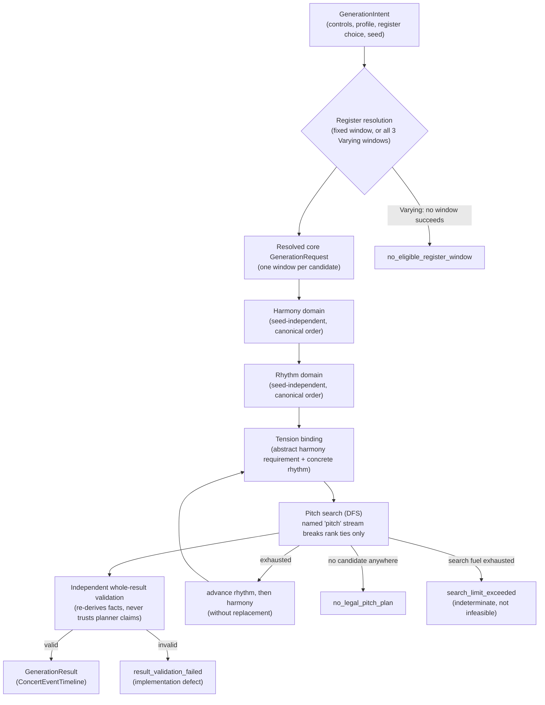

# Generative Process: From Controls to a Four-Measure Phrase

Status: describes the pipeline as implemented on branch `first-release-step7`. Orchestration
(the step that wires harmony, rhythm, and pitch together into one `GenerationResult`) **is now
implemented** — see [Orchestration](#8-orchestration) below. Every stage (harmony, rhythm, pitch
search, independent pitch validation, orchestration, and independent whole-result validation)
exists and is tested, both in isolation and end to end.

This document is an overview for the project owner and future contributors. It does not repeat
the detailed policy tables already written elsewhere; each section links to the authoritative
policy doc instead.

## 1. Overview

A generated phrase is always exactly four 4/4 measures (64 sixteenth-note ticks), built in five
stages. The player's `GenerationIntent` (controls + profile + register choice + seed) is the only
outer input; every stage downstream reads an immutable, serializable value and produces another
one.

Every box above is implemented: `generatePhrase` (the Step 7 orchestrator) resolves the register
choice, builds the resolved `GenerationRequest`(s), and drives harmony/rhythm/pitch to a validated
`GenerationResult` or a typed failure.

**Where the seed enters, and where it deliberately doesn't:** the seed only ever breaks ties
between candidates that are otherwise musically equal-ranked. Canonical enumeration — the list of
legal harmony candidates, legal rhythm candidates, and legal pitch candidates at an attack, in
their stable index order — is entirely seed-independent; the same controls always produce the same
domain in the same order, regardless of seed. The seed is folded into independent tie-breaking
derivations rather than one shared generator: the `pitch` named stream (equal-rank tie-breaking
during pitch search, see `src/domain/random/streams.ts`), and, for harmony, rhythm, and register
selection, their own domain-separated `fnv1a32` hashes (`infinite-flow/harmony-tie/v1`,
`infinite-flow/rhythm-tie/v1`, and the register tie key's `infinite-flow/register-window/v1`, in
`src/domain/generation/orchestration/candidate-ranking.ts` and
`src/domain/profile/register-tie-key.ts`) rather than the named-stream registry. Every one of these
tie-breaking derivations is now drawn by orchestration: harmony and rhythm candidates are ranked by
their tie key before a window is searched, and `selectVaryingRegister` draws the register tie key
to choose among successful Varying windows.

## 2. Inputs: controls and what they influence

| Control                                              | Stage(s) that consume it                                                       | Musical effect                                                                                                                                                                             |
| ---------------------------------------------------- | ------------------------------------------------------------------------------ | ------------------------------------------------------------------------------------------------------------------------------------------------------------------------------------------ |
| Tempo (BPM)                                          | none yet (stored, not read by any planner)                                     | Playback/notation concern; no generation-time effect in this release.                                                                                                                      |
| Tonal center, Collection                             | Harmony                                                                        | Selects the seven-note collection and its diatonic triads.                                                                                                                                 |
| Harmonic motion (Static/Gentle/Active)               | Harmony                                                                        | Selects the legal four-bar chord-role templates.                                                                                                                                           |
| Tension arc (Settled/Lift/Build/Edge)                | Harmony (abstract requirement) → bound at orchestration → Pitch (ranking only) | Schedules _where_ an optional/required active tone may occur and how soon it must resolve; never adds an onset, never changes legality.                                                    |
| Note density (Quarter/Eighth/Sixteenth/Mixed)        | Rhythm                                                                         | Selects the nominal grid and attack-count band per bar.                                                                                                                                    |
| Silence density (Sparse/Conversational/Breath-heavy) | Rhythm                                                                         | Sets required phrase rest-tick totals and rest-shape rules.                                                                                                                                |
| Syncopation (Straight/Occasional/Active)             | Rhythm                                                                         | Selects which boundary-algebra displacement transforms are legal and how many.                                                                                                             |
| Contour (Rising/Falling/Arch/Wandering)              | Pitch (hard constraint via forward checking)                                   | Constrains the sequence of bar checkpoint pitches.                                                                                                                                         |
| Register (Low/Middle/High/Varying)                   | Register resolution → Pitch (hard range)                                       | Picks (or, for Varying, resolves among) the whole-phrase register window inside the instrument's active range.                                                                             |
| Leapiness (Smooth/Shaped/Leaping/Angular)            | Pitch                                                                          | Bounds adjacent-interval size, leap/large-leap budgets, and recovery/run rules.                                                                                                            |
| Arpeggio chaos (Predictable/Varied/Chaotic)          | Pitch (ranking only, chord tones only)                                         | Orders otherwise-legal chord-tone candidates by nearness (Predictable), farness (Chaotic), or leaves them to the seeded tie key (Varied).                                                  |
| Instrument profile (C keyboard / Bb tenor / Eb alto) | Register resolution, Pitch (hard range)                                        | Sets the active concert range the three register windows are derived from.                                                                                                                 |
| Musical profile (Neutral/Jazz)                       | Harmony (shared), Pitch (vocabulary)                                           | Jazz adds chromatic approaches/enclosures to chord-tone targets on top of the shared diatonic Neutral vocabulary; harmony itself is byte-identical between profiles for the same controls. |
| Seed                                                 | Pitch (equal-rank tie-break only)                                              | Reproducibility; never changes what is _legal_, only which equally-ranked legal candidate is chosen.                                                                                       |

See [Melodic Control Models](../docs/music/melodic-control-models.md) for the player-facing
promises behind Tension and Leapiness, and the control-precedence order (hard feasibility →
profile/range/contour → density/silence → syncopation → leapiness/chaos → tension → seeded
tie-break).

## 3. Harmony stage

**Module:** `src/domain/harmony/` (`harmony-planner.ts`, `harmony-types.ts`, `collection.ts`).
**Entry point:** `makeHarmonyCandidateDomain(input: HarmonyPlannerInput): HarmonyPlanResult`.

Responsibility: given tonal center, collection, harmonic motion, tension arc, and musical-profile
identity only, return the **complete, immutable, canonically ordered** list of structurally legal
four-bar harmony candidates — never one selected plan. It does not see rhythm, register, or pitch
feasibility, and it has no seed dependency.

Each candidate carries quarter-boundary chord events (root-position diatonic triads only, no
sevenths/inversions/slash chords for first release), a stable structural identity, a zero-based
`candidateIndex`, an open-endpoint class, and an **abstract** tension requirement (a region,
maximum delay, and figure-count budget — no concrete onset, because rhythm doesn't exist yet at
this stage).

Worked example: for `Major`/`Gentle diatonic` in C, one legal template is
`I | I | {ii, IV} | 5` — bar 3 may be either `ii` or `IV` (both enumerated as separate
candidates, ascending degree), and bar 4 always lands on collection degree 5 (`G` in C major),
which is the open-ending target, not a full authentic cadence back to `I`.

Typed failure: `no_legal_harmony_plan`, returned only when the structural domain itself is empty
— under the current finite policy this does not happen for any legal control combination.

Details: [Harmony Planner Policy](../docs/music/harmony-planner-policy.md).

## 4. Rhythm stage

**Module:** `src/domain/rhythm/` (`rhythm-planner.ts`, `rhythm-skeleton.ts`, `syncopation.ts`,
`rhythm-validator.ts`, `rhythm-types.ts`).
**Entry point:** `makeRhythmCandidateDomain(input: RhythmExpansionInput): RhythmPlanResult`.

Responsibility: allocate onset positions, durations, ties, and rests only — no pitches, no
harmony awareness. Grammar version `rhythm-mvp-v1`.

Worked example (16-tick bar grid, `Sixteenth` density): bar starts fall on ticks `0,4,8,12`
(beats) with sixteenth-lattice attacks available anywhere inside. A **gesture** is built from bar
1's beat cells (`Bar1 ::= x x x x | x x x y | ...`); bar 2 recurs one sounding cell from bar 1
either exactly or with a note↔rest substitution — this is the "answer" relationship's source. Bars
3-4 start as merged copies of bars 1-2, then receive one (Settled/Lift) or one-to-two
(Build/Edge) answer transforms (`translate_interior_rest`, `displace_attack`,
`redistribute_note_pair`, `swap_final_pattern`), and finally the full syncopation transform set for
the selected syncopation level.

Syncopation is boundary algebra, not attack deletion: moving a shared boundary `b` to `b' = b +
delta` lengthens one adjacent event and shortens the other by the same `delta`, so attack count and
total rest ticks never change. `Active displacement` requires at least one offbeat attack (not on
a quarter-tick) plus at least one tied sustain across a quarter-beat boundary, with every bar's
syncopated-attack count capped at its anchored-attack count.

Every bar must contain a **metrical anchor**: a note sounding (fresh attack or tie continuation)
at tick 0 or tick 8 (beat 1 or 3) — this is the "metrical anchor v0.2" relaxation: a tie
_continuation_ through the anchor point counts, not only a fresh attack. The phrase's very first
event is always a fresh attack at bar 1, tick 0 (`rule_phrase_starts_on_downbeat`; see
[Known limits](#6-known-limits) for the trade-off this created).

Typed failure: `no_legal_rhythm_plan`, returned with the union of validation codes observed across
the complete v1 expansion, only when structural rhythm validation rejects every candidate.

Enumeration shortcuts (performance only, output unchanged): under Mixed density a gesture whose
own source cells lack the 1-, 2- or 4-tick class is skipped, since no transform or answer bar can
add one; and each assembled candidate first passes `quickRejectRhythmCandidate`
(`rhythm-invariants.ts`), which reuses the validator's own metrical-anchor, Mixed-coverage,
Active-anchor-ratio and answer-variation tests, so it only drops candidates the validator would
reject. Only yielded candidates are deep-frozen, and transform/selector results are memoized for
the duration of one expansion. When this fast pass yields nothing, the expansion re-runs without
either shortcut so the reported codes are exactly those of the complete expansion; otherwise the
probe's iterator is resumed by the first `candidates()` call rather than restarted.

Details: [Rhythm and Phrase-Structure Policy](../docs/music/rhythm-phrase-structure.md).

## 5. Tension binding

**Module:** `src/domain/pitch/pitch-policy.ts` (`makeTensionBindingDomain`,
`bindTensionRequirement`).

This is the seam where the harmony stage's _abstract_ tension requirement (a bar region, a max
delay, a figure budget) meets one concrete rhythm candidate's actual onsets. Binding produces
concrete target attack(s) the pitch search must treat as an obligation, or fails only that
harmony/rhythm pairing (`NoLegalTensionBinding`) without mutating either candidate. A failed
binding does not prove the harmony or rhythm candidate itself is bad — only that this particular
pairing has nowhere legal to place the required figure; orchestration is expected to advance to
the next rhythm candidate (and, once exhausted, the next harmony candidate) rather than treat it
as a phrase-level failure.

## 6. Pitch stage

**Modules:** `src/domain/pitch/` — `pitch-context.ts` (compiles one static, immutable
`PitchSearchContext` per bound input: chronological attacks, per-attack candidate domains,
checkpoint domains, leapiness limits, contour plan), `pitch-candidates.ts` (role/octave
enumeration and hard filters), `pitch-ranking.ts` (musical rank + seeded tie key),
`pitch-advance.ts` (the pure state-transition function), `pitch-motion.ts` (leap/recovery/run
state machine), `pitch-figures.ts` (passing/neighbor/appoggiatura/chromatic-approach/enclosure as
concrete fixed MIDI paths), `pitch-contour.ts` (checkpoint feasibility table), `pitch-search.ts`
(the DFS driver), `pitch-planner.ts` (thin public facade).
**Entry point:** `planPitchPhrase(input: BoundPitchPlannerInput): PitchPlanResult`.

### Candidate construction and hard filters

For each sounding attack, four role classes are enumerated (chord tones; diatonic
passing/neighbor tones with a feasible stepwise resolution; a scheduled diatonic
appoggiatura/approach if the tension binding reserved one; Jazz-only chromatic approach/enclosure
members), expanded across every octave inside both the active concert range and the resolved
register window, in a **seed-independent canonical order** (source-role identifier, target
identifier, pitch class, octave index) — this assigns each candidate a stable `enumerationIndex`
before any ranking happens. Hard filters then reject, in order: collection/profile violations,
endpoint/reserved-resolution violations, tie/harmony incompatibility, range/window violations,
contour infeasibility, interval cap/leap budget violations, recovery/arpeggio-state violations.
Only survivors are ranked.

### Musical rank and search

Rank is a lexicographic tuple, never a weighted score:

1. hard feasibility (meter/event/endpoint/collection/range/window/reserved-resolution);
2. contour checkpoint feasibility;
3. rhythm-owned density/silence/syncopation/tie plan;
4. leap cap/budget, recovery, arpeggio-run legality;
5. chord-tone priority on beat 1 and at a harmony change;
6. requested arpeggio-chaos ordering (chord tones only);
7. tension role/timing preference among candidates realizing the same bound obligation.

Equal-rank candidates are ordered by `tieKey = hash32("infinite-flow/pitch-tie/v1" || seed ||
decisionIdentity || candidateStableIdentity)`, drawn from the named `pitch` stream; only on a
`tieKey` collision does MIDI, then `enumerationIndex`, break the tie (`pitch-tie-key.ts`).

Search is depth-first over chronological attacks with forward checking, tracking proven-dead
states so a subtree is never re-expanded (`pitch-search.ts`). Within one search the ranked
ordering of an attack's surviving candidates is computed once per
(attack, required obligation, prior MIDI) and reused, each candidate's tie key is computed once
per ordering, and intermediate search steps use an unfrozen transition
(`advanceSearchStep`) — only the returned `PitchPhrase` is deep-frozen. Candidate order and fuel
consumption are identical to ranking every state from scratch. Backtracking happens within pitch
candidates first; only once a bound harmony/rhythm pair's pitch domain is fully exhausted does
orchestration (once built) advance to the next rhythm candidate, then the next harmony candidate,
without replacement.

Worked example — leap recovery: under `Shaped` leapiness (max interval 7 semitones, at most 1
large leap), a large leap (`|d| >= 7`) creates recovery debt that the _next_ interval must repay by
moving `1-4` semitones in the opposite direction. A recognized **run** is exactly three
consecutive chord tones of one unchanged harmony joined by two same-direction intervals of `3+`
semitones; `Leaping`/`Angular` may defer a large leap's debt to the note after such a run instead
of the immediately next note. A single wide interval between two chord tones is ordinary motion,
never a run on its own; two unrecognized same-direction wide intervals fail as
`unrecognized_wide_chain`, three or more as `wide_chain_too_long`.

### Typed outcomes

`PitchPlanResult` is one of: `pitch_plan` (a complete `PitchPhrase`), `search_limit_exceeded`
(the versioned fuel ledger ran out — `DEFAULT_PITCH_SEARCH_FUEL = 20_000` is only the standalone planner default; under orchestration each pitch search receives the window ledger's remaining fuel, see [section 8](#8-orchestration); this is an
**indeterminate** outcome, never treated as proof the request is unsatisfiable), or
`no_legal_pitch_plan` (the search tree was exhausted with proven-dead states, not merely
capped).

Details: [Pitch Planner and Validation Policy](../docs/music/pitch-planner-validation.md).

## 7. Independent validation: pitch-only and whole-result

There are two independent validation layers, neither of which imports the pitch planner.

**Layer 1 — pitch-only.** **Module:** `src/domain/pitch/validation/` — `phrase-facts.ts`
(re-derives chronological facts from raw MIDI values plus the request/harmony/rhythm/binding,
ignoring every planner claim/role annotation), `motion-rules.ts`, `figure-rules.ts`,
`contour-endpoint-rules.ts`, `pitch-phrase-validator.ts` (entry point `validatePitchMidis` /
`validatePitchPhrase`).

This module **never imports the planner**. It exists specifically so a planner soundness bug
cannot silently produce an invalid phrase: it reconstructs range/window membership, figure
legality (free passing/neighbor tones as ordinary vocabulary; appoggiatura entry defined as `|d|

> = 3`; strict passing-tone reading — a passing tone must land on a chord tone, and double passing
> tones are rejected), motion legality (leap count includes large leaps; recovery/run rules exactly
> mirror the planner's), contour checkpoint satisfaction, and open-endpoint satisfaction, purely
> from the candidate MIDI sequence. Harmony is located by absolute beat; an attack no harmony event
> covers is treated as a **planner defect**, not a validation failure the caller can recover from.

**Layer 2 — whole-result.** **Module:** `src/domain/validation/generation-result-validator.ts` and
`generation-result-validator-checks.ts`. **Entry point:**
`validateGenerationResult(input: GenerationResultValidationInput): GenerationResultValidation`.

This module re-derives every documented fact from an immutable `GenerationResult`, its resolved
`GenerationRequest`, its outer `GenerationIntent`, and the claimed `GenerationProvenance`, never
trusting planner annotations: envelope identity/seed, the resolved request against the intent's
profile/window, exact 4-measure 4/4 sixteenth-grid timeline tiling, exact correspondence between
the timeline and `provenance.rhythm` (via the rhythm validator and the rhythm input derived from
controls), harmony provenance re-derived via `makeHarmonyCandidateDomain` (identity and content,
not just claim), tie continuations that repeat their preceding attack's pitch, range/register-
window membership, and every melodic rule by delegating to Layer 1's `validatePitchMidis`. It
never imports the pitch planner (`pitch-planner.ts`, `pitch-policy.ts`, `pitch-search.ts`,
`pitch-context.ts`, `pitch-advance.ts`, `pitch-candidates.ts`, etc.) — only Layer 1's pitch-phrase
validator, the independent rhythm validator, and the harmony planner's public candidate-domain
constructor. `searchWindow` calls it on every claimed pitch plan before accepting a window as
successful (see [section 8](#8-orchestration)).

## 8. Orchestration

**Module:** `src/domain/generation/orchestration/` — `orchestration-types.ts` (shared immutable
types: search policy, provenance, window outcomes, diagnostics, the public `GenerationOutcome`),
`search-ledger.ts` (the versioned fuel ledger), `candidate-ranking.ts` (seeded harmony/rhythm tie
keys and the materialized `RankedRhythmCache`), `request-resolution.ts` (`resolveCoreRequests`,
`selectVaryingRegister`), `timeline-assembly.ts` (`assemblePhraseResult`), `window-search.ts`
(`searchWindow`), `generation-orchestrator.ts` (`generatePhrase`, the entry point).
**Entry point:** `generatePhrase(intent: GenerationIntent, options?: GenerationOrchestrationOptions):
GenerationOutcome`.

`GenerationOutcome` is one of:

- `{ kind: 'generation_success', request, result, provenance, diagnostics }` — `request` is the
  resolved core `GenerationRequest`, `result` is the unchanged `GenerationResult`, `provenance` is
  the selected harmony/rhythm candidates and concrete tension binding, and `diagnostics` is
  internal, never read back by generation.
- `{ kind: 'generation_failure', code, diagnostics }` — `code` is one of `no_legal_harmony_plan`,
  `no_legal_rhythm_plan`, `no_legal_pitch_plan`, `no_eligible_register_window`,
  `search_limit_exceeded`, `result_validation_failed`.

`GenerationRequest` and `GenerationResult` are structurally unchanged from earlier steps.

**Pipeline.** The harmony domain is built once (`makeHarmonyCandidateDomain`; an empty domain fails
`no_legal_harmony_plan`), then the rhythm domain is built once (`makeRhythmCandidateDomain`; an
empty domain fails `no_legal_rhythm_plan`) — both happen before any window search, whether the
register is fixed or `Varying`. Under current policy every harmony candidate of one domain shares
the same tension requirement and the rhythm grammar defines no scores, so candidates are
equal-ranked and the search order is the seeded tie key described in [section 1](#1-overview),
falling back to the canonical `candidateIndex` only on a key collision. The full rhythm domain is
materialized exactly once per call into a frozen `RankedRhythmCache` shared by every window.

**Windows.** `resolveCoreRequests` turns the intent into one resolved core request (fixed register)
or three, in canonical Low/Middle/High order (`Varying`). `searchWindow` then walks ranked harmony
× ranked rhythm × that pair's concrete tension bindings (in stable `bindingIndex` order) × pitch
search without replacement. The first accepted pitch plan is assembled into a concert timeline by
`assemblePhraseResult` (rests kept as rest events; tie continuations repeat the preceding attack's
MIDI) and independently validated by the Layer 2 whole-result validator ([section 7](#7-independent-validation-pitch-only-and-whole-result))
before the window can be reported successful.

**Fuel ledger (`generation-search-v1`).** Each window search runs under its own independent,
wall-clock-independent `FuelLedger` (`search-ledger.ts`), opened fresh per window under a
`GenerationSearchPolicy` whose default `windowFuel` is `250_000`. Spending is 1 unit per visited
harmony/rhythm pair, 1 unit per attempted concrete tension binding, plus every pitch search's own
`fuelUsed` (its `advance` call count) — the pitch search itself receives the window's _remaining_
fuel as its own search ceiling. Any refusal of remaining work — remaining fuel below 1 while work
still remains, exactly 0 remaining immediately after charging a binding, or the pitch search itself
returning `search_limit_exceeded` — resolves the window as `window_search_limit_exceeded`; natural
completion of the whole candidate space without a resolving plan resolves it as `window_exhausted`.
See [Pitch Planner and Validation Policy](../docs/music/pitch-planner-validation.md#generation-search-ledger-engineering-policy-generation-search-v1)
for the calibration rationale.

**Precedence across windows.** Once every window has a determinate outcome:

1. any `window_result_validation_failed` → `result_validation_failed` (an implementation defect);
2. else any `window_search_limit_exceeded` → `search_limit_exceeded` (never select from an
   incomplete successful set);
3. else, among the successful windows: a fixed intent returns its one success directly; a `Varying`
   intent calls `selectVaryingRegister`, which draws the register tie key
   (`infinite-flow/register-window/v1`) for the seed, the generation-affecting register intent, and
   each successful window's register id, picks the lowest unsigned key (canonical Low/Middle/High
   index only on a collision), and reuses that window's already-validated request/result/provenance
   — it is never re-searched;
4. else (no window succeeded): a fixed intent fails `no_legal_pitch_plan`; `Varying` fails
   `no_eligible_register_window`.

**Diagnostics.** `GenerationDiagnostics` (`'generation-diagnostics-v1'`) is a deep-frozen, separate
value built once the outcome is already decided: harmony/rhythm domain sizes, and per window the
register, outcome kind, ledger version, fuel allowance/used, pairs visited, bindings attempted, the
resolved harmony/rhythm candidate indices and identities and the resolved binding index/identity
(when one was reached), plus the overall `successfulRegisters` and `selectedRegister`. Nothing in
`generatePhrase` reads diagnostics back to decide anything.

**All-rest gap fixed.** `searchPitchPlan` (`src/domain/pitch/pitch-search.ts`) now returns
`no_legal_pitch_plan` with `fuelUsed: 0` whenever `context.contourPlan.impossible`, which covers the
zero-attack, all-rest case, before search starts — it can no longer bypass terminal contour/
endpoint validation by returning a trivially "solved" empty plan.

## 9. Determinism and reproduction

- **Canonical enumeration is seed-independent.** Harmony-candidate identity/index, rhythm-candidate
  identity/index, and pitch-candidate `enumerationIndex` are all fixed by the controls alone —
  never by seed, iteration chunking, object-key order, or search outcome.
- **Ranking is deterministic policy**, not weighted scoring: the lexicographic tuples in each
  stage never trade away a named control for a "better" average outcome.
- **Seed enters only as tie-breaks** among candidates already equal on the full rank tuple: the
  `pitch` named stream for pitch-candidate ties (`src/domain/random/streams.ts`), and independent
  domain-separated `fnv1a32` hashes for harmony, rhythm, and register-window ties (see
  [section 1](#1-overview)) — each derivation is independent, so drawing from one can never
  perturb another. MIDI value and `enumerationIndex` are collision fallbacks only, never inputs to
  ordinary ranking.
- **Search ceiling vs. no-plan:** a fuel-exhausted search (`search_limit_exceeded`) is an
  implementation guard, never proof of musical infeasibility, and must never be reported or acted
  on as `no_legal_pitch_plan`. Only a search that proves every state dead (via the `dead` set in
  `pitch-search.ts`, or a fully exhausted window in `searchWindow`) may return `no_legal_pitch_plan`
  or `window_exhausted`.
- Fixed intent and seed reproduce identical successful-window selection, resolved core request,
  harmony/rhythm iteration order, pitch tie-key outcomes, timeline, and any failure. This
  whole-pipeline reproduction is now exercised end to end by
  `tests/unit/domain/generation/orchestration/generation-orchestrator.spec.ts` and
  `generation-seed-matrix.spec.ts`, alongside each stage's own isolated determinism tests.

## 10. Known limits

- **Six rhythm density/silence/syncopation settings have no legal phrase under grammar
  `rhythm-mvp-v1`**, for any tension arc: Quarter + Sparse + Active displacement, Quarter +
  Breath-heavy + Active displacement, Sixteenth + Sparse + Active displacement, Sixteenth +
  Conversational + Active displacement, Sixteenth + Breath-heavy + Occasional offbeats, and
  Sixteenth + Breath-heavy + Active displacement. This is a documented grammar limit, not an
  intended musical rule (see [roadmap.md](roadmap.md#explicitly-unresolved-decisions)). Step 9
  implements the UI-level block for these settings: the domain-owned constant
  `UNSUPPORTED_RHYTHM_SETTINGS` (`src/domain/controls/unsupported-rhythm-settings.ts`,
  `[[rule_unsupported_rhythm_settings_block_generation]]`) is checked against the rhythm planner's
  actual `no_legal_rhythm_plan` outcomes so the list cannot drift from the planner; the session
  guard (`createGenerationSession`'s `isBlockedByUnsupportedRhythm`) refuses to start
  Generate/Regenerate/a profile-switch regeneration while the current controls match one of these
  settings; and `ControlPanel`'s Rhythm group shows the calm inline message and its live region.
  See [docs/phrase-workspace.md](../docs/phrase-workspace.md#unsupported-rhythm-settings) for the
  full behavior.
- Of the 144 density/silence/syncopation/tension combinations, a prior bug (the Breath-heavy check
  requiring exactly 2 rest events, which the policy doc never required) caused 32 of an original 56
  `no_legal_rhythm_plan` outcomes; that fix reduced the count to 24 (the six settings above ×
  4 tension arcs). This history is recorded in `TODO.md`, not in the rhythm policy doc itself.
- **The phrase-starts-on-downbeat rule** (`[[rule_phrase_starts_on_downbeat]]`) required a fix to
  `swapCandidates` in `syncopation.ts` (scanning beat-3 candidates back-to-front) to keep four
  previously near-starved Sixteenth/Occasional-offbeats/Conversational combinations viable (they
  now have 46 legal candidates each instead of 1-2). A future decision to drop the downbeat rule
  (documented as "no action planned" in the rhythm policy doc) would remove the rhythm planner's
  first-note filter and the `first_note_off_downbeat` validation check but should keep this swap
  fix.
- **Calibration bands await listening tests**: rhythm attack bands, silence bands, and answer
  similarity thresholds (`docs/music/rhythm-phrase-structure.md#calibration-questions`); harmony
  template order, two-event-bar frequency, and modal color-chord preference
  (`docs/music/harmony-planner-policy.md#calibration-questions`); pitch candidate-role ordering,
  contour strictness, arpeggio-chaos ranking, search ceiling, and ornament frequency
  (`docs/music/pitch-planner-validation.md#calibration-questions`). None of these numeric values
  are settled musical theory; they are versioned, testable implementation policy pending player
  listening tests.
- **Tempo has no generation-time effect** in this release; it is stored on controls but no planner
  stage reads it (`docs/music/rhythm-phrase-structure.md#calibration-questions` notes any future
  tempo-conditioned density would need a separate product decision).
- **Performance: cold rhythm-domain materialization is now sub-second, and mitigated further by a
  memo and a Worker.** Step 9 added a seed-independent canonical rhythm-domain memo
  (`SHARED_CANONICAL_RHYTHM_DOMAIN_MEMO`, `src/domain/generation/orchestration/canonical-rhythm-domain.ts`)
  that reuses an already-materialized rhythm domain across repeated generations/regenerations of
  the same note density/silence density/syncopation/tension-arc setting, and runs generation in a
  Web Worker (`src/generation-worker/`) so the UI stays responsive. The later enumeration speed
  package then optimized the Step 6 enumeration and the pitch search themselves, with
  byte-identical output (see [section 4](#4-rhythm-stage) and
  [docs/generation-latency.md](../docs/generation-latency.md)): the measured cold worst case fell
  from ~11 s to ~0.7 s in Node (Mixed / Sparse / Active displacement / Build), and the Step 9
  Chromium worst-case scenario from ~9.4 s to ~0.32 s. A memo hit (warm call) stays ≤ ~57 ms in
  Node across every supported setting. Bounded-prefix ranking and precomputed domains remain
  unexplored options; neither is needed for the current budget.
- **Six further note-density/silence-density/syncopation/tension-arc combinations have no legal
  pitch plan in the workspace's fixed default pitch context** (C Major, Gentle diatonic, Middle
  register, B-flat tenor, Arch, Shaped, Predictable, tempo 90): Eighth/Breath-heavy/Straight/Edge;
  Eighth/Breath-heavy/Occasional offbeats/Build and /Edge; Eighth/Breath-heavy/Active
  displacement/Build and /Edge; Mixed/Breath-heavy/Active displacement/Edge. Each has a legal
  rhythm plan (the memo materializes it normally), but the pitch planner finds no legal plan for it
  under these specific pitch-context controls; retrying cannot help, since the outcome depends only
  on the deterministic controls, not the seed. This is a pitch-planner limit in this pitch context,
  not a rhythm-grammar limit, and is out of Step 9's scope; see
  [docs/generation-latency.md](../docs/generation-latency.md) for how it was measured.

## 11. Glossary and code map

For melodic/harmonic/rhythmic vocabulary (tonic, passing tone, appoggiatura, metrical anchor,
chromatic enclosure, etc.), see [Music Terms](../docs/music/terms.md).

| Module                  | Files                                                                                                                                                                                                                                     | Role                                                                                                                                                                                                                                                                                     |
| ----------------------- | ----------------------------------------------------------------------------------------------------------------------------------------------------------------------------------------------------------------------------------------- | ---------------------------------------------------------------------------------------------------------------------------------------------------------------------------------------------------------------------------------------------------------------------------------------- |
| Controls                | `src/domain/controls/generation-controls.ts`, `profile-selection.ts`, `unsupported-rhythm-settings.ts`                                                                                                                                    | Closed catalogs, normalization, `GenerationControls`; the six no-legal-rhythm-plan settings, their message, and nearest-supported-change suggestion.                                                                                                                                     |
| Outer intent            | `src/domain/generation/generation-intent.ts`                                                                                                                                                                                              | `GenerationIntent`: identity, seed, controls, profile, register intent (Varying unresolved).                                                                                                                                                                                             |
| Resolved request        | `src/domain/generation/generation-request.ts`                                                                                                                                                                                             | `GenerationRequest`: identity, seed, measure count, meter — deliberately narrow.                                                                                                                                                                                                         |
| Result envelope         | `src/domain/generation/generation-result.ts`                                                                                                                                                                                              | `GenerationResult`: request identity/seed + `ConcertEventTimeline`.                                                                                                                                                                                                                      |
| Presets                 | `src/domain/generation/profile-switch.ts`                                                                                                                                                                                                 | Neutral/Jazz bundle replacement, custom-marking.                                                                                                                                                                                                                                         |
| Profile/register        | `src/domain/profile/instrument-profile.ts`, `active-concert-range.ts`, `register-intent.ts`, `register-window.ts`, `register-window-derivation.ts`, `register-tie-key.ts`                                                                 | Instrument active ranges and the three canonical register windows (`overlapping-three-window-v1`); the register tie key is now called by orchestration's `selectVaryingRegister`.                                                                                                        |
| Seed/PRNG               | `src/domain/random/seed.ts`, `prng.ts`, `hash32.ts`, `streams.ts`                                                                                                                                                                         | `Seed`, Mulberry32, FNV-1a, named-stream derivation.                                                                                                                                                                                                                                     |
| Harmony                 | `src/domain/harmony/harmony-planner.ts`, `harmony-types.ts`, `collection.ts`                                                                                                                                                              | Collection/triad vocabulary, tonal/modal templates, candidate domain.                                                                                                                                                                                                                    |
| Rhythm                  | `src/domain/rhythm/rhythm-planner.ts`, `rhythm-skeleton.ts`, `syncopation.ts`, `rhythm-validator.ts`, `rhythm-types.ts`                                                                                                                   | Nominal skeleton, syncopation transforms, gesture/answer, candidate domain, validation.                                                                                                                                                                                                  |
| Pitch — search          | `src/domain/pitch/pitch-planner.ts`, `pitch-search.ts`, `pitch-advance.ts`, `pitch-context.ts`                                                                                                                                            | Public facade, DFS driver, pure state transition, immutable search context.                                                                                                                                                                                                              |
| Pitch — vocabulary      | `pitch-candidates.ts`, `pitch-figures.ts`, `pitch-motion.ts`, `pitch-contour.ts`, `pitch-harmony.ts`                                                                                                                                      | Role/octave enumeration, ornament paths, leap/recovery/run state, contour checkpoints, absolute-beat harmony lookup.                                                                                                                                                                     |
| Pitch — ranking         | `pitch-ranking.ts`, `pitch-tie-key.ts`                                                                                                                                                                                                    | Musical rank tuple, seeded tie key.                                                                                                                                                                                                                                                      |
| Pitch — policy/binding  | `pitch-policy.ts`, `pitch-types.ts`                                                                                                                                                                                                       | Tension binding domain, `PitchPolicy`, shared types.                                                                                                                                                                                                                                     |
| Pitch validation        | `src/domain/pitch/validation/phrase-facts.ts`, `motion-rules.ts`, `figure-rules.ts`, `contour-endpoint-rules.ts`, `pitch-phrase-validator.ts`, `pitch-validation-types.ts`                                                                | Independent, planner-blind re-derivation and validation.                                                                                                                                                                                                                                 |
| Orchestration           | `src/domain/generation/orchestration/orchestration-types.ts`, `search-ledger.ts`, `candidate-ranking.ts`, `request-resolution.ts`, `timeline-assembly.ts`, `window-search.ts`, `generation-orchestrator.ts`, `canonical-rhythm-domain.ts` | `generatePhrase`: fuel ledger, seeded candidate ranking/caching, request/register resolution, timeline assembly, per-window search, top-level outcome precedence; the seed-independent canonical rhythm-domain memo (Step 9) that skips re-materializing an already-seen rhythm setting. |
| Whole-result validation | `src/domain/validation/generation-result-validator.ts`, `generation-result-validator-checks.ts`                                                                                                                                           | Independent re-derivation of envelope, request, timeline, rhythm/harmony provenance, ties, range, and melodic rules from a `GenerationResult`.                                                                                                                                           |
| Generation worker       | `src/generation-worker/generation.worker.ts`, `generation-worker-handler.ts`, `generation-worker-protocol.ts`, `generation-worker-client.ts`, `browser-generation-worker.ts`                                                              | Step 9's one long-lived Web Worker running `generatePhrase` off the main thread: the typed correlated request/response protocol, boundary re-validation, and the session-facing client.                                                                                                  |

## 12. Discrepancies found while writing this document

- `docs/music/rhythm-phrase-structure.md` already documents the fix that changed the
  Breath-heavy required-rest-event count and the resulting six-settings-unsupported list, so
  policy doc and code agree on the current rhythm limit set.
- The status-line discrepancy between this document and `specs/generator-architecture.md`/
  `specs/generator-contract.md` is now resolved: both status lines have been bumped to reflect
  Steps 2-9 implemented (see those files' status lines).
- The pitch search's all-rest/zero-attack gap is resolved: `searchPitchPlan` now returns
  `no_legal_pitch_plan` before search starts whenever `context.contourPlan.impossible`, covering
  the zero-attack case (see [section 8](#8-orchestration)). It is no longer an open item.
- The 24 unsupported rhythm density/silence/syncopation/tension combinations (six settings ×
  four tension arcs, [section 10](#10-known-limits)) now surface from `generatePhrase` as a typed
  `no_legal_rhythm_plan`, verified by test; the UI-level block on these settings is now implemented
  by Step 9 (see [section 10](#10-known-limits) and
  [docs/phrase-workspace.md](../docs/phrase-workspace.md#unsupported-rhythm-settings)), resolving
  what was previously a forward-reference to a planned item.
