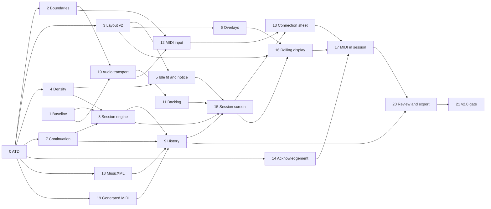

# Infinite Flow v2 — Build Plan

Status: draft v0.3 (2026-09-29). Chunk 0 is done. Build plan for v2.0 through v2.3, written from
[master spec v1.20](master-spec.md). Not yet approved for execution. Change in v0.3: the spec gaps
are resolved, so the phrase-boundary change and the key change's harmonic drop move from chunks 7
and 8 to chunk 24 in v2.1, and each chunk is blocked only by what is still open.

This plan cuts v2 into chunks that one owner can build, test and document at a time, and puts
them in order. It adds no behaviour. What the app does is in the [master spec](master-spec.md);
what the interface looks like is in the UI/UX design set, starting at
[`ui_ux/README.md`](../../../ui_ux/README.md). Where this plan disagrees with either, they win, and
the plan is corrected.

It is read by whoever builds v2, and by the owner. Music terms are explained where they first
appear, with a link to the project [lexicon](../../../docs/music/lexicon.md) when it has an entry.

> **Read first:** [the notation-layout caveat](#2-read-first-the-notation-layout-caveat). Two v2
> design decisions change the layout planner v1 shipped, and the stylesheet on `main` already
> assumes them.

## 1. Overview

### Release sequence

v2 ships in four releases, in this order. Each ends with a release-gate chunk that checks its
part of the [definition of done](master-spec.md#11-definition-of-done).

| Release | Delivers                                                                                                                                                                                                                                                                                          | Chunks    |
| ------- | ------------------------------------------------------------------------------------------------------------------------------------------------------------------------------------------------------------------------------------------------------------------------------------------------- | --------- |
| v2.0    | The core loop: phrases that keep coming and join smoothly, backing, click and count-in, sessions, MIDI note acknowledgement and the controller check, the last-session review, and the export of the generated notes. Settings are locked during a session. Also the three changes to v1 at Idle. | 0–21 (22) |
| v2.1    | The played notes in the review, with their own MIDI export. The settings-mutation flag, with its changes applied at the next phrase boundary.                                                                                                                                                     | 22–26 (5) |
| v2.2    | Adaptive tempo. The multi-phrase tension arc.                                                                                                                                                                                                                                                     | 27–31 (5) |
| v2.3    | The end-of-measure chord-fit check.                                                                                                                                                                                                                                                               | 32–34 (3) |

Chunks 0 and 1 are prerequisites. They are counted in v2.0.

A later release's logic chunk may start before the earlier release ships, once the chunks it
depends on have merged: pure logic changes nothing on screen. Its interface chunk waits for its
own release.

### Prerequisites

[Master spec §11](master-spec.md#prerequisites-that-must-already-be-in-place) lists two
prerequisites. The code and the registers add three more.

- **The v1.0 gate: done.** Instrument templates carry their own written-pitch transposition,
  rhythmic variety replaced the old "Mixed" setting, and profile behaviour runs on capability
  flags. v1.0 was tagged on 2026-09-26.
- **Generation latency, re-measured: done in [chunk 1](#chunk-1--baseline-checks) on 2026-09-29,
  on a cloud virtual machine, for reference only.** The owner decided the same day that no
  performance figure from a virtual machine gates the plan: the latency and engraving checks are
  re-run on a real computer (see [step 4](#3-workflow-for-every-chunk)). The look-ahead
  deadline must keep comfortable headroom at 240 BPM, the fastest tempo, including a cold
  generation. A generation is "cold" when it is the first one for a combination of settings,
  before the generator's caches for that combination are warm. The spec asks for the cold run
  after a mid-session control change from v2.1, when the settings-mutation flag can cause one:
  nothing changes a setting during a v2.0 session. Chunk 1 measures it with the rest, since the
  harness is the same, and its figure gates [chunk 24](#chunk-24--settings-mutation-engine).
  - At 240 BPM one bar lasts one second. A look-ahead phrase normally has three bars: it is
    requested when the phrase before it starts sounding, and is due when that phrase's last bar
    starts ([§4](master-spec.md#4-look-ahead-and-failure-handling)).
  - Two cases have only one bar. Phrase 2 is generated during the one-bar count-in. From v2.1, a
    look-ahead phrase regenerated after an automatic settings change needs at least one bar left
    ([§5](master-spec.md#5-control-changes-during-a-session)).
  - A failed attempt is retried up to four times inside that window.
  - The [open-questions register](../../open-questions.md#v2-spec-questions-o50) sets the working
    target: the cold worst case stays under a quarter of one bar at 240 BPM, 250 ms in Chromium.
  - Today's figures in [`docs/generation-latency.md`](../../../docs/generation-latency.md) miss
    that target on the worst case: 990.7 ms cold in Node, and 823 ms from click to "Phrase ready"
    in Chromium for the densest settings. The medians are far lower (17.1 ms cold in Node).
    Chunk 1 was to decide whether the deadline holds, and stop the plan before the session engine
    ([chunk 8](#chunk-8--session-engine)) if it did not. Its figures come from a virtual machine,
    so they don't gate: the re-run on a real computer does.
- **Engraving on the main thread against the audio scheduler: measured by chunk 1, applied by
  [chunk 10](#chunk-10--audio-transport).** Engraving runs on the page's main thread. If it blocks
  longer than the audio scheduler's look-ahead window (200 ms proposed), sound could come late.
  The spec's default is to run the scheduler's wake-up timer in a Web Worker
  ([§12](master-spec.md#12-open-questions-carried-forward)). Chunk 1 checks whether that is
  enough.
- **The v2 business atoms: done in [chunk 0](#chunk-0--atd-ingestion-of-the-master-spec) on
  2026-09-29.** The master spec is ingested into ATD: 90 new atoms, each tagged with its release,
  and the v1 atoms v2 contradicts revised in place. The same day, nine atoms were revised to match
  master spec v1.19, and the two about applying a setting change at a phrase boundary moved to
  v2.1. Two things remain, both assigned: the owner's sign-off on the revised product vision, and
  small drifts between the code and the new atoms, each fixed by the chunk that changes that code.
- **The browser boundaries: [chunk 2](#chunk-2--browser-boundaries).** v1's lint rules and
  boundary script forbid Web Audio and Web MIDI anywhere in `src/`. Chunk 2 allows them in named
  places only, before any audio or MIDI code lands.

### Waves

Chunks are grouped in waves. A wave starts when every chunk it depends on has merged. Chunks in
one wave touch different source files, so separate owners can build them side by side, each in
its own worktree. Shared documents (the README, a doc under `docs/`) may be touched by several
chunks in different sections; the second to merge rebases on the first.

| Wave | Chunks                                                                                                                                                                                                                                                                                                                     | Waits for                                             |
| ---- | -------------------------------------------------------------------------------------------------------------------------------------------------------------------------------------------------------------------------------------------------------------------------------------------------------------------------- | ----------------------------------------------------- |
| 0    | 0 ATD ingestion (done 2026-09-29) · 1 Baseline checks (done 2026-09-29)                                                                                                                                                                                                                                                    | Nothing                                               |
| 1    | 2 Browser boundaries (done 2026-09-29) · 3 Notation layout v2 (done 2026-09-29) · 4 Note density on small screens (done 2026-09-29) · 7 Generator continuation (done 2026-09-29) · 14 Note acknowledgement (done 2026-09-29) · 18 MusicXML encoding (done 2026-09-29) · 19 Generated-notes MIDI encoding (done 2026-09-29) | Chunk 0 (done). Start chunk 3 first (see the caveat). |
| 2    | 5 Idle fit retries and the room notice · 6 Note identity and session overlays · 8 Session engine · 10 Audio transport                                                                                                                                                                                                      | Wave 1. Chunks 8 and 10 also need chunk 1's verdict.  |
| 3    | 9 Session history · 11 Backing · 12 MIDI input                                                                                                                                                                                                                                                                             | Wave 2                                                |
| 4    | 15 Session screen: start and end                                                                                                                                                                                                                                                                                           | Wave 3                                                |
| 5    | 13 Controller connection · 16 Rolling display                                                                                                                                                                                                                                                                              | Chunk 15                                              |
| 6    | 17 MIDI in the session                                                                                                                                                                                                                                                                                                     | Wave 5                                                |
| 7    | 20 Review and generated-notes export (blocked)                                                                                                                                                                                                                                                                             | Chunk 17 and its design                               |
| 8    | 21 v2.0 release gate                                                                                                                                                                                                                                                                                                       | Every v2.0 chunk                                      |
| 9    | 22 Played-notes MIDI encoding · 24 Settings-mutation engine (blocked in part)                                                                                                                                                                                                                                              | Chunks 4, 7, 8, 9 and 19; may start before v2.0 ships |
| 10   | 23 Review: played notes (blocked) · 25 Settings-mutation control (blocked)                                                                                                                                                                                                                                                 | Wave 9, v2.0, and their designs                       |
| 11   | 26 v2.1 release gate                                                                                                                                                                                                                                                                                                       | Every v2.1 chunk                                      |
| 12   | 27 Adaptive tempo engine · 29 Multi-phrase tension arc (blocked)                                                                                                                                                                                                                                                           | v2.0 chunks; may start before v2.1 ships              |
| 13   | 28 Adaptive tempo control (blocked) · 30 Tension arc control (blocked)                                                                                                                                                                                                                                                     | Wave 12, v2.1, and their designs                      |
| 14   | 31 v2.2 release gate                                                                                                                                                                                                                                                                                                       | Every v2.2 chunk                                      |
| 15   | 32 Chord-fit engine                                                                                                                                                                                                                                                                                                        | v2.0 chunks; may start before v2.2 ships              |
| 16   | 33 Chord-fit presentation (blocked)                                                                                                                                                                                                                                                                                        | Chunk 32, v2.2, and its design                        |
| 17   | 34 v2.3 release gate                                                                                                                                                                                                                                                                                                       | Every v2.3 chunk                                      |

The critical path of v2.0 runs through chunks 0, 7, 8, 9, 15, 16, 17, 20 and 21. The graph below
shows the v2.0 dependencies; each chunk's **Depends on** line is the reference.

## 2. Read first: the notation-layout caveat

The first chunk that touches notation, [chunk 3](#chunk-3--notation-layout-v2), carries this
caveat. It sits near the top because it changes code v1 shipped, and because `main` is already in
an in-between state.

**Two design decisions change v1's layout planner.** Both apply below `bp-tablet-landscape`, the
width (64rem) where the design switches to its tablet-landscape layout; below it is the landscape
phone. A staff system is one line of [staff](../../../docs/music/lexicon.md#staff), read left to
right.

- **(a) The score is always engraved split.** Bars 1–2 go on the top system and bars 3–4 on the
  one below, at idle as in a session. The planner never tries one system first, as v1 does. This
  is what lets a session start without moving a single note.
- **(b) The scale fits both the width and the height.** The engraving scale is the largest that
  fits both, never below the legibility floor (5 px per staff space). The engraver reads the
  height budget from `staff-frame`'s computed `max-block-size`, which is built from
  `--staff-systems-phone-block-budget` and the small viewport height (`100svh`, the height with the
  browser's toolbars showing). So a toolbar showing or hiding never causes a redraw. The reserved
  system positions there therefore depend on the viewport height.

**Related changes in the same area:**

- One `staff-content` unit per system position, each its own engraving. v1 draws a split phrase
  as one SVG (`drawTwoSystems` in `src/notation/vexflow-two-system-engraver.ts`).
- The staff area always reserves two systems, in every state.
- A window with no room for the staff shows `room-notice` instead of the notation error.
- At idle, a phrase too wide for the room is quietly regenerated, with up to three fresh-seed
  retries.
- `Sixteenth` note density is unavailable below `bp-tablet-landscape`.

The design is in the phrase-workspace handoff,
[Notation Contract](../../../ui_ux/screens/phrase-workspace/handoff.md#notation-contract) and
[Responsive Behavior](../../../ui_ux/screens/phrase-workspace/handoff.md#responsive-behavior),
and in the [generate-phrase handoff](../../../ui_ux/flows/generate-phrase/handoff.md).

**Where v1 does it today.** `planSystemLayout` in `src/notation/notation-layout-policy.ts` tries
one system, tries two only when the phone media query matches, and throws
`notation_below_legibility_floor` when neither fits. `PhraseScore.vue` passes the container's
width only. No code reads a height: the engraved height comes from the content. The comment in
`src/styles/components.css` that says the notation layout reads `max-block-size` describes the
target, not the code.

**Documents that still state the v1 rule.** Their owners update them when chunk 3 lands:

- [`specs/generator-architecture.md`](../../generator-architecture.md), by `spec-writer`;
- [`docs/notation-engraving.md`](../../../docs/notation-engraving.md#sizing-and-failure-policy), by
  the chunk's owner;
- [`docs/module_notation_layout_preflight.atom.md`](../../../docs/module_notation_layout_preflight.atom.md),
  by `documentalist`;
- [`docs/release/browser-and-offline-limits.md`](../../../docs/release/browser-and-offline-limits.md#minimum-viewport-and-responsive-breakpoints),
  by the chunk's owner.

**The live interim state.** `main` already carries the v2 stylesheet. Below
`bp-tablet-landscape`, `.staff-frame` has lost v1's fixed minimum block size and is capped at the
phone budget, while the v1 engraver still sizes by width only and draws whatever height its
content needs. `npm run quality` passed, but no test looks at a real phone window. So:

- the phone layout is checked by hand early, in [chunk 1](#chunk-1--baseline-checks) (wave 0);
- chunk 3 is scheduled early: it is in wave 1, and starts first.

## 3. Workflow for every chunk

Each chunk runs in its own git worktree next to the repository
(`/home/bastien/work/infinite_flow-<chunk>`), on a branch from `main`. It ends with one commit and
a `--no-ff` merge into `main`, made when the owner asks. The six steps run in this order. **A
chunk isn't finished until step 6 is done.**

1. **ATD preflight.** `documentalist` finds the atoms that govern the chunk's area, starting from
   the chunk's **Atoms** line. It checks that the change is grounded in them and flags conflicts
   or missing coverage. A missing or conflicting atom stops the chunk until it is resolved.
   - The v2 business atoms exist: [chunk 0](#chunk-0--atd-ingestion-of-the-master-spec) created
     them from master spec v1.18, and they were brought in line with v1.19 the same day. An atom
     still missing goes back to `documentalist` for ingestion.
   - If the gap is in the spec itself, it goes back to `spec-writer`; if it is in the UI/UX
     design, to `ux-writer`.
   - ATD covers business behaviour only. Technical choices (module structure, data formats,
     libraries, how the audio and MIDI adapters are built, tooling) don't go through it: they are
     recorded in the project documentation in step 5.
   - `documentalist` never runs `atd audit` while tests are running: it saturates the machine and
     makes timing-sensitive tests fail.
2. **Tests first, red to green.** Write the tests for the chunk's **Done when** criteria first,
   and see them fail for the right reason: an assertion about the missing behaviour, not an
   import or setup error.
   - **Pure logic** gets Vitest unit tests under `tests/unit/`, mirroring `src/`: session
     scheduling, look-ahead and the failure ladder, note matching, the chord-fit rule, export
     encoding, backing rendering, the density rules.
   - **Behaviour** gets scripted Playwright scenarios. The workspace harness
     (`vite.workspace-harness.config.ts`, driven through `window.__workspaceHarness`) runs the real
     app with deterministic seams: queued seeds, held or failed generations, failed engravings.
     The notation harness (`vite.notation-harness.config.ts`, run by `npm run test:notation`)
     engraves a fixture or a generated phrase in a container of a given size.
   - **Web MIDI and the audio clock are replaced by fakes**, so every test is deterministic: a
     fake MIDI access that plugs, unplugs and plays notes on command, and a fake clock the test
     advances by hand. Neither exists yet. [Chunk 10](#chunk-10--audio-transport) creates the fake
     clock and fake audio output, [chunk 12](#chunk-12--midi-input) the fake MIDI access, and both
     add them to the workspace harness.
   - **Generation is seeded.** Tests queue seeds so that "same seed, same result" can be asserted.
   - A fixture that doesn't exist yet is created here, and added to the fixture list (step 5).
   - A new Playwright spec outside `tests/e2e/notation/` must be added to the `test:e2e` file list
     in `package.json`. That list is explicit: a spec left out never runs in `npm run quality`.
3. **Implement** until the tests pass. Don't change a test to make it pass unless the test itself
   was wrong, and say so in the commit message when that happens. Follow
   [`CODING_RULE.md`](../../../CODING_RULE.md): crash early, no silent fallbacks, dependency
   injection seams instead of test-only branches, an injected clock instead of direct time calls,
   and its file-size limits.
4. **Verify.**
   - The chunk's **Done when** criteria hold.
   - `npm run quality` passes on an idle machine: the whole suite, with no regression in earlier
     chunks.
   - **Performance on a virtual machine never gates.** A cloud or other virtual machine is too
     slow and too noisy to judge latency, main-thread time or any other timing budget. A chunk
     run on one checks that its measuring code runs, takes one measurement for reference, records
     it with the machine and date, and moves on; a missed figure stops nothing. The budgets are
     checked on a real computer, by the owner, before the release gate that names them. Decided by
     the owner on 2026-09-29.
   - The run is repeatable: the same seed gives the same result, and the same script on the fake
     clock and fake MIDI gives the same outcome on a second run.
   - A debug run shows the behaviour on screen: `npm run dev` in Chromium for the real app (with a
     real controller when the chunk reads MIDI), or the workspace or notation harness for a
     scripted case. Anything the chunk changes below `bp-tablet-landscape` is also looked at in a
     landscape phone-sized window.
5. **Documents.** Keep the project documentation current:
   - [`README.md`](../../../README.md): commands, directory boundaries, runtime constraints,
     architecture overview.
   - The technical choices made in the chunk, and why, in the document that owns the area:
     [`docs/phrase-workspace.md`](../../../docs/phrase-workspace.md),
     [`docs/notation-engraving.md`](../../../docs/notation-engraving.md),
     [`specs/generator-architecture.md`](../../generator-architecture.md) (through `spec-writer`),
     or a new document for a new area: audio, MIDI, the session, export.
   - How to run the tests, including any new script or harness option.
   - Harness setup: every new seam on `window.__workspaceHarness` or `window.__notationHarness`,
     and every fake (clock, audio output, MIDI access), with how a test drives it.
   - The fixture list: every fixture the chunk adds, where it lives and what it holds. There is no
     central list today; [chunk 1](#chunk-1--baseline-checks) starts one in a new
     `docs/testing.md`, together with the test layers, harnesses and scripts.
   - A place where the code had to differ from the spec, or from the UI/UX design, is reported to
     `spec-writer` or `ux-writer`, not fixed silently in either one.
6. **ATD stewardship.** For the business behaviour the chunk built, `documentalist` checks that
   every atom the chunk touched has `@spec-link` tags on the code that implements it and
   `@test-link` tags on the tests that verify it. Each tag sits directly above the function, type,
   `describe` or `it` it covers, never at the top of a file. It confirms the atoms still describe
   what the code does, and advances their status only with the owner's agreement.
   `npm run atd:lint` and `npm run atd:check` pass (both run inside `npm run quality`).

## 4. Chunks

Each chunk names its release, what it builds, where that is specified and designed, the atoms it
touches, what it waits for, how to tell it is done, and what blocks it.

- **Atoms** are named by id; the file is `docs/<id>.atom.md`. "v1" marks an atom that existed
  before v2: the chunk changes the code it governs or must keep it true.
- "Item _n_" is item _n_ of the
  [v2.0 definition of done](master-spec.md#v20-is-done-when-all-of-the-following-hold).
- A **spec gap** is a hole or a contradiction in master spec v1.18, found while its atoms were
  written. The eleven gaps are resolved: master spec v1.19 settles eight of them, one only in
  part, and leaves three open for the owner in
  [§12](master-spec.md#12-open-questions-carried-forward).
  [Chunk 0](#chunk-0--atd-ingestion-of-the-master-spec) records how each was resolved. No chunk
  waits on a gap any more; a chunk blocked by an open question builds everything else first.
- "In part" means the chunk can start, but the criteria that the blocker names can't be signed
  off until it is settled.

### Chunk 0 — ATD ingestion of the master spec

**Release:** v2.0, prerequisite. **Done on 2026-09-29.**

**Goal.** Turn master spec v1.18 into ATD business atoms, so every later chunk has atoms to check
its plan against and to tag its code with.

**What it produced.** `documentalist` created 90 atoms, all DRAFT, and revised the v1 atoms that
v2 contradicts in place: four tagged `revised-for-v2`, and the product vision, now version 0.4.
`docs/` holds 173 atoms. Each v2 atom carries a release tag, `release-v2.0` to `release-v2.3`:
`atd query --field tags --search release-v2.0 --paths-only` lists one release. The atoms for the
three changes at Idle also carry `v1-change`. The master spec's acceptance criteria are in the
atoms' EXPECTATION sections, except item 15 (the main-thread budget), which is technical.

**Spec sections:** all, [§1](master-spec.md#1-core-concept) to
[§13](master-spec.md#13-access-model).

**Design docs:** none.

**Atoms:** every atom tagged `release-v2.0` … `release-v2.3`; v1: `req_four_measure_phrase`,
`req_browser_only_first_release`, `rule_optional_midi_privacy`,
`rule_unsupported_rhythm_settings_block_generation`, `vision_infinite_flow_first_release`.

**Depends on:** nothing.

**Done when** (all hold):

- every section of the master spec maps to atoms, and `npm run atd:lint` and `npm run atd:check`
  pass on `main`;
- the atoms v1 left unchanged on purpose are unchanged: `user_story_controlled_phrase_generation`,
  `req_landscape_phrase_workspace`, `rule_ephemeral_session_state`,
  `rule_seeded_phrase_reproduction`, `rule_tension_arc_level_policy`, `rule_leap_recovery`,
  `rule_open_phrase_ending`, `rule_instrument_profile_range`.

**What stays for the build.**

- **The owner's sign-off on VISION v0.4** (`vision_infinite_flow_first_release`). It is needed
  before the v2.0 gate, [chunk 21](#chunk-21--v20-release-gate), at the latest.
- **Drift between the code and the new atoms.** The code still states v1 rules in places. Each
  item is fixed in step 6 of the chunk that changes that code:

  | Drift                                                                                                                                                                                                                           | Fixed by                                                  |
  | ------------------------------------------------------------------------------------------------------------------------------------------------------------------------------------------------------------------------------- | --------------------------------------------------------- |
  | `rule_optional_midi_privacy` and `specification_browser_only_operation_verification` tags in `scripts/verify-boundaries.mjs` and `tests/e2e/release/optional-scope-absence.spec.ts` still assert that MIDI and audio are absent | [Chunk 2](#chunk-2--browser-boundaries)                   |
  | `module_notation_layout_preflight` states the v1 planner: one system first, a retryable notation error for layout                                                                                                               | [Chunk 3](#chunk-3--notation-layout-v2)                   |
  | `rule_unsupported_rhythm_settings_block_generation`: 9 code tags and 12 test tags judge the chosen density, not the density generated with                                                                                      | [Chunk 4](#chunk-4--note-density-on-small-screens)        |
  | `module_generation_request_construction` says browser state cannot alter the generation intent; the density now follows the window's width                                                                                      | [Chunk 4](#chunk-4--note-density-on-small-screens)        |
  | `module_generation_control_catalog` and `module_rhythm_variety_grammar` don't know that `Sixteenth` is unavailable below `bp-tablet-landscape`                                                                                  | [Chunk 4](#chunk-4--note-density-on-small-screens)        |
  | `service_workspace_session_flow` makes a layout failure a retryable notation error                                                                                                                                              | [Chunk 5](#chunk-5--idle-fit-retries-and-the-room-notice) |
  | `rule_generation_failure_alert_copy` has no session case: a session never shows a blocking alert                                                                                                                                | [Chunk 15](#chunk-15--session-screen-start-and-end)       |

- **Eleven spec gaps**, routed to `spec-writer` on 2026-09-29 and resolved the same day in master
  spec v1.19. Eight are settled, one of them only in part; three are open questions for the owner,
  listed in [§12](master-spec.md#12-open-questions-carried-forward). The chunks an open question
  blocks say so:

  | #   | Gap                                                                                                                                                                                                                              | How it was resolved                                                                                                                                                                                                                                                                                                                       | Lands in                        |
  | --- | -------------------------------------------------------------------------------------------------------------------------------------------------------------------------------------------------------------------------------- | ----------------------------------------------------------------------------------------------------------------------------------------------------------------------------------------------------------------------------------------------------------------------------------------------------------------------------------------- | ------------------------------- |
  | 1   | Tense-note resolution at a session's end (§3): "full resolution at Stop or the session's end" can't be enforced one phrase ahead; a tense ending or a pending leap recovery before a standalone fallback or a repeat is unstated | **Answered** by the owner on 2026-09-29 (D167, v1.21): the carry-over stays, and a session's last phrase may end owing. The proposed answer keeps the carry-over between phrases; its alternative, every phrase ending as v1 requires, would remove it altogether. The part about a standalone fallback or a repeat is settled with gap 3 | 7 (the carry-over), 21 (item 2) |
  | 2   | May a session phrase end with a pending leap recovery or an unresolved tense note (§3), when v1 forbids debt on the final sounding event?                                                                                        | **Settled in part** (§3): a phrase generated with carry-in may end owing either, and the next phrase settles it; a phrase generated without carry-in obeys v1 in full. The rest is gap 1's open question                                                                                                                                  | 7                               |
  | 3   | The standalone fallback's join (§4 step 2 against §11 item 2): "isn't smoothed", yet "every join obeys"                                                                                                                          | **Settled** (§3, §4, items 2 and 3): a join made without carry-in, into the standalone phrase or into a repeat, isn't smoothed and settles nothing the phrase before owed. Item 2 covers joins made with carry-in; item 3 names the standalone phrase                                                                                     | 7, 8, 21                        |
  | 4   | The review shows "every phrase shown" (§7), but the history excludes a read-ahead phrase that never sounded                                                                                                                      | **Settled** (§7): the review shows every phrase that started sounding                                                                                                                                                                                                                                                                     | 9, 20                           |
  | 5   | Discarding a look-ahead phrase at a boundary change (§5) against "no note on screen ever changes" (§11 item 4), when that phrase is already on screen as read-ahead                                                              | **Settled** (§5, §11 v2.1): a look-ahead phrase partly on screen is never discarded; the change applies from the phrase after it. It moves to v2.1 with gap 6                                                                                                                                                                             | 24, 25                          |
  | 6   | The phrase-boundary change in v2.0 (§11 table against §5): v2.0 has no automatic source of change before v2.1, yet its atoms are tagged v2.0                                                                                     | **Settled** (§5, §11): applying a change at a phrase boundary ships in v2.1 with the settings-mutation flag, and its two atoms are now tagged `release-v2.1`. v2.0 has the settings lock only                                                                                                                                             | 24, moved there from 7 and 8    |
  | 7   | Played notes in the v2.0 review (§11 table): "already partly true in v2.0" is not specified                                                                                                                                      | **Settled** (§11): v2.0 records the played notes in the session history and doesn't show them; the review shows them from v2.1                                                                                                                                                                                                            | 17, 20, 23                      |
  | 8   | Multi-phrase tension arc (§3): mechanics and default unspecified                                                                                                                                                                 | **Open** for the owner: how the arc runs, and its default (§12)                                                                                                                                                                                                                                                                           | 29, 30                          |
  | 9   | Adaptive tempo (§10): a controller lost mid-session, and the flag's default, unstated                                                                                                                                            | **Open** for the owner: adaptive tempo while the controller is away, and its default (§12)                                                                                                                                                                                                                                                | 27, 28                          |
  | 10  | When the "generator is struggling" notice clears (§4)                                                                                                                                                                            | **Settled** (§4, item 1): the notice stays until a newly generated phrase, the standalone one included, starts sounding, and goes when the session ends                                                                                                                                                                                   | 8, 15                           |
  | 11  | Where a tense note at a join resolves: the v2 README and the master spec (§3) disagree                                                                                                                                           | **Settled** (§3): onto the next phrase's first note, never later; the v2 README now says so                                                                                                                                                                                                                                               | 7                               |

- **Three contradictions** found while writing this plan were settled too, in master spec v1.20
  and the [v2 README](README.md). The rolling display is two alternating staff systems with no
  display-mode toggle, which is what [chunk 16](#chunk-16--rolling-display) builds. Item 12's
  MuseScore check covers each of the three instrument templates: the two saxophones, which
  transpose, with their `<transpose>` element, and the C keyboard without one. The README's
  session-start line now follows §6: from MIDI, only phrase 1's first note, at its exact pitch,
  starts a session.

**Blocked by:** nothing.

### Chunk 1 — Baseline checks

**Release:** v2.0, prerequisite. **Done on 2026-09-29.**

**Progress** (updated as each step lands):

| Step                                 | State | Notes                                                                                                                      |
| ------------------------------------ | ----- | -------------------------------------------------------------------------------------------------------------------------- |
| 1. ATD preflight                     | Done  | PROCEED. No atom changes, no tags on measurement harnesses; `rule_look_ahead_deadline` is the reference                    |
| Latency re-run and the new cold case | Done  | Figures and verdicts in [`docs/generation-latency.md`](../../../docs/generation-latency.md#v2-baseline-chunk-1-2026-09-29) |
| Main-thread engraving                | Done  | New `npm run measure:engraving`; same document                                                                             |
| Phone layout check                   | Done  | One overflow at 740 × 360; see below                                                                                       |
| `docs/testing.md`                    | Done  | Test layers, both harnesses and their seams, scripts, 23 fixtures                                                          |
| 4. Verify (`npm run quality`)        | Done  | All passes except 4 notation visual snapshots, which fail identically on an unchanged checkout here (below)                |
| 6. ATD stewardship                   | Done  | No tags changed; `atd lint` and `atd check` pass. One atom conflict for the owner, below                                   |

**Results.** Measured on a 4-vCPU cloud container, about twice as slow as the reference machine on
the cold worst case, so the owner may want the figures re-run there.

- **Working target (cold worst case under 250 ms in Chromium): missed.** Cold worst case
  1.43–1.44 s; the first generation after a rhythm-control change up to 1.59 s. Changes that keep
  the rhythm setting (key, register) stay near 250 ms. These are virtual-machine figures, for
  reference only: by the owner's decision of 2026-09-29, they don't stop chunks 8, 10 or 24, and
  the check is re-run on a real computer (see [step 4](#3-workflow-for-every-chunk)).
- **The deadline itself (`rule_look_ahead_deadline`, generation and engraving):** the normal
  three-bar window (3 s at 240 BPM) is met, retries included, for the worst setting measured in
  Chromium. A slower setting in Node (Edge tension, 2.06 s cold) could exceed it with four retries,
  and still has to be measured in Chromium. Phrase 2's one-bar window is met when
  phrase 1 has warmed the generator's cache, as it does in the same Worker. The one-bar window for
  a v2.1 regeneration after a rhythm-control change is missed (1.59 s). This puts three DRAFT
  business atoms at odds with the generator as measured: `rule_look_ahead_deadline` expects every
  phrase on time, `req_settings_mutation_flag` lets rhythm controls change, and
  `rule_session_change_applies_at_phrase_boundary` regenerates with one measure left. It is
  settled once the re-run on a real computer shows whether the conflict is real: relax the
  expectation for that case, raise the one-measure threshold, or require faster generation.
- **Main-thread engraving: under 200 ms.** The longest task was 83 ms (93 ms by a timer heartbeat),
  for the first phrase in a fresh page; later phrases stayed under 50 ms. A Worker wake-up timer is
  enough for [chunk 10](#chunk-10--audio-transport), as long as every main-thread task stays shorter
  than the scheduler's window.
- **The old browser figures overstate long generations.** Playwright polls the status text every
  500 ms, so a wall-clock time lands on the next poll: 457 ms in the page read as 866 ms. The
  harness now also times inside the page.

**The visual snapshots on the cloud machine.** The four notation visual snapshots
(`tests/e2e/notation/notation-visual.spec.ts`) differ by about 1 % of their pixels (265–608
pixels) in the cloud container, on an unchanged checkout too, with the same counts: its Chromium
renders the staff slightly differently from the machine that made the reference images. Every
other step of `npm run quality` passes. A chunk run in that container reports these four as known
and leaves the reference images alone unless its layout really changes them.

**What the phone check saw, for [chunk 3](#chunk-3--notation-layout-v2).** The v1.0 code, as a
preview build in Chromium, at 740 × 360 and 844 × 390, with six phrases each of Sixteenth /
Strict / Sparse, Sixteenth / Heavily varied / Sparse and Eighth notes / Heavily varied / Sparse
(36 engravings).

- No horizontal overflow anywhere. `staff-frame`'s computed `max-block-size` is 252 px at
  740 × 360 and 282 px at 844 × 390, and its overflow is visible.
- 35 of 36 phrases were engraved on one system, 117–232 px tall, and fit the frame. One of them,
  at 740 × 360, came within 3 px of the frame's bottom.
- **One overflowed.** At 740 × 360, a Sixteenth / Heavily varied phrase didn't fit one system, so
  v1 drew two. The drawing is 357 px tall in a frame capped at 252 px: the second system runs
  122 px past the frame's bottom edge, over the content below it. This is the in-between state
  [the caveat](#2-read-first-the-notation-layout-caveat) describes: the stylesheet caps the height,
  and the engraver doesn't read it.
  - [The staff frame](phone-check-2026-09-29/740x360-overflow-staff-frame.png): the second system
    cut off at the frame's border.
  - [The window](phone-check-2026-09-29/740x360-overflow-page.png).

**Goal.** Measure what the session engine depends on, before anyone builds it: generation latency
against the look-ahead deadline, and main-thread engraving against the audio scheduler's window.
Check the live phone layout by hand. Start the testing document.

**Spec sections:** [§4](master-spec.md#4-look-ahead-and-failure-handling),
[§6](master-spec.md#6-backing-click-count-in-and-tempo),
[§11 prerequisites](master-spec.md#prerequisites-that-must-already-be-in-place),
[§12](master-spec.md#12-open-questions-carried-forward) (the latency and main-thread items).

**Design docs:** [phrase-workspace handoff, Responsive Behavior](../../../ui_ux/screens/phrase-workspace/handoff.md#responsive-behavior),
for the hand check.

**Atoms:** none. These are technical measurements. `rule_look_ahead_deadline` states the deadline
they are measured against.

**Depends on:** nothing.

**Done when** (all hold):

- `npm run measure:latency` and `npm run measure:latency:browser` have been re-run on the v1.0
  code, and a new cold case has been added and measured: the first generation after a change to
  one setting, as a mid-session change will cause from v2.1. The figures, with the machine and
  date, are in [`docs/generation-latency.md`](../../../docs/generation-latency.md).
- The same document states a verdict against the working target: the cold worst case stays under
  250 ms in Chromium, a quarter of one bar at 240 BPM. If it doesn't, the plan stops before
  chunks 8 and 10, and the owner decides how to proceed. If only the case after a setting change
  misses, the plan stops before [chunk 24](#chunk-24--settings-mutation-engine) instead.
- The longest main-thread task while engraving a phrase in Chromium is measured for the densest
  settings and the largest staff. The document says whether it stays under 200 ms, the proposed
  scheduler window, and so whether moving the scheduler's wake-up timer into a Web Worker is
  enough. [Chunk 10](#chunk-10--audio-transport) applies the answer.
- The phone layout on `main` has been looked at by hand in a landscape phone-sized Chromium
  window (at least 740 × 360 and 844 × 390 CSS pixels) with a dense phrase. What was seen is
  written down for [chunk 3](#chunk-3--notation-layout-v2), with a screenshot for any overflow.
- `docs/testing.md` exists: the test layers, the two harnesses and their seams, the scripts, and
  the fixture list, started with the fixtures that exist today.

**Blocked by:** nothing. It answers two of §12's open items: re-measuring generation latency, and
main-thread engraving against the scheduler.

### Chunk 2 — Browser boundaries

**Release:** v2.0. **Done on 2026-09-29.** Audio contexts are allowed only under `src/audio/` and MIDI access only
under `src/midi/`, in both checks, with a fixture tree proving each case. The absence spec asserts
v2's rule. `specification_browser_only_operation_verification` is rewritten for v2; the chunk 0
drift for this chunk is fixed. `npm run quality` passes but for the four known snapshots (see
[chunk 1](#chunk-1--baseline-checks)). With the owner's agreement, the stale note in
`rule_optional_midi_privacy` now says the rule isn't built yet. The microphone ban stays without a
business rule of its own: the owner ruled it out of scope.

**Goal.** Let Web Audio and Web MIDI into the code, in named places only, before any audio or MIDI
code lands. Everything else v1 forbids stays forbidden: browser storage, network calls, the
microphone.

**Spec sections:** [§6](master-spec.md#6-backing-click-count-in-and-tempo) (starting audio),
[§7](master-spec.md#7-sessions-review-export-and-privacy) (privacy),
[§8](master-spec.md#8-midi-input-and-note-acknowledgement) (Chromium only),
[§13](master-spec.md#13-access-model).

**Design docs:** none.

**Atoms:** `rule_optional_midi_privacy` (v1, revised), `rule_session_data_never_sent_or_stored`,
`rule_audio_unlocked_by_player_click`, `rule_chromium_only_support`, `rule_single_local_user`,
`req_browser_only_first_release` (v1, revised); v1: `specification_browser_only_operation_verification`,
`rule_ephemeral_session_state`, `specification_ephemeral_state_verification`.

**Depends on:** [chunk 0](#chunk-0--atd-ingestion-of-the-master-spec).

**Done when** (all hold):

- `eslint.config.js` and `scripts/verify-boundaries.mjs` allow `AudioContext` only under one audio
  directory and `requestMIDIAccess` only under one MIDI directory (`src/audio/` and `src/midi/`
  are proposed). The same identifier anywhere else still fails both checks. A test fixture file
  proves each case.
- `getUserMedia`, `mediaDevices`, `fetch`, `XMLHttpRequest`, `WebSocket`, `EventSource`,
  `sendBeacon`, `document.cookie`, `localStorage`, `sessionStorage`, `indexedDB` and `caches`
  still fail everywhere in `src/`.
- `tests/e2e/release/optional-scope-absence.spec.ts` asserts v2's rule instead of v1's: nothing
  creates an `AudioContext` or requests MIDI access before a player click on Start or on
  "Connect controller", and no request leaves the origin. Its tags name the v2 atoms.
- `npm run quality` passes.
- Step 6 fixes the drift from chunk 0: the `rule_optional_midi_privacy` and
  `specification_browser_only_operation_verification` tags in `scripts/verify-boundaries.mjs` and
  in the absence spec, and the "without MIDI input, playback" wording of
  `specification_browser_only_operation_verification`.

**Blocked by:** nothing.

### Chunk 3 — Notation layout v2

**Release:** v2.0. Carries [the caveat](#2-read-first-the-notation-layout-caveat). Starts first in
its wave. **Done on 2026-09-29.** The v2 planner splits every phrase below `bp-tablet-landscape`
and keeps one system from it up; the scale fits the width and, below it, the height budget read
from `staff-frame`'s `max-block-size`, never below 5 px per staff space. "No room for the staff"
and "notes too wide" are two typed failures. Each system position is its own `staff-content`
engraving, and two positions are always reserved. The phone check now passes 36 of 36, including
the phrase that overflowed in [chunk 1](#chunk-1--baseline-checks). `npm run quality` passes in
full on the merged code. The four visual baselines were recorded in the cloud container and need
recording again on the owner's machine. Waiting for the owner: the new text of
`module_notation_layout_preflight` (v0.5, back to DRAFT), and two design questions for
`ux-writer`: a phone needs about 317 px of small-viewport height for two systems at the legibility
floor, since the tallest phrases need 17.5 staff spaces per system against the design's 12–14; and
from `bp-tablet-landscape` up the staff frame is about 70 px taller than v1's.

**Follow-up, chunk 3b: in progress since 2026-09-29** (worktree branch `v2-chunk-3b`). The owner
approved the atom text (v0.5, REVIEW). `ux-writer` answered the height question (UX D127–D129), and
the owner accepted its answer and about 276 px as the phone minimum. One system position is sized
for one instrument's reach, 15 staff spaces instead of 17.5, with the staff placed in it for each
instrument. Below 64rem the staff frame's top and bottom padding shrinks to 8 px. The start marker
sits between the first note and its chord symbol where there is room. From `bp-tablet-landscape`
up, the frame shrinks back to about 10 px taller than v1's.

**Goal.** Replace v1's layout planner with v2's: split below `bp-tablet-landscape`, one system per
phrase from it up, a scale that fits the height as well as the width on the phone, one
`staff-content` unit per system position, and two system positions always reserved. The planner
tells "no room for the staff" apart from "these notes don't fit", which chunk 5 needs.

**Spec sections:** [§4](master-spec.md#4-look-ahead-and-failure-handling) (a phrase must fit),
[§6](master-spec.md#6-backing-click-count-in-and-tempo) (which layout, width and height).

**Design docs:** [phrase-workspace handoff: Notation Contract](../../../ui_ux/screens/phrase-workspace/handoff.md#notation-contract),
[Responsive Behavior](../../../ui_ux/screens/phrase-workspace/handoff.md#responsive-behavior),
[Layout Tree](../../../ui_ux/screens/phrase-workspace/handoff.md#layout-tree);
`src/styles/components.css` (`staff-frame`, `staff-content`, the phone block budget).

**Atoms:** `req_four_measure_phrase` (v1, revised), `rule_session_layout_fixed_at_start` (the
layout depends on width alone; the session holds it in chunk 16); v1:
`module_notation_layout_preflight`, `req_landscape_phrase_workspace`,
`rule_notation_display_preserves_phrase`.

**Depends on:** [chunk 0](#chunk-0--atd-ingestion-of-the-master-spec).

**Done when** (all hold):

- `planSystemLayout` in `src/notation/notation-layout-policy.ts` takes the width and, below
  `bp-tablet-landscape`, the height budget. It returns the split layout below that width and the
  one-system layout from it up, never trying one before the other. Unit tests cover both sides of
  the breakpoint.
- The scale is the largest that fits both the width and the height, never below 5 px per staff
  space. Unit tests show a short window lowering the scale, and a window too short for the floor
  giving "no room".
- Its failures are two distinct typed outcomes: "no room for the staff" (the window) and "notes
  too wide" (this phrase). A notation-harness test engraves a dense fixture and a sparse one in
  the same small container and gets one outcome each.
- `PhraseScore.vue` reads the height budget from `staff-frame`'s computed `max-block-size`. A
  notation-harness test changes only the browser toolbar's height (`100vh` against `100svh`) and
  sees no re-engraving.
- Each system position that shows notes is its own `staff-content` engraving, and
  `drawTwoSystems` is gone. The staff area reserves two system positions in every state. The
  visual snapshots in `tests/e2e/notation/` are updated, and the two-system phone snapshot shows
  the split layout at idle.
- The phone check from chunk 1 is repeated on the result: no overflow in a landscape phone window.
- Step 5 updates `docs/notation-engraving.md` and `docs/release/browser-and-offline-limits.md`,
  and asks `spec-writer` to update `specs/generator-architecture.md`.
- Step 6 rewrites `module_notation_layout_preflight` to the v2 planner (the chunk 0 drift).

**Blocked by:** nothing.

### Chunk 4 — Note density on small screens

**Release:** v2.0. **Done on 2026-09-29.** One pure function, `resolveGeneratedNoteDensity`, gives
the density a phrase is generated with; the session reads the window's width through an injected
provider each time it builds an intent, and a crossing never generates. Below
`bp-tablet-landscape`, `Sixteenth` is disabled with its field-note and a stored `Sixteenth` is
kept. The unsupported-rhythm check judges the generated density; the chunk 0 drift for this chunk
is fixed. `npm run quality` passes but for the four known snapshots (see
[chunk 1](#chunk-1--baseline-checks)).
The owner accepted every ATD change the same day. Three REVIEW atoms gained the v2 density rule and
lost their older claim that an instrument-profile switch never generates;
`rule_profile_switch_validates_phrase` judges a blocked combination on the density a phrase would be
generated with; `rule_sixteenth_unavailable_below_tablet_width` and
`module_generation_control_catalog` moved to REVIEW.
The session's step-down memory is chunk 8's; the idle fit retries on a crossing are chunk 5's.

**Goal.** Below `bp-tablet-landscape`, `Sixteenth` can't be chosen, a stored `Sixteenth`
generates as `Eighth`, and unsupported rhythm combinations are judged on the density a phrase is
generated with. Provide the density rule the session engine uses: once a session generates with
`Eighth`, it stays there. [Note density](../../../docs/music/lexicon.md#note-density) is the
setting for the shortest common note value in a phrase.

**Spec sections:** [Changes to v1 at Idle](master-spec.md#changes-to-v1-at-idle),
[§5](master-spec.md#5-control-changes-during-a-session) (note density below the tablet-landscape
width), [§6](master-spec.md#6-backing-click-count-in-and-tempo) (when a session can start).

**Design docs:** [phrase-workspace handoff: Components and Content](../../../ui_ux/screens/phrase-workspace/handoff.md#components-and-content)
(Note density's disabled `Sixteenth` and its `field-note`),
[Responsive Behavior](../../../ui_ux/screens/phrase-workspace/handoff.md#responsive-behavior).

**Atoms:** `rule_sixteenth_unavailable_below_tablet_width`,
`rule_generated_density_follows_window_width`, `rule_session_density_only_steps_down` (the
density rule; the session applies it in chunk 8), `rule_unsupported_rhythm_settings_block_generation`
(v1, revised); v1: `module_generation_control_catalog`, `module_generation_request_construction`,
`module_rhythm_variety_grammar`, `user_story_controlled_phrase_generation`.

**Depends on:** [chunk 0](#chunk-0--atd-ingestion-of-the-master-spec).

**Done when** (all hold):

- One pure function gives the density a phrase is generated with, from the chosen density,
  whether the window is below `bp-tablet-landscape`, and whether the session has stepped down.
  Unit tests cover every case of §5, including "a session that stepped down stays down when the
  window widens".
- The width is read when each phrase is generated, through an injected provider. The chunk
  doesn't touch `src/notation/`, which chunk 3 owns in the same wave. The generation intent
  receives the resolved density and stays free of browser state.
- The unsupported-rhythm check in `src/domain/controls/unsupported-rhythm-settings.ts` judges the
  resolved density. Unit tests show a `Sixteenth` combination blocked from `bp-tablet-landscape`
  up and allowed below it.
- `RhythmControls.vue` disables `Sixteenth` below `bp-tablet-landscape` with its `field-note`,
  and keeps a stored `Sixteenth` selected as chosen. A workspace-harness test resizes the window
  across the breakpoint at idle and checks item 27: the next phrase generated below the width is
  generated with `Eighth`, and the chosen value applies again above it.
- A resize never regenerates the phrase on screen (item 27).
- Step 6 fixes the chunk 0 drift: the 21 tags of `rule_unsupported_rhythm_settings_block_generation`
  now sit on code and tests that judge the density generated with, and
  `module_generation_request_construction`, `module_generation_control_catalog` and
  `module_rhythm_variety_grammar` state the v2 rule.

**Blocked by:** nothing.

### Chunk 5 — Idle fit retries and the room notice

**Release:** v2.0.

**Goal.** At idle, a phrase too wide for the room is quietly replaced, with up to three fresh-seed
retries. A window with no room for the staff, or a round whose retries all failed, shows
`room-notice` instead of the notation error. The notation error stays only for failures a retry
can cure. This is the part of the three changes at Idle that the workspace sees.

**Spec sections:** [Changes to v1 at Idle](master-spec.md#changes-to-v1-at-idle),
[§4](master-spec.md#4-look-ahead-and-failure-handling) (at Idle),
[§6](master-spec.md#6-backing-click-count-in-and-tempo) (a staff with no room), item 26.

**Design docs:** [generate-phrase flow handoff](../../../ui_ux/flows/generate-phrase/handoff.md)
(its diagram owns the idle transitions) and
[intent](../../../ui_ux/flows/generate-phrase/intent.md);
[phrase-workspace handoff: States](../../../ui_ux/screens/phrase-workspace/handoff.md#states)
(**Needs more room**, Loading, **Empty**),
[Notation Contract](../../../ui_ux/screens/phrase-workspace/handoff.md#notation-contract)
(room for the staff); [phrase-workspace intent: When the Staff Has No Room](../../../ui_ux/screens/phrase-workspace/intent.md#when-the-staff-has-no-room).

**Atoms:** `rule_idle_phrase_too_dense_is_replaced`, `rule_retry_round_window_changes`,
`rule_staff_needs_room_notice`, `rule_staff_notice_gives_way_to_new_phrase`,
`rule_too_dense_notice_retry_rounds`, `rule_unsupported_rhythm_gives_way_to_no_phrase`,
`rule_unsupported_rhythm_settings_block_generation` (v1, revised); v1:
`service_workspace_session_flow`, `rule_generation_failure_alert_copy`,
`rule_seeded_phrase_reproduction`, `rule_profile_switch_validates_phrase`.

**Depends on:** [chunk 3](#chunk-3--notation-layout-v2),
[chunk 4](#chunk-4--note-density-on-small-screens).

**Done when** (all hold):

- In `src/composables/`, a "notes too wide" outcome from chunk 3 starts a round of up to three
  fresh-seed retries inside one Loading, each generated with the density the window gives at
  that moment. A "no room" outcome shows `room-notice`. A workspace-harness test with queued
  seeds shows the first fitting retry drawn, with its own seed.
- Every path of item 26 has a workspace-harness scenario, driven by queued seeds and window
  resizes: the notice's two causes and their sentences; clearing when the staff fits, which
  generates a new phrase; a wider window, a changed setting or `Regenerate phrase` starting a
  round; a narrower window never starting one; a wider window during a round starting nothing;
  a change that makes the rhythm combination unsupported, before a round or during one, giving
  way to **Empty** with the unsupported-rhythm alert; and a phrase that stops fitting under an
  unsupported combination.
- No path shows the notation error for a layout failure, and none draws a phrase shown before
  the notice.
- `Start session` doesn't exist yet. Chunk 15 reads this chunk's state to decide whether a session
  can start, so the state names "retries running" and "notice showing" explicitly.
- Step 6 fixes the chunk 0 drift in `service_workspace_session_flow` (a layout failure is no
  longer a retryable notation error), and checks `rule_generation_failure_alert_copy` still
  describes the idle alerts.

**Blocked by:** nothing.

### Chunk 6 — Note identity and session overlays

**Release:** v2.0.

**Goal.** Give every engraved note an identity the session can address, and draw the three
overlays a session puts on the staff: the start marker, the playhead band and the acknowledgement
highlight. The overlays are driven from outside; this chunk only draws them.

**Spec sections:** [§6](master-spec.md#6-backing-click-count-in-and-tempo) (the starting note),
[§8](master-spec.md#8-midi-input-and-note-acknowledgement) (what's ever shown).

**Design docs:** [phrase-workspace handoff: Notation Contract](../../../ui_ux/screens/phrase-workspace/handoff.md#notation-contract)
(start marker, playhead band, acknowledgement); [play-session intent: The Rolling Display](../../../ui_ux/flows/play-session/intent.md#the-rolling-display);
[`motion.md`](../../../ui_ux/motion.md); the `--color-note-ack` token in `src/styles/theme.css`.

**Atoms:** `rule_acknowledgement_highlights_expected_note_only`, `rule_no_grading_or_mismatch_signal`,
`rule_starting_note_named` (the marker only); v1: `entity_concert_event_timeline`,
`rule_notation_display_preserves_phrase`, `rule_presentation_preference_preserves_phrase`.

**Depends on:** [chunk 3](#chunk-3--notation-layout-v2).

**Done when** (all hold):

- A note's identity is its phrase number, measure and event index. It survives engraving: each
  fresh attack's notehead, stem and flag in the SVG can be found from it. A tie continuation maps
  to its original attack. Unit tests cover ties across a barline and rests.
- The notation harness can set the start marker on a note, move the playhead band to a measure,
  and highlight a note by identity. Visual snapshots in both themes show each overlay.
- Highlighting changes only the colour of the note's notehead, stem, flag and own accidental;
  shared beams and ledger lines keep the staff ink. A test compares the SVG before and after and
  finds no other difference: nothing moves.
- No overlay ever draws a note that isn't in the phrase. The engraver has no input for a played
  pitch (item 7).

**Blocked by:** nothing.

### Chunk 7 — Generator continuation

**Release:** v2.0. **Done on 2026-09-29.** A typed, immutable carry-in (the last sounding concert
pitch with its leap state, the register window, the final chord and its endpoint class, the phrase
number) travels through the worker protocol and is validated there. The join obeys the in-phrase
rules; a phrase generated with carry-in may end owing a leap recovery or a tense note's resolution
(D167), and the next phrase settles it on its first note. A join matrix of 480 chained phrases
checks both. Without carry-in the output is v1's, byte for byte, and tempo reaches no generation
input. The carry-in isn't wired into the app yet: that is [chunk 8](#chunk-8--session-engine).
`npm run quality` passes in full on the merged code. v2.1 will need a partial carry-in: a key or
collection change drops only its harmonic part, and today the carry-in refuses settings it doesn't
fit.

**Goal.** Let the generator continue from the phrase before. A request may carry a **carry-in**:
the last sounding concert pitch with its leap state, the register window, the final chord and its
endpoint class, and the phrase number. The join then obeys the same rules as the inside of a
phrase, and a phrase generated with carry-in may end owing a leap recovery or a tense note's
resolution, which the next phrase settles. With no carry-in, the output stays byte-identical to
v1. A [leap](../../../docs/music/lexicon.md#leap) is a jump larger than a step; its
[recovery](../../../docs/music/lexicon.md#recovery) is the small move back the other way that must follow it. A tense
note is one that asks to [resolve](../../../docs/music/lexicon.md#tension-and-resolution).

**Spec sections:** [§3](master-spec.md#3-the-generation-unit-and-how-phrases-join), items 2 and 3.

**Design docs:** none.

**Atoms:** `rule_join_carry_in_limited`, `rule_join_inherits_leap_recovery`,
`rule_join_interval_obeys_phrase_rules`, `rule_join_tense_note_resolution`,
`rule_varying_register_once_per_session`, `rule_no_carry_in_output_matches_v1`,
`rule_tempo_never_affects_generation`, `req_rolling_practice_session` (a session phrase may end
owing); v1:
`rule_phrase_starts_on_downbeat`, `rule_leap_recovery`, `rule_open_phrase_ending`,
`rule_seeded_phrase_reproduction`, `rule_instrument_profile_range`,
`module_generation_request_envelope`, `service_generation_request_resolution`,
`module_register_intent_boundary`, `module_pitch_planner`, `module_harmony_candidate_domain`,
`module_generation_worker_protocol`.

**Depends on:** [chunk 0](#chunk-0--atd-ingestion-of-the-master-spec).

**Done when** (all hold):

- The carry-in is a typed, immutable value holding the four things of §3 and nothing else. It
  travels through `src/generation-worker/generation-worker-protocol.ts` and is validated there.
- The pitch planner in `src/domain/pitch/` treats the carry-in pitch as the note before beat 1: a
  pending leap recovery is inherited, and the first interval obeys the leapiness and interval
  rules. The harmony planner in `src/domain/harmony/` starts from the carried chord. Property
  tests over the seed matrix check every join made with carry-in against the same validators a
  phrase's inside uses (item 2).
- A phrase generated with carry-in may end owing a leap recovery or a tense note's resolution,
  and the next phrase generated with that carry-in settles it: the recovery under the in-phrase
  rules, the tense note resolving onto its first note and never later. Property tests over the
  seed matrix check both across the join.
- A phrase generated without carry-in never ends owing either. Nothing the generator does depends
  on whether the phrase before ended owing something: a join into a phrase generated without
  carry-in settles nothing.
- Every phrase with a carry-in still starts with a fresh attack on beat 1: no tie or rest crosses
  the join.
- `Varying` is resolved once, for phrase 1, and reused through the carried register window.
- The golden outcome tests (`generation-outcome-golden.spec.ts`, `generation-seed-matrix.spec.ts`)
  pass unchanged: no carry-in gives v1's bytes, for a session's first phrase, the failure
  ladder's standalone phrase and the phrase at Idle alike (item 3).
- Tempo reaches no generation input (a type-level test and a property test).
- `npm run measure:latency` shows no regression against chunk 1's figures.

**Blocked by:** nothing since 2026-09-29. The owner answered O97 (D167, master spec v1.21): the
carry-over between phrases stays, and a session's last phrase may end with a leap recovery or a
tense note's resolution still owed, since a session ends where it ends. Step 6 has
`documentalist` give the v1 atoms `rule_leap_recovery` and `rule_open_phrase_ending` their v2
scope.

### Chunk 8 — Session engine

**Release:** v2.0. Needs chunk 1's latency verdict.

**Goal.** The session's logic, with no audio and no screen. A pure state machine, given the time,
never reading a clock: phrase 1 is the idle phrase; phrase _N+1_ is requested when phrase _N_
starts sounding and is due when its last measure starts; phrase 2 is requested during the
count-in; the failure ladder; settings locked; the density step-down; and the ends of a session
as events.

**Spec sections:** [§4](master-spec.md#4-look-ahead-and-failure-handling),
[§5](master-spec.md#5-control-changes-during-a-session),
[§6](master-spec.md#6-backing-click-count-in-and-tempo) (tempo, the session never pauses),
[§7](master-spec.md#7-sessions-review-export-and-privacy) (starting and ending), items 1, 4, 11,
25 and 27.

**Design docs:** [play-session flow handoff](../../../ui_ux/flows/play-session/handoff.md) (its
diagram gives the session's states and transitions).

**Atoms:** `req_rolling_practice_session`, `rule_look_ahead_deadline`,
`rule_phrase_one_is_idle_phrase`, `rule_look_ahead_phrase_must_fit_staff` (the fit check is an
injected seam; chunk 16 provides it), `rule_session_generation_failure_ladder`,
`rule_struggling_generator_notice`, `rule_session_settings_locked`,
`rule_session_density_only_steps_down`, `rule_tempo_never_affects_generation`,
`rule_session_never_pauses`,
`rule_repeat_phrase_marked_internally_only`; v1: `service_generation_orchestration`,
`module_generation_worker_protocol`, `rule_ephemeral_session_state`.

**Depends on:** [chunk 1](#chunk-1--baseline-checks),
[chunk 4](#chunk-4--note-density-on-small-screens),
[chunk 7](#chunk-7--generator-continuation).

**Done when** (all hold):

- The engine lives in its own directory (`src/session/` is proposed). It takes events (start,
  count-in over, phrase started sounding, a generation or fit result, a stop, a hidden tab) with
  their audio time, and returns what to request, what to show next and what ended. Unit tests
  drive it with a list of timed events and assert its outputs.
- The deadline is the start of the sounding phrase's last measure, at the session's tempo. Tests
  at 60, 120 and 240 BPM show the request and the deadline at the right times, including phrase 2
  during the one-bar count-in.
- The failure ladder, with failed generations and failed fit checks mixed: up to three retries
  with a fresh seed and the same carry-in while the deadline allows; one standalone retry, without
  carry-in; a repeat of the previous phrase at the deadline, marked in the phrase's record. The
  session never ends because of a failure (item 1).
- The struggling notice shows from the second repeat in a row, stays through further repeats, and
  clears when a newly generated phrase starts sounding, the standalone one included; it goes when
  the session ends (item 1). Engine tests on timed events cover each case.
- The settings are frozen at start, and nothing in the engine changes one during a session
  (item 4). The density a phrase is generated with comes from chunk 4's function; after the first
  `Eighth`, every later phrase uses `Eighth` (item 27). Applying a setting change at a phrase
  boundary is not built here: it arrives in v2.1, in
  [chunk 24](#chunk-24--settings-mutation-engine).
- Tempo is transport only: the same events at any tempo give the same generation requests.

**Blocked by:** nothing.

### Chunk 9 — Session history

**Release:** v2.0.

**Goal.** Record every phrase that started sounding: the timeline as shown, and the inputs that
reproduce it (the resolved request with the density generated with, the seed, the carry-in), with
its tempo and, internally, whether it is a repeat. Leave room for acknowledgements and played
notes, which chunk 17 fills. Everything stays in memory.

**Spec sections:** [§7](master-spec.md#7-sessions-review-export-and-privacy) (what's recorded,
privacy), items 12, 13 and 27.

**Design docs:** none.

**Atoms:** `rule_session_history_keeps_timeline_and_inputs`,
`rule_session_history_records_played_notes` (the structure),
`rule_repeat_phrase_marked_internally_only`, `rule_session_data_never_sent_or_stored`,
`rule_session_density_only_steps_down` (the density recorded); v1:
`rule_seeded_phrase_reproduction`, `rule_ephemeral_session_state`,
`specification_ephemeral_state_verification`, `entity_concert_event_timeline`.

**Depends on:** [chunk 7](#chunk-7--generator-continuation),
[chunk 8](#chunk-8--session-engine), [chunk 18](#chunk-18--musicxml-encoding),
[chunk 19](#chunk-19--generated-notes-midi-encoding).

**Done when** (all hold):

- The history takes the engine's "phrase started sounding" events. A phrase shown only as
  read-ahead that never sounded is not recorded, so it is in neither the review nor any export; a
  session ended in the count-in records nothing.
- For every recorded phrase, regenerating from its stored inputs gives a timeline equal to the
  one stored. A property test runs this over the seed matrix, with carry-in.
- Encoding a recorded session with chunks 18 and 19 gives the same bytes as encoding the phrases
  regenerated from the stored inputs.
- The recorded density is `Eighth` for every phrase generated with `Eighth` (item 27).
- A repeat is marked in the record and nowhere else: the encoders' output for a repeat is the
  same as for any phrase.
- A history of 2 000 phrases (about 2 h 15 min at 60 BPM) is built and read back within a set
  time budget, since the session length has no cap.
- Nothing is written to browser storage; `npm run verify:boundaries` passes.

**Blocked by:** nothing.

### Chunk 10 — Audio transport

**Release:** v2.0. Needs chunk 1's main-thread verdict.

**Goal.** The audio clock and everything scheduled on it except the backing: the audio adapter,
the scheduler, the click, the count-in, the mix gains, the fade on stop, and the fake clock and
fake audio output every later test uses.

**Spec sections:** [§6](master-spec.md#6-backing-click-count-in-and-tempo) (click, count-in, the
audio clock, starting audio, a hidden tab), items 5, 6, 15 and 18.

**Design docs:** [play-session intent: The Count-In](../../../ui_ux/flows/play-session/intent.md#the-count-in),
[The Audio Mix](../../../ui_ux/flows/play-session/intent.md#the-audio-mix).

**Atoms:** `rule_click_track`, `rule_click_volume_never_silent`, `rule_count_in_always_clicks`,
`rule_playhead_follows_audio_clock`, `rule_audio_unlocked_by_player_click`,
`rule_session_never_pauses`, `req_session_audio_mix` (gains and mute).

**Depends on:** [chunk 1](#chunk-1--baseline-checks), [chunk 2](#chunk-2--browser-boundaries).

**Done when** (all hold):

- The only `AudioContext` is created in the audio directory chunk 2 named, on a player click. A
  test shows no context exists before that click.
- The scheduler plans sound a fixed window ahead on the audio clock. Its wake-up timer runs where
  chunk 1 decided (a Web Worker by default).
- The click plays quarter notes with beat 1 accented. The count-in is one measure of click that
  sounds even with the click off, including when it is turned off during the count-in, at the
  current click volume. The lowest click volume is still audible: its gain is above zero (item
  18).
- Muting sets a gain to zero and never suspends the clock. A test mutes and unmutes and sees the
  clock's time unaffected (item 5).
- Stop fades the output out over about 100 ms.
- A fake clock that the test advances by hand, and a fake audio output that records what was
  scheduled and when, are injected in the workspace harness. `docs/testing.md` says how to drive
  them. A scripted test plays a count-in and eight bars at 120 BPM on the fake clock and checks
  every click's time and accent.
- A real-Chromium test (the workspace harness with the real `AudioContext`) plays a count-in and
  checks the click's scheduled times against the audio clock.

**Blocked by:** in part, ux Q31: the click volume's range and default level are placeholders. Build
with them; the gate needs the real values.

### Chunk 11 — Backing

**Release:** v2.0.

**Goal.** A bass line and block chords that follow the phrase's own harmony, in pitch and on the
beat. A pure renderer from the harmony to note events, and plain Web Audio voices that play them.
No samples. A [chord tone](../../../docs/music/lexicon.md#chord-tone) is a note of the chord; the
[root](../../../docs/music/lexicon.md#root) is the note the chord is built on.

**Spec sections:** [§6](master-spec.md#6-backing-click-count-in-and-tempo) (backing, the mix),
items 5 and 14.

**Design docs:** [play-session intent: The Audio Mix](../../../ui_ux/flows/play-session/intent.md#the-audio-mix).

**Atoms:** `req_session_backing_track`, `req_session_audio_mix`; v1:
`module_harmony_candidate_domain`, `rule_neutral_profile_diatonic_harmony`.

**Depends on:** [chunk 10](#chunk-10--audio-transport).

**Done when** (all hold):

- The renderer is a pure function of a phrase's harmony events and meter. The bass plays the
  chord's root at each harmony event and on every beat 1, adding the fifth on beat 3 for a
  four-beat event. The chords are a close-position triad, attacked on each chord change and each
  downbeat. The default register is §12's proposed one. Unit tests cover one-chord and two-chord
  measures in every collection.
- The rendered notes are in the phrase's concert key: a test checks every rendered pitch class
  against the harmony event it plays under.
- The voices are built from oscillators and gains only. `npm run verify:boundaries` shows no new
  asset in the build.
- On the fake clock, the backing of eight bars at 60, 120 and 240 BPM lands on the beat grid
  exactly. Muting it changes no scheduled time (item 5).
- The backing plays only between the end of the count-in and the session's end, and keeps playing
  through silence.

**Blocked by:** in part, §12's backing voicing and register (O57): build the proposed default; the
listening test must settle it before the v2.0 gate. ux Q31: the backing level's range and default
are placeholders.

### Chunk 12 — MIDI input

**Release:** v2.0.

**Goal.** Read one MIDI controller. The Web MIDI adapter, note-on and note-off parsing, choosing
one input, what "connected" and "lost" mean, the same device reattaching, and the timestamps
mapped onto the audio clock. Plus the fake MIDI access every later test uses. No screen yet.

**Spec sections:** [§8](master-spec.md#8-midi-input-and-note-acknowledgement) (reading the
controller, connected and lost, reattaching, Chromium only), items 10 and 19.

**Design docs:** [controller-connection flow intent: What "connected" and "lost" mean](../../../ui_ux/flows/controller-connection/intent.md)
and [A controller unplugged between sessions](../../../ui_ux/flows/controller-connection/intent.md).

**Atoms:** `req_midi_controller_input`, `rule_only_note_on_counts_as_played`,
`rule_controller_attached_definition`, `rule_same_controller_reattaches`,
`rule_midi_never_blocks_session`, `rule_chromium_only_support`.

**Depends on:** [chunk 2](#chunk-2--browser-boundaries), [chunk 10](#chunk-10--audio-transport).

**Done when** (all hold):

- `requestMIDIAccess` is called only in the MIDI directory chunk 2 named, and only when asked.
  Denied permission, no Web MIDI and no device each give a typed state, never an exception that
  reaches the page.
- Only a note-on with non-zero velocity is a played note, on any channel. A note-off, or a
  note-on at velocity zero, ends a held note; a new note-on for a held pitch ends the earlier one.
  Control change, pitch bend, aftertouch and SysEx are ignored. Unit tests cover each message.
- A controller is connected once permission is granted, one input is selected and its port is
  open; it is lost when that port reports it disconnected. The selection survives an unplug; the
  same device coming back is reattached with no check; a different device is not picked up. Tests
  drive this with the fake MIDI access (item 19, logic part).
- Each played note carries its onset and release on the audio clock, mapped from the MIDI
  timestamp. A unit test checks the mapping with a known offset between the two clocks.
- The fake MIDI access can plug, unplug and play notes at given times. It is injected in the
  workspace harness, and `docs/testing.md` says how to drive it.

**Blocked by:** in part, §12's Bluetooth MIDI item (O71): USB is the tested path; Bluetooth stays
best-effort until it is settled.

### Chunk 13 — Controller connection

**Release:** v2.0.

**Goal.** The connection step, between sessions only: the `Connect controller` click that also
unlocks audio, the connection sheet with its states and device picker, the transposition check,
and the `controller-status` badge in all its forms. A **transposition** is the fixed distance
between the [written pitch](../../../docs/music/lexicon.md#written-pitch) and the
[concert pitch](../../../docs/music/lexicon.md#concert-pitch) of a
[transposing instrument](../../../docs/music/lexicon.md#transposing-instrument).

**Spec sections:** [§6](master-spec.md#6-backing-click-count-in-and-tempo) (starting audio),
[§8](master-spec.md#8-midi-input-and-note-acknowledgement) (connecting, the transposition check,
reattaching between sessions), items 8, 17 (the connecting part) and 19.

**Design docs:** [controller-connection flow handoff](../../../ui_ux/flows/controller-connection/handoff.md)
(Entry and exit, Between-session unplug, Routing rules) and
[intent](../../../ui_ux/flows/controller-connection/intent.md);
[controller-connection screen handoff](../../../ui_ux/screens/controller-connection/handoff.md)
(all sections) and [intent](../../../ui_ux/screens/controller-connection/intent.md);
[phrase-workspace handoff: Components and Content](../../../ui_ux/screens/phrase-workspace/handoff.md#components-and-content)
(`controller-status`).

**Atoms:** `rule_controller_connects_between_sessions`, `rule_controller_transposition_check`,
`rule_audio_unlocked_by_player_click`, `rule_same_controller_reattaches` (at Idle and in the
Review), `rule_midi_never_blocks_session`, `rule_chromium_only_support`; v1:
`entity_instrument_profile`, `rule_readonly_controls_keep_contrast`.

**Depends on:** [chunk 12](#chunk-12--midi-input),
[chunk 15](#chunk-15--session-screen-start-and-end).

**Done when** (all hold):

- The check shows one written note from the instrument's range and compares the played note with
  its expected concert pitch. It reports a match, a whole-octave offset or a semitone offset, with
  the wording and the suggested template from the screen handoff's Check result copy. Unit tests
  inject offsets of 0, ±12, ±2, ±14 and ±9 semitones for each template and get the right report
  (item 8).
- Every sheet state in the screen handoff has a workspace-harness scenario on the fake MIDI
  access: unsupported browser, requesting access (and waiting for the browser), permission
  refused, no device, several devices, the check, its result, and devices plugged or unplugged
  while the sheet is open. Focus goes where the Focus Management section says.
- Nothing played while the sheet is open starts a session or changes the workspace, including
  phrase 1's first note (item 17).
- `Connect controller` is disabled during a session, and the badge shows status only.
- A controller unplugged at Idle keeps its selection and reattaches by itself with no check; the
  badge shows the forms the flow handoff lists (item 19).
- `npm run test:a11y` passes with the sheet open in each state.

**Blocked by:** in part, §12's controller check on the reference hardware: which note a written
middle C sends at each device setting decides whether a manual input-transposition setting is also
needed. Build the check; that verification closes before the v2.0 gate.

### Chunk 14 — Note acknowledgement

**Release:** v2.0. **Done on 2026-09-29.** It paused before any code: as first written,
`rule_expected_note_window` stopped an on-time note from matching when the next note starts less
than 150 ms later (sixteenths from 110 BPM, eighths from 210 BPM). The owner chose to split the gap
at the midpoint the same day (D168, master spec v1.22), and the chunk resumed. The pure logic in
`src/domain/acknowledgement/` lists each phrase's fresh attacks and places the windows over the
whole session, so a phrase's last note is bounded by the next phrase's first. It matches exact
concert pitch at most once, earliest first, after subtracting the latency. The output is note
identities only, enforced by the type checker. A property test covers 20 phrases at every tempo
from 60 to 240 BPM, over USB and Bluetooth LE. The latency constants are provisional (output 0,
Bluetooth LE 12.5 ms) until [chunk 17](#chunk-17--midi-in-the-session) tunes them.
Recording the other notes of a keyboard chord moves to chunk 17 with the rest of played-note
recording: this chunk has no session to record into. `npm run quality` passes in full on the merged
code.

**Goal.** The matching rule, as pure logic: each expected note's window, exact-pitch matching,
once per note, the earliest match first, and the latency correction of a played onset.

**Spec sections:** [§8](master-spec.md#8-midi-input-and-note-acknowledgement)
(expected-note acknowledgement, latency), item 7.

**Design docs:** none (chunk 6 draws the highlight).

**Atoms:** `rule_expected_note_window`, `rule_acknowledgement_exact_pitch`,
`rule_played_onset_latency_compensation`, `rule_no_grading_or_mismatch_signal`,
`rule_only_note_on_counts_as_played`; v1: `entity_concert_event_timeline`.

**Depends on:** [chunk 0](#chunk-0--atd-ingestion-of-the-master-spec).

**Done when** (all hold):

- Expected notes are the phrase's fresh attacks; a tie continuation belongs to its attack and a
  rest has none.
- Two consecutive expected notes share a boundary: the later of 150 ms before the second onset and
  the point halfway between the two onsets. A window opens 150 ms before its onset, or at the
  boundary with the note before if that is later, and closes at the later of 200 ms after the
  onset or the end of the note's tied span, but never after the boundary with the next note, so it
  always holds its own onset (D168). Unit tests cover a short note, a long tied note, sixteenths at
  120 BPM and eighths at 240 BPM, and the last note of a phrase against the next phrase's first.
- A played note matches only the exact concert pitch, octave included. Each expected note is
  matched at most once, by the earliest unmatched note whose window holds the played onset. On a
  keyboard chord, only the expected note is matched and the others are recorded.
- The played onset used is the MIDI time on the audio clock, minus the output latency and a
  constant for the connection type. The constants are named, with their source.
- The output is a list of matched note identities and nothing else: no miss, no wrong note, no
  score. A type-level test shows no such field can be produced.
- A property test over the fixture set: playing every expected note exactly on time matches
  every one; playing each a semitone off matches none.

**Blocked by:** nothing. The constants are tuned on the reference hardware in
[chunk 17](#chunk-17--midi-in-the-session).

### Chunk 15 — Session screen: start and end

**Release:** v2.0.

**Goal.** Put the session on the workspace: `Start session` and `Stop`, when a session can start,
the session cue row with the count-in and the struggling notice, the locked settings, the audio
mix controls, the wake lock and landscape lock, and every way a session ends. The staff keeps
showing phrase 1 while running; chunk 16 makes it roll.

**Spec sections:** [§5](master-spec.md#5-control-changes-during-a-session) (the lock),
[§6](master-spec.md#6-backing-click-count-in-and-tempo) (count-in, when a session can start, the
wake lock, a hidden tab, landscape), [§7](master-spec.md#7-sessions-review-export-and-privacy)
(starting and ending, a session ended during the count-in), items 1, 4, 10, 11, 18, 21, 22, 23
and 24.

**Design docs:** [play-session flow handoff](../../../ui_ux/flows/play-session/handoff.md) and
[intent](../../../ui_ux/flows/play-session/intent.md) (Starting, The Count-In, The Session
Workspace, The Audio Mix, Ending); [phrase-workspace handoff](../../../ui_ux/screens/phrase-workspace/handoff.md)
(all its v2 marks outside the Notation Contract) and
[intent](../../../ui_ux/screens/phrase-workspace/intent.md) (Start and Stop, The Session Cue Row,
The Audio Mix, The Rest of the Workspace During a Session, The Phone and the Window During a
Session); [`motion.md`](../../../ui_ux/motion.md).

**Atoms:** `rule_session_start_conditions`, `rule_count_in_shown_on_screen`,
`rule_session_settings_locked`, `rule_stop_ends_session`, `rule_count_in_ending_returns_to_idle`,
`rule_hidden_tab_ends_session`, `rule_screen_wake_lock_during_session`,
`rule_landscape_lock_during_session`, `rule_session_ends_on_portrait_view`,
`rule_session_ends_when_staff_too_small` (the window part), `rule_session_layout_fixed_at_start`,
`rule_struggling_generator_notice`, `req_session_audio_mix`, `rule_click_volume_never_silent`,
`rule_audio_unlocked_by_player_click`, `rule_midi_never_blocks_session`; v1:
`service_workspace_session_flow`, `rule_generation_failure_alert_copy`,
`rule_readonly_controls_keep_contrast`, `req_landscape_phrase_workspace`.

**Depends on:** [chunk 5](#chunk-5--idle-fit-retries-and-the-room-notice),
[chunk 8](#chunk-8--session-engine), [chunk 9](#chunk-9--session-history),
[chunk 11](#chunk-11--backing).

**Done when** (all hold):

- `Start session` is enabled exactly when every condition of item 22 holds. One
  workspace-harness scenario per condition shows it disabled: no phrase yet, generating, fit
  retries running, notation error, a failure banner, an unsupported combination, the rotate-device
  notice, and `room-notice`.
- A Start click starts the count-in, shown beat by beat in the cue row in time with the click on
  the fake clock, with phrase 1's first measure fully visible. Phrase 1 is the idle phrase; nothing
  on the staff moves (items 18, 25).
- During a session, every generation setting is read-only with its contrast kept; the audio mix
  and `Stop` stay usable. Theme and tempo stay as the handoff says.
- `Backing`, `Click` and the `Volume` popover work at every breakpoint, and the click volume's
  lowest step is audible.
- The wake lock and the landscape lock are requested at start and released at every end. A
  refused or missing lock changes nothing and shows nothing (items 21, 24). Tests fake both APIs.
- A session ends like `Stop` on a hidden tab, on a portrait-shaped view below `bp-desktop`, and on
  a window too narrow or, below `bp-tablet-landscape`, too short for the held layout. A toolbar
  showing or hiding ends nothing (item 24). One scenario per cause, in the count-in and while
  running.
- A session ended in the count-in returns to Idle with phrase 1 on screen and focus as the flow
  handoff says (item 23). A session ended later reaches the engine's "ended" state with its
  history. The Review arrives in chunk 20.
- A session started with no controller runs until `Stop` and never ends by itself (item 10).
- The struggling notice shows in the cue row from the second repeat in a row and never blocks. It
  stays through further repeats, clears when a newly generated phrase starts sounding, the
  standalone one included, and goes when the session ends (item 1). One scenario per case, driven
  by failed generations on the fake clock. No blocking alert shows during a session.
- Step 6 fixes the chunk 0 drift in `rule_generation_failure_alert_copy`: a session has no alert.

**Blocked by:** in part, ux Q31: the audio mix's ranges and default levels are placeholders.
§12's screen wake lock dropped mid-session (O87): the proposed default, asking again silently, is
built only once confirmed.

### Chunk 16 — Rolling display

**Release:** v2.0.

**Goal.** Make the staff roll. Two systems alternate: the player reads one while the other is
refilled. The playhead band follows the audio clock. Each look-ahead phrase is checked against the
held layout before it is accepted. A window change re-engraves in the held layout, or ends the
session when what is shown or waiting no longer fits.

**Spec sections:** [§4](master-spec.md#4-look-ahead-and-failure-handling) (a look-ahead phrase
must fit), [§6](master-spec.md#6-backing-click-count-in-and-tempo) (the audio clock, the window
during a session), items 1, 6, 15, 24 and 25.

**Design docs:** [play-session intent: The Rolling Display](../../../ui_ux/flows/play-session/intent.md#the-rolling-display);
[phrase-workspace handoff: Notation Contract](../../../ui_ux/screens/phrase-workspace/handoff.md#notation-contract)
(session staff layout, playhead band),
[Responsive Behavior](../../../ui_ux/screens/phrase-workspace/handoff.md#responsive-behavior);
[`motion.md`](../../../ui_ux/motion.md) (the refill fade).

**Atoms:** `rule_look_ahead_phrase_must_fit_staff`, `rule_look_ahead_deadline`,
`rule_session_layout_fixed_at_start`, `rule_session_ends_when_staff_too_small` (material already
waiting), `rule_playhead_follows_audio_clock`, `rule_phrase_one_is_idle_phrase`; v1:
`module_notation_layout_preflight`.

**Depends on:** [chunk 3](#chunk-3--notation-layout-v2),
[chunk 6](#chunk-6--note-identity-and-session-overlays),
[chunk 15](#chunk-15--session-screen-start-and-end).

**Done when** (all hold):

- Where a phrase fits one system, whole phrases alternate between the top and bottom systems. In
  the split layout, bars 1–2 are always on top and bars 3–4 below. When the playhead leaves a
  system, that system clears and refills with what comes next. A workspace-harness scenario on
  the fake clock runs eight phrases in each layout and checks what each system shows at every
  barline.
- The read-ahead never drops below one measure (item 1).
- The fit check chunk 8 injects is the chunk 3 planner in the held layout. A queued phrase too
  wide for it is never drawn and counts as a failed attempt (item 25).
- A resize within the held layout re-engraves both systems at the new size and moves no note
  between systems. A resize that makes what is shown, or what is checked and waiting, no longer
  fit ends the session like Stop. No notation error ever shows in a session (items 24, 25).
- A note once drawn doesn't change until its system is refilled. Nothing in v2.0 discards a
  look-ahead phrase once it is drawn; from v2.1, [chunk 25](#chunk-25--settings-mutation-control)
  asks this chunk whether any of a look-ahead phrase is on screen yet.
- In real Chromium, over a five-minute session at 120 BPM, the playhead band's measure changes
  within 20 ms of the audio clock's barline (item 6).
- In real Chromium at 240 BPM with the densest settings, no main-thread task runs longer than the
  scheduler's window (item 15). The measurement method is chunk 1's.

**Blocked by:** nothing.

### Chunk 17 — MIDI in the session

**Release:** v2.0.

**Goal.** Bring the controller into the session: the starting note and its line, live
acknowledgement, played notes recorded in the history, the 30-second silence rule, a controller
lost mid-session with its banner and 30-second window, and the controller-less cases. Then tune
the windows and latency constants on the reference hardware.

**Spec sections:** [§6](master-spec.md#6-backing-click-count-in-and-tempo) (the starting note),
[§7](master-spec.md#7-sessions-review-export-and-privacy) (silence, what's recorded),
[§8](master-spec.md#8-midi-input-and-note-acknowledgement) (starting while the controller is
away, losing it mid-session, acknowledgement, latency), items 7, 9, 10, 16, 17 and 20.

**Design docs:** [play-session intent: Starting, Branches](../../../ui_ux/flows/play-session/intent.md#branches);
[controller-connection flow handoff: Mid-session controller loss](../../../ui_ux/flows/controller-connection/handoff.md)
and [intent: A controller lost during a session](../../../ui_ux/flows/controller-connection/intent.md);
[phrase-workspace handoff: States](../../../ui_ux/screens/phrase-workspace/handoff.md#states)
(the starting-note line, silent controller, lost controller),
[Notation Contract](../../../ui_ux/screens/phrase-workspace/handoff.md#notation-contract)
(acknowledgement).

**Atoms:** `rule_midi_starting_note`, `rule_starting_note_named`,
`rule_starting_note_only_starts_count_in`, `rule_silence_timeout_ends_session`,
`rule_controller_loss_mid_session`, `rule_controller_reconnection_window`,
`rule_controllerless_session_never_gains_controller`, `rule_start_while_controller_away`,
`rule_session_history_records_played_notes`, `rule_acknowledgement_highlights_expected_note_only`,
`rule_expected_note_window`, `rule_played_onset_latency_compensation`,
`rule_no_grading_or_mismatch_signal`.

**Depends on:** [chunk 13](#chunk-13--controller-connection),
[chunk 14](#chunk-14--note-acknowledgement), [chunk 16](#chunk-16--rolling-display).

**Done when** (all hold):

- At Idle with a controller attached, only phrase 1's first note at its exact pitch starts the
  count-in; the starting-note line names it exactly when playing it would start a session. Any
  other note, a note in any state of item 22, and a note with no controller attached start
  nothing, change nothing and name nothing (item 17). Workspace-harness scenarios on the fake
  MIDI access cover each case.
- The starting note is in no phrase of the history (item 18). Played notes whose onsets fall in a
  phrase are recorded in it with pitch, velocity, onset and release, together with the phrase's
  acknowledgements. v2.0 records them and shows them nowhere after the session; the review shows
  them from v2.1.
- A matched note lights up on the staff through chunk 6; an unmatched or wrong note changes
  nothing at all on screen. A test compares screenshots before and after a wrong note (item 7).
- With a controller attached, the session ends after more than 30 s without a note, counted from
  the first note played (§7).
- A controller lost mid-session shows the disconnect banner with its countdown. The same device
  back within 30 s reattaches with no check, and the silence timer restarts from the reconnection;
  otherwise the session ends at 30 s from the loss. Notes due while it was away stay unmatched
  (item 16).
- A Start click with the selected controller away starts a controller-less session that never
  gains a controller, count-in included; the device reattaches once the session ends (items 10,
  20).
- On the reference hardware (a breath controller over USB, and a USB keyboard), the windows and
  latency constants are tuned and documented in a new MIDI document under `docs/`, with the
  measurements (item 9).

**Blocked by:** in part, §12's Bluetooth MIDI item (O71) and the controller check on the reference
hardware: the tuning covers USB; Bluetooth stays best-effort until settled.

### Chunk 18 — MusicXML encoding

**Release:** v2.0. **Done on 2026-09-29.** `encodeGeneratedNotesMusicXml` in
`src/export/musicxml/` turns the instrument and the session's phrases (number, written phrase,
tempo) into one score-partwise 4.0 file. It has no field for played notes and rejects extra fields
at run time. Phrase numbers must run 1, 2, 3… with no gap, so chunk 20's session history must
number only the phrases that sounded. A phrase in a new key opens with a new key signature. Every
phrase ends with a double barline except the last, which ends with a final barline: the owner
decided this on 2026-09-29, and `rule_generated_notes_musicxml_export` v0.2 now states both. The MusicXML 4.0 schema is stored under
`tests/fixtures/musicxml/schema/`, and a unit test validates the output and three golden files
against it offline, so the unit tests now need `xmllint` (package `libxml2-utils`). The MuseScore
check stays in chunk 20. `npm run quality` passes in full on the merged code.

**Goal.** A pure encoder from a session's phrases to one MusicXML file. No screen and no download:
chunk 20 adds those.

**Spec sections:** [§7](master-spec.md#7-sessions-review-export-and-privacy) (export, generated
notes, MusicXML), item 12.

**Design docs:** none.

**Atoms:** `rule_generated_notes_musicxml_export`, `req_session_export` (the MusicXML part); v1:
`module_notation_display_convention`, `entity_instrument_profile`,
`rule_notation_display_preserves_phrase`.

**Depends on:** [chunk 0](#chunk-0--atd-ingestion-of-the-master-spec).

**Done when** (all hold):

- The encoder takes phrases in session order, each with its number, written phrase and tempo, and
  the instrument. It lives in its own directory (`src/export/` is proposed) and uses the same
  written-phrase model as the staff (`src/domain/notation/`).
- The output is score-partwise 4.0: one part in written pitch; a `<transpose>` element with the
  instrument's transposition, left out for the C template; chord symbols; a rehearsal mark and a
  double barline per phrase; a metronome mark at the start and at every tempo change. Phrases sit
  back to back from phrase 1.
- Golden-file tests cover the three instrument templates, one tempo change and a two-chord
  measure. The output is well formed and validates against the MusicXML 4.0 schema.
- It never takes a played note: its input type has none.

**Blocked by:** nothing. The MuseScore check is in [chunk 20](#chunk-20--review-and-generated-notes-export).

### Chunk 19 — Generated-notes MIDI encoding

**Release:** v2.0. **Done on 2026-09-29.** `encodeGeneratedNotesMidi` in `src/export/midi/` writes
one Standard MIDI File, type 1. Track 1 holds the 4/4 time signature, the tempo map and a
"Phrase n" marker per phrase. Track 2 holds the generated line at concert pitch, with each tied
note as one held note. The backing gets track 3 only when it is passed in. The input has no field
for played notes, and tempos must be whole numbers from 60 to 240 BPM. The resolution is fixed at
960 ticks per quarter note: at 60 BPM, rounding moves an onset by at most about 0.52 ms. MIDI
stores tempo in whole microseconds, so a tempo like 70 BPM drifts from the audio clock by at most
about 1 ms per 2000 quarter notes. A small SMF reader written for the tests reads the file back
and gets the same notes and tempo map. For [chunk 20](#chunk-20--review-and-generated-notes-export):
the backing needs a small adapter to `{ number, notes }` per phrase, and one channel can't sound
the same pitch twice at once. The check in a real MIDI tool stays in chunk 20. For chunk 22:
reuse the 960 ticks per quarter note and `conductorTrackEvents`. `rule_played_notes_export_unquantized_timing`
already links the resolution constant but must not count as implemented until chunk 22. An
optional architecture atom for the shared MIDI time grid could be recorded before then.
`npm run quality` passes in full on the merged code.

**Goal.** A pure encoder from a session's phrases to one Standard MIDI File, type 1: the generated
line at concert pitch, the tempo map, a marker per phrase, and an optional backing track. It fixes
the file's time resolution for chunk 22 too.

**Spec sections:** [§7](master-spec.md#7-sessions-review-export-and-privacy) (export, generated
notes, MIDI; played notes, lining up), item 12.

**Design docs:** none.

**Atoms:** `rule_generated_notes_midi_export`, `req_session_export` (the MIDI part),
`rule_export_contents_never_merged`; v1: `entity_concert_event_timeline`.

**Depends on:** [chunk 0](#chunk-0--atd-ingestion-of-the-master-spec).

**Done when** (all hold):

- The encoder takes phrases in session order with their numbers, concert timelines and tempos,
  and optionally the backing's note events. It doesn't render the backing: chunk 20 feeds it
  chunk 11's output.
- The file has the generated line on its own track, a full tempo map, one marker per phrase with
  its number, and the backing on its own track only when asked. Phrase 1 starts at time zero, with
  no gap between phrases.
- The time resolution is fixed and documented, fine enough that rounding moves no onset more than
  1 ms at 60 BPM, the slowest tempo.
- Golden-file tests cover a tempo change, a tie across a barline and the backing on and off. A
  parser test reads the file back and gets the same notes and tempo map.
- It never takes a played note: its input type has none.

**Blocked by:** nothing.

### Chunk 20 — Review and generated-notes export

**Release:** v2.0.

**Goal.** The last-session review: every phrase that sounded, in order, engraved as it was shown,
with its number and tempo. The generated-notes export action, MusicXML or MIDI, as a browser
download. Starting a new session from the review.

**Spec sections:** [§7](master-spec.md#7-sessions-review-export-and-privacy) (the review, export,
privacy), [§12](master-spec.md#12-open-questions-carried-forward) (starting from the Review),
items 12 and 13.

**Design docs:** not designed yet: the Review and export, unit 6 in
[`ui_ux/todo.md`](../../../ui_ux/todo.md).

**Atoms:** `req_last_session_review`, `rule_new_session_discards_review`, `req_session_export`,
`rule_generated_notes_musicxml_export`, `rule_generated_notes_midi_export`,
`rule_repeat_phrase_marked_internally_only`, `rule_session_data_never_sent_or_stored`,
`rule_optional_midi_privacy`, `rule_no_grading_or_mismatch_signal`,
`rule_same_controller_reattaches` (in the Review); v1: `rule_ephemeral_session_state`.

**Depends on:** [chunk 9](#chunk-9--session-history), [chunk 17](#chunk-17--midi-in-the-session),
and its design.

**Done when** (all hold):

- A session ended after phrase 1 sounded opens the review, which shows every phrase that started
  sounding, in order, engraved from the stored timeline, with its number and tempo. A phrase only
  ever drawn as read-ahead is not in it. A repeat looks like any other phrase. A 2 000-phrase
  history stays responsive.
- The review shows no played note, although the history holds them since chunk 17: they appear
  from v2.1, in [chunk 23](#chunk-23--review-played-notes).
- The generated-notes action lets the player pick MusicXML or MIDI (and the backing track for
  MIDI, off by default) and downloads exactly one file, built from the history by chunks 18 and 19. Exporting twice gives identical bytes. No played note is in either file.
- MuseScore opens the MusicXML correctly for each of the three instrument templates: the B♭ tenor
  and E♭ alto saxophones, which transpose, with their `<transpose>` element, and the C keyboard
  without one. A MIDI tool opens the MIDI file with the right tempo map and markers. The checks
  are done by hand and written down.
- Starting a new session from the review discards it without confirmation. Reloading the page
  discards everything.
- A network and storage spy across a full session, the review and both exports sees no request
  and no write (item 13).

**Blocked by:** design: the Review and export (v2.0), unit 6 in `ui_ux/todo.md`, with ux Q25 and
Q47 (Review part). §12: starting a session from the Review (O84).

### Chunk 21 — v2.0 release gate

**Release:** v2.0.

**Goal.** Check the whole v2.0 definition of done on the merged code, close what the earlier
chunks left open, and get the owner's go.

**Spec sections:** [§11](master-spec.md#11-definition-of-done),
[§12](master-spec.md#12-open-questions-carried-forward).

**Design docs:** every v2.0 handoff above.

**Atoms:** every atom tagged `release-v2.0`; v1: `vision_infinite_flow_first_release`,
`specification_behavioral_quality_gates`, `specification_browser_only_operation_verification`,
`specification_ephemeral_state_verification`, `contract_infinite_flow_first_release`.

**Depends on:** every v2.0 chunk (0–20).

**Done when** (all hold):

- Every one of items 1–27 has a named test or a written hand check, listed in one table in the
  release notes under `docs/release/`.
- Item 1: a sweep over the seed matrix and every supported combination at 60, 120 and 240 BPM, on
  the fake clock, meets every deadline and survives injected failures.
- Items 6, 9 and 15 are measured in real Chromium on the reference machine and hardware.
- Item 2: the property tests of chunk 7 check every join made with carry-in, and a join into the
  standalone phrase or into a repeat is held to no join rule. Item 3: the standalone phrase's
  output is v1's.
- Items 12 and 13: MuseScore opens real MusicXML exports for the three instrument templates, the
  two saxophones with `<transpose>` and the C keyboard without; a MIDI tool opens real MIDI
  exports; the privacy spy runs across a session, the review and export.
- Item 14: every v1 release test still passes; offline use after first load works with no audio
  asset added.
- The open items that §12 lets implementation start without are closed or carried forward by the
  owner: backing voicing (listening test), Bluetooth MIDI, the controller check on the reference
  hardware, the wake lock dropped mid-session, and starting from the Review. The audio mix's
  levels are set.
- The owner has answered what a session's last phrase may owe. Chunk 7's carry-over criteria hold
  under that answer, and `documentalist` has given `rule_leap_recovery` and
  `rule_open_phrase_ending` their v2 scope.
- The owner has signed off VISION v0.4, and `documentalist` has advanced the v2.0 atoms' status
  with the owner's agreement.
- The owner decides the tag.

**Blocked by:** every open item above, until closed. O97, which item 2's check depended on, was
answered on 2026-09-29 (D167): a join made with carry-in settles what the phrase before owed, and a
session's last phrase may end with it still owed.

### Chunk 22 — Played-notes MIDI encoding

**Release:** v2.1.

**Goal.** A pure encoder from the history's played notes to one MIDI file that lines up with the
generated-notes MIDI file of the same session.

**Spec sections:** [§7](master-spec.md#7-sessions-review-export-and-privacy) (played notes),
[§11, v2.1](master-spec.md#added-by-v21-and-later).

**Design docs:** none.

**Atoms:** `req_played_notes_export`, `rule_played_notes_export_unquantized_timing`,
`rule_played_notes_export_aligns_with_generated_midi`, `rule_export_contents_never_merged`,
`rule_session_history_records_played_notes`.

**Depends on:** [chunk 9](#chunk-9--session-history),
[chunk 19](#chunk-19--generated-notes-midi-encoding).

**Done when** (all hold):

- The file holds exactly the played notes whose onsets fall in a phrase: not the starting note,
  nothing from the count-in. Pitch is the concert pitch as received; velocity is the original.
- Each onset keeps its time relative to its phrase, through the tempo map, unquantized. A
  property test over random onsets and tempos, including a tempo change, finds no onset more than
  1 ms from where it was played.
- A note lasts until its release; one still held at the session's end stops there.
- The tempo map, the phrase markers and the time resolution are those of chunk 19's file for the
  same session. A test encodes both and compares the tempo map and markers byte for byte.
- It never holds the backing or a generated note.

**Blocked by:** nothing.

### Chunk 23 — Review: played notes

**Release:** v2.1.

**Goal.** Played notes in the review, behind a toggle, unquantized and neutral, and the
played-notes export action beside the generated-notes one.

**Spec sections:** [§7](master-spec.md#7-sessions-review-export-and-privacy) (the review, played
notes, both contents), [§11, v2.1](master-spec.md#added-by-v21-and-later).

**Design docs:** not designed yet: the Review's v2.1 additions, unit 7 in
[`ui_ux/todo.md`](../../../ui_ux/todo.md).

**Atoms:** `rule_review_played_notes_toggle`, `req_played_notes_export`,
`rule_export_contents_never_merged`, `rule_no_grading_or_mismatch_signal`,
`rule_session_data_never_sent_or_stored`.

**Depends on:** [chunk 22](#chunk-22--played-notes-midi-encoding), v2.0, and its design.

**Done when** (all hold):

- Played notes show only when the toggle is on, unquantized and in a neutral colour. They come
  from the session history, which holds the played notes and the acknowledgements since v2.0
  (chunk 17); this chunk records nothing new. A matched note may be marked as matched; nothing
  ever marks a note that didn't match.
- The played-notes action downloads exactly one MIDI file from chunk 22. It is unavailable when
  the session holds no played note. Using both actions gives two files, whose names say which
  content each holds and that they come from the same session.
- Imported together into a real DAW, the two MIDI files of one session line up phrase by phrase.
  The check is done by hand and written down.
- The privacy spy of item 13 still sees nothing.

**Blocked by:** design: the Review's v2.1 additions, unit 7 in `ui_ux/todo.md`.

### Chunk 24 — Settings-mutation engine

**Release:** v2.1.

**Goal.** The logic of the settings-mutation flag, and of applying a setting change at a phrase
boundary, which the flag is the first thing to need: every few phrases, one eligible setting moves
by at most one step; an unsupported combination rerolls; the change applies at the next phrase
boundary, and never to a look-ahead phrase already partly on screen. A key or collection change
drops the harmonic part of the carry-in. In v2.0 the settings are only locked during a session;
this chunk adds the first way for one to change.

**Spec sections:** [§5](master-spec.md#5-control-changes-during-a-session) (the automatic sources,
the phrase boundary, a key change drops the harmonic part),
[§11 prerequisites](master-spec.md#prerequisites-that-must-already-be-in-place) (the cold run
after a mid-session change), [§11, v2.1](master-spec.md#added-by-v21-and-later),
[§12](master-spec.md#12-open-questions-carried-forward) (cadence and default; the flag with
`Eighth`).

**Design docs:** none.

**Atoms:** `req_settings_mutation_flag`, `rule_mutation_rerolls_unsupported_combination`,
`rule_session_change_applies_at_phrase_boundary`, `rule_key_change_drops_harmonic_carry_in`,
`rule_varying_register_once_per_session`, `rule_sixteenth_unavailable_below_tablet_width`,
`rule_join_carry_in_limited`, `rule_look_ahead_deadline`, `rule_session_settings_locked`; v1:
`rule_unsupported_rhythm_settings_block_generation`, `module_generation_control_catalog`,
`module_generation_worker_protocol`, `module_pitch_planner`, `module_register_intent_boundary`.

**Depends on:** [chunk 1](#chunk-1--baseline-checks) (the cold case after a setting change),
[chunk 4](#chunk-4--note-density-on-small-screens),
[chunk 7](#chunk-7--generator-continuation), [chunk 8](#chunk-8--session-engine).

**Done when** (all hold):

- A mutation is a pure, seeded function: it picks one setting other than the instrument and tempo,
  and moves it one step up or down. Unit tests check every setting's steps.
- A mutation that lands on an unsupported combination, or on `Sixteenth` below
  `bp-tablet-landscape`, mutates again until it lands on a supported one. No cycle is skipped. A
  property test over every starting combination always ends on a supported one.
- The session engine of chunk 8 applies a change at the first phrase that hasn't started
  sounding. A look-ahead phrase generated with the old settings is discarded and regenerated only
  when none of it is on screen yet and at least a measure remains before its deadline; otherwise
  it stays as it is and the change applies from the phrase after it. Whether any of it is on
  screen is an injected seam; chunk 25 connects it to the rolling display. Engine tests on timed
  events cover the three cases: nothing drawn with a measure left, partly drawn, less than a
  measure left.
- With the flag off, nothing changes a setting during a session: chunk 8's lock tests still pass.
- The generator of chunk 7 accepts a carry-in without its harmonic part, after a key or collection
  change; its pitch is re-checked against the new range and register window. Unit tests cover a
  pitch that no longer fits. A register change re-resolves `Varying`. Engine tests on timed events
  show both.
- Chunk 1's figure for the first generation after a setting change meets the working target,
  including a regenerated look-ahead phrase with one measure left at 240 BPM, or the owner has
  decided how to proceed.
- The cadence and the default are the owner's answer, in one named constant each.

**Blocked by:** in part, §12: the flag's cadence and default (O77); the flag in a session generating
with `Eighth` (O93).

### Chunk 25 — Settings-mutation control

**Release:** v2.1.

**Goal.** The flag's on/off control, the settings panel quietly showing each automatic change, and
the flag running in the real session: chunk 24's engine connected to the rolling display.

**Spec sections:** [§5](master-spec.md#5-control-changes-during-a-session),
[§11, v2.1](master-spec.md#added-by-v21-and-later).

**Design docs:** not designed yet: the settings-mutation flag UI, unit 10 in
[`ui_ux/todo.md`](../../../ui_ux/todo.md).

**Atoms:** `req_settings_mutation_flag`, `rule_automatic_change_updates_controls_quietly`,
`rule_session_settings_locked`, `rule_session_change_applies_at_phrase_boundary`; v1:
`rule_readonly_controls_keep_contrast`.

**Depends on:** [chunk 24](#chunk-24--settings-mutation-engine), v2.0, and its design.

**Done when** (all hold):

- The flag can be set at Idle and in the Review, and is read-only during a session.
- When a change applies, the locked control shows the new value with no highlight, no scroll and
  no shift. A workspace-harness test compares the layout before and after.
- Chunk 24's "any of it on screen" seam is answered by the rolling display of chunk 16. A
  workspace-harness scenario on the fake clock makes a change while the next phrase is partly
  drawn as read-ahead: that phrase stays as drawn and the change first shows in the phrase after
  it. No note on screen changes (the v2.1 criterion of §11).
- The control's default is the owner's answer.

**Blocked by:** design: the settings-mutation flag UI, unit 10 in `ui_ux/todo.md`. §12: the flag's
cadence and default (O77).

### Chunk 26 — v2.1 release gate

**Release:** v2.1.

**Goal.** Check v2.1's definition of done and v2.0's still holding, and get the owner's go.

**Spec sections:** [§11, v2.1](master-spec.md#added-by-v21-and-later).

**Design docs:** the v2.1 handoffs.

**Atoms:** every atom tagged `release-v2.1`.

**Depends on:** every v2.1 chunk (22–25).

**Done when** (all hold):

- Each v2.1 criterion of §11 has a named test or a written hand check, in the release notes.
- The two MIDI files of one session line up in a real DAW; the privacy spy still sees nothing.
- A setting changed by the flag first shows at the first phrase that hasn't begun sounding, or at
  the phrase after it, and no note on screen ever changes. The latency prerequisite's cold run
  after a mid-session change holds, re-run on the v2.1 code.
- The v2.0 gate's tests all still pass.
- `documentalist` has advanced the v2.1 atoms with the owner's agreement. The owner decides the tag.

**Blocked by:** what blocks chunks 23–25.

### Chunk 27 — Adaptive tempo engine

**Release:** v2.2.

**Goal.** The flat tempo schedule: +5 BPM every two phrases, up to 240 BPM, never down, reset to
the starting tempo when the session ends. Generation never sees it.

**Spec sections:** [§10](master-spec.md#10-adaptive-tempo),
[§11, v2.2](master-spec.md#added-by-v21-and-later).

**Design docs:** none.

**Atoms:** `req_adaptive_tempo`, `rule_adaptive_tempo_flat_schedule`,
`rule_adaptive_tempo_resets_after_session`, `rule_tempo_never_affects_generation`,
`rule_controller_attached_definition`.

**Depends on:** the v2.0 chunks (8, 9, 10 and 17 in particular).

**Done when** (all hold):

- With the flag on, the tempo rises by 5 BPM every two phrases, whatever is played, and stops at
  240 BPM. Engine tests on timed events check each step and the ceiling.
- The change applies at a phrase boundary; the audio transport and the playhead follow it with no
  gap. The history records each phrase's tempo, and the exports carry the tempo map.
- The flag is available only with a controller attached.
- At the session's end, the tempo control goes back to the starting tempo; the review records the
  tempo reached.
- A property test shows the same seeds and settings generate the same phrases with the flag on or
  off.

**Blocked by:** in part, §12: adaptive tempo when the controller is lost mid-session, and the
flag's default (O99). Whether the rise carries on while the controller is away waits for the
answer; the rest can be built.

### Chunk 28 — Adaptive tempo control

**Release:** v2.2.

**Goal.** The flag's control, shown as unavailable with its reason when no controller is attached,
the exact tempo during a session, and the quiet "reached tempo" note at Idle.

**Spec sections:** [§10](master-spec.md#10-adaptive-tempo).

**Design docs:** not designed yet: the adaptive-tempo UI, unit 8 in
[`ui_ux/todo.md`](../../../ui_ux/todo.md).

**Atoms:** `req_adaptive_tempo`, `rule_adaptive_tempo_resets_after_session`,
`rule_no_grading_or_mismatch_signal`.

**Depends on:** [chunk 27](#chunk-27--adaptive-tempo-engine), v2.1, and its design.

**Done when** (all hold):

- The control can be set at Idle and in the Review; without a controller it is unavailable and
  says why.
- During a session the exact tempo in effect is shown, even off the control's list.
- Nothing about performance is shown, stored or exported.

**Blocked by:** design: the adaptive-tempo UI, unit 8 in `ui_ux/todo.md`. §12: adaptive tempo
when the controller is lost mid-session, and the flag's default (O99).

### Chunk 29 — Multi-phrase tension arc

**Release:** v2.2.

**Goal.** An opt-in tension arc that rises and falls across several phrases, instead of each
phrase's own arc. [Tension](../../../docs/music/lexicon.md#tension) is the app's setting for how
much melodic tension a phrase builds, and where.

**Spec sections:** [§3](master-spec.md#3-the-generation-unit-and-how-phrases-join) (the
multi-phrase tension arc).

**Design docs:** none.

**Atoms:** `req_multi_phrase_tension_arc`; v1: `rule_tension_arc_level_policy`,
`rule_tension_arc_settled`, `rule_tension_arc_lift`, `rule_tension_arc_build`,
`rule_tension_arc_edge`, `rule_tension_ranking_respects_constraints`.

**Depends on:** the v2.0 chunks (7 and 8 in particular).

**Done when:** defined once the owner has said how the arc runs and whether it starts on or off.
At least: with the flag off, every phrase's output is unchanged (the golden tests pass); with it
on, the same seeds give the same session. The proposed answer also says how the arc meets the
settings-mutation flag, which may change the tension setting itself; if it is kept, this chunk
also depends on [chunk 24](#chunk-24--settings-mutation-engine).

**Blocked by:** §12: how the multi-phrase tension arc runs, and its default (O98).

### Chunk 30 — Tension arc control

**Release:** v2.2.

**Goal.** The multi-phrase arc's on/off control.

**Spec sections:** [§3](master-spec.md#3-the-generation-unit-and-how-phrases-join).

**Design docs:** not designed yet: the tension-arc control, unit 11 in
[`ui_ux/todo.md`](../../../ui_ux/todo.md).

**Atoms:** `req_multi_phrase_tension_arc`, `rule_session_settings_locked`.

**Depends on:** [chunk 29](#chunk-29--multi-phrase-tension-arc), v2.1, and its design.

**Done when** (all hold):

- The control can be set at Idle and in the Review, and is read-only during a session.
- Its state reaches the session engine; a workspace-harness test runs a session with it on.

**Blocked by:** design: the tension-arc control, unit 11 in `ui_ux/todo.md`. §12: how the
multi-phrase tension arc runs, and its default (O98).

### Chunk 31 — v2.2 release gate

**Release:** v2.2.

**Goal.** Check v2.2's definition of done and the earlier releases' still holding, and get the
owner's go.

**Spec sections:** [§10](master-spec.md#10-adaptive-tempo),
[§11, v2.2](master-spec.md#added-by-v21-and-later).

**Design docs:** the v2.2 handoffs.

**Atoms:** every atom tagged `release-v2.2`.

**Depends on:** every v2.2 chunk (27–30).

**Done when** (all hold):

- Adaptive tempo meets §10: a flat, unconditional schedule; never an automatic decrease; the
  correct reset at the session's end; generation provably unaffected.
- The tension arc meets the criteria its settled spec gives.
- The v2.0 and v2.1 gates' tests all still pass.
- `documentalist` has advanced the v2.2 atoms with the owner's agreement. The owner decides the tag.

**Blocked by:** what blocks chunks 27–30.

### Chunk 32 — Chord-fit engine

**Release:** v2.3.

**Goal.** The end-of-measure chord-fit check, as pure logic: on a measure played differently from
the written phrase, does what was played fit the harmony? A
pitch class is a note name in any octave; a
[chromatic approach](../../../docs/music/lexicon.md#chromatic-approach) is a note a half step
from a chord tone that moves onto it.

**Spec sections:** [§9](master-spec.md#9-the-end-of-measure-chord-fit-check),
[§11, v2.3](master-spec.md#added-by-v21-and-later).

**Design docs:** none.

**Atoms:** `req_chord_fit_acknowledgement`, `rule_chord_fit_only_off_script`,
`rule_chord_fit_measure_assignment`, `rule_chord_fit_criteria`,
`rule_no_grading_or_mismatch_signal`; v1: `rule_jazz_chromatic_resolution`,
`rule_neutral_profile_diatonic_pitches`.

**Depends on:** the v2.0 chunks (9, 14 and 17 in particular).

**Done when** (all hold):

- A played note belongs to the measure its corrected onset rounds to on the sixteenth-note grid;
  a held or tied note counts only where it was attacked. Unit tests cover notes near a barline
  above 160 BPM.
- The check runs only on a measure where what was played differs from the written measure.
- A measure fits when at least one note was played, one is a chord tone of the chord sounding at
  its onset, and every other is in the phrase's scale or a chromatic note that moves a half step
  onto a chord tone within the player's next two notes. Unit tests cover a two-chord measure and
  an approach that lands in the next measure.
- The output is "fits" or nothing: no near miss, no failure.
- The property test of §11 v2.3: over the whole fixture set and every supported combination,
  playing the generated phrase exactly never produces a chord-fit result.

**Blocked by:** nothing.

### Chunk 33 — Chord-fit presentation

**Release:** v2.3.

**Goal.** Show a fitting measure on screen, quietly and positively, apart from the per-note
highlight.

**Spec sections:** [§9](master-spec.md#9-the-end-of-measure-chord-fit-check).

**Design docs:** not designed yet: the chord-fit presentation, unit 9 in
[`ui_ux/todo.md`](../../../ui_ux/todo.md).

**Atoms:** `req_chord_fit_acknowledgement`, `rule_no_grading_or_mismatch_signal`.

**Depends on:** [chunk 32](#chunk-32--chord-fit-engine), v2.2, and its design.

**Done when** (all hold):

- A fitting off-script measure is marked as the design says, on the audio clock, at the end of
  the measure.
- A script-perfect measure, an empty measure and a measure that doesn't fit show nothing. A
  workspace-harness test compares screenshots.

**Blocked by:** design: the chord-fit presentation, unit 9 in `ui_ux/todo.md`.

### Chunk 34 — v2.3 release gate

**Release:** v2.3.

**Goal.** Check v2.3's definition of done and the earlier releases' still holding, and get the
owner's go.

**Spec sections:** [§9](master-spec.md#9-the-end-of-measure-chord-fit-check),
[§11, v2.3](master-spec.md#added-by-v21-and-later).

**Design docs:** the v2.3 handoff.

**Atoms:** every atom tagged `release-v2.3`.

**Depends on:** every v2.3 chunk (32–33).

**Done when** (all hold):

- The v2.3 property test passes over the fixture set.
- The v2.0, v2.1 and v2.2 gates' tests all still pass.
- `documentalist` has advanced the v2.3 atoms with the owner's agreement. The owner decides the tag.

**Blocked by:** what blocks chunk 33.
