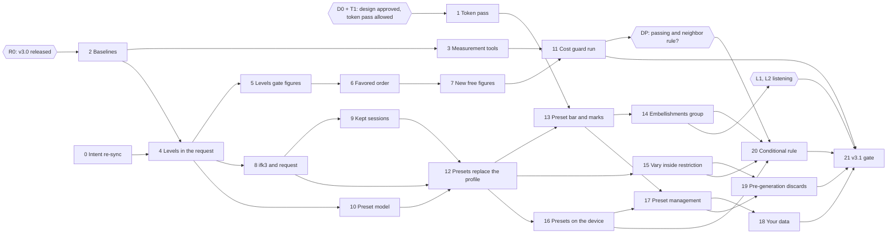

# Infinite Flow v3.1 — Build Plan

Status: draft v1 (2026-10-08), not approved; written while implementation is paused. The owner reviews it with the v3.1 design.

Build plan for v3.1, embellishment figures and presets, written from
[master spec Part B](master-spec.md#part-b--v31) (v1.0, approved 2026-10-08) and the v3.1 design
at the root of [`ui_ux/`](../../../ui_ux/README.md): everything marked `[v3.1 new]`,
`[v3.1 changed]` or with a `_v3.1 …:_` change-block line, the v3.2 marks ignored. The v3.0 design
it builds on is frozen in [`ui_ux/versions/v3.0/`](../../../ui_ux/versions/v3.0/README.md). It adds
no behaviour: what the app does is in the master spec, what the interface looks like is in the
design set, and where this plan disagrees with either, they win and the plan is corrected. The
code facts it relies on are in [embellishment-flags.md](embellishment-flags.md) and
[presets.md](presets.md), checked against `main` (bcf0cfb) on 2026-10-08: every file and symbol
they cite still exists; the few drifts are in [§9](#9-code-facts-checked-on-2026-10-08).

**v3.1 is built on v3.0.** This plan assumes every chunk of the
[v3.0 build plan](build-plan.md) is merged and the v3.0 gate passed: the storage under
`src/storage/`, the settings record, tolerant loading, the kept-session record, the `ifk2.` key,
the session seed plan and pre-generation. It names v3.0's planned modules as that plan names them
("v3.0 chunk _n_"); where v3.0 lands a module elsewhere, the chunk's preflight follows the code.

It is read by whoever builds v3.1, and by the owner. Music terms are explained where they first
appear, with a link to the project [lexicon](../../../docs/music/lexicon.md) when it has an entry.

> **Read first:** [what v3.1 changes in v3.0 and v2](#2-read-first-what-v31-changes-in-v30-and-v2).
> Neutral and Jazz must keep generating exactly what v3.0 generates, note for note, while the
> idea they are built on (a named "musical profile" the generator looks up) is taken out of about
> thirty-five files. A corpus recorded on v3.0 before any change guards every generator chunk.

## 1. Overview

### Release sequence

v3.1 ships as one release, with one gate, [chunk 21](#chunk-21--v31-release-gate). Chunks 0–3 are
prerequisites; chunks 4–11 change the generator (figure levels, the replay key, kept sessions,
the preset model and the cost guard's first run); chunks 12–19 build presets in the workspace, on
the device and in Vary settings; chunk 20 is conditional; the gate checks all 23 items of the
[definition of done](master-spec.md#b14-definition-of-done) on the merged code and produces
`docs/release/v3.1-release-notes.md`. v3.2 (Jam) is not planned here.

The order: first the generator learns figure levels without changing a note (chunks 4–5), then
favored levels and the two new figures (6–7), then the musical profile leaves the generation
request and the replay key (8–9). Presets come next as pure rules (10), then in the workspace
(12–15), on the device (16–18), and through pre-generation (19). The cost guard is measured as soon
as the generator is complete (11), so its one decision is known before the interface is built.

### Owner steps and gates

Some steps are not code and need the owner. They are part of the sequence:

| Step | What | When | Blocks |
| --- | --- | --- | --- |
| **R0** | v3.0 is released: the [v3.0 gate](build-plan.md#chunk-26--v30-release-gate) passed and `3.0.0` is tagged. | Before chunk 2. | Every coding chunk (2–21). Chunk 2's corpus must be recorded on the code v3.0 ships. |
| **D0** | The owner approves the v3.1 design ([`ui_ux/todo.md`](../../../ui_ux/todo.md), Next Unit); `ux-writer` copies it into `ui_ux/versions/v3.1/`, and this plan's design links are repointed there. | Before chunk 1. | Chunk 1, so every interface chunk (13, 14, 15, 17, 18, 20). |
| **T1** | The owner allows one `ux-writer` pass on `src/styles/theme.css` and `components.css` for part 1 of [`token-source-v3.1-v3.2.md`](../../../ui_ux/token-source-v3.1-v3.2.md), as he did for v3.0 (ux Q66). | With D0. | [Chunk 1](#chunk-1--token-source-pass-part-1-v31). |
| **DP** | The [cost-guard decision](#decision-point-the-passing-and-neighbor-rule): the measurement of chunk 11 decides whether the passing-and-neighbor rule ships. The owner is told the figures and the outcome; `spec-writer` records it. | After chunk 11. | Chunk 20 (built or skipped). |
| **L1** | The owner's listening check of the figure levels ([H1](#5-hand-checks)); the shares are tuned from it. | After chunk 14. | The gate's final M1 and M2 runs. |
| **L2** | The owner's listening check of the eight built-in presets ([H2](#5-hand-checks)). | After chunk 14. | The gate. |
| **Contract** | Nothing to wait for: B11's four guarantee changes were confirmed and applied on 2026-10-08 (spec D246, CONTRACT 3.0). | Done. | Nothing; the gate checks the record (item 23). |

### Waves

The owner's rule is **one coding chunk in flight at a time**, so waves are not run side by side:
chunks run one after another in number order. The waves say which chunks are independent: a chunk
whose wave has started may be taken out of number order when the next one is blocked (waiting for
the owner, a design answer or a measurement). Chunks in one wave touch different source files.

| Wave | Chunks | Waits for |
| --- | --- | --- |
| 0 | 0 Intent re-sync · 1 Token-source pass · 2 Baselines | Chunk 0: nothing. Chunk 1: D0 and T1. Chunk 2: R0. |
| 1 | 3 Measurement tools · 4 Figure levels in the request | Chunk 2 (both); chunk 0 (4) |
| 2 | 5 Levels gate the figures · 8 Replay key `ifk3.` · 10 Preset model | Chunk 4 |
| 3 | 6 Favored levels order the search · 9 Kept sessions hold the levels | Chunk 5 (6); chunk 8 (9) |
| 4 | 7 Two new free figures · 12 Presets replace the musical profile | Chunk 6 (7); chunks 8, 9, 10 (12) |
| 5 | 11 Cost guard, first run · 13 Preset bar and key and mode marks · 15 Vary settings inside the restriction | Chunks 3, 7 (11); chunks 1, 12 (13); chunk 12 (15) |
| 6 | 14 Embellishments group · 16 Presets on the device | Chunk 13 (14); chunk 12 (16) |
| 7 | 17 Preset management | Chunks 1, 13, 16 |
| 8 | 18 Your data and Delete everything · 19 Pre-generation discards | Chunk 17 (18); chunks 15, 17 (19) |
| 9 | 20 Passing and neighbor never both Off (**conditional**) | DP; chunks 14, 15, 16 |
| 10 | 21 v3.1 release gate | Every other chunk; L1, L2 |

The critical path runs 0 → 4 → 8 → 9 → 12 → 13 → 17 → 18 → 21, with 16 before 17. The generator
branch (5 → 6 → 7 → 11) and Vary settings (15) can fill any wait on it.

## 2. Read first: what v3.1 changes in v3.0 and v2

[B11](master-spec.md#b11-what-v31-changes-in-v30-and-in-v2s-guarantees) lists what v3.1 changes on
purpose. Each enforcement point changes in exactly one chunk, never "along the way". Test titles
are as on `main` (bcf0cfb); v3.0 may move their lines, so the chunk finds each one by its title.

| What holds today | Changed in | Becomes |
| --- | --- | --- |
| Contract guarantees `rule_mutation_profile_flip_keeps_controls` (removed), `rule_mutation_marks_profile_customized` 0.3, `rule_mutation_setting_scales` 0.2, `rule_mutation_reverts_at_session_end` 0.2 | **Applied** 2026-10-08 (CONTRACT 3.0, D246) | The new wordings hold for v3.0 and v3.1 alike. The flip atom itself is deleted in [chunk 12](#chunk-12--presets-replace-the-musical-profile) (the documentalist's escalation). |
| The chromatic capability looked up from the profile's name: `MUSICAL_PROFILE_CAPABILITIES` (`src/domain/controls/profile-selection.ts:40-45`), read in `makePitchPolicy` (`src/domain/pitch/pitch-policy.ts:60`) and `melodicFailures` (`src/domain/validation/generation-result-validator.ts:141`) | [4](#chunk-4--figure-levels-in-the-generation-request) | Derived from the figure levels the request carries; no code reads a profile or preset name to decide a note. |
| "Neutral is entirely diatonic", a project policy in [pitch-planner-validation.md](../../../docs/music/pitch-planner-validation.md#authority-and-ownership) and `rule_neutral_profile_diatonic_pitches` | [5](#chunk-5--levels-gate-the-figures) | A property of Neutral's levels: a chromatic note is refused only when both chromatic figures are Off. |
| The profile flip in Vary settings: `tests/unit/session/settings-mutation-scales.spec.ts` › 'flips Neutral and Jazz, keeps every control and marks the profile customized', › 'marks the profile customized after a profile-controlled step, keeping its identity', › 'leaves the customized mark as it was after a step of a value the profile does not control', › 'classifies every eligible setting as profile-controlled, free, or the profile itself', › 'holds one scale per eligible setting…'; `tests/unit/session/settings-mutation.spec.ts` › 'changes exactly one eligible setting by one step, never tempo or the instrument' (its `musicalProfile` branch); `tests/e2e/session/session-vary-settings.spec.ts` › 'a profile flip shows in place at its phrase with nothing moving, and a hidden tab restores it'; the `VARIED` fixture of `tests/unit/components/workspace/WorkspaceShell-vary-settings.spec.ts` | [12](#chunk-12--presets-replace-the-musical-profile) | The figure step in the profile's place in the draw; Tension, Leapiness, Arpeggio chaos and the levels mark Custom. |
| A profile sets seven controls and leaves Tension alone: `tests/unit/domain/controls/generation-controls.spec.ts` › 'applies each complete immutable bundle and reselecting replaces arbitrary custom values', › 'retains grammar identity on controlled custom edits and never mutates preset definitions', › 'does not mark a profile custom after a non-profile-controlled edit'; `tests/e2e/release/defaults-and-controls.spec.ts` › 'the Neutral preset sets its seven controlled values', › 'the Jazz preset sets its seven controlled values', › 'manually editing a preset-controlled value clears the preset selection to custom'; `tests/unit/composables/use-generation-session.spec.ts` › 'marks the applied preset custom after a manual rhythmic-variety edit, the same as any other preset field' | [12](#chunk-12--presets-replace-the-musical-profile) | A preset sets ten controls and seven levels; Custom names its base. |
| The "Custom (Jazz grammar)" and "grammar retained" copy: `tests/unit/components/controls/control-options.spec.ts` › 'shows the retained grammar in parentheses during a custom edit'; `tests/unit/components/controls/ControlPanel.spec.ts` › 'shows the control-summary line and recomputes it…', › 'shows the retained-grammar custom status text and clears the preset selection', › 'holds both preset status texts in one cell…'; `WorkspaceShell-vary-settings.spec.ts` › 'shows the controller's settings during a session, and the player's own again at its end'; `session-vary-settings.spec.ts` › 'a register stepped from Varying is Varying again after Stop, and the flag is set in the Review' | 12 (summary copy), [13](#chunk-13--the-preset-bar-and-the-key-and-mode-marks) (the status line goes) | "Custom, based on {name}" in the box and the summary; the status line is removed. |
| Replay keys encode the profile name and its customized flag: `tests/unit/generation-worker/phrase-replay-key.spec.ts` (the `tupleOf` helper, › 'round-trips a custom Jazz profile', › 'is one line of the ifk1 prefix and unpadded base64url', › 'rejects a payload that is not a 7-entry array', › 'rejects a slot of the wrong type and names it', › 'refuses a key that is not one well-formed ifk1 key'); the `ifk1`-bound cases of `phrase-replay.spec.ts` and `tests/unit/scripts/replay-phrase-script.spec.ts` | [8](#chunk-8--replay-key-ifk3-the-profile-leaves-the-request) | Encoding writes `ifk3.` for every phrase; every `ifk1.` and `ifk2.` decoding test stays. |
| The worker refuses any extra field in the profile selection (`parseProfileSelection`, `PROFILE_SELECTION_ALLOWED_KEYS`, `src/generation-worker/generation-worker-inbound.ts:57-75`). No test covers that refusal today. | 8 | The intent has no profile selection; the worker checks the seven levels instead, refusing an unknown figure or level, with a test. |
| v3.0's settings record holds "the musical profile selection" ([v3.0 chunk 6](build-plan.md#chunk-6--tolerant-settings-codec)) | [16](#chunk-16--presets-and-levels-on-the-device) | The preset selection and seven level records, migrated at open (data version 3). |
| v3.0's kept phrases hold the profile in their reproduction inputs; the summary holds the musical profile ([v3.0 chunk 9](build-plan.md#chunk-9--kept-session-record)) | 8 (read), [9](#chunk-9--kept-sessions-hold-the-levels-and-the-preset-label) (migrated) | The seven levels, and the session's preset label, migrated at open (data version 2). |
| v3.0's pre-generation discards on "the profile" ([v3.0 chunk 24](build-plan.md#chunk-24--pre-generation-at-idle)) | 12, 15, [19](#chunk-19--pre-generation-discards) | A preset choice that changes something, a level, or the restriction in force (B8.3). |
| The cold-generation goldens (`tests/unit/domain/generation/orchestration/cold-generation-golden/`), `generation-outcome-golden.spec.ts`, and v3.0's `ifk1.`/`ifk2.` corpus | **Never** | They stay byte-identical: Neutral and Jazz reproduce v3.0 (item 2). A chunk that needs to touch one is wrong. |

Every replaced test gets its v3.1 counterpart in the same chunk, and the gate lists each pair
(item 22).

### The figure and preset design the chunks build on

Proposed here, settled by `documentalist`'s architecture captures in the chunks named:

- **Figures and levels, one module** ([chunk 4](#chunk-4--figure-levels-in-the-generation-request)).
  `src/domain/figures/figure-levels.ts`: the seven figure ids in a fixed order (`passingTone`,
  `accentedPassingTone`, `neighborTone`, `appoggiatura`, `diatonicEnclosure`,
  `chromaticApproach`, `chromaticEnclosure`), the four levels (`off`, `asToday`, `favored`,
  `stronglyFavored`; the interface labels them Off, Rarely, Often, Very often), the B5.3 table for
  Neutral and Jazz, and the per-figure allowance the pitch policy reads. The ids are internal and
  never change; the replay key and the storage hold them.
- **The request carries the levels, never a name** (chunks 4 and 8). `GenerationIntent` gains
  `figureLevels` in chunk 4, beside the musical profile; chunk 8 removes the profile. From then
  on nothing in the generator, the worker, the replay key or a kept phrase names a profile or a
  preset.
- **The favored draw is an integer hash** ([chunk 6](#chunk-6--favored-levels-order-the-search)).
  The pitch search already orders by FNV-1a tie keys (`pitchTieKey`,
  `src/domain/pitch/pitch-tie-key.ts`), not by a pseudorandom stream. The draw for a figure at a
  note is `fnv1a32` (`src/domain/random/hash32.ts`) of the seed, the note's identity and the
  figure id, kept when it falls under the level's share (a numerator over a power of two:
  starting at 1/4 and 1/2, tuned by M1 and M2). Integer operations only (`Math.imul`, `>>> 0`, a
  mask), so every browser draws the same. Off and As today never compute it: no draw.
- **Presets as pure rules** ([chunk 10](#chunk-10--the-preset-model)). `src/domain/presets/`: the
  restriction (two halves, each "any" or an ordered list), the eight built-ins by fixed id
  (`neutral`, `jazz`, `gentle`, `speed-drill`, `reel`, `bebop`, `pop-song`, `modal-dorian`), the
  selection (a preset, or Custom with a base id or none), choosing, the restriction in force,
  names, the limit and the save choices. Player presets are known by an id from an injected id
  source. Nothing here touches storage or the interface.
- **Storage** (chunks 9 and 16), inside v3.0's [storage design](build-plan.md#the-storage-design-the-chunks-build-on):
  one new object store, `presets` (one record per player preset, keyed by id); in `settings`, a
  record per figure level and a `presetSelection` record replacing the musical profile's. Two data
  versions, one per stored shape that changes, each with its upgrade step: **2** rewrites v3.0's
  kept sessions (levels in each phrase's inputs, the preset label in the summary), **3** migrates
  the settings and creates the `presets` store. One step per chunk keeps each migration tested on
  its own and never leaves a development database half-migrated.
- **Code loaded on demand:** the preset sheet and the Presets section of Your data, like the other
  sheets (M4). The built-in table, the preset bar and the seven level controls are in the entry
  chunk.

## 3. Workflow for every chunk

Each chunk runs in its own git worktree next to the repository
(`/home/bastien/work/infinite_flow-v31-c<n>`; never reuse `../infinite_flow-perf-investigation`),
on a branch from `main` (`v3.1-c<n>-<slug>`). It ends with one commit and a `--no-ff` merge into
`main`, made when the owner asks. **One coding chunk is in flight at a time.** The six steps run in
this order; a chunk isn't finished until step 6 is done.

1. **Intent preflight.** `documentalist` runs its preflight (the full pass, then again with the
   chunk's files), starting from the chunk's **Atoms** line. A missing or conflicting atom stops
   the chunk until it is resolved: a spec gap goes to `spec-writer`, a design gap to `ux-writer`.
   A chunk marked **Architecture capture** settles a piece of architecture: `documentalist`
   records it before any code. ATD covers business behaviour and architecture only, never
   tooling, tests' plumbing or measurement scripts (chunks 2, 3 and 11 add no atom).
2. **Tests first, red to green.** Write the tests for the chunk's **Done when** first and see them
   fail on an assertion about the missing behaviour, not an import error.
   - Pure logic gets Vitest unit tests under `tests/unit/`, mirroring `src/`. Storage runs on
     `fake-indexeddb` (v3.0 chunk 4) and saved data is seeded through the harness's storage seam
     (v3.0 chunk 7), never by hand-built records.
   - Behaviour gets Playwright scenarios on the workspace harness, each from an empty browser
     context. A new spec outside `tests/e2e/notation/` is added to the explicit `test:e2e` list in
     `package.json`, or it never runs in `npm run quality`.
   - **Every chunk that touches generation (4–9, 12, 15, 20) runs the v3.0 corpus of
     [chunk 2](#chunk-2--baselines-the-v30-phrase-corpus-and-the-bundle) and the cold-generation
     goldens unchanged.** A red corpus means Neutral or Jazz no longer reproduces v3.0: stop and
     find why, never re-record.
3. **Implement** until the tests pass, following [`CODING_RULE.md`](../../../CODING_RULE.md): crash
   early, no silent fallbacks (tolerant loading is the spec's explicit exception, and lives in the
   codecs), injected seams instead of test-only branches, an injected clock and id source, the
   file-size limits. Interface code uses only the classes and tokens of `src/styles/`; no raw
   visual value.
4. **Verify.**
   - The chunk's **Done when** holds, and `npm run quality` passes on an idle machine. **Never run
     `atd audit` alongside tests**: it saturates the machine and makes timing tests fail.
   - A generation chunk also runs `npm run test:sweep` (on an idle machine; it takes long).
   - The entry chunk's size after `npm run build` is written in the commit message, with its change
     from the previous chunk ([M4](#m4--the-first-load-bundle)).
   - Performance on a virtual machine never gates: a figure measured there is recorded with the
     machine and date, for reference. Budgets are checked by the owner on the reference machine.
   - A debug run shows the behaviour on screen (`npm run dev` in Chromium, or the workspace
     harness), with a landscape phone-sized window for anything below `bp-tablet-landscape`.
     **Never edit the repository while the owner is testing on the dev server**: Vite reloads his
     page. Batch any write until he pauses.
5. **Documents.** `README.md` (directory boundaries, the quality-gate table), `docs/storage.md`
   (records, data versions), `docs/testing.md` (every new seam, fake, fixture and script), the
   area's own document (`docs/session-engine.md`, `docs/phrase-workspace.md`,
   `docs/generation-latency.md`, [`docs/music/`](../../../docs/music/README.md)), and the lexicon
   entries B11 lists, rewritten from "planned" to "built" when the chunk builds what they describe.
   A place where the code had to differ from the spec or the design is reported to `spec-writer`
   or `ux-writer`, never fixed silently.
6. **Post-task sync.** `documentalist` checks the `@spec-link` / `@test-link` tags (**directly
   above the function or test, never at the top of a file**), confirms the atoms still describe the
   code, applies the chunk's **Revise** list (the non-STABLE atoms tagged `changes-in-v3.1`,
   [change set part E](../../../docs/release/v3.1-v3.2-intent-change-set.md)), runs the drift
   check of the chunk's **Drift check** list (part F), and advances a status only with the owner's
   agreement. `npm run atd:lint` and `npm run atd:check` pass.

## 4. Measurements

Four figures the spec leaves to the build, each with the chunk that takes it and where it is
recorded. The gate copies each into the release notes. The [corpus](#chunk-2--baselines-the-v30-phrase-corpus-and-the-bundle)
that proves Neutral and Jazz unchanged is a guard, not a measurement: it either passes or the
chunk stops.

### M1 — Figure shares

- **What:** for each figure and each level, the share of phrases containing it as a free figure,
  and how many it holds per phrase ([B5.2](master-spec.md#b52-four-levels), item 3). The order
  must hold: never fewer from Off to As today to Favored to Strongly favored, and more wherever the
  figure's rhythm needs are met; at Off only Tension's scheduled figure. The Favored and Strongly
  favored shares start at about 1 in 4 and 1 in 2 of the notes where the figure could start, and
  are tuned by listening (H1) and by the cost guard (M2).
- **How:** chunk 3's census script over a fixed seed sweep (the deadline sweep's 568 rhythm
  settings × two seeds, each of the nine modes), one figure raised at a time from the Neutral
  defaults, then all raised. Run on v3.0 in chunk 3 (the As today baseline), in chunk 6 and 7 as
  each lands, in chunk 11, and finally in the gate after tuning.
- **Recorded:** a new "Embellishment figures" section of `docs/generation-latency.md`, with the
  final shares; the constants carry a comment pointing there.

### M2 — The cost guard

- **What:** [B5.6](master-spec.md#b56-the-cost-guard): whether figure levels slow the generator or
  make it fail, at three settings: the Neutral and Jazz defaults (the baseline), every figure
  Strongly favored, and every diatonic figure (1 to 5) Off. The search allowance is **not**
  raised: 250,000 units alone, 160,000 when joining the previous phrase
  (`DEFAULT_WINDOW_SEARCH_FUEL`, `CARRY_IN_WINDOW_SEARCH_FUEL` in
  `src/domain/generation/orchestration/search-ledger.ts`).
- **How:** chunk 3's cost runner runs each setting on the deadline sweep (`npm run test:sweep`: the
  568 cases at 60, 120 and 240 BPM, each attempt charged its measured time) and in a 240 BPM
  session, recording the share of phrases generated, the slowest and 95th-percentile generation
  times, and at 240 BPM the share of phrases that fall back to being generated without the join.
  **Speed drill is measured first** (B6.5: the most expensive setting found), and every built-in
  preset runs on the sweep in every mode its restriction allows (item 9). The owner runs the
  deciding runs on the reference machine.
- **Acceptance:** against the baseline, at most 2 percentage points more fallbacks at 240 BPM, and
  at most 2 percentage points fewer phrases generated at any swept setting. A level that costs more
  is tuned down (a smaller share) before the gate.
- **Recorded:** `docs/generation-latency.md` ("Embellishment figures: the cost guard"), which also
  takes the deadline sweep's figures that today live only in the
  [ISS-009 record](../../../issues/Ref_20261006_failed_carry_in_attempts_slow.md).

### Decision point: the passing-and-neighbor rule

B5.6 makes one rule depend on M2: **if "every diatonic figure Off" fails the acceptance test, the
passing tone and the neighbor tone may not both be Off**; if it passes, the rule does not ship.

- **Taken in [chunk 11](#chunk-11--the-cost-guard-first-run)**, on the reference machine, with the
  shares as they stand then. The figures and the outcome go to the owner and to `spec-writer`,
  who records the decision; `documentalist` then adds the rule as an atom (adopted) or records
  that it was measured and not needed (rejected).
- **Adopted:** [chunk 20](#chunk-20--passing-and-neighbor-never-both-off-conditional) builds it in
  the level controls, Vary settings and loading, as B5.6 and the design say (the level control
  refuses the second of the two with its note; a Vary settings step landing there is drawn again;
  a saved setting or preset holding both loads with the neighbor tone at As today).
- **Rejected:** chunk 20 is skipped, and every level stays selectable.
- **Re-checked at the gate:** the final run (after L1's tuning) must still meet the acceptance
  test at all three settings. If a tuning breaks it, the share is tuned down; the decision is
  reopened only if "every diatonic figure Off" itself flips, and then goes back to the owner.

### M3 — The start-up read and the migrations

- **What:** whether loading the player presets with the settings stays inside v3.0's start-up
  wait (Part A §4.4, v3.0's measurement M2), and how long the first open by v3.1 takes to migrate
  v3.0's data (data versions 2 and 3). A read slower than the wait makes the visit a failed-read
  visit, which saves nothing ([B7](master-spec.md#b7-saving-on-the-device)).
- **How:** chunk 16 times the start-up read on a seeded database with 0, 50 and 60 player presets
  (60: written from two tabs) and 0, 10, 100 and 500 kept sessions, cold and warm; chunk 9 times
  the version 2 upgrade on 10, 100 and 500 v3.0 kept sessions, and chunk 16 the version 3 upgrade.
  The owner repeats the deciding runs on the reference machine.
- **Acceptance:** each, upgrade included, well under the start-up wait constant. If the
  kept-session upgrade does not fit with many pinned sessions, that is
  [question 2](#10-questions-for-spec-writer), raised before chunk 9 merges.
- **Recorded:** `docs/storage.md`.

### M4 — The first-load bundle

- **What:** the entry chunk stays within its 224 kB budget (`scripts/verify-boundaries.mjs`,
  `entryChunkByteBudget`). v3.0 left little headroom; the combo box, seven level controls and the
  built-in table add code (B12).
- **How:** chunk 2 records the baseline on the v3.0 release; every chunk records its entry size and
  change (step 4). The preset sheet and Your data's Presets section load on demand. Raising the
  budget needs the owner.
- **Recorded:** each commit message, and the gate's release notes.

## 5. Hand checks

The owner runs these himself, on the Travel Sax over USB and the reference machine. Each is written
into a new v3.1 part of [`HARDWARE-CHECKLIST.md`](../../../HARDWARE-CHECKLIST.md) by the chunk named,
and run at that chunk or at the gate.

| Check | Chunk | What the owner does |
| --- | --- | --- |
| H1 Listening: the levels (L1) | 14, used by 21 | For each figure, at a few settings that leave it room (Eighth and Sixteenth, Heavily varied), regenerate a handful of phrases at Rarely, Often and Very often; say whether Often is clearly heard and Very often not overwhelming. The shares are tuned from it, then M1 and M2 re-run. |
| H2 Listening: the built-ins (L2) | 14, used by 21 | Choose each of the eight presets, regenerate a few phrases, play a short session; say whether each sounds as its description says (Reel in Mixolydian, Bebop's chromatic lines, Pop song's familiar chords, Modal (Dorian)'s color note). Neutral and Jazz should sound exactly as in v3.0. |
| H3 Same phrase in Edge | 8 | Run chunk 8's in-browser replay test once with Playwright's Microsoft Edge channel on his machine (`msedge`), and replay one `ifk3.` key copied from a Chrome session in Edge; the phrases match. Item 7's "Chrome and Edge" half. |
| H4 Vary settings under a preset | 15 | With the Travel Sax, Vary settings on, Reel chosen from C Ionian: a long session moves the mode only between Mixolydian and Dorian, the box turns to "Custom, based on Reel" when a setting moves, and Stop brings back Reel and its settings. Repeat under Modal (Dorian): the mode never moves. |
| H5 v3.0 data carried over | 16, at 21 | In the installed app and a plain Chrome tab that used v3.0 (settings changed, a pinned session, a Jazz selection with a changed Tension), update to v3.1: the settings come back, the box shows "Custom, based on Jazz", the pinned session opens with its label and plays back the same notes. |

## 6. Chunks

Each chunk names its goal, what it builds and where, the spec sections and design documents, the
atoms, what it waits for, how to tell it is done, which definition-of-done items it covers, and how
it is verified. "Item _n_" is item _n_ of [B14](master-spec.md#b14-definition-of-done). **Atoms**
are ids of `docs/<id>.atom.md`: the DRAFT atoms tagged `release-v3.1` the chunk builds, then, marked
"(v2)" or "(v3.0)", existing atoms it must keep true. **Revise** lists the atoms tagged
`changes-in-v3.1` that its post-task sync revises; **Drift check**, the ARCHITECTURE atoms of change
set part F it checks against the new code.

### Chunk 0 — Intent re-sync

**Goal.** Make sure the 38 `release-v3.1` atoms and the 17 `changes-in-v3.1` atoms still match
master spec Part B and the state v3.0's gate left, before the first v3.1 chunk relies on them.

**Scope.** `documentalist`, spec ingestion (milestone refinement). Atoms only; no code.

- Part B as it stands when the build starts: decisions recorded after the ingestion of 2026-10-08
  (D247 onwards, and any later one) that touch Part B.
- The atoms v3.0's gate promoted or revised that v3.1 revises again
  (`rule_settings_saved_on_change`, `rule_kept_session_content`, `req_kept_session_list`,
  `rule_pregeneration_discarded_on_change`, `rule_persistent_storage_requested`,
  `rule_delete_everything`, `req_your_data`): their `changes-in-v3.1` notes still name the right
  change.
- The passing-and-neighbor rule stays unmade until [DP](#decision-point-the-passing-and-neighbor-rule).

**Atoms:** every atom tagged `release-v3.1` or `changes-in-v3.1`;
`contract_infinite_flow_first_release` (3.0).

**Depends on:** nothing (best run right after R0).

**Done when:** each Part B behaviour is stated by an atom (still DRAFT); `npm run atd:lint` and
`npm run atd:check` pass; the change set file records what changed, if anything.

**Items covered:** none directly; every later chunk's preflight relies on it.

**Verification:** `documentalist`'s ingestion report; `npm run quality`.

### Chunk 1 — Token-source pass, part 1 (v3.1)

**Pending the owner's D0 and T1.**

**Goal.** Write v3.1's new tokens and component classes into the canonical token source, so every
interface chunk can style its components without inventing a value.

**Scope.** `ux-writer`, not a coding executor. Edits `src/styles/theme.css` and
`src/styles/components.css` only, under `v3.1 new` / `v3.1 changed` comments: everything in part 1
of [`token-source-v3.1-v3.2.md`](../../../ui_ux/token-source-v3.1-v3.2.md): the tokens
`--preset-select-inline-size` and `--segment-mark-size`; the classes `preset-bar`,
`preset-select` (its read-only state), `preset-actions`, `segment.is-marked`,
`control-group-figures`, `control-group-intro`, `choice-list`, `choice-option`, `name-alert`,
`sheet-list`, `sheet-list-row`. It does **not** remove `preset-status` and `preset-status-text`:
the status line is still rendered until [chunk 13](#chunk-13--the-preset-bar-and-the-key-and-mode-marks)
removes it, which then deletes those classes. Part 2 (v3.2) is not applied, so the document stays;
`ux-writer` marks part 1 as applied in it.

**Design docs:** [`ui_ux/token-source-v3.1-v3.2.md`](../../../ui_ux/token-source-v3.1-v3.2.md) (Part
1), [`ui_ux/README.md`](../../../ui_ux/README.md).

**Atoms:** none (styling is not business behaviour).

**Depends on:** D0 and T1; v3.0's own token pass merged (branch `v3-c1-token-source`, which this
plan leaves to the owner).

**Done when:** every class and token part 1 names exists in `src/styles/`; no v3.1 handoff names a
class that exists nowhere (`preset-status` excepted until chunk 13); `npm run quality` passes with
no snapshot change; `npm run lint:links` passes.

**Items covered:** none directly; it unblocks 13, 14, 17, 18 and 20.

**Verification:** `npm run quality`; a `grep` of each v3.1 handoff's class names against
`src/styles/`.

### Chunk 2 — Baselines: the v3.0 phrase corpus and the bundle

**Goal.** Record, on the code v3.0 shipped, the facts v3.1 must not break: the phrase every Neutral
and Jazz request gives, every `ifk1.` and `ifk2.` key's phrase, and the entry chunk's size.

**Scope.**

- A corpus generated from the `3.0.0` tag before any v3.1 change: Neutral and Jazz, each customized
  or not, × **every one of the nine modes** × the three built-in instruments and two player-made
  instruments × a spread of the other controls (every Tension value, every Leapiness and Arpeggio
  chaos value, Eighth and Sixteenth with Heavily varied) × several seeds, with and without carry-in
  (a carry-in whose final harmony is null included). Each case is stored as its key (`ifk1.` for a
  built-in instrument, `ifk2.` for a player-made one) and the timeline it replays to. Fixture
  `tests/fixtures/replay-keys/v3.0-neutral-jazz.json` and a unit test,
  `tests/unit/generation-worker/phrase-replay-key-v30-corpus.spec.ts`, that decodes each key,
  regenerates it through the worker runtime and expects the stored timeline byte for byte. It sits
  beside v3.0's `ifk1-v2.0.json` corpus, which stays.
- The entry chunk's size after `npm run build` on the tag, recorded here and in `docs/testing.md`.

**Files:** the fixture and spec above, a generator script under `scripts/` (tooling),
`docs/testing.md`.

**Atoms:** none new (test plumbing). The corpus later backs `rule_neutral_and_jazz_figure_levels`
and `rule_seeded_phrase_reproduction`, whose test links chunk 8 adds.

**Depends on:** R0.

**Done when:** the corpus test passes on the tag and on `main`; the baseline size is recorded.

**Items covered:** 2 and 19 (as the guard for chunks 4–9 and 12).

**Verification:** `npm run quality`; the corpus test is red if any timeline is changed by hand.

### Chunk 3 — Measurement tools: the figure census and the cost runner

**Goal.** The two scripts M1 and M2 need, run once on v3.0 for their baselines.

**Scope.** Tooling only, no product code.

- **Figure census:** from a generated phrase (its timeline, chord plan and figure provenance),
  classify each non-chord note as one of the seven figures, or as Tension's scheduled figure, using
  the generator's own provenance where it records it (free obligations, written figure paths,
  `boundPaths`) and B5.1's definitions otherwise (beats 1 and 3 strong, steps in the collection,
  half steps, back to back under one chord). A sweep config (beside `vitest.sweep.config.ts`)
  reports, per figure and level setting, the share of phrases containing it and its count per
  phrase.
- **Cost runner:** the deadline sweep (`tests/sweep/session-deadline-sweep-*.spec.ts`,
  `sweepCases()` in `tests/unit/session/deadline-sweep.ts`) parameterised by figure levels (until
  chunk 4 exists, by profile), plus a 240 BPM session run; it writes the share generated, the
  slowest and 95th-percentile times and the 240 BPM fallback share as JSON, the way
  `tests/perf/generation-latency.perf.ts` writes `LATENCY_OUT`.
- Baselines on v3.0: the As today shares of passing tones, neighbor tones and chromatic figures
  (B12's "1 to 6 %" and "4 to 20 %" made exact), and the Neutral and Jazz cost figures.

**Files:** `tests/sweep/figure-census.ts` (new), `tests/sweep/figure-census.spec.ts` (new), a
census config, the cost runner beside `tests/sweep/deadline-sweep-measured.ts`, `package.json`
(`measure:figures`, `measure:cost`), `docs/testing.md`, `docs/generation-latency.md` (the
baselines).

**Atoms:** none (measurement).

**Depends on:** chunk 2.

**Done when:** the census classifies the figures of a hand-written fixture phrase holding one of
each figure exactly; both scripts run on `main` and their baselines are recorded.

**Items covered:** none directly; M1 and M2 rest on it (items 3, 8, 9).

**Verification:** `npm run quality` (the census's own unit test); the baseline runs.

### Chunk 4 — Figure levels in the generation request

**Architecture capture:** figure levels replace the musical profile's capability as what the
generator reads (the figures and levels module of [§2](#the-figure-and-preset-design-the-chunks-build-on)).

**Goal.** Put the seven figure levels into every generation request and make the generator read
its chromatic allowance from them, without changing a single note.

**Scope.**

- `src/domain/figures/figure-levels.ts` (new): the figure ids, the levels, `NEUTRAL_FIGURE_LEVELS`
  and `JAZZ_FIGURE_LEVELS` (B5.3), `levelsForProfile(profile)`, and the allowance helpers the
  pitch policy and the validator read.
- `GenerationIntent` gains `figureLevels`; `makeGenerationIntent` fills it from the profile with
  `levelsForProfile` (the musical profile stays in the intent until chunk 8). The session's
  `buildAttemptIntent` passes it through unchanged.
- `makePitchPolicy` and `melodicFailures` stop looking up `MUSICAL_PROFILE_CAPABILITIES` by name:
  `allowsChromaticApproach` becomes "the chromatic approach or the chromatic enclosure is not
  Off". The seven other reads of that flag (in `pitch-candidates.ts`, `pitch-context.ts` and
  `figure-rules.ts`) are untouched: per-figure gating is chunk 5's.
- The worker's inbound parser validates `figureLevels` (exactly the seven ids, each a known level,
  no extra field) and rebuilds it; the prewarm and the cancellation paths carry it.

**Files:** `src/domain/figures/figure-levels.ts` (new), `src/domain/generation/generation-intent.ts`,
`src/domain/pitch/pitch-policy.ts`, `src/domain/validation/generation-result-validator.ts`,
`src/domain/controls/profile-selection.ts` (the capability table goes),
`src/generation-worker/generation-worker-inbound.ts`; tests under `tests/unit/domain/figures/`,
`tests/unit/generation-worker/`.

**Spec sections:** [B5.1](master-spec.md#b51-the-seven-figures), [B5.3](master-spec.md#b53-neutral-and-jazz-sound-as-before), [B9](master-spec.md#b9-the-generation-request-the-replay-key-and-kept-sessions), [B12](master-spec.md#b12-existing-code-and-risks).

**Atoms:** `req_embellishment_figure_levels`, `rule_embellishment_figures_defined`,
`rule_neutral_and_jazz_figure_levels`; (v2) `rule_seeded_phrase_reproduction`,
`rule_jazz_chromatic_resolution`, `rule_neutral_profile_diatonic_harmony`.
**Drift check:** `module_musical_profile_capabilities`, `module_generation_request_construction`,
`module_generation_worker_protocol`.

**Depends on:** chunks 0 and 2.

**Done when:**

- Every intent built for Neutral carries B5.3's Neutral levels, every Jazz intent Jazz's, customized
  or not.
- No source file outside `src/domain/figures/` and the profile-selection module reads
  `MUSICAL_PROFILE_CAPABILITIES` or compares a profile name to decide a note (a `grep` check in the
  test of the module).
- The worker refuses an intent whose levels miss a figure, name an unknown one, or hold an unknown
  level, with the typed protocol error.
- The v3.0 corpus, the cold-generation goldens and every v2 and v3.0 generation test pass unchanged.

**Items covered:** 1 (the levels exist), 2 (guarded).

**Verification:** `npm run quality`; `npm run test:sweep`; entry chunk size recorded.

### Chunk 5 — Levels gate the figures

**Goal.** Make each figure's level decide whether the search may write it as a free figure and
whether the validator accepts it, leaving Tension's scheduled figure alone.

**Scope.**

- **Free figures tagged by kind.** Today a free diatonic non-chord note has one role,
  `passing_or_neighbor` (`ordinaryCandidates`, `src/domain/pitch/pitch-candidates.ts`), and is
  told apart only when it resolves (`advanceFigure` and `freeToneResolves`,
  `src/domain/pitch/pitch-figures.ts`). The search now refuses a free tone whose resolution makes
  it a figure that is Off: a passing tone off beats 1 and 3 needs the passing tone allowed, on
  beat 1 or 3 the accented passing tone, a neighbor tone the neighbor tone (either beat).
- **Chromatic figures per figure.** `approachPaths` and `enclosurePaths` are offered only when their
  own figure is not Off.
- **The validator** (`figureFailures`, `freelyExplained` and `chromaticOrnament` in
  `src/domain/pitch/validation/figure-rules.ts`) accepts exactly the figures the levels allow, and
  refuses a note outside the collection (`out_of_collection`) when both chromatic figures are Off.
- **Tension's scheduled figure is exempt** ([B5.4](master-spec.md#b54-free-figures-and-tensions-scheduled-figure)):
  `boundPaths`, `makeTensionBindingDomain` and `bindingStructureHolds` read no level, so every
  Tension value keeps its figure with every level Off.
- As today behaves exactly as today; the two new figures stay impossible (chunk 7).

**Files:** `src/domain/pitch/pitch-candidates.ts`, `src/domain/pitch/pitch-figures.ts`,
`src/domain/pitch/pitch-types.ts`, `src/domain/pitch/validation/figure-rules.ts`,
`src/domain/pitch/validation/pitch-validation-types.ts`, `src/domain/pitch/pitch-context.ts`;
tests under `tests/unit/domain/pitch/` (`figure-rules.spec.ts`, `pitch-candidates.spec.ts` and
their fixtures read the capability today); [`docs/music/pitch-planner-validation.md`](../../../docs/music/pitch-planner-validation.md),
[`docs/music/neutral-profile.md`](../../../docs/music/neutral-profile.md),
[`docs/music/jazz-profile.md`](../../../docs/music/jazz-profile.md).

**Spec sections:** [B5.1](master-spec.md#b51-the-seven-figures), [B5.2](master-spec.md#b52-four-levels), [B5.4](master-spec.md#b54-free-figures-and-tensions-scheduled-figure), [B11](master-spec.md#b11-what-v31-changes-in-v30-and-in-v2s-guarantees).

**Atoms:** `rule_figure_level_orders_search` (its Off and As today halves),
`rule_levels_govern_free_figures_only`, `rule_chromatic_notes_need_a_chromatic_figure`,
`rule_figures_resolve_onto_chord_tones`; (v2) `rule_neutral_profile_diatonic_harmony`.
**Revise:** `rule_neutral_profile_diatonic_pitches`, `rule_jazz_chromatic_resolution`.
**Drift check:** `service_generation_result_validation`, `module_musical_profile_capabilities`.

**Depends on:** chunk 4.

**Done when:**

- With a figure Off, the census over the M1 sweep finds it only as Tension's scheduled figure (for
  the three figures Tension can schedule) or not at all, for each of the seven in turn.
- With every level Off, every Tension value still places its scheduled figure: Edge and Build in
  every successful phrase, Settled and Lift where they did (fixed seeds, all four values).
- The validator refuses a phrase holding a free figure whose level is Off, and a chromatic note when
  both chromatic figures are Off; it accepts the same phrase when the level allows it (unit tests
  per figure).
- With Neutral's and Jazz's levels, the v3.0 corpus and the goldens pass unchanged.

**Items covered:** 5 (the validator accepts exactly what the levels allow), 6, 2 (guarded).

**Verification:** `npm run quality`; `npm run test:sweep`; M1 run for the record.

### Chunk 6 — Favored levels order the search

**Architecture capture:** the favored draw (an integer hash of the seed, the note and the figure;
[§2](#the-figure-and-preset-design-the-chunks-build-on)).

**Goal.** At about 1 in 4 (Favored) or 1 in 2 (Strongly favored) of the notes where a figure could
start, try it before the chord tones; never require it.

**Scope.**

- `src/domain/pitch/figure-draw.ts` (new): `isFigureDrawn(seed, noteIdentity, figureId, level)`,
  integer only, computed only for Favored and Strongly favored. The shares are two constants,
  `FAVORED_SHARE` and `STRONGLY_FAVORED_SHARE`, as numerators over a power of two.
- `pitchRank` (`src/domain/pitch/pitch-ranking.ts`) puts a candidate that starts a drawn figure
  before the chord tones; where several figures are drawn at one note, the higher level first,
  then the seed's usual tie key. Everything else keeps today's order, so a phrase whose levels are
  all Off or As today is searched in exactly v3.0's order.
- A favored candidate that dead-ends is backed out of like any other; no phrase is rejected or
  retried for lacking a figure. The search's ordering cache (`searchPitchPlan`,
  `src/domain/pitch/pitch-search.ts`) stays correct: the draw depends only on the seed and the
  note.

**Files:** `src/domain/pitch/figure-draw.ts` (new), `src/domain/pitch/pitch-ranking.ts`,
`src/domain/pitch/pitch-candidates.ts` (each candidate names the figure it starts),
`src/domain/pitch/pitch-search.ts` (if the cache key needs the levels); tests under
`tests/unit/domain/pitch/`.

**Spec sections:** [B5.2](master-spec.md#b52-four-levels), [B5.5](master-spec.md#b55-determinism), [B13](master-spec.md#b13-architectural-decisions-and-their-reasons).

**Atoms:** `rule_figure_level_orders_search`, `rule_figure_level_never_a_quota`,
`rule_figure_draws_reproducible`. **Drift check:** `mechanic_pitch_search_policy` and the pitch
search modules, `module_named_stream_pseudorandomness` (its hash tie keys),
`module_ranked_candidate_ordering`.

**Depends on:** chunk 5.

**Done when:**

- The census's share of each figure never decreases from Off to As today to Favored to Strongly
  favored, and rises at the rhythm settings that leave it room (property over the M1 sweep).
- A phrase is never refused for lacking a favored figure: an instrumented run counts zero
  rejections or retries tied to a level.
- No floating-point operation in the draw (a unit test over the module's source, plus
  golden draws for a fixed seed list).
- With Neutral's and Jazz's levels the v3.0 corpus and the goldens pass: no draw is made.
- M1 recorded at the starting shares.

**Items covered:** 3, 4, 7 (the draws are integer-only), 2 (guarded).

**Verification:** `npm run quality`; `npm run test:sweep`; M1.

### Chunk 7 — Two new free figures: the appoggiatura and the diatonic enclosure

**Goal.** Let the search write a free appoggiatura and a diatonic enclosure when their level allows
them, under every existing figure rule.

**Scope.**

- **Free appoggiatura:** a collection note outside the chord, entered by a leap of 3 half steps or
  more, on beat 1 or 3, resolved by one scale step onto a chord tone (the shape
  `boundFigureShapeHolds` already checks for Tension's), as a new free candidate path.
- **Diatonic enclosure:** the scale notes just above and below a target chord tone, in either
  order, then the target, three back-to-back notes under one chord: the one place two outside
  notes in a row are allowed, beside the chromatic enclosure.
- Both Off for Neutral and Jazz, so no existing phrase changes: adding a candidate changes what the
  search finds when it backs up past the chord tones, which is why B5.3 keeps new figures Off.
- The validator accepts each only when its level allows it; the census recognises both.

**Files:** `src/domain/pitch/pitch-candidates.ts`, `src/domain/pitch/pitch-figures.ts` (the
enclosure's path confirmation), `src/domain/pitch/validation/figure-rules.ts`, the census of
chunk 3; tests under `tests/unit/domain/pitch/`.

**Spec sections:** [B5.1](master-spec.md#b51-the-seven-figures), [B5.6](master-spec.md#b56-the-cost-guard) (new figures enlarge the search).

**Atoms:** `rule_embellishment_figures_defined`, `rule_figures_resolve_onto_chord_tones`,
`req_embellishment_figure_levels`. **Drift check:** `service_generation_result_validation`.

**Depends on:** chunk 6.

**Done when:**

- With either figure Favored, the census finds it in a share of phrases that rises from As today;
  with it Off, never.
- Every generated instance resolves once, onto a chord tone, and spans no chord change; the
  validator refuses each one when its level is Off (unit tests with hand-written phrases).
- The v3.0 corpus and goldens pass; an acknowledgement test lights a free appoggiatura's and an
  enclosure's notes at their exact pitches only.

**Items covered:** 5 (the new figures), 3, 21 (acknowledgement for the new figures).

**Verification:** `npm run quality`; `npm run test:sweep`; M1.

### Chunk 8 — Replay key `ifk3.`; the profile leaves the request

**Architecture capture:** the `ifk3.` format (a revision of `module_phrase_replay_key`), and the
generation request without a musical profile.

**Goal.** Write `ifk3.` for every phrase, holding the levels by figure and no name, while every
`ifk1.` and `ifk2.` key keeps decoding to the same phrase; and take the musical profile out of the
request.

**Scope.**

- **The key.** `encodePhraseReplayKey` writes `ifk3.` for every phrase: what `ifk2.` carries except
  the musical profile's name and its customized flag, plus the seven levels by figure id. Proposed
  for the capture: the instrument by id for a built-in (as `ifk1.`), inline for my instrument (as
  `ifk2.`). `decodePhraseReplayKey` accepts all three versions: an `ifk1.` or `ifk2.` key's profile
  name maps to B5.3's levels whatever its customized flag; an `ifk3.` key naming a figure v3.1 does
  not know is refused with the reason; a later prefix is refused as an unsupported version, as
  today. `npm run replay:phrase` replays all three.
- **The request.** `GenerationIntent` loses `musicalProfile`; the worker's
  `parseProfileSelection` and `PROFILE_SELECTION_ALLOWED_KEYS` go. The readers that only checked
  the name is known (`harmony-planner.ts`, `harmony-types.ts`, `buildHarmonyDomain` in
  `generation-orchestrator.ts`, `harmonyProvenanceFailures` in
  `generation-result-validator-checks.ts`, `carriedHarmonyFits` in `carry-in-fit.ts`) drop it. At the
  session level, `harmonySettingsDiffer` (`src/session/carry-in-adaptation.ts`) treats a change of
  levels where it treated a change of profile, so a v2 session's join checks are unchanged.
- **Where the levels come from until chunk 12:** the idle state still holds a musical profile
  selection; the request builder maps it to levels with `levelsForProfile`.
- **Kept sessions keep reading:** v3.0's kept-session codec stores the request's shape, so it now
  writes levels; a stored v3.0 phrase (a profile, no levels) is read through one mapping function,
  `src/storage/records/profile-to-levels.ts`, which chunk 9's upgrade step reuses.
- An in-browser replay test (workspace harness) replays a slice of the corpus through the worker,
  for H3.
- This chunk is wide but mechanical (about fifteen files, most a removed field). It cannot be split
  without a throwaway key format: the encoder cannot write `ifk1.` once the request has no profile.

**Files:** `src/generation-worker/phrase-replay-key.ts`, `phrase-replay-key-decode.ts`,
`phrase-replay.ts`, `phrase-replay-report.ts`, `generation-worker-inbound.ts`,
`scripts/replay-phrase.mjs`, `src/domain/generation/generation-intent.ts`, the five name readers
above, `src/session/session-intents.ts`, `src/session/carry-in-adaptation.ts`,
`src/storage/records/kept-session-record.ts`, `src/storage/records/profile-to-levels.ts` (new);
tests under `tests/unit/generation-worker/`, `tests/unit/scripts/`, `tests/unit/storage/`,
`tests/e2e/release/deterministic-replay.spec.ts` (extended).

**Spec sections:** [B9](master-spec.md#b9-the-generation-request-the-replay-key-and-kept-sessions), Part A §7.4.

**Atoms:** `rule_figure_draws_reproducible`, `rule_neutral_and_jazz_figure_levels`; (v2)
`rule_seeded_phrase_reproduction`, `rule_neutral_profile_diatonic_harmony`.
**Revise:** `rule_seeded_phrase_reproduction` (figure levels in the request). **Drift check:**
`module_phrase_replay_key`, `module_generation_worker_protocol`,
`module_generation_request_construction`.

**Depends on:** chunk 4 (chunks 5–7 need not have merged).

**Done when:**

- Every phrase's key is `ifk3.`; encoding then decoding returns an equal intent, and replaying it
  gives the same timeline, for built-in and player-made instruments.
- Chunk 2's corpus and v3.0's `ifk1-v2.0.json` corpus pass unchanged: every `ifk1.` and `ifk2.` key
  decodes to the same phrase, a customized Jazz key to Jazz's levels.
- An `ifk3.` key naming an unknown figure, or with an unknown level, is refused with the reason; an
  `ifk4.` key as an unsupported version.
- No intent, key or kept phrase holds a profile or preset name (a test over each one's keys).
- A v3.0-shaped kept session (seeded) still opens, its phrases read with its profile's levels.
- `npm run replay:phrase` replays one key of each version.

**Items covered:** 19, 7 (the key reproduces; H3 for Edge), 20 (reading v3.0 phrases).

**Verification:** `npm run quality`; `npm run replay:phrase -- <key>` for each version by hand; H3.

### Chunk 9 — Kept sessions hold the levels and the preset label

**Goal.** Migrate the sessions v3.0 kept, and record with each new session the preset label it
started with.

**Scope.**

- **Data version 2**, an upgrade step in the migration runner of
  [v3.0 chunk 4](build-plan.md#chunk-4--database-core): every stored phrase's reproduction inputs
  get the levels of their profile (through chunk 8's mapping) in place of the profile; each
  summary's musical profile becomes its **preset label**, in the same form ("Neutral", "Jazz",
  "Custom, based on Jazz"). Generated timelines are not touched. If v3.0's summary holds the name
  without the customized flag, the label's Custom form is taken from phrase 1's reproduction
  inputs, which hold it.
- **New sessions** record the preset label at their start, as `control-summary` writes it. Until
  chunk 12 that is the musical profile's display; chunk 12 switches the source to the preset
  selection. A snapshot: nothing later changes it.
- The session list's detail line and the review's summary show the label where they showed the
  profile.
- M3's upgrade timing.

**Files:** `src/storage/records/kept-session-record.ts` (and its summary module),
`src/storage/migrations/kept-sessions-v2.ts` (new), the runner's registration in
`src/storage/database.ts`, the session-row text module (v3.0 chunk 14), the review summary in
`src/components/review/`; tests under `tests/unit/storage/`, `tests/e2e/storage/kept-session.spec.ts`
(extended).

**Spec sections:** [B9](master-spec.md#b9-the-generation-request-the-replay-key-and-kept-sessions), Part A §5.2, §5.4.

**Design docs:** [`flows/kept-sessions/handoff.md`](../../../ui_ux/flows/kept-sessions/handoff.md)
(Terms: Preset label), [`flows/review-and-export/handoff.md`](../../../ui_ux/flows/review-and-export/handoff.md)
(Saving the Session), [`screens/session-list/handoff.md`](../../../ui_ux/screens/session-list/handoff.md)
(Detail line), [`screens/last-session-review/handoff.md`](../../../ui_ux/screens/last-session-review/handoff.md)
(`review-summary`).

**Atoms:** `rule_earlier_kept_sessions_carried_over`, `rule_preset_label_kept_with_session`;
(v3.0) `rule_kept_session_content`, `rule_kept_session_holds_no_acknowledgements`.
**Revise:** `rule_kept_session_content`, `req_kept_session_list`.

**Depends on:** chunk 8.

**Done when:**

- A database seeded with v3.0 sessions (Neutral, Jazz, customized Jazz, my instrument, played
  notes, favorites, a comment) opens at data version 2: each phrase holds its profile's levels,
  each summary its label, and the review's notation and both exports are byte-identical to before.
- A v3.0 tab open meanwhile becomes outdated by v3.0's own rule.
- A new session's summary holds the label at its start, as a stored string: a later change of
  selection does not rewrite it.
- M3's version 2 timing recorded.

**Items covered:** 20, 2 (old sessions' notes unchanged).

**Verification:** `npm run quality`; M3 (upgrade half); a debug run opening a kept v3.0 session.

### Chunk 10 — The preset model

**Architecture capture:** the preset selection and the restriction, as pure rules in
`src/domain/presets/` ([§2](#the-figure-and-preset-design-the-chunks-build-on)).

**Goal.** Every preset rule of B6 as pure, tested functions, before any interface or storage uses
them.

**Scope.**

- **Types:** `KeyAndModeRestriction` (two halves, each "any" or an ordered list; Major and Ionian,
  Minor and Aeolian distinct), `Preset` (id, name, ten controls, seven levels, restriction, kind),
  `PresetSelection` (a preset id, or Custom with a base id or none).
- **The eight built-ins**, exactly B6.5's values, restrictions and fixed ids.
- **Choosing** (B6.3): the ten controls and seven levels set; for each half separately, the current
  key or mode kept if allowed, else the half's first value; tempo, instrument and session options
  never touched. **Custom** (B6.4): begins on a preset-held change or a key or mode outside the
  restriction in force, never by comparing values; only choosing leaves it. **The restriction in
  force**, worked out from the selection and the key and mode, never stored. **Deleting** the
  selected preset or Custom's base: Custom with no base, the same values.
- **Saving rules** (B6.6): the save-as-new restriction choices ("as now", "only this key and mode",
  "any"), merged when they mean the same restriction, as the preset sheet shows them; save changes
  asks only when the key or mode lies outside the base's restriction; names (trimmed, 1–40
  characters, unique ignoring case with the built-ins, "Custom" reserved, the first reason that
  applies), "My preset", "My preset 2" numbering; the 50-preset limit (50 or more loaded: no new
  save).
- **The restriction in words**, as the sheet and the description line write it ("Mixolydian or
  Dorian in any key", "only G Dorian").

**Files:** `src/domain/presets/key-and-mode-restriction.ts`, `built-in-presets.ts`,
`preset-selection.ts`, `preset-names.ts`, `preset-save-choices.ts` (all new); tests under
`tests/unit/domain/presets/`.

**Spec sections:** [B6](master-spec.md#b6-presets) (B6.1 to B6.6), [B4](master-spec.md#b4-words-used-in-this-part).

**Design docs:** [`flows/presets/handoff.md`](../../../ui_ux/flows/presets/handoff.md) (Choosing,
Custom and the Restriction; Routing Rules: names, the limit, Save as new, Save changes),
[`screens/preset-sheet/handoff.md`](../../../ui_ux/screens/preset-sheet/handoff.md) (Key and mode,
`name-alert`).

**Atoms:** `req_presets`, `rule_preset_contents`, `rule_key_and_mode_restriction`,
`rule_built_in_preset_values`, `rule_choosing_preset_sets_its_settings`,
`rule_choosing_preset_keeps_allowed_key_and_mode`, `rule_custom_selection`,
`rule_custom_names_its_base`, `rule_restriction_in_force`, `rule_player_preset_names`,
`rule_player_preset_limit`, `rule_saving_preset_asks_its_restriction`,
`rule_save_changes_restriction`, `rule_deleting_base_preset_leaves_custom`.

**Depends on:** chunk 4 (the level type). Independent of chunks 5–9.

**Done when:**

- The eight built-ins equal B6.5 field by field (a table-driven test that reads the spec's table
  values once, written out by hand).
- Each built-in is a supported rhythm setting at its density and, for Sixteenth, stepped down to
  Eighth (`isUnsupportedRhythmSetting`, `isRhythmSettingBlocked`).
- B6.3's five examples give exactly the results of its table; Neutral and Jazz never move the key or
  mode (property over every key and mode).
- Custom: a preset-held change makes it; tempo, instrument, and keys or modes inside the
  restriction never do; changing a value back stays Custom; only choosing leaves it (property
  tests over random action sequences).
- Names: every refusal and its reason; the numbering skips taken names ignoring case; 50 loaded
  blocks a new save, 60 too.

**Items covered:** 9 (values, restrictions, rhythm support), 10, 11, 14 (the rules) — each proved
again in the workspace by its interface chunk.

**Verification:** `npm run quality`.

### Chunk 11 — The cost guard, first run

**Goal.** Measure B5.6's cost guard on the complete generator and take the
[decision](#decision-point-the-passing-and-neighbor-rule).

**Scope.** No product code beyond tuning constants. Run M2 at the three settings, Speed drill
first, and every built-in on the sweep in every mode its restriction allows (Neutral, Jazz, Gentle
and Speed drill in all nine; Reel in Mixolydian and Dorian; Bebop and Pop song in Major; Modal
(Dorian) in Dorian), using chunk 10's built-in table. Run M1. Tune `FAVORED_SHARE` or
`STRONGLY_FAVORED_SHARE` down if Strongly favored fails acceptance. Report the decision to the owner
and `spec-writer`.

**Files:** `src/domain/pitch/figure-draw.ts` (constants only, if tuned),
`docs/generation-latency.md`.

**Spec sections:** [B5.6](master-spec.md#b56-the-cost-guard), [B5.2](master-spec.md#b52-four-levels), [B6.5](master-spec.md#b65-the-built-in-presets).

**Atoms:** none (measurement). The decision feeds `documentalist` (DP).

**Depends on:** chunks 3, 7 and 10.

**Done when:** M2's table is recorded for the three settings and the eight built-ins, on the
reference machine for the deciding runs; every built-in generates in every allowed mode; the
decision is recorded by `spec-writer`; M1 is recorded at the shares in force.

**Items covered:** 8 (first measurement and decision), 9 (generates on the sweep), 3.

**Verification:** the runs themselves; `npm run quality` if a constant changed (the corpus is
unaffected: Neutral and Jazz make no draw).

### Chunk 12 — Presets replace the musical profile

**Goal.** Make the workspace hold a preset selection and seven levels instead of a musical
profile, with choosing, Custom and the restriction in force, and replace Vary settings' profile
flip with the figure step, without the full preset bar yet.

**Scope.**

- **State.** The generation session's idle state holds the selection, the ten controls (Tension,
  Leapiness and Arpeggio chaos now preset-held) and the seven levels; `SessionSettings` becomes
  `{ controls, figureLevels, selection }`. The request builder takes the levels from the state.
  `ProfileSelection`, `PROFILE_BUNDLES`, `applyMusicalProfile` and `applyControlledCustomValue`
  give way to chunk 10's model.
- **The routing point.** `setControl` (`src/composables/generation-session-control-actions.ts`)
  makes Custom for the ten controls; for the written key and the collection it makes Custom only
  outside the restriction in force (opting out). A new `setFigureLevel` makes Custom. `selectPreset`
  replaces `selectMusicalProfile`. The instrument switch
  (`src/composables/generation-session-profile-switch.ts`) never makes Custom. The phrase on
  screen stays; under the too-many-notes notice a choice that changes a setting starts a round, as
  any change does (`afterGenerationSettingChange`).
- **The interface, minimally.** The existing two-segment control chooses the Neutral and Jazz
  built-ins; `control-summary` reads `… · Custom, based on Jazz · …`. The full box comes in chunk
  13; the other six built-ins are reachable through the harness until then.
- **Vary settings.** The figure step takes the musical profile's one place in the draw
  (`MUTATION_SCALES` and `MUTABLE_SETTINGS` in `src/session/settings-mutation-scales.ts`;
  `drawMutation` in `src/session/settings-mutation.ts`): the seeded draw picks the setting, then
  for the figure step the figure, then the direction; never past Off or Strongly favored. A move of
  a preset-held setting (the ten controls, Tension, Leapiness and Arpeggio chaos included, or a
  level) marks the selection Custom for the session; key and mode moves never do; the selection and
  every moved setting return at the end (the shown-settings path, `use-shown-settings.ts`,
  `workspace-session-ends.ts`). The flip cannot outlive the profile, so it goes in this chunk.
  Tension across phrases never marks Custom.
- **Kept sessions:** the preset label comes from the selection at the session's start.
- **Pre-generation:** a preset choice that changes a value discards as a control change does; v3.0's
  "profile change" test becomes a preset-change test (the full B8.3 set is chunk 19's).
- **The documentalist's escalation (step 6):** delete `rule_mutation_profile_flip_keeps_controls`;
  move its `@spec-link` (`src/session/settings-mutation-scales.ts`) and `@test-link`s
  (`tests/unit/session/settings-mutation-scales.spec.ts`,
  `tests/e2e/session/session-vary-settings.spec.ts`) to `rule_vary_settings_figure_step`, each
  directly above the figure step's function and its tests; remove it from
  `module_settings_mutation`'s parents and from the dependents of `req_settings_mutation_flag` and
  `rule_profile_control_customization`.
- Like chunk 8, it cannot be split cleanly: once the selection is a preset, the flip has nothing
  to flip, so the figure step must land in the same commit. If the brief is too large for one
  executor, it is decomposed into units inside the chunk's worktree, with one commit at the end.

**Files:** `src/composables/generation-session-control-actions.ts`, `use-generation-session.ts`,
`generation-session-types.ts`, `generation-session-profile-switch.ts`,
`generation-session-prewarm.ts`, `src/domain/controls/profile-selection.ts` (shrinks to the
defaults), `src/session/session-types.ts`, `session-intents.ts`, `settings-mutation-scales.ts`,
`settings-mutation.ts`, `src/components/workspace/use-shown-settings.ts`,
`workspace-session-start.ts`, `src/components/controls/control-options.ts`,
`FoundationControls.vue`; the tests of [§2](#2-read-first-what-v31-changes-in-v30-and-v2) rewritten;
`tests/e2e/workspace/presets-choose.spec.ts` (new).

**Spec sections:** [B6.3](master-spec.md#b63-choosing-a-preset), [B6.4](master-spec.md#b64-the-selection-custom-and-the-highlight), [B8.1](master-spec.md#b81-vary-settings), [B8.2](master-spec.md#b82-tension-across-phrases), [B11](master-spec.md#b11-what-v31-changes-in-v30-and-in-v2s-guarantees).

**Design docs:** [`flows/presets/handoff.md`](../../../ui_ux/flows/presets/handoff.md) (Choosing,
Custom and the Restriction; Routing Rules: Choosing a preset, The phrase stays, Custom begins,
Opting out, During a session), [`flows/play-session/handoff.md`](../../../ui_ux/flows/play-session/handoff.md)
(Vary settings and presets), [`flows/generate-phrase/handoff.md`](../../../ui_ux/flows/generate-phrase/handoff.md)
(Choosing a preset), [`screens/phrase-workspace/handoff.md`](../../../ui_ux/screens/phrase-workspace/handoff.md)
(`control-summary`; Custom; The preset during a session).

**Atoms:** `rule_choosing_preset_sets_its_settings`, `rule_choosing_preset_keeps_allowed_key_and_mode`,
`rule_custom_selection`, `rule_custom_names_its_base`, `rule_restriction_in_force`,
`rule_preset_contents`, `rule_preset_label_kept_with_session`, `rule_vary_settings_figure_step`,
`rule_vary_settings_marks_custom`, `rule_tension_across_phrases_never_marks_custom`; (v2, STABLE)
`rule_mutation_marks_profile_customized`, `rule_mutation_setting_scales`,
`rule_mutation_reverts_at_session_end`, `rule_session_settings_locked`. **Revise:**
`user_story_controlled_phrase_generation`, `rule_selectable_generative_profiles`,
`rule_profile_presets_apply_defined_controls`, `rule_profile_control_customization`,
`rule_mutation_draws_setting_then_direction`. **Delete:** `rule_mutation_profile_flip_keeps_controls`
(above). **Drift check:** `module_settings_mutation`, `module_profile_control_customization`,
`module_generative_profile_selection`, `module_session_vary_settings_flag`.

**Depends on:** chunks 8, 9 and 10.

**Done when:**

- Choosing Neutral or Jazz sets ten controls and seven levels: from a state with Tension at Build,
  Neutral sets Lift; the tempo, the instrument and the session options never change; the phrase on
  screen stays.
- Choosing Reel (harness) from A Aeolian lands on A Mixolydian; from A Dorian nothing moves.
- Custom from a control, a level, or a key or mode outside the restriction; never from the tempo,
  the instrument, or a key inside; changing back stays Custom; the summary names the base.
- Vary settings: over many seeded sessions, every move is one setting one step, a figure step moves
  one level within bounds, every other setting is drawn as often as before (the draw's slot count
  unchanged), a Tension, Leapiness, Arpeggio chaos or level move shows Custom at the instant its
  phrase starts sounding, Stop restores the selection and every setting, Tension across phrases
  never shows Custom.
- A kept session started from Custom based on Jazz carries that label.
- The v3.0 corpus passes; every rewritten test has its counterpart.

**Items covered:** 10, 11, 13 (the figure step, Custom, restore, Tension across phrases), 20 (the
label), 2 (guarded).

**Verification:** `npm run quality`; `npm run test:sweep` (session draws); a debug run of a Vary
settings session.

### Chunk 13 — The preset bar and the key and mode marks

**Goal.** The preset combo box at the top of the controls, its description line, and the marks on
Written key and Collection that show the restriction in force.

**Scope.**

- `preset-bar` as the first row of `control-section`: `preset-select`, a native `select` with
  `optgroup`s **Practice** (Neutral, Gentle, Speed drill), **Styles** (Jazz, Bebop, Pop song, Reel,
  Modal (Dorian)) and **Your presets** (alphabetical ignoring case, absent while empty); in Custom
  a first `option`, selected, `disabled` and `hidden`, shows "Custom, based on {name}" or
  "Custom"; the full text in `title`; read-only (`is-readonly`, `aria-readonly`, a keyboard change
  refused and reverted) during Loading and a session; the description `field-note` by selection,
  frozen during a session. `preset-actions` is not rendered yet (chunk 17).
- The foundation group's "Musical profile preset" field, its `preset-status` line and that line's
  announcements are removed; `ux-writer` deletes the `preset-status` classes in the same chunk.
- **The marks:** `segment.is-marked` on every segment the restriction in force allows, on each half
  that is a list, with its `field-note` named by the radiogroup's `aria-describedby`; nothing
  marked under "any" or none; no segment ever disabled for a restriction; marks frozen during a
  session. `SegmentedControl.vue` gains a `marked` option flag (today an option has only
  `disabled` and `describedBy`).
- Every radiogroup has a checked segment again (v3.0's Custom state had none).
- Nothing announced on choosing; focus stays on the box.

**Files:** `src/components/controls/PresetBar.vue` (new), `src/components/controls/preset-bar-model.ts`
(new: options, groups, description text), `ControlPanel.vue`, `FoundationControls.vue`,
`SegmentedControl.vue`, `segmented-control-option.ts`, `control-options.ts`; tests
`tests/unit/components/controls/PresetBar.spec.ts`, `tests/e2e/workspace/preset-bar.spec.ts`,
`tests/e2e/workspace/key-and-mode-marks.spec.ts`, the rewritten `ControlPanel.spec.ts` status
tests.

**Spec sections:** [B6.3](master-spec.md#b63-choosing-a-preset), [B6.4](master-spec.md#b64-the-selection-custom-and-the-highlight), [B10](master-spec.md#b10-for-the-interface-design).

**Design docs:** [`screens/phrase-workspace/handoff.md`](../../../ui_ux/screens/phrase-workspace/handoff.md)
(Layout Tree; The preset bar; The key and mode marks; Responsive Behavior; States: Custom, Loading,
during a session), [`flows/presets/handoff.md`](../../../ui_ux/flows/presets/handoff.md) (The list,
The highlight, Focus, Nothing is announced), [`ui_ux/motion.md`](../../../ui_ux/motion.md).

**Atoms:** `req_presets`, `rule_restriction_highlight_never_blocks`, `rule_restriction_in_force`,
`rule_custom_names_its_base`, `rule_built_in_preset_values`.

**Depends on:** chunks 1 and 12.

**Done when:**

- The box lists the eight built-ins in their two groups; choosing each sets B6.5's values (e2e per
  preset, reading the controls).
- Reel chosen: Collection marks Mixolydian and Dorian with its note, Written key marks nothing;
  choosing Ionian turns the box to "Custom, based on Reel" and removes the marks; choosing Dorian
  back brings them and stays Custom.
- Every key and mode segment stays selectable under every restriction (a test over the eight).
- The marks are a shape (an `::after` dot) plus the note, never colour alone; a screen reader reads
  the note through `aria-describedby` (accessibility spec).
- During a session the box is read-only and a keyboard change is reverted; the description and the
  marks keep their start state.
- Phone landscape: the bar stacks and loses nothing.

**Items covered:** 10, 11, 12.

**Verification:** `npm run quality`; `npm run test:a11y`; phone and desktop debug runs; entry chunk
size recorded.

### Chunk 14 — The Embellishments group

**Goal.** Seven figure level controls the player sets at Idle.

**Scope.** `control-group control-group-figures` after the character group and before "During a
session": the `h3` "Embellishments", its `control-group-intro`, and seven `field-group`s, each a
four-segment `segmented-control` (`Off`, `Rarely`, `Often`, `Very often`) with its figure's
`field-note` (the design's table). Editable at Idle and in the review mode, read-only during
Loading and a session (where a figure step shows in place); a change makes Custom, discards the
pre-generated phrases and never regenerates the phrase on screen. First visit: Neutral's levels.
"During a session" moves after the group.

**Files:** `src/components/controls/EmbellishmentControls.vue` (new), `figure-level-options.ts`
(new), `ControlPanel.vue`; tests `tests/unit/components/controls/EmbellishmentControls.spec.ts`,
`tests/e2e/workspace/embellishment-levels.spec.ts`.

**Spec sections:** [B5.2](master-spec.md#b52-four-levels), [B10](master-spec.md#b10-for-the-interface-design), [B8.3](master-spec.md#b83-pre-generation).

**Design docs:** [`screens/phrase-workspace/handoff.md`](../../../ui_ux/screens/phrase-workspace/handoff.md)
(Embellishments; Responsive Behavior: `control-group-figures`).

**Atoms:** `req_embellishment_figure_levels`, `rule_custom_selection`; (v3.0)
`rule_pregeneration_discarded_on_change`.

**Depends on:** chunk 13 (and chunk 1).

**Done when:**

- Each level control sets its figure's level in the next request (harness reads the intent).
- A level change with a preset selected makes "Custom, based on {name}"; it discards every
  pre-generated phrase; the phrase on screen stays.
- During a session the group is read-only; a figure step shows as that figure's level changing in
  place at its phrase.
- Phone landscape stacks the seven fields; desktop lays them out in columns.
- Then **H1 and H2** with the owner.

**Items covered:** 1 (set at Idle, locked during a session), 11, 18 (a level change discards).

**Verification:** `npm run quality`; `npm run test:a11y`; H1, H2.

### Chunk 15 — Vary settings inside the restriction

**Goal.** Keep Vary settings' key and mode moves inside the restriction in force at the session's
start, so the app never opts the player out of their preset.

**Scope.** The session freezes the restriction in force at Start (nothing when none). A key or mode
move outside it is drawn again, as a move onto an unsupported combination is
(`isSupportedStep`, `drawMutation`); the bound is fixed for the session; a half with no allowed
value one step away does not move; with no restriction in force nothing is drawn again for a
restriction's sake. The redraw bound (`MAX_MUTATION_DRAWS`, 10,000) is checked against the worst
restriction (a one-pair player preset). The session seed plan ([v3.0 chunk 23](build-plan.md#chunk-23--session-seed-plan))
takes the restriction, so a pre-generated phrase equals the session's; **a change of the
restriction in force at Idle discards the pre-generated phrases** whether Vary settings is on or
not (opting out, coming back inside; saves and deletions arrive in chunk 17).

**Files:** `src/session/settings-mutation.ts`, `src/session/session-seed-plan.ts` (v3.0),
`src/session/session-types.ts`, `src/components/workspace/workspace-session-start.ts`,
`src/composables/generation-session-pregeneration.ts` (v3.0); tests under `tests/unit/session/`,
`tests/e2e/session/session-vary-settings.spec.ts` (extended).

**Spec sections:** [B8.1](master-spec.md#b81-vary-settings), [B8.3](master-spec.md#b83-pre-generation), [B12](master-spec.md#b12-existing-code-and-risks) (the redraw bound).

**Design docs:** [`flows/play-session/handoff.md`](../../../ui_ux/flows/play-session/handoff.md)
(Vary settings and presets: Key and mode moves), [`flows/generate-phrase/handoff.md`](../../../ui_ux/flows/generate-phrase/handoff.md)
(Prepared phrases and presets).

**Atoms:** `rule_vary_settings_stays_inside_restriction`, `rule_restriction_in_force`; (v3.0)
`rule_pregenerated_phrase_matches_session`. **Revise:**
`rule_mutation_rerolls_unsupported_combination`. **Drift check:** `module_settings_mutation`.

**Depends on:** chunk 12.

**Done when:**

- Over many seeded sessions: under Reel the mode moves only between Mixolydian and Dorian; under
  Modal (Dorian), Pop song and Bebop it never moves while the key does; under a one-pair restriction
  neither moves; with none in force the moves are exactly v3.0's for the same seeds.
- The largest number of redraws any of those sessions needed is recorded and stays far below the
  bound (a property test with the one-pair restriction and every rhythm setting).
- With Vary settings on and a restriction in force, pre-generated phrases equal the session's
  (fake clock, instant generator); opting out at Idle discards them, coming back inside too.
- Key and mode moves never mark Custom.

**Items covered:** 13 (inside the restriction; none in force unbounded), 7 (pre-generated phrases
equal the session's with any levels and a restriction), 18 (the restriction's half).

**Verification:** `npm run quality`; `npm run test:sweep`; H4.

### Chunk 16 — Presets and levels on the device

**Goal.** Save the figure levels, the preset selection and the player presets, migrate v3.0's
settings, and load them so that the values win and nothing moves behind the player's back.

**Scope.**

- **Data version 3:** the `presets` object store; in `settings`, the seven level records and the
  `presetSelection` record replacing the musical profile's: a v3.0 selection becomes that built-in,
  or Custom based on it, with that built-in's levels.
- **Records** (`src/storage/records/`): the player preset record (id, name, ten controls, seven
  levels, restriction; data and app version) and its tolerant codec, per preset and per field: an
  unknown or invalid field takes that setting's first-load value; a level missing because the
  record predates its figure is Off; a missing name becomes a numbered one; an unknown key or mode
  is dropped from its list, an empty list or a missing restriction reads "any"; a record that
  cannot be read at all is left in place and not listed, with no notice. The settings codec gains
  the levels and the selection.
- **Load** within the start-up wait, with the settings: the values win (values that differ from the
  selected preset's, or a key and mode outside its restriction, load as Custom based on it; a preset
  that no longer exists, as Custom with no base); loading never moves the key or the mode. A failed
  presets read makes the visit a failed-read visit as a whole, which lists the built-ins only; an
  outdated tab lists the player presets it read. Neither saves.
- **Save on change**, under the save policy (v3.0 chunk 5): a level, the selection; never during a
  session (the hold), never what Vary settings moved. The player-preset write itself is chunk 17's.
- M3's start-up timing.

**Files:** `src/storage/records/preset-record.ts` (new), `src/storage/records/settings-record.ts`,
`src/storage/migrations/settings-v3.ts` (new), `src/storage/database.ts`, the bootstrap that loads
settings (v3.0 chunk 7), `src/composables/use-generation-session.ts` (load into the state); tests
`tests/unit/storage/preset-record.spec.ts`, `tests/unit/storage/settings-record.spec.ts`
(extended), `tests/e2e/storage/presets-load.spec.ts`.

**Spec sections:** [B7](master-spec.md#b7-saving-on-the-device), Part A §4.2–§4.4.

**Design docs:** [`flows/saved-data/handoff.md`](../../../ui_ux/flows/saved-data/handoff.md) (What
Is Saved; Load: Player presets, The values win, Tolerant, Settings saved by v3.0; Presets while
saving is off), [`flows/presets/handoff.md`](../../../ui_ux/flows/presets/handoff.md) (At load, Saving
off), [`screens/phrase-workspace/handoff.md`](../../../ui_ux/screens/phrase-workspace/handoff.md)
(Saved settings).

**Atoms:** `rule_player_presets_saved_on_device`, `rule_preset_load_values_win`,
`rule_presets_load_tolerantly`, `rule_saved_profile_becomes_preset`,
`rule_presets_in_visits_that_save_nothing` (its loading half); (v3.0)
`rule_saved_settings_load_tolerantly`, `rule_saved_setting_is_players_choice`,
`rule_no_save_during_session`, `rule_outdated_tab_stops_saving`,
`rule_failed_read_offers_only_delete_everything`. **Revise:** `rule_settings_saved_on_change`.

**Depends on:** chunk 12 (the state). Independent of chunks 13–15.

**Done when:**

- The seven levels and the selection survive a reload (one e2e test per level, and for a built-in,
  a player preset and Custom with and without a base).
- Seeded player presets load; a preset changed in another tab (seeded values differing from the
  saved selection's) loads as "Custom, based on it" with the saved values; a deleted base loads as
  Custom with no base; a saved key and mode outside the restriction load unmoved, as Custom.
- Each tolerant-loading case of B7, one test each (property test over random corruptions of a
  preset record); an unreadable record is not listed and still in the store.
- A v3.0 database with a Jazz selection and Tension at Build opens as "Custom, based on Jazz" with
  Jazz's levels and Tension at Build.
- A failed or slow read: the built-ins only, nothing written; an outdated tab: its player presets
  listed, nothing written.
- Nothing written during a session; a level Vary settings moved is not saved.
- M3 recorded.

**Items covered:** 1 (saved and restored), 15 (but renaming, chunk 17), 16 (writes nothing in both
visits; lists as specified).

**Verification:** `npm run quality`; M3; a debug run reloading with seeded v3.0 data; H5 at the
gate.

### Chunk 17 — Preset management: the actions and the preset sheet

**Goal.** Save as new, save changes, rename and delete player presets, from the preset bar, with
their refusals, their notice and their storage.

**Scope.**

- `preset-actions` (`Save as new preset`, `Save changes`, `Rename preset`, `Delete preset`), by
  selection exactly as the design's table says; enabled at Idle, in the review mode and during
  Loading; disabled for a whole session, keeping the buttons it held at Start; `Delete preset`
  absent while saving is off; `Save as new preset` disabled at 50 or more with its note.
- **The preset sheet**, loaded on demand, in four modes (Save as new: name and Key and mode; Save
  changes: the reason and Key and mode; Rename; Delete confirmation, on the shared confirmation
  pattern of v3.0 chunk 12): `name-alert` as a polite live region with the first reason; the main
  action disabled while it shows; `choice-list` radiogroup; focus on open and on close as the
  design says; no MIDI note starts a session while it is open.
- **What each does:** the rules of chunk 10, written through the save policy (one whole preset per
  write; the last write wins); a one-click `Save changes` inside the base's restriction; the new or
  overwritten preset becomes the selection; rename keeps the selection and the base, and moves the
  preset in the list; delete leaves Custom with no base and the same values. Nothing regenerates.
- **A refused save** keeps the result for the visit and raises the save-problem notice at once in
  its preset wording ("Your preset “{name}” couldn't be saved on this device…"), or its storage-full
  wording (v3.0 chunk 8's notice row gains the third wording). A failed deletion keeps the
  confirmation with its error line.
- **Persistent storage:** Save as new and Save changes join the triggers of v3.0's once-per-visit
  request; rename and delete do not.
- **Saving off:** presets made, changed or renamed last for the page, under the visit's notice.
- **Exports and privacy:** no export file carries a preset's name or restriction.

**Files:** `src/components/controls/PresetActions.vue` (new), `src/components/workspace/PresetSheet.vue`
(new), `src/components/workspace/use-player-presets.ts` (new), `src/components/controls/PresetBar.vue`,
`src/components/workspace/use-app-notices.ts` (v3.0), the save policy's persist trigger (v3.0);
tests `tests/unit/components/workspace/PresetSheet.spec.ts`, `tests/e2e/workspace/preset-management.spec.ts`,
`tests/e2e/storage/presets-saving.spec.ts`. If the brief exceeds about five source files, split
the sheet and its four modes (17b) from the actions, storage and notice (17a).

**Spec sections:** [B6.6](master-spec.md#b66-player-presets), [B7](master-spec.md#b7-saving-on-the-device), [B8.4](master-spec.md#b84-acknowledgement-exports-phone-width-and-the-instrument), Part A §4.5.

**Design docs:** [`flows/presets/handoff.md`](../../../ui_ux/flows/presets/handoff.md) (Saving,
Renaming and Deleting; Routing Rules: The actions row, Save as new, Save changes, Rename, Delete,
Names, The limit, A refused save, Saving off, Persistent storage, Two tabs, Focus),
[`screens/preset-sheet/handoff.md`](../../../ui_ux/screens/preset-sheet/handoff.md),
[`flows/saved-data/handoff.md`](../../../ui_ux/flows/saved-data/handoff.md) (Notices: Preset not
saved; Asking for protection), [`screens/phrase-workspace/handoff.md`](../../../ui_ux/screens/phrase-workspace/handoff.md)
(`preset-actions`).

**Atoms:** `rule_preset_management_actions`, `rule_saving_preset_asks_its_restriction`,
`rule_save_changes_restriction`, `rule_player_preset_names`, `rule_player_preset_limit`,
`rule_deleting_base_preset_leaves_custom`, `rule_player_presets_saved_on_device`,
`rule_refused_preset_save_told`, `rule_presets_in_visits_that_save_nothing`,
`rule_no_preset_leaves_device`; (v3.0) `rule_failed_save_never_disturbs_session`,
`rule_outdated_tab_stops_saving`. **Revise:** `rule_persistent_storage_requested`.

**Depends on:** chunks 1, 13 and 16.

**Done when:**

- Save as new from a built-in, a player preset and each Custom state: the three restriction choices
  (merged as the design says), "as now" by default; from Custom based on Reel "as now" keeps
  Mixolydian or Dorian; the new preset is the selection, in Your presets.
- Save changes inside the base's restriction saves in one click and keeps the restriction; outside
  it asks, "Any key and mode" by default, and replaces it; a built-in offers no Save changes,
  Rename or Delete.
- Every refused name with its reason as typed; 40 characters cut; 50 presets disable Save as new
  with its note; 60 seeded are all listed and still block.
- Rename keeps the selection and Custom's base, and leaves every kept session's label as it was;
  a case-only change is a rename; after a reload the renamed preset is still selected.
- Delete leaves "Custom" with the same values; a failed deletion keeps the confirmation.
- An injected refusal keeps the preset usable and shows the preset notice at once; storage full
  shows its wording.
- A persist spy sees one request at the first Save as new or Save changes of a visit, none for a
  rename or delete.
- During a session every action is disabled and no sheet opens; while a sheet is open the starting
  note starts nothing.
- An outdated tab and a failed-read visit: a preset made there is usable, nothing written, no
  Delete preset.
- The generated-notes and played-notes files of a session played under a distinctively named
  player preset hold neither its name nor its restriction (byte scan).

**Items covered:** 14, 15 (rename keeps the selection), 16 (refused save, no deletion while saving
is off), 17, 21 (exports).

**Verification:** `npm run quality`; `npm run test:a11y`; phone and desktop debug runs; entry chunk
size recorded (the sheet is lazy).

### Chunk 18 — Your data and Delete everything

**Goal.** List the player presets in Your data, delete one from there, and make Delete everything
remove them all.

**Scope.** Your data's Presets section ("{n} presets of your own.", or "None."), a `sheet-list` of
every player preset in the box's order, more than 50 included, each with its `Delete` and the
preset confirmation (the fifth confirmation); absent while saving is off. Deleting from there
changes no setting, key or mode, and leaves the selection Custom with no base when it was the
selection or the base, which the box shows when the sheet closes; focus as the design says. The
Settings line names the preset. Delete everything's confirmation names the presets and removes
every player preset, an unreadable record included; the page reloads with the built-ins only.
Delete every session and Delete all played notes leave the presets.

**Files:** `src/components/workspace/YourDataSheet.vue` (v3.0), `src/components/workspace/use-your-data.ts`
(v3.0), `src/components/workspace/YourDataPresets.vue` (new); tests
`tests/e2e/storage/your-data.spec.ts` (extended).

**Spec sections:** [B7](master-spec.md#b7-saving-on-the-device), [B16](master-spec.md#b16-access-model), Part A §4.1.

**Design docs:** [`screens/your-data/handoff.md`](../../../ui_ux/screens/your-data/handoff.md),
[`flows/saved-data/handoff.md`](../../../ui_ux/flows/saved-data/handoff.md) (Your Data: the
deletions, After a preset's deletion), [`flows/presets/handoff.md`](../../../ui_ux/flows/presets/handoff.md)
(Deleting from Your data).

**Atoms:** `rule_deleting_base_preset_leaves_custom`, `rule_presets_in_visits_that_save_nothing`;
(v3.0) `rule_failed_read_offers_only_delete_everything`. **Revise:** `req_your_data`,
`rule_delete_everything`.

**Depends on:** chunk 17.

**Done when:**

- Seeded with three player presets and one unreadable record: the section lists three, counts three;
  deleting the selected one leaves "Custom" with the same values; deleting another leaves the
  selection as it was.
- Delete everything: after the reload, the `presets` store is empty (the unreadable record gone),
  the box lists the built-ins only.
- Delete every session and Delete all played notes leave every preset.
- Both saving-off visits: no Presets section.

**Items covered:** 16 (Delete everything, Your data), 14 (deleting).

**Verification:** `npm run quality`; entry chunk size recorded (the sheet is lazy).

### Chunk 19 — Pre-generation discards

**Goal.** Prove, in one place, every case of B8.3: what discards the pre-generated phrases, and
what does not.

**Scope.** Most triggers are already wired by chunks 12, 14 and 15; this chunk adds the two that
need saving and deleting (a save whose restriction choice changes the restriction in force; the
deletion of the preset that supplied it) and pins the whole matrix: discards on choosing a preset
whose values differ or that moves the key or mode, on any level change, on any change of the
restriction in force (opting out, coming back inside, a save or deletion that changes it) with
Vary settings on or off; no discard on saving, renaming or deleting that changes neither a setting
nor the restriction, nor on choosing a preset identical in values and restriction. None of it shows.

**Files:** `src/composables/generation-session-pregeneration.ts` (v3.0),
`src/components/workspace/use-player-presets.ts`; tests under `tests/unit/composables/`,
`tests/e2e/workspace/pregeneration.spec.ts` (extended).

**Spec sections:** [B8.3](master-spec.md#b83-pre-generation), Part A §8.

**Design docs:** [`flows/generate-phrase/handoff.md`](../../../ui_ux/flows/generate-phrase/handoff.md)
(Prepared phrases and presets), [`flows/presets/handoff.md`](../../../ui_ux/flows/presets/handoff.md)
(Prepared phrases).

**Atoms:** (v3.0) `req_idle_pregeneration`, `rule_pregenerated_phrase_matches_session`.
**Revise:** `rule_pregeneration_discarded_on_change`.

**Depends on:** chunks 15 and 17.

**Done when:** each row of the matrix above is a test (unit, with a spy on the pre-generation
queue), and an e2e test shows the ready phrases dropped on a Reel choice and kept on a rename.

**Items covered:** 18.

**Verification:** `npm run quality`.

### Chunk 20 — Passing and neighbor never both Off (conditional)

**Runs only if [DP](#decision-point-the-passing-and-neighbor-rule) adopted the rule.** Otherwise it
is skipped, and the gate records why.

**Goal.** Keep one escape route for the pitch search: the passing tone and the neighbor tone may not
both be Off.

**Scope.** Before code, `documentalist` adds the rule as an atom (business behaviour, B5.6). Then:
in the Embellishments group, while one of the two is Off the other's `Off` segment is disabled
(native, never the checked one, skipped by arrow keys) with its second `field-note`, as Note
density's `Sixteenth` is on a phone; a Vary settings figure step landing on both Off is drawn again;
a saved setting, a saved player preset, or a preset arriving from another tab holding both loads
with the neighbor tone at As today. Built-ins never hold both.

**Files:** `src/components/controls/EmbellishmentControls.vue`, `figure-level-options.ts`,
`src/session/settings-mutation.ts`, `src/storage/records/settings-record.ts`,
`src/storage/records/preset-record.ts`; tests in each area.

**Spec sections:** [B5.6](master-spec.md#b56-the-cost-guard).

**Design docs:** [`screens/phrase-workspace/handoff.md`](../../../ui_ux/screens/phrase-workspace/handoff.md)
(Embellishments: Passing tone and neighbor tone never both off),
[`flows/play-session/handoff.md`](../../../ui_ux/flows/play-session/handoff.md) (The figure step).

**Atoms:** the new atom; `rule_vary_settings_figure_step`, `rule_presets_load_tolerantly`.

**Depends on:** DP; chunks 14, 15 and 16.

**Done when:** each of the three places holds the rule (a control test, a seeded Vary settings run
over many seeds, a seeded record each for settings and a preset); the M2 setting "every diatonic
figure Off" is no longer reachable from the controls.

**Items covered:** 8 (if adopted, the rule holds in the controls, Vary settings and loading).

**Verification:** `npm run quality`.

### Chunk 21 — v3.1 release gate

**Goal.** Check the whole definition of done on the merged code, record every measurement and hand
check, close the intent record, and get the owner's go for the `3.1.0` tag.

**Scope.**

- `docs/release/v3.1-release-notes.md`, on the model of
  [`v2.0-release-notes.md`](../../../docs/release/v2.0-release-notes.md) and v3.0's: one row per item
  1–23 of B14 with its evidence (named tests as `file` › 'title', or a written hand check), then the
  table of every replaced test and its v3.1 counterpart (item 22, from [§2](#2-read-first-what-v31-changes-in-v30-and-v2)),
  then M1–M4 with their figures and the DP outcome.
- **Final M1 and M2** after L1's tuning, on the reference machine, against the acceptance of M2.
- The v3.0 corpus, `ifk1.` corpus and goldens re-run; the privacy spy (network half) with player
  presets saved (no preset leaves the device).
- `npm run verify:boundaries` with the 224 kB entry budget unchanged (M4).
- Hand checks H1–H5 done.
- `documentalist`'s post-task sync over every `release-v3.1` atom, promoting those the owner agrees
  to; every `changes-in-v3.1` atom revised; part F's drift checks done; the contract's item 23
  record checked (D246 in the CONTRACT 3.0 notes). The lexicon entries B11 lists no longer say
  "planned".
- `ux-writer` confirms no v3.1 handoff names a class missing from `src/styles/`.
- `package.json` version `3.1.0`; the tag only when the owner asks.

**Atoms:** every atom tagged `release-v3.1`; `contract_infinite_flow_first_release`,
`vision_infinite_flow_first_release`, `specification_behavioral_quality_gates`.

**Depends on:** every other chunk (20 built or skipped), L1, L2.

**Done when:** every item of B14 has a row with evidence; every measurement has its figure; the
owner says go.

**Items covered:** all, 2, 8, 22 and 23 in particular.

**Verification:** `npm run quality` on an idle machine (never with `atd audit` running); the release
notes reviewed by the owner; `npm run lint:links`. After the tag: `spec-writer` and `ux-writer`
archive the v3.1 working records (milestone archive).

## 7. Definition-of-done coverage

Every item of [B14](master-spec.md#b14-definition-of-done), the chunk that proves it, and its
verification. The gate copies this into the release notes with the final test names.

| Item | Proved in | Verified by |
| --- | --- | --- |
| 1 Seven levels: set at Idle, locked in a session, saved, held by every preset | 4, 14, 16, 10 | intent test of the levels; e2e level controls and read-only in a session; reload e2e per level; built-in table test |
| 2 Neutral and Jazz reproduce v3.0 | 2, guarded in 4–9 and 12, 21 | the v3.0 corpus (every mode) and the cold-generation goldens, unchanged |
| 3 Levels audible and ordered; shares recorded | 6, 7, 11, 21 | census property over the M1 sweep; M1 final shares |
| 4 No quota | 6 | instrumented run: no rejection or retry tied to a level |
| 5 New figures; validator exact; chromatic refused when both Off | 5, 7 | census; figure-rule unit tests per figure and level |
| 6 Tension's figure with every level Off | 5 | fixed-seed tests over the four Tension values |
| 7 Deterministic in Chrome and Edge; pre-generated equal with any levels | 6, 8, 15 | integer-only draw test; `ifk3.` round trip; in-browser replay; H3 (Edge); pre-generation identity with levels and a restriction |
| 8 Cost guard measured, met, decision recorded (and the rule if adopted) | 11, 20, 21 | M2 tables; DP record; chunk 20's tests if built |
| 9 Eight built-ins exact; supported at Sixteenth and Eighth; generate in every allowed mode | 10, 11, 13 | table test; rhythm support test; M2 built-in sweep; e2e per preset |
| 10 Choosing a preset | 10, 12, 13 | B6.3 table test; e2e: ten controls and seven levels set, tempo, instrument and options kept, phrase kept |
| 11 Custom | 10, 12, 13, 14 | property tests on action sequences; e2e for controls, levels, key and mode |
| 12 The highlight | 13 | e2e marks and notes under each built-in; every segment selectable; a11y |
| 13 Vary settings | 12, 15 | seeded session properties; e2e Custom during and restore after; H4 |
| 14 Player presets | 10, 17, 18 | name, limit and restriction-choice tests; e2e management; none during a session |
| 15 Persistence and migration | 16, 17 | reload e2e; values-win and tolerant-loading tests; v3.0 settings migration test |
| 16 Visits that save nothing; refused save; Delete everything; Your data | 16, 17, 18 | injected failed read and newer data; refusal e2e; Delete everything e2e |
| 17 Persistent storage | 17 | persist spy |
| 18 Pre-generation discards | 14, 15, 19 | the B8.3 matrix |
| 19 Replay keys | 2, 8 | `ifk3.` round trip; `ifk1.`/`ifk2.` corpora; unknown figure refused; replay tool on all three |
| 20 Kept sessions | 8, 9, 12 | version 2 migration test with byte-identical exports; label snapshot test |
| 21 Acknowledgement and exports unchanged; no preset leaves the device | 7, 17, 21 | acknowledgement tests on figure notes; export byte scan; network privacy spy |
| 22 v3.0 and v2 otherwise unchanged | every chunk | `npm run quality`; the replaced-tests table of [§2](#2-read-first-what-v31-changes-in-v30-and-v2) |
| 23 Contract | done (D246), 21 | the confirmation in the CONTRACT 3.0 atom's notes |

## 8. Risks

From [B12](master-spec.md#b12-existing-code-and-risks), with where each is handled.

- **Reproducibility** (Neutral and Jazz note for note): the corpus guard in every generation chunk,
  levels that make no draw at Off and As today, and new figures Off for both (chunks 2, 4–9).
- **Generation cost:** M2 at chunk 11, before any interface; tuning down; DP.
- **The redraw bound** under a one-pair restriction: measured in chunk 15.
- **The bundle:** M4 per chunk; the sheet lazy.
- **Migrations:** two steps, each tested on seeded v3.0 data and timed (M3); H5 on real v3.0 data.
- **The widest chunks** are 8 and 12, both mostly removal of the musical profile; each says how it
  may split.
- **Transitional interface** between chunks 12 and 13: Neutral and Jazz only in the box, through the
  old two-segment control. Every rule holds; only the list is short. Chunks 12 and 13 should merge
  close together, and no release is cut between them.

## 9. Code facts checked on 2026-10-08

The line references in [embellishment-flags.md](embellishment-flags.md) and
[presets.md](presets.md) were checked against `main` (bcf0cfb). Every file and symbol exists. What
the plan relies on that differs from the drafts:

- The chromatic capability is looked up by name in two places only, `makePitchPolicy`
  (`src/domain/pitch/pitch-policy.ts:60`) and `melodicFailures`
  (`src/domain/validation/generation-result-validator.ts:141`); `window-search.ts:96` only passes
  the name, and `generation-intent.ts:27-39` only carries it. The flag itself is read in seven more
  places (five in `pitch-candidates.ts`, one each in `pitch-context.ts` and `figure-rules.ts`). About thirty-five source
  files read the profile's name or the flag in all.
- Tension's appoggiatura is tried after the "no figure" placement and after every passing or
  neighbor placement, under Settled, Lift and Edge alike (`makeTensionBindingDomain`), not only
  under Settled and Lift.
- A free non-chord tone must be approached by a step (`free_tone_unprepared` in `advanceFigure`), so
  a free appoggiatura (entered by a leap) is impossible today, as B5.1 says.
- The pitch search orders candidates by FNV-1a hash tie keys (`pitchTieKey`); the named-stream
  registry (`deriveNamedStream`) has no caller. Vary settings' indexed stream draws with
  `Math.floor(nextFloat() * n)`, which B5.2's integer rule does not cover (it is about the figure
  draws).
- At Idle, a control change regenerates nothing **unless** the too-many-notes or no-room notice
  shows, in which case `afterGenerationSettingChange`
  (`src/composables/generation-session-room-notice.ts`) starts a round or a room check; the design
  applies the same to a preset choice.
- The instrument switch does not go through `setControl` (which refuses `instrumentProfileId`) but
  through `generation-session-profile-switch.ts`; it leaves the selection alone.
- Small line drifts: `DEFAULT_GENERATION_CONTROLS` is at `profile-selection.ts:85-94`;
  `FoundationControls.vue`'s status texts end at 154; `advanceFigure`'s new free obligation is at
  `pitch-figures.ts:168-177`; `tryPair` ends at `window-search.ts:208`.
- The `ifk1.` payload is the unpadded base64url of a JSON 7-tuple whose first entry is the request id
  (a string such as `"replay-12"`).
- No test covers the worker's refusal of an extra field in the profile selection; chunk 8 adds one
  for the levels.
- The deadline sweep's results live only in the ISS-009 record today; M2 moves them to
  `docs/generation-latency.md`.

## 10. Questions for spec-writer

Gaps found while planning. None is settled here; each chunk named works from the reading given
until `spec-writer` answers.

1. **A level missing from a v3.1-era record** (B7, chunk 16). B7 says a level missing "because the
   record was written before that figure existed" is Off, and an unknown or invalid field takes the
   setting's first-load value. A preset record written by v3.1 that lacks one of the seven levels
   (damaged, not older) is not "written before that figure existed". Reading used: the record's
   data version decides; a figure known at that version and missing takes its first-load value
   (Neutral's level for that figure, As today for three of them), a figure added after it is Off.
   Confirm, or say that any missing level is Off.
2. **Migrating kept sessions "when the database opens"** (B9, chunk 9, M3). Rewriting every v3.0
   kept body inside the upgrade transaction can take long with many pinned sessions, and a read
   slower than the start-up wait turns the visit into one that saves nothing. If M3 shows it does
   not fit, would reading each v3.0 body through the same mapping when it is opened (never
   rewritten, the summary's label still migrated at open) satisfy B9 and item 20? Only needed if
   M3 fails.
3. **What `ifk3.` carries for a built-in instrument** (B9, chunk 8). B9 says `ifk3.` carries
   "everything `ifk2.` carries", but `ifk2.` is written only for my instrument, inline. Reading
   used: a built-in instrument by id (as `ifk1.`), my instrument inline (as `ifk2.`); the
   architecture capture records it. Confirm no spec wording is needed.
4. **The label of a session kept by v3.0** (B9, chunk 9). B9 says it keeps "the musical profile it
   recorded, in the same form (Neutral, Jazz, or Custom based on one of them)". Part A §5.2 lists
   only "musical profile" for the session, so v3.0 may record the name without the customized flag.
   Reading used: the Custom form is taken from phrase 1's reproduction inputs, which hold the flag
   as it was at the session's start. Confirm that phrase 1's flag is the right source.
