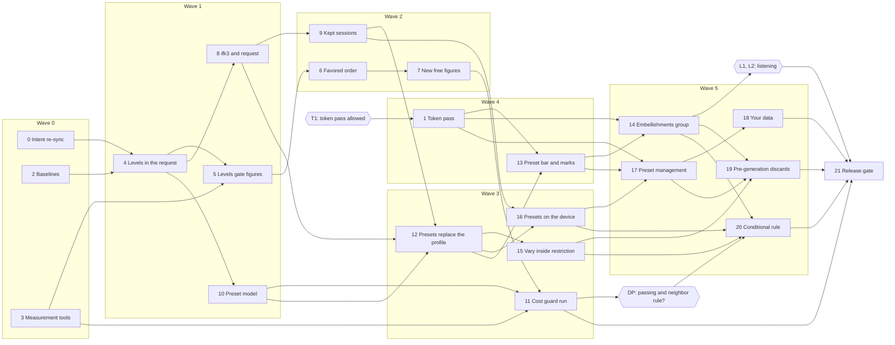

# Infinite Flow v3.1 — Build Plan

Status: v7 (2026-10-19): wave 1's preflight corrections, before its first chunk: chunk 9's step
reads both shapes and stays in wave 2; the kept summary's profile comes from the session history;
chunk 4 takes the profile out of the pitch policy and the harmony planner; chunk 8 owns the
replay-key specs and the stale prompt's labels (spec D364–D366).
v6 (2026-10-19): gate CS cleared, wave 1 no longer waits on it (spec D363).
v5 (2026-10-19): entry budget 300 KiB, gate CS for the MAJOR contract bump (it blocks wave 1's
sync), the contract atoms each chunk revises, chunk 8 removes chunk 2's lint exception (spec
D359–D362).
v4 (2026-10-19): gates D0 and R0 cleared, T1 not given, waves re-formed around it, code facts
refreshed, design links on the frozen v3.1 design (spec D353–D356, ux D324). Approved by the owner
on 2026-10-19 (spec D357), with the transitional interface below.

Embellishment figures and presets, written from [master spec Part B](master-spec.md#part-b--v31)
(v1.0, approved 2026-10-08, with spec D250 written in) and the v3.1 design, frozen at
[`ui_ux/versions/v3.1/`](../../../ui_ux/versions/v3.1/README.md) (ux D225–D251, approved by the
owner on 2026-10-19: gate D0; frozen by ux D324): everything marked `[v3.1 new]`, `[v3.1 changed]`
or with a `_v3.1 …:_` change-block line. The frozen v3.0 design is [`ui_ux/versions/v3.0/`](../../../ui_ux/versions/v3.0/README.md).
Code facts: [embellishment-flags.md](embellishment-flags.md) and [presets.md](presets.md), written
against `main` (bcf0cfb) on 2026-10-08; every file and symbol this plan names was checked again
against `main` (d007b27, v3.0 released) on 2026-10-19, and the plan follows the code where the two
drafts are older. The plan follows the build-plan model
(`~/.local/share/dev_team/references/build-plan-model.md`) through the project's
[build workflow](build-workflow.md). Music terms: the
[lexicon](../../../docs/music/lexicon.md).

**v3.1 is built on v3.0**: every chunk of the [v3.0 build plan](build-plan.md) merged and its
release gate passed (gate R0, met). This plan names v3.0's modules where v3.0 landed them (checked
on d007b27); where code moves again before a wave starts, the wave preflight follows the code.

## Read first: what v3.1 changes in v3.0 and v2

> Neutral and Jazz must keep generating exactly what v3.0 generates, note for note, while the idea
> they are built on (a named "musical profile" the generator looks up) is taken out of about
> fifty source files (48 on d007b27, about ten of them in the generator and the validator). A corpus recorded on v3.0 before any change
> ([chunk 2](#chunk-2--baselines-the-v30-phrase-corpus-and-the-bundle)) guards every generator
> chunk.

[B11](master-spec.md#b11-what-v31-changes-in-v30-and-in-v2s-guarantees) lists what v3.1 changes on
purpose. Each enforcement point changes in exactly one chunk, never "along the way". Test titles are
as on `main` (d007b27); a chunk finds each one by its title, not its line.

| What holds today                                                                                                                                                                                                                                                                                                                                                                                                                                                                                                                                                                                                                                                                                                                                                                                                                                                                                                             | Changed in                                                                                           | Becomes                                                                                                                                                                                                                                                                                                                                                                                                                                                                    |
| ---------------------------------------------------------------------------------------------------------------------------------------------------------------------------------------------------------------------------------------------------------------------------------------------------------------------------------------------------------------------------------------------------------------------------------------------------------------------------------------------------------------------------------------------------------------------------------------------------------------------------------------------------------------------------------------------------------------------------------------------------------------------------------------------------------------------------------------------------------------------------------------------------------------------------- | ---------------------------------------------------------------------------------------------------- | -------------------------------------------------------------------------------------------------------------------------------------------------------------------------------------------------------------------------------------------------------------------------------------------------------------------------------------------------------------------------------------------------------------------------------------------------------------------------- |
| Contract guarantees `rule_mutation_profile_flip_keeps_controls` (removed), `rule_mutation_marks_profile_customized` 0.3, `rule_mutation_setting_scales` 0.2, `rule_mutation_reverts_at_session_end` 0.2                                                                                                                                                                                                                                                                                                                                                                                                                                                                                                                                                                                                                                                                                                                      | **Applied** 2026-10-08 (CONTRACT 3.0, D246)                                                          | The new wordings hold for v3.0 and v3.1 alike. The flip atom itself is deleted at [chunk 12](#chunk-12--presets-replace-the-musical-profile)'s wave sync.                                                                                                                                                                                                                                                                                                                  |
| The chromatic capability looked up from the profile's name: `MUSICAL_PROFILE_CAPABILITIES` (`src/domain/controls/profile-selection.ts:40-45`), read in `makePitchPolicy` (`src/domain/pitch/pitch-policy.ts:60`) and `melodicFailures` (`src/domain/validation/generation-result-validator.ts:141`)                                                                                                                                                                                                                                                                                                                                                                                                                                                                                                                                                                                                                          | [4](#chunk-4--figure-levels-in-the-generation-request)                                               | Derived from the figure levels the request carries; no code reads a profile or preset name to decide a note.                                                                                                                                                                                                                                                                                                                                                               |
| "Neutral is entirely diatonic", a project policy in [pitch-planner-validation.md](../../../docs/music/pitch-planner-validation.md#authority-and-ownership) and `rule_neutral_profile_diatonic_pitches`                                                                                                                                                                                                                                                                                                                                                                                                                                                                                                                                                                                                                                                                                                                       | [5](#chunk-5--levels-gate-the-figures)                                                               | A property of Neutral's levels: a chromatic note is refused only when both chromatic figures are Off.                                                                                                                                                                                                                                                                                                                                                                      |
| The profile flip in Vary settings: `tests/unit/session/settings-mutation-scales.spec.ts` › 'flips Neutral and Jazz, keeps every control and marks the profile customized', › 'marks the profile customized after a profile-controlled step, keeping its identity', › 'leaves the customized mark as it was after a step of a value the profile does not control', › 'classifies every eligible setting as profile-controlled, free, or the profile itself', › 'holds one scale per eligible setting…'; `tests/unit/session/settings-mutation.spec.ts` › 'changes exactly one eligible setting by one step, never tempo or the instrument' (its `musicalProfile` branch); `tests/e2e/session/session-vary-settings.spec.ts` › 'a profile flip shows in place at its phrase with nothing moving, and a hidden tab restores it'; the `VARIED` fixture of `tests/unit/components/workspace/WorkspaceShell-vary-settings.spec.ts` | [12](#chunk-12--presets-replace-the-musical-profile)                                                 | The figure step in the profile's place in the draw; Tension, Leapiness, Arpeggio chaos and the levels mark Custom.                                                                                                                                                                                                                                                                                                                                                         |
| A profile sets seven controls and leaves Tension alone: `tests/unit/domain/controls/generation-controls.spec.ts` › 'applies each complete immutable bundle and reselecting replaces arbitrary custom values', › 'retains grammar identity on controlled custom edits and never mutates preset definitions', › 'does not mark a profile custom after a non-profile-controlled edit'; `tests/e2e/release/defaults-and-controls.spec.ts` › 'the Neutral preset sets its seven controlled values', › 'the Jazz preset sets its seven controlled values', › 'manually editing a preset-controlled value clears the preset selection to custom'; `tests/unit/composables/use-generation-session.spec.ts` › 'marks the applied preset custom after a manual rhythmic-variety edit, the same as any other preset field'                                                                                                              | [12](#chunk-12--presets-replace-the-musical-profile)                                                 | A preset sets ten controls and seven levels; Custom names its base.                                                                                                                                                                                                                                                                                                                                                                                                        |
| The "Custom (Jazz grammar)" and "grammar retained" copy: `tests/unit/components/controls/control-options.spec.ts` › 'shows the retained grammar in parentheses during a custom edit'; `tests/unit/components/controls/ControlPanel.spec.ts` › 'shows the control-summary line and recomputes it…', › 'shows the retained-grammar custom status text and clears the preset selection', › 'holds both preset status texts in one cell…'; `WorkspaceShell-vary-settings.spec.ts` › 'shows the controller's settings during a session, and the player's own again at its end'; `session-vary-settings.spec.ts` › 'a register stepped from Varying is Varying again after Stop, and the flag is set in the Review'                                                                                                                                                                                                                | 12 (summary copy), [13](#chunk-13--the-preset-bar-and-the-key-and-mode-marks) (the status line goes) | "Custom, based on {name}" in the box and the summary; the status line is removed.                                                                                                                                                                                                                                                                                                                                                                                          |
| Replay keys encode the profile name and its customized flag: `tests/unit/generation-worker/phrase-replay-key.spec.ts` (the `tupleOf` helper, › 'round-trips a custom Jazz profile', › 'is one line of the ifk1 prefix and unpadded base64url', › 'rejects a payload that is not a 7-entry array', › 'rejects a slot of the wrong type and names it', › 'refuses a key that is not one well-formed ifk1 key'); the `ifk1`-bound cases of `phrase-replay.spec.ts` and `tests/unit/scripts/replay-phrase-script.spec.ts`                                                                                                                                                                                                                                                                                                                                                                                                        | [8](#chunk-8--replay-key-ifk3-the-profile-leaves-the-request)                                        | Encoding writes `ifk3.` for every phrase; every `ifk1.` and `ifk2.` decoding test stays (`ifk2.`'s in `phrase-replay-key-ifk2.spec.ts` and the replay script's spec).                                                                                                                                                                                                                                                                                                      |
| The worker refuses any extra field in the profile selection (`parseProfileSelection`, `PROFILE_SELECTION_ALLOWED_KEYS`, `src/generation-worker/generation-worker-inbound.ts:41-58`). No test covers that refusal today.                                                                                                                                                                                                                                                                                                                                                                                                                                                                                                                                                                                                                                                                                                      | 8                                                                                                    | The intent has no profile selection; the worker checks the seven levels instead, refusing an unknown figure or level, with a test.                                                                                                                                                                                                                                                                                                                                         |
| v3.0's settings record holds the musical profile selection (the `profileSelection` record of `src/storage/records/settings-record.ts`, [v3.0 chunk 6](build-plan.md#chunk-6--tolerant-settings-codec))                                                                                                                                                                                                                                                                                                                                                                                                                                                                                                                                                                                                                                                                                                                       | [16](#chunk-16--presets-and-levels-on-the-device)                                                    | The preset selection and seven level records, migrated at open (data version 3).                                                                                                                                                                                                                                                                                                                                                                                           |
| v3.0's kept phrases hold the profile in their reproduction inputs (`parseKeptIntent`, `src/storage/records/kept-phrase-parsers.ts`); the summary holds the musical profile with its customized flag (`src/storage/records/kept-session-summary.ts`) ([v3.0 chunk 9](build-plan.md#chunk-9--kept-session-record))                                                                                                                                                                                                                                                                                                                                                                                                                                                                                                                                                                                                             | 8 (read), [9](#chunk-9--kept-sessions-hold-the-levels-and-the-preset-label) (migrated)               | The seven levels, and the session's preset label, migrated at open (data version 2).                                                                                                                                                                                                                                                                                                                                                                                       |
| v3.0's pre-generation discards on a change of the profile, part of its queue key (`settingsKeyOf`, `src/components/workspace/workspace-pregeneration.ts`; [v3.0 chunk 24](build-plan.md#chunk-24--pre-generation-at-idle))                                                                                                                                                                                                                                                                                                                                                                                                                                                                                                                                                                                                                                                                                                   | 12, 15, [19](#chunk-19--pre-generation-discards)                                                     | A preset choice that changes something, a level, or the restriction in force (B8.3).                                                                                                                                                                                                                                                                                                                                                                                       |
| The recorded fixtures: the cold-generation goldens (`cold-generation-golden/*.golden.v1.json`), the cases and hashes of `generation-outcome-golden.v3.ts`, the `ifk1.` corpus recorded on v2.0 (`tests/fixtures/replay-keys/ifk1-v2.0.json`) and chunk 2's v3.0 corpus (`v3.0-neutral-jazz.json`, the first holding `ifk2.` keys); and the replay assertions over them: each key decodes and replays to its recorded phrase, each golden case gives its recorded outcome                                                                                                                                                                                                                                                                                                                                                                                                                                                     | **Never**                                                                                            | They stay byte-identical and every such assertion passes as written: Neutral and Jazz reproduce v3.0 (item 2). A chunk that needs to change one is wrong. The spec files around them may change only to pass the same inputs in a new form: chunk 8 replaces the re-encode cases (re-encoding now writes `ifk3.`) and reads a key's profile from its raw tuple; a chunk that drops the profile from the intent factory's input passes `levelsForProfile(profile)` instead. |

Every replaced test gets its v3.1 counterpart in the same chunk, and the release gate lists each
pair (item 22).

**The transitional interface.** Between chunks 12 (wave 3) and 13 (wave 4) the box offers Neutral
and Jazz only, through the old two-segment control, and the seven levels have no control yet (chunk
14, wave 5); every rule holds, only the list is short. From chunk 8 (wave 1) the stale-phrase prompt
names a Neutral–Jazz change by the labels of the two chromatic figures, whose controls come with
chunk 14 (wave 5). Between waves 1 and 2, data version 1's kept sessions hold two phrase shapes,
a profile (v3.0) or the levels (chunk 8), both read; chunk 9's version 2 step (wave 2) carries both
over (spec D364). Waves 0–3 may merge into `main` in that state and `main` may stay in it while T1
waits, but no release is cut before wave 5 has merged.

## Gates

| Gate         | What                                                                                                                                                                                                                                                                                                                                                                                                                                                                                                                                                                                 | Cleared by                                                                                                | Blocks                                                                                                                                                                                                                      | Status                                                       |
| ------------ | ------------------------------------------------------------------------------------------------------------------------------------------------------------------------------------------------------------------------------------------------------------------------------------------------------------------------------------------------------------------------------------------------------------------------------------------------------------------------------------------------------------------------------------------------------------------------------------ | --------------------------------------------------------------------------------------------------------- | --------------------------------------------------------------------------------------------------------------------------------------------------------------------------------------------------------------------------- | ------------------------------------------------------------ |
| **R0**       | v3.0 is released: the [v3.0 release gate](build-plan.md#chunk-26--v30-release-gate) passed and `3.0.0` is tagged, so chunk 2's corpus is recorded on the code v3.0 ships.                                                                                                                                                                                                                                                                                                                                                                                                            | The owner, at v3.0's release                                                                              | Chunks 0 and 2, and through them every chunk                                                                                                                                                                                | done (2026-10-16, tag `v3.0.0`; spec D354)                   |
| **D0**       | The owner approves the v3.1 design; `ux-writer` copies it into [`ui_ux/versions/v3.1/`](../../../ui_ux/versions/v3.1/README.md); `spec-writer` repoints this plan's design links there.                                                                                                                                                                                                                                                                                                                                                                                              | The owner; `ux-writer`; `spec-writer`                                                                     | Chunks 1 and 15, and through 1 the interface chunks (13, 14, 17, 18, 20)                                                                                                                                                    | done (2026-10-19, spec D353; frozen by ux D324), v3.1 only   |
| **T1**       | The owner allows one `ux-writer` pass on `src/styles/theme.css` and `components.css` for v3.1's token additions ([`token-source-v3.1.md`](../../../ui_ux/versions/v3.1/token-source-v3.1.md), part 1 of the root's `token-source-v3.1-v3.2.md`), as he did for v3.0 (ux Q66).                                                                                                                                                                                                                                                                                                        | The owner                                                                                                 | Chunk 1, and through it 13, 14 and 17–20 (waves 4 and 5) and the release gate                                                                                                                                               | not given (2026-10-19, spec D355): asked again before wave 4 |
| **DP**       | The [cost-guard decision](#decision-point-the-passing-and-neighbor-rule), from chunk 11's M2 run.                                                                                                                                                                                                                                                                                                                                                                                                                                                                                    | The owner is told the figures and the outcome; `spec-writer` records it; `documentalist` records the atom | Chunk 20 (built, or dropped)                                                                                                                                                                                                | open (after chunk 11)                                        |
| **L1**       | The owner's listening check of the figure levels ([H1](#hand-checks)); the shares are tuned from it.                                                                                                                                                                                                                                                                                                                                                                                                                                                                                 | The owner                                                                                                 | The release gate's final M1 and M2 runs                                                                                                                                                                                     | open (after chunk 14)                                        |
| **L2**       | The owner's listening check of the eight built-in presets ([H2](#hand-checks)).                                                                                                                                                                                                                                                                                                                                                                                                                                                                                                      | The owner                                                                                                 | The release gate                                                                                                                                                                                                            | open (after chunk 14)                                        |
| **Contract** | B11's four guarantee changes confirmed and applied (CONTRACT 3.0).                                                                                                                                                                                                                                                                                                                                                                                                                                                                                                                   | The owner; `documentalist`                                                                                | Nothing; the release gate checks the record (item 23)                                                                                                                                                                       | done (2026-10-08, spec D246)                                 |
| **CS**       | The MAJOR contract bump for v3.0's STABLE contract atoms that v3.1 revises (the twelve of the change set's [part I3](../../../docs/release/v3.1-v3.2-intent-change-set.md#i3-for-the-owner-not-applied)) and for `rule_open_phrase_ending` ([B11](master-spec.md#b11-what-v31-changes-in-v30-and-in-v2s-guarantees); spec D361, D362): `documentalist` drafts their new wordings, the three "to decide" rows first (two weaken a guarantee); the owner confirms them all at once. The chunks that revise them say "(contract, CS)" in their Revisions line: 8, 9, 12, 16, 17 and 18. | `documentalist` drafts; the owner confirms                                                                | The sync of wave 1, the first wave whose chunks revise one (chunk 8: `rule_kept_session_content`, `entity_kept_session_record`, `module_kept_session_codec`); its chunks may be built and merged into the wave branch first | done (2026-10-19, spec D363)                                 |

## Waves

| Wave | Chunks                                                                                                                                                | Waits for                                                                                                                                                                                                                                                          | Status              |
| ---- | ----------------------------------------------------------------------------------------------------------------------------------------------------- | ------------------------------------------------------------------------------------------------------------------------------------------------------------------------------------------------------------------------------------------------------------------ | ------------------- |
| 0    | 0 Intent re-sync · 2 Baselines · 3 Measurement tools                                                                                                  | Nothing (R0 done). Chunk 3 records its baselines on v3.0's code: nothing in this wave changes the generator.                                                                                                                                                       | merged (2026-10-19) |
| 1    | 4 Figure levels in the request · 5 Levels gate the figures · 8 Replay key `ifk3.` · 10 Preset model                                                   | Wave 0. In-wave 4 → 5, 4 → 8 and 4 → 10: chunk 4's capture fixes the figure ids, the level type and the request's `figureLevels`.                                                                                                                                  | planned             |
| 2    | 6 Favored levels order the search · 7 Two new free figures · 9 Kept sessions hold the levels                                                          | Wave 1. In-wave 6 → 7: chunk 6's capture fixes the draw and the candidate's figure.                                                                                                                                                                                | planned             |
| 3    | 11 Cost guard, first run · 12 Presets replace the musical profile · 15 Vary settings inside the restriction · 16 Presets on the device                | Wave 2. In-wave 12 → 15 and 12 → 16: chunk 12's capture fixes the session settings and the routing point. DP opens at its end.                                                                                                                                     | planned             |
| 4    | 1 Token-source pass · 13 Preset bar and marks                                                                                                         | Wave 3; **T1** (not given, D355). Two chunks: every other chunk T1 holds needs both 1 and 13, which would make a chain of three, and every chunk T1 does not hold is in waves 0–3 so that it need not wait.                                                        | blocked (on T1)     |
| 5    | 14 Embellishments group · 17 Preset management · 18 Your data · 19 Pre-generation discards · 20 Passing and neighbor never both Off (**conditional**) | Wave 4; DP (20). In-wave 14 → 19 and 14 → 20: chunk 14's capture fixes the level controls' option model and their change path; 17 → 18 and 17 → 19: chunk 17's capture fixes the player-presets composable. L1 and L2 open at its end. Four chunks if DP drops 20. | planned             |

The [release gate](#chunk-21--v31-release-gate) (chunk 21) follows wave 5, with L1 and L2. κ is 1
([build workflow](build-workflow.md#concurrency-and-order)). If the owner gives T1 before wave 3's
preflight, chunk 1 joins wave 3 (no chunk there needs it) and `spec-writer` re-forms waves 4 and 5
as 13, 14, 17 and 18, 19, 20.

The critical path runs 0 → 4 → 8 → 9 → 12 → 13 → 14 or 17 → 19 → 21, and T1 → 1 → 13 joins it:
from wave 4 on, the release waits on T1.

## Workflow deltas

The [build workflow](build-workflow.md) holds for v3.1 with release name `v3.1`. v3.1's own:

- **Corpus guard** (a chunk check): chunks 4–9, 12, 15 and 20 run chunk 2's v3.0 corpus
  (`tests/unit/generation-worker/phrase-replay-key-v30-corpus.spec.ts`, the first corpus holding
  `ifk2.` keys), the `ifk1-v2.0.json` corpus (`phrase-replay-key-corpus.spec.ts`), the `ifk2.`
  decoding tests and the cold-generation goldens, their fixtures and replay assertions unchanged
  (the Read-first table's **Never** row). Red means Neutral or Jazz no longer reproduces v3.0.
- **Sweep at the wave gate**: chunks 4, 5, 6, 7, 12 and 15 place it there, so waves 1–3 run it.
- **Intent**: the DRAFT atoms are tagged `release-v3.1`, the atoms to revise `changes-in-v3.1`;
  revisions are part E and drift checks part F of the
  [v3.1–v3.2 intent change set](../../../docs/release/v3.1-v3.2-intent-change-set.md). Chunks 2, 3
  and 11 add no atom. A revision marked "(contract, CS)" changes a STABLE contract atom: it is
  part of one MAJOR contract bump whose wordings the owner confirms first (gate [CS](#gates)).
- **Chunks 0 and 1 are not coding chunks**: the driver hands chunk 0 to `documentalist` (spec
  ingestion, milestone refinement) and chunk 1 to `ux-writer`.
- **Area documents**: `docs/session-engine.md`, `docs/phrase-workspace.md`,
  `docs/generation-latency.md`, [`docs/music/`](../../../docs/music/README.md); the lexicon entries
  B11 lists.
- **Entry budget**: 300 KiB (307,200 B), raised from 224 KiB in wave 0
  ([M4](#m4--the-first-load-bundle)).
- **Hand checks** go into a new "v3.1 hand checks" part of
  [`HARDWARE-CHECKLIST.md`](../../../HARDWARE-CHECKLIST.md), written by the chunk the
  [table](#hand-checks) names. The file's v3.0 part already uses H2–H9, so the v3.1 part names its
  checks "v3.1 H1" to "v3.1 H5".

## Measurements and hand checks

The release gate copies every figure into the release notes. The corpus of chunk 2 is a guard, not
a measurement: it passes, or the chunk stops.

### M1 — Figure shares

- **What:** for each figure and level, the share of phrases holding it as a free figure and its
  count per phrase, in the order [B5.2](master-spec.md#b52-four-levels) requires (item 3). Favored
  and Strongly favored start at about 1 in 4 and 1 in 2 of the notes where the figure could start,
  tuned by H1 and M2.
- **How:** chunk 3's census over a fixed seed sweep (the deadline sweep's 568 rhythm settings × two
  seeds, in each of the nine collections: Major, Minor and the seven modes), one figure raised at a time from the Neutral defaults, then
  all raised.
- **Run by:** chunk 3 (the As today baseline, on v3.0); chunks 5, 6 and 7, as a chunk check (the
  census is their acceptance test); chunk 11; the release gate, after L1's tuning.
- **Recorded:** a new "Embellishment figures" section of `docs/generation-latency.md`, with the
  final shares; the constants carry a comment pointing there.

### M2 — The cost guard

- **What:** [B5.6](master-spec.md#b56-the-cost-guard)'s guard at its three settings, against its
  acceptance. The allowance is `DEFAULT_WINDOW_SEARCH_FUEL` and `CARRY_IN_WINDOW_SEARCH_FUEL` in
  `src/domain/generation/orchestration/search-ledger.ts`, not raised.
- **How:** chunk 3's cost runner on the deadline sweep (`npm run test:sweep`: the 568 cases at 60,
  120 and 240 BPM, each attempt charged its measured time) and in a 240 BPM session. **Speed drill
  first** ([B6.5](master-spec.md#b65-the-built-in-presets): the most expensive setting found);
  every built-in on the sweep in every mode its restriction allows (item 9).
- **Run by:** chunk 3 (baseline); chunk 11 (first run and [DP](#decision-point-the-passing-and-neighbor-rule));
  the release gate, after L1's tuning. The owner runs the deciding runs on the reference machine.
- **Recorded:** `docs/generation-latency.md` ("Embellishment figures: the cost guard"), beside the
  568-case sweep figures v3.0 already records there ("Phrase 2 after pre-generation"); the
  carry-in figures still kept only in the
  [ISS-009 record](../../../issues/Ref_20261006_failed_carry_in_attempts_slow.md) move there too.

### Decision point: the passing-and-neighbor rule

Gate DP: whether B5.6's rule (the passing tone and the neighbor tone may not both be Off) ships.

- **Taken in [chunk 11](#chunk-11--the-cost-guard-first-run)**, on the reference machine, with the
  shares as they stand then. `documentalist` then adds the rule as an atom (adopted), or records
  that it was measured and not needed (rejected).
- **Adopted:** [chunk 20](#chunk-20--passing-and-neighbor-never-both-off-conditional) builds it.
  **Rejected:** chunk 20 is dropped, every level stays selectable.
- **Re-checked at the release gate:** the final run must still meet the acceptance at all three
  settings. If a tuning breaks it, the share is tuned down; the decision reopens only if "every
  diatonic figure Off" itself flips, and then goes back to the owner.

### M3 — The start-up read and the migrations

- **What:** whether loading the player presets with the settings stays inside v3.0's start-up wait
  (Part A §4.4, v3.0's M2), and how long v3.1's first open takes to migrate v3.0's data (data
  versions 2 and 3); a slower read makes the visit a failed-read visit
  ([B7](master-spec.md#b7-saving-on-the-device)).
- **Run by:** chunk 9 (the version 2 upgrade on 10, 100 and 500 v3.0 kept sessions); chunk 16 (the
  version 3 upgrade, and the start-up read on a seeded database with 0, 50 and 60 player presets,
  60 written from two tabs, and 0, 10, 100 and 500 kept sessions, cold and warm). The owner repeats
  the deciding runs on the reference machine.
- **Acceptance:** each, upgrade included, well under the start-up wait constant. If the
  kept-session upgrade does not fit with many pinned sessions, chunk 9 maps each v3.0 body when it
  is read instead (B9, spec D250), decided before chunk 9 merges.
- **Recorded:** `docs/storage.md`.

### M4 — The first-load bundle

- **What:** the entry chunk stays within its 300 KiB budget, 307,200 B (`entryChunkByteBudget`,
  `scripts/verify-boundaries.mjs`): the owner's "300kb", read in the unit of v3.0's 224 KiB budget
  (spec D359). v3.0 left 230 bytes of that one; the combo box, the seven level controls and the
  built-in table add code (B12).
  The preset sheet and Your data's Presets section load on demand; the built-in table, the preset
  bar and the seven level controls are in the entry chunk.
- **Run by:** chunk 2 (the baseline on the v3.0 release, 229,146 B); every wave gate; the release
  gate (`npm run verify:boundaries` at 300 KiB). The constant's raise lands in wave 0, made by the
  driver.
- **Recorded:** the wave log and each wave's merge commit message; the release notes.

### Hand checks

The owner runs these on the Travel Sax over USB and the reference machine.

| Check                            | Written by | Run at                                 | What the owner does                                                                                                                                                                                                                                                                               |
| -------------------------------- | ---------- | -------------------------------------- | ------------------------------------------------------------------------------------------------------------------------------------------------------------------------------------------------------------------------------------------------------------------------------------------------- |
| H1 Listening: the levels (L1)    | 14         | After wave 5; used by the release gate | For each figure, at a few settings that leave it room (Eighth and Sixteenth, Heavily varied), regenerate a handful of phrases at Rarely, Often and Very often; say whether Often is clearly heard and Very often not overwhelming. The shares are tuned from it, then M1 and M2 re-run.           |
| H2 Listening: the built-ins (L2) | 14         | After wave 5; used by the release gate | Choose each of the eight presets, regenerate a few phrases, play a short session; say whether each sounds as its description says (Reel in Mixolydian, Bebop's chromatic lines, Pop song's familiar chords, Modal (Dorian)'s color note). Neutral and Jazz should sound exactly as in v3.0.       |
| H3 Same phrase in Edge           | 8          | Chunk 8                                | Run chunk 8's in-browser replay test once with Playwright's Microsoft Edge channel (`msedge`), and replay one `ifk3.` key copied from a Chrome session in Edge; the phrases match. Item 7's "Chrome and Edge" half.                                                                               |
| H4 Vary settings under a preset  | 15         | Chunk 15                               | With the Travel Sax, Vary settings on, Reel chosen from C Ionian: a long session moves the mode only between Mixolydian and Dorian, the box turns to "Custom, based on Reel" when a setting moves, and Stop brings back Reel and its settings. Repeat under Modal (Dorian): the mode never moves. |
| H5 v3.0 data carried over        | 16         | The release gate                       | In the installed app and a plain Chrome tab that used v3.0 (settings changed, a pinned session, a Jazz selection with a changed Tension), update to v3.1: the settings come back, the box shows "Custom, based on Jazz", the pinned session opens with its label and plays back the same notes.   |

## Chunks

"Item _n_" is item _n_ of the [definition of done](master-spec.md#b14-definition-of-done). The
**Atoms** and **Revisions** lines follow the [build workflow](build-workflow.md#intent-atd).

### Chunk 0 — Intent re-sync

Status: merged (w0, 60fe7d8)
Wave: 0
Depends on: R0 (it checks the atoms against the state v3.0's release gate left)
Architecture capture: none

- **Goal:** make sure the 38 `release-v3.1` atoms and the 17 `changes-in-v3.1` atoms still match
  master spec Part B and v3.0's released state, before the first v3.1 chunk relies on them.
- **Scope:** `documentalist`, spec ingestion (milestone refinement); atoms only, no code.
  - Part B as it stands when the build starts: the decisions recorded after the ingestion of
    2026-10-08 (D247 onwards) that touch Part B.
  - The atoms v3.0's gate promoted or revised that v3.1 revises again
    (`rule_settings_saved_on_change`, `rule_kept_session_content`, `req_kept_session_list`,
    `rule_pregeneration_discarded_on_change`, `rule_persistent_storage_requested`,
    `rule_delete_everything`, `req_your_data`): their `changes-in-v3.1` notes still name the right
    change.
  - Out: the passing-and-neighbor rule stays unmade until DP.
- **Files:** `docs/*.atom.md`; the [change set](../../../docs/release/v3.1-v3.2-intent-change-set.md).
- **Spec sections:** [Part B](master-spec.md#part-b--v31). No item directly; every later wave's
  preflight relies on it.
- **Atoms:** every atom tagged `release-v3.1` or `changes-in-v3.1`;
  `contract_infinite_flow_first_release`, now at 6.3.1 (it moved through 4.0, 5.0, 6.0 and the
  D347 trim during v3.0): the CONTRACT 3.0 wordings (the change set's part A) still hold in it.
- **Revisions:** none.
- **Done when:** each Part B behaviour is stated by an atom (still DRAFT); `npm run atd:lint` and
  `npm run atd:check` pass; the change set file records what changed, if anything.
- **Verification:** `documentalist`'s ingestion report; chunk checks.
- **Split rule:** none needed.

Record: 60fe7d8, `documentalist` on `v3.1-w0` (atoms only). Two atoms revised (B7, B9), two added (B6.1, B7), three REVIEW atoms tagged `changes-in-v3.1`; change set part I. Owner points in part I3 (a STABLE tag, the contract bump for v3.0's STABLE atoms that v3.1 revises); `spec-writer` points in part I4.

### Chunk 1 — Token-source pass, part 1 (v3.1)

Status: blocked (on T1)
Wave: 4
Depends on: T1 (D0 approved)
Architecture capture: none

- **Goal:** write v3.1's new tokens and component classes into the canonical token source, so every
  interface chunk can style its components without inventing a value.
- **Scope:** `ux-writer`, not a coding executor. Everything in the frozen
  [`token-source-v3.1.md`](../../../ui_ux/versions/v3.1/token-source-v3.1.md) (part 1 of the root's
  `token-source-v3.1-v3.2.md`), under `v3.1 new` /
  `v3.1 changed` comments: the tokens `--preset-select-inline-size` and `--segment-mark-size`; the
  classes `preset-bar`, `preset-select` (its read-only state), `preset-actions`,
  `segment.is-marked`, `control-group-figures`, `control-group-intro`, `choice-list`,
  `choice-option`, `name-alert`, `sheet-list`, `sheet-list-row`. Out: removing `preset-status` and
  `preset-status-text` (the status line is rendered until [chunk 13](#chunk-13--the-preset-bar-and-the-key-and-mode-marks),
  which deletes them); part 2 (v3.2), so the document stays and `ux-writer` marks part 1 applied
  in it.
- **Files:** `src/styles/theme.css`, `src/styles/components.css`;
  `ui_ux/token-source-v3.1-v3.2.md`.
- **Design docs:** [`ui_ux/versions/v3.1/token-source-v3.1.md`](../../../ui_ux/versions/v3.1/token-source-v3.1.md),
  [`ui_ux/versions/v3.1/README.md`](../../../ui_ux/versions/v3.1/README.md). No item directly; it unblocks 13, 14,
  17, 18 and 20.
- **Atoms:** none (styling is not business behaviour).
- **Revisions:** none.
- **Done when:** every class and token part 1 names exists in `src/styles/`; no v3.1 handoff names a
  class that exists nowhere (`preset-status` excepted until chunk 13); `npm run test:notation`
  passes with no snapshot change; `npm run lint:links` passes.
- **Verification:** chunk checks; `npm run test:notation` (this chunk's area); a `grep` of each v3.1
  handoff's class names against `src/styles/`.
- **Split rule:** none needed.

### Chunk 2 — Baselines: the v3.0 phrase corpus and the bundle

Status: merged (w0, 392cdc9)
Wave: 0
Depends on: R0
Architecture capture: none

- **Goal:** record, on the code v3.0 shipped, the facts v3.1 must not break: the phrase every
  Neutral and Jazz request gives, every `ifk1.` and `ifk2.` key's phrase, and the entry chunk's
  size.
- **Scope:**
  - A corpus generated from the `3.0.0` tag before any v3.1 change: Neutral and Jazz, each
    customized or not, × **every one of the nine collections** (Major, Minor and the seven modes) ×
    the three built-in instruments and my instrument with two different ranges × a spread of the other controls (every Tension value, every Leapiness
    and Arpeggio chaos value, Eighth and Sixteenth with Heavily varied) × several seeds, with and
    without carry-in (a carry-in whose final harmony is null included). Each case is stored as its
    key (`ifk1.` for a built-in instrument, `ifk2.` for my instrument, which the key carries inline)
    and the timeline it replays to. A unit test decodes each key, regenerates it through the worker runtime and expects
    the stored timeline byte for byte. It sits beside the `ifk1-v2.0.json` corpus, which stays.
  - The entry chunk's size after `npm run build` on the tag ([M4](#m4--the-first-load-bundle)).
- **Files:** `tests/fixtures/replay-keys/v3.0-neutral-jazz.json` (new),
  `tests/unit/generation-worker/phrase-replay-key-v30-corpus.spec.ts` (new), the recorder
  `scripts/record-replay-key-corpus.mjs` (it wrote v2.0's `ifk1.` corpus), extended for the v3.0
  cases, or a new recorder beside it (tooling), `docs/testing.md`.
- **Spec sections:** [B5.3](master-spec.md#b53-neutral-and-jazz-sound-as-before),
  [B9](master-spec.md#b9-the-generation-request-the-replay-key-and-kept-sessions); items 2 and 19
  (as the guard for chunks 4–9 and 12).
- **Atoms:** none (test plumbing). The corpus later backs `rule_neutral_and_jazz_figure_levels`
  and `rule_seeded_phrase_reproduction`, whose test links chunk 8 adds.
- **Revisions:** none.
- **Done when:** the corpus test passes on the tag and on `main`; the baseline size is recorded.
- **Verification:** chunk checks; the corpus test is red if any timeline is changed by hand.
- **Split rule:** none needed.

Record: 99d6233, merged as 392cdc9. 210 cases (126 `ifk1.`, 84 `ifk2.`), 677,547 B, recorded on the tag (`src/` identical to `v3.0.0`); entry chunk 229,146 B, 230 B under the 224 KiB budget. 21 rotated cases the workspace blocks (`UNSUPPORTED_RHYTHM_SETTINGS`) take the workspace's own nearest supported syncopation. The new spec carries a temporary `// @lint-ignore-atd` line naming chunk 8, which removes it when it adds the test links. New `.prettierignore` (the fixture only).

### Chunk 3 — Measurement tools: the figure census and the cost runner

Status: merged (w0, 6e9f36c)
Wave: 0
Depends on: R0 (its baselines are v3.0's; no chunk of its wave changes the generator)
Architecture capture: none

- **Goal:** the two scripts M1 and M2 need, run once on v3.0 for their baselines.
- **Scope:** tooling only, no product code.
  - **Figure census:** from a generated phrase (its timeline, chord plan and figure provenance),
    classify each non-chord note as one of the seven figures, or as Tension's scheduled figure,
    using the generator's own provenance where it records it (free obligations, written figure
    paths, `boundPaths`) and B5.1's definitions otherwise (beats 1 and 3 strong, steps in the
    collection, half steps, back to back under one chord). A sweep config (beside
    `vitest.sweep.config.ts`) reports, per figure and level setting, the share of phrases
    containing it and its count per phrase.
  - **Cost runner:** the deadline sweep (`tests/sweep/session-deadline-sweep-*.spec.ts`,
    `sweepCases()` in `tests/unit/session/deadline-sweep.ts`) parameterised by figure levels (until
    chunk 4 exists, by profile), plus a 240 BPM session run; it writes the share generated, the
    slowest and 95th-percentile times and the 240 BPM fallback share as JSON, the way
    `tests/perf/generation-latency.perf.ts` writes `LATENCY_OUT`.
  - Baselines on v3.0: the As today shares of passing tones, neighbor tones and chromatic figures
    (B12's "1 to 6 %" and "4 to 20 %" made exact), and the Neutral and Jazz cost figures.
- **Files:** `tests/sweep/figure-census.ts` (new), `tests/sweep/figure-census.spec.ts` (new), a
  census config, the cost runner beside `tests/sweep/deadline-sweep-measured.ts`, `package.json`
  (`measure:figures`, `measure:cost`), `docs/testing.md`, `docs/generation-latency.md` (the
  baselines).
- **Spec sections:** [B5.1](master-spec.md#b51-the-seven-figures),
  [B5.6](master-spec.md#b56-the-cost-guard), [B12](master-spec.md#b12-existing-code-and-risks);
  no item directly (M1 and M2 rest on it: items 3, 8, 9).
- **Atoms:** none (measurement).
- **Revisions:** none.
- **Done when:** the census classifies the figures of a hand-written fixture phrase holding one of
  each figure exactly; both scripts run on `main` and their baselines are recorded.
- **Verification:** chunk checks (the census's own unit test); the baseline runs (M1, M2: this
  chunk's point).
- **Split rule:** none needed (tooling, two scripts).

Record: d976392, merged as 6e9f36c. `src/` identical to `v3.0.0`, so both baselines are v3.0's; reference machine (Ryzen 5 PRO 8640HS, not a VM), 2026-10-19, idle. M1 over the 568 sweep cases × 9 collections (5,112 phrases per profile): Neutral/Jazz phrase shares passing 2.3/1.9 %, accented passing 5.3/4.0 %, neighbor 22.7/16.7 %, free appoggiatura and diatonic enclosure 0/0, chromatic approach 0/10.6 %, chromatic enclosure 0/7.9 %, Tension's scheduled figure 50.0/49.9 %, unexplained 0. M2: phrases 2–6 generated at 60 and 120 BPM 100.0/99.96 %, at 240 BPM 100/100 %; 95th percentile 0.022/0.019 s; slowest success 0.408/0.570 s; 240 BPM fallback share 21.2/21.0 % over phrases 2–6, 1.5/1.2 % over 3–6. Figures in `docs/generation-latency.md`. Scripts `measure:figures`, `measure:cost` take a `{label, apply}` setting list for chunks 4 and 11. Finding: sweep case #542 played as Jazz repeats phrase 5 at its deadline at 60 and 120 BPM (v3.0 behaviour, recorded in the doc, no issue filed). The cost runner peaks near 1.57 GB heap.

### Chunk 4 — Figure levels in the generation request

Status: merged (w1, bfa53a3)
Wave: 1
Depends on: 0, 2
Architecture capture: the figures and levels module, `src/domain/figures/figure-levels.ts`: the
seven figure ids in a fixed order (`passingTone`, `accentedPassingTone`, `neighborTone`,
`appoggiatura`, `diatonicEnclosure`, `chromaticApproach`, `chromaticEnclosure`), internal and never
changing (the replay key and storage hold them); the four levels (`off`, `asToday`, `favored`,
`stronglyFavored`, labelled Off, Rarely, Often, Very often); B5.3's table for Neutral and Jazz; the
per-figure allowance the pitch policy and the validator read. The generation request carries
`figureLevels`, from which the generator reads what it may write, never a profile or preset name
(revises `module_musical_profile_capabilities`, `module_generation_request_construction`). Chunks
5 (the allowance), 8 (the request's `figureLevels`) and 10 (the level type) build on it in the same
wave.

- **Goal:** put the seven figure levels into every generation request and make the generator read
  its chromatic allowance from them, without changing a single note.
- **Scope:**
  - `figure-levels.ts`: the figure ids, the levels, `NEUTRAL_FIGURE_LEVELS` and
    `JAZZ_FIGURE_LEVELS` (B5.3), `levelsForProfile(profile)`, and the allowance helpers.
  - `GenerationIntent` gains `figureLevels`; `makeGenerationIntent` fills it from the profile with
    `levelsForProfile` (the musical profile stays in the intent until chunk 8). The session's
    `buildAttemptIntent` passes it through unchanged.
  - `makePitchPolicy` and `melodicFailures` stop looking up `MUSICAL_PROFILE_CAPABILITIES` by name:
    `allowsChromaticApproach` becomes "the chromatic approach or the chromatic enclosure is not
    Off". These are the only two lookups by name in the app (`generation-intent.ts` only carries
    the name). The pitch policy takes the levels in place of the profile, which it read only for
    that lookup: `PitchPolicy` (`pitch-types.ts`) and the validation context's policy
    (`pitch-validation-types.ts`) lose `profile`, and `makePitchPolicy`'s one call
    (`bindingPitchPolicy`, `window-search.ts`) passes `intent.figureLevels`. So chunk 8, which has no
    path to chunk 5 in this wave, touches no pitch-search file. The test-side readers of the table
    follow: the figure census's `contextOf` (`tests/sweep/figure-census.ts`, which `test:sweep` runs
    through `figure-census.spec.ts`) and `validation-fixtures.ts`, with the pitch tests'
    `makePitchPolicy({ profile })` calls. Out: the seven other reads of that flag (five in
    `pitch-candidates.ts`, one each in `pitch-context.ts` and `figure-rules.ts`), which are chunk
    5's per-figure gating.
  - **The harmony planner reads no profile.** `makeHarmonyCandidateDomain` only checks that the
    profile it is given is known (`harmony-planner.ts`); its input (`HarmonyPlannerInput`,
    `harmony-types.ts`) loses `profile`, and its three callers (`buildHarmonyDomain` in
    `generation-orchestrator.ts`, `harmonyProvenanceFailures` in
    `generation-result-validator-checks.ts`, `carriedHarmonyFits` in `carry-in-fit.ts`) stop
    passing it, with their test call sites. It is here rather than in chunk 8 because about ten
    specs under `tests/unit/domain/pitch/` build a harmony domain, and chunk 5 edits that folder.
  - The worker's inbound parser validates `figureLevels` (exactly the seven ids, each a known
    level, no extra field) and rebuilds it; the prewarm and the cancellation paths carry it.
- **Files:** `src/domain/figures/figure-levels.ts` (new),
  `src/domain/generation/generation-intent.ts`, `src/domain/pitch/pitch-policy.ts`,
  `src/domain/pitch/pitch-types.ts`, `src/domain/pitch/validation/pitch-validation-types.ts`,
  `src/domain/generation/orchestration/window-search.ts`,
  `src/domain/validation/generation-result-validator.ts`, `src/domain/controls/profile-selection.ts`
  (the capability table goes), `src/generation-worker/generation-worker-inbound.ts`,
  `src/domain/harmony/harmony-planner.ts`, `src/domain/harmony/harmony-types.ts`,
  `src/domain/generation/orchestration/generation-orchestrator.ts`,
  `src/domain/validation/generation-result-validator-checks.ts`,
  `src/domain/generation/carry-in/carry-in-fit.ts`; `tests/sweep/figure-census.ts`; tests under
  `tests/unit/domain/figures/`, `tests/unit/generation-worker/`, and the policy's and the harmony
  planner's call sites under `tests/unit/domain/pitch/` (`validation/validation-fixtures.ts` among
  them), `tests/unit/domain/harmony/`, `tests/unit/domain/validation/`,
  `tests/unit/domain/backing/`, `tests/unit/audio/backing-harmony.ts` and
  `tests/unit/domain/generation/orchestration/candidate-ranking.spec.ts`.
- **Spec sections:** [B5.1](master-spec.md#b51-the-seven-figures),
  [B5.3](master-spec.md#b53-neutral-and-jazz-sound-as-before),
  [B9](master-spec.md#b9-the-generation-request-the-replay-key-and-kept-sessions),
  [B12](master-spec.md#b12-existing-code-and-risks); items 1 (the levels exist), 2 (guarded).
- **Atoms:** `req_embellishment_figure_levels`, `rule_embellishment_figures_defined`,
  `rule_neutral_and_jazz_figure_levels`; (v2) `rule_seeded_phrase_reproduction`,
  `rule_jazz_chromatic_resolution`, `rule_neutral_profile_diatonic_harmony`. Drift check:
  `module_musical_profile_capabilities`, `module_generation_request_construction`,
  `module_generation_worker_protocol`.
- **Revisions:** revise `module_harmony_candidate_domain` (it consumes no musical profile).
- **Done when:**
  - Every intent built for Neutral carries B5.3's Neutral levels, every Jazz intent Jazz's,
    customized or not.
  - No source file outside `src/domain/figures/` and the profile-selection module reads
    `MUSICAL_PROFILE_CAPABILITIES` or compares a profile name to decide a note (a `grep` check in
    the test of the module).
  - The worker refuses an intent whose levels miss a figure, name an unknown one, or hold an unknown
    level, with the typed protocol error.
  - The v3.0 corpus, the cold-generation goldens and every v2 and v3.0 generation test pass, their
    assertions unchanged (only the policy's and the planner's inputs lose the profile).
- **Verification:** chunk checks with the corpus guard; the sweep and the bundle at the wave gate.
- **Split rule:** if the brief passes about five source files, 4a the figures module, the intent's
  `figureLevels` and the worker (`figure-levels.ts`, `generation-intent.ts`,
  `generation-worker-inbound.ts`), 4b the allowance read from the levels and the harmony planner's
  profile (the policy, its types, `window-search.ts`, the validator, the table, the planner and its
  callers, the census and the test call sites).

Record: d06205b (4a, the figures module, `figureLevels` in the intent, the worker parser, the kept-intent reader) and 683bee4 (4b, the allowance from the levels, the harmony planner without a profile), merged as bfa53a3. `MUSICAL_PROFILE_CAPABILITIES` deleted; a grep test keeps profile-name reads out of the generator. The worker refuses bad levels with `GenerationWorkerProtocolError`. Corpus guard passed, fixtures byte-identical. Outside its Files line: `src/storage/records/kept-phrase-parsers.ts`, where `figureLevels` is an optional key, checked against the stored profile, filled from it when absent; so phrases kept from now until chunk 8 hold both `musicalProfile` and `figureLevels` (a third version 1 shape for chunks 8 and 9). The parser calls `levelsForProfile` directly until chunk 8 adds `profile-to-levels.ts`. `PitchPolicy.capabilities` keeps the field name `allowsChromaticApproach` for chunk 5.

### Chunk 5 — Levels gate the figures

Status: planned
Wave: 1
Depends on: 3 (the census its Done when runs), 4
Architecture capture: none

- **Goal:** make each figure's level decide whether the search may write it as a free figure and
  whether the validator accepts it, leaving Tension's scheduled figure alone.
- **Scope:**
  - **Free figures tagged by kind.** Today a free diatonic non-chord note has one role,
    `passing_or_neighbor` (`ordinaryCandidates`, `src/domain/pitch/pitch-candidates.ts`), and is
    told apart only when it resolves (`advanceFigure` and `freeToneResolves`,
    `src/domain/pitch/pitch-figures.ts`). The search now refuses a free tone whose resolution makes
    it a figure that is Off: a passing tone off beats 1 and 3 needs the passing tone allowed, on
    beat 1 or 3 the accented passing tone, a neighbor tone the neighbor tone (either beat).
  - **Chromatic figures per figure.** `approachPaths` and `enclosurePaths` are offered only when
    their own figure is not Off.
  - **The validator** (`figureFailures`, `freelyExplained` and `chromaticOrnament` in
    `src/domain/pitch/validation/figure-rules.ts`) accepts exactly the figures the levels allow, and
    refuses a note outside the collection (`out_of_collection`) when both chromatic figures are Off.
  - **Tension's scheduled figure is exempt**
    ([B5.4](master-spec.md#b54-free-figures-and-tensions-scheduled-figure)): `boundPaths`,
    `makeTensionBindingDomain` and `bindingStructureHolds` read no level, so every Tension value
    keeps its figure with every level Off. Code fact: Tension's appoggiatura is tried after the "no
    figure" placement and after every passing or neighbor placement, under Settled, Lift and Edge
    alike (`makeTensionBindingDomain`, `src/domain/pitch/pitch-policy.ts`, in the order
    `permittedFigureKinds` gives in `src/domain/harmony/harmony-planner.ts`); neither changes.
  - As today behaves exactly as today. Out: the two new figures, which stay impossible (chunk 7).
- **Files:** `src/domain/pitch/pitch-candidates.ts`, `src/domain/pitch/pitch-figures.ts`,
  `src/domain/pitch/pitch-types.ts`, `src/domain/pitch/validation/figure-rules.ts`,
  `src/domain/pitch/validation/pitch-validation-types.ts`, `src/domain/pitch/pitch-context.ts`;
  tests under `tests/unit/domain/pitch/` (`validation/figure-rules.spec.ts`,
  `validation/binding-agreement.spec.ts`, `validation/validation-fixtures.ts` and
  `pitch-candidates.spec.ts` read the capability today); `tests/sweep/figure-census.ts` (its
  `contextOf` builds the validator's context, so it follows the policy's per-figure shape);
  [`docs/music/pitch-planner-validation.md`](../../../docs/music/pitch-planner-validation.md),
  [`docs/music/neutral-profile.md`](../../../docs/music/neutral-profile.md),
  [`docs/music/jazz-profile.md`](../../../docs/music/jazz-profile.md).
- **Spec sections:** [B5.1](master-spec.md#b51-the-seven-figures),
  [B5.2](master-spec.md#b52-four-levels),
  [B5.4](master-spec.md#b54-free-figures-and-tensions-scheduled-figure),
  [B11](master-spec.md#b11-what-v31-changes-in-v30-and-in-v2s-guarantees); items 5 (the validator
  accepts exactly what the levels allow), 6, 2 (guarded).
- **Atoms:** `rule_figure_level_orders_search` (its Off and As today halves),
  `rule_levels_govern_free_figures_only`, `rule_chromatic_notes_need_a_chromatic_figure`,
  `rule_figures_resolve_onto_chord_tones`; (v2) `rule_neutral_profile_diatonic_harmony`. Drift
  check: `service_generation_result_validation`, `module_musical_profile_capabilities`.
- **Revisions:** revise `rule_neutral_profile_diatonic_pitches`, `rule_jazz_chromatic_resolution`,
  `rule_tension_resolution_delay_permits_rests` (chromatic approaches and enclosures under any
  preset's levels, not only Jazz's; its no-rest rule unchanged). Chunk 4 already makes
  `rule_jazz_chromatic_resolution`'s gating sentence stale (the capability is worked out from the
  levels, not declared by the profile); if chunk 5 leaves wave 1, that revision moves to chunk 4.
- **Done when:**
  - With a figure Off, the census over the M1 sweep finds it only as Tension's scheduled figure
    (for the three figures Tension can schedule) or not at all, for each of the seven in turn.
  - With every level Off, every Tension value still places its scheduled figure: Edge and Build in
    every successful phrase, Settled and Lift where they did (fixed seeds, all four values).
  - The validator refuses a phrase holding a free figure whose level is Off, and a chromatic note
    when both chromatic figures are Off; it accepts the same phrase when the level allows it (unit
    tests per figure).
  - With Neutral's and Jazz's levels, the v3.0 corpus and the goldens pass unchanged.
- **Verification:** chunk checks with the corpus guard; M1 (the census, its acceptance test); the
  sweep at the wave gate.
- **Split rule:** if the brief passes about five source files, 5a the search (candidates, figures,
  types, context), 5b the validator (figure rules and their types).

### Chunk 6 — Favored levels order the search

Status: planned
Wave: 2
Depends on: 5
Architecture capture: the favored draw, `isFigureDrawn(seed, noteIdentity, figureId, level)` in
`src/domain/pitch/figure-draw.ts`: `fnv1a32` (`src/domain/random/hash32.ts`) of the seed, the
note's identity and the figure id, kept when it falls under the level's share (a numerator over a
power of two, `FAVORED_SHARE` and `STRONGLY_FAVORED_SHARE`, starting at 1/4 and 1/2); integer
operations only (`Math.imul`, `>>> 0`, a mask), so every browser draws the same; never computed at
Off or As today. The pitch search already orders by FNV-1a tie keys (`pitchTieKey`,
`src/domain/pitch/pitch-tie-key.ts`), not by a
pseudorandom stream; the named-stream registry (`deriveNamedStream`) has no caller. And each pitch
candidate names the figure it starts, which the ranking reads. Chunk 7 builds on both in the same
wave.

- **Goal:** at about 1 in 4 (Favored) or 1 in 2 (Strongly favored) of the notes where a figure
  could start, try it before the chord tones; never require it.
- **Scope:**
  - `figure-draw.ts` (new), computed only for Favored and Strongly favored.
  - `pitchRank` (`src/domain/pitch/pitch-ranking.ts`) puts a candidate that starts a drawn figure
    before the chord tones; where several figures are drawn at one note, the higher level first,
    then the seed's usual tie key. Everything else keeps today's order, so a phrase whose levels
    are all Off or As today is searched in exactly v3.0's order.
  - A favored candidate that dead-ends is backed out of like any other; no phrase is rejected or
    retried for lacking a figure. The search's candidate memo (`CandidateDomainMemo` and
    `memoFits` in `src/domain/pitch/pitch-candidates.ts`, its key built in
    `src/domain/pitch/pitch-advance.ts`) stays correct: the draw depends only on the seed and the
    note, and the memo already keys on the chromatic allowance.
- **Files:** `src/domain/pitch/figure-draw.ts` (new), `src/domain/pitch/pitch-ranking.ts`,
  `src/domain/pitch/pitch-candidates.ts` (each candidate names the figure it starts),
  `src/domain/pitch/pitch-advance.ts` (if the memo key needs the levels); tests under
  `tests/unit/domain/pitch/`.
- **Spec sections:** [B5.2](master-spec.md#b52-four-levels), [B5.5](master-spec.md#b55-determinism),
  [B13](master-spec.md#b13-architectural-decisions-and-their-reasons); items 3, 4, 7 (the draws
  are integer-only), 2 (guarded).
- **Atoms:** `rule_figure_level_orders_search`, `rule_figure_level_never_a_quota`,
  `rule_figure_draws_reproducible`. Drift check: `mechanic_pitch_search_policy` and the pitch
  search modules, `module_named_stream_pseudorandomness` (its hash tie keys),
  `module_ranked_candidate_ordering`.
- **Revisions:** none.
- **Done when:**
  - The census's share of each figure never decreases from Off to As today to Favored to Strongly
    favored, and rises at the rhythm settings that leave it room (property over the M1 sweep).
  - A phrase is never refused for lacking a favored figure: an instrumented run counts zero
    rejections or retries tied to a level.
  - No floating-point operation in the draw (a unit test over the module's source, plus golden
    draws for a fixed seed list).
  - With Neutral's and Jazz's levels the v3.0 corpus and the goldens pass: no draw is made.
  - M1 recorded at the starting shares.
- **Verification:** chunk checks with the corpus guard; M1; the sweep at the wave gate.
- **Split rule:** none needed (four source files).

### Chunk 7 — Two new free figures: the appoggiatura and the diatonic enclosure

Status: planned
Wave: 2
Depends on: 6
Architecture capture: none (it builds on chunk 6's)

- **Goal:** let the search write a free appoggiatura and a diatonic enclosure when their level
  allows them, under every existing figure rule.
- **Scope:**
  - **Free appoggiatura:** a collection note outside the chord, entered by a leap of 3 half steps
    or more, on beat 1 or 3, resolved by one scale step onto a chord tone (the shape
    `boundFigureShapeHolds` already checks for Tension's), as a new free candidate path. Code
    fact: a free non-chord tone must be approached by a step today (`free_tone_unprepared` in
    `advanceFigure`), so a free appoggiatura is impossible, as B5.1 says.
  - **Diatonic enclosure:** the scale notes just above and below a target chord tone, in either
    order, then the target, three back-to-back notes under one chord: the one place two outside
    notes in a row are allowed, beside the chromatic enclosure.
  - Both Off for Neutral and Jazz, so no existing phrase changes: adding a candidate changes what
    the search finds when it backs up past the chord tones, which is why B5.3 keeps new figures
    Off.
  - The validator accepts each only when its level allows it; the census recognises both.
- **Files:** `src/domain/pitch/pitch-candidates.ts`, `src/domain/pitch/pitch-figures.ts` (the
  enclosure's path confirmation), `src/domain/pitch/validation/figure-rules.ts`, chunk 3's census;
  tests under `tests/unit/domain/pitch/`.
- **Spec sections:** [B5.1](master-spec.md#b51-the-seven-figures),
  [B5.6](master-spec.md#b56-the-cost-guard) (new figures enlarge the search); items 5 (the new
  figures), 3, 21 (acknowledgement for the new figures).
- **Atoms:** `rule_embellishment_figures_defined`, `rule_figures_resolve_onto_chord_tones`,
  `req_embellishment_figure_levels`. Drift check: `service_generation_result_validation`.
- **Revisions:** none.
- **Done when:**
  - With either figure Favored, the census finds it in a share of phrases that rises from As today;
    with it Off, never.
  - Every generated instance resolves once, onto a chord tone, and spans no chord change; the
    validator refuses each one when its level is Off (unit tests with hand-written phrases).
  - The v3.0 corpus and goldens pass; an acknowledgement test lights a free appoggiatura's and an
    enclosure's notes at their exact pitches only.
- **Verification:** chunk checks with the corpus guard; M1; the sweep at the wave gate.
- **Split rule:** none needed (three source files and the census).

### Chunk 8 — Replay key `ifk3.`; the profile leaves the request

Status: planned
Wave: 1
Depends on: 4
Architecture capture: the `ifk3.` format (a revision of `module_phrase_replay_key`): what `ifk2.`
carries less the musical profile's name and its customized flag, plus the seven levels by figure
id; a built-in instrument by its id (as `ifk1.`), my instrument inline (as `ifk2.`) (B9, spec
D250). The generation request without a musical profile. And the reading of a v3.0 kept phrase (a
profile, no levels) through one mapping function, `src/storage/records/profile-to-levels.ts` (a
profile name to B5.3's levels, whatever its customized flag), which chunk 9's upgrade step reuses
in wave 2 (spec D364).

- **Goal:** write `ifk3.` for every phrase, holding the levels by figure and no name, while every
  `ifk1.` and `ifk2.` key keeps decoding to the same phrase; and take the musical profile out of
  the request.
- **Scope:**
  - **The key.** `encodePhraseReplayKey` writes `ifk3.` for every phrase. `decodePhraseReplayKey`
    accepts all three versions: an `ifk1.` or `ifk2.` key's profile name maps to B5.3's levels
    whatever its customized flag; an `ifk3.` key naming a figure v3.1 does not know is refused with
    the reason; a later prefix is refused as an unsupported version, as today. `npm run
replay:phrase` replays all three. Code fact: the `ifk1.` payload is the unpadded base64url of a
    JSON 7-tuple whose first entry is the request id (a string such as `"replay-12"`). The order
    of the `ifk3.` tuple's entries, and how a built-in phrase's tuple marks that it has no my
    instrument, are this chunk's owner's to state, in the codec and its tests; they are permanent
    once a key is emitted, and the wave sync records them in `module_phrase_replay_key`.
  - **The request.** `GenerationIntent` loses `musicalProfile`; the worker's
    `parseProfileSelection` and `PROFILE_SELECTION_ALLOWED_KEYS` go, and so does the carry-in
    receiver's profile (`CarryInReceiver`, `carry-in-fit.ts`). The pitch policy and the harmony
    planner already read none (chunk 4). At the session level, `harmonySettingsDiffer`
    (`src/session/carry-in-adaptation.ts`) treats a change of levels where it treated a change of
    profile, so a v2 session's join checks are unchanged; so does the stale-phrase-1 check
    (`src/session/stale-phrase-one.ts`, v3.0), whose `StaleSetting` names the seven figures in
    place of `musicalProfile`.
  - **Where the levels come from until chunk 12:** the idle state and the session settings
    (`SessionSettings`, `src/session/session-types.ts`) still hold a musical profile selection,
    and so does the intent factory's input (`GenerationIntentInput`): `makeGenerationIntent` maps
    it to levels with `levelsForProfile`, and the intent holds none. So the goldens, the corpora's
    case builders and every test that builds an intent through the factory build it as today.
  - **The kept summary's profile.** `encodeKeptSession` takes the summary's musical profile from
    phrase 1's intent (`first.intent.musicalProfile`, `kept-session-record.ts`), which no longer
    holds one. It takes it from the session history instead: `SessionHistory`
    (`src/session/session-history.ts`) keeps the profile selection of the settings it is created
    with, the session's settings at its start, and `KeptSessionHistory` picks it. `HeldSessionFacts`
    stays as it is (STABLE `module_kept_session_save`). The record then names the session's
    settings after Use it, as `rule_stale_phrase_prompt_at_start` says, where v3.0 named phrase
    1's. Chunk 9 makes the preset label from the same source (spec D365).
  - **Kept sessions keep reading:** v3.0's kept-session codec stores the request's shape
    (`parseKeptIntent` and `parseKeptProfileSelection` in `kept-phrase-parsers.ts`), so it now
    writes levels, still at data version 1, and reads a version 1 phrase in either shape: its
    levels, or a v3.0 profile through `profile-to-levels.ts`. Chunk 9's version 2 step reuses that
    reader (spec D364).
  - **The stale-phrase prompt's labels:** `StalePhrasePrompt.vue`'s label table drops Musical
    profile preset and adds the seven figure labels after Arpeggio chaos, per the design; until
    chunk 14 a Neutral–Jazz change is named by the two chromatic figures (the transitional
    interface).
  - An in-browser replay test (workspace harness) replays a slice of the corpus through the worker,
    for H3.
  - **The replay-key specs.** Re-encoding a decoded `ifk1.` or `ifk2.` key now writes `ifk3.`. In
    `phrase-replay-key-corpus.spec.ts` and `phrase-replay-key-v30-corpus.spec.ts`, 'decodes every
    key and re-encodes it to the same key' gives way to a case that decodes every key and checks
    that its `ifk3.` re-encoding decodes to an equal intent; the v3.0 corpus spec's coverage
    (`selectionOf`) reads each key's profile from its raw tuple or its case label, not from the
    intent. In `phrase-replay-key-ifk2.spec.ts`, the cases that encode (about ten
    `encodePhraseReplayKey` calls, `startsWith('ifk2.')`, 'still encodes a built-in phrase as an
    ifk1 key of seven entries') become fixed `ifk2.` and `ifk1.` key strings that still decode,
    each with an `ifk3.` counterpart. The fixtures and the replay assertions stay (the Read-first
    table's **Never** row).
  - **Chunk 2's lint exception goes:** chunk 2 left a temporary `// @lint-ignore-atd` line (line 2)
    in `tests/unit/generation-worker/phrase-replay-key-v30-corpus.spec.ts`; this chunk removes it
    and adds that spec's `@test-link` tags: the replay case to `rule_seeded_phrase_reproduction`,
    `rule_neutral_and_jazz_figure_levels` and `module_phrase_replay_key`, the decode case to
    `module_phrase_replay_key`.
- **Files:** `src/generation-worker/phrase-replay-key.ts`, `phrase-replay-key-decode.ts`,
  `phrase-replay.ts`, `phrase-replay-report.ts`, `generation-worker-inbound.ts`,
  `scripts/replay-phrase.mjs`, `src/domain/generation/generation-intent.ts`,
  `src/domain/generation/carry-in/carry-in-fit.ts`, `src/session/session-intents.ts`,
  `src/session/carry-in-adaptation.ts`, `src/session/stale-phrase-one.ts`,
  `src/session/session-types.ts`, `src/session/session-history.ts`,
  `src/components/workspace/StalePhrasePrompt.vue`, `src/storage/records/kept-session-record.ts`,
  `src/storage/records/kept-phrase-parsers.ts`, `src/storage/records/profile-to-levels.ts` (new);
  tests under `tests/unit/generation-worker/`, `tests/unit/scripts/`, `tests/unit/storage/`,
  `tests/e2e/release/deterministic-replay.spec.ts` (new replay-key tests in a v1 file that holds no
  key test yet); and about twenty test files beyond those folders that read the intent's profile
  or the session's stale settings: under `tests/unit/session/` (`history-recording.ts`,
  `session-intents.spec.ts`, `session-engine-mutation.spec.ts`, `carry-in-adaptation.spec.ts`,
  `stale-phrase-one.spec.ts`, `deadline-sweep.ts`),
  `tests/unit/composables/use-generation-session.spec.ts`,
  `tests/unit/components/workspace/` (`workspace-session-runner.spec.ts`,
  `StalePhrasePrompt.spec.ts`), `tests/unit/domain/generation/orchestration/`
  (`generation-orchestrator-fixture.ts`, `rhythm-domain-prewarm.spec.ts`; never the goldens'),
  the carry-in specs (`tests/unit/domain/generation/carry-in/`), and `tests/e2e/`
  (`workspace-harness/main.ts`,
  `review/session-list-helpers.ts`, `workspace/pregeneration.spec.ts`). The type checker lists the
  rest.
- **Spec sections:** [B9](master-spec.md#b9-the-generation-request-the-replay-key-and-kept-sessions),
  Part A §7.4; items 19, 7 (the key reproduces; H3 for Edge), 20 (reading v3.0 phrases).
- **Design docs:** [`screens/stale-phrase-prompt/handoff.md`](../../../ui_ux/versions/v3.1/screens/stale-phrase-prompt/handoff.md)
  ({changed settings}, [v3.1 changed]).
- **Atoms:** `rule_figure_draws_reproducible`, `rule_neutral_and_jazz_figure_levels`; (v2)
  `rule_seeded_phrase_reproduction`, `rule_neutral_profile_diatonic_harmony`; (v3.0)
  `rule_kept_session_content`, `rule_stale_phrase_prompt_at_start`. Drift check:
  `module_phrase_replay_key`, `module_generation_worker_protocol`,
  `module_generation_request_construction`; at the sync, `service_session_engine` and
  `module_session_shown_settings`; and `module_on_device_database`, a known drift until chunk 9:
  kept sessions change shape at data version 1 (spec D364).
- **Revisions:** revise `rule_seeded_phrase_reproduction` (figure levels in the request);
  `rule_stale_phrase_prompt_at_start` (the levels count where the profile did, named by the
  figures' labels); `module_session_carry_in_after_change` (its harmony check reads the levels
  where it read the profile); `service_session_history` (the history keeps the session's profile
  selection from its start); (contract, CS) `rule_kept_session_content` (each phrase's inputs hold
  the levels in place of the profile; chunk 9 adds the label), `entity_kept_session_record` and
  `module_kept_session_codec` (a kept phrase's intent holds no profile; the summary's profile comes
  from the session history).
- **Done when:**
  - Every phrase's key is `ifk3.`; encoding then decoding returns an equal intent, and replaying it
    gives the same timeline, for built-in and player-made instruments.
  - Chunk 2's corpus and v2.0's `ifk1-v2.0.json` corpus pass, their fixtures and replay assertions
    unchanged: every `ifk1.` and `ifk2.` key decodes to the same phrase, a customized Jazz key to
    Jazz's levels, and its `ifk3.` re-encoding decodes to an equal intent.
  - An `ifk3.` key naming an unknown figure, or with an unknown level, is refused with the reason;
    an `ifk4.` key as an unsupported version.
  - No intent, key or kept phrase holds a profile or preset name (a test over each one's keys).
  - A v3.0-shaped kept session (seeded) still opens, its phrases read with its profile's levels.
  - A session kept by this chunk's code reopens, and its review and both exports are identical to
    those at its save.
  - After Use it, the kept session's summary names the session's profile, not phrase 1's.
  - The stale-phrase prompt names a changed level by its figure's label and never Musical profile
    preset.
  - `npm run replay:phrase` replays one key of each version.
  - `phrase-replay-key-v30-corpus.spec.ts` carries its `@test-link` tags and no `@lint-ignore-atd`
    line; `npm run atd:lint` passes.
- **Verification:** chunk checks with the corpus guard; `npm run replay:phrase -- <key>` for each
  version by hand; H3.
- **Split rule:** none: wide but mechanical (about seventeen source files, most a removed field,
  and about twenty test files beyond its own folders). It cannot be split without a throwaway key
  format: the encoder cannot write `ifk1.` once the request has no profile. The chunk owner
  decomposes it into units in the chunk's worktree (the key and its specs; the request and the
  session; storage and the summary's source; the stale prompt), one commit at the end.

### Chunk 9 — Kept sessions hold the levels and the preset label

Status: planned
Wave: 2
Depends on: 8
Architecture capture: data version 2, inside v3.0's
[storage design](build-plan.md#the-storage-design-the-chunks-build-on) (today
`DATABASE_DATA_VERSION` 1, its one step `CREATE_STORES` in `PRODUCTION_MIGRATIONS`,
`src/storage/database.ts`, which refuses a gap in the steps): one upgrade step, in a new
`src/storage/migrations/` and appended to that list, that rewrites the version 1 kept sessions,
v3.0's and those kept by wave 1's code alike: it reads each phrase with chunk 8's reader (levels
kept, a profile mapped through `profile-to-levels.ts`), and each summary's musical profile becomes
the session's preset label, a stored string. A record it cannot read is left as it is, for the codec
to report as unreadable: the step never throws on a stored value, since a throwing step rolls the
upgrade back and every later open rejects (`MigrationStepError`; spec D364). One data version per
stored shape that changes, each with its own step (v3.1 writes 2 and 3), so each migration is
tested on its own and a development database is never left half-migrated.

- **Goal:** migrate the sessions v3.0 kept, and record with each new session the preset label it
  started with.
- **Scope:**
  - **Data version 2**, an upgrade step in the migration runner of
    [v3.0 chunk 4](build-plan.md#chunk-4--database-core): the preset label takes the same form
    ("Neutral", "Jazz", "Custom, based on Jazz"). Generated timelines are not touched. Code fact:
    v3.0's summary holds the profile with its customized flag (`kept-session-summary.ts`), so B9's
    fallback to phrase 1's reproduction inputs (spec D250) is never needed on v3.0's own data; the
    step keeps it for a summary that lacks the flag. The records' own versions
    (`KEPT_SESSION_DATA_VERSION`, `kept-reading.ts`) move with it.
  - **New sessions** record the preset label at their start, as `control-summary` writes it, from
    the profile selection the session history keeps (chunk 8). Until chunk 12 that is the musical
    profile's display; chunk 12 switches the source to the preset
    selection. A snapshot: nothing later changes it.
  - The session list's detail line (`detailLine` in `src/components/review/session-row-text.ts`,
    through `profileSelectionLabel`) shows the label where it showed the profile. The review's
    summary (`summary` in `src/components/review/ReviewPanel.vue`) shows no profile today, although
    the v3.0 design said it did; it gains `{preset}` where the v3.1 design places it.
  - M3's upgrade timing.
- **Files:** `src/storage/records/kept-session-record.ts`, `kept-session-summary.ts`,
  `kept-reading.ts`, `src/storage/migrations/kept-sessions-v2.ts` (new), its registration in
  `PRODUCTION_MIGRATIONS` (`src/storage/database.ts`), `src/components/review/session-row-text.ts`
  (v3.0 chunk 14b), `src/components/review/ReviewPanel.vue`; tests under `tests/unit/storage/`,
  `tests/e2e/storage/kept-session.spec.ts` (extended).
- **Spec sections:** [B9](master-spec.md#b9-the-generation-request-the-replay-key-and-kept-sessions),
  Part A §5.2, §5.4; items 20, 2 (old sessions' notes unchanged).
- **Design docs:** [`flows/kept-sessions/handoff.md`](../../../ui_ux/versions/v3.1/flows/kept-sessions/handoff.md)
  (Terms: Preset label), [`flows/review-and-export/handoff.md`](../../../ui_ux/versions/v3.1/flows/review-and-export/handoff.md)
  (Saving the Session), [`screens/session-list/handoff.md`](../../../ui_ux/versions/v3.1/screens/session-list/handoff.md)
  (Detail line), [`screens/last-session-review/handoff.md`](../../../ui_ux/versions/v3.1/screens/last-session-review/handoff.md)
  (`review-summary`).
- **Atoms:** `rule_earlier_kept_sessions_carried_over`, `rule_preset_label_kept_with_session`;
  (v3.0) `rule_kept_session_content`, `rule_kept_session_holds_no_acknowledgements`.
- **Revisions:** (contract, CS) revise `rule_kept_session_content` (the preset label),
  `req_kept_session_list`, `entity_kept_session_record`, `module_kept_session_codec` (the label in
  the summary), `module_kept_session_reach` (the rows' label), `module_on_device_database` (data
  version 2 and its step).
- **Done when:**
  - A database seeded with v3.0 sessions (Neutral, Jazz, customized Jazz, my instrument, played
    notes, favorites, a comment) opens at data version 2: each phrase holds its profile's levels,
    each summary its label, and the review's notation and both exports are byte-identical to
    before.
  - A version 1 database holding a v3.0-shaped session, a session kept by wave 1's code and one
    damaged record opens at version 2: both sessions carried over, the damaged record left and read
    as unreadable, the open never rejected.
  - A v3.0 tab open meanwhile becomes outdated by v3.0's own rule.
  - A new session's summary holds the label at its start, as a stored string: a later change of
    selection does not rewrite it.
  - M3's version 2 timing recorded.
- **Verification:** chunk checks with the corpus guard; M3 (the upgrade half); a debug run opening
  a kept v3.0 session.
- **Split rule:** if the brief passes about five source files, 9a the record, summary and data
  version 2, 9b the label in the session list and the review.

### Chunk 10 — The preset model

Status: planned
Wave: 1
Depends on: 4 (the level type)
Architecture capture: the preset model, pure rules in `src/domain/presets/`: the restriction (two
halves, each "any" or an ordered list), the eight built-ins by fixed id (`neutral`, `jazz`,
`gentle`, `speed-drill`, `reel`, `bebop`, `pop-song`, `modal-dorian`), the selection (a preset, or
Custom with a base id or none), choosing, the restriction in force, names, the limit and the save
choices. Player presets are known by an id from an injected id source. Nothing here touches
storage or the interface.

- **Goal:** every preset rule of B6 as pure, tested functions, before any interface or storage uses
  them.
- **Scope:**
  - **Types:** `KeyAndModeRestriction` (Major and Ionian, Minor and Aeolian distinct), `Preset` (id,
    name, ten controls, seven levels, restriction, kind), `PresetSelection`.
  - **The eight built-ins**, exactly B6.5's values, restrictions and fixed ids.
  - **Choosing** (B6.3), **Custom** (B6.4: never by comparing values; only choosing leaves it),
    **the restriction in force** (worked out, never stored), **deleting** the selected preset or
    Custom's base (Custom with no base, the same values).
  - **Saving rules** (B6.6): the save-as-new restriction choices, merged when they mean the same
    restriction, as the preset sheet shows them; when save changes asks; names, the "My preset"
    numbering and the 50-preset limit.
  - **The restriction in words**, as the sheet and the description line write it ("Mixolydian or
    Dorian in any key", "only G Dorian"), taking the key's and the collection's display labels as
    input ("F-sharp/G-flat" is the interface's, `src/components/controls/control-options.ts`;
    the interface chunks pass them), so the module imports no interface code.
- **Files:** `src/domain/presets/key-and-mode-restriction.ts`, `built-in-presets.ts`,
  `preset-selection.ts`, `preset-names.ts`, `preset-save-choices.ts` (all new); tests under
  `tests/unit/domain/presets/`.
- **Spec sections:** [B6](master-spec.md#b6-presets) (B6.1 to B6.6),
  [B4](master-spec.md#b4-words-used-in-this-part); items 9 (values, restrictions, rhythm support),
  10, 11, 14 (the rules), each proved again in the workspace by its interface chunk.
- **Design docs:** [`flows/presets/handoff.md`](../../../ui_ux/versions/v3.1/flows/presets/handoff.md) (Choosing,
  Custom and the Restriction; Routing Rules: names, the limit, Save as new, Save changes),
  [`screens/preset-sheet/handoff.md`](../../../ui_ux/versions/v3.1/screens/preset-sheet/handoff.md) (Key and mode,
  `name-alert`).
- **Atoms:** `req_presets`, `rule_preset_contents`, `rule_key_and_mode_restriction`,
  `rule_built_in_preset_values`, `rule_choosing_preset_sets_its_settings`,
  `rule_choosing_preset_keeps_allowed_key_and_mode`, `rule_custom_selection`,
  `rule_custom_names_its_base`, `rule_restriction_in_force`, `rule_player_preset_names`,
  `rule_player_preset_limit`, `rule_saving_preset_asks_its_restriction`,
  `rule_save_changes_restriction`, `rule_deleting_base_preset_leaves_custom`.
- **Revisions:** none.
- **Done when:**
  - The eight built-ins equal B6.5 field by field (a table-driven test that reads the spec's table
    values once, written out by hand).
  - Each built-in is a supported rhythm setting at its density and, for Sixteenth, stepped down to
    Eighth (`isUnsupportedRhythmSetting`, `isRhythmSettingBlocked`).
  - B6.3's five examples give exactly the results of its table; Neutral and Jazz never move the key
    or mode (property over every key and mode).
  - Custom: a preset-held change makes it; tempo, instrument, and keys or modes inside the
    restriction never do; changing a value back stays Custom; only choosing leaves it (property
    tests over random action sequences).
  - Names: every refusal and its reason; the numbering skips taken names ignoring case; 50 loaded
    blocks a new save, 60 too.
- **Verification:** chunk checks.
- **Split rule:** none needed (five new pure modules).

### Chunk 11 — The cost guard, first run

Status: planned
Wave: 3
Depends on: 3, 7, 10
Architecture capture: none

- **Goal:** measure B5.6's cost guard on the complete generator and take the
  [decision](#decision-point-the-passing-and-neighbor-rule) (gate DP).
- **Scope:** no product code beyond tuning constants. M2 at the three settings, Speed drill first,
  and every built-in on the sweep in every mode its restriction allows (Neutral, Jazz, Gentle and
  Speed drill in all nine; Reel in Mixolydian and Dorian; Bebop and Pop song in Major; Modal
  (Dorian) in Dorian), using chunk 10's built-in table. M1. Tune `FAVORED_SHARE` or
  `STRONGLY_FAVORED_SHARE` down if Strongly favored fails acceptance. Report the decision to the
  owner and `spec-writer`.
- **Files:** `src/domain/pitch/figure-draw.ts` (constants only, if tuned),
  `docs/generation-latency.md`.
- **Spec sections:** [B5.6](master-spec.md#b56-the-cost-guard),
  [B5.2](master-spec.md#b52-four-levels), [B6.5](master-spec.md#b65-the-built-in-presets); items 8
  (first measurement and decision), 9 (generates on the sweep), 3.
- **Atoms:** none (measurement); the decision feeds `documentalist` through DP.
- **Revisions:** none.
- **Done when:** M2's table is recorded for the three settings and the eight built-ins, on the
  reference machine for the deciding runs; every built-in generates in every allowed mode; the
  decision is recorded by `spec-writer`; M1 is recorded at the shares in force.
- **Verification:** the runs themselves (M1, M2: this chunk's point); chunk checks if a constant
  changed (the corpus is unaffected: Neutral and Jazz make no draw).
- **Split rule:** none needed.

### Chunk 12 — Presets replace the musical profile

Status: planned
Wave: 3
Depends on: 8, 9, 10
Architecture capture: the session settings become `{ controls, figureLevels, selection }`, with
Tension, Leapiness and Arpeggio chaos preset-held, and the routing point that decides Custom
(`setControl`, the new `setFigureLevel`, `selectPreset` in place of `selectMusicalProfile`; the
instrument switch outside it); Vary settings' figure step takes the profile flip's place in the
draw (setting, then figure, then direction). Revises `module_profile_control_customization`,
`module_generative_profile_selection` and `module_settings_mutation`. Chunks 15 (the session
settings and the draw) and 16 (the state it loads into) build on it in the same wave.

- **Goal:** make the workspace hold a preset selection and seven levels instead of a musical
  profile, with choosing, Custom and the restriction in force, and replace Vary settings' profile
  flip with the figure step, without the full preset bar yet.
- **Scope:**
  - **State.** The generation session's idle state holds the selection, the ten controls and the
    seven levels. The request builder takes the levels from the state. `ProfileSelection`,
    `PROFILE_BUNDLES`, `applyMusicalProfile` and `applyControlledCustomValue` give way to chunk
    10's model in the session. Code fact: the storage side imports them too
    (`settings-record.ts`, `setting-defaults.ts`, `settings-saver.ts`, `kept-session-summary.ts`,
    `kept-phrase-parsers.ts`), and chunk 16 rewrites the settings half after this chunk merges, so
    `profile-selection.ts` keeps v3.0's profile shape and bundles for those readers (the v3.0 data
    they read and upgrade) until chunk 16; the app works after each merge.
  - **The routing point.** `setControl` (`src/composables/generation-session-control-actions.ts`)
    makes Custom for the ten controls; for the written key and the collection it makes Custom only
    outside the restriction in force (opting out). `setFigureLevel` makes Custom. The instrument
    switch (`src/composables/generation-session-profile-switch.ts`; it does not go through
    `setControl`, which refuses `instrumentProfileId`) never makes Custom. The phrase on screen
    stays; under the too-many-notes or no-room notice a choice that changes a setting starts a
    round or a room check, as any change does (`afterGenerationSettingChange`,
    `src/composables/generation-session-room-notice.ts`). Every edit goes through `applyChosen`,
    which also hands the change to the settings saver (`chosenControlChanges`).
  - **The interface, minimally.** The existing two-segment control chooses the Neutral and Jazz
    built-ins (its `select-musical-profile` event in `ControlPanel.vue`, handled by
    `handleSelectMusicalProfile` in `WorkspaceShell.vue`); `control-summary` (`controlSummaryText`
    and `profileSelectionLabel`, `control-options.ts`) reads `… · Custom, based on Jazz · …`. Out: the full box (chunk
    13); the other six built-ins are reachable through the harness until then.
  - **Vary settings.** The figure step takes the musical profile's one place in the draw
    (the `musicalProfile` entry of `MUTATION_SCALES` and its slot in `MUTABLE_SETTINGS`,
    `src/session/settings-mutation-scales.ts`; `drawMutation` in `src/session/settings-mutation.ts`): the seeded draw picks the setting, then
    for the figure step the figure, then the direction; never past Off or Strongly favored. A move
    of a preset-held setting (the ten controls, Tension, Leapiness and Arpeggio chaos included, or
    a level) marks the selection Custom for the session; key and mode moves never do; the selection
    and every moved setting return at the end (the shown-settings path: the restore is in
    `use-shown-settings.ts`; `workspace-session-ends.ts` only clears it). The flip cannot outlive the profile, so it goes in this chunk.
    Tension across phrases never marks Custom. Code fact: Vary settings' indexed stream draws with
    `Math.floor(stream.nextFloat() * items.length)`, which B5.2's integer rule (about the figure draws) does not
    cover.
  - **Kept sessions:** the preset label comes from the selection at the session's start.
  - **Pre-generation:** a preset choice that changes a value discards as a control change does;
    v3.0's "profile change" test becomes a preset-change test. Code fact: v3.0's queue key
    (`settingsKeyOf`, `src/components/workspace/workspace-pregeneration.ts`) holds the profile
    selection, so a change of the Custom mark alone would discard; the key holds the seven levels in
    its place, never the selection (B8.3: a preset identical in values discards nothing). Out: the
    full B8.3 set (chunk 19).
- **Files:** `src/composables/generation-session-control-actions.ts`, `use-generation-session.ts`,
  `generation-session-types.ts`, `generation-session-profile-switch.ts`,
  `generation-session-prewarm.ts`, `src/domain/controls/profile-selection.ts` (shrinks to the
  defaults), `src/session/session-types.ts`, `session-intents.ts`, `settings-mutation-scales.ts`,
  `settings-mutation.ts`, `src/components/workspace/use-shown-settings.ts`,
  `workspace-session-start.ts`, `workspace-pregeneration.ts`, `WorkspaceShell.vue`,
  `src/composables/workspace-session-result.ts`, `src/domain/controls/generation-controls.ts`
  (`MUSICAL_PROFILES`), `src/components/controls/control-options.ts`, `ControlPanel.vue`,
  `FoundationControls.vue`; the tests of [Read first](#read-first-what-v31-changes-in-v30-and-v2)
  rewritten; `tests/e2e/workspace/presets-choose.spec.ts` (new).
- **Spec sections:** [B6.3](master-spec.md#b63-choosing-a-preset),
  [B6.4](master-spec.md#b64-the-selection-custom-and-the-highlight),
  [B8.1](master-spec.md#b81-vary-settings), [B8.2](master-spec.md#b82-tension-across-phrases),
  [B11](master-spec.md#b11-what-v31-changes-in-v30-and-in-v2s-guarantees); items 10, 11, 13 (the
  figure step, Custom, restore, Tension across phrases), 20 (the label), 2 (guarded).
- **Design docs:** [`flows/presets/handoff.md`](../../../ui_ux/versions/v3.1/flows/presets/handoff.md) (Choosing,
  Custom and the Restriction; Routing Rules: Choosing a preset, The phrase stays, Custom begins,
  Opting out, During a session), [`flows/play-session/handoff.md`](../../../ui_ux/versions/v3.1/flows/play-session/handoff.md)
  (Vary settings and presets), [`flows/generate-phrase/handoff.md`](../../../ui_ux/versions/v3.1/flows/generate-phrase/handoff.md)
  (Choosing a preset), [`screens/phrase-workspace/handoff.md`](../../../ui_ux/versions/v3.1/screens/phrase-workspace/handoff.md)
  (`control-summary`; Custom; The preset during a session).
- **Atoms:** `rule_choosing_preset_sets_its_settings`,
  `rule_choosing_preset_keeps_allowed_key_and_mode`, `rule_custom_selection`,
  `rule_custom_names_its_base`, `rule_restriction_in_force`, `rule_preset_contents`,
  `rule_preset_label_kept_with_session`, `rule_vary_settings_figure_step`,
  `rule_vary_settings_marks_custom`, `rule_tension_across_phrases_never_marks_custom`; (v2, STABLE)
  `rule_mutation_marks_profile_customized`, `rule_mutation_setting_scales`,
  `rule_mutation_reverts_at_session_end`, `rule_session_settings_locked`. Drift check:
  `module_settings_mutation`, `module_profile_control_customization`,
  `module_generative_profile_selection`, `module_session_vary_settings_flag`.
- **Revisions:** revise `user_story_controlled_phrase_generation`,
  `rule_selectable_generative_profiles`, `rule_profile_presets_apply_defined_controls`,
  `rule_profile_control_customization`, `rule_mutation_draws_setting_then_direction`,
  `rule_stale_phrase_prompt_at_start` (the preset selection shown from the start); (contract, CS)
  `rule_open_phrase_ending` (no "jazz" approaches and enclosures, no "profile-approved"
  continuation; spec D362). Delete
  `rule_mutation_profile_flip_keeps_controls` (the documentalist's escalation): move its
  `@spec-link` (`src/session/settings-mutation-scales.ts`) and `@test-link`s
  (`tests/unit/session/settings-mutation-scales.spec.ts`,
  `tests/e2e/session/session-vary-settings.spec.ts`) to `rule_vary_settings_figure_step`, each
  directly above the figure step's function and its tests; remove it from
  `module_settings_mutation`'s parents and from the dependents of `req_settings_mutation_flag` and
  `rule_profile_control_customization`.
- **Done when:**
  - Choosing Neutral or Jazz sets ten controls and seven levels: from a state with Tension at Build,
    Neutral sets Lift; the tempo, the instrument and the session options never change; the phrase on
    screen stays.
  - Choosing Reel (harness) from A Aeolian lands on A Mixolydian; from A Dorian nothing moves.
  - Custom from a control, a level, or a key or mode outside the restriction; never from the tempo,
    the instrument, or a key inside; changing back stays Custom; the summary names the base.
  - Vary settings: over many seeded sessions, every move is one setting one step, a figure step
    moves one level within bounds, every other setting is drawn as often as before (the draw's slot
    count unchanged), a Tension, Leapiness, Arpeggio chaos or level move shows Custom at the instant
    its phrase starts sounding, Stop restores the selection and every setting, Tension across
    phrases never shows Custom.
  - A kept session started from Custom based on Jazz carries that label.
  - The v3.0 corpus passes; every rewritten test has its counterpart.
- **Verification:** chunk checks with the corpus guard; a debug run of a Vary settings session; the
  sweep at the wave gate (session draws).
- **Split rule:** none: it cannot be split cleanly, since once the selection is a preset the flip
  has nothing to flip, so the figure step lands in the same commit. If the brief is too large for
  one executor, the chunk owner decomposes it into units in the chunk's worktree, one commit at the
  end.

### Chunk 13 — The preset bar and the key and mode marks

Status: blocked (on T1, through 1)
Wave: 4
Depends on: 1, 12
Architecture capture: the segmented control's option model gains a `marked` flag beside `disabled`
and `describedBy` (`segmented-control-option.ts`), which chunk 14's level controls build on in the
same wave; and the preset bar model (`preset-bar-model.ts`): the box's options, groups, Custom
option and description, derived from the selection.

- **Goal:** the preset combo box at the top of the controls, its description line, and the marks
  on Written key and Collection that show the restriction in force.
- **Scope:**
  - `preset-bar` as the first row of `control-section`: `preset-select`, a native `select` with
    `optgroup`s **Practice** (Neutral, Gentle, Speed drill), **Styles** (Jazz, Bebop, Pop song,
    Reel, Modal (Dorian)) and **Your presets** (alphabetical ignoring case, absent while empty); in
    Custom a first `option`, selected, `disabled` and `hidden`, shows "Custom, based on {name}" or
    "Custom"; the full text in `title`; read-only (`is-readonly`, `aria-readonly`, a keyboard change
    refused and reverted) during Loading and a session; the description `field-note` by selection,
    frozen during a session. Out: `preset-actions` (chunk 17).
  - The foundation group's "Musical profile preset" field, its `preset-status` line and that line's
    announcements are removed; `ux-writer` deletes the `preset-status` classes in the same chunk.
  - **The marks:** `segment.is-marked` on every segment the restriction in force allows, on each
    half that is a list, with its `field-note` named by the radiogroup's `aria-describedby`;
    nothing marked under "any" or none; no segment ever disabled for a restriction; marks frozen
    during a session. `SegmentedControl.vue` gains the `marked` option flag.
  - Every radiogroup has a checked segment again (v3.0's Custom state had none).
  - Nothing announced on choosing; focus stays on the box.
- **Files:** `src/components/controls/PresetBar.vue` (new),
  `src/components/controls/preset-bar-model.ts` (new), `ControlPanel.vue`,
  `FoundationControls.vue`, `src/components/workspace/WorkspaceShell.vue` (the box's choice in
  place of the profile handler), `SegmentedControl.vue`, `segmented-control-option.ts`,
  `control-options.ts`; `src/styles/components.css` (`ux-writer`); tests
  `tests/unit/components/controls/PresetBar.spec.ts`, `tests/e2e/workspace/preset-bar.spec.ts`,
  `tests/e2e/workspace/key-and-mode-marks.spec.ts`, the rewritten `ControlPanel.spec.ts` status
  tests.
- **Spec sections:** [B6.3](master-spec.md#b63-choosing-a-preset),
  [B6.4](master-spec.md#b64-the-selection-custom-and-the-highlight),
  [B10](master-spec.md#b10-for-the-interface-design); items 10, 11, 12.
- **Design docs:** [`screens/phrase-workspace/handoff.md`](../../../ui_ux/versions/v3.1/screens/phrase-workspace/handoff.md)
  (Layout Tree; The preset bar; The key and mode marks; Responsive Behavior; States: Custom,
  Loading, during a session), [`flows/presets/handoff.md`](../../../ui_ux/versions/v3.1/flows/presets/handoff.md)
  (The list, The highlight, Focus, Nothing is announced), [`ui_ux/versions/v3.1/motion.md`](../../../ui_ux/versions/v3.1/motion.md).
- **Atoms:** `req_presets`, `rule_restriction_highlight_never_blocks`, `rule_restriction_in_force`,
  `rule_custom_names_its_base`, `rule_built_in_preset_values`.
- **Revisions:** none.
- **Done when:**
  - The box lists the eight built-ins in their two groups; choosing each sets B6.5's values (e2e
    per preset, reading the controls).
  - Reel chosen: Collection marks Mixolydian and Dorian with its note, Written key marks nothing;
    choosing Ionian turns the box to "Custom, based on Reel" and removes the marks; choosing Dorian
    back brings them and stays Custom.
  - Every key and mode segment stays selectable under every restriction (a test over the eight).
  - The marks are a shape (an `::after` dot) plus the note, never colour alone; a screen reader
    reads the note through `aria-describedby` (accessibility spec).
  - During a session the box is read-only and a keyboard change is reverted; the description and
    the marks keep their start state.
  - Phone landscape: the bar stacks and loses nothing.
- **Verification:** chunk checks; the accessibility checks of what it adds; phone and desktop debug
  runs; the bundle at the wave gate.
- **Split rule:** if the brief passes about five source files, 13a the preset bar (bar, model,
  panel, foundation), 13b the marks (segmented control, its option, control options).

### Chunk 14 — The Embellishments group

Status: blocked (on T1, through 1)
Wave: 5
Depends on: 1, 13
Architecture capture: the figure level controls' option model, `figure-level-options.ts`:
per figure, its four options (`off`, `asToday`, `favored`, `stronglyFavored`, labelled Off, Rarely,
Often, Very often) with a `disabled` flag and a second `field-note` slot (chunk 20 sets them), and
the change path: a level change goes through `setFigureLevel` (chunk 12), which makes Custom, and
the levels in the pre-generation queue key (chunk 12) discard the prepared phrases. Chunks 19 and 20 build on it in the same wave.

- **Goal:** seven figure level controls the player sets at Idle.
- **Scope:** `control-group control-group-figures` after the character group and before "During a
  session": the `h3` "Embellishments", its `control-group-intro`, and seven `field-group`s, each a
  four-segment `segmented-control` (`Off`, `Rarely`, `Often`, `Very often`) with its figure's
  `field-note` (the design's table). Editable at Idle and in the review mode, read-only during
  Loading and a session (where a figure step shows in place); a change makes Custom, discards the
  pre-generated phrases and never regenerates the phrase on screen. First visit: Neutral's levels.
  "During a session" moves after the group. Then the owner's H1 and H2 (gates L1, L2).
- **Files:** `src/components/controls/EmbellishmentControls.vue` (new), `figure-level-options.ts`
  (new), `ControlPanel.vue`; tests `tests/unit/components/controls/EmbellishmentControls.spec.ts`,
  `tests/e2e/workspace/embellishment-levels.spec.ts`; the v3.1 H1 and H2 entries of
  `HARDWARE-CHECKLIST.md`.
- **Spec sections:** [B5.2](master-spec.md#b52-four-levels),
  [B10](master-spec.md#b10-for-the-interface-design), [B8.3](master-spec.md#b83-pre-generation);
  items 1 (set at Idle, locked during a session), 11, 18 (a level change discards).
- **Design docs:** [`screens/phrase-workspace/handoff.md`](../../../ui_ux/versions/v3.1/screens/phrase-workspace/handoff.md)
  (Embellishments; Responsive Behavior: `control-group-figures`).
- **Atoms:** `req_embellishment_figure_levels`, `rule_custom_selection`; (v3.0)
  `rule_pregeneration_discarded_on_change`.
- **Revisions:** none.
- **Done when:**
  - Each level control sets its figure's level in the next request (harness reads the intent).
  - A level change with a preset selected makes "Custom, based on {name}"; it discards every
    pre-generated phrase; the phrase on screen stays.
  - During a session the group is read-only; a figure step shows as that figure's level changing in
    place at its phrase.
  - Phone landscape stacks the seven fields; desktop lays them out in columns.
  - Then **H1 and H2** with the owner.
- **Verification:** chunk checks; the accessibility checks of what it adds; H1, H2.
- **Split rule:** none needed (three source files).

### Chunk 15 — Vary settings inside the restriction

Status: planned
Wave: 3
Depends on: 12, D0 (approved)
Architecture capture: none

- **Goal:** keep Vary settings' key and mode moves inside the restriction in force at the session's
  start, so the app never opts the player out of their preset.
- **Scope:** the session freezes the restriction in force at Start (nothing when none). A key or
  mode move outside it is drawn again, as a move onto an unsupported combination is
  (`isSupportedStep`, `drawMutation`); the bound is fixed for the session; a half with no allowed
  value one step away does not move; with no restriction in force nothing is drawn again for a
  restriction's sake. The redraw bound (`MAX_MUTATION_DRAWS`, 10,000) is checked against the worst
  restriction (a one-pair player preset); it and `isSupportedStep` are private to
  `settings-mutation.ts`, so the count the test reads comes through an injected seam, never a
  test-only branch. The session seed plan
  ([v3.0 chunk 23](build-plan.md#chunk-23--session-seed-plan)) takes the restriction, so a
  pre-generated phrase equals the session's; **a change of the restriction in force at Idle
  discards the pre-generated phrases** whether Vary settings is on or not (opting out, coming back
  inside). Out: saves and deletions that change it (chunks 17 and 19).
- **Files:** `src/session/settings-mutation.ts`, `src/session/session-seed-plan.ts` (v3.0),
  `src/session/session-types.ts`, `src/components/workspace/workspace-session-start.ts`,
  `src/session/session-pregeneration.ts` (`createPregenerationPlan`, v3.0),
  `src/components/workspace/workspace-pregeneration.ts` (the queue key gains the restriction in
  force, v3.0); tests under `tests/unit/session/`,
  `tests/unit/components/workspace/workspace-pregeneration-discard.spec.ts`,
  `tests/e2e/session/session-vary-settings.spec.ts` (extended); the v3.1 H4 entry of
  `HARDWARE-CHECKLIST.md`.
- **Spec sections:** [B8.1](master-spec.md#b81-vary-settings),
  [B8.3](master-spec.md#b83-pre-generation), [B12](master-spec.md#b12-existing-code-and-risks)
  (the redraw bound); items 13 (inside the restriction; none in force unbounded), 7 (pre-generated
  phrases equal the session's with any levels and a restriction), 18 (the restriction's half).
- **Design docs:** [`flows/play-session/handoff.md`](../../../ui_ux/versions/v3.1/flows/play-session/handoff.md)
  (Vary settings and presets: Key and mode moves), [`flows/generate-phrase/handoff.md`](../../../ui_ux/versions/v3.1/flows/generate-phrase/handoff.md)
  (Prepared phrases and presets).
- **Atoms:** `rule_vary_settings_stays_inside_restriction`, `rule_restriction_in_force`; (v3.0)
  `rule_pregenerated_phrase_matches_session`. Drift check: `module_settings_mutation`.
- **Revisions:** revise `rule_mutation_rerolls_unsupported_combination`.
- **Done when:**
  - Over many seeded sessions: under Reel the mode moves only between Mixolydian and Dorian; under
    Modal (Dorian), Pop song and Bebop it never moves while the key does; under a one-pair
    restriction neither moves; with none in force the moves are exactly v3.0's for the same seeds.
  - The largest number of redraws any of those sessions needed is recorded and stays far below the
    bound (a property test with the one-pair restriction and every rhythm setting).
  - With Vary settings on and a restriction in force, pre-generated phrases equal the session's
    (fake clock, instant generator); opting out at Idle discards them, coming back inside too.
  - Key and mode moves never mark Custom.
- **Verification:** chunk checks with the corpus guard; H4; the sweep at the wave gate.
- **Split rule:** none needed (five source files).

### Chunk 16 — Presets and levels on the device

Status: planned
Wave: 3
Depends on: 9 (data version 2, which version 3 follows), 12 (the state)
Architecture capture: data version 3, inside v3.0's
[storage design](build-plan.md#the-storage-design-the-chunks-build-on): a new object store,
`presets` (one record per player preset, keyed by id); in `settings`, one record per figure level
and a `presetSelection` record replacing the musical profile's; the upgrade step that migrates
v3.0's settings and creates the store; the player preset record (id, name, ten controls, seven
levels, restriction; data and app version) and its tolerant codec.

- **Goal:** save the figure levels, the preset selection and the player presets, migrate v3.0's
  settings, and load them so that the values win and nothing moves behind the player's back.
- **Scope:**
  - **Data version 3:** a v3.0 selection becomes that built-in, or Custom based on it, with that
    built-in's levels.
  - **Records** (`src/storage/records/`): the player preset codec is tolerant per preset and per
    field as [B7](master-spec.md#b7-saving-on-the-device) states (a missing level by the record's
    data version, spec D250); a record that cannot be read at all is left in place and not listed,
    with no notice. The settings codec gains the levels and the selection.
  - **Load** within the start-up wait, with the settings: the values win (B7); loading never moves
    the key or the mode. A failed presets read makes the visit a failed-read visit as a whole,
    which lists the built-ins only; an outdated tab lists the player presets it read. Neither saves.
  - **Save on change**, under the save policy (v3.0 chunk 5): a level, the selection; never during a
    session (the hold), never what Vary settings moved. Out: the player-preset write itself (chunk
    17).
  - M3's start-up timing and version 3 upgrade.
- **Files:** `src/storage/records/preset-record.ts` (new), `src/storage/records/settings-record.ts`,
  `src/storage/records/setting-defaults.ts`, `src/storage/settings-saver.ts` (save on change),
  `src/storage/migrations/settings-v3.ts` (new), `src/storage/database.ts` (`DATA_STORES`,
  `PRODUCTION_MIGRATIONS`), `src/storage-bootstrap.ts` (`loadSavedData`, v3.0 chunk 7),
  `src/components/workspace/create-workspace-session.ts` and
  `src/composables/use-generation-session.ts` (load into the state), `profile-selection.ts` (what
  chunk 12 left for storage goes); tests
  `tests/unit/storage/preset-record.spec.ts`, `tests/unit/storage/settings-record.spec.ts`
  (extended), `tests/e2e/storage/presets-load.spec.ts`; the v3.1 H5 entry of `HARDWARE-CHECKLIST.md`.
- **Spec sections:** [B7](master-spec.md#b7-saving-on-the-device), Part A §4.2–§4.4; items 1
  (saved and restored), 15 (renaming is chunk 17's), 16 (writes nothing in both visits; lists as
  specified).
- **Design docs:** [`flows/saved-data/handoff.md`](../../../ui_ux/versions/v3.1/flows/saved-data/handoff.md) (What
  Is Saved; Load: Player presets, The values win, Tolerant, Settings saved by v3.0; Presets while
  saving is off), [`flows/presets/handoff.md`](../../../ui_ux/versions/v3.1/flows/presets/handoff.md) (At load,
  Saving off), [`screens/phrase-workspace/handoff.md`](../../../ui_ux/versions/v3.1/screens/phrase-workspace/handoff.md)
  (Saved settings).
- **Atoms:** `rule_player_presets_saved_on_device`, `rule_preset_load_values_win`,
  `rule_presets_load_tolerantly`, `rule_saved_profile_becomes_preset`,
  `rule_presets_in_visits_that_save_nothing` (its loading half); (v3.0)
  `rule_saved_settings_load_tolerantly`, `rule_saved_setting_is_players_choice`,
  `rule_no_save_during_session`, `rule_outdated_tab_stops_saving`,
  `rule_failed_read_offers_only_delete_everything`.
- **Revisions:** (contract, CS) revise `rule_settings_saved_on_change`,
  `rule_saved_settings_load_tolerantly` (Custom based on the preset in place of its grammar; a key
  and mode outside the restriction load as Custom; tagged `changes-in-v3.1` by spec D360),
  `module_on_device_database` (data version 3, the `presets` store), `module_saved_data_loader`
  (the levels, the selection and the presets read with the settings).
- **Done when:**
  - The seven levels and the selection survive a reload (one e2e test per level, and for a
    built-in, a player preset and Custom with and without a base).
  - Seeded player presets load; a preset changed in another tab (seeded values differing from the
    saved selection's) loads as "Custom, based on it" with the saved values; a deleted base loads as
    Custom with no base; a saved key and mode outside the restriction load unmoved, as Custom.
  - Each tolerant-loading case of B7, one test each (property test over random corruptions of a
    preset record); an unreadable record is not listed and still in the store.
  - A v3.0 database with a Jazz selection and Tension at Build opens as "Custom, based on Jazz" with
    Jazz's levels and Tension at Build.
  - A failed or slow read: the built-ins only, nothing written; an outdated tab: its player presets
    listed, nothing written.
  - Nothing written during a session; a level Vary settings moved is not saved.
  - M3 recorded.
- **Verification:** chunk checks; M3; a debug run reloading with seeded v3.0 data; H5 at the
  release gate.
- **Split rule:** if the brief passes about five source files, 16a the records and the version 3
  upgrade, 16b the load and the save on change.

### Chunk 17 — Preset management: the actions and the preset sheet

Status: blocked (on T1, through 1)
Wave: 5
Depends on: 1, 13, 16
Architecture capture: the player presets composable, `use-player-presets.ts`: the list, save as
new, save changes, rename and delete, each writing one whole preset through the save policy (the
last write wins), and how a save or a deletion reports that it changed the restriction in force.
Chunks 18 and 19 build on it in the same wave.

- **Goal:** save as new, save changes, rename and delete player presets, from the preset bar, with
  their refusals, their notice and their storage.
- **Scope:**
  - `preset-actions` (`Save as new preset`, `Save changes`, `Rename preset`, `Delete preset`), by
    selection exactly as the design's table says; enabled at Idle, in the review mode and during
    Loading; disabled for a whole session, keeping the buttons it held at Start; `Delete preset`
    absent while saving is off; `Save as new preset` disabled at 50 or more with its note.
  - **The preset sheet**, loaded on demand, in four modes (Save as new: name and Key and mode; Save
    changes: the reason and Key and mode; Rename; Delete confirmation, on the shared confirmation
    pattern, `ConfirmationSheet.vue`, of v3.0 chunk 11b): `name-alert` as a polite live region with the first reason; the main
    action disabled while it shows; `choice-list` radiogroup; focus on open and on close as the
    design says; no MIDI note starts a session while it is open.
  - **What each does:** the rules of chunk 10; a one-click `Save changes` inside the base's
    restriction; the new or overwritten preset becomes the selection; rename keeps the selection and
    the base, and moves the preset in the list; delete leaves Custom with no base and the same
    values. Nothing regenerates.
  - **A refused save** keeps the result for the visit and raises the save-problem notice at once in
    its preset wording, or its storage-full wording (v3.0's notice row, `NOTICES` in
    `use-app-notices.ts` and `AppNoticeRow.vue`, gains the third wording). A failed deletion keeps the confirmation with its error line.
  - **Persistent storage:** Save as new and Save changes join the triggers of v3.0's once-per-visit
    request (`requestProtection`, `src/storage/save-policy-requests.ts`, today called for my
    instrument and kept sessions); rename and delete do not.
  - **Saving off:** presets made, changed or renamed last for the page, under the visit's notice.
  - **Exports and privacy:** no export file carries a preset's name or restriction.
- **Files:** `src/components/controls/PresetActions.vue` (new),
  `src/components/workspace/PresetSheet.vue` (new), `src/components/workspace/use-player-presets.ts`
  (new), `src/components/controls/PresetBar.vue`, `src/components/workspace/use-app-notices.ts`
  and `AppNoticeRow.vue` (v3.0), `src/storage/save-policy-requests.ts` (v3.0, called from the new
  composable); tests
  `tests/unit/components/workspace/PresetSheet.spec.ts`,
  `tests/e2e/workspace/preset-management.spec.ts`, `tests/e2e/storage/presets-saving.spec.ts`.
- **Spec sections:** [B6.6](master-spec.md#b66-player-presets),
  [B7](master-spec.md#b7-saving-on-the-device),
  [B8.4](master-spec.md#b84-acknowledgement-exports-phone-width-and-the-instrument), Part A §4.5;
  items 14, 15 (rename keeps the selection), 16 (refused save, no deletion while saving is off),
  17, 21 (exports).
- **Design docs:** [`flows/presets/handoff.md`](../../../ui_ux/versions/v3.1/flows/presets/handoff.md) (Saving,
  Renaming and Deleting; Routing Rules: The actions row, Save as new, Save changes, Rename, Delete,
  Names, The limit, A refused save, Saving off, Persistent storage, Two tabs, Focus),
  [`screens/preset-sheet/handoff.md`](../../../ui_ux/versions/v3.1/screens/preset-sheet/handoff.md),
  [`flows/saved-data/handoff.md`](../../../ui_ux/versions/v3.1/flows/saved-data/handoff.md) (Notices: Preset not
  saved; Asking for protection), [`screens/phrase-workspace/handoff.md`](../../../ui_ux/versions/v3.1/screens/phrase-workspace/handoff.md)
  (`preset-actions`).
- **Atoms:** `rule_preset_management_actions`, `rule_saving_preset_asks_its_restriction`,
  `rule_save_changes_restriction`, `rule_player_preset_names`, `rule_player_preset_limit`,
  `rule_deleting_base_preset_leaves_custom`, `rule_player_presets_saved_on_device`,
  `rule_refused_preset_save_told`, `rule_presets_in_visits_that_save_nothing`,
  `rule_no_preset_leaves_device`; (v3.0) `rule_failed_save_never_disturbs_session`,
  `rule_outdated_tab_stops_saving`.
- **Revisions:** revise `rule_unsupported_rhythm_settings_block_generation` (a player preset may
  hold an unsupported combination; eight built-ins); (contract, CS)
  `rule_persistent_storage_requested`.
- **Done when:**
  - Save as new from a built-in, a player preset and each Custom state: the three restriction
    choices (merged as the design says), "as now" by default; from Custom based on Reel "as now"
    keeps Mixolydian or Dorian; the new preset is the selection, in Your presets.
  - Save changes inside the base's restriction saves in one click and keeps the restriction;
    outside it asks, "Any key and mode" by default, and replaces it; a built-in offers no Save
    changes, Rename or Delete.
  - Every refused name with its reason as typed; 40 characters cut; 50 presets disable Save as new
    with its note; 60 seeded are all listed and still block.
  - Rename keeps the selection and Custom's base, and leaves every kept session's label as it was;
    a case-only change is a rename; after a reload the renamed preset is still selected.
  - Delete leaves "Custom" with the same values; a failed deletion keeps the confirmation.
  - An injected refusal keeps the preset usable and shows the preset notice at once; storage full
    shows its wording.
  - A persist spy sees one request at the first Save as new or Save changes of a visit, none for a
    rename or delete.
  - During a session every action is disabled and no sheet opens; while a sheet is open the
    starting note starts nothing.
  - An outdated tab and a failed-read visit: a preset made there is usable, nothing written, no
    Delete preset.
  - The generated-notes and played-notes files of a session played under a distinctively named
    player preset hold neither its name nor its restriction (byte scan).
- **Verification:** chunk checks; the accessibility checks of what it adds; phone and desktop debug
  runs; the bundle at the wave gate (the sheet is lazy).
- **Split rule:** if the brief passes about five source files, 17a the actions, the composable's
  storage and the notice, 17b the sheet and its four modes.

### Chunk 18 — Your data and Delete everything

Status: blocked (on T1, through 17)
Wave: 5
Depends on: 17
Architecture capture: none (it builds on chunk 17's)

- **Goal:** list the player presets in Your data, delete one from there, and make Delete everything
  remove them all.
- **Scope:** Your data's Presets section ("{n} presets of your own.", or "None."), a `sheet-list`
  of every player preset in the box's order, more than 50 included, each with its `Delete` and the
  preset confirmation (the fifth confirmation); absent while saving is off. Deleting from there
  changes no setting, key or mode, and leaves the selection Custom with no base when it was the
  selection or the base, which the box shows when the sheet closes; focus as the design says. The
  Settings line names the preset. Delete everything's confirmation names the presets and removes
  every player preset, an unreadable record included; the page reloads with the built-ins only.
  Delete every session and Delete all played notes leave the presets.
- **Files:** `src/components/workspace/YourDataSheet.vue` (v3.0; it draws its own
  confirmations), `use-your-data-sheet.ts` (v3.0: the sheet's model, deletions and Delete
  everything), `your-data-copy.ts` (v3.0: the confirmation kinds, four today, gain the fifth),
  `src/components/workspace/YourDataPresets.vue` (new); tests `tests/e2e/storage/your-data.spec.ts` (extended).
- **Spec sections:** [B7](master-spec.md#b7-saving-on-the-device),
  [B16](master-spec.md#b16-access-model), Part A §4.1; items 16 (Delete everything, Your data), 14
  (deleting).
- **Design docs:** [`screens/your-data/handoff.md`](../../../ui_ux/versions/v3.1/screens/your-data/handoff.md),
  [`flows/saved-data/handoff.md`](../../../ui_ux/versions/v3.1/flows/saved-data/handoff.md) (Your Data: the
  deletions, After a preset's deletion), [`flows/presets/handoff.md`](../../../ui_ux/versions/v3.1/flows/presets/handoff.md)
  (Deleting from Your data).
- **Atoms:** `rule_deleting_base_preset_leaves_custom`, `rule_presets_in_visits_that_save_nothing`;
  (v3.0) `rule_failed_read_offers_only_delete_everything`.
- **Revisions:** (contract, CS) revise `req_your_data`, `rule_delete_everything`.
- **Done when:**
  - Seeded with three player presets and one unreadable record: the section lists three, counts
    three; deleting the selected one leaves "Custom" with the same values; deleting another leaves
    the selection as it was.
  - Delete everything: after the reload, the `presets` store is empty (the unreadable record gone),
    the box lists the built-ins only.
  - Delete every session and Delete all played notes leave every preset.
  - Both saving-off visits: no Presets section.
- **Verification:** chunk checks; the bundle at the wave gate (the sheet is lazy).
- **Split rule:** none needed (four source files).

### Chunk 19 — Pre-generation discards

Status: blocked (on T1, through 14 and 17)
Wave: 5
Depends on: 14 (its level-change trigger), 15, 17
Architecture capture: none (it builds on chunks 14's and 17's)

- **Goal:** prove, in one place, every case of B8.3: what discards the pre-generated phrases, and
  what does not.
- **Scope:** most triggers are already wired by chunks 12, 14 and 15; this chunk adds the two that
  need saving and deleting (a save whose restriction choice changes the restriction in force; the
  deletion of the preset that supplied it) and pins the whole matrix: discards on choosing a preset
  whose values differ or that moves the key or mode, on any level change, on any change of the
  restriction in force (opting out, coming back inside, a save or deletion that changes it) with
  Vary settings on or off; no discard on saving, renaming or deleting that changes neither a
  setting nor the restriction, nor on choosing a preset identical in values and restriction. None
  of it shows.
- **Files:** `src/components/workspace/workspace-pregeneration.ts` (v3.0, the queue key and its
  discard), `src/components/workspace/use-player-presets.ts`; tests in
  `tests/unit/components/workspace/workspace-pregeneration-discard.spec.ts` (extended),
  `tests/e2e/workspace/pregeneration.spec.ts` (extended).
- **Spec sections:** [B8.3](master-spec.md#b83-pre-generation), Part A §8; item 18.
- **Design docs:** [`flows/generate-phrase/handoff.md`](../../../ui_ux/versions/v3.1/flows/generate-phrase/handoff.md)
  (Prepared phrases and presets), [`flows/presets/handoff.md`](../../../ui_ux/versions/v3.1/flows/presets/handoff.md)
  (Prepared phrases).
- **Atoms:** (v3.0) `req_idle_pregeneration`, `rule_pregenerated_phrase_matches_session`.
- **Revisions:** revise `rule_pregeneration_discarded_on_change`.
- **Done when:** each row of the matrix above is a test (unit, with a spy on the pre-generation
  queue), and an e2e test shows the ready phrases dropped on a Reel choice and kept on a rename.
- **Verification:** chunk checks.
- **Split rule:** none needed (two source files).

### Chunk 20 — Passing and neighbor never both Off (conditional)

Status: blocked (on DP; on T1, through 14)
Wave: 5
Depends on: DP (adopted; dropped if rejected), 14, 15, 16
Architecture capture: none (it builds on chunk 14's)

- **Goal:** keep one escape route for the pitch search: the passing tone and the neighbor tone may
  not both be Off.
- **Scope:** before code, `documentalist` adds the rule as an atom (business behaviour, B5.6).
  Then: in the Embellishments group, while one of the two is Off the other's `Off` segment is
  disabled (native, never the checked one, skipped by arrow keys) with its second `field-note`, as
  Note density's `Sixteenth` is on a phone; a Vary settings figure step landing on both Off is drawn
  again; a saved setting, a saved player preset, or a preset arriving from another tab holding both
  loads with the neighbor tone at As today. Built-ins never hold both.
- **Files:** `src/components/controls/EmbellishmentControls.vue`, `figure-level-options.ts`,
  `src/session/settings-mutation.ts`, `src/storage/records/settings-record.ts`,
  `src/storage/records/preset-record.ts`; tests in each area.
- **Spec sections:** [B5.6](master-spec.md#b56-the-cost-guard); item 8 (if adopted, the rule holds
  in the controls, Vary settings and loading).
- **Design docs:** [`screens/phrase-workspace/handoff.md`](../../../ui_ux/versions/v3.1/screens/phrase-workspace/handoff.md)
  (Embellishments: Passing tone and neighbor tone never both off),
  [`flows/play-session/handoff.md`](../../../ui_ux/versions/v3.1/flows/play-session/handoff.md) (The figure step).
- **Atoms:** the new atom; `rule_vary_settings_figure_step`, `rule_presets_load_tolerantly`.
- **Revisions:** none.
- **Done when:** each of the three places holds the rule (a control test, a seeded Vary settings
  run over many seeds, a seeded record each for settings and a preset); the M2 setting "every
  diatonic figure Off" is no longer reachable from the controls.
- **Verification:** chunk checks with the corpus guard.
- **Split rule:** none needed (five source files).

## Chunk 21 — v3.1 release gate

Status: blocked (on L1, L2)
Depends on: every chunk (20 built or dropped), L1, L2

The release gate, not a wave; it keeps its chunk number because other plans link it. It runs the
[build workflow's release gate](build-workflow.md#release-gate), plus:

- `docs/release/v3.1-release-notes.md`: one row per item 1–23 of B14, then the table of every
  replaced test and its v3.1 counterpart (item 22, from
  [Read first](#read-first-what-v31-changes-in-v30-and-v2)), then M1–M4 with their figures and
  the DP outcome.
- **Final M1 and M2** after L1's tuning, on the reference machine, against B5.6's acceptance.
- The v3.0 corpus, the `ifk1.` corpus, the `ifk2.` tests and the goldens re-run; the privacy spy
  (`tests/e2e/review/review-privacy.spec.ts`, network half) with player presets saved (no preset
  leaves the device).
- `npm run verify:boundaries` with the 300 KiB entry budget (M4).
- Hand checks v3.1 H1–H5 done.
- `documentalist`'s post-task sync over every `release-v3.1` atom, promoting those the owner agrees
  to; every `changes-in-v3.1` atom revised; part F's drift checks done; the contract's item 23
  record checked (D246, in the CONTRACT 3.0 notes, and gate CS's MAJOR bump, spec D361). The lexicon entries B11 lists no longer say
  "planned". Atoms: every atom tagged `release-v3.1`; `contract_infinite_flow_first_release`,
  `vision_infinite_flow_first_release`, `specification_behavioral_quality_gates`.
- `ux-writer` confirms no v3.1 handoff names a class missing from `src/styles/`.
- `package.json` version `3.1.0`.

**Done when:** every item of B14 has a row with evidence; every measurement has its figure; the
owner says go.

### Definition-of-done coverage

| Item                                                                                       | Proved in                    | Verified by                                                                                                                     |
| ------------------------------------------------------------------------------------------ | ---------------------------- | ------------------------------------------------------------------------------------------------------------------------------- |
| 1 Seven levels: set at Idle, locked in a session, saved, held by every preset              | 4, 14, 16, 10                | intent test of the levels; e2e level controls and read-only in a session; reload e2e per level; built-in table test             |
| 2 Neutral and Jazz reproduce v3.0                                                          | 2, guarded in 4–9 and 12, 21 | the v3.0 corpus (every mode) and the cold-generation goldens, unchanged                                                         |
| 3 Levels audible and ordered; shares recorded                                              | 6, 7, 11, 21                 | census property over the M1 sweep; M1 final shares                                                                              |
| 4 No quota                                                                                 | 6                            | instrumented run: no rejection or retry tied to a level                                                                         |
| 5 New figures; validator exact; chromatic refused when both Off                            | 5, 7                         | census; figure-rule unit tests per figure and level                                                                             |
| 6 Tension's figure with every level Off                                                    | 5                            | fixed-seed tests over the four Tension values                                                                                   |
| 7 Deterministic in Chrome and Edge; pre-generated equal with any levels                    | 6, 8, 15                     | integer-only draw test; `ifk3.` round trip; in-browser replay; H3 (Edge); pre-generation identity with levels and a restriction |
| 8 Cost guard measured, met, decision recorded (and the rule if adopted)                    | 11, 20, 21                   | M2 tables; DP record; chunk 20's tests if built                                                                                 |
| 9 Eight built-ins exact; supported at Sixteenth and Eighth; generate in every allowed mode | 10, 11, 13                   | table test; rhythm support test; M2 built-in sweep; e2e per preset                                                              |
| 10 Choosing a preset                                                                       | 10, 12, 13                   | B6.3 table test; e2e: ten controls and seven levels set, tempo, instrument and options kept, phrase kept                        |
| 11 Custom                                                                                  | 10, 12, 13, 14               | property tests on action sequences; e2e for controls, levels, key and mode                                                      |
| 12 The highlight                                                                           | 13                           | e2e marks and notes under each built-in; every segment selectable; a11y                                                         |
| 13 Vary settings                                                                           | 12, 15                       | seeded session properties; e2e Custom during and restore after; H4                                                              |
| 14 Player presets                                                                          | 10, 17, 18                   | name, limit and restriction-choice tests; e2e management; none during a session                                                 |
| 15 Persistence and migration                                                               | 16, 17                       | reload e2e; values-win and tolerant-loading tests; v3.0 settings migration test                                                 |
| 16 Visits that save nothing; refused save; Delete everything; Your data                    | 16, 17, 18                   | injected failed read and newer data; refusal e2e; Delete everything e2e                                                         |
| 17 Persistent storage                                                                      | 17                           | persist spy                                                                                                                     |
| 18 Pre-generation discards                                                                 | 14, 15, 19                   | the B8.3 matrix                                                                                                                 |
| 19 Replay keys                                                                             | 2, 8                         | `ifk3.` round trip; `ifk1.`/`ifk2.` corpora; unknown figure refused; replay tool on all three                                   |
| 20 Kept sessions                                                                           | 8, 9, 12                     | version 2 migration test with byte-identical exports; label snapshot test                                                       |
| 21 Acknowledgement and exports unchanged; no preset leaves the device                      | 7, 17, 21                    | acknowledgement tests on figure notes; export byte scan; network privacy spy                                                    |
| 22 v3.0 and v2 otherwise unchanged                                                         | every wave gate              | `npm run quality`; the replaced-tests table of [Read first](#read-first-what-v31-changes-in-v30-and-v2)                         |
| 23 Contract                                                                                | done (D246), CS, 21          | the confirmations in the CONTRACT 3.0 atom's notes and in the MAJOR bump's (gate CS)                                            |
