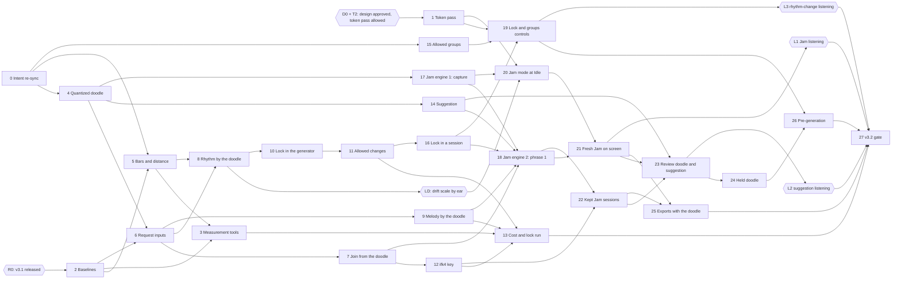

# Infinite Flow v3.2 — Build Plan

Status: draft v2 (2026-10-09): the workflow moves to wave level (spec D252,
[§3](#3-workflow-waves-and-chunks)); draft v1 (2026-10-08), not approved; written while
implementation is paused. The owner reviews it with the v3.2 design.

Build plan for v3.2, Jam, the key and mode suggestion, the rhythm lock, Jam's drift and Vary
settings' allowed groups, written from [master spec Part C](master-spec.md#part-c--v32) (v1.0,
approved 2026-10-08, with spec decisions D240–D249 written in) and the v3.2 design at the root of
[`ui_ux/`](../../../ui_ux/README.md): everything marked `[v3.2 new]`, `[v3.2 changed]` or with a
`_v3.2 …:_` change-block line. It adds no behaviour: what the app does is in the master spec, what
the interface looks like is in the design set, and where this plan disagrees with either, they win
and the plan is corrected. The code facts it relies on are in [jam-grounding.md](jam-grounding.md),
[rhythm-lock.md](rhythm-lock.md), [key-and-mode-suggestion.md](key-and-mode-suggestion.md) and
[jam.md](jam.md), checked against `main` (c65152b) on 2026-10-08; what moved is in
[§9](#9-code-facts-checked-on-2026-10-08).

**v3.2 is built on v3.0 and v3.1.** This plan assumes every chunk of the
[v3.0 build plan](build-plan.md) and of the [v3.1 build plan](build-plan-v3.1.md) is merged and
both gates passed: the storage under `src/storage/`, tolerant loading, kept sessions and their
played-notes record, the stray-note filter, the session seed plan and pre-generation (v3.0); the
figure levels, the `ifk3.` replay key, presets, the restriction in force and Vary settings' figure
step (v3.1). It names their planned modules as those plans name them ("v3.0 chunk _n_", "v3.1
chunk _n_"); where one of them lands a module elsewhere, the wave's preflight follows the code.

It is read by whoever builds v3.2, and by the owner. Music terms are explained where they first
appear, with a link to the project [lexicon](../../../docs/music/lexicon.md) when it has an entry.

> **Read first:** [what v3.2 changes in v2, v3.0 and v3.1](#2-read-first-what-v32-changes-in-v2-v30-and-v31).
> With Jam off, the rhythm lock off and all six allowed groups on (the defaults), v3.2 must
> generate exactly what v3.1 generates, note for note, and Vary settings must draw exactly what it
> draws. A corpus recorded on v3.1 before any change guards every generator and session chunk.
> And for the first time a session starts with no phrase on screen: the session engine learns a
> capture, a deadline counted from the generation measure, and a ladder of its own for phrase 1.

## 1. Overview

### Release sequence

v3.2 ships as one release, with one gate, [chunk 27](#chunk-27--v32-release-gate). Chunks 0–3 are
prerequisites; chunks 4–14 build the generator's side as pure, tested rules (the quantized doodle,
rhythm bars and distance, the request's new inputs, the join, the doodle's orderings, the rhythm
lock and its changes, the `ifk4.` replay key, the suggestion) and measure their cost; chunks 15–18
build the session's side (Vary settings' allowed groups, the lock in a session, the Jam engine in
two parts); chunks 19–26 build the interface, the storage and pre-generation on top. The gate
checks all 41 items of the [definition of done](master-spec.md#c16-definition-of-done) on the
merged code and produces `docs/release/v3.2-release-notes.md`.

The order: first the doodle and the rhythm bar key exist as pure data (chunks 4–5), then the
request carries every new input with no effect (6), then each input gains its effect, one per chunk
(7–11), then the key that replays it (12). The cost is measured as soon as the generator is
complete (13), before any interface is built on it. The session learns the lock and the allowed
groups (15–16) before the Jam engine (17–18), which the workspace then shows (19–21), keeps (22),
reviews (23), holds again (24), exports (25) and prepares in the background (26).

### Owner steps and gates

Some steps are not code and need the owner. They are part of the sequence:

| Step | What | When | Blocks |
| --- | --- | --- | --- |
| **R0** | v3.1 is released: the [v3.1 gate](build-plan-v3.1.md#chunk-21--v31-release-gate) passed and `3.1.0` is tagged. | Before chunk 2. | Every coding chunk (2–27). Chunk 2's corpus must be recorded on the code v3.1 ships. |
| **D0** | The owner approves the v3.2 design ([`ui_ux/todo.md`](../../../ui_ux/todo.md)); if `ux-writer` freezes it into `ui_ux/versions/v3.2/`, this plan's design links are repointed there. | Before chunk 1. | Chunk 1, so every interface chunk (19–21, 23–25). |
| **T2** | The owner allows one `ux-writer` pass on `src/styles/theme.css` and `components.css` for part 2 of [`token-source-v3.1-v3.2.md`](../../../ui_ux/token-source-v3.1-v3.2.md), as for v3.0 (ux Q66) and v3.1 (T1). | With D0. | [Chunk 1](#chunk-1--token-source-pass-part-2-v32). |
| **LD** | The owner ranks a handful of rhythm pairs by ear on drift's distance scale ([H1](#5-hand-checks)), before the scale drives the Drift control ([C8](master-spec.md#c8-jams-drift)). | After chunk 8. | Chunk 20 (the Drift control). A ranking that disagrees with the scale goes to `spec-writer` before chunk 20. |
| **L1** | The owner's listening check of Jam ([H2](#5-hand-checks), item 14). | After chunk 21. | The gate. |
| **L2** | The owner's listening check of the suggestion ([H3](#5-hand-checks), item 25); the weights and cues are tuned from it. | After chunk 23. | The gate's final suggestion tests. |
| **L3** | The owner's listening check of the allowed rhythm changes ([H4](#5-hand-checks), item 32); the change shares are tuned from it. | After chunk 19. | The gate's final M2 run. |
| **Contract** | Nothing to wait for: C13's guarantee changes were confirmed and applied on 2026-10-08 (spec D246, CONTRACT 3.0). | Done. | Nothing; the gate checks the record (item 41). |

### Waves

Waves run one after another. Inside a wave, chunks run one at a time in number order: the owner's
rule is **one coding chunk in flight at a time**. Each wave starts with one intent preflight, ends
with one wave gate (the full test pass, the bundle and the post-task sync), and reaches `main` as
one merge ([§3](#3-workflow-waves-and-chunks)). The chunks in a wave are independent of each other
and touch different source files, so one preflight can cover them all. A chunk still blocked when
the rest of its wave is done (waiting for the owner, a design answer or a measurement) moves to the
next wave.

| Wave | Chunks | Waits for |
| --- | --- | --- |
| 0 | 0 Intent re-sync · 1 Token-source pass · 2 Baselines | Chunk 0: nothing. Chunk 1: D0 and T2. Chunk 2: R0. |
| 1 | 4 The quantized doodle · 5 Rhythm bars, distance and change kinds · 15 Vary settings' allowed groups | Chunk 0 (all three); chunk 2 (5) |
| 2 | 3 Measurement tools · 6 The request carries v3.2's inputs · 14 The key and mode suggestion · 17 Jam engine, part 1 | Chunks 2, 5 (3); chunks 2, 4 (6); chunk 4 (14, 17) |
| 3 | 7 Phrase 1 joins the doodle · 8 Rhythm ordered by the doodle · 9 Melody follows the doodle · 20 Jam mode at Idle | Chunk 6 (7, 9); chunks 5, 6 (8); chunks 1, 17 and LD (20) |
| 4 | 10 The rhythm lock in the generator · 12 Replay key `ifk4.` | Chunk 8 (10); chunk 7 (12) |
| 5 | 11 Allowed rhythm changes in the generator | Chunk 10 |
| 6 | 13 Cost and lock measurements, first run · 16 The rhythm lock in a session | Chunks 3, 9, 11, 12 (13); chunk 11 (16) |
| 7 | 18 Jam engine, part 2 · 19 The rhythm lock and What may vary in the controls | Chunks 7, 9, 14, 16, 17 (18); chunks 1, 15, 16 (19) |
| 8 | 21 A fresh Jam on screen · 22 Kept Jam sessions on the device | Chunks 18, 20 (21); chunks 12, 18 (22) |
| 9 | 23 The review's doodle section and the suggestion · 25 Exports open with the doodle | Chunks 14, 21, 22 (23); chunks 21, 22 (25) |
| 10 | 24 The held doodle | Chunk 23 |
| 11 | 26 Pre-generation and the v3.2 settings | Chunks 19, 24 |
| 12 | 27 v3.2 release gate | Every other chunk; L1, L2, L3 |

The critical path runs 0 → 4 → 6 → 8 → 10 → 11 → 16 → 18 → 21 → 23 → 24 → 26 → 27, with 5 before
8, 17 before 18 and 22 before 23. The suggestion (14), the allowed groups (15), the measurements
(13), the controls (19, 20), the kept sessions (22) and the exports (25) can fill any wait on it.

## 2. Read first: what v3.2 changes in v2, v3.0 and v3.1

[C13](master-spec.md#c13-what-v32-changes-in-v2-v30-and-v31-guarantees-and-atoms) lists what v3.2
changes on purpose. Each enforcement point changes in exactly one chunk, never "along the way".
Test titles are as on `main` (c65152b) or as the v3.0 and v3.1 plans name them; those plans may move
their lines, so the chunk finds each one by its title. Unlike v3.1, most of v3.2 adds a mode beside
v2's behaviour rather than replacing it: a v2 test that describes a session outside a Jam stays as
it is, and the chunk adds the Jam variant beside it.

| What holds today | Changed in | Becomes |
| --- | --- | --- |
| Sixteen STABLE contract guarantees (change set part A: A5–A16, among them `rule_optional_midi_privacy`, `rule_midi_starting_note`, `rule_count_in_shown_on_screen`, `rule_silence_timeout_ends_session`, `rule_controller_loss_mid_session`, `rule_controller_reconnection_window`, `rule_session_generation_failure_ladder`, `rule_dropped_attempt_cancelled`, `rule_join_carry_in_limited`) | **Applied** 2026-10-08 (CONTRACT 3.0, D246) | The new wordings hold for v3.1's code and v3.2's alike; each chunk below builds the exception its guarantee now allows. |
| A session starts with phrase 1 on screen: `tests/e2e/session/session-start.spec.ts` › 'the count-in lights beat by beat with its clicks, and phrase 1 never moves'; `tests/e2e/session/session-midi-start.spec.ts` › '…: the line names phrase 1's first note, which starts the count-in' | [17](#chunk-17--jam-engine-part-1-the-count-in-and-the-capture), [21](#chunk-21--a-fresh-jam-on-screen) | Unchanged outside Jam mode; a fresh Jam starts on the home note with no phrase on screen, its beats still counted (new tests beside them). |
| The silence timer counts from the starting note: `tests/e2e/session/session-midi-silence.spec.ts` › 'counted from the starting note: running at 29.9 s, ended by 30.1 s' | 17 | Unchanged outside a fresh Jam; in one, neither the home note nor the doodle arms it, and the 30-second wait for a first doodle note is the Jam's own rule. |
| A lost controller never ends a session at once: `tests/e2e/session/session-midi-controller-loss.spec.ts` › 'the banner shows while the count-in clicks on; a replug before beat 4 brings it back' | 17 | Unchanged outside a fresh Jam; from a fresh Jam's count-in until phrase 1 sounds, a lost controller ends the Jam at once. |
| v2's failure ladder (`LADDER`, `src/session/failure-ladder.ts`) and the phrase-2 deadline (`phraseTwoDeadline`, `src/session/session-timing.ts`) | [18](#chunk-18--jam-engine-part-2-from-the-doodle-to-phrase-1) | Unchanged for phrases 2 onward and outside Jam; a fresh Jam's phrase 1 has its own three rungs and three-measure deadline, and its phrase 2 is due at the start of phrase 1's last measure. |
| Phrase 1 is generated at Idle (`rule_phrase_one_is_idle_phrase`, `rule_session_density_only_steps_down`'s wording) | 18 | In a fresh Jam the session generates phrase 1, so the narrow-window step-down can apply from phrase 1. |
| The join has a positive phrase number: `makeCarryIn` (`src/domain/generation/carry-in/carry-in.ts`) refuses phrase number 0; the replay key requires "phrase number equals the carry-in's plus one" | [6](#chunk-6--the-request-carries-v32s-inputs), [12](#chunk-12--replay-key-ifk4) | A join from the doodle, from no phrase, with no chord, no arriving interval and no owed recovery; numbered joins keep every refusal. |
| The worker refuses any extra request field (`parseGenerationRequest`; the worker's inbound parser; `tests/unit/generation-worker/generation-worker-protocol.spec.ts`) | 6 | It accepts and re-validates the five new inputs, and still refuses any other field. |
| Replay keys: encoding writes `ifk3.` (v3.1 chunk 8's tests in `tests/unit/generation-worker/phrase-replay-key.spec.ts`) | 12 | Encoding writes `ifk4.` for every phrase; every `ifk1.`, `ifk2.` and `ifk3.` decoding test stays. |
| Rhythm candidates ordered by seed alone (`rankMaterializedRhythmCandidates`, `candidate-ranking.ts`), and the atom `module_ranked_candidate_ordering`'s "without scoring or preferring any candidate over another" | [8](#chunk-8--rhythm-ordered-by-the-doodle) (doodle order), [10](#chunk-10--the-rhythm-lock-in-the-generator) (lock and forced bend order) | Preference keys in front of the seeded key when a doodle or the lock is in the request; seeded order alone otherwise. The atom is revised in chunk 8. |
| Vary settings moves every setting but tempo and the instrument, and throws when no move exists: `tests/unit/session/settings-mutation.spec.ts` › 'changes exactly one eligible setting by one step, never tempo or the instrument', › 'throws instead of looping when no candidate is supported'; `tests/unit/session/settings-mutation-scales.spec.ts` › 'holds one scale per eligible setting and never tempo or the instrument', › 'offers at least one step for every eligible setting' (as v3.1 chunk 12 rewrites them) | [15](#chunk-15--vary-settings-allowed-groups) | Only settings of an allowed group move; with all six on, the draws are v3.1's, byte for byte. With no legal move Vary settings is unavailable at Idle; a dead end mid-session skips one mutation, recorded, and never throws. |
| Notes before phrase 1 belong to no phrase: `tests/unit/session/session-history-played-notes.spec.ts` › 'puts the starting note and the count-in notes in no phrase' | 17 | Unchanged; in a fresh Jam the notes with a snapped start inside the doodle's measures belong to the doodle. |
| The played-notes export drops every note before phrase 1, and both MIDI files start phrase 1 at time zero: `tests/unit/export/midi/played-notes-midi-input.spec.ts` › 'refuses an onset before its phrase starts or at or after the next phrase starts'; `tests/unit/export/midi/midi-encoder.spec.ts` › 'writes one marker per phrase with its number, phrases back to back from time zero'; `tests/unit/export/musicxml/musicxml-encoder.spec.ts` › 'lays phrases back to back from phrase 1, four full measures each, numbered 1 upward' | [25](#chunk-25--exports-open-with-the-doodle) | Unchanged outside a Jam; a Jam's files open with a "Doodle" section at time zero and phrase 1 at the next barline, the raw doodle notes in the played-notes file's section. |
| The session end generates a new phrase 1 (`rule_session_end_generates_next_phrase_one`) | 21, [24](#chunk-24--the-held-doodle) | In Jam mode, no phrase without a held doodle; with one, phrase 1 written again from it. |
| Kept sessions as v3.1 leaves them (data version 3 is v3.1's last) | [22](#chunk-22--kept-jam-sessions-on-the-device) | Data version 4: the Jam flag, the quantized doodle with its capture tempo, the decline, and each phrase's new inputs. |
| Pre-generation's discard triggers (v3.1 chunk 19's B8.3 matrix) | 20, [26](#chunk-26--pre-generation-and-the-v32-settings) | Five more triggers; no pre-generation in Jam mode without a held doodle; with one, it runs from it. |
| The cold-generation goldens, `generation-outcome-golden.spec.ts`, and the `ifk1.`, `ifk2.` and `ifk3.` corpora of v3.0 and v3.1 | **Never** | They stay byte-identical: without a doodle and the lock, v3.2 reproduces v3.1 (item 10). A chunk that needs to touch one is wrong. |

Every replaced or extended test gets its v3.2 counterpart in the same chunk, and the gate lists
each pair (item 40).

### The Jam design the chunks build on

Proposed here, settled by `documentalist`'s architecture captures in the chunks named:

- **The quantized doodle, one type** ([chunk 4](#chunk-4--the-quantized-doodle)).
  `src/domain/doodle/quantized-doodle.ts`: one to four measures, each note a start and a length in
  ticks from the start of the doodle's first measure and a concert pitch; at most 64 notes, sorted,
  never overlapping (one melodic line). Its own type, not a `ConcertEventTimeline`, which is always
  four measures. The capture tempo is kept beside it by the session and the storage, never inside
  it, so it can never reach the request.
- **Rhythm bars and distance, pure rules** ([chunk 5](#chunk-5--rhythm-bars-distance-and-change-kinds)).
  `src/domain/rhythm/rhythm-bars.ts`: a candidate's written bars (every note start and length,
  rest and tie, per measure) as a compact key, so identical rhythms are found equal whatever their
  identity. `rhythm-distance.ts`: C8's per-measure edit count over the lists of note and rest starts
  (ties ignored), its bands (Same, Close, Near, beyond) and the total over four measures, integers
  only. `rhythm-change-kinds.ts`: whether two bars differ by exactly one change of one of C7.3's
  five kinds, in one measure or in a gesture measure repeated in its answer measure.
- **The request carries five inputs, the generator decides** ([chunk 6](#chunk-6--the-request-carries-v32s-inputs)).
  `GenerationIntent` and the resolved `GenerationRequest` gain, as one optional group each:
  `doodle` (the quantized doodle and the drift), and `rhythmLock` (its state, the allowed rhythm
  changes, whether the phrase is a tenser one). Proposed for the capture: the lock's state has
  three forms, off, "on, nothing locked yet" (phrase 1, chosen nearest the doodle) and "on, these
  bars" ([question 1](#10-questions-for-spec-writer)). Absent means v3.1's request exactly. Every
  ordering and draw is computed inside generation from these inputs, so the generator stays a pure
  function of its request and a replay key replays without the app's state.
- **The join from no phrase** (chunks 6 and 7). `CarryIn` gains an origin: a phrase (with its
  number, as today) or the doodle (no number, no chord, no arriving interval, no owed recovery).
  `makeCarryIn` keeps all nine refusals for a phrase origin and checks only the pitch and the
  window for a doodle origin. The `entity_phrase_carry_in` atom is revised at its capture.
- **Preference keys in front of the seeded key** (chunks 8–11). In the rhythm stage, a candidate's
  place is a tuple: a preference rank, then the existing seeded tie key, then its index, compared
  in code-unit order (ISS-010). With a doodle and no lock: rank 0 for a candidate whose every
  measure lies inside the drift band, else 1 plus its total edits. Under the lock: the drawn
  change's candidates, then the locked bars, then the forced bend's order by total edits from the
  locked bars. With neither, the tuple is the seeded key alone, so the order is v3.1's. In the
  pitch stage, the doodle's move preference is one term inside `pitchRank`'s existing rank, never
  across ranks.
- **Rhythm-major search under the lock** ([chunk 10](#chunk-10--the-rhythm-lock-in-the-generator)).
  `searchWindow` walks chord plans, then rhythms; under the lock the phrase's rhythm (the drawn
  change, then the locked bars) is tried with every chord plan before any other rhythm, then the
  forced bend's rhythms, each with every chord plan. An order, not a filter: every phrase possible
  in v3.1 stays possible.
- **Two new hash draws, no new stream.** The rhythm change: `fnv1a32` over the tie-key prefix
  `infinite-flow/rhythm-change/v1` and the phrase's seed, kept when it falls under the share (a
  numerator over a power of two: 1/4, or 1/2 on a tenser phrase). The suggestion: `fnv1a32` over
  `infinite-flow/key-suggestion/v1` and the quantized doodle's notes. Integer operations only
  (`Math.imul`, `>>> 0`, masks), as v3.1's favored draw; no `Math.exp`, `Math.log` or division
  of floats anywhere on either path.
- **The suggestion as pure rules** ([chunk 14](#chunk-14--the-key-and-mode-suggestion)).
  `src/domain/key-suggestion/`: the 84 scores as integer penalties in thousandths, note weights in
  ticks, the cues, the cut at a penalty gap (the research note's "half the best one's chance" is a
  gap of 693 thousandths at T = 1), the draw from a precomputed integer weight table indexed by the
  gap, and the naming in the player's family. It runs on the main thread (far under a
  millisecond), loaded with the review's code and fetched when a Jam starts.
- **The Jam engine inside the session engine** (chunks 17 and 18). `src/session/jam/`: the
  capture's state machine (count-in, capture, tentative generation measure, generation measure,
  extended wait, read-in), driven by the click plan's beat grid (`beatAt`,
  `src/audio/click-track.ts`) on the injected audio clock, and phrase 1's ladder. The session engine
  gains one way in, "start without phrase 1", and joins its usual running state when phrase 1
  sounds. Everything is tested on the fake clock with fake MIDI, never with real time.
- **Storage** ([chunk 22](#chunk-22--kept-jam-sessions-on-the-device), inside v3.0's
  [storage design](build-plan.md#the-storage-design-the-chunks-build-on)): five new records in
  `settings`, no migration (a missing record takes its default); **data version 4** for kept
  sessions: the summary gains the Jam flag and the decline, the body the quantized doodle and its
  capture tempo, each phrase's inputs the new fields. Proposed for the capture: the upgrade step
  writes the summaries' Jam flag (false) and leaves pre-v3.2 bodies as they are, an absent field
  reading as "none" in the body codec. Raw doodle notes are played notes, in v3.0's `playedNotes`
  store, marked as the doodle's.
- **Code loaded on demand:** the review's doodle section and the suggestion load with the review
  (M4). The quantizer, the capture and the Jam controls are in the entry chunk; the bar key, the
  distance and the orderings live in the generation worker's bundle.

## 3. Workflow: waves and chunks

Work runs **wave by wave**. The intent checks and the full test and performance pass happen once
per wave; a chunk tests only what it changed. The owner chose this on 2026-10-09 (spec D252) for a
better quality-to-cost ratio. He accepts that the chunks of one wave may drift a little apart
before the wave gate catches it.

**Order.** One wave at a time, in wave order. Inside a wave, one chunk at a time, in number order.
**One coding chunk is in flight at a time.** A chunk may go ahead of a blocked lower-numbered chunk
of the same wave. If a chunk is still blocked when the rest of its wave is done (it is waiting for
the owner, a design answer or a measurement), it leaves the wave: the wave closes without it, and
it joins the next wave, whose preflight covers it.

**Branches.** At the start of a wave, a wave branch `v3.2-w<n>` is made from `main` in its own
worktree (`/home/bastien/work/infinite_flow-v32-w<n>`). Each chunk runs in its own worktree
(`/home/bastien/work/infinite_flow-v32-c<n>`) on a branch made from the wave branch
(`v3.2-c<n>-<slug>`). It ends with one commit, merged `--no-ff` into the wave branch as soon as
its chunk checks pass; that merge needs no owner approval. The wave branch merges `--no-ff` into
`main` after the wave gate, when the owner asks, so `main` only ever receives waves that passed
the full gate. Never reuse `../infinite_flow-perf-investigation`.

### Wave start: intent preflight

1. `documentalist` runs its preflight **once for the whole wave**. It does the full pass, then
   runs again with the files of every chunk in the wave, starting from the chunks' **Atoms**
   lines. A missing or conflicting atom stops the chunk it concerns until it is resolved: a spec
   gap goes to `spec-writer`, a design gap to `ux-writer`. The wave's other chunks go on, because
   chunks in one wave are independent.
2. For every chunk of the wave marked **Architecture capture**, `documentalist` records the
   architecture now, before any code, in a commit on the wave branch.
3. A chunk runs no preflight of its own. If a chunk still meets an atom that contradicts it, it
   stops and reports it as in step 1. It never fixes it silently.

ATD covers business behaviour and architecture only, never tooling, tests' plumbing or
measurement scripts (chunks 2, 3 and 13 add no atom).

### Every chunk: four steps

A chunk is finished when step 4 is done and it is merged into the wave branch.

1. **Tests first, red to green.** Write the tests for the chunk's **Done when** first and see them
   fail on an assertion about the missing behaviour, not an import error.
   - Pure logic gets Vitest unit tests under `tests/unit/`, mirroring `src/`. Storage runs on
     `fake-indexeddb` (v3.0 chunk 4) and saved data is seeded through the harness's storage seam
     (v3.0 chunk 7), never by hand-built records.
   - The session and the Jam engine run on the injected audio clock with a fake MIDI port and the
     held-generation harness; a test never waits for real time.
   - Behaviour gets Playwright scenarios on the workspace harness, each from an empty browser
     context. A new spec outside `tests/e2e/notation/` is added to the explicit `test:e2e` list in
     `package.json`, or it never runs in `npm run quality`.
   - **Every chunk that touches generation or the session's draws (6–12, 15, 16, 18) runs the v3.1
     corpus of [chunk 2](#chunk-2--baselines-the-v31-corpus-the-vary-settings-draws-and-the-bundle),
     the earlier corpora and the cold-generation goldens unchanged.** A red corpus means a request
     without a doodle or the lock no longer reproduces v3.1: stop and find why, never re-record.
     This guard is part of the chunk checks, not the wave gate: it tests exactly what such a chunk
     changes, and a regression found a wave later costs far more to trace.
2. **Implement** until the tests pass, following [`CODING_RULE.md`](../../../CODING_RULE.md): crash
   early, no silent fallbacks (tolerant loading is the spec's explicit exception, and lives in the
   codecs), injected seams instead of test-only branches, an injected clock and id source, the
   file-size limits. Interface code uses only the classes and tokens of `src/styles/`; no raw
   visual value.
3. **Verify the change, not the whole app.** These are the **chunk checks**; each chunk's
   **Verification** line starts from them:
   - The chunk's **Done when** holds.
   - The tests the chunk adds or changes pass, and so does the corpus guard of step 1 for a
     generation or session chunk. So do the existing unit tests of the source files it touches
     (`npx vitest related --run <those files>`) and the Playwright specs it adds or edits.
   - `npm run typecheck`, `npm run lint` and `npm run format:check` pass, and
     `npm run lint:links` passes when the chunk changed a Markdown file.
   - A debug run shows the behaviour on screen (`npm run dev` in Chromium, or the workspace
     harness), with a landscape phone-sized window for anything below `bp-tablet-landscape`.
     **Never edit the repository while the owner is testing on the dev server**: Vite reloads his
     page. Batch any write until he pauses.
   - The chunk does **not** run `npm run quality`, the full end-to-end, accessibility or notation
     suites, the sweep, a bundle measurement or a timing measurement, unless its **Verification**
     line names that check. A line names one only when the check is the chunk's point: a
     measurement chunk (3, 13), or a chunk whose change is that area (the notation snapshots in
     chunk 1). A check the line places "at the wave gate" waits for the wave gate.
4. **Documents.** `README.md` (directory boundaries, the quality-gate table), `docs/storage.md`
   (records, data versions), `docs/testing.md` (every new seam, fake, fixture and script), the
   area's own document (`docs/session-engine.md`, `docs/phrase-workspace.md`,
   `docs/generation-latency.md`, `docs/audio-transport.md`,
   [`docs/music/`](../../../docs/music/README.md)), and the lexicon entries of C4, rewritten from
   "planned" to "built" when the chunk builds what they describe. A place where the code had to
   differ from the spec or the design is reported to `spec-writer` or `ux-writer`, never fixed
   silently.

### Wave end: the wave gate

"The gate" alone still means the release gate, chunk 27; "the wave gate" is this one.

When the wave's last chunk is merged into the wave branch, on that branch and on an idle machine
(**never run `atd audit` alongside tests**: it saturates the machine and makes timing tests fail):

1. **The full test pass.** `npm run quality`, and `npm run test:sweep` when a chunk of the wave
   places the sweep at the wave gate (every generation or session chunk does; it takes
   long), with every
   other check or measurement a chunk's **Verification** line places there. A failure is traced to
   the chunk that caused it and fixed on the wave branch in a commit of its own. A fix that would
   change behaviour the spec or the design states goes to `spec-writer` or `ux-writer` instead.
2. **The bundle.** The entry chunk's size after `npm run build`, with its change since the
   previous wave ([M4](#m4--the-first-load-bundle)), is written in the wave's merge commit message.
   A chunk's "lazy" claim about the entry chunk is checked here.
3. **Performance.** A figure measured on a virtual machine never gates: it is recorded with the
   machine and date, for reference. The owner checks budgets on the reference machine.
4. **Post-task sync, once for the wave.** `documentalist` runs it over the wave's whole diff. It
   checks the `@spec-link` / `@test-link` tags (**directly above the function or test, never at
   the top of a file**), confirms the atoms still describe the code, applies every chunk's
   **Revise** list (the non-STABLE atoms tagged `changes-in-v3.2`,
   [change set part E](../../../docs/release/v3.1-v3.2-intent-change-set.md)) and runs every
   chunk's **Drift check** list (part F). It advances a status only with the owner's agreement.
   `npm run atd:lint` and `npm run atd:check` pass. The sync is committed on the wave branch.
5. **Merge.** The owner gets a short report: the chunks merged, any chunk moved to the next wave,
   the gate's results, the bundle figure and the sync's changes. The wave branch merges into
   `main` when he asks. Then its worktrees and branches are removed.

## 4. Measurements

Four figures the spec leaves to the build ([C17](master-spec.md#c17-deferred-and-open): "measured
before the gate, not open questions"), each with the chunk that takes it and where it is recorded.
The gate copies each into the release notes. The [v3.1 corpus](#chunk-2--baselines-the-v31-corpus-the-vary-settings-draws-and-the-bundle)
that proves "unchanged without the new inputs" (item 10) is a guard, not a measurement: it either
passes or the chunk stops.

### M1 — The Jam sweep

- **What:** [C16 item 13](master-spec.md#c16-definition-of-done) and [C5.8](master-spec.md#c58-the-time-budget):
  over doodles × settings at 60, 120 and 240 BPM, with the rhythm lock on and off, the share of
  phrase 1 generated by each rung (the doodle's join and preferences; the preferences without the
  join; doodle-free) and the share of Jams whose phrase 1 never came; the cost of the new orderings
  (keying a domain by bars, ordering it by distance, the pitch preference) per attempt; that no
  phrase is repeated; and that every standalone attempt, carrying the doodle's preferences and the
  lock, stays within the standalone reserve (`STANDALONE_RESERVE_SECONDS`, 1.075 s, of which the
  0.95 s budget is the attempt's).
- **How:** chunk 3's Jam sweep: the deadline sweep's 568 rhythm settings (`sweepCases()`,
  `tests/unit/session/deadline-sweep.ts`), each with a set of recorded and written doodles (one to
  four measures, near and far from the settings' rhythms, inside and outside the register windows
  and the instrument's range, one note, a chord played as a doodle), each attempt charged its
  measured time as `npm run test:sweep` does, phrase 1 driven through chunk 18's ladder and phrases
  2 to 8 through v2's. Run on v3.1 for the "Jam off, lock off" baseline (chunk 3), at chunk 13 on
  the complete generator, and at the gate.
- **Acceptance:** no phrase repeated anywhere in the sweep; the slowest standalone attempt within
  the budget on the reference machine; with Jam off and the lock off, the v3.1 baseline's figures
  (the phrases are byte-equal; only timing noise may differ). If the preferences or the lock push a
  standalone attempt past its budget, that is not tuned away: it goes to `spec-writer` (C5.9 and
  C7.6 keep them on every rung), with the figures.
- **Recorded:** a new "Jam and the rhythm lock" section of `docs/generation-latency.md`.

### M2 — The lock census: forced bends and rhythm changes

- **What:** C16 items 26 and 27, and [C7.4](master-spec.md#c74-when-a-phrase-changes)'s starting
  shares: the forced-bend rate (overall, with Tension across phrases at each tension, and after
  Vary settings' Tension step from Build to Lift); the share of phrases that draw a change (target:
  near 1 in 4, near 1 in 2 on tenser phrases); the share of draws that found no candidate, per
  allowed kind and per rhythm setting; and that no phrase makes more than one change, of an
  allowed kind, measured from the locked rhythm.
- **How:** chunk 3's lock census, over seeded eight-phrase sessions on the deadline sweep's
  settings, each kind allowed alone and all five together, Tension across phrases on and off. Run
  at chunk 13, again after L3's tuning, and at the gate. Its per-kind availability is compared
  with [jam-grounding §D.2](jam-grounding.md#d2-what-the-rhythm-domain-offers-a-locked-rhythm)'s
  measured shares.
- **Acceptance:** the changed share within a few points of 1 in 4 and 1 in 2 over the sweep
  (tuned by L3); the rest is recorded, not judged. A forced-bend rate the owner finds too high at
  L3 goes to `spec-writer`: the lock is strict by spec.
- **Recorded:** `docs/generation-latency.md` (the rates) and
  [`docs/music/rhythm-phrase-structure.md`](../../../docs/music/rhythm-phrase-structure.md) (what each
  kind offers per setting).

### M3 — The start-up read and the migration

- **What:** whether loading the five new settings and listing kept Jam sessions stays inside
  v3.0's start-up wait (Part A §4.4), and how long the data version 4 upgrade takes on v3.1's data.
- **How:** chunk 22 times the start-up read on a seeded database with 0, 10, 100 and 500 kept
  sessions, half of them Jam sessions with four-measure doodles and kept raw notes, cold and warm,
  and the version 4 upgrade on 10, 100 and 500 v3.1 sessions. The owner repeats the deciding runs on
  the reference machine.
- **Acceptance:** each, upgrade included, well under the start-up wait constant. If the upgrade
  does not fit, the fallback D250 allowed for v3.1 (each session mapped when read, the player seeing
  no difference) is the reading; the chunk reports it to `spec-writer` before merging.
- **Recorded:** `docs/storage.md`.

### M4 — The first-load bundle

- **What:** the entry chunk stays within its 224 kB budget (`scripts/verify-boundaries.mjs`,
  `entryChunkByteBudget`). The quantizer, the capture, the five controls with two `toggle-list`s,
  `staff-jam` and the cue row's new parts add code ([C14](master-spec.md#c14-existing-code-and-risks)).
- **How:** chunk 2 records the baseline on the v3.1 release; every wave gate records the entry size
  and its change since the previous wave ([§3](#wave-end-the-wave-gate)). The review's doodle
  section and the suggestion load with the review. Raising the budget needs the owner.
- **Recorded:** each commit message, and the gate's release notes.

## 5. Hand checks

The owner runs these himself, on the Travel Sax over USB and the reference machine. Each is written
into a new v3.2 part of [`HARDWARE-CHECKLIST.md`](../../../HARDWARE-CHECKLIST.md) by the chunk named,
and run at that chunk or at the gate. H1 to H4 are the listening checks C8 and C16 ask for.

| Check | Chunk | What the owner does |
| --- | --- | --- |
| H1 Drift's scale by ear (LD) | 8, before 20 | Listen to chunk 3's rendered pairs (a doodle measure, then candidate measures at Same, Close, Near and beyond) and rank them by how different they sound; say whether Close sounds closer than Near. The band rule is kept, or the disagreement goes to `spec-writer` before the Drift control ships. |
| H2 Listening: Jam (L1) | 21, used by 27 | Play a handful of doodles (one, two and four measures; a rhythmic figure, a scale run, a leap), each at Close, Near and Free, lock off and on: "does it sound like my doodle?" Item 14. |
| H3 Listening: the suggestion (L2) | 23, used by 27 | Play a handful of doodles, the research note's worked examples among them, and judge each suggestion; say whether Locrian ever surprises. The weights, cues and the Locrian question are tuned from it (C6.2). Item 25. |
| H4 Listening: allowed rhythm changes (L3) | 19, used by 27 | With the lock on, allow each kind alone on a handful of locked rhythms at Eighth and Sixteenth, Heavily varied; say whether each change is heard as small, and whether 1 in 4 (1 in 2 on tenser phrases) is too often. Item 32. The change shares are tuned from it, then M2 re-run. |
| H5 A Jam on the Travel Sax | 21 | At 60, 120 and 240 BPM: a doodle ended by silence, one ended by length with a held note, a note played a little early onto beat 1, a breath noise; the click through to phrase 1 with `Click` off; phrase 1 continuing the last note. Unplug the controller during the count-in, the capture and the read-in measure: the Jam ends at once each time. |
| H6 Same answer in Edge | 12, 14 | Run chunk 12's in-browser replay test and chunk 14's suggestion test once with Playwright's Microsoft Edge channel (`msedge`), and replay one `ifk4.` key of a Jam phrase copied from a Chrome session in Edge; the phrases and the suggestion match. Items 21 and 37's "Chrome and Edge" half. |
| H7 A Jam's files | 25 | Open a Jam's MusicXML in MuseScore and both MIDI files in a DAW: the "Doodle" section at time zero, phrase 1 at the next barline, the two MIDI files line up measure for measure. |
| H8 v3.1 data carried over | 22, at 27 | In the installed app and a plain Chrome tab that used v3.1 (settings changed, a pinned session, played notes kept), update to v3.2: the settings come back with v3.2's defaults, the pinned session opens as before, with no doodle and no "Jam". |
| H9 Vary settings' groups | 19 | With the Travel Sax, Vary settings on with only "Key and mode" allowed: a long session moves only the key and mode. Lock on with every group: the rhythm never moves. |

## 6. Chunks

Each chunk names its goal, what it builds and where, the spec sections and design documents, the
atoms, what it waits for (the earlier v3.2 chunks, and the v3.0 and v3.1 chunks it relies on), how
to tell it is done, which definition-of-done items it covers, and how it is verified. "Item _n_" is
item _n_ of [C16](master-spec.md#c16-definition-of-done). **Atoms** are ids of
`docs/<id>.atom.md`: the DRAFT atoms tagged `release-v3.2` the chunk builds, then, marked "(v2)",
"(v3.0)" or "(v3.1)", existing atoms it must keep true. **Revise** lists the atoms tagged
`changes-in-v3.2` that its post-task sync revises; **Drift check**, the ARCHITECTURE atoms of change
set part F it checks against the new code.

### Chunk 0 — Intent re-sync

**Goal.** Make sure the 67 `release-v3.2` atoms and the 33 `changes-in-v3.2` atoms still match
master spec Part C and the state v3.1's gate left, before the first v3.2 chunk relies on them.

**Scope.** `documentalist`, spec ingestion (milestone refinement). Atoms only; no code.

- Part C as it stands when the build starts: decisions recorded after the ingestion of 2026-10-08
  (D247–D249 are written in; D251 onwards, and any answer to
  [§10](#10-questions-for-spec-writer)) that touch Part C.
- The atoms v3.1's gate promoted or revised that v3.2 revises again
  (`rule_seeded_phrase_reproduction`, `rule_mutation_rerolls_unsupported_combination`,
  `rule_mutation_draws_setting_then_direction`, `rule_settings_saved_on_change`,
  `rule_delete_everything`, `rule_kept_session_content`, `req_kept_session_list`,
  `rule_pregeneration_discarded_on_change`): their `changes-in-v3.2` notes still name the right
  change.
- `module_ranked_candidate_ordering` and `module_named_stream_pseudorandomness` (part G) still
  read as corrected on 2026-10-08.

**Atoms:** every atom tagged `release-v3.2` or `changes-in-v3.2`;
`contract_infinite_flow_first_release` (3.0).

**Depends on:** nothing (best run right after R0).

**Done when:** each Part C behaviour is stated by an atom (still DRAFT); `npm run atd:lint` and
`npm run atd:check` pass; the change set file records what changed, if anything.

**Items covered:** none directly; every later wave's preflight relies on it.

**Verification:** `documentalist`'s ingestion report; the chunk checks.

### Chunk 1 — Token-source pass, part 2 (v3.2)

**Pending the owner's D0 and T2.**

**Goal.** Write v3.2's new component classes into the canonical token source, so every interface
chunk can style its components without inventing a value.

**Scope.** `ux-writer`, not a coding executor. Edits `src/styles/theme.css` and
`src/styles/components.css` only, under `v3.2 new` comments: everything in part 2 of
[`token-source-v3.1-v3.2.md`](../../../ui_ux/token-source-v3.1-v3.2.md): no new token; the classes
`staff-jam`, `jam-instruction`, `jam-notice`, `jam-capture`, `jam-writing`, `jam-bar`,
`suggestion-row`, `review-doodle`, `toggle-list` (its read-only state) and `field-dependent` (the
dashed ring drawn once, by the outer read-only `field-group`). Part 1 was applied by v3.1 chunk 1;
with part 2 applied, `ux-writer` marks the document as applied in full.

**Design docs:** [`ui_ux/token-source-v3.1-v3.2.md`](../../../ui_ux/token-source-v3.1-v3.2.md) (Part
2), [`ui_ux/README.md`](../../../ui_ux/README.md).

**Atoms:** none (styling is not business behaviour).

**Depends on:** D0 and T2; v3.1 chunk 1 (part 1) merged.

**Done when:** every class part 2 names exists in `src/styles/`; no v3.2 handoff names a class that
exists nowhere; `npm run test:notation` passes with no snapshot change; `npm run lint:links` passes.

**Items covered:** none directly; it unblocks 19, 20, 21, 23 and 24.

**Verification:** the chunk checks; a `grep` of each v3.2 handoff's class names against
`src/styles/`.

### Chunk 2 — Baselines: the v3.1 corpus, the Vary settings draws and the bundle

**Goal.** Record, on the code v3.1 shipped, the facts v3.2 must not break: the phrase every request
gives without a doodle or the lock, every `ifk3.` key's phrase, Vary settings' draws, and the entry
chunk's size.

**Scope.**

- **The phrase corpus**, generated from the `3.1.0` tag before any v3.2 change: the eight built-in
  presets and a spread of figure levels × **every one of the nine modes** × the three built-in
  instruments and two player-made ones × a spread of the other controls (every Tension value,
  Eighth and Sixteenth with Heavily varied, Strict variety with Straight syncopation) × several
  seeds, with and without carry-in (a carry-in with a null harmony included). Each case is stored
  as its `ifk3.` key and the timeline it replays to. Fixture
  `tests/fixtures/replay-keys/v3.1-corpus.json` and a unit test,
  `tests/unit/generation-worker/phrase-replay-key-v31-corpus.spec.ts`, beside v3.1's
  `v3.0-neutral-jazz.json` corpus and v3.0's `ifk1-v2.0.json`, which stay.
- **The Vary settings corpus**: seeded sessions (Vary settings on, every preset's restriction, a
  narrow-window step-down among them) whose drawn moves, phrase by phrase, are recorded from the
  tag. Fixture `tests/fixtures/sessions/v3.1-vary-settings-draws.json` and a unit test that replays
  each through the session's draw and expects the same moves. Item 33's "all six groups reproduce
  today's Vary settings byte for byte" rests on it.
- The entry chunk's size after `npm run build` on the tag, recorded here and in `docs/testing.md`.

**Files:** the fixtures and specs above, a generator script under `scripts/` (tooling),
`docs/testing.md`.

**Atoms:** none new (test plumbing). The corpus later backs
`rule_jam_and_lock_off_reproduce_earlier_phrases` and `rule_seeded_phrase_reproduction`, whose test
links chunk 12 adds.

**Depends on:** R0.

**Done when:** both corpus tests pass on the tag and on `main`; the baseline size is recorded.

**Items covered:** 10 and 33 (as the guard for chunks 6–12, 15, 16 and 18), 37 (`ifk3.` decoding).

**Verification:** the chunk checks; each corpus test is red if a stored value is changed by hand.

### Chunk 3 — Measurement tools: the doodle set, the Jam sweep, the lock census and the renders

**Goal.** The scripts M1, M2 and the listening checks need, run once on v3.1 for their baselines.

**Scope.** Tooling only, no product code.

- **The doodle set**: a fixture of quantized doodles, written by hand from C5.5's rules and
  recorded on the Travel Sax (the v3.0 played-notes export, H1 of v3.0, gives real timing), each
  with its intended traits (length, density, far from or near to which rhythm settings, last note
  inside or outside the windows). Recorded raw notes are kept with their quantized form, so chunk
  4's quantizer is tested on them too.
- **The Jam sweep** (M1): the deadline sweep (`tests/sweep/session-deadline-sweep-*.spec.ts`,
  `sweepCases()` in `tests/unit/session/deadline-sweep.ts`) and v3.1 chunk 3's cost runner,
  parameterised by a doodle and the lock (until chunks 6–11 exist, it runs Jam off and lock off
  only, the baseline). It writes, as JSON like `LATENCY_OUT`, the rung shares, the per-attempt
  timings with the orderings' share, the repeat count, and the slowest and 95th-percentile
  standalone attempts.
- **The lock census** (M2): seeded eight-phrase sessions per setting; per phrase, whether it kept
  the locked bars, took a change (of which kind), or a forced bend; per draw, whether candidates
  existed. Classifies with chunk 5's `rhythm-change-kinds.ts`.
- **The renders** for H1, H2 and H4: a script writing short MIDI files (a doodle measure then
  candidates at each distance; a locked rhythm then one change of each kind) for the owner to hear
  without the app.

**Files:** `tests/sweep/jam-sweep.ts`, `tests/sweep/jam-sweep.spec.ts`, `tests/sweep/lock-census.ts`,
`tests/sweep/lock-census.spec.ts` (all new), `tests/fixtures/doodles/` (new),
`scripts/render-rhythm-examples.mjs` (new), `package.json` (`measure:jam`, `measure:lock`,
`render:rhythms`), `docs/testing.md`, `docs/generation-latency.md` (the baseline).

**Atoms:** none (measurement).

**Depends on:** chunks 2 and 5 (the census and the renders classify with the bar key).

**Done when:** the sweep runs on `main` with Jam and the lock off and records the baseline; the
census classifies a hand-written session holding one change of each kind, a forced bend and a kept
phrase exactly; the renders play in a MIDI player.

**Items covered:** none directly; M1 and M2 rest on it (items 13, 26, 27).

**Verification:** the chunk checks (the census's own unit test); the baseline run.

### Chunk 4 — The quantized doodle

**Architecture capture:** the quantized doodle's type and the quantizer
([§2](#the-jam-design-the-chunks-build-on)).

**Goal.** Turn the raw notes of a capture into the quantized doodle every later step reads, by
C5.5's rules, with integer arithmetic.

**Scope.**

- `src/domain/doodle/quantized-doodle.ts` (new): the type (one to four measures, notes as start and
  length in ticks from the doodle's first measure and concert pitch, at most 64), its validating
  constructor and parser (used again by the worker and the storage), and the overlay of its
  measures on four phrase measures (one measure four times; two twice; three as 1, 2, 3, 1; four as
  they are).
- `src/domain/doodle/doodle-quantizer.ts` (new): from raw notes (concert pitch, onset and release on
  the audio clock), the grid origin (the first barline after the count-in) and the tempo: the
  stray-note filter first (v3.0 chunk 25's `src/domain/played-notes/stray-notes.ts`); each time
  converted once to integer microseconds, then snapped to the nearest tick with integer division
  (a tie rounds to the later tick, stated in the module and tested); a note keeps at least one
  tick; overlaps cut the earlier note at the later start; two notes on one tick keep the longer,
  then the higher; notes before the doodle's first measure (snapped before the first beat after the
  count-in) dropped; a note past the doodle's end cut at its last barline. The doodle's first
  measure is the measure holding its first note; the doodle starts there, rests included.
- What a measure is for the capture: `doodleMeasureOf(snappedStart)`, used by chunk 17's end rule.

**Files:** `src/domain/doodle/quantized-doodle.ts`, `src/domain/doodle/doodle-quantizer.ts` (new);
tests `tests/unit/domain/doodle/quantized-doodle.spec.ts`, `doodle-quantizer.spec.ts`, using chunk
3's recorded doodles when they exist.

**Spec sections:** [C5.4](master-spec.md#c54-capturing-the-doodle-where-it-starts-and-where-it-ends), [C5.5](master-spec.md#c55-quantizing), [C5.9](master-spec.md#c59-what-the-doodle-feeds-the-generator) (the overlay), [C10.6](master-spec.md#c106-stray-notes-v30), [C11](master-spec.md#c11-the-generation-request-the-replay-key-and-kept-sessions).

**Atoms:** `rule_doodle_quantized_to_sixteenths`, `rule_doodle_is_one_line`,
`rule_doodle_capture_start`, `rule_quantized_doodle_is_generation_input`; (v3.0)
`rule_stray_note_definition`, `rule_stray_notes_filtered_on_reading`.

**Depends on:** chunk 0; v3.0 chunk 25 (the stray-note filter).

**Done when:**

- Recorded and written doodles quantize as C5.5 says: a note a little early onto beat 1 is the
  doodle's first note; overlaps, chords and notes colliding on one tick reduce to one line (each
  rule a named test); a very short note never starts, extends or shapes the doodle.
- The quantizer has no floating-point operation after the one conversion to microseconds (a test
  over the module's source), and quantizes a fixed list identically twice.
- The constructor refuses zero or five measures, an overlap, a note outside its measures, 65 notes.
- The overlay gives C5.9's four patterns.

**Items covered:** 7, 6 (the doodle's half).

**Verification:** the chunk checks.

### Chunk 5 — Rhythm bars, distance and change kinds

**Architecture capture:** the bar key (a revision of `entity_rhythm_candidate_domain`: identical
rhythms compare equal by their bars, not their identity).

**Goal.** C8's distance and C7.3's five kinds as pure, tested functions over the existing rhythm
candidates, before any ordering uses them.

**Scope.**

- `src/domain/rhythm/rhythm-bars.ts` (new): a candidate's written bars per measure (note starts and
  lengths, rests, ties) as a compact string key; its start lists (note starts and rest starts, ties
  ignored, so a rhythm written with other ties is at distance 0); a domain keyed by bars once, beside
  the canonical memo (`canonical-rhythm-domain.ts`), so a lookup costs a map access.
- `src/domain/rhythm/rhythm-distance.ts` (new): the per-measure edit count between two start lists
  (an edit adds a start, removes one, or moves one by at most an eighth note; reading of
  [question 3](#10-questions-for-spec-writer): a note start turned into a rest start at the same
  tick is one edit), the band (Same; Close, one edit away from ticks 0 and 8; Near, one edit
  touching tick 0 or 8, or two Close edits; beyond), and the total over four measures. Integers
  only.
- `src/domain/rhythm/rhythm-change-kinds.ts` (new): given the locked bars and a candidate's bars,
  the one allowed-kind change they differ by (move a note start by a sixteenth or an eighth, move a
  rest, split a note, merge two notes, add or remove a rest), either in one measure or made in
  gesture measure _k_ and repeated in answer measure _k_ + 2, or none. Bars are compared as written
  ([question 4](#10-questions-for-spec-writer)).

**Files:** the three modules above (new); tests under `tests/unit/domain/rhythm/`.

**Spec sections:** [C4](master-spec.md#c4-words-used-in-this-part) (Bars, Distance), [C7.3](master-spec.md#c73-the-five-kinds-and-the-known-limit), [C7.6](master-spec.md#c76-how-the-search-holds-the-lock), [C8](master-spec.md#c8-jams-drift).

**Atoms:** `rule_rhythm_distance`, `rule_rhythm_change_kinds`; (v2)
`rule_unsupported_rhythm_settings_block_generation`. **Drift check:**
`entity_rhythm_candidate_domain`.

**Depends on:** chunks 0 and 2.

**Done when:**

- Over the real domains, the bar key finds jam-grounding §D.2's facts: in the slowest domain, 1,797
  candidates and 1,435 distinct rhythms; every Settled or Lift rhythm among Build's; Settled and
  Lift equal, Build and Edge equal (a test over every rhythm setting).
- C8's bands on hand-written measure pairs, one test per row of its definition; the total is
  symmetric and zero only between rhythms equal up to ties.
- The five kinds on hand-written pairs, each kind alone and repeated, and pairs that are none (two
  changes; a tie difference); the per-kind availability over the domains is within a point of
  §D.2's shares.
- Keying the largest domain (2,932 candidates) takes about 10 ms in Node (recorded, not gated).

**Items covered:** 12 and 26 (their basis).

**Verification:** the chunk checks; then H1 can be prepared with chunk 3's renders.

### Chunk 6 — The request carries v3.2's inputs

**Architecture capture:** the five new request inputs and the join from no phrase
([§2](#the-jam-design-the-chunks-build-on)); a revision of `entity_phrase_carry_in`.

**Goal.** Put the doodle, the drift, the lock's state, the allowed rhythm changes and the tenser
flag into the request, across the worker, with no effect on any phrase yet.

**Scope.**

- `GenerationIntent` and `GenerationRequest` gain the optional `doodle` group (the quantized doodle
  and the drift) and `rhythmLock` group (its state, the allowed changes, the tenser flag);
  `makeGenerationIntent` and `request-resolution.ts` carry them. With the lock off the request
  holds no `rhythmLock` at all, the allowed changes and the tenser flag included, so a request is
  canonical and a v3.1-shaped one stays exactly v3.1's.
- `CarryIn` gains its origin; `makeCarryIn` and `parseCarryIn` accept a doodle origin (no phrase
  number, a null harmony, no arriving interval, no owed recovery) and keep every refusal for a
  phrase origin; `carriedMotionState` (`src/domain/pitch/pitch-carry-in.ts`) reads a doodle origin
  as "the note before beat 1, reached by no interval".
- The worker's inbound parser validates and rebuilds both groups (the doodle through chunk 4's
  parser; a drift, a lock state or a kind it does not know refused with the typed protocol error)
  and still refuses any other field (`GENERATION_INTENT_ALLOWED_KEYS`,
  `GENERATION_REQUEST_ALLOWED_KEYS`, `requireAllowedKeys`); `makeCarryInGenerationIntent`
  (`carry-in/carry-in-intent.ts`) accepts a doodle-origin join only with a doodle in the intent;
  the prewarm and the cancellation paths carry them.
- No consumer reads them yet: every phrase is v3.1's.

**Files:** `src/domain/generation/generation-intent.ts`, `generation-request.ts`,
`src/domain/generation/orchestration/request-resolution.ts`,
`src/domain/generation/carry-in/carry-in.ts`, `carry-in-intent.ts`,
`src/domain/pitch/pitch-carry-in.ts`, `src/generation-worker/generation-worker-inbound.ts`,
`generation-worker-protocol.ts`; tests under
`tests/unit/domain/generation/`, `tests/unit/generation-worker/generation-worker-protocol.spec.ts`
and `generation-worker-protocol-carry-in.spec.ts` (extended).

**Spec sections:** [C11](master-spec.md#c11-the-generation-request-the-replay-key-and-kept-sessions), [C5.9](master-spec.md#c59-what-the-doodle-feeds-the-generator) (the join), [C14](master-spec.md#c14-existing-code-and-risks).

**Atoms:** `rule_quantized_doodle_is_generation_input`, `rule_every_jam_phrase_carries_doodle`,
`rule_jam_and_lock_off_reproduce_earlier_phrases`; (v2) `rule_seeded_phrase_reproduction`,
`rule_join_carry_in_limited`. **Drift check:** `module_generation_request_construction`,
`module_generation_worker_protocol`, `entity_phrase_carry_in`.

**Depends on:** chunks 2 and 4; v3.1 chunks 4 and 8 (the request with levels and no profile, the
worker's level checks); v3.0 chunks 16–17 (my instrument in the request).

**Done when:**

- A request with each group round-trips through the worker unchanged; one with an unknown drift,
  lock state or kind, a malformed doodle, or any extra field is refused with the typed error.
- A doodle-origin join is accepted with a pitch inside the window; refused outside it; a phrase
  origin with number 0 is still refused (each of the nine refusals keeps its test).
- The v3.1 corpus, every earlier corpus and the goldens pass unchanged; a request built with Jam
  off and the lock off is deep-equal to v3.1's.

**Items covered:** 10 (guarded), 11 (the join's form).

**Verification:** the chunk checks; the sweep at the wave gate; the bundle at the wave gate.

### Chunk 7 — Phrase 1 joins the doodle

**Goal.** Make phrase 1 continue from the doodle's last note, in the register window C5.9 picks,
or generate without the join when that note lies outside it.

**Scope.**

- `src/domain/doodle/doodle-join.ts` (new): from the doodle and the instrument, the join: the last
  note's concert pitch, with no chord, no arriving interval and no owed recovery; none when that
  note lies outside the instrument's range or the window.
- **Register:** with Register on Varying, the window holding the last note, the nearest by its
  centre when several do (ties by the existing register tie key); when none does, Varying resolves
  as in v2. With Low, Middle or High, the player's window. An input decided before the search, in
  the register resolution stage (`selectVaryingRegister`, `request-resolution.ts`, ties by
  `registerTieKey`). For rung 2 (no join) the session passes that window as the explicit register a
  standalone attempt already receives from `buildAttemptIntent` (chunk 18).
- The orchestrator reads the doodle group: the join for phrase 1 (the session says which phrase it
  is asking for through the carry-in it sends, chunk 18), the doodle's preferences arriving in
  chunks 8–9. Phrases 2 onward keep v2's join from the previous phrase.

**Files:** `src/domain/doodle/doodle-join.ts` (new), the register resolution in
`src/domain/generation/orchestration/request-resolution.ts`, `generation-orchestrator.ts`; tests
under `tests/unit/domain/doodle/`, `tests/unit/domain/generation/`.

**Spec sections:** [C5.9](master-spec.md#c59-what-the-doodle-feeds-the-generator) (the join, register), [C5.10](master-spec.md#c510-planner-authority).

**Atoms:** `rule_jam_phrase_one_joins_doodle`, `rule_jam_register_follows_doodle`,
`rule_doodle_only_orders_candidates`; (v2) `rule_varying_register_once_per_session`,
`rule_instrument_profile_range`. **Revise:** `rule_join_inherits_leap_recovery`,
`rule_join_tense_note_resolution`. **Drift check:** `entity_phrase_carry_in`.

**Depends on:** chunk 6; v3.0 chunk 16 (my instrument's range).

**Done when:**

- Over the doodle set, phrase 1's first interval from the doodle's last note obeys the limits of
  two notes inside a phrase, and no recovery is owed on its first note.
- Varying picks the window holding the last note (the nearest centre among several); outside every
  window, Varying's v2 choice; Low, Middle and High never change.
- Outside the window or the range, phrase 1 is generated with no join (a test per case), the
  doodle's other inputs still in the request.
- The v3.1 corpus passes.

**Items covered:** 11, 9 (the join changes no setting).

**Verification:** the chunk checks; the sweep at the wave gate.

### Chunk 8 — Rhythm ordered by the doodle

**Architecture capture:** preference keys in front of the seeded key in the rhythm stage
([§2](#the-jam-design-the-chunks-build-on)). **Step in the capture:** `documentalist` revises
`module_ranked_candidate_ordering` (REVIEW), whose "without scoring or preferring any candidate over
another" v3.2 breaks (change set part G): its intent and logic say that, with a doodle or the lock
in the request, a preference rank comes first, then the seeded tie key, then the index; without
them the order is the seeded key alone, as today. The atom is revised before the code, its
expectation gaining the doodle-free case's identity with today's order.

**Goal.** Order a phrase's rhythm candidates by C8's drift bands when the request carries a doodle,
without removing any.

**Scope.**

- In the rhythm ranking (`candidate-ranking.ts`, `rankMaterializedRhythmCandidates`), with a
  doodle: the overlay of chunk 4 laid over the four measures; candidates whose every measure lies
  inside the drift position's band first, in seeded order; then the rest by total edits, fewest
  first, then the seeded order; Free keeps the seeded order alone. Ties by the seeded key, then by
  index, in code-unit order.
- The ranked cache stays valid per request: the preference is computed after the seeded ranking,
  over the bar key's lists, once per request.
- A doodle far from every rhythm the settings allow is only approached: no candidate is dropped, so
  `no_legal_rhythm_plan` can arise only where it arises in v3.1.

**Files:** `src/domain/generation/orchestration/candidate-ranking.ts`,
`src/domain/rhythm/rhythm-doodle-order.ts` (new), `generation-orchestrator.ts`; tests under
`tests/unit/domain/generation/orchestration/`, `tests/unit/domain/rhythm/`.

**Spec sections:** [C5.9](master-spec.md#c59-what-the-doodle-feeds-the-generator) (rhythm), [C8](master-spec.md#c8-jams-drift), [C11](master-spec.md#c11-the-generation-request-the-replay-key-and-kept-sessions) (determinism).

**Atoms:** `rule_jam_rhythm_ordered_by_doodle`, `rule_jam_drift_positions`, `rule_rhythm_distance`,
`rule_doodle_only_orders_candidates`. **Revise (capture):** `module_ranked_candidate_ordering`.
**Drift check:** `module_named_stream_pseudorandomness` (no new stream), the rhythm ranking modules.

**Depends on:** chunks 5 and 6.

**Done when:**

- Over the doodle set and every drift position, the chosen rhythm's measures lie in the band
  whenever a candidate in it can make a phrase; Free chooses exactly v3.1's rhythm for the seed.
- The same doodle and seed give the same order twice, in any locale (a test with a non-English
  collation forced, as for ISS-010).
- Every candidate appears once in the order (no filter); the v3.1 corpus passes.
- Then **H1** (LD) with the owner, from chunk 3's renders.

**Items covered:** 12 (rhythm), 9.

**Verification:** the chunk checks; the sweep at the wave gate; H1.

### Chunk 9 — Melody follows the doodle's moves

**Goal.** Order pitch candidates to follow the doodle's moves at Close and Near, inside every rule.

**Scope.** In the pitch ranking (`pitchRank`, `src/domain/pitch/pitch-ranking.ts`): for each note of
the phrase, the doodle's next move (up, down or the same note; a step, a skip or a leap in the app's
size classes), cycled in order; at Close direction and size are preferred, at Near direction only,
at Free nothing. The term orders candidates within each rank of the existing order (chord tones
first, v3.1's drawn favored figures), never across ranks, after the hard rules (Contour, Leapiness,
the window). The search's ordering memo (`searchPitchPlan`, `src/domain/pitch/pitch-search.ts`)
keeps a correct key: its key, `attackIndex|required|priorMidi`, already holds the note's position,
on which the doodle's move depends alone; a test pins that a doodle request reuses no ordering
across two different doodles (the memo lives per search).

**Files:** `src/domain/pitch/pitch-ranking.ts`, `src/domain/pitch/doodle-moves.ts` (new),
`src/domain/pitch/pitch-search.ts` (if the memo key needs it); tests under
`tests/unit/domain/pitch/`.

**Spec sections:** [C5.9](master-spec.md#c59-what-the-doodle-feeds-the-generator) (melody), [C8](master-spec.md#c8-jams-drift), [C10.1](master-spec.md#c101-presets-and-the-key-and-mode-restriction-v31) (figures).

**Atoms:** `rule_jam_melody_follows_doodle_moves`, `rule_jam_drift_positions`,
`rule_doodle_only_orders_candidates`; (v3.1) `rule_figure_level_orders_search`. **Drift check:**
`mechanic_pitch_search_policy` and the pitch search modules.

**Depends on:** chunk 6; v3.1 chunk 6 (the favored rank the term sits inside).

**Done when:**

- Over the doodle set, the share of notes moving in the doodle's direction rises from Free to Near
  to Close, and of matching sizes at Close (property over seeds).
- Every phrase passes the validator unchanged (no rule is weakened): the doodle never makes a
  phrase impossible that v3.1 finds (property: the same requests without the doodle succeed at
  least as often).
- Without a doodle the pitch order is v3.1's; the v3.1 corpus passes.

**Items covered:** 12 (melody), 9.

**Verification:** the chunk checks; the sweep at the wave gate.

### Chunk 10 — The rhythm lock in the generator

**Architecture capture:** the lock's order and the rhythm-major search under the lock
([§2](#the-jam-design-the-chunks-build-on)).

**Goal.** With the lock in the request, keep the locked bars, take a forced bend only when they
cannot make a phrase, and choose phrase 1's rhythm nearest the doodle.

**Scope.**

- **Matched by bars** (chunk 5's key) among the candidates of the phrase's own settings, never by
  index or identity.
- **Under "on, these bars":** the locked bars first; then the forced bend's order (total edits from
  the locked bars, a tie variant at 0 first, then the seeded order).
- **Under "on, nothing locked yet"** (phrase 1 of a Jam, and a held doodle's phrase 1): candidates
  by total edits to the doodle only, closest first, whatever the drift; outside a Jam phrase 1 is
  an ordinary phrase.
- **The search** (`searchWindow`, `src/domain/generation/orchestration/window-search.ts`) tries the
  phrase's rhythm with every chord plan before any other rhythm, then each forced-bend rhythm with
  every chord plan, under the fuel the request already has. Without the lock the loop is v3.1's.
- **The outcome** names which happened (locked, forced bend), in the provenance the session
  history keeps, never in the timeline.

**Files:** `window-search.ts`, `candidate-ranking.ts`, `src/domain/rhythm/rhythm-lock-order.ts`
(new), `orchestration-types.ts`; tests under `tests/unit/domain/generation/orchestration/`.

**Spec sections:** [C7.1](master-spec.md#c71-the-switch-and-what-is-locked), [C7.5](master-spec.md#c75-the-forced-bend), [C7.6](master-spec.md#c76-how-the-search-holds-the-lock), [C5.10](master-spec.md#c510-planner-authority).

**Atoms:** `req_rhythm_lock`, `rule_rhythm_lock_strict`, `rule_locked_rhythm_is_phrase_one`,
`rule_forced_bend`; (v2) `rule_session_generation_failure_ladder`. **Drift check:**
`module_ranked_candidate_ordering` (as revised in chunk 8), `entity_rhythm_candidate_domain`.

**Depends on:** chunk 8 (the ordering seam); chunk 5.

**Done when:**

- With the locked bars present, every phrase has them, on every rung (an instrumented search shows
  the locked rhythm tried with every chord plan before any other rhythm: item 29).
- A step from Build to Lift whose domain lacks the bars gives a forced bend at the least total
  edits; a tie variant is taken at distance 0 first.
- Phrase 1 under "nothing locked yet" takes the candidate nearest the doodle over the doodle set,
  whatever the drift.
- Without the lock, the v3.1 corpus passes; the fuel per search never exceeds v3.1's allowance.

**Items covered:** 26, 29, 30 (phrase 1 nearest the doodle).

**Verification:** the chunk checks; the sweep at the wave gate.

### Chunk 11 — Allowed rhythm changes in the generator

**Architecture capture:** the rhythm-change draw (`infinite-flow/rhythm-change/v1` over the
phrase's seed; [§2](#the-jam-design-the-chunks-build-on)).

**Goal.** Let a locked phrase make one change of an allowed kind, at the share C7.4 gives, drawn
inside generation.

**Scope.** `src/domain/rhythm/rhythm-change-draw.ts` (new): with the locked bars, at least one
allowed kind and a phrase seed, whether the phrase changes (1 in 4, 1 in 2 when the tenser flag is
set; numerators over a power of two, `RHYTHM_CHANGE_SHARE` and `TENSER_RHYTHM_CHANGE_SHARE`); if
so, the candidates whose bars differ from the locked bars by exactly one allowed change (chunk 5),
every kind pooled, in seeded order, placed before the locked bars in chunk 10's order. No
candidate: the locked rhythm, recorded as "no change available" in the provenance. Never on a
request without locked bars (phrase 1). Integer-only, and computed only when the lock and a kind
are both in the request: no draw otherwise.

**Files:** `src/domain/rhythm/rhythm-change-draw.ts` (new), `src/domain/rhythm/rhythm-lock-order.ts`;
tests under `tests/unit/domain/rhythm/`.

**Spec sections:** [C7.2](master-spec.md#c72-allowed-rhythm-changes-the-option), [C7.3](master-spec.md#c73-the-five-kinds-and-the-known-limit), [C7.4](master-spec.md#c74-when-a-phrase-changes).

**Atoms:** `rule_allowed_rhythm_changes`, `rule_rhythm_change_kinds`,
`rule_rhythm_change_lasts_one_phrase`, `rule_rhythm_change_share`; (v2)
`rule_seeded_phrase_reproduction`. **Drift check:** `module_named_stream_pseudorandomness` (a hash
tie key, no new stream).

**Depends on:** chunk 10.

**Done when:**

- Over many seeds, no phrase makes more than one change, each of an allowed kind and measured from
  the locked bars; the drawn share is near 1 in 4 and 1 in 2 on tenser phrases (property).
- No floating-point operation in the draw (a test over the module's source); golden draws for a
  fixed seed list.
- Under Strict variety with Straight syncopation at Sixteenth, no change is ever found and the
  phrase keeps the locked rhythm.
- Without the lock or with no kind allowed, no draw is made; the v3.1 corpus passes.

**Items covered:** 27 (generator half).

**Verification:** the chunk checks; the sweep at the wave gate.

### Chunk 12 — Replay key `ifk4.`

**Architecture capture:** the `ifk4.` format (a revision of `module_phrase_replay_key`).

**Goal.** Write `ifk4.` for every phrase, holding the request's new inputs, while every `ifk1.`,
`ifk2.` and `ifk3.` key keeps decoding to the same phrase.

**Scope.**

- **The key.** `encodePhraseReplayKey` writes `ifk4.`: everything `ifk3.` carries, plus the doodle
  group and the lock group as chunk 6 defines them, and a join of either origin. Proposed for the
  capture: a phrase with a doodle-origin join is phrase 1, and "phrase number equals the
  carry-in's plus one" holds only for a phrase origin. A four-measure doodle at sixteenths is about
  a kilobyte of JSON: still one console line.
- **Decoding** accepts all four versions: `ifk1.` to `ifk3.` decode as no doodle, no lock and no
  allowed change, to the phrase their version wrote; `ifk4.` re-validates every field (the doodle
  through chunk 4's parser); a later prefix is refused as an unsupported version.
  `npm run replay:phrase` replays all four.
- **The atom's "holds no played notes"** is read against C5.14 at the capture: the quantized doodle
  is a generation input, never the raw notes.
- An in-browser replay test (workspace harness) replays a Jam phrase 1, a locked phrase, a changed
  phrase, a forced bend and a drifted phrase through the worker, for H6.

**Files:** `src/generation-worker/phrase-replay-key.ts`, `phrase-replay-key-decode.ts`,
`phrase-replay.ts`, `phrase-replay-report.ts`, `scripts/replay-phrase.mjs`; tests under
`tests/unit/generation-worker/`, `tests/unit/scripts/`,
`tests/e2e/release/deterministic-replay.spec.ts` (extended).

**Spec sections:** [C11](master-spec.md#c11-the-generation-request-the-replay-key-and-kept-sessions), [C5.14](master-spec.md#c514-the-doodles-two-forms).

**Atoms:** `rule_quantized_doodle_is_generation_input`, `rule_jam_and_lock_off_reproduce_earlier_phrases`;
(v2) `rule_seeded_phrase_reproduction`. **Revise:** `rule_seeded_phrase_reproduction` (the doodle,
the drift, the locked bars, the allowed changes, the tenser flag). **Drift check:**
`module_phrase_replay_key`, `module_generation_worker_protocol`,
`module_generation_request_construction`.

**Depends on:** chunk 7 (the join's two origins); v3.1 chunk 8 (`ifk3.`), v3.0 chunk 18 (`ifk2.`),
chunk 2's corpus.

**Done when:**

- Every phrase's key is `ifk4.`; encoding then decoding returns an equal intent, and replaying it
  gives the same timeline, with and without each group, for built-in and player-made instruments.
- Chunk 2's corpus and every earlier corpus pass: each `ifk1.`, `ifk2.` and `ifk3.` key decodes to
  the same phrase.
- An `ifk4.` key with a malformed doodle, an unknown drift, lock state or kind is refused with the
  reason; an `ifk5.` key as an unsupported version.
- `npm run replay:phrase` replays one key of each version.

**Items covered:** 37, 10 (guarded), 21's Edge half for phrases (H6).

**Verification:** the chunk checks; `npm run replay:phrase -- <key>` for each version by hand; H6.

### Chunk 13 — Cost and lock measurements, first run

**Goal.** Measure M1 and M2 on the complete generator, before any interface is built on it, and
tune the change shares if needed.

**Scope.** No product code beyond tuning constants. Run M1 at 60, 120 and 240 BPM, lock off and on,
over the doodle set, phrase 1 driven by a test double of chunk 18's ladder (the rungs, the deadline
and the reserve as C5.7 sets them; chunk 18 replaces the double and the gate re-runs it). Run M2.
Replay a sample of every kind of phrase (Jam phrase 1 by each rung, locked, changed, forced bend,
drifted) from its `ifk4.` key. Report the figures to the owner, and to `spec-writer` if a
standalone attempt exceeds its budget.

**Files:** `src/domain/rhythm/rhythm-change-draw.ts` (constants only, if tuned),
`docs/generation-latency.md`, `docs/music/rhythm-phrase-structure.md`.

**Spec sections:** [C5.8](master-spec.md#c58-the-time-budget), [C7.4](master-spec.md#c74-when-a-phrase-changes), [C14](master-spec.md#c14-existing-code-and-risks) (at risk), [C16](master-spec.md#c16-definition-of-done) items 13, 26, 27.

**Atoms:** none (measurement).

**Depends on:** chunks 3, 9, 11 and 12.

**Done when:** M1 and M2 are recorded, on the reference machine for the deciding runs; no phrase is
repeated; every replayed sample matches.

**Items covered:** 13 (first measurement), 26 (forced-bend rate), 27 (shares), 37 (every kind
replays).

**Verification:** the runs themselves; the chunk checks if a constant changed.

### Chunk 14 — The key and mode suggestion

**Architecture capture:** the suggestion module and its integer draw
([§2](#the-jam-design-the-chunks-build-on)).

**Goal.** C6's method as pure, tested functions over the quantized doodle.

**Scope.** `src/domain/key-suggestion/` (new):

- **Scores:** the 84 pairs (12 home notes × Ionian to Locrian), each note's role penalty in
  thousandths (from the research note's −ln shares: 1609, 1802, 1931, 2141 and 5521), weighted by
  its length in ticks clamped to 2–6 (half a beat to a beat and a half), × 1.5 on beat 1 or 3; the
  final ×2 and first ×1.5 cues as fixed bonuses when the note is the candidate's home note. Every
  factor of 1.5 handled by doubling the whole scale, so nothing is fractional.
- **Thresholds:** nothing below 5 pitch classes, 6 notes or 2 beats of sounding time (after the
  stray-note filter, in the quantized doodle); the fit share (`5 × fitting ≥ 4 × total` for 80 %).
- **The kept candidates:** at most 3, within a penalty gap of 693 thousandths of the best, ordered
  by penalty, then home note C to B, then mode Ionian to Locrian.
- **The draw:** the seed is `fnv1a32` of the doodle's notes under `infinite-flow/key-suggestion/v1`;
  weights from a precomputed integer table indexed by the penalty gap (its values written once,
  from `e^(−gap/1000)`, as integer literals in the source with their derivation in a comment);
  `seed % total` walks the list. No transcendental function runs.
- **The answer:** "nothing" (too little material; the selection among the kept candidates, Major as
  Ionian and Minor as Aeolian), "no fit", or the drawn pair, named in written pitch in the player's
  family (Major or Minor for Ionian or Aeolian while Major or Minor is selected, else the mode).
  The restriction plays no part.

**Files:** `src/domain/key-suggestion/key-suggestion.ts`, `key-suggestion-scores.ts`,
`key-suggestion-draw.ts`, `key-suggestion-names.ts` (all new); tests under
`tests/unit/domain/key-suggestion/`, the research note's worked examples among them; an in-browser
test (harness) that computes the suggestion for a fixed doodle list, for H6.

**Spec sections:** [C6.1](master-spec.md#c6-the-key-and-mode-suggestion) to [C6.3](master-spec.md#c63-when-nothing-is-suggested), [C6.5](master-spec.md#c65-use-it-keep-mine-and-jam-again-on-this-doodle) (the family's labels), [C10.1](master-spec.md#c101-presets-and-the-key-and-mode-restriction-v31).

**Atoms:** `req_key_and_mode_suggestion`, `rule_suggestion_candidates`,
`rule_suggestion_same_doodle_same_answer`, `rule_suggestion_withheld`,
`rule_doodle_outside_modes_told`, `rule_suggestion_ignores_restriction`,
`rule_suggestion_named_in_players_family`. **Drift check:** `module_named_stream_pseudorandomness`.

**Depends on:** chunk 4.

**Done when:**

- The research note's worked examples give its answers; each threshold and the 80 % rule at their
  edges; the selection among the kept candidates gives nothing; Major and Ionian, Minor and Aeolian
  compared as the same.
- The same doodle gives the same answer every run; no floating-point operation on the path (a test
  over the modules' sources); golden answers for a fixed list, identical in Chromium and in Edge
  (H6).
- A doodle transposed by a fifth gives the answer transposed, and a preset restriction changes
  nothing (property).
- Scoring 64 notes takes under a millisecond (recorded).

**Items covered:** 21, 22 (the rules), 24 (the names), 6 (the filter's half).

**Verification:** the chunk checks; H6.

### Chunk 15 — Vary settings' allowed groups

**Architecture capture:** the run-time exclusion of groups in the settings mutation.

**Goal.** Let Vary settings move only the settings of the allowed groups, never the Rhythm group
under the lock, with the legal-move check and the narrow mid-session skip.

**Scope.**

- **Groups** (`src/session/settings-mutation-scales.ts`): each mutable setting's group (Key and
  mode, Harmony, Tension, Rhythm, Melody shape, Figures). The draw (`drawMutation`,
  `src/session/settings-mutation.ts`) skips a setting of a disallowed group by the same route as an
  unsupported landing is redrawn, so with **all six on, the draws consume the stream exactly as
  v3.1's** (chunk 2's corpus).
- **The legal-move check**, a pure function the interface calls at Idle: at least one move from the
  current settings onto a supported combination, among the eligible groups (Rhythm not counting
  under the lock; Key and mode counting only inside the restriction in force, v3.1 chunk 15).
- **The session's settings** hold the groups and whether the lock is on; a session started while no
  move exists runs without Vary settings. The session seed plan (v3.0 chunk 23) takes the groups.
- **A dead end mid-session** (only after a narrow-window step-down): that mutation is skipped and
  recorded in the session history; the next is drawn as usual; nothing throws. The throw stays only
  for unsupported input settings, which a session can no longer start with.

**Files:** `src/session/settings-mutation-scales.ts`, `settings-mutation.ts`,
`src/session/session-mutation-step.ts`, `session-types.ts`, `src/session/session-seed-plan.ts`
(v3.0), `src/session/session-history.ts`; tests under `tests/unit/session/` (the four tests of
[§2](#2-read-first-what-v32-changes-in-v2-v30-and-v31) rewritten).

**Spec sections:** [C9](master-spec.md#c9-vary-settings-allowed-groups), [C7.7](master-spec.md#c77-what-the-lock-meets) (Vary settings), [C10.1](master-spec.md#c101-presets-and-the-key-and-mode-restriction-v31).

**Atoms:** `rule_vary_settings_allowed_groups`, `rule_vary_settings_needs_legal_move`,
`rule_vary_settings_skips_dead_end`; (v3.1) `rule_vary_settings_stays_inside_restriction`,
`rule_vary_settings_figure_step`. **Revise:** `req_settings_mutation_flag`,
`rule_mutation_rerolls_unsupported_combination`, `rule_mutation_draws_setting_then_direction`.
**Drift check:** `module_settings_mutation`.

**Depends on:** chunk 0; v3.1 chunks 12 and 15 (the figure step, the restriction bound); v3.0 chunk
23 (the seed plan).

**Done when:**

- With all six groups on, chunk 2's Vary settings corpus passes byte for byte.
- With any subset, over many seeded sessions, every move is of an allowed group; under the lock the
  Rhythm group never moves.
- The legal-move check is false exactly when no move exists (property over random settings, groups,
  lock and restriction); a session started then runs without Vary settings.
- A seeded step-down that leaves a dead end skips one mutation, records it, and never throws.

**Items covered:** 33.

**Verification:** the chunk checks; the sweep at the wave gate.

### Chunk 16 — The rhythm lock in a session

**Goal.** Run the lock through a session: phrase 1's bars locked at Start, every request carrying
them, the tenser flag and the allowed changes, the re-lock after a narrow-window step-down, and
nothing shown.

**Scope.**

- **At Start** (outside a Jam), the session freezes phrase 1's bars (the phrase on screen) and the
  allowed rhythm changes. Every later request carries "on, these bars", the allowed changes, and
  the tenser flag from Tension across phrases (`tensionArcCycleStep`,
  `src/session/tension-arc-cycle.ts`: the second phrase of each group of four, unless already
  Edge). A Tension step made by Vary settings is never a tenser phrase.
- **Every rung of the ladder** keeps the lock (`src/session/failure-ladder.ts`,
  `src/session/session-intents.ts`).
- **The re-lock:** the first phrase generated with Eighth after a narrow-window step-down takes the
  nearest Eighth rhythm (its request holds the old bars; the generator's forced-bend order finds
  it, with no change drawn: [question 2](#10-questions-for-spec-writer)), and the session locks
  that phrase's bars for the rest of the session.
- **The history** records each phrase as locked, changed (with its kind), forced bend, re-lock or
  no change available; nothing is shown in the live view.
- **Pre-generation** (v3.0 chunk 24) follows the lock: the seed plan takes the lock, phrases 2–5
  carry phrase 1's bars and draw exactly as the session would.

**Files:** `src/session/session-intents.ts`, `session-runner.ts`, `failure-ladder.ts`,
`session-types.ts`, `session-history.ts`, `src/session/rhythm-lock-session.ts` (new),
`src/session/session-seed-plan.ts` (v3.0), `src/composables/generation-session-pregeneration.ts`
(v3.0); tests under `tests/unit/session/`, `tests/unit/composables/`.

**Spec sections:** [C7.1](master-spec.md#c71-the-switch-and-what-is-locked), [C7.4](master-spec.md#c74-when-a-phrase-changes), [C7.7](master-spec.md#c77-what-the-lock-meets), [C10.5](master-spec.md#c105-pre-generation-v30).

**Atoms:** `rule_rhythm_lock_strict`, `rule_locked_rhythm_is_phrase_one`,
`rule_rhythm_lock_relocks_after_step_down`, `rule_rhythm_change_lasts_one_phrase`,
`rule_rhythm_changes_never_shown`; (v3.0) `rule_pregenerated_phrase_matches_session`; (v2)
`rule_multi_phrase_tension_arc_cycle`, `rule_session_density_only_steps_down`. **Revise:**
`rule_look_ahead_deadline` (only if the lock touches it; else in chunk 18). **Drift check:**
`service_session_runner`, `module_session_failure_ladder`, `service_session_history`.

**Depends on:** chunk 11; v3.0 chunks 23 and 24.

**Done when:**

- Over seeded sessions with the lock on and no kind allowed, every phrase has phrase 1's bars, apart
  from forced bends, which the history records (item 26).
- With kinds allowed: at most one change per phrase, never on phrase 1, the next phrase back to the
  locked bars, tenser phrases drawing about twice as often (item 27).
- A seeded narrow-window step-down: the first Eighth phrase's bars are locked from then on (item
  30).
- With pre-generation (fake clock, instant generator), the session's phrases are identical with it
  on and off, changes included (item 31).
- With the lock off, the v3.1 corpus and chunk 2's Vary settings corpus pass.

**Items covered:** 26, 27, 30 (re-lock), 31, 28 (nothing in the live view; e2e in chunk 19).

**Verification:** the chunk checks; the sweep at the wave gate.

### Chunk 17 — Jam engine, part 1: the count-in and the capture

**Architecture capture:** a session that starts without phrase 1, and the capture's state machine
([§2](#the-jam-design-the-chunks-build-on)).

**Goal.** Start a fresh Jam on a Start click or the home note, count in, capture the doodle until
its end by silence or by length, and end the Jam cleanly before phrase 1 for every reason C5.13
gives.

**Scope.**

- **The starting note in Jam mode** (`src/session/starting-note.ts`): the selected key's home note in
  written pitch, in the octave nearest the middle of the instrument's written range (the lower of
  two equally near), matched at its exact concert pitch; it starts the count-in only and belongs to
  no doodle.
- **The engine's new way in** (`src/session/session-engine.ts`, beside `createSessionEngine`'s
  phrase-1 path): a start with no phrase 1, which neither records a phrase 1 nor requests phrase 2
  at Start, and a start (`workspace-session-start.ts`) that queues no backing; the count-in as
  v2's; the click forced on from the count-in to the end of the read-in measure whatever the click
  switch says, at the click volume, by extending the count-in's existing bypass of the click gain
  (`web-audio-session-bus.ts`); no backing before phrase 1.
- **The capture** (`src/session/jam/jam-capture.ts`, new), on the click plan's beat grid: notes
  through the stray-note filter, each belonging by its snapped start (chunk 4); the doodle's first
  measure is the one holding its first note; at each barline after it, with no note sounding, a
  "tentative generation measure" begins (chunk 18 starts an attempt there); a doodle note inside it
  cancels the attempt and the measure joins the doodle; a measure beginning with a note sounding is
  never silent; after four measures the doodle ends, a held note cut at that barline. The doodle is
  quantized once, at its end. Notes after the end belong to nothing.
- **Ends before phrase 1:** no doodle note within 30 s after the count-in (very short notes not
  counting); the controller lost (at once, no countdown); Stop; the tab hidden; the staff no longer
  shown. Each ends as a count-in end: back to Idle, no review, nothing kept, the doodle not held.
  Neither the home note nor a doodle note arms the silence timer
  (`src/session/session-midi-timers.ts`).
- **The history** keeps the raw doodle notes as played notes marked as the doodle's, and the
  quantized doodle with the session's tempo as its capture tempo.
- The cue row's phase (count-in, capture with the current measure, writing, read-in) is exposed as
  engine state for chunk 21; nothing is drawn yet.

**Files:** `src/session/starting-note.ts`, `session-engine.ts`, `session-engine-state.ts`,
`session-midi-timers.ts`, `session-history.ts`, `session-history-played-notes.ts`,
`src/session/jam/jam-capture.ts`, `src/session/jam/jam-phase.ts` (new),
`src/audio/web-audio-session-bus.ts`, `src/audio/audio-transport.ts`,
`src/components/workspace/workspace-session-start.ts`, `workspace-session-begin.ts`,
`workspace-session-midi.ts` (notes routed to the capture); tests under `tests/unit/session/jam/`,
`tests/unit/session/`, `tests/unit/audio/`.

**Spec sections:** [C5.2](master-spec.md#c52-starting-a-jam), [C5.3](master-spec.md#c53-the-count-in-and-the-click), [C5.4](master-spec.md#c54-capturing-the-doodle-where-it-starts-and-where-it-ends), [C5.13](master-spec.md#c513-edge-cases-before-phrase-1-sounds), [C10.6](master-spec.md#c106-stray-notes-v30).

**Design docs:** [`flows/jam/handoff.md`](../../../ui_ux/flows/jam/handoff.md) (A Jam; Routing
Rules: Terms, The starting note, Count-in, The click, Capture, Ends before phrase 1 sounds),
[`flows/play-session/handoff.md`](../../../ui_ux/flows/play-session/handoff.md) (The starting note in
a Jam; The count-in of a fresh Jam; the silence timer).

**Atoms:** `req_jam`, `rule_jam_starting_note_is_home_note`, `rule_jam_start_conditions`,
`rule_jam_click_runs_until_phrase_one`, `rule_jam_no_backing_before_phrase_one`,
`rule_jam_live_view_never_shows_doodle`, `rule_doodle_capture_start`, `rule_doodle_ends_by_silence`,
`rule_doodle_ends_by_length`, `rule_notes_after_doodle_belong_nowhere`,
`rule_jam_without_doodle_note_ends`, `rule_jam_silence_timer_from_phrase_one`,
`rule_jam_controller_loss_before_phrase_one`, `rule_jam_ending_before_phrase_one`,
`rule_raw_doodle_notes_are_played_notes`; (v2, STABLE) `rule_midi_starting_note`,
`rule_count_in_shown_on_screen`, `rule_silence_timeout_ends_session`,
`rule_controller_loss_mid_session`. **Revise:** `rule_session_start_conditions`,
`rule_starting_note_only_starts_count_in`, `rule_count_in_always_clicks`, `rule_click_track`,
`rule_count_in_ending_returns_to_idle`, `rule_hidden_tab_ends_session`, `rule_stop_ends_session`,
`rule_session_history_records_played_notes`. **Drift check:** `module_session_starting_note`,
`module_session_silence_timeout`, `module_session_controller_loss`, `service_session_engine`,
`service_session_start`, `service_session_history`.

**Depends on:** chunk 4; v3.0 chunk 25 (the filter), v3.0 chunk 23 (a fresh Jam draws its session
seed at Start, [question 5](#10-questions-for-spec-writer)).

**Done when:** on the fake clock with fake MIDI,

- the home note in C5.2's octave starts a fresh Jam (each built-in instrument and a player-made one,
  the octave tie included); no other note at Idle starts anything;
- the click sounds every beat from the count-in on with the click switch off; no backing is
  scheduled;
- each end rule of C5.4 is a test: silence after one, two and three measures; four measures with a
  held note cut; a note inside the tentative measure extends the doodle; a measure beginning with a
  held note that ends at once is not silent; an early note onto beat 1 belongs to the doodle;
- no doodle note within 30 s (very short ones not counting) ends the Jam; at 29.9 s it still runs;
- a controller lost, Stop, a hidden tab and a lost staff during the count-in and the capture each
  end it with no review and nothing kept; the silence timer is never armed before phrase 1;
- outside Jam mode every v2 starting-note, count-in, silence and controller test passes unchanged.

**Items covered:** 3 (engine), 4 (engine), 5, 6 (the 30-second wait), 16 (engine half).

**Verification:** the chunk checks; the sweep at the wave gate.

### Chunk 18 — Jam engine, part 2: from the doodle to phrase 1

**Goal.** Write phrase 1 from the doodle within the generation measure, extend the wait by whole
measures up to the deadline, fall down the three rungs, show phrase 1 with its read-in measure, and
run the Jam as any session from phrase 1.

**Scope.**

- **The attempts:** at the tentative generation measure (chunk 17) the first attempt starts, with
  the doodle group, the doodle-origin join (chunk 7), and with the lock on "on, nothing locked
  yet"; a doodle note cancels it on the worker (v2's cancellation).
- **The ladder** (`src/session/jam/jam-phrase-one.ts`, new): rung 1, the join and the preferences,
  with v2's carry-in retries (a fresh seed each from the seed plan, skipped after a search that
  covered every candidate); rung 2, one attempt with the preferences and no join; rung 3, v2's
  standalone phrase with no doodle at all. The **deadline** is three measures after the generation
  measure begins; once less than the standalone reserve (`STANDALONE_RESERVE_SECONDS`) is left, no
  rung 1 or 2 attempt starts, the running one is cancelled and rung 3 is requested at once. A
  phrase 1 that does not engrave in the session staff layout is a failed attempt.
- **Showing:** phrase 1 at the first barline at or after it is ready, then one read-in measure, then
  it sounds with the backing. Phrase 2 is requested as soon as phrase 1 is ready, its deadline the
  start of phrase 1's last measure.
- **Every rung failed by the deadline:** the Jam ends as a count-in end, and the engine reports why
  (chunk 21 shows `jam-notice`).
- **From phrase 1:** a v2 session; every request carries the doodle group (phrases 2 onward join
  the phrase before, every rung keeping the preferences); with the lock on, phrase 1's bars are
  locked (chunk 16), a rung-3 phrase 1 keeping its own; Vary settings, Tension across phrases and
  Rising tempo count from phrase 1; the silence timer waits for a first note from phrase 1 on; the
  narrow-window step-down applies from phrase 1.
- **The suggestion** (chunk 14) is computed when the doodle ends and kept with the session; nothing
  is shown.

**Files:** `src/session/jam/jam-phrase-one.ts` (new), `src/session/session-timing.ts` (the Jam's
deadlines beside `phraseTwoDeadline`), `session-engine.ts`, `session-runner.ts`,
`session-intents.ts`, `failure-ladder.ts` (its rungs reused, not changed), `session-history.ts`;
tests under `tests/unit/session/jam/`, `tests/unit/session/`, the sweep's Jam phase.

**Spec sections:** [C5.6](master-spec.md#c56-from-the-doodle-to-phrase-1-the-generation-and-read-in-measures), [C5.7](master-spec.md#c57-when-phrase-1-is-late-the-extended-wait-and-the-fallback), [C5.8](master-spec.md#c58-the-time-budget), [C5.9](master-spec.md#c59-what-the-doodle-feeds-the-generator), [C5.12](master-spec.md#c512-during-the-jam), [C7.1](master-spec.md#c71-the-switch-and-what-is-locked), [C10.8](master-spec.md#c108-other-session-rules).

**Design docs:** [`flows/jam/handoff.md`](../../../ui_ux/flows/jam/handoff.md) (Generation measure,
Extended wait, Every rung failed, Read-in measure, Phrase 1 sounds),
[`flows/play-session/handoff.md`](../../../ui_ux/flows/play-session/handoff.md) (Phrase 1 of a fresh
Jam; the step-down from phrase 1).

**Atoms:** `rule_two_measures_before_jam_phrase_one`, `rule_jam_phrase_one_deadline`,
`rule_jam_phrase_one_failure_ladder`, `rule_jam_ends_when_phrase_one_never_comes`,
`rule_every_jam_phrase_carries_doodle`, `rule_jam_runs_as_session_from_phrase_one`,
`rule_doodle_only_orders_candidates`; (v2, STABLE) `rule_session_generation_failure_ladder`,
`rule_dropped_attempt_cancelled`, `rule_session_density_only_steps_down`. **Revise:**
`rule_phrase_one_is_idle_phrase`, `rule_look_ahead_deadline`, `req_rolling_practice_session`,
`rule_no_carry_in_output_matches_v1`. **Drift check:** `module_session_look_ahead_timing`,
`module_session_failure_ladder`, `service_session_runner`, `service_session_controller`,
`module_generation_worker_cancellation`.

**Depends on:** chunks 7, 9, 14, 16 and 17; v3.0 chunk 23 (seeds).

**Done when:** on the fake clock, with the held-generation harness,

- an instant generator shows phrase 1 at the generation measure's end and sounds it one measure
  later: two measures between the doodle and phrase 1, at 60, 120 and 240 BPM;
- a slow generator: the wait grows by whole measures; rung 2 and rung 3 are reached in order; at
  240 BPM, no rung 1 or 2 attempt starts with less than the reserve left;
- every rung failing ends the Jam with no review, nothing kept, and the failure reported;
- phrase 2's deadline is the start of phrase 1's last measure;
- with the lock on, phrase 1 is the candidate nearest the doodle and is then held (item 30); a
  rung-3 phrase 1's own rhythm is held;
- the doodle changes no setting: the controls after a Jam equal those before (item 9);
- Vary settings, Tension across phrases and Rising tempo count from phrase 1 (item 17).

**Items covered:** 8 (engine), 9, 16 (the failure), 17, 30 (Jam half), 13 (the sweep's phrase 1 is
now the real ladder).

**Verification:** the chunk checks; the sweep at the wave gate; M1 re-run with the real ladder at
the wave gate.

### Chunk 19 — The rhythm lock and What may vary in the controls

**Goal.** The Rhythm lock with its Allowed rhythm changes, and Vary settings' What may vary, in
"During a session", saved, with Vary settings unavailable when no move exists.

**Scope.**

- `field-group` **Rhythm lock** (Off, On) with its note, and its `field-dependent` **Allowed rhythm
  changes**: a `toggle-list` of five ("Move a note", "Move a rest", "Split a note", "Merge two
  notes", "Add or remove a rest"), all off by default, with its note; shown only while the lock
  shows On, its values kept while hidden.
- Under **Vary settings**, the v3.2 note, and the `field-dependent` **What may vary**: six toggles,
  all on; "Rhythm" disabled and shown off while the lock shows On, with "The rhythm lock holds the
  rhythm."; **unavailable for lack of a move** (chunk 15's check): On disabled, Off shown checked,
  "Nothing is allowed to vary with these choices. Turn on another group below.", the stored choice
  kept, judged at Idle and in the review mode after any change of the groups, the lock, a preset or
  a setting.
- Read-only during Loading and a session with the choices the session runs with; dependents appear
  and leave at once, only at Idle and in the review mode.
- **Saving** (v3.0 chunks 5–7): the lock, the allowed changes and the groups, each a `settings`
  record, saved when the player changes it, never during a session; tolerant loading (an unknown or
  invalid value takes its default; a stored "Rhythm" group kept while the lock disables it).
- Changing either at Idle discards the pre-generated phrases (the full matrix is chunk 26's).
- The live view never marks a change or a forced bend (e2e over a seeded session).

**Files:** `src/components/controls/SessionOptions.vue` (or the existing "During a session" group's
component), `src/components/controls/ToggleList.vue` (new), `src/components/controls/FieldDependent.vue`
(new), `src/components/workspace/use-session-options.ts`, `src/storage/records/settings-record.ts`;
tests `tests/unit/components/controls/ToggleList.spec.ts`,
`tests/e2e/workspace/rhythm-lock-controls.spec.ts`, `tests/e2e/workspace/vary-settings-groups.spec.ts`,
`tests/e2e/storage/session-options-v32.spec.ts` (new).

**Spec sections:** [C7.1](master-spec.md#c71-the-switch-and-what-is-locked), [C7.2](master-spec.md#c72-allowed-rhythm-changes-the-option), [C9](master-spec.md#c9-vary-settings-allowed-groups), [C10.2](master-spec.md#c102-saving-the-new-settings-v30-storage), [C12](master-spec.md#c12-for-the-interface-design).

**Design docs:** [`screens/phrase-workspace/handoff.md`](../../../ui_ux/screens/phrase-workspace/handoff.md)
(Layout Tree: "During a session"; Components and Content: Rhythm lock, Vary settings, What may
vary, Unavailable for lack of a move, Saved settings; Responsive Behavior),
[`flows/play-session/handoff.md`](../../../ui_ux/flows/play-session/handoff.md) (The rhythm lock
during a session; Vary settings' allowed groups), [`flows/saved-data/handoff.md`](../../../ui_ux/flows/saved-data/handoff.md)
(What Is Saved; Load).

**Atoms:** `req_rhythm_lock`, `rule_allowed_rhythm_changes`, `rule_rhythm_changes_never_shown`,
`rule_vary_settings_allowed_groups`, `rule_vary_settings_needs_legal_move`; (v3.0)
`rule_saved_setting_is_players_choice`, `rule_no_save_during_session`. **Revise:**
`rule_settings_saved_on_change`, `rule_saved_settings_load_tolerantly` (their v3.2 halves for these
three settings). **Drift check:** `module_session_vary_settings_flag`.

**Depends on:** chunks 1, 15 and 16; v3.0 chunks 6 and 7; v3.1 chunk 14 (the Embellishments group
before "During a session").

**Done when:**

- The lock and each kind set in the controls reach the session's requests (harness reads the
  intents); the list is hidden and kept while the lock is off.
- Each group toggled off is never moved over a seeded session; "Rhythm" disabled under the lock,
  its stored value back when the lock goes off.
- Choices that leave no move (only "Rhythm" on with the lock on; only "Key and mode" on under a
  player preset restricted to one key and mode) show the unavailable state with its sentence; the
  stored On returns as soon as a move exists.
- Each value survives a reload; a corrupt record loads its default; v3.1 data loads the defaults.
- Nothing in the live view changes on a changed phrase or a forced bend.
- Phone landscape stacks each dependent under its switch; no toggle is cut. Then **H4** (L3) and
  **H9** with the owner.

**Items covered:** 33 (UI), 34 (three of the five), 28 (live view), 26 and 27 (e2e).

**Verification:** the chunk checks; the accessibility checks of what it adds; phone and desktop
debug runs; the bundle at the wave gate.

### Chunk 20 — Jam mode at Idle

**Goal.** The Jam switch and Drift, Jam mode in and out of effect with the controller, and Jam mode's
Idle: the empty staff, `Start Jam` and the home note named.

**Scope.**

- `field-group` **Jam** (Off, On), first in "During a session", unavailable without a connected
  controller as Rising tempo is, the stored choice kept; its `field-dependent` **Drift** (Close,
  Near, Free; Near by default). Both saved like the session options (tolerant, defaults Off and
  Near).
- **Jam mode in effect** (the switch On and a controller attached), judged at Idle and in the review
  mode: turning it on, or a controller attaching with Jam stored On (at load too, through v3.0 chunk
  22's remembered controller), discards at once and silently the phrase on screen, every prepared
  phrase, a failure banner, a notation error, a too-many-notes notice and a generation in flight;
  a no-room notice stays.
- **Jam mode at Idle**: `staff-frame staff-jam`, the empty system engraved by the notation pipeline
  (clef, the key signature of the selected key and collection, 4/4, no barline, placed by the
  instrument's rule at the breakpoint's scale) and `jam-instruction`; redrawn at once on a key,
  mode or instrument change; `Generate phrase` disabled and secondary; `Start Jam` primary, under
  the start conditions (chunk 17); `start-note-line` naming the home note with its octave number,
  no marker. No phrase generated, prepared or replaced; the rhythm prewarm still runs.
- **Leaving Jam mode** (the switch off, the controller lost) shows **Empty**: nothing generated
  until `Generate phrase`.
- `jam-notice` placed and shown on demand (chunk 21 raises it).

**Files:** `src/components/controls/SessionOptions.vue`, `src/components/workspace/use-session-options.ts`,
`src/components/workspace/use-jam-mode.ts` (new), `ScorePanel.vue`, `WorkspaceHeader.vue`,
`src/components/workspace/session-action-policy.ts`, `src/notation/empty-system-engraving.ts`
(new, beside `vexflow-engraver.ts`), `src/components/workspace/prewarm-policy.ts`,
`src/composables/generation-session-pregeneration.ts` (v3.0; stops in Jam mode),
`src/storage/records/settings-record.ts`; tests `tests/unit/notation/empty-system-engraving.spec.ts`,
`tests/e2e/workspace/jam-mode-idle.spec.ts` (new).

**Spec sections:** [C5.1](master-spec.md#c51-the-jam-switch), [C5.2](master-spec.md#c52-starting-a-jam), [C8](master-spec.md#c8-jams-drift), [C10.2](master-spec.md#c102-saving-the-new-settings-v30-storage), [C10.5](master-spec.md#c105-pre-generation-v30), [C12](master-spec.md#c12-for-the-interface-design).

**Design docs:** [`flows/jam/handoff.md`](../../../ui_ux/flows/jam/handoff.md) (Jam Mode In and Out of
Effect; Routing Rules: Jam mode in and out of effect, Turning Jam mode on, Leaving Jam mode at Idle,
Jam mode at Idle, Start conditions, The starting note, At load),
[`screens/phrase-workspace/handoff.md`](../../../ui_ux/screens/phrase-workspace/handoff.md) (Jam,
Drift; Jam mode's staff; the action table; The starting note in Jam mode; Notation Contract: The
empty system; States: Jam mode at Idle, Leaving Jam mode; Responsive Behavior),
[`flows/generate-phrase/handoff.md`](../../../ui_ux/flows/generate-phrase/handoff.md) (Jam mode).

**Atoms:** `rule_jam_needs_controller`, `rule_jam_idle_shows_no_phrase`,
`rule_jam_starting_note_is_home_note`, `rule_jam_start_conditions`, `rule_jam_drift_positions`;
(v2, STABLE) `rule_midi_never_blocks_session`. **Revise:** `req_idle_pregeneration`,
`rule_settings_saved_on_change`, `rule_saved_settings_load_tolerantly` (the Jam and Drift halves).
**Drift check:** `service_idle_generation_session`.

**Depends on:** chunks 1 and 17; LD (the Drift control); v3.0 chunks 7, 22 and 24.

**Done when:**

- The switch is off at first; without a controller On is disabled with its note, the stored On kept
  and back when a controller attaches; Idle and Start then behave as with Jam off.
- Turning Jam on discards the phrase on screen and every prepared phrase (spy on the queue);
  `staff-jam` shows the key signature of each of the nine modes in two keys; turning it off shows
  Empty and generates nothing.
- `start-note-line` names the home note with its octave for each built-in instrument; `Start Jam`
  disabled under the unsupported-rhythm alert, Needs more room and Notation error.
- Drift shown only while Jam shows On; Jam and Drift survive a reload; presets never change them.
- Phone landscape: the empty system and the instruction at every breakpoint.

**Items covered:** 1, 2, 3 (Idle half), 34 (two of the five), 35 (no pre-generation in Jam mode).

**Verification:** the chunk checks; the accessibility checks of what it adds; phone and desktop
debug runs; the bundle at the wave gate.

### Chunk 21 — A fresh Jam on screen

**Goal.** Show a fresh Jam from Start to phrase 1: the cue row's capture and writing, phrase 1
entering at the read-in measure, the ends before phrase 1, and `jam-notice`.

**Scope.**

- `session-cue-row`: `count-in` during the count-in; `jam-capture` ("Your doodle", "Doodle" on the
  phone, numbers 1 to 4 lit on the audio clock: `is-current` from the doodle's first note, then at
  each barline); `jam-writing` (static) during the tentative and real generation measures and an
  extended wait; `count-in` again in the read-in measure. The staff keeps `staff-jam`; no doodle
  note, playhead or mark is drawn.
- **Read-in:** at its barline `staff-jam` fades out and phrase 1 enters in the session staff layout
  held from the start; phrase 2 enters the bottom system when engraved.
- **Ends before phrase 1:** back to Jam mode's Idle, `staff-jam` back, focus on `Start Jam`; a lost
  controller shows Empty with focus on the phrase action; a viewport with no room shows Needs more
  room; only a failed phrase 1 shows `jam-notice` ("The app couldn't continue your doodle with these
  settings. Try again, or change a setting."), named by `Start Jam`'s `aria-describedby`, until the
  next start or a control change.
- **The session end in Jam mode:** the hidden workspace takes Jam mode's Idle (no new phrase); a
  controller away at the end leaves Jam mode.
- During the Jam nothing is asked or offered: no button beyond Stop, no sheet.

**Files:** `src/components/workspace/SessionCueRow.vue`, `JamCapture.vue`, `JamWriting.vue` (new),
`ScorePanel.vue`, `workspace-session-display.ts`, `workspace-session-ends.ts`,
`session-end-focus.ts`, `workspace-session-begin.ts`, `create-workspace-session.ts`; tests
`tests/e2e/session/jam-fresh.spec.ts`, `tests/e2e/session/jam-ends-before-phrase-one.spec.ts` (new).

**Spec sections:** [C5.3](master-spec.md#c53-the-count-in-and-the-click) to [C5.7](master-spec.md#c57-when-phrase-1-is-late-the-extended-wait-and-the-fallback), [C5.12](master-spec.md#c512-during-the-jam), [C5.13](master-spec.md#c513-edge-cases-before-phrase-1-sounds), [C12](master-spec.md#c12-for-the-interface-design).

**Design docs:** [`flows/jam/handoff.md`](../../../ui_ux/flows/jam/handoff.md) (A Jam; Routing Rules
from Count-in to Ends before phrase 1 sounds),
[`screens/phrase-workspace/handoff.md`](../../../ui_ux/screens/phrase-workspace/handoff.md) (The Jam's
cue row; States: Jam count-in, Jam capture, Jam writing, Jam read-in, Jam ended before phrase 1;
Session end), [`flows/play-session/handoff.md`](../../../ui_ux/flows/play-session/handoff.md) (Starting
a Jam; A fresh Jam ended before phrase 1 sounds; The end of a Jam),
[`flows/review-and-export/handoff.md`](../../../ui_ux/flows/review-and-export/handoff.md) (The next
phrase in Jam mode).

**Atoms:** `req_jam`, `rule_jam_live_view_never_shows_doodle`, `rule_jam_ending_before_phrase_one`,
`rule_jam_ends_when_phrase_one_never_comes`, `rule_jam_runs_as_session_from_phrase_one`; (v2,
STABLE) `rule_count_in_shown_on_screen`, `rule_midi_starting_note`. **Revise:**
`rule_session_end_generates_next_phrase_one`.

**Depends on:** chunks 18 and 20.

**Done when:**

- E2e on the harness (fake MIDI, fake clock): a Jam by `Start Jam` and one by the home note each
  reach Session running; the cue row's phases in order; no note appears on the staff during the
  capture; the audio spy hears the click with `Click` off and no backing until phrase 1.
- Each end before phrase 1 (no note in 30 s, controller lost, Stop, hidden tab, no room, every rung
  failed) lands where the design says, with its focus; only the last shows `jam-notice`.
- No note starts anything while the review shows.
- Then **H5** and **H2** (L1) with the owner.

**Items covered:** 3, 4, 8, 16, 17, 23 (never during a Jam).

**Verification:** the chunk checks; the accessibility checks of what it adds; phone and desktop
debug runs; H2, H5.

### Chunk 22 — Kept Jam sessions on the device

**Architecture capture:** data version 4 and its upgrade step
([§2](#the-jam-design-the-chunks-build-on)).

**Goal.** Keep a Jam session with its doodle in both forms, by the privacy split, migrate earlier
sessions, mark Jam sessions in the list, and make the deletions and the visits that save nothing
hold.

**Scope.**

- **Data version 4** (the migration runner of v3.0 chunk 4, after v3.1's 2 and 3): the summary gains
  the Jam flag and the decline; the body the quantized doodle and its capture tempo; each phrase's
  reproduction inputs the doodle and lock groups. The upgrade writes the summaries' Jam flag
  (false); pre-v3.2 bodies are read with no doodle, an absent field meaning none. M3's timing.
- **The save** at the session's end, as any session (a Jam that ends before phrase 1 saves nothing):
  the quantized doodle and its capture tempo **whatever "Keep my played notes" says**; the raw
  doodle notes in the `playedNotes` record, marked as the doodle's, **only while it is on**. The
  decline is saved when the review's `Keep` is pressed (chunk 23).
- **Deletions:** deleting a Jam session deletes both forms; deleting its played notes (one session,
  or all) deletes the raw doodle notes and keeps the quantized doodle; Delete everything removes
  every Jam session and resets the five v3.2 settings to their defaults.
- **Visits that save nothing** (outdated tab, failed read): a Jam runs and is reviewed in memory;
  nothing is written, the decline included. A Jam session written by a newer version is listed as
  such and does not open.
- **The list and the summary:** the session list's detail line and `review-summary` begin with
  "Jam" for a Jam session.

**Files:** `src/storage/records/kept-session-record.ts` (and its summary module),
`src/storage/records/played-notes-record.ts` (v3.0), `src/storage/migrations/kept-sessions-v4.ts`
(new), `src/storage/database.ts`, the session-row text module (v3.0 chunk 14),
`src/components/review/` (the summary), `src/components/workspace/use-your-data.ts` (v3.0); tests
under `tests/unit/storage/`, `tests/e2e/storage/kept-jam-session.spec.ts` (new),
`tests/e2e/review/review-privacy.spec.ts` (extended: the storage half with a Jam).

**Spec sections:** [C5.14](master-spec.md#c514-the-doodles-two-forms), [C10.3](master-spec.md#c103-kept-sessions-and-played-notes), [C10.4](master-spec.md#c104-visits-that-save-nothing-outdated-tab-failed-read), [C10.7](master-spec.md#c107-delete-everything-and-your-data), [C11](master-spec.md#c11-the-generation-request-the-replay-key-and-kept-sessions).

**Design docs:** [`flows/kept-sessions/handoff.md`](../../../ui_ux/flows/kept-sessions/handoff.md)
(Terms: Jam session; Keeping at a Session's End; Deleting a Session; Deletions Made Elsewhere; While
Saving Is Off), [`flows/saved-data/handoff.md`](../../../ui_ux/flows/saved-data/handoff.md) (What Is
Saved; Load; Your Data), [`screens/session-list/handoff.md`](../../../ui_ux/screens/session-list/handoff.md)
(the detail line), [`screens/your-data/handoff.md`](../../../ui_ux/screens/your-data/handoff.md)
(Overview copy; Confirmations: "Doodles stay as the app wrote them."),
[`screens/last-session-review/handoff.md`](../../../ui_ux/screens/last-session-review/handoff.md)
(`review-summary`; the played-notes confirmation in a Jam).

**Atoms:** `rule_quantized_doodle_is_generation_input`, `rule_raw_doodle_notes_are_played_notes`,
`rule_deleting_played_notes_keeps_quantized_doodle`, `rule_jam_in_visits_that_save_nothing`,
`rule_jam_ending_before_phrase_one`; (v3.0) `rule_most_recent_session_kept`,
`rule_outdated_tab_stops_saving`, `rule_failed_read_offers_only_delete_everything`; (v2, STABLE)
`rule_optional_midi_privacy`. **Revise:** `rule_kept_session_content`, `req_kept_session_list`,
`rule_played_notes_kept_only_after_opt_in`, `rule_kept_played_notes_deletable`,
`rule_delete_everything`.

**Depends on:** chunks 12 and 18; v3.0 chunks 4, 9–11, 14 and 15; v3.1 chunks 9 and 16 (data
versions 2 and 3).

**Done when:**

- A database seeded with v3.1 sessions (pinned, favorites, played notes, a comment, presets) opens
  at data version 4; each session opens as before, exports byte-identical, no "Jam".
- A Jam session with the switch off: after a reload, the doodle and its tempo are back, no raw
  doodle note is in storage (the privacy spy's storage half); with it on, the raw notes are back,
  marked as the doodle's.
- Deleting played notes keeps the doodle; deleting the session removes both; Delete everything
  empties the sessions and resets the five settings.
- An outdated tab and a failed-read visit: a Jam runs and reviews, nothing is written.
- The list's detail line and the summary begin with "Jam"; M3 recorded. Then **H8** at the gate.

**Items covered:** 20 (storage), 38, 39, 36 (the save half), 18 (the list's mark).

**Verification:** the chunk checks; M3; a debug run reloading a kept Jam session.

### Chunk 23 — The review's doodle section and the suggestion

**Goal.** Open a Jam's review with the doodle as the app heard it, its played-notes lane, the
suggestion with Use it and Keep mine, and `Jam again on this doodle`.

**Scope.**

- **`review-doodle`** between `review-view` and `review-list`: its header ("Your doodle", the
  capture tempo, `Jam again on this doodle` disabled without a controller with "Needs a connected
  controller."), its `review-staff` engraving the quantized doodle in the session instrument's
  written pitch, with the key signature the Jam started with, no chord symbol, its measures at a
  phrase's width from the system's start, the staff lines ending at its last barline; split below
  `bp-tablet-landscape`; the first item of the engraving order; "This doodle needs a wider window."
  or "…couldn't be drawn." by the phrase's rules; no number, no favorite, nothing acknowledged.
- **The lane** over the doodle: the raw doodle notes, very short ones left out, anchored to the
  doodle's engraving, "Played notes, your doodle"; empty in a Jam on a held doodle. `review-view`
  and `Export played notes` count a note in the doodle (C5.15's rule).
- **`suggestion-row`** (offering, set, no fit, absent), computed by chunk 14 and judged against the
  current key, mode and restriction in force whenever the review opens and whenever one of them
  changes while it shows; the restriction line when the answer lies outside it (v3.1's restriction
  in force and its preset name). **Use {answer}** sets Written key and Collection as a change by
  hand (saved, prepared phrases discarded, Custom under an excluding restriction, the Collection
  crossing to the modes); **Keep {key} {mode}** changes nothing and saves the decline into the
  session (chunk 22). Focus as the design says; nothing announced.
- **`Jam again on this doodle`** leaves the review mode as `Close review` does and turns Jam on;
  holding the doodle is chunk 24's (until then the button only closes and turns Jam on, through the
  harness).
- The `room-notice` stands in for the doodle section too.

**Files:** `src/components/review/ReviewDoodle.vue`, `src/components/review/SuggestionRow.vue`,
`src/components/review/use-key-suggestion.ts` (all new), `ReviewPanel.vue`,
`review-engraving-window.ts`, `played-notes-lane-geometry.ts`, `played-notes-lane-view.ts`,
`src/notation/doodle-engraving.ts` (new), `src/components/review/load-review-panel.ts` (the
suggestion loads with the review); tests `tests/unit/components/review/SuggestionRow.spec.ts`,
`tests/e2e/review/review-doodle.spec.ts`, `tests/e2e/review/review-suggestion.spec.ts` (new).

**Spec sections:** [C5.15](master-spec.md#c515-the-review-and-the-exports), [C6.3](master-spec.md#c63-when-nothing-is-suggested), [C6.4](master-spec.md#c64-where-and-when-it-is-shown), [C6.5](master-spec.md#c65-use-it-keep-mine-and-jam-again-on-this-doodle), [C10.1](master-spec.md#c101-presets-and-the-key-and-mode-restriction-v31), [C12](master-spec.md#c12-for-the-interface-design).

**Design docs:** [`screens/last-session-review/handoff.md`](../../../ui_ux/screens/last-session-review/handoff.md)
(`review-doodle`, `suggestion-row`, The doodle's lane, Focus and Keyboard, Responsive Behavior,
States), [`flows/review-and-export/handoff.md`](../../../ui_ux/flows/review-and-export/handoff.md)
(The Doodle and the Suggestion; Played Notes).

**Atoms:** `rule_review_opens_with_doodle`, `rule_suggestion_shown_after_jam_only`,
`rule_suggestion_use_it`, `rule_suggestion_keep_mine`, `rule_suggestion_withheld`,
`rule_doodle_outside_modes_told`, `rule_suggestion_named_in_players_family`; (v2, STABLE)
`rule_review_played_notes_toggle`, `req_last_session_review`; (v3.1)
`rule_restriction_in_force`, `rule_custom_selection`. **Drift check:**
`module_review_played_notes_lane`.

**Depends on:** chunks 14, 21 and 22; v3.0 chunks 12 and 25; v3.1 chunks 10 and 13.

**Done when:**

- The review of a just-ended Jam and of a kept one open with the doodle section, engraved from the
  quantized doodle (one-, two- and four-measure doodles), the lane under it when on; a session kept
  before v3.2 has none.
- Each form of the suggestion row; the row leaves when the key and mode become a close answer;
  `Use` under Reel's restriction makes Custom, based on Reel; under Major an Ionian answer reads and
  sets "Major"; `Keep` declines for good, after a reload too.
- "No fit" shows its sentence in every review of that Jam, never naming a note.
- `Jam again on this doodle` disabled without a controller, enabled in place when one connects.
- A screen reader reaches the section's buttons in the design's tab order. Then **H3** (L2).

**Items covered:** 18, 22, 23, 24 (review half).

**Verification:** the chunk checks; the accessibility checks of what it adds; phone and desktop
debug runs; the bundle at the wave gate (the section is lazy).

### Chunk 24 — The held doodle

**Goal.** Hold a doodle at Idle from `Jam again on this doodle`, write phrase 1 from it, play a Jam
on it with no capture, and let it go exactly when C5.11 and the design say.

**Scope.**

- **Holding** (`src/components/workspace/use-held-doodle.ts`, new; in memory only): from a Jam's
  review (just ended or kept), replacing any doodle held; the Jam switch turned on (saved) if off.
- **Phrase 1 at Idle** from it: three rungs (chunk 18's ladder with no deadline, the idle attempt
  budget, a fresh seed each), through every idle rule (the fit retries and replacements written
  from it, Needs more room, the generation errors, `Retry generation` writing from it); with the
  lock on, the rhythm nearest the doodle. Pre-generation runs from it.
- **`jam-bar`** between `score-toolbar` and the failure banner's place: its sentence, and
  `suggestion-row` at Idle (no no-fit form; "Key and mode set to {answer}." after `Use`, which keeps
  the doodle and writes phrase 1 again from it in the new key and mode; `Keep` declines, saved with
  the source session). Hidden with the staff area in the review mode; held still, its buttons
  disabled, during a session.
- **A Jam on a held doodle**: a v2 start from Ready (`Start Jam` or phrase 1's first note), no
  capture, no 30-second wait, v2's controller rule from the count-in; its review shows the held
  doodle with its first capture tempo, an empty lane, the decline carried; at its end, phrase 1
  written again from the doodle with a fresh seed (or, ended during its count-in, the same phrase 1
  again).
- **What keeps it and what lets it go**, as the design's two lists say: the tempo, Rising tempo, the
  audio mix, the theme, a viewport change, `Regenerate phrase`, its own `Use` keep it; every other
  change that discards prepared phrases, the Jam switch off, the controller lost (at Idle, or away
  when a Jam on it ends), deleting its source session or Delete everything, another doodle, a
  reload let it go, with its suggestion, silently.

**Files:** `src/components/workspace/use-held-doodle.ts`, `JamBar.vue` (new), `ScorePanel.vue`,
`use-review-host.ts`, `workspace-session-begin.ts`, `workspace-session-ends.ts`,
`src/composables/generation-session-pregeneration.ts` (v3.0), `use-generation-session.ts`; tests
`tests/unit/components/workspace/use-held-doodle.spec.ts`, `tests/e2e/workspace/held-doodle.spec.ts`
(new).

**Spec sections:** [C5.11](master-spec.md#c511-the-held-doodle-and-jam-again-on-this-doodle), [C5.13](master-spec.md#c513-edge-cases-before-phrase-1-sounds), [C6.4](master-spec.md#c64-where-and-when-it-is-shown), [C6.5](master-spec.md#c65-use-it-keep-mine-and-jam-again-on-this-doodle), [C10.5](master-spec.md#c105-pre-generation-v30).

**Design docs:** [`flows/jam/handoff.md`](../../../ui_ux/flows/jam/handoff.md) (The Held Doodle;
Routing Rules: Jam on a held doodle, The held doodle at Idle, What keeps a held doodle, What lets it
go, `jam-bar`, The suggestion at Idle), [`screens/phrase-workspace/handoff.md`](../../../ui_ux/screens/phrase-workspace/handoff.md)
(The held doodle's bar; States: Jam mode with a held doodle),
[`flows/generate-phrase/handoff.md`](../../../ui_ux/flows/generate-phrase/handoff.md) (A held doodle's
phrase 1), [`flows/review-and-export/handoff.md`](../../../ui_ux/flows/review-and-export/handoff.md)
(`Jam again on this doodle`; A Jam played on a held doodle).

**Atoms:** `rule_jam_again_on_this_doodle`, `rule_held_doodle_phrase_one_at_idle`,
`rule_jam_on_held_doodle_skips_capture`, `rule_held_doodle_dropped_on_change`,
`rule_held_doodle_in_memory_only`, `rule_suggestion_use_it`, `rule_suggestion_keep_mine`; (v3.0)
`rule_pregenerated_phrase_matches_session`. **Revise:** `rule_session_end_generates_next_phrase_one`
(its held-doodle half).

**Depends on:** chunks 20 and 23; v3.0 chunk 24.

**Done when:**

- `Jam again on this doodle` from a just-ended and from a kept Jam holds the doodle, turns Jam on,
  and shows phrase 1 written from it with `jam-bar`; the starting note is phrase 1's first note.
- The held doodle's phrase 1 and prepared phrases are the phrases the Jam plays (fake clock,
  instant generator).
- Each "keeps" and each "lets go" change of the design, one test each; letting go shows Jam mode's
  Idle or Empty, announcing nothing.
- After a reload no doodle is held; the kept session's review offers it again, and the same settings
  and seed give the same phrase 1.
- During a Jam on it, `jam-bar` is held still; its review's lane is empty.

**Items covered:** 15, 23 (Idle half), 24 (held half), 36 (in memory).

**Verification:** the chunk checks; the accessibility checks of what it adds; a debug run going
round twice on one doodle.

### Chunk 25 — Exports open with the doodle

**Goal.** Open a Jam's generated-notes and played-notes files with a "Doodle" section, in both
scopes, the two MIDI files still lining up.

**Scope.**

- **Generated notes:** MusicXML (written pitch, the key signature the Jam started with, no chord
  symbol, a rehearsal mark "Doodle") and MIDI (a marker "Doodle", no backing under it even with
  `Backing track` on), the section as many measures long as the doodle, at its capture tempo,
  starting at time zero; the first exported phrase at the next barline; the waiting measures never
  written.
- **Played notes:** the same section holding the raw doodle notes (very short ones following
  `Include very short notes`), a note running past the section's end stopped there; other notes
  before phrase 1 still dropped; in a Jam on a held doodle the section is there, empty.
- **Both scopes:** the doodle is always exported, never a favorite; `Export played notes` under
  `Favorites only` is disabled only when neither a favorite phrase nor the doodle holds a note.
- Outside a Jam every file is byte-identical to v3.1's. No change or forced bend is marked.

**Files:** `src/export/generated-notes-file.ts`, `src/export/played-notes-file.ts`,
`src/export/midi/midi-export-input.ts`, `midi-tracks.ts`, `played-notes-midi-input.ts`,
`played-notes-placement.ts`, `src/export/musicxml/musicxml-export-input.ts`, `musicxml-marks.ts`,
`src/export/doodle-section.ts` (new); tests under `tests/unit/export/` (the three tests of
[§2](#2-read-first-what-v32-changes-in-v2-v30-and-v31) kept, Jam variants beside them),
`tests/e2e/review/review-export-jam.spec.ts` (new).

**Spec sections:** [C5.15](master-spec.md#c515-the-review-and-the-exports), [C5.14](master-spec.md#c514-the-doodles-two-forms).

**Design docs:** [`flows/review-and-export/handoff.md`](../../../ui_ux/flows/review-and-export/handoff.md)
(Export: A Jam's exports open with the doodle), [`screens/last-session-review/handoff.md`](../../../ui_ux/screens/last-session-review/handoff.md)
(A Jam's files open with the doodle; In a Jam, the raw doodle notes count as played notes).

**Atoms:** `rule_jam_exports_open_with_doodle`, `rule_jam_exports_line_up`,
`rule_raw_doodle_notes_are_played_notes`, `rule_rhythm_changes_never_shown`; (v2)
`rule_played_notes_export_unquantized_timing`. **Revise:** `req_played_notes_export`,
`rule_played_notes_export_aligns_with_generated_midi`, `rule_generated_notes_midi_export`,
`rule_generated_notes_musicxml_export`, `rule_favorites_only_export`. **Drift check:**
`module_review_export_pipeline`.

**Depends on:** chunks 21 and 22; v3.0 chunks 13 and 25.

**Done when:**

- Each file of a seeded Jam (one-, two- and four-measure doodles, Rising tempo on) opens with the
  section; in both MIDI files the doodle starts at tick 0 and phrase 1's marker at the same tick
  (alignment test over both scopes).
- The played-notes file holds the raw doodle notes unquantized, a held note stopped at the
  section's end, very short ones by the option; a Jam on a held doodle: the section empty.
- Non-Jam sessions export byte-identical files to v3.1's (golden).
- No exported file holds a raw doodle note except the played-notes file (byte scan). Then **H7**.

**Items covered:** 19, 20 (exports), 28 (exports).

**Verification:** the chunk checks; H7.

### Chunk 26 — Pre-generation and the v3.2 settings

**Goal.** Prove, in one place, every case of C10.5: what the v3.2 settings discard, and how
pre-generation runs in Jam mode.

**Scope.** Most triggers are already wired by chunks 19, 20 and 24; this chunk pins the matrix:
discards on any change at Idle of the Jam switch, the drift, the lock, the allowed changes and the
groups, whether or not the change acts on phrases at that moment; with a held doodle each also lets
it go; no pre-generation in Jam mode without a held doodle; with one, prepared phrases carry the
doodle, the drift, the lock and its draws exactly as the session would; `Use {answer}` discards as a
key or mode change and keeps the held doodle. None of it shows.

**Files:** `src/composables/generation-session-pregeneration.ts` (v3.0),
`src/components/workspace/use-held-doodle.ts`; tests under `tests/unit/composables/`,
`tests/e2e/workspace/pregeneration.spec.ts` (extended).

**Spec sections:** [C10.5](master-spec.md#c105-pre-generation-v30), [C7.7](master-spec.md#c77-what-the-lock-meets) (pre-generation), Part A §8.

**Design docs:** [`flows/generate-phrase/handoff.md`](../../../ui_ux/flows/generate-phrase/handoff.md)
(Prepared phrases and the v3.2 settings).

**Atoms:** (v3.0) `req_idle_pregeneration`, `rule_pregenerated_phrase_matches_session`. **Revise:**
`rule_pregeneration_discarded_on_change`.

**Depends on:** chunks 19 and 24; v3.1 chunk 19 (the B8.3 matrix it extends).

**Done when:** each row of the matrix above is a test (unit, with a spy on the pre-generation
queue); an e2e test shows the ready phrases dropped on a lock change and the held doodle's prepared
phrases played by its Jam.

**Items covered:** 35, 31 (held doodle and lock together).

**Verification:** the chunk checks.

### Chunk 27 — v3.2 release gate

**Goal.** Check the whole definition of done on the merged code, record every measurement and hand
check, close the intent record, and get the owner's go for the `3.2.0` tag.

**Scope.**

- `docs/release/v3.2-release-notes.md`, on the model of v3.0's and v3.1's: one row per item 1–41 of
  C16 with its evidence (named tests as `file` › 'title', or a written hand check), then the table
  of every replaced or extended test and its v3.2 counterpart (item 40, from
  [§2](#2-read-first-what-v32-changes-in-v2-v30-and-v31)), then M1–M4 with their figures.
- **Final M1 and M2** after L3's tuning, on the reference machine.
- The v3.1 corpus, every earlier corpus, the Vary settings corpus and the goldens re-run; the
  privacy spy (network half) with Jam sessions kept, raw notes kept and not (nothing sent).
- `npm run verify:boundaries` with the 224 kB entry budget unchanged (M4).
- Hand checks H1–H9 done.
- `documentalist`'s post-task sync over every `release-v3.2` atom, promoting those the owner agrees
  to; every `changes-in-v3.2` atom revised; part F's drift checks done (`module_ranked_candidate_ordering`
  and `module_named_stream_pseudorandomness` among them); the vision's v3.2 scope checked; the
  contract's item 41 record checked (D246 in the CONTRACT 3.0 notes). The lexicon entries of C4 no
  longer say "planned".
- `ux-writer` confirms no v3.2 handoff names a class missing from `src/styles/`.
- `package.json` version `3.2.0`; the tag only when the owner asks.

**Atoms:** every atom tagged `release-v3.2`; `contract_infinite_flow_first_release`,
`vision_infinite_flow_first_release`, `specification_behavioral_quality_gates`.

**Depends on:** every other chunk; L1, L2, L3.

**Done when:** every item of C16 has a row with evidence; every measurement has its figure; the
owner says go.

**Items covered:** all; 10, 13, 40 and 41 in particular.

**Verification:** `npm run quality` on an idle machine (never with `atd audit` running); the release
notes reviewed by the owner; `npm run lint:links`. After the tag: `spec-writer` and `ux-writer`
archive the v3.2 working records (milestone archive).

## 7. Definition-of-done coverage

Every item of [C16](master-spec.md#c16-definition-of-done), the chunk that proves it, and its
verification. The gate copies this into the release notes with the final test names.

| Item | Proved in | Verified by |
| --- | --- | --- |
| 1 The Jam switch | 20 | e2e: off at first, saved, Idle and review only, unavailable without a controller with the choice kept, presets never change it |
| 2 Idle in Jam mode | 20 | e2e: `staff-jam` with the key signature, no phrase, no Idle rules, no pre-generation (queue spy); Empty on leaving |
| 3 Starting | 17, 20, 21 | engine tests of the home note's octave; e2e start by click and by note; no other note starts; none while a review shows |
| 4 The click | 17, 21 | engine test with the click switch off; e2e audio spy: no backing before phrase 1; no doodle note drawn |
| 5 The end rule | 17 | engine tests of each end rule on the fake clock |
| 6 Very short notes | 4, 14, 17 | quantizer and suggestion inputs; the 30-second wait ignores them |
| 7 Quantizing | 4 | named tests on recorded doodles: early notes, overlaps, chords, one-tick collisions |
| 8 Phrase 1 timing, ladder and failure | 18, 21 | engine tests with a slow generator; e2e `jam-notice` |
| 9 The doodle changes no setting | 7, 8, 9, 18 | validator over the doodle set; controls unchanged after a Jam |
| 10 Unchanged without the new inputs | 2, guarded in 6–12, 15, 16, 18; 27 | the v3.1 corpus, earlier corpora, goldens and Vary settings corpus, unchanged |
| 11 The join | 6, 7 | join and register tests over the doodle set |
| 12 Drift's three positions | 5, 8, 9 | band tests; order properties per position |
| 13 The sweep | 3, 13, 18, 27 | M1 tables |
| 14 Jam listening | 21 (H2), 27 | the owner's recorded check |
| 15 The held doodle | 23, 24 | e2e holding, keeping and letting go; prepared phrases equal; after a reload |
| 16 Ends before phrase 1 | 17, 18, 21 | engine tests; e2e each end with no review and nothing kept |
| 17 During the Jam | 18, 21 | nothing offered (e2e); counts from phrase 1 (engine) |
| 18 The review, the lane, the list mark | 22, 23 | e2e doodle section and lane; list detail line |
| 19 The exports | 25 | alignment test in both scopes; byte scan; H7 |
| 20 The doodle's two forms | 22, 25, 27 | storage spy with the switch off; deletion tests; network spy |
| 21 The suggestion is deterministic | 14 | integer-only test; golden answers; H6 (Edge) |
| 22 Nothing suggested | 14, 23 | threshold and fit tests; the no-fit sentence in every review |
| 23 Where the suggestion shows | 21, 23, 24 | e2e: never during a Jam; review and Idle with a held doodle only; only the drawn answer |
| 24 Use it and Keep mine | 14, 23, 24 | e2e under a restriction and in each family; decline after a reload |
| 25 Suggestion listening | 23 (H3), 27 | the owner's recorded check |
| 26 Strict lock | 5, 10, 13, 16 | session property; M2 forced-bend rate |
| 27 Allowed changes | 11, 13, 16 | draw properties; M2 shares and no-candidate share |
| 28 Never shown | 16, 19, 23, 25 | live-view e2e; review and export golden |
| 29 Search order under the lock | 10 | instrumented search on every rung |
| 30 Jam and narrow windows | 10, 16, 18 | phrase 1 nearest the doodle; re-lock after a step-down |
| 31 Pre-generated under the lock | 16, 26 | identity with pre-generation on and off, changes included |
| 32 Rhythm-change listening | 19 (H4), 27 | the owner's recorded check |
| 33 Vary settings' allowed groups | 2, 15, 19 | corpus with all six; subset properties; unavailable state e2e |
| 34 Persistence | 19, 20 | reload e2e per setting; corrupt and v3.1 data load defaults |
| 35 Pre-generation | 20, 26 | the C10.5 matrix |
| 36 Visits that save nothing | 22, 23, 24 | outdated tab and failed read: a Jam runs, reviews, suggests, holds; nothing written |
| 37 Replay keys | 2, 12, 13 | `ifk4.` round trip; earlier corpora; every kind of phrase replays; H6 |
| 38 Kept sessions | 22 | data version 4 migration on seeded v3.1 data; H8 |
| 39 Delete everything | 22 | e2e: Jam sessions gone, five settings reset |
| 40 Otherwise unchanged | every wave gate | `npm run quality`; the table of [§2](#2-read-first-what-v32-changes-in-v2-v30-and-v31) |
| 41 Contract | done (D246), 27 | the confirmation in the CONTRACT 3.0 atom's notes |

## 8. Risks

From [C14](master-spec.md#c14-existing-code-and-risks), with where each is handled.

- **The generation budget at 240 BPM:** M1 at chunk 13, before any interface, and again at chunk 18
  with the real ladder; a standalone attempt over its budget goes to `spec-writer`, never tuned
  away by dropping a preference the spec keeps.
- **Reproducibility** (Jam off, lock off, all groups on must be v3.1's exactly): no `doodle` or
  `rhythmLock` group in such a request, no draw computed without them, the group exclusion
  consuming the stream as v3.1 does; the corpora in every generation and session chunk.
- **The bar key:** chunk 5 tests it against the measured facts before the lock uses it; matching by
  identity would silently break the lock across tension steps.
- **The session engine:** a session that starts without phrase 1 is new; it is split over two
  chunks (17, 18), each tested on the fake clock, and v2's session tests run unchanged in each.
- **Forced bends at Build:** frequent by design with Tension across phrases at Build; M2 records the
  rate and L3 hears it; a lock that sounds less strict than expected is reported, not changed.
- **The first-load bundle:** M4 per chunk; the review's doodle section and the suggestion lazy.
- **The migration:** data version 4 writes only summaries; M3 times it; H8 on real v3.1 data.
- **The widest chunks** are 17, 18 and 24. If a brief is too large for one executor, it is
  decomposed into units inside the chunk's worktree, with one commit at the end.
- **The transitional interface** between chunks 19–20 and 24: `Jam again on this doodle` closes the
  review and turns Jam on without holding the doodle until chunk 24. No release is cut between them.

## 9. Code facts checked on 2026-10-08

The references in [jam-grounding.md](jam-grounding.md), [rhythm-lock.md](rhythm-lock.md),
[key-and-mode-suggestion.md](key-and-mode-suggestion.md) and [jam.md](jam.md) were checked against
`main` (c65152b) by `codebase-explorer`. Every file and symbol they cite exists under the name they
give; none of them gives a line number, so nothing drifted by line. What the plan relies on, and
what differs from the drafts:

- **v3.0 and v3.1 are not built yet.** `main` has no `src/storage/` (true on 2026-10-08; since
  v3.0's wave 1, merged as a84739a, it holds the settings codec), no stray-note filter, no
  quantizer, no pre-generation, no kept sessions and no `ifk2.` or `ifk3.` (`ifk2.` appears only in
  tests, as a key that must be refused). Every v3.0 and v3.1 module this plan names is planned;
  each wave's preflight follows where those plans actually land them.
- **The request is closed in three places.** `GenerationIntent` (`generation-intent.ts:27`), the
  resolved `GenerationRequest` (`generation-request.ts:128`, built by `resolveCoreRequests`,
  `request-resolution.ts:80`), and the worker, through `requireAllowedKeys`
  (`generation-worker-protocol.ts:87`) with `GENERATION_INTENT_ALLOWED_KEYS`
  (`generation-worker-inbound.ts:77`) and `GENERATION_REQUEST_ALLOWED_KEYS`
  (`generation-request.ts:196`). Chunk 6 amends all three.
- **The join.** `makeCarryIn` (`carry-in.ts:177`) holds the nine refusals, the positive phrase
  number at line 199; `parseCarryIn` (:323) refuses unknown fields; `makeCarryInGenerationIntent`
  (`carry-in/carry-in-intent.ts:30`) checks a carry-in against its intent. The replay key's "phrase
  number equals the carry-in's plus one" is `requireConsistentPhraseNumber`
  (`phrase-replay-key.ts:85`), called by both the encoder and the decoder. Chunks 6 and 12 give
  each a doodle origin.
- **The register.** `selectVaryingRegister` (`request-resolution.ts:132`) is the only reader of
  `registerTieKey`; a carry-in attempt keeps the carried window, and a standalone attempt gets an
  explicit register from `buildAttemptIntent` (`session-intents.ts:111`). So a Jam's rung 2 (no
  join) receives the doodle's window as that explicit register (chunks 7 and 18).
- **The rhythm domain** is memoised by `memoKey` (`canonical-rhythm-domain.ts:48`): grammar
  version, note density, rhythmic variety, silence density, syncopation, tension. Candidates carry
  `candidateIndex` and `identity` (`rhythm-types.ts:175–176`); the identity is JSON of the grammar
  version, controls, bars, recurrence and transforms, so identical bars still differ. The seeded
  order is `rhythmTieKey` (`candidate-ranking.ts:36`) and its incremental twin
  `buildRhythmTieKeyPlan` (`rhythm-tie-key-batch.ts:100`), ties by index. The 2,932 and 1,797
  domain sizes are pinned in `tests/unit/domain/rhythm/fixtures/rhythm-mvp-v2-manifest.json` and
  the cold-generation golden `memo-ranking.golden.v1.json`.
- **"1,797 is the slowest domain to build" depends on the run**: true for the v2.0 gate in Chromium
  (277.2 ms), but in Node, after the speed-up, the 2,932-candidate Straight settings are slowest
  (`docs/generation-latency.md`). M1 measures both.
- **The search** walks chord plans outside and rhythms inside (`searchWindow`,
  `window-search.ts:258–259`), as C7.6 says; chunk 10 turns it rhythm-major under the lock only.
  `pitchRank` (`pitch-ranking.ts:14`) returns `[priority, chord tone first, chaos key]`, and
  `orderCandidates` (:48) then sorts by `pitchTieKey`, pitch and enumeration index. The pitch
  search's ordering memo key is `attackIndex|required|priorMidi` (`pitch-search.ts:57`); the
  doodle's move for a note depends only on its attack index, so chunk 9 needs no new key part.
- **The session engine assumes phrase 1.** `createSessionEngine` (`session-engine.ts:421`) requires
  phrase 1 to be a generation success (:426), records it as generated at Idle, and requests phrase
  2 at once (:453–454); `createSessionStart().start` (`workspace-session-start.ts:55`) queues phrase
  1's backing at Start (:79). Chunk 17 adds the start without phrase 1 beside this path.
- **The click.** Count-in clicks already bypass the click switch's gain
  (`web-audio-session-bus.ts:226–238`; the switch is `setClickOn`, `audio-transport.ts:351`, on the
  `click-enable` gain of `audio-mix.ts:152`). Chunk 17 extends that bypass to the end of the read-in
  measure.
- **Timers.** `SILENCE_TIMEOUT_SECONDS` and `RECONNECTION_WINDOW_SECONDS`, both 30
  (`session-midi-timers.ts:15`, :22), checked in `workspace-session-midi.ts` (:275–291). At Idle
  `onIdleNote` (:153) drops every note but the starting note, which `isStartingNote`
  (`starting-note.ts:83`) matches by exact concert pitch.
- **Deadlines and the ladder.** `phraseTwoDeadline` (one measure after Start) and
  `nextPhraseDeadline` (three measures after phrase N starts) in `session-timing.ts` (:32, :42);
  `STANDALONE_RESERVE_SECONDS` = 0.95 + 0.125 (:86) with `cutoverAt` and `standaloneDue`; `LADDER`
  (`failure-ladder.ts:26`): carry-in retries 0–3, then one standalone attempt; the repeat in
  `runDeadline` (`session-engine.ts:141`). The narrow-window step-down is
  `resolveGeneratedNoteDensity` (`src/domain/controls/generated-note-density.ts:40`), called from
  `buildAttemptIntent`.
- **Seeds.** Each attempt's seed comes from `nextCryptoSeed`
  (`create-workspace-session.ts:197`), not from `session-intents.ts` as jam-grounding A.6 says;
  Vary settings' seed is drawn in `mutationFlagFor` (`workspace-session-runner.ts:40`). v3.0 chunk
  23 replaces both with the seed plan ([question 5](#10-questions-for-spec-writer)).
- **Vary settings.** `MUTABLE_SETTINGS` (`settings-mutation-scales.ts:268`) lists 13 settings, the
  musical profile among them until v3.1 chunk 12; `MutationContext` (:61) has no way to exclude
  one. `drawMutation` (`settings-mutation.ts:196`) throws when no supported move exists (:203) and
  after `MAX_MUTATION_DRAWS` (10,000) failed draws (:217); `drawFrom` (:182) uses
  `Math.floor(stream.nextFloat() * n)` on `deriveIndexedStream`, the only stream in production use
  (`deriveNamedStream` has no caller outside its tests).
- **Tension across phrases.** `CYCLE_STEPS = [0, 1, 0, −1]` (`tension-arc-cycle.ts:17`), read by
  `tensionArcCycleStep`; the tenser phrase is the cycle's +1 step.
- **Played notes and the exports.** Notes before phrase 1 get phrase index −1 and are skipped
  (`phraseIndexAt`, `notesByRecord`, `session-history-played-notes.ts:29`, :46); phrase 1 starts at
  tick 0 through `phraseStartTick` (`src/export/midi/midi-tracks.ts:55`). The encoders are
  `encodeGeneratedNotesMusicXml` (`musicxml-encoder.ts:92`), `encodeGeneratedNotesMidi`
  (`midi-encoder.ts:43`) and `encodePlayedNotesMidi` (`played-notes-midi-encoder.ts:33`), behind
  `buildGeneratedNotesFile` and `buildPlayedNotesFile`. The lane is `playedNotesLanes`
  (`played-notes-lane-geometry.ts:157`).
- **Hashes.** `fnv1a32` and `fnv1a32Resume` (`src/domain/random/hash32.ts:20`, :36); the tie keys'
  prefixes follow `infinite-flow/<name>/v1`, as the two new draws will.
- Small precisions to the drafts, for `spec-writer` if wanted: the rhythm provenance checks
  (`hasValidNominalProvenance`, `hasRenderedTransformAlgebra`) live in
  `rhythm-validator-provenance.ts`; `contourCheckpoints` is in
  `src/domain/pitch/validation/contour-endpoint-rules.ts`.

## 10. Questions for spec-writer

Gaps found while planning. **All five were answered by `spec-writer` on 2026-10-08 (spec D251),
each as the reading given below**, and written into master spec Part C (C6.2, C7.1, C7.4, C8,
C11, C14, C15). They are kept here so the chunks' references stay readable.

1. **The lock's state in phrase 1's request** (C11, C7.1; chunks 6, 10, 18). C11 lists "the locked
   bars, or none" among the request's inputs. In a Jam with the lock on, phrase 1 has no locked bars
   yet, but its rhythm must be chosen nearest the doodle "whatever the drift", which the generator
   cannot tell from a request with the lock off. Reading used: the lock's input has three forms,
   off, "on, nothing locked yet" (phrase 1 of a Jam, and a held doodle's phrase 1) and "on, these
   bars"; `ifk4.` carries it. Confirm, or say how phrase 1's request should say it.
2. **The re-lock phrase and a rhythm change** (C7.1, C7.4; chunk 16). After a narrow-window
   step-down, "the first phrase generated with Eighth takes the nearest Eighth rhythm", which then
   becomes the locked one. C7.4 lets every phrase from phrase 2 on draw a change. Reading used: the
   re-lock phrase draws no change; its request still holds the old bars, the generator's forced-bend
   order finds the nearest Eighth rhythm, and the session locks it. Confirm that the re-lock phrase
   never takes a change.
3. **What one edit is** (C8; chunk 5). The distance compares "two lists of note starts and rest
   starts". A note start turned into a rest start at the same tick could be one edit or two (removed
   from one list, added to the other). Reading used: one edit, so that C7.3's "Add or remove a rest"
   is Close, as its table says, and drift's bands agree with the change kinds. Ties are not starts,
   so a rhythm written with other ties is at distance 0 (C7.5). Confirm.
4. **"Exactly one change" and ties** (C7.3, C7.4; chunk 5). Rhythms are compared "by their written
   bars", and a tie added or removed is not a kind. Reading used: a candidate that differs from the
   locked bars by one allowed change and also by a tie elsewhere is not "exactly one change", so it
   is never drawn as one (it can still come first in a forced bend, at distance 0 for the tie).
   Confirm, or say that ties are ignored when classifying a change.
5. **"There is no session seed"** (C6.2, C14; chunks 14, 17). v3.0 chunk 23 adds a session seed
   plan, drawn when phrase 1 becomes a phrase a session could start from, from which every phrase's
   seed derives. Part C's reasons ("each phrase's seed is a fresh random value") predate it. Reading
   used: nothing changes in behaviour: the suggestion stays seeded by the doodle alone (that is
   what makes it the same across sessions); the rhythm change draws from each phrase's own seed,
   which the seed plan now derives; a fresh Jam, which has no phrase 1 at Idle, draws its session
   seed at Start. Only the wording of C6.2 and C14 would need updating.
