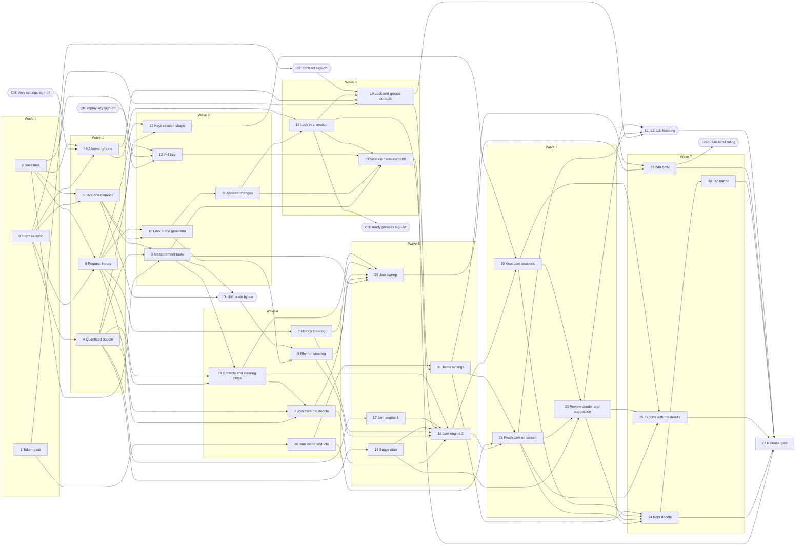

# Infinite Flow v3.2 — Build Plan

Status: v20 (2026-10-26): v19 with chunk 16's finding written in (spec D439): chunk 19 carries the
saved lock, allowed changes and allowed groups into Start and the Idle pre-generation's start, its
Files, Scope, Done when and split rule to match, and runs the corpus guard. v19 (2026-10-26): v18 with wave 3's preflight corrections and the owner's bundle ruling
written in (spec D437, D438): chunk 16's re-lock only from locked bars with sixteenth notes, its
tenser flag's condition, Files on the session's engine and pre-generation plan (not the seed plan),
atoms and drift checks, and gate CR for `module_session_ready_phrases`' likely wording at wave 3's
sync; chunk 13 classes a re-lock from the history's mark and tunes no change share; chunk 19's
Files, new specs and atoms; each wave gate records the first-load JS total (workflow deltas, M4).
v18 (2026-10-23): v17 with chunk 11's two points settled (spec D435, D436; master spec
Part C v1.11): "no change available" also covers a drawn change whose candidates all fail, and M2
tallies it apart from "no candidate"; M2 and any test of the change shares draw from seed-plan
phrase seeds, never raw consecutive seeds.
v17 (2026-10-23): v16 with chunk 10's finding written in (spec D434): chunk 13 reports
the rhythm orderings' time through the generator's diagnostics, under a clock only the sweeps pass,
and the sweeps read it (M1, M5); chunk 8's steering rank inside that time; chunk 29's ladder double
reports it.
v16 (2026-10-23): v15 with chunk 3's findings written in (spec D431–D433, master spec
Part C v1.10): chunk 13's lock census reads each phrase's lock outcome from its provenance; gate
DS, the owner's answer to O268 (how the doodle's short silences are read), before chunk 28; v3.2
H5 asks O269 (a legato doodle read as Heavily varied); gate LD opens as planned.
v15 (2026-10-23): v14 with wave 2's preflight corrections and rulings written in (spec
D427–D430, master spec Part C v1.9): chunk 10's walk rhythm-major only with locked bars, chunk 8's
band read with it; chunks 10, 11, 12 and 22's atoms and drift checks; chunk 16's re-lock request
without an allowed change; chunk 22's data versions, contract revisions, loophole closure and a
fresh Jam's played-notes clock; gate CK widened to chunk 22; gate DR for the doodle recordings.
v14 (2026-10-22): v13 with chunk 15's dead-end test matched to the trigger it uses, a
dead end reached mid-session by changing the settings, since none is reachable under today's rules
(spec D426, master spec Part C v1.8). v13 (2026-10-22): v12 with chunk 6's steering-block shape confirmed (spec D425, master spec
Part C v1.7): chunk 6's capture states the block as built, note starts and rest starts; chunk 8
reads candidates as heard against the doodle; chunk 28 writes a doodle measure's starts as C5.9
says. v12 (2026-10-22): v11 with the ruling on chunk 5's change kinds written in (spec D424,
master spec Part C v1.6): chunk 5's kinds, availability census and costs; chunks 8, 10 and 11's
costs and chunk 11's Sixteenth case; M2's comparison; v3.2 H2's settings. v11 (2026-10-22): v10 with wave 1's preflight corrections and the driver's rulings written
in (spec D422, D423; master spec Part C v1.5): chunks 4, 5, 6 and 15 corrected, chunk 12's two
contract revisions, gates CN and CK, a MAJOR contract bump at the sync of each wave that changes a
guarantee promoted at 8.1.0. v10 (2026-10-22): v9 with gate CS's sign-off written in (spec D421, master spec Part C
v1.4): the owner signed off the change set's part M, M1–M22, as drafted; `documentalist` applies it
on wave 0's branch, so a chunk's "(contract, CS)" revision is its sync's check that the code meets
the signed wording. v9 (2026-10-21): v8 with chunk 2's report written in: the Vary settings draws corpus
compares only `SessionSettings`' v3.1.0 keys once a chunk adds fields to it (the corpus guard,
chunks 15 and 16). v8: v7 with chunk 0's three findings settled (spec D418–D420, master spec
Part C v1.3): gate CS also takes `rule_start_while_controller_away` (chunk 20),
`module_session_seed_plan` (chunks 17 and 18 build a fresh Jam's seeds, chunk 24 checks the kept
doodle's) and the vision's out-of-scope browser line. v7: v6 with wave 0's preflight corrections (chunk 0 also drafts the vision's
two v1.0 lines for CS and no longer edits the lexicon, whose v3.2 entries `spec-writer` brought to
Part C v1.2; chunk 2's **Atoms** name its tests' links). v6: v5 **approved by the owner** (spec
D417), hand check v3.2 H9 waived (spec D417). v5 was v4 (rewritten from master spec Part C v1.2 and the approved v3.2 design, Jam as its
own mode, spec D416) corrected against the design at `ux-writer`'s review (chunks 1, 23, 24, 25, 30).

Jam mode, the key and mode suggestion, the rhythm lock, Jam's drift and Vary settings' allowed
groups, written from [master spec Part C](master-spec.md#part-c--v32) v1.2 (approved by the owner on
2026-10-21, spec D410, with the design's behaviour answers, spec D411) and the v3.2 design at the
root of [`ui_ux/`](../../../ui_ux/README.md) (ux D328–D346, validated by `ux-critic`, approved by the
owner: gate D0, spec D412): everything marked `[v3.2 new]`, `[v3.2 changed]` or with a `_v3.2 …:_`
change-block line. If `ux-writer` freezes the design into `ui_ux/versions/v3.2/`, `spec-writer`
repoints this plan's design links there. Every file and symbol this plan names was checked against
`main` (5ef47a0, v3.1.0 plus its archive) on 2026-10-21; where code moves before a wave starts, the
wave preflight follows the code. The plan follows the build-plan model
(`~/.local/share/dev_team/references/build-plan-model.md`) through the project's
[build workflow](build-workflow.md). Music terms: the [lexicon](../../../docs/music/lexicon.md).

**v3.2 is built on v3.1**: every chunk of the [v3.1 build plan](build-plan-v3.1.md) merged and its
release gate passed (gate R0, met). This plan names v3.0's and v3.1's modules where they landed.

**Two halves, one release.** Waves 0–3 build the session-mode half (the rhythm lock, its allowed
changes, Vary settings' allowed groups, and the whole of v3.2's request, replay key and kept-session
shape); waves 4–7 build Jam mode on it. v3.2 ships once, as `3.2.0` (spec D410): one replay key
version (`ifk4.`), one kept-session data step. Its contract changes are applied at the sync of the
wave that builds them, each signed off by the owner first (spec D422): CONTRACT 7.2.0 to 8.0.0
(gate CS), 9.0.0 at wave 1's sync (gate CN), another MAJOR at wave 2's (gate CK, chunk 12's
replay key and chunk 22's kept-session shape, spec D429). Chunk
IDs 0–27 keep the meaning plan v3 gave them where it still holds, since the v3.3 plan cites them;
chunks 28–33 are new, and chunk 26 is folded into chunk 19.

## Read first: what v3.2 changes in v2, v3.0 and v3.1

> In session mode, with the rhythm lock off and all six allowed groups on (the defaults), v3.2 must
> generate exactly what v3.1 generates, note for note, and Vary settings must draw exactly what it
> draws; and a request with none of v3.2's fields must give v3.1's phrase byte for byte. Two
> corpora recorded on v3.1 before any change
> ([chunk 2](#chunk-2--baselines-the-v31-corpus-the-vary-settings-draws-and-the-bundle)) guard every
> generator and session chunk. Jam mode's code stays out of the first load: a boundary check added
> in [chunk 20](#chunk-20--jam-mode-the-mode-switch-jams-code-on-demand-and-jams-idle) fails the build
> otherwise.

[C13](master-spec.md#c13-what-v32-changes-in-v2-v30-and-v31-guarantees-and-atoms) lists what v3.2
changes on purpose. Each enforcement point changes in exactly one chunk, never "along the way". Test
titles are as on `main` (5ef47a0); a chunk finds each one by its title. Most of v3.2 adds a mode
beside v2's behaviour rather than replacing it: a test that describes session mode stays as it is,
and the chunk adds the Jam variant beside it.

| What holds today | Changed in | Becomes |
| --- | --- | --- |
| The STABLE contract guarantees C13 names (among them `rule_optional_midi_privacy`, `rule_midi_starting_note`, `rule_midi_never_blocks_session`, `rule_count_in_shown_on_screen`, `rule_silence_timeout_ends_session`, `rule_controller_loss_mid_session`, `rule_session_generation_failure_ladder`, `rule_join_carry_in_limited`, and the eight STABLE `changes-in-v3.2` atoms) at CONTRACT 7.2.0 | Gate [CS](#gates); revised by the chunks whose **Revisions** line says "(contract, CS)" | One MAJOR bump to CONTRACT 8.0.0, the re-scoped wording signed off once by the owner. |
| A session starts with phrase 1 on screen: `tests/e2e/session/session-start.spec.ts` › 'the count-in lights beat by beat with its clicks, and phrase 1 never moves'; `tests/e2e/session/session-midi-start.spec.ts` › '…: the line names phrase 1's first note, which starts the count-in'; the `no_phrase` blocker (`src/session/session-start-conditions.ts`) | [17](#chunk-17--jam-engine-part-1-the-count-in-and-the-capture), [21](#chunk-21--a-fresh-jam-on-screen) | Unchanged in session mode; a fresh Jam starts on the home note with no phrase on screen, its beats still counted (new tests beside them). |
| The silence timer counts from the starting note: `tests/e2e/session/session-midi-silence.spec.ts` › 'counted from the starting note: running at 29.9 s, ended by 30.1 s' | 17 | Unchanged outside a fresh Jam; in one, neither the home note nor the doodle arms it, and the 30-second wait for a first doodle note is the Jam's own rule. |
| A lost controller never ends a session at once: `tests/e2e/session/session-midi-controller-loss.spec.ts` › 'the banner shows while the count-in clicks on; a replug before beat 4 brings it back' | 17 | Unchanged outside a fresh Jam; from a fresh Jam's count-in until phrase 1 sounds, a lost controller ends the Jam at once. |
| v2's failure ladder (`LADDER`, `src/session/failure-ladder.ts`) and the phrase-2 deadline (`phraseTwoDeadline`, `src/session/session-timing.ts`) | [18](#chunk-18--jam-engine-part-2-from-the-doodle-to-phrase-1) | Unchanged for phrases 2 onward and in session mode; a fresh Jam's phrase 1 has its own three rungs and three-measure deadline, and its phrase 2 is due at the start of phrase 1's last measure. |
| A session's seed is drawn at Idle when phrase 1 is published, and phrase 1 never takes a derived seed: `module_session_seed_plan`; `phraseAttemptSeed` refuses a phrase number below 2 (`src/session/session-seed-plan.ts`); the start takes `sessionSeed` from the Idle result (`src/components/workspace/workspace-session-start.ts`) | 17 (the draw at Start), 18 (phrase 1's seeds) | Unchanged in session mode and for a kept doodle's phrase 1 at Idle; a fresh Jam draws its session seed once at Start, and its phrase 1's attempts take seeds from labels of their own (C11); every existing label and seed unchanged. |
| Phrase 1 is generated at Idle (`rule_phrase_one_is_idle_phrase`, `rule_session_density_only_steps_down`'s wording) | 18 | In a fresh Jam the session generates phrase 1, so the narrow-window step-down can apply from phrase 1. |
| The join has a positive phrase number: `makeCarryIn` (`src/domain/generation/carry-in/carry-in.ts`) refuses phrase number 0; the replay key requires "phrase number equals the carry-in's plus one" (`requireConsistentPhraseNumber`, `src/generation-worker/phrase-replay-key.ts`) | [6](#chunk-6--the-request-carries-v32s-inputs), [12](#chunk-12--replay-key-ifk4) | A join from no phrase (the doodle's), with no chord, no arriving interval and no owed recovery; numbered joins keep every refusal. |
| The worker refuses any extra request field (`GENERATION_INTENT_ALLOWED_KEYS`, `src/generation-worker/generation-worker-inbound.ts`; `parseGenerationRequest`, `src/domain/generation/generation-request.ts`; `tests/unit/generation-worker/generation-worker-protocol.spec.ts`) | 6 | It accepts and re-validates the lock group and the steering block, and still refuses any other field. |
| Replay keys: encoding writes `ifk3.` (`encodePhraseReplayKey`; `tests/unit/generation-worker/phrase-replay-key.spec.ts` › 'is one line of the ifk3 prefix and unpadded base64url') | 12 | Encoding writes `ifk4.` for every phrase; every `ifk1.`, `ifk2.` and `ifk3.` decoding test stays. |
| Rhythm candidates ordered by seed alone (`rankMaterializedRhythmCandidates`, `src/domain/generation/orchestration/candidate-ranking.ts`), and `module_ranked_candidate_ordering`'s "without scoring or preferring any candidate over another" | [10](#chunk-10--the-rhythm-lock-in-the-generator) (the seam, the lock), [8](#chunk-8--rhythm-ordered-by-the-steering-block) (the steering block) | Preference keys in front of the seeded key when the lock or a steering block is in the request; seeded order alone otherwise. The atom is revised in chunk 10's capture. |
| Vary settings moves every setting but tempo and the instrument, and throws when no move exists: `tests/unit/session/settings-mutation.spec.ts` › 'changes exactly one eligible setting by one step, never tempo or the instrument', › 'throws instead of looping when no candidate is supported'; `tests/unit/session/settings-mutation-scales.spec.ts` › 'holds one scale per eligible setting, the figure levels in the profile's last place, and never tempo or the instrument', › 'offers at least one step for every eligible setting' | [15](#chunk-15--vary-settings-allowed-groups) | Only settings of an allowed group move; with all six on, the draws are v3.1's, byte for byte. With no legal move Vary settings is unavailable at Idle; a dead end mid-session skips one mutation, recorded, and never throws. |
| Notes before phrase 1 belong to no phrase: `tests/unit/session/session-history-played-notes.spec.ts` › 'puts the starting note and the count-in notes in no phrase' | 17 | Unchanged; in a fresh Jam the notes with a snapped start inside the doodle's measures belong to the doodle. |
| The played-notes export drops every note before phrase 1, and both MIDI files start phrase 1 at time zero: `tests/unit/export/midi/played-notes-midi-input.spec.ts` › 'refuses an onset before its phrase starts or at or after the next phrase starts'; `tests/unit/export/midi/midi-encoder.spec.ts` › 'writes one marker per phrase with its number, phrases back to back from time zero'; `tests/unit/export/musicxml/musicxml-encoder.spec.ts` › 'lays phrases back to back from phrase 1, four full measures each, numbered 1 upward' | [25](#chunk-25--exports-open-with-the-doodle) | Unchanged outside a Jam; a Jam's files open with a "Doodle" section at time zero and phrase 1 at the next barline, the raw doodle notes in the played-notes file's section. |
| The session end generates a new phrase 1 (`rule_session_end_generates_next_phrase_one`) | 21, [24](#chunk-24--the-kept-doodle) | In Jam mode, no phrase without a kept doodle; with one, phrase 1 written again from it. |
| Kept-session records: database data version 3 (`DATABASE_DATA_VERSION`, `src/storage/database.ts`); record shapes summary 2, body 2, played notes 1 (`src/storage/records/kept-reading.ts`); the kept intent's exact field list (`INTENT_FIELDS`, `src/storage/records/kept-phrase-parsers.ts`) | [22](#chunk-22--v32s-kept-session-shape) | One database step, 4, taken once, upgrading at open only (spec D376), each shape with its own data version (spec D370): the kept intent gains the lock group and the steering block; the summary and body gain the Jam parts (data version 4 each); played notes stay at version 1, a fresh Jam's timed from its count-in (spec D430). |
| Pre-generation's discard: its queue key `settingsKeyOf` (`src/components/workspace/workspace-pregeneration.ts`): the controls without the tempo, the figure levels, Vary settings, Tension across phrases and the restriction in force | [19](#chunk-19--the-rhythm-lock-and-what-may-vary-in-the-controls), 20, 24 | Session mode's key gains the lock, the allowed rhythm changes and the allowed groups; Jam's settings never enter it; session mode prepares nothing while Jam mode shows; Jam mode prepares only for its kept doodle, in a queue of its own. |
| Nothing checks that a module stays out of the entry chunk: `scripts/verify-boundaries.mjs` checks sizes (entry 307,200 B, 265,431 used at 3.1.0; every other chunk 100 KiB; the worker 150 KiB) and the service worker's precache list | 20 | A Jam module in the entry chunk fails `npm run verify:boundaries`. |
| The cold-generation goldens (`tests/unit/domain/generation/orchestration/generation-outcome-golden.spec.ts` and its fixtures), and the `ifk1.`, `ifk2.` and `ifk3.` corpora of v3.0 and v3.1 | **Never** | They stay byte-identical: without the new inputs, v3.2 reproduces v3.1 (item 9). A chunk that needs to touch one is wrong. |

Every replaced or extended test gets its v3.2 counterpart in the same chunk, and the release gate
lists each pair (item 48).

**The transitional interface.** From wave 4 (chunk 20) Jam mode opens, with its Idle and, from
wave 5, its settings, but `Start Jam` stays disabled until chunk 21 (wave 6) wires the fresh Jam;
in wave 6 `Jam again on this doodle` opens Jam mode without keeping the doodle until chunk 24
(wave 7); tap-in arrives with chunk 32 (wave 7). Each wave may merge into `main` in that state, but
no release is cut before wave 7 has merged.

## Gates

| Gate | What | Cleared by | Blocks | Status |
| --- | --- | --- | --- | --- |
| **R0** | v3.1 is released: the [v3.1 release gate](build-plan-v3.1.md#chunk-21--v31-release-gate) passed and `3.1.0` is tagged, so chunk 2's corpora are recorded on the code v3.1 ships. | The owner, at v3.1's release | Chunk 2, and through wave 0 every later wave | done (2026-10-21, tag `v3.1.0`; spec D397) |
| **D0** | The owner approves the v3.2 design, reworked for Jam as its own mode (ux D328–D346, `ux-critic` validated). | The owner | Chunk 1, and through it every interface chunk | done (2026-10-21, spec D412) |
| **T2** | The owner allows one `ux-writer` pass on `src/styles/theme.css` and `components.css` for part 2 of [`token-source-v3.1-v3.2.md`](../../../src/styles/components.css), adding the classes `mode-switch`, `tap-tempo`, `doodle-readings` and `jam-needs-controller` with the rest of part 2; no new token value. | The owner | Chunk 1 | done (2026-10-21, spec D412) |
| **CS** | The MAJOR contract bump for C13's guarantee changes: `documentalist` drafts the re-scoped wording of every STABLE contract atom v3.2 revises, and of the two v1.0 lines in the STABLE vision (`vision_infinite_flow_first_release` 0.9) (chunk 0), then of the three items C13 added after chunk 0 (`rule_start_while_controller_away`, `module_session_seed_plan`, and the vision's out-of-scope browsers, spec D418–D420); the owner confirms them all at once, CONTRACT 7.2.0 to 8.0.0. The chunks that revise one say "(contract, CS)" in their **Revisions** line. Signed off on 2026-10-22, the [change set](../../../docs/release/v3.1-v3.2-intent-change-set.md)'s part M (M1–M22) as drafted, and applied on wave 0's branch (spec D421); a "(contract, CS)" revision is then its wave sync's check that the code meets the signed wording. | `documentalist` drafts; the owner confirms | The sync of wave 3, the first wave whose chunks revise one (chunk 19: `rule_settings_saved_on_change`, `rule_saved_settings_load_tolerantly`); its chunks may be built and merged into the wave branch first | done (D421; applied 3fe768f, CONTRACT 8.0.0, then 8.1.0 with three promotions, 5a0c991) |
| **CN** | The owner confirms the [change set](../../../docs/release/v3.1-v3.2-intent-change-set.md)'s part N: N1 (`module_settings_mutation` 0.4 to 0.5, STABLE on the contract since 8.1.0, which chunk 15 changes), N3 (CONTRACT 8.1.0 to 9.0.0, MAJOR) and, optionally, N2 (`rule_vary_settings_figure_step`). `documentalist` applies them at wave 1's sync (spec D422; [build workflow](build-workflow.md#intent-atd), "Contract sign-off"). | `documentalist` drafts (done, 896ee7f); the owner confirms | Chunk 15's merge into the wave branch | done (2026-10-22, the owner: "ok for the vary settings"; N1, N2 and N3; applied at wave 1's sync) |
| **CK** | The owner confirms the wording of chunk 12's two contract revisions, `module_phrase_replay_key` and `rule_seeded_phrase_reproduction` (STABLE on the contract since 8.1.0), and of chunk 22's three, `module_kept_session_codec`, `entity_kept_session_record` and `module_on_device_database` (STABLE on the contract since v3.0; their wording takes in the loophole closure and a fresh Jam's played-notes clock), with the optional rewordings, and the MAJOR bump, CONTRACT 9.0.0 to 10.0.0, that applies them all at wave 2's sync (spec D422, D429, D430): the [change set](../../../docs/release/v3.1-v3.2-intent-change-set.md)'s part P, P1–P8 with P3b and the played-notes clock's wording. | `documentalist` drafts at wave 2's preflight (P1–P8, P3b; the clock's wording after spec D430); the owner confirms | Chunk 12's and chunk 22's merges into the wave branch | done (2026-10-23, the owner: "i approve it all"; change set part P, P1–P8 with P3b and the clock; applied at wave 2's sync) |
| **CR** | If chunk 16 changes what `module_session_ready_phrases` (STABLE on the contract) guarantees, as the preflight expects (a ready phrase's re-derived request takes in the session's lock state): `documentalist` drafts the wording extension at wave 3's sync and the owner confirms it there, with the contract bump the change set's rule gives (spec D422, D437). As for CS, chunk 16 merges into the wave branch first, since chunks 13 and 19 build on it in the wave. | `documentalist` drafts; the owner confirms | Wave 3's sync, and so its merge into `main` | open (likely; drafted at the sync) |
| **LD** | The owner ranks a handful of rhythm pairs by ear on drift's distance scale ([v3.2 H1](#v32-h1--drifts-scale-by-ear-ld)), before the scale drives the steering block's band ([C8](master-spec.md#c8-jams-drift)). A ranking that disagrees with the scale goes to `spec-writer` before chunk 8. | The owner; `spec-writer` if the ranking disagrees | Chunk 8 (wave 4) | open (after wave 2: chunks 3 and 5) |
| **DR** | The owner's Travel Sax recordings join the doodle set: chunk 3 writes the doodles by hand and documents how to add recorded ones (played-notes exports, kept beside their quantized form); the owner records them that way (spec D427). | The owner | Chunk 28 (wave 4), whose readings and v3.2 H5 use the recorded doodles; nothing in wave 2 waits on it | open (after chunk 3) |
| **DS** | The owner answers [O268](../../open-questions.md#v32-build-o267): how a short silence between two doodle notes (a detached note) is read, for the steering block's starts ([C5.9](master-spec.md#c59-what-the-doodle-feeds-the-generator)) and the silence reading ([C5.16.1](master-spec.md#c5161-the-doodle-to-controls-mapping)); `spec-writer` writes the answer into Part C and chunk 28 (spec D433). | The owner; then `spec-writer` | Chunk 28 (wave 4); nothing in waves 2 and 3 waits on it, nor LD (H1's measures read the same either way) | open |
| **L3** | The owner's listening check of the allowed rhythm changes ([v3.2 H2](#v32-h2--allowed-rhythm-changes-l3), item 13); the change shares are tuned from it. | The owner | The release gate's final M2 run | open (after wave 3) |
| **L1** | The owner's listening check of Jam ([v3.2 H4](#v32-h4--jam-listening-settings-drift-and-lock-l1) and [H5](#v32-h5--jam-listening-the-doodle-to-controls-mapping-l1), item 32); it confirms or sends back three of D406's provisional answers ([below](#what-confirms-d406s-provisional-answers)). | The owner; a failed answer becomes a ruling | The release gate | open (after wave 6) |
| **L2** | The owner's listening check of the suggestion ([v3.2 H6](#v32-h6--the-suggestion-l2), item 45); the weights and cues are tuned from it. | The owner | The release gate's final suggestion tests | open (after wave 6) |
| **J240** | Whether Jam's tempo reaches 240 BPM: from [chunk 33](#chunk-33--240-bpm-in-jam-best-effort)'s run at 240 BPM, the owner widens Jam's tempo control to 240, or keeps it at 180 and the chunk is dropped (C5.17, spec D404). Widening changes two of the design's sentences (Tap tempo's limit note): `ux-writer` rewords them first. | The owner; `ux-writer` if widened | The second half of chunk 33 | open (in wave 7) |

There is no data register (`data-register/README.md` does not exist), so the version's data
preflight does not run and no chunk carries a **Data** line
([build workflow](build-workflow.md#data-register)).

## Waves

| Wave | Chunks | Waits for | Status |
| --- | --- | --- | --- |
| 0 | 0 Intent re-sync and the contract drafts · 1 Token-source pass · 2 Baselines | Nothing (R0, D0, T2 done). | merged into `main` |
| 1 | 4 The quantized doodle · 5 Rhythm bars, distance and change kinds · 6 The request carries v3.2's inputs · 15 Vary settings' allowed groups | Wave 0; CN before chunk 15's merge. | merged into `main` |
| 2 | 3 Measurement tools · 10 The rhythm lock in the generator · 11 Allowed rhythm changes · 12 Replay key `ifk4.` · 22 v3.2's kept-session shape | Wave 1; CK before chunk 12's and chunk 22's merges. In-wave 10 → 11: chunk 10's capture fixes the ordering seam and the lock's order the draw slots into. LD opens at its end. | gated and synced (2026-10-26), merge into `main` on the owner's word |
| 3 | 16 The rhythm lock in a session · 13 Session measurements · 19 The lock and What may vary in the controls | Wave 2; CS and CR before its sync. In-wave 16 → 13 and 16 → 19: chunk 16's capture fixes the session's lock state and what the session history records. Three chunks: the session half ends here, and every other session chunk is done. L3 opens at its end. | planned |
| 4 | 20 Jam mode: the switch, Jam's code, Jam's Idle · 28 From the doodle: controls and steering block · 7 The join from the doodle · 8 Rhythm ordered by the steering block · 9 Melody follows the moves | Wave 3; LD (8); DR and DS (28). In-wave 28 → 7: chunk 28's capture fixes the register window the join reads. | planned |
| 5 | 14 The key and mode suggestion · 17 Jam engine, part 1 · 18 Jam engine, part 2 · 29 The Jam sweep, first run · 31 Jam's settings | Wave 4. In-wave 14 → 18: chunk 14's capture fixes the suggestion's answer type; 17 → 18: chunk 17's capture fixes the engine's way in and the capture's states. | planned |
| 6 | 21 A fresh Jam on screen · 30 Kept Jam sessions · 23 The review's doodle section and the suggestion | Wave 5. In-wave 21 → 23 and 30 → 23: chunk 21's capture fixes what the review receives from an ended Jam, chunk 30's what a kept Jam session holds. Three chunks: everything else of Jam's waits on 21 or 23. L1 and L2 open at its end. | planned |
| 7 | 24 The kept doodle · 25 Exports open with the doodle · 32 Tap tempo · 33 240 BPM in Jam | Wave 6; J240 (33's second half). In-wave 24 → 32: both change Jam's Idle note routing, whose interface chunk 20's capture fixed. | planned |

The [release gate](#chunk-27--v32-release-gate) (chunk 27) follows wave 7, with L1, L2, L3 and the
hand checks. κ is 1 ([build workflow](build-workflow.md#concurrency-and-order)).

The critical path runs 0 → 6 → 10 → 11 → 16 → 19 → 31 → 21 → 23 → 24 → 32 → 27, with LD
between waves 2 and 4 and CS and CR before wave 3's sync.

## Workflow deltas

The [build workflow](build-workflow.md) holds for v3.2 with release name `v3.2`: wave branches
`v3.2-w<n>` in `/home/bastien/work/infinite_flow-v3.2-w<n>`, chunk branches `v3.2-c<id>-<slug>` in
`/home/bastien/work/infinite_flow-v3.2-c<id>`. v3.2's own:

- **Corpus guard** (a chunk check): chunks 6, 8, 9, 10, 11, 12, 15, 16, 18 and 19, which touch
  generation or the session's draws, run chunk 2's two corpora (the `ifk3.` phrase corpus and the
  Vary settings draws), v3.1's `v3.0-neutral-jazz.json` corpus, v3.0's `ifk1-v2.0.json` corpus and
  the cold-generation goldens unchanged. Red means a request with none of the new fields, or Vary
  settings with all six groups on, no longer reproduces v3.1. The fixtures are never regenerated.
  The Vary settings corpus stores each start's full `SessionSettings` and a hash of each landing's,
  so a chunk that adds a field to `SessionSettings` (chunk 15, and chunk 16 if the lock's state
  lands there) changes its spec, and only so: the starts check and the hash compare the settings
  projected onto the keys `SessionSettings` had in v3.1.0 (`controls`, `figureLevels`, `selection`,
  `instrumentProfile`, `restriction`, each with only its v3.1.0 keys), the projection written out
  in the spec, and every row's move, draw count and selection are still compared as recorded.
- **Session tests on the fake clock**: the session and the Jam engine run on the injected audio
  clock with a fake MIDI port and the held-generation harness; a test never waits for real time.
- **Sweep at the wave gate**: chunks 6, 8–11, 15–18 place it there, so waves 1–5 run it; wave 5's
  gate also re-runs M1 with chunk 18's real ladder.
- **Jam's code** lives under `src/jam/` (chunk 20's capture), apart from the generator's steering
  module (in the worker), the session engine's generic way in (`src/session/`) and the data shapes
  (`src/domain/doodle/`, the request, the kept-session codec). From chunk 20 on, `npm run
  verify:boundaries` fails if any `src/jam/` module is in the entry chunk, and each wave gate
  records the size of Jam's chunks beside the entry chunk's.
- **Phones are a third-rate client** (spec D414): a chunk's phone check is a landscape phone debug
  run showing nothing cut, overlapping or unreachable. Where the design's phone variant costs more
  than it is worth, the chunk owner may reduce the capability below `bp-tablet-landscape` (hide a
  non-essential element, drop an animation, keep a list collapsed), recording it on the chunk's
  **Record** line and reporting it to `ux-writer`; no owner ruling is needed. No hand check runs on
  a phone.
- **Intent**: the DRAFT atoms are tagged `release-v3.2` (67, written from Part C v1.0 and
  reconciled with v1.2 by chunk 0), the atoms to revise `changes-in-v3.2` (33, eight of them STABLE
  on the contract surface); revisions are part E, drift checks part F and the corrected atoms part
  G of the [v3.1–v3.2 intent change set](../../../docs/release/v3.1-v3.2-intent-change-set.md), as
  chunk 0 leaves it. Atom names below are those known on 2026-10-21; chunk 0 may rename or replace
  the ones Part C v1.1 retired (the Jam switch, the kept doodle's dropping list), and the wave
  preflight follows its result. Chunks 1, 2, 3, 13 and 29 add no atom.
- **Chunks 0 and 1 are not coding chunks**: the driver hands chunk 0 to `documentalist` (spec
  ingestion, milestone refinement) and chunk 1 to `ux-writer`.
- **Area documents**: `docs/session-engine.md`, `docs/phrase-workspace.md`,
  `docs/generation-latency.md`, `docs/audio-transport.md`, `docs/storage.md`,
  [`docs/music/`](../../../docs/music/README.md); the lexicon entries C4 names.
- **Entry budget**: 300 KiB (307,200 B), unchanged; 265,431 B used at 3.1.0
  ([M4](#m4--the-first-load-bundle)). Raising it needs the owner. From wave 3 on, each wave gate
  records the first-load JS total (the entry chunk and every chunk it imports statically) beside
  the entry chunk's figure, with its change since the previous wave (spec D438): information only,
  since rolldown's re-splitting can move the entry chunk alone by about 18 kB with no change in what
  loads (wave 2). The budget and what `verify:boundaries` gates on are unchanged.
- **New end-to-end specs** go into the explicit `test:e2e` list in `package.json`, or they never
  run in `npm run quality`.
- **Hand checks** go into a new "v3.2 hand checks" part of
  [`HARDWARE-CHECKLIST.md`](../../../HARDWARE-CHECKLIST.md), written by the chunk the
  [list](#hand-checks) names, as numbered scripts of at most ten minutes, run in Chrome on the
  reference machine with the Travel Sax over USB; their names are "v3.2 H1" to "v3.2 H8" (H9 waived,
  spec D417). None runs in Edge (spec D399).

## Measurements and hand checks

Figures the spec leaves to the build ([C17](master-spec.md#c17-deferred-and-open): "measured before
the gate, not open questions"). The release gate copies each into the release notes. Chunk 2's
corpora are a guard, not a measurement.

### M1 — The Jam sweep

- **What:** [C16 item 31](master-spec.md#c16-definition-of-done) and
  [C5.8](master-spec.md#c58-the-time-budget): over doodles × settings at 60, 120 and 180 BPM, with
  Jam's lock on and off, warm and cold rhythm domains (C5.8, spec D410), the share of phrase 1
  generated by each rung (the join and the steering block; the block without the join; neither) and
  the share of Jams whose phrase 1 never came; the cost of the new orderings per attempt; that no
  phrase repeats; and that every standalone attempt, carrying the steering block and the lock,
  stays within the standalone reserve (`STANDALONE_RESERVE_SECONDS`, 1.075 s,
  `src/session/session-timing.ts`). 240 BPM only in chunk 33.
- **How:** chunk 3's Jam sweep: the deadline sweep's rhythm settings (`sweepCases()`,
  `tests/unit/session/deadline-sweep.ts`) crossed with the doodle set, the controls taken from each
  doodle by chunk 28's mapping, each attempt charged its measured time as `npm run test:sweep` does,
  phrase 1 through a test double of chunk 18's ladder (chunk 29) and then the real one (wave 5's
  gate), phrases 2 to 8 through v2's. A cold domain is measured by clearing the domain memo before
  phrase 1. Each attempt's orderings time is the one the generator's diagnostics report (chunk 13,
  spec D434); until chunk 13 the orderings' share is null.
- **Run by:** chunk 3 (the no-steering baseline, on v3.1's generator); chunk 29; wave 5's gate;
  chunk 33 (at 240 BPM); the release gate.
- **Acceptance:** no phrase repeated; the slowest standalone attempt within the budget on the
  reference machine; with no steering block and the lock off, the baseline's figures (phrases
  byte-equal; only timing noise differs). A standalone attempt past its budget is not tuned away: it
  goes to `spec-writer` with the figures (C5.9 and C7.6 keep the block and the lock on every rung).
  A cold domain that misses the deadlines at 180 BPM goes to the owner (spec D410).
- **Recorded:** a "Jam and the rhythm lock" section of `docs/generation-latency.md`.

### M2 — The lock census: forced bends and rhythm changes

- **What:** C16 items 1 and 2, and [C7.4](master-spec.md#c74-when-a-phrase-changes)'s starting
  shares: the forced-bend rate (overall, with Tension across phrases at each tension, after Vary
  settings' Tension step from Build to Lift); the share of phrases that draw a change (near 1 in 4,
  1 in 2 on tenser phrases); the share of draws with no candidate, per kind and per rhythm setting,
  and apart from it the draws whose candidates all failed to make a phrase (both record "no change
  available", spec D435; the domain lookup tells them apart);
  and that no phrase makes more than one change, of an allowed kind, measured from the locked
  rhythm.
- **How:** chunk 3's lock census, over seeded eight-phrase sessions on the deadline sweep's
  settings, each kind alone and all five together, Tension across phrases on and off, each phrase
  classed by the lock outcome its provenance records, a re-lock by the history's mark (chunk 13,
  spec D432, D437); per-kind
  availability compared with [jam-grounding §D.2](jam-grounding.md#d2-what-the-rhythm-domain-offers-a-locked-rhythm)'s
  census (re-measured, spec D424), and recorded at each built-in preset's rhythm settings, which
  L3's tuning reads. Every draw comes from a phrase seed the session seed plan derives, as in a
  session (spec D436): the draw's hash barely moves its kept bits when only a seed's last hex digit
  changes, so raw consecutive phrase seeds, or consecutive session seeds, draw in clumps; the
  census's session seeds, 100 apart, spread (0.2503 and 0.4991 over 20,000 sessions' phrases 2–8).
  The same holds for any test of the shares.
- **Run by:** chunk 13; the release gate, after L3's tuning.
- **Acceptance:** the changed share within a few points of 1 in 4 and 1 in 2 (tuned by L3); the
  rest is recorded. A forced-bend rate the owner finds too high at L3 goes to `spec-writer`: the
  lock is strict by spec.
- **Recorded:** `docs/generation-latency.md` and
  [`docs/music/rhythm-phrase-structure.md`](../../../docs/music/rhythm-phrase-structure.md).

### M3 — The start-up read and the kept-session upgrade

- **What:** whether v3.2's first open upgrades v3.1's kept sessions to database step 4 inside the
  start-up wait (Part A §4.4), and whether reading Jam sessions with four-measure doodles stays
  inside it.
- **Run by:** chunk 22 (`npm run measure:kept-session-upgrade` and `measure:startup-read`, on 10,
  100 and 500 v3.1 sessions by v3.1's method, cold and warm); chunk 30 (the read with half of them
  Jam sessions). The owner repeats the deciding runs on the reference machine.
- **Acceptance:** each well under the start-up wait constant. The upgrade runs at open only (spec
  D376); a visit past the wait is a failed-read visit, as v3.1 accepted for its largest bodies.
- **Recorded:** `docs/storage.md`.

### M4 — The first-load bundle

- **What:** the entry chunk stays within 307,200 B (`entryChunkByteBudget`,
  `scripts/verify-boundaries.mjs`; 265,431 B at 3.1.0); from chunk 20 on, no `src/jam/` module is
  in it, and each of Jam's chunks stays within the 100 KiB per-chunk budget. The session half adds
  the lock's and the groups' controls to the entry chunk; the bar key, the distance, the orderings
  and the steering module live in the worker's chunk (150 KiB); the mode switch and Jam's loader
  are the only Jam code in the entry chunk.
- **Run by:** chunk 2 (the baseline on `main`); every wave gate; the release gate.
- **Beside it** (spec D438): from wave 3 on, the first-load JS total, the entry chunk and every
  chunk it imports statically (318,964 B over 16 files after wave 2), recorded for information; it
  gates nothing.
- **Recorded:** the wave log and each wave's merge commit message; the release notes.

### M5 — The session sweep with the lock

- **What:** [C16 item 10](master-spec.md#c16-definition-of-done): at 60, 120 and 240 BPM, lock on
  and off, the forced-bend rate, the share of changes, no phrase repeated, the standalone
  attempts within their reserve, and the lock's orderings' share of attempt time.
- **How:** chunk 3's session sweep: `npm run test:sweep`'s cases with the lock on (phrase 1's bars
  frozen as chunk 16 does), the allowed changes all on and all off; the orderings' time from the
  generator's diagnostics, as in M1 (chunk 13).
- **Run by:** chunk 3 (baseline, lock off); chunk 13; the release gate.
- **Acceptance:** with the lock off, v3.1's figures; with it on, every standalone attempt within its
  budget; otherwise as M1.
- **Recorded:** `docs/generation-latency.md`, beside M1.

### What confirms D406's provisional answers

Four answers are provisional until the owner's checks (spec D406;
[Part C §C17](master-spec.md#c17-deferred-and-open)). A check that fails comes back to the owner as
a ruling; the spec and this plan then change by decision, never silently in a chunk.

| Answer (spec D406) | Confirmed by | If it fails |
| --- | --- | --- |
| Jam's settings set | v3.2 H4 (L1) | The owner rules which setting comes back into Jam, or goes |
| The doodle sets the rhythm and shape controls | v3.2 H5 (L1), with C5.16.1's thresholds | The owner rules between corrected thresholds and v1.0's "the doodle changes no setting" |
| Tempo set before the doodle, with tap-in | v3.2 H7 | Tap-in may slip to after v3.2 (chunk 32 dropped); set-before stays unless the owner rules otherwise |
| Jam's own lock, changes and drift, apart from session mode's | v3.2 H1 (LD), then v3.2 H4 (L1) | The owner rules on folding them into one "how close to my doodle" control |

### Hand checks

The owner runs these in Chrome on the reference machine with the Travel Sax over USB, each a
numbered script of at most ten minutes, written into `HARDWARE-CHECKLIST.md` by the chunk named. A
check passes on the owner's word; what they report is recorded by the driver in the wave log.

#### v3.2 H1 — Drift's scale by ear (LD)

Written by chunk 3; run after wave 2, before wave 4. About 8 minutes.

1. Open the folder of chunk 3's rendered rhythm pairs.
2. For each of five doodle measures, play the doodle measure, then its candidates at Same, Close,
   Near and beyond, in a shuffled order.
3. Rank each set from most to least alike.
4. Say whether Close sounds closer than Near in most sets.
5. Report the rankings; a set that disagrees with the scale goes to `spec-writer`.

#### v3.2 H2 — Allowed rhythm changes (L3)

Written by chunk 19; run after wave 3. About 10 minutes.

A kind changes a phrase only when the locked rhythm offers it (C7.3's known limit). These settings
offer all five: of their locked rhythms, 28 % offer a moved note, 51 % a moved rest, 22 % a split,
15 % a merge, 28 % a rest added or removed, and 82 % at least one (spec D424). At Neutral's
settings, Move a note and Move a rest never happen, so it is not used here.

1. Session mode, the Pop song preset (Eighth, Heavily varied, Occasional offbeats, Conversational
   silence, tension Lift), any key, 120 BPM; Rhythm lock On.
2. Allow all five kinds; play eight phrases. Say whether each change sounded small, and whether
   1 in 4 felt too often.
3. Allow one kind only; play eight phrases. If none changed, press Regenerate at Idle (a new
   phrase 1, a new locked rhythm) and play eight more; if still none, note it and move on (M2
   records how often each kind is available). Repeat for each kind (one to two minutes each).
4. Repeat 2 with Tension across phrases on: tenser phrases change about 1 in 2.
5. Report; the shares are tuned from it, then M2 re-runs.

#### v3.2 H3 — Vary settings' groups

Written by chunk 19; run after wave 3. About 6 minutes.

1. Session mode; Vary settings On; What may vary: only "Key and mode".
2. Play a session of about twelve phrases: only the key and mode move.
3. Turn every group on, Rhythm lock On; play about eight phrases: the rhythm never moves.
4. Turn every group off but "Rhythm", lock On: Vary settings shows it cannot vary, with its reason.

#### v3.2 H4 — Jam listening: settings, drift and lock (L1)

Written by chunk 21; run after wave 6. About 10 minutes.

1. Jam mode, 100 BPM, Drift Near, lock Off.
2. Play a two-measure doodle with a clear rhythm; listen to four phrases: "does it sound like my
   doodle?"
3. Stop; the doodle is kept. Set Drift Close; Start; listen to four phrases.
4. Same with Drift Free.
5. Rhythm lock On; Start; listen to four phrases: one rhythm, near the doodle's.
6. Say whether Jam's small settings set felt enough, and whether drift and the lock felt like two
   controls or one.

#### v3.2 H5 — Jam listening: the doodle-to-controls mapping (L1)

Written by chunk 21; run after wave 6. About 10 minutes.

1. Jam mode, 90 BPM, Drift Near, lock Off, New doodle before each step.
2. Play a sparse doodle (three or four long notes over two measures); read "From your doodle"
   after phrase 1; listen to two phrases.
3. Play a busy doodle (running eighths or sixteenths); read, listen.
4. Play a leaping doodle (wide jumps); read, listen.
5. Play a doodle of one note; read: only the register comes from it.
6. Play a legato doodle of eighths and held quarters, about half of each; read: rhythmic variety
   shows Heavily varied; listen to two phrases: do they sound busier than the doodle, with
   sixteenth notes it never had ([O269](../../open-questions.md#v32-build-o267))?
7. For each, say whether the readings and the phrases matched the doodle; report any that did not.

#### v3.2 H6 — The suggestion (L2)

Written by chunk 23; run after wave 6. About 10 minutes.

1. Jam mode in C Major.
2. Play four doodles, a fresh Jam each: one plainly in G Major, one in D Dorian, one in A Minor,
   one with a blue note (a flattened third over Major).
3. After each, read the review's suggestion: does it name what the doodle sounds in? The blue-note
   doodle should get the "no mode fits" sentence, naming no note.
4. Use one suggestion; Start again: the phrases follow the new key and mode.
5. Say whether Locrian ever surprised you. The weights and cues are tuned from it.

#### v3.2 H7 — A Jam on the Travel Sax, with tap-in

Written by chunk 32; run after wave 7. About 10 minutes.

1. Jam mode; press Tap tempo, then tap 120 BPM on the Travel Sax: the tempo shows 120.
2. Start Jam by the home note; play a one-measure doodle; stop playing: phrase 1 continues from
   your last note, after the writing and read-in measures, with `Click` off in the session options
   (the click still sounds until phrase 1).
3. Stop. New doodle. Tap 60 BPM; play a four-measure doodle holding its last note: it ends after
   four measures.
4. New doodle. Tap 180 BPM; play a doodle with one note a little early onto beat 1, and a breath
   noise: the early note is the doodle's first, the noise changes nothing.
5. Start a fresh Jam and unplug the controller during the count-in: the Jam ends at once. Plug in;
   repeat during the doodle, then during the read-in measure.
6. Say whether setting the tempo first felt natural, and whether tap-in was worth keeping.

#### v3.2 H8 — A Jam's files

Written by chunk 25; run after wave 7. About 5 minutes.

1. Export a kept Jam session's generated notes as MusicXML and MIDI, and its played notes as MIDI.
2. Open the MusicXML in MuseScore: a "Doodle" section first, then phrase 1 at the next barline.
3. Open both MIDI files in a DAW: the doodle at time zero in both, phrase 1 at the same bar in both.

#### v3.2 H9 — waived

Waived by the owner (spec D417), on the ground of v3.1 H5's waiver (spec D399): v3.1 had no live
users. Chunk 22's upgrade tests on seeded v3.1 data and M3 cover the carried data. The ID is not
reused.

## Chunks

"Item _n_" is item _n_ of the [definition of done](master-spec.md#c16-definition-of-done). The
**Atoms** and **Revisions** lines follow the [build workflow](build-workflow.md#intent-atd).

### Chunk 0 — Intent re-sync and the contract drafts

Status: done (w0, f3b4abe)
Record: 48 DRAFT atoms revised (14 restate a retired rule under the same id), 26 added, 0 retired; `release-v3.2` now 93 DRAFT; change set parts L (re-sync) and M (CS drafts M1–M22) with the owner.
Wave: 0
Depends on: none
Architecture capture: none

- **Goal:** bring the declared intent in line with Part C v1.2 before the first chunk relies on
  it, and draft the re-scoped contract wording the owner signs off once (gate CS).
- **Scope:** `documentalist`, spec ingestion (milestone refinement); atoms only, no code. The
  lexicon's v3.2 entries already follow v1.2 (`spec-writer`'s, plan v7).
  - The 67 DRAFT `release-v3.2` atoms, written from v1.0: those v1.1 retired (the Jam switch, a
    controller switching the mode, the kept doodle's dropping list, the doodle in the request)
    revised or replaced; new ones for what v1.1 and v1.2 add (Jam mode and its switch at Idle,
    Jam's code on demand, Jam's own settings and first values, the doodle-to-controls mapping, the
    steering block, tap-in, the kept doodle's rules).
  - The 33 `changes-in-v3.2` atoms: their notes name the v1.2 change.
  - **The vision's v3.2 lines**: `vision_infinite_flow_first_release` (STABLE 0.9) still says v1.0
    in two places, "from v3.2, the Jam switch and its drift" (a control v1.1 retired: Jam mode, its
    mode button and Jam's own settings) and "without ever changing a setting" (the doodle sets
    Jam's rhythm and shape controls, C5.16). A redraft of both, in Part C v1.2's terms.
  - **The CS drafts**: the re-scoped wording of every STABLE contract atom C13 names, and the
    vision's redrafted lines, in one list for the owner, the weakening ones first.
- **Files:** `docs/*.atom.md`, among them `docs/vision_infinite_flow_first_release.atom.md`;
  [the change set](../../../docs/release/v3.1-v3.2-intent-change-set.md).
- **Spec sections:** [Part C](master-spec.md#part-c--v32), C13; no item directly.
- **Atoms:** every atom tagged `release-v3.2` or `changes-in-v3.2`;
  `contract_infinite_flow_first_release` (7.2.0); `vision_infinite_flow_first_release` (STABLE
  0.9).
- **Revisions:** none (the contract bump and the vision's lines are CS's).
- **Done when:** each Part C v1.2 behaviour is stated by an atom (DRAFT); no atom states a retired
  v1.0 behaviour; `npm run atd:lint` and `npm run atd:check` pass; the CS list, the vision's lines
  included, is with the owner.
- **Verification:** `documentalist`'s ingestion report; chunk checks.
- **Split rule:** none needed.

### Chunk 1 — Token-source pass, part 2 (v3.2)

Status: done (w0, c241b22)
Record: part 2's 15 classes in one `v3.2 new` block of `components.css`, no new token; the token-source document deleted (ux D349, which follows the handoffs on `doodle-readings`' columns and `review-doodle`'s note).
Wave: 0
Depends on: D0, T2 (both done)
Architecture capture: none

- **Goal:** write v3.2's component classes into the canonical token source, so every interface
  chunk styles its components without inventing a value.
- **Scope:** `ux-writer`, not a coding executor. Everything in part 2 of
  [`token-source-v3.1-v3.2.md`](../../../src/styles/components.css), under `v3.2 new`
  comments (ux D342): no new token value; among the classes `mode-switch`, `tap-tempo`,
  `doodle-readings`, `jam-needs-controller`, `staff-jam`, `jam-capture`, `jam-writing`, `jam-bar`
  with its button, `suggestion-row` without the restriction line, `review-doodle`, `toggle-list`
  and `field-dependent`. With part 2 applied, both parts are in the token source, and `ux-writer`
  deletes the document, as it says, repointing every inbound link in the same change (this plan's
  included; archived documents' paths only).
- **Files:** `src/styles/theme.css`, `src/styles/components.css`;
  `ui_ux/token-source-v3.1-v3.2.md` (deleted), the documents linking to it.
- **Design docs:** [`ui_ux/token-source-v3.1-v3.2.md`](../../../src/styles/components.css)
  (part 2). No item directly; it unblocks 19, 20, 21, 23, 24, 31 and 32.
- **Atoms:** none (styling).
- **Revisions:** none.
- **Done when:** every class part 2 names exists in `src/styles/`; no v3.2 handoff names a class
  that exists nowhere; `npm run test:notation` passes with no snapshot change; the document is
  gone and `npm run lint:links` passes.
- **Verification:** chunk checks; `npm run test:notation`; a `grep` of each v3.2 handoff's class
  names against `src/styles/`.
- **Split rule:** none needed.

### Chunk 2 — Baselines: the v3.1 corpus, the Vary settings draws and the bundle

Status: merged (w0, bdd382c)
Record: phrase corpus 250 `ifk3.` cases, Vary settings corpus 240 sessions (2,400 landings), both green on `v3.1.0` and on the wave branch; entry chunk 265,431 B on ec221b1; corpus guard command in `docs/testing.md` (12 files, 425 tests, about 15 s).
Wave: 0
Depends on: R0 (done)
Architecture capture: none

- **Goal:** record, on the code v3.1 shipped, what v3.2 must not break: the phrase every request
  gives without the new fields, every `ifk3.` key's phrase, Vary settings' draws, and the entry
  chunk's size.
- **Scope:**
  - **The phrase corpus**, generated from the `v3.1.0` tag: the eight built-in presets and a spread
    of figure levels × every one of the nine collections × the three built-in instruments and two
    player-made ones × a spread of the other controls (every Tension value, Eighth and Sixteenth
    with Heavily varied, Strict variety with Straight syncopation) × several seeds, with and
    without carry-in (a null harmony included), each stored as its `ifk3.` key and the timeline it
    replays to; a unit test regenerates each byte for byte.
  - **The Vary settings corpus**: seeded sessions (Vary settings on, every preset's restriction, a
    narrow-window step-down) whose drawn moves are recorded from the tag; a unit test replays each
    through the session's draw. Item 7's "all six groups reproduce today's Vary settings byte for
    byte" rests on it.
  - The entry chunk's size after `npm run build` on `main`.
- **Files:** `tests/fixtures/replay-keys/v3.1-corpus.json`,
  `tests/unit/generation-worker/phrase-replay-key-v31-corpus.spec.ts`,
  `tests/fixtures/vary-settings/v3.1-mutation-draws.json` (beside v3.0's
  `v3.0-mutation-draws.json`) and its unit test (all new), a generator script under `scripts/`,
  `docs/testing.md`.
- **Spec sections:** [C11](master-spec.md#c11-the-generation-request-the-replay-key-and-kept-sessions),
  [C9](master-spec.md#c9-vary-settings-allowed-groups); items 9 and 7 (the guard), 11 (`ifk3.`
  decoding).
- **Atoms:** none revised. The new tests `@test-link` the atoms the corpora they extend link: the
  phrase corpus to (v2) `module_phrase_replay_key` and (v1) `rule_seeded_phrase_reproduction`, as
  `phrase-replay-key-v30-corpus.spec.ts` does; the Vary settings corpus to (v3.1)
  `rule_vary_settings_figure_step` and `rule_vary_settings_stays_inside_restriction` and (v2)
  `module_settings_mutation`, as the tests replaying `v3.0-mutation-draws.json` in
  `settings-mutation.spec.ts` and `settings-mutation-restriction.spec.ts` do.
- **Revisions:** none.
- **Done when:** both corpus tests pass on the tag and on `main`; the baseline size is recorded in
  `docs/testing.md`.
- **Verification:** chunk checks; each corpus test is red if a stored value is changed by hand.
- **Split rule:** none needed.

### Chunk 3 — Measurement tools: the doodle set, the sweeps, the lock census and the renders

Status: merged (w2, e70a845)
Record: e70a845, merge 97952f9. The doodle set is hand-written (driver's ruling; the owner's Travel Sax
recordings come in through `scripts/import-doodle-recording.mjs`, gate DR); runners are `*.measure.ts`
files with helpers split to keep under the size limit; four findings sent to `spec-writer` (wave log, wave 2).
Wave: 2
Depends on: 2, 4 (the doodle type), 5 (the bar key)
Architecture capture: none

- **Goal:** the scripts M1, M2, M5 and the listening checks need, each run once on the code as it
  stands for its baseline.
- **Scope:** tooling only.
  - **The doodle set**: quantized doodles written by hand from C5.5's rules and recorded on the
    Travel Sax (through v3.0's played-notes export), each with its traits (length, density, near or
    far from which rhythm settings, last note inside or outside the windows, one note, a chord);
    the recorded raw notes kept beside their quantized form, for chunk 4's quantizer, and the
    sparse, busy, leaping and one-note doodles chunk 28 and v3.2 H5 use.
  - **The Jam sweep** (M1): the deadline sweep (`tests/sweep/session-deadline-sweep-*.spec.ts`,
    `sweepCases()`) and v3.1 chunk 3's cost runner, parameterised by controls, a steering block, a
    lock state and a cold or warm domain; until chunks 8 and 28 exist it runs with no block (the
    baseline). It writes, as JSON like `LATENCY_OUT`, the rung shares, the per-attempt timings with
    the orderings' share, the repeat count, and the slowest and 95th-percentile standalone attempts.
  - **The session sweep** (M5): the same runner in session mode with the lock's state as input.
  - **The lock census** (M2): seeded eight-phrase sessions per setting; per phrase, kept bars, a
    change (its kind), a forced bend; per draw, whether candidates existed.
  - **The renders** for v3.2 H1 and H2: short MIDI files (a doodle measure, then candidates at
    each distance; a locked rhythm, then one change of each kind).
- **Files:** `tests/sweep/jam-sweep.ts`, `jam-sweep.spec.ts`, `lock-census.ts`,
  `lock-census.spec.ts`, `tests/fixtures/doodles/`, `scripts/render-rhythm-examples.mjs` (all new),
  `package.json` (`measure:jam`, `measure:lock`, `render:rhythms`), `docs/testing.md`,
  `docs/generation-latency.md`, `HARDWARE-CHECKLIST.md` (v3.2 H1).
- **Spec sections:** [C5.5](master-spec.md#c55-quantizing), [C5.8](master-spec.md#c58-the-time-budget),
  [C7.4](master-spec.md#c74-when-a-phrase-changes); M1, M2, M5 rest on it (items 1, 2, 10, 31).
- **Atoms:** none (measurement).
- **Revisions:** none.
- **Done when:** the sweeps run on the wave branch with no block and the lock off and record the
  baselines; the census classifies a hand-written session holding one change of each kind, a forced
  bend and a kept phrase exactly; the renders play in a MIDI player; v3.2 H1 is written.
- **Verification:** chunk checks (the census's own unit test); the baseline runs.
- **Split rule:** none needed (tooling).

### Chunk 4 — The quantized doodle

Status: merged (w1, c80701d)
Record: `quantizeDoodle` takes a fourth input, `endMeasure` (the capture's end barline, chunk 17's verdict), and exports `snappedTickOf` for chunk 17; quantizer import boundary enforced in `eslint.config.js`; 76 new tests; lexicon "quantize" stays planned until Jam is usable; for the sync: `endMeasure` into `module_doodle_quantizer`.
Wave: 1
Depends on: 0
Architecture capture: the quantized doodle, `src/domain/doodle/quantized-doodle.ts`: one to four
measures, each note a start and a length in ticks from the start of the doodle's first measure and
a concert pitch; at most 64 notes, sorted, never overlapping (one line). Its own type, not a
`ConcertEventTimeline` (always four measures), with a validating constructor and a parser that the
kept-session codec (chunk 22) and Jam's code reuse. The capture tempo is kept beside it, never
inside it, so it can never reach the request. The quantizer, `src/jam/doodle-quantizer.ts`, takes
raw notes on the audio clock, the grid origin and the tempo; integer arithmetic after one
conversion to microseconds. Nothing outside `src/jam/` imports the quantizer.

- **Goal:** turn a capture's raw notes into the quantized doodle every later step reads, by C5.5's
  rules, with integer arithmetic.
- **Scope:**
  - `quantized-doodle.ts` (new): the type, its constructor and parser.
  - `doodle-quantizer.ts` (new): the stray-note filter first (`withoutVeryShortNotes`,
    `src/domain/played-notes/stray-notes.ts`); each time converted once to integer microseconds,
    then snapped to the nearest tick with integer division (a tie to the later tick, stated and
    tested); a note keeps at least one tick; overlaps cut the earlier note at the later start; two
    notes on one tick keep the longer, then the higher; notes snapped before the first beat after
    the count-in dropped; a note past the doodle's end cut at its last barline; the doodle starts
    at the measure holding its first note, rests included. `doodleMeasureOf(snappedStart)`, which
    chunk 17's end rule uses.
- **Files:** `src/domain/doodle/quantized-doodle.ts`, `src/jam/doodle-quantizer.ts` (new); tests
  `tests/unit/domain/doodle/quantized-doodle.spec.ts`, `tests/unit/jam/doodle-quantizer.spec.ts`.
- **Spec sections:** [C5.4](master-spec.md#c54-capturing-the-doodle-where-it-starts-and-where-it-ends),
  [C5.5](master-spec.md#c55-quantizing), [C10.6](master-spec.md#c106-stray-notes-v30); items 25,
  24 (the doodle's half).
- **Atoms:** `rule_doodle_quantized_to_sixteenths`, `rule_doodle_is_one_line`,
  `rule_doodle_capture_start`, `rule_quantized_doodle_is_generation_input`; (v3.0)
  `rule_stray_note_definition`, `rule_stray_notes_filtered_on_reading`.
- **Revisions:** revise `rule_stray_notes_filtered_on_reading` (REVIEW, not on the contract): very
  short notes are filtered "only" for the review's Played notes lane and the played-notes export;
  the doodle becomes a third reader (C5.4, C10.6). Change set part E does not list it yet;
  `documentalist` adds it at the sync.
- **Done when:**
  - Written doodles quantize as C5.5 says: a note a little early onto beat 1 is the doodle's first
    note; overlaps, chords and notes colliding on one tick reduce to one line (a named test each); a
    very short note never starts, extends or shapes the doodle.
  - No floating-point operation after the one conversion (a test over the module's source); a fixed
    list quantizes identically twice.
  - The constructor refuses zero or five measures, an overlap, a note outside its measures, 65
    notes; the parser round-trips every valid doodle.
- **Verification:** chunk checks. Chunk 3's recorded doodles join the quantizer's tests when they
  exist.
- **Split rule:** none needed (two new modules).

### Chunk 5 — Rhythm bars, distance and change kinds

Status: merged (w1, baf924b)
Record: stopped at WIP 8cbb67f on §D.2's figures, resumed after spec D424 (definitions kept, §D.2 re-measured); census equal to §D.2 count for count; keying 13.2 ms, distance to all 20.4 ms with start lists precomputed (29.7 ms without; chunks 8, 10, 11 precompute once per domain); kind names imported as a type from chunk 6's `request-rhythm-lock.ts`.
Wave: 1
Depends on: 0, 2
Architecture capture: the bar key, `src/domain/rhythm/rhythm-bars.ts` (a revision of
`entity_rhythm_candidate_domain`): a candidate's written bars per measure (note starts and lengths,
rests, ties) as a compact string key, so identical rhythms compare equal by their bars, never by
their `identity` or index; a domain keyed by bars once, beside the canonical memo
(`src/domain/generation/orchestration/canonical-rhythm-domain.ts`), so a lookup costs a map access.

- **Goal:** C8's distance and C7.3's five kinds as pure, tested functions over the existing rhythm
  candidates, before any ordering uses them.
- **Scope:**
  - `rhythm-bars.ts` (new): the bar key; its start lists (note starts and rest starts, ties
    ignored, so a rhythm written with other ties is at distance 0); the keyed domain.
  - `rhythm-distance.ts` (new): the per-measure edit count (C8: add a start, remove one, move one by
    at most an eighth; a note start turned into a rest start at the same tick is one edit), the band
    (Same; Close; Near; beyond), the total over four measures. Integers only.
  - `rhythm-change-kinds.ts` (new): the one allowed-kind change between the locked bars and a
    candidate's, in one measure or made in gesture measure _k_ and repeated in answer measure
    _k_ + 2, or none; bars compared as written. The kinds exactly as C7.3's "Exactly" column
    defines them; "repeated" is the identical edit (kind, tick, shift); ties must match outside
    the ticks the edit touches (spec D424).
- **Files:** `src/domain/rhythm/rhythm-bars.ts`, `src/domain/rhythm/rhythm-distance.ts`,
  `src/domain/rhythm/rhythm-change-kinds.ts` (new); tests under `tests/unit/domain/rhythm/`.
- **Spec sections:** [C4](master-spec.md#c4-words-used-in-this-part) (Bars, Distance),
  [C7.3](master-spec.md#c73-the-five-kinds-and-the-known-limit),
  [C7.6](master-spec.md#c76-how-the-search-holds-the-lock), [C8](master-spec.md#c8-jams-drift);
  items 1, 2 and 29 (their basis); jam-grounding §D.2 (the census).
- **Atoms:** `rule_rhythm_distance`, `rule_rhythm_change_kinds` (DRAFT; `documentalist` corrects
  its known limit and its "repeated" at the wave's sync, spec D424); (v2)
  `rule_unsupported_rhythm_settings_block_generation`. Drift check:
  `entity_rhythm_candidate_domain`.
- **Revisions:** none.
- **Done when:**
  - Over the real domains, the bar key finds jam-grounding §D.2's facts (in the slowest domain
    1,797 candidates and 1,435 distinct rhythms; Settled and Lift equal, Build and Edge equal, every
    Lift rhythm among Build's).
  - C8's bands on hand-written measure pairs, one test per rule; the total is symmetric and zero
    only between rhythms equal up to ties.
  - The five kinds on hand-written pairs, alone and repeated, and pairs that are none (among
    them the same kind at another tick or shift in _k_ + 2, a note start moved after a rest, a
    rest start moving alone, a note and a rest trading places, a tie added outside the edit).
  - Per-kind availability over every supported domain equals
    [jam-grounding §D.2](jam-grounding.md#d2-what-the-rhythm-domain-offers-a-locked-rhythm)'s
    census count for count, every row of its table, with its grouping: a candidate (twins with
    identical bars counted each) counts once per kind and form when another candidate of its own
    domain is that change from it; counts summed over the row's domains. The census may run once
    in the spec that already builds every domain; never beside `atd audit`.
  - Keying the largest domain (2,932 candidates) takes about 15 ms in Node, and the total edits
    from one rhythm to all of it about 27 ms (both recorded in the chunk's report, for chunks 8,
    10 and 11; 14.4 ms and 26.5 ms medians at 8cbb67f, spec D424).
- **Verification:** chunk checks.
- **Split rule:** none needed (three new pure modules).

### Chunk 6 — The request carries v3.2's inputs

Status: merged (w1, 83ac43c)
Record: 6a 4021188, 6b 899c152; new `src/domain/generation/request-rhythm-lock.ts` (the lock group, kinds in chunk 5's names); `CarryIn` = `PhraseCarryIn | NoPhraseCarryIn`, a no-phrase carry-in requires phrase number 1; the `ifk1.`–`ifk3.` decoders read carry-ins through `parsePhraseCarryIn`; the steering block's target holds note and rest starts (C8 needs both; sent to `spec-writer`); the two group parsers enter the entry chunk with `parseGenerationRequest` (wave gate measures).
Wave: 1
Depends on: 0, 2
Architecture capture: v3.2's whole request contract, so the replay key and the kept-session shape
are taken once. `GenerationIntent` and the resolved `GenerationRequest` gain two optional groups:
`rhythmLock` (its state: on with nothing locked yet, or on with these bars; the allowed rhythm
changes; whether the phrase is a tenser one; absent means off) and `steering` (the steering block,
`src/domain/generation/steering-block.ts`: a target rhythm, exactly four measures already laid
over the phrase, each its note starts and rest starts in increasing tick 0–15 (C8 compares both,
spec D425), with a band, close, near or unbounded (Free); a list of at most 63 melodic moves, up or
down with a step, a skip or a leap, or the same note with no size, with a strength; no pitch). Absent groups mean v3.1's request exactly. Every ordering and draw is
computed inside generation from them. `CarryIn` gains an origin: a phrase (its number, as today) or
none (the doodle's join: no number, no chord, no arriving interval, no owed recovery); `makeCarryIn`
keeps every refusal for a phrase origin and checks only the pitch and the window for none. A
carry-in from a phrase keeps exactly v3.1's fields and serialized form (request, worker, `ifk3.`
key, kept record); the no-phrase origin has a form of its own (revises `entity_phrase_carry_in`,
0.5 in the capture).

- **Goal:** put the lock's state, the allowed changes, the tenser flag, the steering block and the
  join from no phrase into the request, across the worker, with no effect on any phrase yet.
- **Scope:**
  - The two groups in `GenerationIntent` and `GenerationRequest`; `request-resolution.ts` carries
    them; a v3.1-shaped request stays exactly v3.1's.
  - `CarryIn`'s origin; `makeCarryIn`, `parseCarryIn` and `carriedMotionState`
    (`src/domain/pitch/pitch-carry-in.ts`: no origin reads as "the note before beat 1, reached by no
    interval").
  - The worker's inbound parser validates and rebuilds both groups (an unknown lock state, kind,
    band, move or strength refused with the typed protocol error) and still refuses any other field
    (`GENERATION_INTENT_ALLOWED_KEYS`, `parseGenerationRequest`'s allowed keys); the prewarm and
    cancellation paths carry them; `makeCarryInGenerationIntent` accepts a join from no phrase only
    with a steering block in the intent.
  - The code that reads `carryIn.phraseNumber`, which a carry-in from no phrase lacks, reads it
    from the phrase origin only and keeps v3.1's behaviour for it: `requireConsistentPhraseNumber`
    (`phrase-replay-key.ts`), the replay names (`phrase-replay-names.ts`) and the session's
    carry-in adaptation (`carry-in-adaptation.ts`). The kept-session codec reuses `parseCarryIn`
    (`kept-phrase-parsers.ts`, under the STABLE `module_kept_session_codec`): it reads stored
    records exactly as v3.1 does until chunk 22, so a kept carry-in in any other form is refused as
    v3.1 refuses it.
  - No consumer reads the new inputs yet. Until chunk 12 brings `ifk4.`, the `ifk3.` encoder
    (`encodePhraseReplayKey`) refuses an intent with `rhythmLock`, `steering` or a carry-in from no
    phrase with a typed error, rather than write a key that loses them (spec D423); nothing produces
    such an intent in wave 1.
- **Files:** `src/domain/generation/generation-intent.ts`, `generation-request.ts`,
  `steering-block.ts` (new), `src/domain/generation/orchestration/request-resolution.ts`,
  `src/domain/generation/carry-in/carry-in.ts`, `carry-in-intent.ts`,
  `src/domain/pitch/pitch-carry-in.ts`, `src/generation-worker/generation-worker-inbound.ts`,
  `generation-worker-protocol.ts`, `phrase-replay-key.ts`, `phrase-replay-names.ts`,
  `src/session/carry-in-adaptation.ts`, `src/storage/records/kept-phrase-parsers.ts`; tests under
  `tests/unit/domain/generation/`, `tests/unit/generation-worker/generation-worker-protocol.spec.ts`,
  `generation-worker-protocol-carry-in.spec.ts` and `phrase-replay-key.spec.ts`.
- **Spec sections:** [C11](master-spec.md#c11-the-generation-request-the-replay-key-and-kept-sessions),
  [C5.9](master-spec.md#c59-what-the-doodle-feeds-the-generator) (the block, the join),
  [C14](master-spec.md#c14-existing-code-and-risks); items 9 (guarded), 27, 28 (the join's form).
- **Atoms:** `rule_jam_and_lock_off_reproduce_earlier_phrases`, `rule_jam_steering_block`,
  `rule_jam_phrase_one_joins_doodle` (the join's form); (v2) `rule_seeded_phrase_reproduction`,
  `rule_join_carry_in_limited`, `module_phrase_replay_key`; (v3.0) `module_kept_session_codec`.
  Drift check: `module_generation_request_construction`,
  `module_generation_worker_protocol`, `entity_phrase_carry_in`.
- **Revisions:** none (`entity_phrase_carry_in` is revised in the capture).
- **Done when:**
  - A request with each group round-trips through the worker unchanged; one with an unknown value
    in either group, or any extra field, is refused with the typed error.
  - A join from no phrase is accepted with a pitch inside the window and refused outside it; a
    phrase origin with number 0 is still refused (each refusal keeps its test).
  - A carry-in from a phrase serializes exactly as in v3.1 in the request, the worker message, the
    `ifk3.` key and the kept record; a stored v3.1 kept record reads as before.
  - The `ifk3.` encoder refuses an intent with either group or a carry-in from no phrase with the
    typed error; every v3.1-shaped intent encodes as before.
  - The corpora and the goldens pass unchanged; a request built with neither group is deep-equal to
    v3.1's.
- **Verification:** chunk checks with the corpus guard; the sweep and the bundle at the wave gate.
- **Split rule:** if the brief passes about five source files, 6a the two groups (intent, request,
  steering block, resolution, inbound parser, protocol, the encoder's refusal of the two groups),
  6b the join's origin (carry-in, carry-in intent, pitch carry-in, the three readers of the phrase
  number and the kept codec's reuse, the encoder's refusal of a carry-in from no phrase).

### Chunk 7 — The join from the doodle

Status: planned
Wave: 4
Depends on: 4, 6, 28 (the register window) (and v3.0 chunk 16, my instrument's range)
Architecture capture: none (chunk 6 fixed the join's form, chunk 28 the window)

- **Goal:** on Jam's side, build phrase 1's join from the doodle's last note and choose the register
  window C5.9 gives, or no join when that note lies outside it.
- **Scope:** `src/jam/doodle-join.ts` (new): from the quantized doodle, the instrument and the
  register window chunk 28 reads, the join from no phrase (the last note's concert pitch,
  no chord, no arriving interval, no owed recovery), with the window holding the last note passed
  as today's register input; none when that note lies outside the instrument's range or every
  window. Phrases 2 onward keep v2's join from the previous phrase.
- **Files:** `src/jam/doodle-join.ts` (new); tests under `tests/unit/jam/`.
- **Spec sections:** [C5.9](master-spec.md#c59-what-the-doodle-feeds-the-generator) (the join,
  register), [C5.10](master-spec.md#c510-planner-authority); item 28.
- **Atoms:** `rule_jam_phrase_one_joins_doodle`, `rule_jam_register_follows_doodle`; (v2)
  `rule_varying_register_once_per_session`, `rule_instrument_profile_range`. Drift check:
  `entity_phrase_carry_in`.
- **Revisions:** revise `rule_join_inherits_leap_recovery`, `rule_join_tense_note_resolution`.
- **Done when:**
  - Over the doodle set, generating with the join gives a first interval that obeys the limits of
    two notes inside a phrase, and no recovery owed on phrase 1's first note.
  - The window holds the last note (nearest centre among several); outside every window or the
    range, no join (a test per case), the steering block still in the request.
- **Verification:** chunk checks.
- **Split rule:** none needed (one module).

### Chunk 8 — Rhythm ordered by the steering block

Status: planned
Wave: 4
Depends on: 5, 6, 10 (the ordering seam), LD
Architecture capture: the generator's steering module, `src/domain/generation/steering/`, its rhythm
part: with a steering block, a candidate's preference rank is 0 when every measure lies inside the
block's band, else 1 plus its total edits to the target rhythm; with the lock "on, nothing locked
yet" and a block, the total edits alone (nearest the doodle, whatever the band). It slots into
chunk 10's preference tuple; without a block the tuple is chunk 10's. A block never changes the
search's walk: without locked bars it stays v3.1's, harmony-major (C7.6, C8; spec D428).

- **Goal:** order a phrase's rhythm candidates by the steering block's target rhythm and band, and
  choose a Jam's locked phrase 1 nearest the doodle, without removing any candidate.
- **Scope:** `rhythm-steering.ts` (new) in the steering module; the rank computed after the seeded
  ranking, over the bar key's start lists read as heard (a rest start right after a rest dropped,
  C8, spec D425; the lock's comparisons keep the written lists), once per request; ties by the seeded key, then index, in
  code-unit order. Budget: the total edits from one rhythm to every candidate of the largest domain
  take about 27 ms in Node (chunk 5's measure, spec D424), so the rank is computed once per
  request, never per rung or chord plan; memoizing the per-measure distance by measure pair is
  allowed. The rank is built inside the span whose time the diagnostics report (chunk 13, spec
  D434), so the Jam sweep (M1) confirms it. A target far from every rhythm the settings allow is only approached:
  `no_legal_rhythm_plan` arises only where it arises in v3.1.
- **Files:** `src/domain/generation/steering/rhythm-steering.ts` (new),
  `src/domain/generation/orchestration/candidate-ranking.ts`, `src/domain/rhythm/rhythm-lock-order.ts`,
  `src/domain/generation/orchestration/generation-orchestrator.ts` (the order built once per
  request, inside the timed span); tests under `tests/unit/domain/generation/`.
- **Spec sections:** [C5.9](master-spec.md#c59-what-the-doodle-feeds-the-generator) (rhythm),
  [C7.1](master-spec.md#c71-the-switch-and-what-is-locked) (a Jam's locked rhythm),
  [C8](master-spec.md#c8-jams-drift); items 27, 29 (rhythm), 30.
- **Atoms:** `rule_jam_rhythm_ordered_by_doodle`, `rule_jam_drift_positions`,
  `rule_rhythm_distance`, `rule_doodle_only_orders_candidates`. Drift check:
  `module_named_stream_pseudorandomness` (no new stream), `module_ranked_candidate_ordering`.
- **Revisions:** none.
- **Done when:**
  - Over the doodle set's blocks at each band, the chosen rhythm's measures lie in the band
    whenever a candidate in it makes a phrase with the chord plan the search settles on (the
    first one any rhythm makes a phrase with, spec D428); Free's block keeps v3.1's rhythm for the
    seed.
  - With "nothing locked yet", phrase 1 takes the candidate nearest the target among those making
    a phrase with that chord plan, whatever the band.
  - A candidate that writes one of the target's silences as two rests is at no edit from it.
  - The same block and seed give the same order twice, under a non-English collation.
  - Every candidate appears once in the order; the corpora pass.
  - With a clock passed and a block, the diagnostics' orderings time includes the rank's.
- **Verification:** chunk checks with the corpus guard; the sweep at the wave gate.
- **Split rule:** none needed (four source files).

### Chunk 9 — Melody follows the moves

Status: planned
Wave: 4
Depends on: 6 (and v3.1 chunk 6, the favored rank the term sits inside)
Architecture capture: none (the term sits in `pitchRank`'s existing rank, never across ranks)

- **Goal:** order pitch candidates to follow the steering block's moves, inside every rule.
- **Scope:** `pitch-steering.ts` (new) in the steering module; `pitchRank`
  (`src/domain/pitch/pitch-ranking.ts`) reads it: for each note of the phrase, the block's next move,
  cycled; strength "size and direction", "direction only" or none. The term orders candidates
  within each rank (chord tones first, v3.1's drawn favored figures), after the hard rules
  (Contour, Leapiness, the window). The search's ordering memo (`searchPitchPlan`,
  `src/domain/pitch/pitch-search.ts`) keeps a correct key (a test pins that no ordering is reused
  across two blocks).
- **Files:** `src/domain/generation/steering/pitch-steering.ts` (new),
  `src/domain/pitch/pitch-ranking.ts`, `src/domain/pitch/pitch-search.ts` (if the memo key needs
  it); tests under `tests/unit/domain/pitch/`.
- **Spec sections:** [C5.9](master-spec.md#c59-what-the-doodle-feeds-the-generator) (melody),
  [C8](master-spec.md#c8-jams-drift); items 27, 29 (melody).
- **Atoms:** `rule_jam_melody_follows_doodle_moves`, `rule_jam_drift_positions`,
  `rule_doodle_only_orders_candidates`; (v3.1) `rule_figure_level_orders_search`. Drift check:
  `mechanic_pitch_search_policy`.
- **Revisions:** none.
- **Done when:**
  - Over the doodle set's blocks, the share of notes moving in the block's direction rises from no
    strength to "direction only" to "size and direction", and of matching sizes at the last.
  - Every phrase passes the validator unchanged; the same requests without the block succeed at
    least as often.
  - Without a block the pitch order is v3.1's; the corpora pass.
- **Verification:** chunk checks with the corpus guard; the sweep at the wave gate.
- **Split rule:** none needed (three source files).

### Chunk 10 — The rhythm lock in the generator

Status: merged (w2, 6179f7f)
Record: 6179f7f, merge bdd858c. Beyond the Files line: `generation-orchestrator.ts` builds the lock order
once per request; `rhythm-bars.ts` takes `WrittenMeasure` (types only); the worker protocol accepts
the provenance's `rhythmLockOutcome`; the lock order's tests sit in `tests/unit/domain/rhythm/`. No
deviation from the spec or the design. The orderings' time is not yet reported to the sweep (sent to
`spec-writer`).
Wave: 2
Depends on: 5, 6
Architecture capture: the ordering seam and the rhythm-major search. In the rhythm stage a
candidate's place is a tuple: a preference rank, then the seeded tie key, then its index, compared
in code-unit order (ISS-010); with neither the lock nor a steering block, the seeded key alone, so
the order is v3.1's. Under "on, these bars": the drawn change's candidates (chunk 11), then the
locked bars, then the forced bend's order by total edits from the locked bars. Candidates are
matched to the locked bars by bars (chunk 5), never by index or identity. When the request holds
locked bars, `searchWindow` walks rhythm-major: the phrase's rhythm with every chord plan before
any other rhythm. Otherwise (the lock off, "on, nothing locked yet", with or without a steering
block) it walks harmony-major, as v3.1 does, so the order is v3.1's (spec D428). An order, not a
filter. The outcome
(locked, forced bend) goes into the provenance the session history keeps, never the timeline.
`documentalist` revises `module_ranked_candidate_ordering` (REVIEW) in the capture: with the lock or
a steering block, a preference rank comes first; without them, the seeded key alone; and
`service_generation_window_search` (REVIEW): rhythm-major only with locked bars. Chunks 11 and 8
build on the seam.

- **Goal:** with "on, these bars" in the request, keep the locked bars, take a forced bend only when
  they cannot make a phrase.
- **Scope:** `rhythm-lock-order.ts` (new): the locked bars first, then the forced bend's order (a
  tie variant at distance 0 first, then total edits, then the seeded order), computed only when a
  bend is needed and once per request (about 27 ms on the largest domain in Node, spec D424); the search
  (`src/domain/generation/orchestration/window-search.ts`) as the capture says, under the fuel the
  request already has; the outcome in the provenance. "On, nothing locked yet" without a block is
  an ordinary phrase.
- **Files:** `window-search.ts`, `candidate-ranking.ts`, `orchestration-types.ts`,
  `src/domain/rhythm/rhythm-lock-order.ts` (new); tests under
  `tests/unit/domain/generation/orchestration/`.
- **Spec sections:** [C7.1](master-spec.md#c71-the-switch-and-what-is-locked),
  [C7.5](master-spec.md#c75-the-forced-bend), [C7.6](master-spec.md#c76-how-the-search-holds-the-lock),
  [C5.10](master-spec.md#c510-planner-authority); items 1, 4.
- **Atoms:** `req_rhythm_lock`, `rule_rhythm_lock_strict`, `rule_locked_rhythm_is_phrase_one`,
  `rule_forced_bend`; (v2) `rule_session_generation_failure_ladder`. Drift check:
  `entity_rhythm_candidate_domain`, `service_generation_window_search`, `module_rhythm_lock_order`.
- **Revisions:** none (`module_ranked_candidate_ordering` and `service_generation_window_search`
  are revised in the capture).
- **Done when:**
  - With the locked bars present, every phrase has them, on every rung; an instrumented search shows
    the locked rhythm tried with every chord plan before any other rhythm (item 4); without locked
    bars, the same instrument shows v3.1's harmony-major walk.
  - A step from Build to Lift whose domain lacks the bars gives a forced bend at the least total
    edits; a tie variant at distance 0 first.
  - Without the lock, the corpora pass; the fuel per search never exceeds v3.1's.
- **Verification:** chunk checks with the corpus guard; the sweep at the wave gate.
- **Split rule:** none needed (four source files).

### Chunk 11 — Allowed rhythm changes in the generator

Status: merged (w2, d37cd69)
Record: d37cd69, merge fa96819. Beyond the Files line: the orchestrator draws once per request,
the provenance's `rhythmChange` (window search, worker protocol), `rhythm-change-kinds.ts` widened
for types only. One reading sent to `spec-writer`: a drawn change whose candidates all fail to make
a phrase also records "no change available". Domain grouping about 17.5 ms cold (plan: about 13).
Wave: 2
Depends on: 10
Architecture capture: the rhythm-change draw, `src/domain/rhythm/rhythm-change-draw.ts`: `fnv1a32`
(`src/domain/random/hash32.ts`) over the tie-key prefix `infinite-flow/rhythm-change/v1` and the
phrase's seed, kept when it falls under the share (`RHYTHM_CHANGE_SHARE` 1/4,
`TENSER_RHYTHM_CHANGE_SHARE` 1/2, numerators over a power of two); integer operations only, no new
stream; computed only when the locked bars and an allowed kind are both in the request. It records
the change's kind, or "no change available", in the provenance. Chunk 16 builds on it.

- **Goal:** let a locked phrase make one change of an allowed kind, at C7.4's share, drawn inside
  generation.
- **Scope:** `rhythm-change-draw.ts` (new): whether the phrase changes (1 in 4; 1 in 2 with the
  tenser flag); if so, the candidates whose bars differ from the locked bars by exactly one allowed
  change (chunk 5), every kind pooled, in seeded order, placed before the locked bars in chunk 10's
  order; none found, the locked rhythm, recorded. Never without locked bars (phrase 1). The
  candidates are looked up among those sharing the locked bars' other measures (three for a change
  in one measure, two for a repeated one), grouped once per domain on first use (about 13 ms on
  the largest domain), never by scanning the domain (about 38 ms a phrase; spec D424).
- **Files:** `src/domain/rhythm/rhythm-change-draw.ts` (new),
  `src/domain/rhythm/rhythm-lock-order.ts`; tests under `tests/unit/domain/rhythm/`.
- **Spec sections:** [C7.2](master-spec.md#c72-allowed-rhythm-changes-the-option),
  [C7.3](master-spec.md#c73-the-five-kinds-and-the-known-limit),
  [C7.4](master-spec.md#c74-when-a-phrase-changes); item 2 (generator half).
- **Atoms:** `rule_allowed_rhythm_changes`, `rule_rhythm_change_kinds`,
  `rule_rhythm_change_lasts_one_phrase`, `rule_rhythm_change_share`; (v2)
  `rule_seeded_phrase_reproduction`. Drift check: `module_named_stream_pseudorandomness`,
  `module_rhythm_change_draw`.
- **Revisions:** none.
- **Done when:**
  - Over many seeds, no phrase makes more than one change, each of an allowed kind and measured
    from the locked bars; the drawn share is near 1 in 4, and 1 in 2 on tenser phrases.
  - No floating-point operation in the draw; golden draws for a fixed seed list.
  - Under Strict variety with Straight syncopation at Sixteenth, no change is found under
    Conversational or Breath-heavy silence and the phrase keeps the locked rhythm; under Sparse,
    only Add or remove a rest is ever drawn (spec D424).
  - Without the lock or a kind, no draw is made; the corpora pass.
- **Verification:** chunk checks with the corpus guard; the sweep at the wave gate.
- **Split rule:** none needed (two source files).

### Chunk 12 — Replay key `ifk4.`

Status: merged (w2, cecd20b)
Record: cecd20b, merge 4f8178d (gate CK, change set part P, owner 2026-10-23). Built to P1 and P2
as signed; `phrase-replay.ts` and `scripts/replay-phrase.mjs` needed no change; one comment in
`generation-worker-inbound.ts`; the in-browser test also replays a v3.1 corpus slice. No deviation.
Wave: 2
Depends on: 2, 6 (and v3.1 chunk 8's `ifk3.`)
Architecture capture: the `ifk4.` format (a revision of `module_phrase_replay_key`): everything
`ifk3.` carries, plus the lock group and the steering block as chunk 6 defines them, and a join of
either origin; not the quantized doodle (spec D410). A phrase with a join from no phrase is phrase
1, and `requireConsistentPhraseNumber` holds only for a phrase origin. The atom's "holds no played
notes" stays true. Written once for v3.2 (spec D410).

- **Goal:** write `ifk4.` for every phrase, holding the request's new inputs, while every `ifk1.`,
  `ifk2.` and `ifk3.` key keeps decoding to the same phrase.
- **Scope:** `encodePhraseReplayKey` writes `ifk4.`, and the refusal chunk 6 gave the `ifk3.`
  encoder goes with it (spec D423); decoding accepts four versions (`ifk1.` to
  `ifk3.` as no lock and no block, to the phrase their version wrote; `ifk4.` re-validating every
  field; a later prefix refused as an unsupported version); `npm run replay:phrase` replays all
  four; an in-browser replay test (workspace harness, Chrome) replays a locked phrase, a changed
  phrase, a forced bend, and phrases with a steering block and a join from no phrase written by
  hand (Jam's own come with chunk 29).
- **Files:** `src/generation-worker/phrase-replay-key.ts`, `phrase-replay-key-decode.ts`,
  `phrase-replay.ts`, `phrase-replay-report.ts`, `scripts/replay-phrase.mjs`; tests under
  `tests/unit/generation-worker/`, `tests/unit/scripts/`,
  `tests/e2e/release/deterministic-replay.spec.ts`.
- **Spec sections:** [C11](master-spec.md#c11-the-generation-request-the-replay-key-and-kept-sessions),
  [C5.14](master-spec.md#c514-the-doodles-two-forms); items 11, 39 (format), 9 (guarded).
- **Atoms:** `rule_jam_and_lock_off_reproduce_earlier_phrases`; (v2)
  `rule_seeded_phrase_reproduction`. Drift check: `module_generation_worker_protocol`,
  `module_generation_request_construction`, `service_headless_phrase_replay` (its tags in
  `phrase-replay.ts`, `phrase-replay-report.ts` and `scripts/replay-phrase.mjs`; its printed input
  gains the new groups).
- **Revisions:** revise `module_phrase_replay_key` and `rule_seeded_phrase_reproduction` (the lock
  fields, the steering block, the join from no phrase) (contract, drafted at wave 2's preflight;
  owner sign-off before merge, gate [CK](#gates); a MAJOR bump at wave 2's sync, spec D422).
- **Done when:**
  - Every phrase's key is `ifk4.`; encode then decode gives an equal intent and the same timeline,
    with and without each group, for built-in and player-made instruments.
  - Chunk 2's corpus and every earlier corpus pass.
  - An `ifk4.` key with a malformed group is refused with the reason; an `ifk5.` key as an
    unsupported version.
  - `npm run replay:phrase` replays one key of each version.
- **Verification:** chunk checks with the corpus guard; `npm run replay:phrase -- <key>` for each
  version.
- **Split rule:** none needed (five source files and the script, one format).

### Chunk 13 — Session measurements, first run

Status: merged (w3, 94bbbe5)
Wave: 3
Depends on: 3, 11, 12, 16
Architecture capture: the orderings' time in the generator's diagnostics (spec D434):
`generatePhrase`'s options (`GenerationOrchestrationOptions`) take an optional clock; when one is
passed, `GenerationDiagnostics` carries the seconds spent building the request's rhythm orderings,
the span that builds chunk 10's lock order with chunk 11's draw slotted in (and, from chunk 8, the
steering rank). Without a clock the field is absent and the outcome stays deep-equal for the same
intent and seed; the provenance never holds a time. Chunk 9's pitch term sits inside the search and
is not timed apart.

- **Goal:** measure M2 and M5 on the complete session half, with the lock's orderings' share of
  attempt time.
- **Scope:** no product code beyond the diagnostics' orderings time. The change shares stay as
  built: they are tuned from L3's listening check, and changing them changes the business atom
  `rule_rhythm_change_share`, which needs the owner. Run M5 at 60, 120 and 240 BPM, lock off and
  on; run M2; replay a sample of locked, changed and forced-bend phrases from their `ifk4.` keys.
  Report the figures to the owner, and to `spec-writer` if a standalone attempt exceeds its budget.
  - **The orderings' time** (spec D434): the orchestrator times the span above under the clock
    passed in; the sweeps' two timed generators (the ladder double's in `jam-sweep-ladder.ts`, the
    session sweep's `OutcomeCache`) pass `performance.now` and carry the reported seconds into
    each attempt's `orderingSeconds`, which `attemptTimings` already sums into the orderings'
    share. Chunk 3's baseline figures stay as recorded (no orderings on v3.1's generator).
  - **The census reads the provenance** (spec D432): chunk 3's lock census classes each phrase by
    the lock outcome its provenance records (locked, changed with its kind, forced bend, no change
    available; chunks 10 and 11, kept by chunk 16's history), not from its written bars, since from
    bars alone a forced bend landing exactly one allowed change from the locked rhythm reads as a
    change. The re-lock class is the exception: it comes from the history's own re-lock mark
    (`module_session_rhythm_lock`), since the re-lock phrase's provenance shows the lock's order,
    normally a forced bend; that phrase is counted as a re-lock, not as a bend. The bars cross-check
    the outcome: a recorded change is exactly one change of an allowed kind, a locked phrase has the
    locked bars in effect (after a re-lock, the re-lock phrase's). Forced bends one allowed change
    away are counted as bends and tallied apart.
- **Files:** `src/domain/generation/orchestration/generation-orchestrator.ts`,
  `orchestration-types.ts`, `tests/sweep/jam-sweep-ladder.ts`, `jam-sweep.ts`,
  `tests/unit/session/deadline-sweep.ts`,
  `tests/sweep/lock-census.ts`, `lock-census-sweep.ts`, `lock-census.spec.ts`; tests under
  `tests/unit/domain/generation/orchestration/`; `docs/generation-latency.md`,
  `docs/music/rhythm-phrase-structure.md`.
- **Spec sections:** [C5.8](master-spec.md#c58-the-time-budget) (the orderings' cost),
  [C7.4](master-spec.md#c74-when-a-phrase-changes),
  [C14](master-spec.md#c14-existing-code-and-risks); items 1, 2, 10, 11.
- **Atoms:** none (measurement). Drift check: `entity_generation_diagnostics` (a timing
  observation, never read back), `service_generation_orchestration`.
- **Revisions:** none.
- **Done when:** M2 and M5 recorded, the deciding runs on the reference machine, M5's orderings'
  share a figure with the lock on (about zero with it off); no phrase repeated; every replayed sample
  matches; every census class comes from the provenance, the re-lock from the history's mark, and
  agrees with the bars; the forced bends one allowed change away are counted; the change shares are
  unchanged; the same intent and seed without a clock still give deep-equal outcomes, and with one
  the same phrase and provenance.
- **Verification:** the runs; chunk checks with the corpus guard (the orchestrator and the census
  change).
- **Split rule:** if heavy, 13a the diagnostics' orderings time and the sweeps reading it, then
  13b the runs and the census.

Record: 7e08ec8 (13a, the orderings' time in the diagnostics), 2d7eab6 (13b, M2 and M5 with the
lock), merged 94bbbe5. Figures in `docs/generation-latency.md` and
`docs/music/rhythm-phrase-structure.md`. The forced-bend order is timed at its first build; the
sweeps strip the time field before the session sees it (`splitOrderingsTime`). M5 runs as two
processes (heap), documented in `docs/testing.md`. No sweep session re-locks (wide window).

### Chunk 14 — The key and mode suggestion

Status: planned
Wave: 5
Depends on: 4
Architecture capture: the suggestion module, `src/jam/key-suggestion/`, and its answer: "nothing",
"no fit", or the drawn pair named in the player's family, read by chunks 18, 23 and 24. Its seed
is `fnv1a32` of the quantized doodle's notes under `infinite-flow/key-suggestion/v1`; the weights
come from a precomputed integer table; no transcendental function runs. It runs on the main thread,
in Jam's code.

- **Goal:** C6's method as pure, tested functions over the quantized doodle.
- **Scope:** the 84 pairs' scores (role penalties in thousandths, 1609, 1802, 1931, 2141 and 5521,
  weighted by length in ticks clamped to 2–6, × 1.5 on beat 1 or 3; the last ×2 and first ×1.5 cues
  when the note is the candidate's home note; every factor 1.5 handled by doubling the scale); the
  thresholds (5 pitch classes, 6 notes, 2 beats; `5 × fitting ≥ 4 × total`); at most 3 kept
  candidates within a gap of 693 thousandths, ordered by penalty, home note C to B, then mode Ionian
  to Locrian; the draw (`seed % total` over integer weights written once from `e^(−gap/1000)`); the
  answer judged against **Jam's** key and mode, named in written pitch in the player's family. No
  restriction plays a part.
- **Files:** `src/jam/key-suggestion/key-suggestion.ts`, `key-suggestion-scores.ts`,
  `key-suggestion-draw.ts`, `key-suggestion-names.ts` (all new); tests under
  `tests/unit/jam/key-suggestion/`, the research note's worked examples among them; an in-browser
  test computing the suggestion for a fixed doodle list in Chrome.
- **Spec sections:** [C6.1](master-spec.md#c61-what-it-is) to
  [C6.3](master-spec.md#c63-when-nothing-is-suggested),
  [C6.5](master-spec.md#c65-use-it-keep-mine-and-jam-again-on-this-doodle) (the family's labels);
  items 41, 42 (the rules), 24 (the filter's half).
- **Atoms:** `req_key_and_mode_suggestion`, `rule_suggestion_candidates`,
  `rule_suggestion_same_doodle_same_answer`, `rule_suggestion_withheld`,
  `rule_doodle_outside_modes_told`, `rule_suggestion_ignores_restriction`,
  `rule_suggestion_named_in_players_family`. Drift check: `module_named_stream_pseudorandomness`.
- **Revisions:** none.
- **Done when:**
  - The research note's worked examples give its answers; each threshold and the 80 % rule at their
    edges; Jam's key and mode among the kept candidates gives nothing; Major and Ionian, Minor and
    Aeolian compared as the same.
  - The same doodle gives the same answer every run; no floating-point operation on the path;
    golden answers for a fixed list, identical in Node and in Chrome.
  - A doodle transposed by a fifth gives the answer transposed (property).
  - Scoring 64 notes takes under a millisecond (recorded).
- **Verification:** chunk checks.
- **Split rule:** none needed (four new pure modules).

### Chunk 15 — Vary settings' allowed groups

Status: merged (w1, 6be387f)
Record: 15a b03c104, 15b 3995fc1; gate CN cleared before merge; `SessionSettings` gains `allowedGroups` and `rhythmLockOn` (corpus compared on `projectOntoV310Keys`); `hasLegalMove`, `MutationDeadEnd`, `mutation-skipped` output, `SessionHistory.skippedMutations()` in memory; a step-down dead end is unreachable with today's rules (exhaustive search), so the dead-end test turns the lock on mid-session through a `settings-change` event (sent to `spec-writer`).
Wave: 1
Depends on: 0, 2 (and v3.1 chunks 12 and 15, the figure step and the restriction bound)
Architecture capture: the run-time exclusion of groups in the settings mutation: each mutable
setting's group (Key and mode, Harmony, Tension, Rhythm, Melody shape, Figures); a setting of a
disallowed group skipped by the same route as an unsupported landing is redrawn, so with all six on
the draws consume the stream exactly as v3.1's; the legal-move check, a pure function the controls
call at Idle (chunk 19).

- **Goal:** let Vary settings move only the settings of the allowed groups, never the Rhythm group
  under the lock, with the legal-move check and the narrow mid-session skip.
- **Scope:** the groups (`MUTABLE_SETTINGS`, `src/session/settings-mutation-scales.ts`) and the
  draw (`drawMutation`, `src/session/settings-mutation.ts`); the legal-move check (Rhythm not
  counting under the lock; Key and mode only inside the restriction in force); the session's
  settings hold the groups and whether the lock is on; the session start (`mutationFlagFor`,
  which pre-generation also calls) runs without Vary settings when the legal-move check is false;
  a dead end mid-session skips that mutation, recorded in the in-memory session history only (the
  kept record does not change), never throwing. The typed error stays for settings unsupported to
  begin with and for the fixed draw bound (unreachable in practice when a supported move exists);
  the dead end is the only no-throw outcome (spec D423).
- **Files:** `src/session/settings-mutation-scales.ts`, `settings-mutation.ts`,
  `session-mutation-step.ts`, `session-types.ts`, `session-history.ts`,
  `src/components/workspace/workspace-session-runner.ts` (and its call in
  `workspace-pregeneration.ts`);
  tests under `tests/unit/session/` (the four tests of [Read first](#read-first-what-v32-changes-in-v2-v30-and-v31)
  rewritten), `settings-mutation-v31-draws.spec.ts` and `vary-settings-draws-v31-cases.ts` (the
  projection below), the Vary settings draws corpus section of `docs/testing.md`.
- **Spec sections:** [C9](master-spec.md#c9-vary-settings-allowed-groups),
  [C7.7](master-spec.md#c77-what-the-lock-meets); item 7.
- **Atoms:** `rule_vary_settings_allowed_groups`, `rule_vary_settings_needs_legal_move`,
  `rule_vary_settings_skips_dead_end`; (v3.0) `module_session_seed_plan` (it reads no setting,
  C11); (v3.1) `rule_vary_settings_stays_inside_restriction`, `rule_vary_settings_figure_step`
  (its promise holds; N2 only rewords it).
- **Revisions:** revise `req_settings_mutation_flag`,
  `rule_mutation_rerolls_unsupported_combination`, `rule_mutation_draws_setting_then_direction`;
  `module_settings_mutation` (contract, change set N1; owner sign-off before merge, gate
  [CN](#gates)); `rule_vary_settings_figure_step` (contract, N2, optional); CONTRACT 9.0.0 (N3),
  applied at wave 1's sync (spec D422).
- **Done when:**
  - With all six groups on, chunk 2's Vary settings corpus passes, its fixture untouched: every
    row's move, draw count and selection exactly as recorded (the draw count is what proves the
    stream is consumed exactly as v3.1's), and the starts and each landing's settings hash compared
    on the settings projected onto `SessionSettings`' v3.1.0 keys (`controls`, `figureLevels`,
    `selection`, `instrumentProfile`, `restriction`, each with only its v3.1.0 keys), since the
    groups and the lock state are new keys. The spec states the projection explicitly and
    `docs/testing.md` describes it; the fixture is never regenerated.
  - With any subset, every move over many seeded sessions is of an allowed group; under the lock
    the Rhythm group never moves.
  - The legal-move check is false exactly when no move exists (property); a session started then
    runs without Vary settings.
  - A dead end reached mid-session (none is reachable under today's rules, C9; the test reaches it
    by, e.g., turning the lock on mid-session through a `settings-change` event) skips one
    mutation, records it in the session history, never throws; a kept session's record is
    unchanged.
- **Verification:** chunk checks with the corpus guard; the sweep at the wave gate.
- **Split rule:** if the brief passes about five source files, 15a the groups in the draw and the
  legal-move check (scales, mutation), 15b the session's side (the mutation step, types, the
  session start's `mutationFlagFor`, the dead-end record).

### Chunk 16 — The rhythm lock in a session

Status: merged (w3, 79ac60d)
Wave: 3
Depends on: 11, 15 (the session's settings hold the lock) (and v3.0 chunks 23 and 24)
Architecture capture: the session's lock state: frozen at Start from phrase 1's bars and the
allowed changes, carried by every request with the tenser flag; the re-lock after a narrow-window
step-down from locked bars with sixteenth notes; what the history records per phrase (locked,
changed with its kind, forced bend, re-lock, no change available). Captured as
`module_session_rhythm_lock` 0.1 at wave 3's preflight (fad111f). Chunks 13 and 19 build on it.

- **Goal:** run the lock through a session: phrase 1's bars locked at Start, every request carrying
  them, the tenser flag and the allowed changes, the re-lock, pre-generation following the lock,
  and nothing shown.
- **Scope:**
  - **At Start** in session mode, the session freezes phrase 1's bars; every later request carries
    "on, these bars", the allowed changes and the tenser flag. The flag is set only for a tenser
    phrase ([C4](master-spec.md#c4-words-used-in-this-part), "Tenser phrase"): Tension across
    phrases runs in the session, the phrase's cycle step is one tenser (`tensionArcCycleStep`,
    `src/session/tension-arc-cycle.ts`) and the tension in effect is below Edge. The step alone is
    not enough: it is +1 at Edge too. A Vary settings Tension step never sets it.
  - **Every rung** keeps the lock (`src/session/failure-ladder.ts`, `session-intents.ts`).
  - **The re-lock**, only when the locked bars use sixteenth notes (C7.1,
    `rule_rhythm_lock_relocks_after_step_down`): some note or rest of them starts or lasts off the
    Eighth density's two-tick grid. Then a narrow-window step-down leaves a re-lock pending, and the
    first phrase generated with Eighth takes the nearest Eighth rhythm (each rung's request holds
    the old bars and no allowed change, so no change is drawn and the forced bend's order finds it;
    C7.1, C7.4, spec D427); the session locks its bars from then on. A repeat is not a generated
    phrase and leaves the re-lock pending. Locked bars without sixteenth notes stay locked through
    the step-down, and the phrases after it draw as usual (C7.4, `rule_rhythm_change_share`).
  - **The history** as the capture says; nothing in the live view.
  - **Pre-generation** follows the lock: the pre-generation plan takes it, phrases 2–5 carry
    phrase 1's bars, allowed changes, tenser flags and re-lock and draw exactly as the session would,
    and the engine spends a ready phrase only when the request it re-derives, lock group included,
    is identical (`src/session/session-pregeneration.ts`, `session-ready-phrases.ts`,
    `src/components/workspace/workspace-pregeneration.ts`). The session seed plan does not change:
    a phrase's change draw takes the phrase's own seed inside generation.
- **Files:** `src/session/session-intents.ts`, `session-runner.ts`, `failure-ladder.ts`,
  `session-types.ts`, `session-history.ts`, `session-engine.ts`, `session-engine-state.ts`,
  `session-phrase-opening.ts`, `session-pregeneration.ts`, `session-ready-phrases.ts`,
  `src/session/rhythm-lock-session.ts` (new), `src/components/workspace/workspace-pregeneration.ts`;
  tests under `tests/unit/session/`, `tests/unit/components/workspace/workspace-pregeneration*.spec.ts`.
- **Spec sections:** [C7.1](master-spec.md#c71-the-switch-and-what-is-locked),
  [C7.4](master-spec.md#c74-when-a-phrase-changes), [C7.7](master-spec.md#c77-what-the-lock-meets),
  [C10.5](master-spec.md#c105-pre-generation-v30); items 1, 2, 3 (live view), 5, 6.
- **Atoms:** `rule_rhythm_lock_strict`, `rule_locked_rhythm_is_phrase_one`,
  `rule_rhythm_lock_relocks_after_step_down`, `rule_rhythm_change_lasts_one_phrase`,
  `rule_rhythm_changes_never_shown`, `rule_forced_bend`, `rule_rhythm_change_share`,
  `entity_request_rhythm_lock`; (v3.0) `rule_pregenerated_phrase_matches_session`; (v2)
  `rule_multi_phrase_tension_arc_cycle`, `rule_session_density_only_steps_down`. Drift check:
  `service_session_runner`, `module_session_failure_ladder`, `service_session_history`,
  `service_session_engine`, `module_session_pregeneration_plan`, `module_session_density_step_down`,
  `module_session_ready_phrases` (contract); the code is tagged with `module_session_rhythm_lock`
  (captured).
- **Revisions:** likely `module_session_ready_phrases` (contract, CR): its wording extended so a
  ready phrase's re-derived request takes in the session's lock state; `documentalist` drafts it
  at wave 3's sync, the owner signs it off then.
- **Done when:**
  - Over seeded sessions with the lock on and no kind allowed, every phrase has phrase 1's bars
    apart from forced bends, which the history records.
  - With kinds allowed: at most one change per phrase, never on phrase 1, the next phrase back to the
    locked bars, tenser phrases drawing about twice as often.
  - A seeded step-down from locked bars with sixteenth notes: the first Eighth phrase's requests
    hold no allowed change, it draws none, and its bars are locked from then on; a repeat before it
    leaves the re-lock pending. From locked bars without sixteenth notes, nothing re-locks and the
    phrases after the step-down draw as usual.
  - The tenser flag is set on the second phrase of each group of four only with Tension across
    phrases on and the tension in effect below Edge; never at Edge, never for a Vary settings step.
  - With pre-generation (fake clock, instant generator), the session's phrases are identical with
    it on and off, changes included.
  - With the lock off, the corpora pass; if the lock's state is added to `SessionSettings`, the
    Vary settings corpus keeps comparing through chunk 15's projection onto the v3.1.0 keys,
    and its fixture is never regenerated.
- **Verification:** chunk checks with the corpus guard; the sweep at the wave gate.
- **Split rule:** if the brief passes about five source files, 16a the lock in the session's
  requests (intents, runner, ladder, types, the engine and its state, the phrase opening, the
  lock module, the history), 16b pre-generation follows the lock (the pre-generation plan, the
  ready phrases, the workspace's pre-generation module).

Record: 84645e6 (16a, the lock in the session's requests), 7890771 (16b, pre-generation follows
the lock), merged 79ac60d. Also changed `session-ladder-step.ts`, `session-settings-change.ts`,
`stale-phrase-one.ts`. Start still passes the lock off (`workspace-session-start.ts`,
`workspace-pregeneration.ts` `startOf`): the Idle choice arrives with chunk 19 (sent to
`spec-writer`). New atom tags left off five session files at the ten-atom cap (for the sync).

### Chunk 17 — Jam engine, part 1: the count-in and the capture

Status: planned
Wave: 5
Depends on: 4 (and v3.0 chunk 25, the filter; v3.0 chunk 23, the seed plan)
Architecture capture: a session that starts without phrase 1, and the capture's state machine. The
session engine (`src/session/session-engine.ts`) gains one generic way in, "start without phrase 1
on a click Jam's code runs", and joins its usual running state when phrase 1 sounds; the engine
never names Jam. `src/jam/jam-capture.ts` holds the capture's states (count-in, capture, tentative
generation measure, generation measure, extended wait, read-in), driven by the click plan's beat
grid (`beatAt`, `src/audio/click-track.ts`) on the injected audio clock. The cue row's phase is
state chunk 21 reads. Chunk 18 builds on it.

- **Goal:** start a fresh Jam on a Start click or the home note, count in, capture the doodle until
  its end by silence or length, and end the Jam cleanly before phrase 1 for every reason C5.13 gives.
- **Scope:**
  - **The home note** (`src/session/starting-note.ts`, given Jam's key by the caller): in written
    pitch, the octave nearest the middle of the instrument's written range (the lower of two
    equally near), matched at its exact concert pitch; it starts the count-in only.
  - **The way in**: a start with no phrase 1, which records no phrase 1 and requests no phrase 2 at
    Start; it draws the session seed once, at Start, from the session-seed provider
    (`nextSessionSeed`), since there is no Idle result to take it from (C11); no backing queued; the count-in as v2's; the click forced on from the count-in to the
    end of the read-in measure whatever `Click` says, by extending the count-in's bypass of the
    click gain (`src/audio/web-audio-session-bus.ts`).
  - **The capture** (`src/jam/jam-capture.ts`, `jam-phase.ts`): notes through the stray-note
    filter, each belonging by its snapped start (chunk 4); at each barline after the doodle's first
    measure with nothing sounding, a tentative generation measure (chunk 18 starts an attempt
    there); a doodle note inside it cancels the attempt and extends the doodle; a measure beginning
    with a note sounding is never silent; after four measures the doodle ends, a held note cut; the
    doodle quantized once, at its end; notes after the end belong to nothing.
  - **Ends before phrase 1**: no doodle note within 30 s after the count-in (very short ones not
    counting); the controller lost (at once); Stop; a hidden tab; a staff that can no longer be
    shown. Each ends as a count-in end. Neither the home note nor a doodle note arms the silence
    timer (`src/session/session-midi-timers.ts`, `src/components/workspace/workspace-session-midi.ts`).
  - **The history** keeps the raw doodle notes as played notes marked as the doodle's, and the
    quantized doodle with its capture tempo.
- **Files:** `src/session/starting-note.ts`, `session-engine.ts`, `session-engine-state.ts`,
  `session-midi-timers.ts`, `session-history.ts`, `session-history-played-notes.ts`,
  `src/jam/jam-capture.ts`, `src/jam/jam-phase.ts` (new), `src/audio/web-audio-session-bus.ts`,
  `src/components/workspace/workspace-session-start.ts`, `workspace-session-begin.ts`,
  `workspace-session-midi.ts`; tests under `tests/unit/jam/`, `tests/unit/session/`,
  `tests/unit/audio/`.
- **Spec sections:** [C5.2](master-spec.md#c52-starting-a-jam),
  [C5.3](master-spec.md#c53-the-count-in-and-the-click),
  [C5.4](master-spec.md#c54-capturing-the-doodle-where-it-starts-and-where-it-ends),
  [C5.13](master-spec.md#c513-edge-cases-before-phrase-1-sounds),
  [C10.6](master-spec.md#c106-stray-notes-v30),
  [C11](master-spec.md#c11-the-generation-request-the-replay-key-and-kept-sessions) (a fresh Jam's
  seeds); items 21, 22, 23, 24, 34 (engine halves).
- **Design docs:** [`flows/jam/handoff.md`](../../../ui_ux/flows/jam/handoff.md) (A Jam; Routing
  Rules: The starting note, fresh Jam; Count-in; The click; Capture; Ends before phrase 1 sounds),
  [`flows/play-session/handoff.md`](../../../ui_ux/flows/play-session/handoff.md).
- **Atoms:** `req_jam`, `rule_jam_starting_note_is_home_note`, `rule_jam_start_conditions`,
  `rule_jam_click_runs_until_phrase_one`, `rule_jam_no_backing_before_phrase_one`,
  `rule_jam_live_view_never_shows_doodle`, `rule_doodle_capture_start`,
  `rule_doodle_ends_by_silence`, `rule_doodle_ends_by_length`,
  `rule_notes_after_doodle_belong_nowhere`, `rule_jam_without_doodle_note_ends`,
  `rule_jam_silence_timer_from_phrase_one`, `rule_jam_controller_loss_before_phrase_one`,
  `rule_jam_ending_before_phrase_one`, `rule_raw_doodle_notes_are_played_notes`; (v2, STABLE)
  `rule_midi_starting_note`, `rule_count_in_shown_on_screen`, `rule_silence_timeout_ends_session`,
  `rule_controller_loss_mid_session`. Drift check: `module_session_starting_note`,
  `module_session_silence_timeout`, `module_session_controller_loss`, `service_session_engine`,
  `service_session_start`, `service_session_history`, `module_session_seed_plan` (the session seed
  drawn at a fresh Jam's Start; chunk 18 revises the atom).
- **Revisions:** revise `rule_session_start_conditions`, `rule_starting_note_only_starts_count_in`,
  `rule_count_in_always_clicks`, `rule_click_track`, `rule_count_in_ending_returns_to_idle`,
  `rule_hidden_tab_ends_session`, `rule_stop_ends_session`,
  `rule_session_history_records_played_notes`; `rule_midi_starting_note`,
  `rule_count_in_shown_on_screen`, `rule_silence_timeout_ends_session`,
  `rule_controller_loss_mid_session`, `rule_controller_reconnection_window` (contract, CS).
- **Done when:** on the fake clock with fake MIDI,
  - the home note in C5.2's octave starts a fresh Jam (each built-in instrument and a player-made
    one, the octave tie included);
  - the click sounds every beat from the count-in with `Click` off; no backing is scheduled;
  - each end rule of C5.4 is a test (silence after one, two and three measures; four measures with a
    held note cut; a note inside the tentative measure extends the doodle; a measure beginning with
    a held note that ends at once is not silent; an early note onto beat 1 belongs to the doodle);
  - no doodle note within 30 s ends the Jam, at 29.9 s it still runs;
  - each end before phrase 1 during the count-in and the capture ends it with nothing kept, the
    silence timer never armed;
  - in session mode every starting-note, count-in, silence and controller test passes unchanged;
  - a fresh Jam's start draws exactly one session seed, at Start, and none during the count-in or
    the capture (seed-provider spy).
- **Verification:** chunk checks; the sweep at the wave gate.
- **Split rule:** if the brief passes about five source files, 17a the way in (the starting note,
  the start without phrase 1, the forced click, the timers left unarmed), 17b the capture, its
  history and the ends before phrase 1.

### Chunk 18 — Jam engine, part 2: from the doodle to phrase 1

Status: planned
Wave: 5
Depends on: 7, 8, 9, 14, 16, 17, 28
Architecture capture: none (it builds on chunk 17's)

- **Goal:** write phrase 1 from the doodle within the generation measure, extend the wait by whole
  measures up to the deadline, fall down the three rungs, show phrase 1 with its read-in measure,
  and run the Jam as a session from phrase 1.
- **Scope:**
  - **At the doodle's end** (the tentative generation measure): the controls taken from the doodle
    and the steering block (chunk 28), the join (chunk 7), and with Jam's lock on, "on, nothing
    locked yet"; the first attempt starts; a doodle note cancels it on the worker.
  - **The ladder** (`src/jam/jam-phrase-one.ts`): rung 1, the join and the block, with v2's carry-in
    retries (each with a seed of its own, skipped after a search that covered every candidate); rung 2, the
    block with no join; rung 3, v2's standalone phrase with no block. Deadline three measures after
    the generation measure begins; with less than `STANDALONE_RESERVE_SECONDS` left, no rung 1 or 2
    attempt starts, the running one is cancelled and rung 3 requested at once. A phrase 1 that does
    not engrave in the session staff layout is a failed attempt.
  - **The seeds** (C11): the ladder takes each attempt's seed from its caller. In a fresh Jam, each
    is derived from the session seed drawn at Start (chunk 17) by a new function of
    `src/session/session-seed-plan.ts`, label `session-seed-plan-v1:jam-phrase-one:rung:<r>`, r 0
    for rung 1's first attempt, 1 to 3 its retries, 4 rung 2, 5 rung 3 (refused otherwise, with
    `SessionSeedPlanError`); a rung-0 attempt cancelled by a further doodle note and requested
    again on the longer doodle keeps its seed. `phraseAttemptSeed` and its labels stay as they are.
    At Idle with a kept doodle (chunk 24) the caller draws a fresh seed per attempt.
  - **Showing**: phrase 1 at the first barline at or after it is ready, then one read-in measure,
    then it sounds with the backing; phrase 2 requested once phrase 1 is ready, due at the start of
    phrase 1's last measure.
  - **Every rung failed**: the Jam ends as a count-in end, the engine reporting why.
  - **From phrase 1**: a v2 session; every request carries the steering block (phrases 2 onward
    join the phrase before, every rung keeping the block); with Jam's lock on, phrase 1's bars are
    locked (chunk 16's machinery, Jam's own lock value); Vary settings, Tension across phrases and
    Rising tempo do not run; the silence timer waits for a first note from phrase 1 on; the
    narrow-window step-down applies from phrase 1.
  - **The suggestion** (chunk 14) computed at the doodle's end and kept with the session.
- **Files:** `src/jam/jam-phrase-one.ts` (new), `src/session/session-timing.ts` (the Jam's
  deadlines beside `phraseTwoDeadline`), `session-seed-plan.ts` (phrase 1's labels), `session-engine.ts`, `session-runner.ts`,
  `session-intents.ts`, `session-history.ts`; tests under `tests/unit/jam/`, `tests/unit/session/`.
- **Spec sections:** [C5.6](master-spec.md#c56-from-the-doodle-to-phrase-1-the-generation-and-read-in-measures),
  [C5.7](master-spec.md#c57-when-phrase-1-is-late-the-extended-wait-and-the-fallback),
  [C5.8](master-spec.md#c58-the-time-budget), [C5.9](master-spec.md#c59-what-the-doodle-feeds-the-generator),
  [C5.12](master-spec.md#c512-during-the-jam), [C7.1](master-spec.md#c71-the-switch-and-what-is-locked),
  [C10.8](master-spec.md#c108-other-session-rules),
  [C11](master-spec.md#c11-the-generation-request-the-replay-key-and-kept-sessions); items 26, 27,
  30, 35 (engine halves), 39 (the seeds).
- **Design docs:** [`flows/jam/handoff.md`](../../../ui_ux/flows/jam/handoff.md) (Routing Rules:
  Generation measure; Extended wait; Every rung failed by the deadline; Read-in measure; Phrase 1
  sounds).
- **Atoms:** `rule_two_measures_before_jam_phrase_one`, `rule_jam_phrase_one_deadline`,
  `rule_jam_phrase_one_failure_ladder`, `rule_jam_ends_when_phrase_one_never_comes`,
  `rule_every_jam_phrase_carries_doodle` (as chunk 0 rewords it for the steering block),
  `rule_jam_runs_as_session_from_phrase_one`, `rule_doodle_only_orders_candidates`. Drift check:
  `module_session_look_ahead_timing`, `module_session_failure_ladder`, `service_session_runner`,
  `module_generation_worker_cancellation`, `module_session_seed_plan` (STABLE, on the contract:
  "At Start the session takes phrase 1, exactly the Idle phrase", "Nothing in a session draws a
  seed"; C13).
- **Revisions:** revise `rule_phrase_one_is_idle_phrase`, `rule_look_ahead_deadline`,
  `req_rolling_practice_session`, `rule_no_carry_in_output_matches_v1`;
  `rule_session_generation_failure_ladder`, `rule_dropped_attempt_cancelled`,
  `rule_session_density_only_steps_down`, `rule_join_carry_in_limited`,
  `module_session_seed_plan` (contract, CS).
- **Done when:** on the fake clock with the held-generation harness,
  - an instant generator shows phrase 1 at the generation measure's end and sounds it one measure
    later, at 60, 120 and 180 BPM;
  - a slow generator: the wait grows by whole measures; rungs 2 and 3 reached in order; no rung 1 or
    2 attempt starts with less than the reserve left;
  - every rung failing ends the Jam with nothing kept and the failure reported;
  - phrase 2's deadline is the start of phrase 1's last measure;
  - with Jam's lock on, phrase 1 is the candidate nearest the doodle and is then held; a rung-3
    phrase 1's own rhythm is held;
  - Vary settings, Tension across phrases and Rising tempo never run in a Jam;
  - each rung's attempt seed is the one its label gives, a skipped retry shifting no other seed;
    two runs from one session seed, quantized doodle and settings give the same seeds, phrase 1's
    included; `phraseAttemptSeed`'s tests pass unchanged, and the v3.1 corpus guard holds.
- **Verification:** chunk checks with the corpus guard; the sweep at the wave gate; M1 re-run with
  the real ladder at the wave gate.
- **Split rule:** if the brief passes about five source files, 18a the ladder and the deadlines up
  to phrase 1 sounding (the phrase-1 module, its seeds, the timing, the engine), 18b the Jam from phrase 1 on
  (the runner, the intents, the history).

### Chunk 19 — The rhythm lock and What may vary in the controls

Status: merged (w3, 2d375f3)
Wave: 3
Depends on: 1, 15, 16; CS before wave 3's sync (and v3.0 chunks 5–7; v3.1 chunk 14)
Architecture capture: the "During a session" group's dependent controls: `FieldDependent.vue` (a
dependent shown under its switch, appearing and leaving at once, only at Idle and in the review
mode, its read-only state) and `ToggleList.vue` (a list of toggles, its read-only and disabled
states), which chunk 31 reuses for Jam's lock; each new session-mode setting a `settings` record of
its own in the `sessionOptions` group, no migration, a missing record taking its default; the three
join `settingsKeyOf`; the session controller holds the three saved choices as it holds Vary
settings' flag and passes them to Start and to the Idle pre-generation's start.

- **Goal:** the Rhythm lock with its Allowed rhythm changes, and Vary settings' What may vary, in
  "During a session", saved, with Vary settings unavailable when no move exists, and each change at
  Idle discarding the prepared phrases.
- **Scope:**
  - **Rhythm lock** (Off, On) with its note, and its dependent **Allowed rhythm changes** (five
    toggles, all off), shown only while the lock shows On, its values kept while hidden.
  - **What may vary** under Vary settings: six toggles, all on; "Rhythm" disabled and shown off
    under the lock; **unavailable for lack of a move** (chunk 15's check), the stored choice kept,
    judged at Idle and in the review mode after any change.
  - Read-only during Loading and a session; dependents appear and leave only at Idle and in the
    review mode.
  - **Saving**: each a record, saved when changed, never during a session; tolerant loading (an
    invalid value takes its default; a stored "Rhythm" kept while the lock disables it).
  - **Into the session** (spec D439): the session controller holds the saved lock, allowed
    changes and allowed groups (`src/components/workspace/workspace-session-settings.ts`, beside
    the Vary settings flag), and both Start (`workspace-session-start.ts`) and the Idle
    pre-generation's `startOf` (`workspace-pregeneration.ts`) put them into the session's settings
    in place of today's lock off, no change and every group, so a pre-generated phrase's request,
    its phrase 1→2 plan included, is the one the session re-derives. The stale-phrase comparison
    (`workspace-stale-phrase.ts`) and `phraseOneSettings` (`src/session/stale-phrase-one.ts`) keep
    the lock off and every group: neither reaches a request.
  - **Pre-generation** (chunk 26 folded in, spec D416): the lock, the allowed changes and the groups
    join `settingsKeyOf` (`src/components/workspace/workspace-pregeneration.ts`), so a change at
    Idle discards the prepared phrases whether or not it acts on phrases then; the C10.5 matrix for
    session mode pinned with a spy on the queue.
  - The live view never marks a change or a forced bend (e2e over a seeded session).
- **Files:** `src/components/controls/SessionOptionsControls.vue`, `ToggleList.vue` (new),
  `FieldDependent.vue` (new), `src/components/workspace/use-session-options.ts`,
  `src/storage/records/settings-record.ts`, `setting-defaults.ts`,
  `src/components/workspace/workspace-pregeneration.ts`, `workspace-session-start.ts`,
  `workspace-session-settings.ts`, `workspace-session-controller.ts`,
  `workspace-session-controller-types.ts` and `workspace-session-active.ts` (the last two type
  additions: the controller's state and setters, Start's sides); tests
  `tests/unit/components/controls/ToggleList.spec.ts` (new),
  `tests/unit/components/workspace/workspace-pregeneration*.spec.ts`,
  `workspace-session-controller-saved-options.spec.ts`,
  `workspace-session-controller-pregeneration.spec.ts`,
  `tests/e2e/workspace/rhythm-lock-controls.spec.ts` (new),
  `tests/e2e/workspace/vary-settings-groups.spec.ts` (new),
  `tests/e2e/storage/session-options-v32.spec.ts` (new), the three new end-to-end specs added to
  `package.json`'s `test:e2e` list; `HARDWARE-CHECKLIST.md` (v3.2 H2, H3).
- **Spec sections:** [C7.1](master-spec.md#c71-the-switch-and-what-is-locked),
  [C7.2](master-spec.md#c72-allowed-rhythm-changes-the-option),
  [C9](master-spec.md#c9-vary-settings-allowed-groups),
  [C10.2](master-spec.md#c102-saving-the-new-settings-v30-storage),
  [C10.5](master-spec.md#c105-pre-generation-v30), [C12](master-spec.md#c12-for-the-interface-design);
  items 3, 6, 7 (interface), 8.
- **Design docs:** [`screens/phrase-workspace/handoff.md`](../../../ui_ux/screens/phrase-workspace/handoff.md)
  (Components and Content: Rhythm lock, Allowed rhythm changes, Vary settings, What may vary,
  Unavailable for lack of a move, Saved settings; Responsive Behavior),
  [`flows/play-session/handoff.md`](../../../ui_ux/flows/play-session/handoff.md),
  [`flows/generate-phrase/handoff.md`](../../../ui_ux/flows/generate-phrase/handoff.md) (Prepared
  phrases and the v3.2 settings), [`flows/saved-data/handoff.md`](../../../ui_ux/flows/saved-data/handoff.md)
  (What Is Saved, and When; Load).
- **Atoms:** `req_rhythm_lock`, `rule_allowed_rhythm_changes`, `rule_rhythm_changes_never_shown`,
  `rule_vary_settings_allowed_groups`, `rule_vary_settings_needs_legal_move`; (v3.0)
  `req_idle_pregeneration`, `rule_saved_setting_is_players_choice`, `rule_no_save_during_session`;
  the captures `ui_field_dependent`, `ui_toggle_list`, `entity_session_option_records` (wave 3's
  preflight); (v3.0) `rule_pregenerated_phrase_matches_session`; `module_session_rhythm_lock`
  (captured, chunk 16). Drift check: `module_session_vary_settings_flag`,
  `module_idle_pregeneration_queue`.
- **Revisions:** revise `rule_pregeneration_discarded_on_change` (session mode's three triggers);
  `rule_settings_saved_on_change`, `rule_saved_settings_load_tolerantly` (their session-mode halves;
  contract, CS).
- **Done when:**
  - The lock and each kind set in the controls reach the session's requests; the list is hidden and
    kept while the lock is off.
  - With a saved lock on, kinds allowed and a group off, `startOf`'s settings equal Start's, and
    with pre-generation on (fake clock, instant generator) the ready phrases are spent at Start and
    the session's phrases are identical with it on and off, changes included. With the defaults,
    Start and `startOf` give v3.1's settings and the corpora pass.
  - Each group toggled off never moves over a seeded session; "Rhythm" disabled under the lock, its
    stored value back when the lock goes off.
  - Choices that leave no move show the unavailable state with its sentence; the stored On returns
    once a move exists.
  - Each value survives a reload; a corrupt record loads its default; v3.1 data loads the defaults.
  - Each change of the three at Idle empties the prepared phrases (queue spy); a tempo change does
    not.
  - Nothing in the live view changes on a changed phrase or a forced bend; v3.2 H2 and H3 written.
- **Verification:** chunk checks with the corpus guard (19a); the accessibility checks of what it
  adds; desktop and phone debug runs; the bundle at the wave gate.
- **Split rule:** 19a the saved choices into the session (the record and its defaults, the
  controller's holders, state and sides, Start, and pre-generation's `startOf`, key and matrix;
  three of its eight files are small, and with nothing yet to change the defaults the app keeps
  v3.1's behaviour after it), 19b the controls (the controls component, the two new components,
  the composable forwarding to the controller and saving, the end-to-end specs, v3.2 H2 and H3).

Record: f0db02d (19a, the saved choices into the session), f07f0d3 (19b, the controls), merged
2d375f3. The holders live in a new `workspace-session-lock-choices.ts` (`chosenSessionSettings`),
not `workspace-session-settings.ts`, which was at the ten-atom cap; Vary settings' availability is a
new controller reading in `workspace-vary-settings-availability.ts`. Read-only toggle lists have no
assistive-technology cue beyond blocked activation (ARIA allows none; asked of `ux-writer`).

### Chunk 20 — Jam mode: the mode switch, Jam's code on demand and Jam's Idle

Status: planned
Wave: 4
Depends on: 1 (and v3.0 chunks 7, 22 and 24)
Architecture capture: the top-level mode and Jam's code boundary. The mode (session or Jam, never
saved, session at load) is workspace state read by `WorkspaceShell.vue`; `mode-switch` sits in the
header. Jam's code lives under `src/jam/` and loads through one memoized loader,
`src/components/workspace/load-jam-mode.ts` (the review and preset-sheet pattern); nothing outside
the loader imports `src/jam/` statically (an `eslint` `no-restricted-imports` rule), and
`scripts/verify-boundaries.mjs` fails the build when a `src/jam/` module is in the entry chunk
(read from the build's module graph). Jam's view sits over the one shared workspace (worker, audio,
MIDI, saving). Code outside `src/jam/` reaches Jam's code only through the loader, or through ports
Jam's code registers on the workspace when it loads (the notes the capture reads, the review's
doodle section, the exports' doodle section); a session that needs Jam's code waits for the load. Jam's Idle note routing (the starting note, later tap-in) is one module,
`src/jam/jam-idle-notes.ts`, that chunks 24 and 32 extend. While Jam mode shows, session mode keeps
its state and its prepared phrases and prepares nothing new.

- **Goal:** switch modes at Idle, load Jam's code on the first press, keep it out of the first load,
  return session mode exactly as left, and show Jam mode's Idle without a doodle, with a controller
  needed to start.
- **Scope:**
  - **The mode switch** (`segmented-control mode-switch`, "Mode", `Session` and `Jam`), read-only in
    Loading, a session and the review mode; instant; focus stays on the segment.
  - **Opening Jam mode**: the first press in a visit loads Jam's code; the workspace held as in
    Loading meanwhile, `Session` cancelling; on failure (offline before the files were kept) session
    mode as it was and the notice with `Try again` and `Dismiss`. Later presses wait for nothing.
    The service worker precaches Jam's chunk like every file (`verify:boundaries` already fails on a
    file missing from `dist/sw.js`).
  - **Leaving Jam mode**: session mode exactly as it was left (phrase, prepared phrases, banners);
    an instrument changed meanwhile acting there as an instrument switch is chunk 31's. A
    controller arriving or leaving never switches the mode.
  - **Jam mode's Idle, no kept doodle**: `staff-frame staff-jam`, the empty system (clef, the key
    signature of Jam's key and mode, 4/4) engraved by the notation pipeline, redrawn at once on a
    key, mode or instrument change; `Generate phrase` disabled; `Start Jam` primary but disabled
    until chunk 21 (the transitional interface); the starting-note line naming the home note;
    without a controller, `jam-needs-controller` in its place, `Start Jam` named by it. No phrase
    generated, prepared or replaced; the rhythm prewarm runs for the controls Jam last took from a
    doodle. Until chunk 31, Jam's key and mode are session mode's.
  - **The boundary** as the capture says.
- **Files:** `src/components/workspace/WorkspaceShell.vue`, `WorkspaceHeader.vue`,
  `load-jam-mode.ts` (new), `workspace-pregeneration.ts` (paused while Jam shows),
  `session-action-policy.ts`, `prewarm-policy.ts`, `src/jam/JamWorkspace.vue`,
  `src/jam/empty-system-engraving.ts`, `src/jam/jam-idle-notes.ts` (new),
  `scripts/verify-boundaries.mjs`, `eslint.config.js`; tests `tests/unit/components/workspace/load-jam-mode.spec.ts`,
  `tests/unit/jam/empty-system-engraving.spec.ts`, `tests/e2e/workspace/jam-mode-switch.spec.ts`,
  `tests/e2e/workspace/jam-mode-idle.spec.ts` (new).
- **Spec sections:** [C5.1](master-spec.md#c51-jam-mode), [C5.2](master-spec.md#c52-starting-a-jam),
  [C10.5](master-spec.md#c105-pre-generation-v30), [C10.9](master-spec.md#c109-loading-jams-code-on-demand),
  [C12](master-spec.md#c12-for-the-interface-design); items 14, 15, 16, 20, 21 (Idle half).
- **Design docs:** [`flows/jam/handoff.md`](../../../ui_ux/flows/jam/handoff.md) (Entering and
  Leaving Jam Mode; Routing Rules: The mode switch, Opening Jam mode, Session mode while Jam mode
  shows, Leaving Jam mode, At load, No controller in Jam mode, Jam mode at Idle, no kept doodle,
  Start conditions, fresh Jam, The starting note, fresh Jam),
  [`screens/phrase-workspace/handoff.md`](../../../ui_ux/screens/phrase-workspace/handoff.md) (The
  mode switch; Jam mode's staff; The starting note in Jam mode; `jam-needs-controller`; Notation
  Contract: The empty system; States: Opening Jam mode, Jam mode at Idle, Leaving Jam mode;
  Responsive Behavior), [`flows/controller-connection/handoff.md`](../../../ui_ux/flows/controller-connection/handoff.md).
- **Atoms:** the Jam mode atoms chunk 0 adds (the switch at Idle only, opening in session mode,
  Jam's code on demand); `rule_jam_needs_controller`, `rule_jam_idle_shows_no_phrase`,
  `rule_jam_starting_note_is_home_note`, `rule_jam_start_conditions`; (v3.0)
  `req_idle_pregeneration`. Drift check: `service_idle_generation_session`.
- **Revisions:** revise `rule_pregeneration_discarded_on_change` (nothing in Jam mode discards
  session mode's phrases); `rule_midi_never_blocks_session`, `rule_start_while_controller_away`
  (contract, CS).
- **Done when:**
  - The app opens in session mode, after a reload too; the switch works at Idle only.
  - `npm run build` then `npm run verify:boundaries` fails on a test fixture that imports a
    `src/jam/` module into the entry, and passes on the real build; the entry chunk stays within
    307,200 B; Jam's chunks within 100 KiB.
  - The first press loads Jam's code (network spy), a failed load shows the notice and leaves
    session mode as it was, `Try again` opens Jam mode; offline after the service worker has kept
    the files, Jam mode opens.
  - Leaving returns session mode's phrase and prepared phrases untouched (queue spy: no discard, no
    preparation while Jam showed).
  - `staff-jam` shows the key signature of each of the nine collections in two keys; the line names
    the home note with its octave for each built-in instrument; without a controller the
    `jam-needs-controller` line shows and `Start Jam` is disabled; a controller arriving changes no
    mode.
- **Verification:** chunk checks; `npm run build` and `npm run verify:boundaries` (this chunk's
  point); the accessibility checks of what it adds; desktop and phone debug runs.
- **Split rule:** 20a the mode and Jam's code (the shell, the header, the loader, the boundary
  check, the lint rule, pre-generation paused), 20b Jam's Idle on screen (Jam's view, the empty
  system, the action policy, the prewarm, Jam's Idle notes).

### Chunk 21 — A fresh Jam on screen

Status: planned
Wave: 6
Depends on: 18, 20, 31
Architecture capture: how a Jam's end reaches the workspace and the review: what the review host
receives from an ended Jam (its session history with the quantized doodle and its capture tempo,
the raw doodle notes, the controls taken from the doodle, the suggestion kept by chunk 18), and the
state the workspace takes after it (Jam mode's Idle). Chunk 23 builds on it.

- **Goal:** show a fresh Jam from Start to phrase 1, the ends before phrase 1, `jam-notice`, and the
  readings filled when phrase 1 enters; enable `Start Jam`.
- **Scope:**
  - `Start Jam` enabled under the start conditions; a Start click or the home note starts a fresh
    Jam (chunk 17).
  - `session-cue-row`: `count-in`; `jam-capture` (the doodle's measures 1 to 4 lit on the audio
    clock); `jam-writing` during the generation measures and an extended wait; `count-in` again in
    the read-in measure. No doodle note, playhead or mark drawn.
  - **Read-in**: `staff-jam` fades out and phrase 1 enters in the session staff layout; phrase 2
    enters the bottom system when engraved. The readings ("From your doodle", chunk 31) fill
    silently when phrase 1 enters.
  - **Ends before phrase 1**: back to Jam mode's Idle with the design's focus; only a failed phrase 1
    shows `jam-notice`, named by `Start Jam`, until the next start or a control change.
  - **The session end in Jam mode**: the hidden workspace takes Jam mode's Idle (the kept doodle is
    chunk 24's); the mode never changes with the controller.
  - Nothing asked or offered during the Jam.
- **Files:** `src/components/workspace/SessionCueRow.vue`, `src/jam/JamCapture.vue`,
  `src/jam/JamWriting.vue` (new), `src/components/workspace/ScorePanel.vue`,
  `workspace-session-display.ts`, `workspace-session-ends.ts`, `session-end-focus.ts`,
  `workspace-session-begin.ts`, `create-workspace-session.ts`; tests
  `tests/e2e/session/jam-fresh.spec.ts`, `tests/e2e/session/jam-ends-before-phrase-one.spec.ts`
  (new), `HARDWARE-CHECKLIST.md` (v3.2 H4, H5).
- **Spec sections:** [C5.3](master-spec.md#c53-the-count-in-and-the-click) to
  [C5.7](master-spec.md#c57-when-phrase-1-is-late-the-extended-wait-and-the-fallback),
  [C5.12](master-spec.md#c512-during-the-jam), [C5.13](master-spec.md#c513-edge-cases-before-phrase-1-sounds),
  [C12](master-spec.md#c12-for-the-interface-design); items 21, 22, 26, 34, 35, 43 (never during a
  Jam).
- **Design docs:** [`flows/jam/handoff.md`](../../../ui_ux/flows/jam/handoff.md) (A Jam; Routing
  Rules from Count-in to A fresh Jam's session end),
  [`screens/phrase-workspace/handoff.md`](../../../ui_ux/screens/phrase-workspace/handoff.md) (The
  Jam's cue row; States: Jam count-in, Jam capture, Jam writing, Jam read-in, Jam ended before
  phrase 1), [`flows/play-session/handoff.md`](../../../ui_ux/flows/play-session/handoff.md),
  [`flows/review-and-export/handoff.md`](../../../ui_ux/flows/review-and-export/handoff.md).
- **Atoms:** `req_jam`, `rule_jam_live_view_never_shows_doodle`, `rule_jam_ending_before_phrase_one`,
  `rule_jam_ends_when_phrase_one_never_comes`, `rule_jam_runs_as_session_from_phrase_one`; (v2,
  STABLE) `rule_count_in_shown_on_screen`, `rule_midi_starting_note`.
- **Revisions:** revise `rule_session_end_generates_next_phrase_one` (its fresh-Jam half).
- **Done when:**
  - E2e on the harness (fake MIDI, fake clock): a Jam by `Start Jam` and one by the home note each
    reach Session running; the cue row's phases in order; no note on the staff during the capture;
    the audio spy hears the click with `Click` off and no backing until phrase 1; the readings fill
    when phrase 1 enters.
  - Each end before phrase 1 lands where the design says, with its focus; only every rung failing
    shows `jam-notice`.
  - No note starts anything while the review shows; v3.2 H4 and H5 written.
- **Verification:** chunk checks; the accessibility checks of what it adds; desktop and phone debug
  runs.
- **Split rule:** 21a the cue row and the read-in (the cue row and its two parts, the score panel,
  the session display), 21b the ends and the session end in Jam mode (the ends, the end focus, the
  begin and create modules).

### Chunk 22 — v3.2's kept-session shape

Status: merged (w2, 9dd3d07)
Record: 22a 30a5e73, 22b 9dd3d07, merge b5cfc5d (gate CK, change set part P, owner 2026-10-23); paused once on the
usage limit (WIP e7e0cf4), resumed. Beyond the Files line: new `kept-intent-parsers.ts`, `kept-session-summary.ts`,
`migrations/rewrite-each.ts`; `database.ts` holds each step until its cursor walk ends (`MigrationUpgrade.hold`,
within `module_kept_session_jam_upgrade_step` and P6; the name goes into `module_on_device_database` at the sync);
the e2e seam `version-one-seams.ts` renamed `earlier-version-seams.ts`. `suggestionDeclined` is present exactly on a
Jam; chunk 30 must pass `jam.fresh` to the save and `fresh` to `encodeKeptPlayedNotes`. M3 in `docs/storage.md`
(2026-10-26, Ryzen 5 PRO 8640HS, load about 2): from v3.1, 500 sessions about 0.81–0.95 s cold (47 % of the 2 s
wait); from v3.0 (steps 2–4), 500 sessions about 1.7–1.9 s (94 %), reported to the owner. No deviation from the
spec, part P or the design.
Wave: 2
Depends on: 4, 6 (and v3.0 chunks 4 and 9–11; v3.1 chunks 9 and 16)
Architecture capture: database step 4, taken once for v3.2, upgrading at open only (spec D376),
each record shape with its own data version (spec D370): the kept intent (`INTENT_FIELDS`,
`kept-phrase-parsers.ts`) gains the lock group and the steering block, and a join from no phrase;
the body (`kept-session-body.ts`) gains the quantized doodle with its capture tempo, optional; the
summary gains whether it is a Jam session and whether its suggestion was declined. The summary and
the body take data version 4, the database's step (3 was the presets' step); the played-notes
record stays at data version 1, its reader unchanged (no onset below 0). A fresh Jam's played notes
count from its count-in's first beat, and its body holds the doodle's first barline and phrase 1's
scheduled start in seconds on that clock, whatever "Keep my played notes" says; the kept notes
before phrase 1's start are its raw doodle notes. Every other session's played notes, and every
other time, count from phrase 1's scheduled start as in v3.1 (C10.3, spec D430). A kept phrase
whose request holds a lock group or a steering block its intent lacks, or the reverse, or a join
of another origin, is unreadable; the data version 2 readers refuse a request holding either
group, as v3.1's did (spec D429). Older records are upgraded with no Jam part and are otherwise
unchanged. Chunk 30 writes the Jam parts.

- **Goal:** v3.2's kept-session shape in one step, so the Jam half adds data and no version.
- **Scope:** the shapes and the upgrade step as the capture says (the migration runner of v3.0
  chunk 4, beside `kept-sessions-v2.ts` and `settings-v3.ts`); locked, changed and forced-bend
  phrases kept with their reproduction inputs; the request-intent agreement on the lock group, the
  steering block and the join's origin (`kept-session-body.ts`, beside the request id and seed
  check); a fresh Jam's played-notes clock in the body and the codec; M3's upgrade timing.
- **Files:** `src/storage/records/kept-reading.ts`, `kept-session-body.ts`,
  `kept-phrase-parsers.ts`, `kept-session-record.ts` (and its summary module),
  `kept-played-notes.ts` (a fresh Jam's clock when reading; the data version 1 reader unchanged),
  `src/storage/migrations/kept-sessions-v4.ts` (new), `src/storage/database.ts`; tests under
  `tests/unit/storage/`.
- **Spec sections:** [C10.3](master-spec.md#c103-kept-sessions-and-played-notes),
  [C11](master-spec.md#c11-the-generation-request-the-replay-key-and-kept-sessions); item 12.
- **Atoms:** `rule_quantized_doodle_is_generation_input`, `rule_earlier_sessions_open_without_doodle`;
  (v3.0) `rule_most_recent_session_kept`, `rule_kept_session_content`. Drift check:
  `entity_kept_session_record`, `module_kept_session_codec`, `module_on_device_database`,
  `module_kept_session_upgrade_step`, `module_settings_upgrade_step`,
  `module_kept_session_jam_upgrade_step`.
- **Revisions:** revise `module_kept_session_codec`, `entity_kept_session_record` and
  `module_on_device_database` (contract, CK; change set P3–P5 with P3b and the played-notes clock;
  owner sign-off before merge, a MAJOR bump at wave 2's sync, spec D422, D429). Chunk 30 revises
  the content atoms.
- **Done when:**
  - A database seeded with v3.1 sessions (pinned, favorites, played notes, a comment) opens at step
    4; each session opens as before, exports byte-identical, no Jam part.
  - A session with locked and changed phrases round-trips through the codec and replays each phrase.
  - A record with a lower shape version read later is unreadable, a higher one newer, as v3.1's.
  - A kept phrase whose request holds a lock group, a steering block or a join from no phrase its
    intent lacks, or the reverse, makes the session unreadable; a data version 2 record holding
    either group is refused by the upgrade's readers.
  - A fresh Jam's record (written by the test, chunk 30 writing the real one) round-trips with its
    raw doodle notes before phrase 1 and its clock; a session without the clock holding a played
    note before phrase 1, or a clock with phrase 1 not after the doodle's first barline, is
    unreadable.
  - M3 recorded.
- **Verification:** chunk checks; M3 (this chunk's point).
- **Split rule:** if the brief passes about five source files, 22a the intent and the body with the
  upgrade (parsers, body, migration, database), 22b the summary, the reading envelope and the
  played-notes clock (summary, reading, record, played notes).

### Chunk 23 — The review's doodle section and the suggestion

Status: planned
Wave: 6
Depends on: 14, 21, 30 (and v3.0 chunks 12 and 25)
Architecture capture: none (it builds on chunk 21's and chunk 30's)

- **Goal:** open a Jam session's review with the doodle as the app heard it, its played-notes lane,
  the suggestion with its two answers, and `Jam again on this doodle`, all from Jam's code.
- **Scope:**
  - **`review-doodle`** first, before phrase 1, engraved from the quantized doodle in written pitch
    with the key signature the Jam started with; no number, no chord symbol, no favorite, nothing
    acknowledged; the lane under it when shown (very short notes left out), empty in a Jam on a kept
    doodle; a doodle note played just before the doodle's first barline is O267's.
  - **Loading from Jam's code** (ux D339): "Loading your doodle." while it loads; if it fails, the
    sentence, `Jam again on this doodle` disabled with the reason, no suggestion; the rest of the
    review works.
  - **`suggestion-row`**: judged against Jam's key and mode; `Jam in {answer}` sets Jam's key and
    mode only (saved with Jam's settings, chunk 31), never session mode's; `Keep {key} {mode}`
    declines, saved with the session (chunk 30); the "no mode fits" sentence in every review of that
    Jam; focus as the design says.
  - **`Jam again on this doodle`** leaves the review into Jam mode, loading its code if needed;
    keeping the doodle is chunk 24's (until then it only opens Jam mode).
- **Files:** `src/jam/review/ReviewDoodle.vue`, `src/jam/review/SuggestionRow.vue`,
  `src/jam/review/use-key-suggestion.ts`, `src/jam/doodle-engraving.ts` (all new),
  `src/components/review/ReviewPanel.vue`, `review-engraving-window.ts`,
  `played-notes-lane-geometry.ts`, `played-notes-lane-view.ts`; tests
  `tests/unit/jam/review/SuggestionRow.spec.ts`, `tests/e2e/review/review-doodle.spec.ts`,
  `tests/e2e/review/review-suggestion.spec.ts` (new), `HARDWARE-CHECKLIST.md` (v3.2 H6).
- **Spec sections:** [C5.15](master-spec.md#c515-the-review-and-the-exports),
  [C6.3](master-spec.md#c63-when-nothing-is-suggested), [C6.4](master-spec.md#c64-where-and-when-it-is-shown),
  [C6.5](master-spec.md#c65-use-it-keep-mine-and-jam-again-on-this-doodle),
  [C10.9](master-spec.md#c109-loading-jams-code-on-demand); items 36, 42, 43, 44 (review halves).
- **Design docs:** [`screens/last-session-review/handoff.md`](../../../ui_ux/screens/last-session-review/handoff.md)
  (Components and Content: `review-doodle`, `suggestion-row`; Focus and Keyboard; Responsive
  Behavior; States), [`flows/review-and-export/handoff.md`](../../../ui_ux/flows/review-and-export/handoff.md)
  (The Doodle and the Suggestion; Played Notes).
- **Atoms:** `rule_review_opens_with_doodle`, `rule_suggestion_shown_after_jam_only`,
  `rule_suggestion_use_it`, `rule_suggestion_keep_mine`, `rule_suggestion_withheld`,
  `rule_doodle_outside_modes_told`, `rule_suggestion_named_in_players_family`; (v2, STABLE)
  `req_last_session_review`. Drift check: `module_review_played_notes_lane`.
- **Revisions:** `rule_review_played_notes_toggle`, `req_last_session_review` (contract, CS).
- **Done when:**
  - The review of a just-ended Jam and of a kept one open with the doodle section (one-, two- and
    four-measure doodles), the lane under it when on; a session kept before v3.2 has none.
  - A failed load of Jam's code shows the design's sentence and leaves the rest of the review
    working.
  - Each form of the suggestion row; `Jam in {answer}` changes Jam's key and mode and never session
    mode's; under Major an Ionian answer reads and sets "Major"; `Keep` declines for good, after a
    reload too; "no fit" names no note.
  - A screen reader reaches the section's controls in the design's order; v3.2 H6 written.
- **Verification:** chunk checks; the accessibility checks of what it adds; desktop and phone debug
  runs; the bundle at the wave gate.
- **Split rule:** 23a the doodle section and its lane (the doodle component, the review panel, the
  engraving window, the lane, the doodle engraving), 23b the suggestion row and `Jam again on this
  doodle` (the row, its composable).

### Chunk 24 — The kept doodle

Status: planned
Wave: 7
Depends on: 21, 23, 30, 31 (and v3.0 chunk 24)
Architecture capture: the kept doodle, `src/jam/use-kept-doodle.ts`, in memory only: what keeps it
(the end of a Jam; `Jam again on this doodle`, replacing any kept one), the session it comes from
(the latest one played on it), what lets it go, and what reads it (phrase 1 at Idle, Jam's own
pre-generation queue, a Jam on it). Jam's queue is its own instance of the pre-generation queue,
keyed by Jam's settings and the doodle, never session mode's.

- **Goal:** keep a Jam's doodle at Idle, write phrase 1 from it, play a Jam on it with no capture,
  rewrite phrase 1 when a Jam setting changes, and let it go exactly when C5.11 says.
- **Scope:**
  - **Keeping**: after every Jam, and from `Jam again on this doodle`, replacing any kept doodle.
  - **Phrase 1 at Idle** from it: three rungs with no deadline (chunk 18's ladder), through every
    Idle rule; with Jam's lock on, the rhythm nearest the doodle; Jam's prepared phrases from it.
  - **A Jam setting changed** (all but the tempo) writes phrase 1 again at once, through Loading,
    discarding Jam's prepared phrases; of the shared settings, only the instrument does likewise (my
    instrument's range or clef included). The tempo, the theme and the audio mix rewrite nothing,
    nor does a controller lost or attached.
  - **`jam-bar`** with its sentence and `New doodle`, and `suggestion-row` at Idle; held still
    during a session.
  - **A Jam on it**: a v2 start from Ready (`Start Jam` or phrase 1's first note, through
    `jam-idle-notes.ts`), no capture, no 30-second wait; its review shows the kept doodle with an
    empty lane; at its end, phrase 1 written again with a fresh seed (ended in its count-in, the
    same phrase 1).
  - **What lets it go**, and nothing else: `New doodle`, leaving Jam mode, the player's deletion of
    the latest session played on it, Delete everything, `Jam again on this doodle` on another
    doodle (which replaces it), a reload. A session end that replaces an unpinned
    session keeps it.
- **Files:** `src/jam/use-kept-doodle.ts`, `src/jam/JamBar.vue` (new), `src/jam/jam-idle-notes.ts`,
  `src/components/workspace/use-review-host.ts`, `workspace-session-begin.ts`,
  `workspace-session-ends.ts`, `workspace-pregeneration.ts`; tests
  `tests/unit/jam/use-kept-doodle.spec.ts`, `tests/e2e/workspace/kept-doodle.spec.ts` (new).
- **Spec sections:** [C5.11](master-spec.md#c511-the-kept-doodle-and-jam-again-on-this-doodle),
  [C5.13](master-spec.md#c513-edge-cases-before-phrase-1-sounds),
  [C6.4](master-spec.md#c64-where-and-when-it-is-shown),
  [C6.5](master-spec.md#c65-use-it-keep-mine-and-jam-again-on-this-doodle),
  [C10.5](master-spec.md#c105-pre-generation-v30); items 33, 43, 44 (kept halves), 46.
- **Design docs:** [`flows/jam/handoff.md`](../../../ui_ux/flows/jam/handoff.md) (The Kept Doodle;
  Routing Rules: Jam on the kept doodle, The kept doodle at Idle, A Jam setting changed with a kept
  doodle, What lets the kept doodle go, `New doodle`, `jam-bar`, The suggestion at Idle),
  [`screens/phrase-workspace/handoff.md`](../../../ui_ux/screens/phrase-workspace/handoff.md) (The
  kept doodle's bar; States: Jam mode with a kept doodle),
  [`flows/generate-phrase/handoff.md`](../../../ui_ux/flows/generate-phrase/handoff.md),
  [`flows/kept-sessions/handoff.md`](../../../ui_ux/flows/kept-sessions/handoff.md) (Deleting a
  Session).
- **Atoms:** `rule_jam_again_on_this_doodle`, `rule_held_doodle_phrase_one_at_idle`,
  `rule_jam_on_held_doodle_skips_capture`, `rule_held_doodle_in_memory_only` and their kept-doodle
  successors from chunk 0, which also replaces `rule_held_doodle_dropped_on_change`;
  `rule_suggestion_use_it`, `rule_suggestion_keep_mine`; (v3.0)
  `rule_pregenerated_phrase_matches_session`. Drift check: `module_session_seed_plan` (a kept
  doodle's phrase 1 at Idle draws its seeds as any phrase 1 at Idle, C11).
- **Revisions:** revise `rule_session_end_generates_next_phrase_one` (its kept-doodle half),
  `rule_pregeneration_discarded_on_change` (Jam's queue).
- **Done when:**
  - After a Jam and from `Jam again on this doodle`, phrase 1 written from the doodle shows with
    `jam-bar`; the starting note is phrase 1's first note.
  - The kept doodle's phrase 1 and prepared phrases are the phrases the Jam plays (fake clock).
  - Each Jam setting change rewrites phrase 1 at once, an instrument change too (my instrument's
    range or clef included); a tempo, theme or audio-mix change does not; the out-of-date phrase
    prompt never shows in Jam mode.
  - Each "lets go" of the design is a test; a second Jam on the doodle, replacing the first
    (unpinned) session, keeps it; deleting the latest session played on it lets it go.
  - After a reload nothing is kept; the kept session's review offers it again, and the same settings
    and seed give the same phrase 1.
- **Verification:** chunk checks; the accessibility checks of what it adds; a debug run going round
  twice on one doodle.
- **Split rule:** 24a keeping, phrase 1 at Idle, Jam's queue and what lets it go (the composable,
  the review host, pre-generation), 24b the bar and a Jam on it (the bar, Jam's Idle notes, the
  session begin and ends).

### Chunk 25 — Exports open with the doodle

Status: planned
Wave: 7
Depends on: 21, 23, 30 (and v3.0 chunks 13 and 25)
Architecture capture: none

- **Goal:** open a Jam's generated-notes and played-notes files with a "Doodle" section, in both
  scopes, the two MIDI files still lining up; count the raw doodle notes as played notes in the
  review.
- **Scope:**
  - **Generated notes**: MusicXML (written pitch, the Jam's key signature, a rehearsal mark
    "Doodle") and MIDI (a marker "Doodle", no backing under it), as many measures as the doodle, at
    its capture tempo, from time zero; the first exported phrase at the next barline.
  - **Played notes**: the same section holding the raw doodle notes (very short ones by the option),
    a note running past its end stopped there; other notes before phrase 1 still dropped; empty in
    a Jam on a kept doodle. In a kept session the raw doodle notes are the played notes kept before
    phrase 1's start, placed by the body's clock (chunk 22, spec D430); a doodle note played just
    before the doodle's first barline is O267's.
  - **In a Jam, the raw doodle notes count as played notes** for the review's view and the
    played-notes export: a note whose onset falls in the doodle's measures makes the session hold a
    played note, so a Jam in which only the doodle was played has `review-view` (the doodle's lane,
    chunk 23) and `Export played notes`. Under `Favorites only` the export is disabled only when
    neither a favorite phrase nor the doodle holds a played note; with `Include very short notes`
    off, the doodle's raw notes count with the phrases' in both scopes; a Jam on a kept doodle holds
    none of them. Under `Favorites only` in a Jam, the very-short reason reads "Every note you
    played in your favorites and the doodle is very short. Turn on Include very short notes to
    export them."; the other reasons keep their wording. (Keeping such a Jam's played notes, and
    `Delete played notes`, are chunk 30's.)
  - **Both scopes**: the doodle always exported, never a favorite.
  - **From Jam's code**: the section is built by `src/jam/export/doodle-section.ts`, loaded with
    Jam's code; an export pressed while it loads waits; if the load fails, both exports of that
    session are unavailable with the reason (ux D339, D345).
  - Outside a Jam every file is byte-identical to v3.1's.
- **Files:** `src/export/generated-notes-file.ts`, `played-notes-file.ts`,
  `src/export/midi/midi-export-input.ts`, `midi-tracks.ts`, `played-notes-midi-input.ts`,
  `played-notes-placement.ts`, `src/export/musicxml/musicxml-export-input.ts`, `musicxml-marks.ts`,
  `src/jam/export/doodle-section.ts` (new); `src/components/workspace/review-export.ts` (whether
  the history and the file hold a played note, and why not), `use-review-area.ts`,
  `src/components/review/review-types.ts`, `ReviewPanel.vue` (the reason's words); tests under
  `tests/unit/export/` (the three tests of
  [Read first](#read-first-what-v32-changes-in-v2-v30-and-v31) kept, Jam variants beside them),
  `tests/unit/components/workspace/` (the review export's Jam cases),
  `tests/e2e/review/review-export-jam.spec.ts` (new), `HARDWARE-CHECKLIST.md` (v3.2 H8).
- **Spec sections:** [C5.15](master-spec.md#c515-the-review-and-the-exports),
  [C5.14](master-spec.md#c514-the-doodles-two-forms); items 37, 38 (exports), 3 (exports).
- **Design docs:** [`flows/review-and-export/handoff.md`](../../../ui_ux/flows/review-and-export/handoff.md)
  (Export), [`screens/last-session-review/handoff.md`](../../../ui_ux/screens/last-session-review/handoff.md)
  (A Jam's files open with the doodle; In a Jam, the raw doodle notes count as played notes).
- **Atoms:** `rule_jam_exports_open_with_doodle`, `rule_jam_exports_line_up`,
  `rule_raw_doodle_notes_are_played_notes`, `rule_rhythm_changes_never_shown`; (v2)
  `rule_played_notes_export_unquantized_timing`; (v3.0) `rule_played_notes_export_omits_stray_notes`.
  Drift check: `module_review_export_pipeline`.
- **Revisions:** revise `req_played_notes_export`,
  `rule_played_notes_export_aligns_with_generated_midi`, `rule_generated_notes_midi_export`,
  `rule_generated_notes_musicxml_export`; `rule_favorites_only_export` (contract, CS).
- **Done when:**
  - Each file of a seeded Jam (one-, two- and four-measure doodles) opens with the section; in both
    MIDI files the doodle starts at tick 0 and phrase 1's marker at the same tick (both scopes).
  - The played-notes file holds the raw doodle notes unquantized, a held note stopped at the
    section's end; a Jam on a kept doodle, the section empty.
  - Non-Jam sessions export byte-identical files to v3.1's (golden).
  - No file but the played-notes file holds a raw doodle note (byte scan); v3.2 H8 written.
  - A seeded Jam in which only the doodle was played shows `review-view`, the doodle's lane and
    `Export played notes`, in both scopes with no favorite; a Jam on a kept doodle with no note
    played after it shows neither. With the doodle's and the favorites' notes all very short, the
    Jam sentence under `Favorites only`, v3.0's under `Whole session`; non-Jam reasons unchanged.
- **Verification:** chunk checks.
- **Split rule:** 25a the generated-notes files (the file, the MIDI and MusicXML inputs, the tracks,
  the marks, the doodle section), 25b the played-notes file and what counts as holding a played
  note (the file, its MIDI input, the placement, the review export, the review area, the panel's
  reason words).

### Chunk 26 — Pre-generation and the v3.2 settings

Status: dropped (folded into chunk 19, spec D416)

Session mode's three new discard triggers and their matrix are chunk 19's (19b); Jam's settings
staying out of session mode's key, and session mode preparing nothing while Jam mode shows, are
chunk 20's; Jam's own queue for the kept doodle is chunk 24's. Kept as a section because the v3.3
plan cites it.

### Chunk 28 — From the doodle: the controls and the steering block

Status: planned
Wave: 4
Depends on: 4, 6 (and chunk 3's doodle set, merged in wave 2), DR (the owner's recordings in it),
DS (how the doodle's short silences are read)
Architecture capture: what Jam's side derives from the quantized doodle when it ends:
`src/jam/doodle-controls.ts` (C5.16.1: the seven controls, a supported combination, first-visit
values for what the doodle does not show) and `src/jam/steering-block-builder.ts` (the doodle's
measures laid over four, one measure four times, two twice, three as 1, 2, 3, 1, four as they are;
the target rhythm's note starts and rest starts, each measure's as heard, C5.9 and spec D425; the
band and the move strength from the drift, C8; the move list in the doodle's order). Both pure; chunk 18 calls them at the doodle's end, chunk 24 for a kept doodle.

- **Goal:** turn the quantized doodle into ordinary control values and the steering block, exactly
  as C5.16.1 and C5.9 say.
- **Scope:** the two modules above; the readings' model (each of the seven controls with its value
  and whether it came from the doodle or is the default), which chunk 31 shows.
- **Files:** `src/jam/doodle-controls.ts`, `src/jam/steering-block-builder.ts` (new); tests
  `tests/unit/jam/doodle-controls.spec.ts`, `tests/unit/jam/steering-block-builder.spec.ts`.
- **Spec sections:** [C5.16.1](master-spec.md#c5161-the-doodle-to-controls-mapping),
  [C5.9](master-spec.md#c59-what-the-doodle-feeds-the-generator), [C8](master-spec.md#c8-jams-drift),
  [C10.8](master-spec.md#c108-other-session-rules); items 18, 27, 29.
- **Atoms:** the mapping and steering-block atoms chunk 0 adds; `rule_jam_drift_positions`,
  `rule_doodle_only_orders_candidates`; (v2) `rule_unsupported_rhythm_settings_block_generation`.
- **Revisions:** none.
- **Done when:**
  - Each row of C5.16.1 at its edges, a test each (the note density's quarter share; the variety's
    3-in-4; the syncopated-measure half; the silence midpoints; each contour; each leapiness limit
    scaled by measures; the register's nearest window and Varying).
  - The doodle set's sparse, busy, leaping and one-note doodles give the readings recorded with them.
  - Every result is a supported combination, at both widths (C10.8); an unsupported one raises
    rhythmic variety only.
  - The overlay gives C5.9's four patterns; each drift gives C8's band and strength; integers only.
  - A doodle measure's starts as C5.9 says, a test each: a rest start where a note ends and none
    starts; one at tick 0 for a measure opening in silence, a silence crossing the barline
    included; none for a note held across the barline (an empty measure possible); never two rest
    starts in a row.
- **Verification:** chunk checks.
- **Split rule:** none needed (two pure modules).

### Chunk 29 — The Jam sweep, first run

Status: planned
Wave: 5
Depends on: 3, 7, 8, 9, 28
Architecture capture: none

- **Goal:** measure M1 on the complete Jam generator at 60, 120 and 180 BPM, before Jam's interface
  is built on it.
- **Scope:** no product code. Run M1 with phrase 1 through a test double of chunk 18's ladder (the
  rungs, the deadline and the reserve as C5.7 sets them), warm and cold domains, Jam's lock off and
  on; replay a sample of Jam phrases (each rung, locked, drifted) from their `ifk4.` keys. Report
  the figures to the owner, and to `spec-writer` if a standalone attempt exceeds its budget or a
  cold domain misses the deadlines at 180 BPM.
  The double carries each attempt's orderings time from the diagnostics, as chunk 13's baseline
  ladder does (spec D434).
- **Files:** `tests/sweep/jam-sweep-ladder.ts` (the double), `docs/generation-latency.md`.
- **Spec sections:** [C5.8](master-spec.md#c58-the-time-budget),
  [C14](master-spec.md#c14-existing-code-and-risks) (at risk); items 31, 39 (every kind replays).
- **Atoms:** none (measurement).
- **Revisions:** none.
- **Done when:** M1 recorded, the deciding runs on the reference machine; no phrase repeated; every
  replayed sample matches.
- **Verification:** the runs (this chunk's point).
- **Split rule:** none needed.

### Chunk 30 — Kept Jam sessions on the device

Status: planned
Wave: 6
Depends on: 18, 22
Architecture capture: what a kept Jam session holds, in chunk 22's shape: the summary's Jam mark
and decline, the body's quantized doodle and capture tempo, each phrase's steering block, and the
raw doodle notes in the played-notes record only while "Keep my played notes" is on, a fresh Jam's
played notes timed from its count-in with the body's clock (chunk 22, spec D430). Chunk 23 builds
on it.

- **Goal:** keep a Jam session with its doodle in both forms, by the privacy split; mark Jam sessions
  in the list; make the deletions, Delete everything and the visits that save nothing hold.
- **Scope:**
  - **The save** at a Jam's end, as any session (a Jam ended before phrase 1 saves nothing): the
    quantized doodle and its capture tempo whatever "Keep my played notes" says; the raw doodle notes
    only while it is on. The raw doodle notes count as played notes here too: a Jam in which only
    the doodle was played keeps them under the opt-in (at its end, or when `Keep my played notes`
    is turned on in its review), and `Delete played notes` then shows. The decline saved when
    `Keep` is pressed (chunk 23).
  - **Deletions**: deleting a Jam session deletes both forms; deleting its played notes (one or
    all) deletes only the raw ones; Delete everything removes every Jam session (Jam's settings reset
    is chunk 31's; the kept doodle let go is chunk 24's). `Delete played notes`'s confirmation in a
    Jam session reads the design's Jam copy: "This deletes the notes you played in this session. The
    session stays, with its doodle as the app wrote it, its favorite phrases and comment.", the rest
    as v3.0's.
  - **Visits that save nothing** (outdated tab, failed read): a Jam runs and is reviewed in memory;
    nothing written, the decline included; a Jam session written by a newer version listed as such.
  - **The list and the summary**: "Jam" first in a Jam session's detail line and `review-summary`;
    no preset part (ux D345).
  - M3's read with Jam sessions.
- **Files:** `src/components/workspace/workspace-session-save.ts`,
  `session-review-state.ts` (whether a session holds played notes to keep),
  `review-confirmation-copy.ts`, `src/storage/records/kept-session-record.ts`,
  `src/storage/records/kept-played-notes.ts`, the session-row text module
  (`src/components/review/SessionRow.vue` or its text helper),
  `src/components/workspace/use-your-data.ts`, the review summary; tests under `tests/unit/storage/`,
  `tests/unit/components/workspace/` (the session review state's and the confirmation's Jam cases),
  `tests/e2e/storage/kept-jam-session.spec.ts` (new), `tests/e2e/review/review-privacy.spec.ts`
  (extended: the storage half with a Jam).
- **Spec sections:** [C5.14](master-spec.md#c514-the-doodles-two-forms),
  [C10.3](master-spec.md#c103-kept-sessions-and-played-notes),
  [C10.4](master-spec.md#c104-visits-that-save-nothing-outdated-tab-failed-read),
  [C10.7](master-spec.md#c107-delete-everything-and-your-data),
  [C11](master-spec.md#c11-the-generation-request-the-replay-key-and-kept-sessions); items 36 (list
  mark), 38, 39 (kept), 46, 47.
- **Design docs:** [`flows/kept-sessions/handoff.md`](../../../ui_ux/flows/kept-sessions/handoff.md)
  (Terms; Keeping at a Session's End; Deleting a Session; Deletions Made Elsewhere; While Saving Is
  Off), [`flows/saved-data/handoff.md`](../../../ui_ux/flows/saved-data/handoff.md) (What Is Saved,
  and When; Load; Your Data), [`screens/session-list/handoff.md`](../../../ui_ux/screens/session-list/handoff.md),
  [`screens/your-data/handoff.md`](../../../ui_ux/screens/your-data/handoff.md) (Overview copy;
  Confirmations), [`screens/last-session-review/handoff.md`](../../../ui_ux/screens/last-session-review/handoff.md)
  (In a Jam, the raw doodle notes count as played notes; Keep my played notes; Delete played notes;
  Confirmations: This session's played notes, in a Jam session).
- **Atoms:** `rule_raw_doodle_notes_are_played_notes`,
  `rule_deleting_played_notes_keeps_quantized_doodle`, `rule_jam_in_visits_that_save_nothing`,
  `rule_jam_ending_before_phrase_one`; (v3.0) `rule_outdated_tab_stops_saving`,
  `rule_failed_read_offers_only_delete_everything`.
- **Revisions:** `rule_kept_session_content`, `req_kept_session_list`,
  `rule_played_notes_kept_only_after_opt_in`, `rule_kept_played_notes_deletable`,
  `rule_delete_everything`, `rule_optional_midi_privacy` (contract, CS).
- **Done when:**
  - A Jam session with the opt-in off: after a reload the doodle and its tempo are back, and no raw
    doodle note is in storage (the privacy spy's storage half); with it on, the raw notes are back,
    told apart as the doodle's by their times (played notes still version 1).
  - Deleting played notes keeps the doodle; deleting the session removes both; Delete everything
    empties the sessions.
  - A Jam in which only the doodle was played, opt-in on: its raw notes kept, `Delete played notes`
    shown, its confirmation in the Jam copy; a non-Jam session's confirmation unchanged.
  - An outdated tab and a failed-read visit: a Jam runs and reviews, nothing is written.
  - The list's detail line and the summary begin with "Jam"; M3's read recorded.
- **Verification:** chunk checks; a debug run reloading a kept Jam session.
- **Split rule:** if the brief passes about five source files, 30a the save and the deletions (the
  save, the session review state, the confirmation copy, the record, the played notes), 30b the list's mark, the summary and Your data.

### Chunk 31 — Jam's settings

Status: planned
Wave: 5
Depends on: 19 (the dependent controls), 20 (Jam's view)
Architecture capture: Jam's settings model, `src/jam/jam-settings.ts`: the settings of C5.16 with
their first values, decoded tolerantly in Jam's code from records of a `jam` group in the settings
store (`src/storage/records/settings-record.ts` lists the group's keys and stores their values; the
first load decodes nothing of Jam's); saved when changed, never during a session; reset by Delete
everything. The shared settings stay session mode's records; an instrument changed in Jam mode is
applied to session mode, on returning, as an instrument switch made there.

- **Goal:** Jam's own small settings set, saved apart, with the readings of what came from the
  doodle, and the shared instrument handled on return.
- **Scope:**
  - **"Shape your Jam"** in place of session mode's controls (ux D332): **Foundation** (Tempo, 60 to
    180 in steps of 10, with room for `Tap tempo` from chunk 32; Written key; Collection; Instrument,
    shared; Harmonic motion; Tension; **Embellishments**, one level for all seven figures, the
    request carrying it as seven equal figure levels); **Following your doodle** (Drift; Rhythm lock
    with Allowed rhythm changes under it, chunk 19's components); **From your doodle**
    (`doodle-readings`, empty until a doodle, its rows from chunk 28's model, "(default)" for what
    the doodle left unsaid, and the narrow-screen reading of a Sixteenth, D411). No preset bar, no
    key and mode marks, no "During a session" options; arpeggio chaos held at Varied.
  - **First values** (C5.16): key and mode and tempo from session mode's current values the first
    time Jam's settings are needed (tempo kept in 60–180), Gentle diatonic, Lift, Embellishments
    Rarely, Drift Near, lock off, every change off.
  - **Saving and loading** as the capture says; visits that save nothing keep them in memory.
  - **The shared instrument on return** (C5.1, D411): an instrument (or my instrument's range or
    clef) changed in Jam mode acts on session mode as an instrument switch on returning: the phrase
    checked and written again, the prepared phrases discarded.
  - Editable at Idle, read-only in Loading and a session.
- **Files:** `src/jam/jam-settings.ts`, `src/jam/JamControls.vue`, `src/jam/DoodleReadings.vue`
  (new), `src/storage/records/settings-record.ts`, `src/components/workspace/WorkspaceShell.vue`
  (the return), `src/composables/use-generation-session.ts` (the instrument switch on return); tests
  `tests/unit/jam/jam-settings.spec.ts`, `tests/e2e/workspace/jam-settings.spec.ts` (new).
- **Spec sections:** [C5.1](master-spec.md#c51-jam-mode), [C5.16](master-spec.md#c516-jams-settings),
  [C5.17](master-spec.md#c517-tempo-in-jam-and-tap-in) (the range),
  [C10.2](master-spec.md#c102-saving-the-new-settings-v30-storage),
  [C10.7](master-spec.md#c107-delete-everything-and-your-data); items 14 (the shared setting), 17,
  19 (the range), 47 (Jam's settings reset).
- **Design docs:** [`screens/phrase-workspace/handoff.md`](../../../ui_ux/screens/phrase-workspace/handoff.md)
  (Jam's controls: Foundation, Following your doodle, From your doodle; Jam's settings),
  [`flows/jam/handoff.md`](../../../ui_ux/flows/jam/handoff.md) (Routing Rules: Leaving Jam mode,
  Saving), [`flows/saved-data/handoff.md`](../../../ui_ux/flows/saved-data/handoff.md).
- **Atoms:** the Jam settings atoms chunk 0 adds; `rule_jam_drift_positions`; (v3.0)
  `rule_no_save_during_session`.
- **Revisions:** `rule_settings_saved_on_change`, `rule_saved_settings_load_tolerantly`,
  `rule_delete_everything` (their Jam halves; contract, CS).
- **Done when:**
  - The first time, Jam's settings start from C5.16's first values; each survives a reload; a
    corrupt record loads its first value; session mode's records are untouched by any Jam change.
  - The readings show what chunk 28's model gives, "(default)" where it says so.
  - An instrument changed in Jam mode: on returning, session mode's phrase is written for the new
    instrument and its prepared phrases discarded; no other Jam change touches session mode.
  - Delete everything resets Jam's settings; the entry chunk decodes none of them (M4).
  - Phone landscape: the three groups stack, nothing cut.
- **Verification:** chunk checks; the accessibility checks of what it adds; desktop and phone debug
  runs; the bundle at the wave gate.
- **Split rule:** 31a the model, saving and the instrument on return (the settings module, the
  record, the shell, the generation session), 31b the controls and the readings (the two
  components).

### Chunk 32 — Tap tempo

Status: planned
Wave: 7
Depends on: 24 (Jam's Idle notes), 31 (the Tempo field)
Architecture capture: none (chunk 20's capture fixed Jam's Idle note routing)

- **Goal:** set Jam's tempo by tapping, as C5.17 and ux D335 say. Droppable by the owner's ruling
  without touching anything else.
- **Scope:** `src/jam/tap-tempo.ts` (new, pure): taps in, tempo out (from the fourth tap, the last
  four's mean beat, the nearest step of 10, a tie to the slower, kept in Jam's range read from the
  Tempo control's values); `btn tap-tempo` and its `field-note` in the Tempo field; listening from a
  press, every controller note a tap while it listens (the starting note included, starting
  nothing), ending two seconds after the last tap or when anything else is used; key repeats
  ignored; very short notes not taps; notes alone never tap.
- **Files:** `src/jam/tap-tempo.ts`, `src/jam/TapTempo.vue` (new), `src/jam/jam-idle-notes.ts`,
  `src/jam/JamControls.vue`; tests `tests/unit/jam/tap-tempo.spec.ts`,
  `tests/e2e/workspace/jam-tap-tempo.spec.ts` (new), `HARDWARE-CHECKLIST.md` (v3.2 H7).
- **Spec sections:** [C5.17](master-spec.md#c517-tempo-in-jam-and-tap-in),
  [C10.6](master-spec.md#c106-stray-notes-v30); items 19, 24 (taps).
- **Design docs:** [`flows/jam/handoff.md`](../../../ui_ux/flows/jam/handoff.md) (Routing Rules:
  Tap tempo), [`screens/phrase-workspace/handoff.md`](../../../ui_ux/screens/phrase-workspace/handoff.md)
  (Jam's controls: Tap tempo).
- **Atoms:** the tap-in atom chunk 0 adds; (v2) `rule_tempo_never_affects_generation`. Drift check:
  `module_session_starting_note`.
- **Revisions:** none.
- **Done when:**
  - Four taps at 120 BPM set 120; uneven taps still set the rounded mean; a fifth tap updates it;
    the limits hold at 60 and 180 with the design's sentences.
  - Notes at Jam's Idle without a press change nothing; after a press, the starting note taps and
    starts nothing, and a Start click still starts.
  - Taps start nothing and never reach a doodle; v3.2 H7 written.
- **Verification:** chunk checks; the accessibility checks of what it adds; a debug run with a
  controller.
- **Split rule:** none needed (four files).

### Chunk 33 — 240 BPM in Jam, best effort

Status: planned
Wave: 7
Depends on: 29, 31; J240 (its second half)
Architecture capture: none

- **Goal:** find out, last, whether Jam holds at 240 BPM at a cost worth paying, and widen Jam's
  tempo control only on the owner's ruling (C5.17, spec D404).
- **Scope:**
  - **First half (measurement)**: M1 at 240 BPM on the complete Jam (chunk 18's real ladder), warm
    and cold domains, lock on and off; the figures to the owner with a recommendation. No product
    code.
  - **Second half (on J240 "widen")**: Jam's tempo values to 240; tap-in's limit follows the values;
    `ux-writer`'s rewording of the limit sentences applied; M1 at 240 recorded as passing. On J240
    "keep 180", the chunk ends after its first half, marked "measured; not widened".
- **Files:** `docs/generation-latency.md`; on "widen": `src/jam/jam-settings.ts` and the tests that
  pin the range.
- **Spec sections:** [C5.17](master-spec.md#c517-tempo-in-jam-and-tap-in),
  [C5.8](master-spec.md#c58-the-time-budget); item 31 (240 last).
- **Atoms:** none, unless widened (then the tempo-range atom's wording, by the ruling).
- **Revisions:** none.
- **Done when:** the 240 BPM figures are recorded and the owner has ruled; if widened, every Jam
  check of item 31 holds at 240.
- **Verification:** the runs; chunk checks if widened.
- **Split rule:** the two halves above, in order.

## Chunk 27 — v3.2 release gate

Status: planned
Depends on: every chunk but 26 (folded into 19), L1, L2, L3, CS

The release gate, not a wave; it keeps its chunk number because other plans link it. It runs the
[build workflow's release gate](build-workflow.md#release-gate), plus:

- `docs/release/v3.2-release-notes.md`: one row per item 1–49 of C16, then the table of every
  replaced or extended test and its v3.2 counterpart (item 48, from
  [Read first](#read-first-what-v32-changes-in-v2-v30-and-v31)), then M1–M5 with their figures and
  chunk 33's outcome, and how D406's four provisional answers were confirmed or ruled.
- **Final M1, M2 and M5** after L3's tuning, on the reference machine.
- The v3.1 corpus, every earlier corpus, the Vary settings corpus and the goldens re-run; the
  privacy spy (network half) with Jam sessions kept, raw notes kept and not (nothing sent).
- `npm run verify:boundaries` with the 300 KiB entry budget and the Jam boundary (M4).
- Hand checks v3.2 H1–H8 done (H9 waived, spec D417), each a numbered script of at most ten
  minutes, none on Edge or a phone.
- `documentalist`'s post-task sync over every `release-v3.2` atom, promoting those the owner agrees
  to; every `changes-in-v3.2` atom revised; part F's drift checks done; the vision's v3.2 scope
  checked; CS's record checked (CONTRACT 8.0.0, the owner's one sign-off, item 49). The lexicon
  entries C4 names no longer say "planned". Atoms: every atom tagged `release-v3.2`;
  `contract_infinite_flow_first_release`, `vision_infinite_flow_first_release`,
  `specification_behavioral_quality_gates`.
- `ux-writer` confirms no v3.2 handoff names a class missing from `src/styles/`, and lists the
  phone reductions chunks recorded.
- `package.json` version `3.2.0`; the tag only when the owner asks.

**Done when:** every item of C16 has a row with evidence; every measurement has its figure; the
owner says go.

### Definition-of-done coverage

| Item | Proved in | Verified by |
| --- | --- | --- |
| 1 Strict lock | 5, 10, 13, 16 | session property; M2 forced-bend rate |
| 2 Allowed changes | 11, 13, 16 | draw properties; M2 shares and no-candidate share |
| 3 Never shown | 16, 19, 23, 25 | live-view e2e; review and export golden |
| 4 Search order | 10 | instrumented search on every rung |
| 5 Narrow windows | 16 | re-lock after a seeded step-down |
| 6 Pre-generated under the lock; discards | 16, 19 | identity with pre-generation on and off; queue spy |
| 7 Vary settings' allowed groups | 2, 15, 19 | corpus with all six; subset properties; unavailable-state e2e; v3.2 H3 |
| 8 Session persistence | 19 | reload e2e per setting; corrupt and v3.1 data load defaults |
| 9 Unchanged without the new inputs | 2, guarded in 6, 8–12, 15, 16, 18; 27 | the corpora and goldens, unchanged |
| 10 The session sweep | 3, 13, 27 | M5 tables |
| 11 Replay keys | 2, 12, 13 | `ifk4.` round trip; earlier corpora; replay tool on four versions |
| 12 Kept sessions, lock data, upgrade | 22 | step-4 upgrade on seeded v3.1 data; M3 |
| 13 Rhythm-change listening | 19 (H2), 27 | the owner's recorded check |
| 14 Jam mode | 20, 31 | e2e switch at Idle only, session mode as left, instrument on return, never saved |
| 15 A controller needed | 20 | e2e `jam-needs-controller`; no mode change on plug or unplug |
| 16 On demand | 20, every wave gate, 27 | boundary check; network spy; offline e2e |
| 17 Jam's settings | 31 | first values, reload, corrupt record, session records untouched |
| 18 Controls taken from the doodle | 28 | C5.16.1 row tests; the doodle set's four doodles; v3.2 H5 |
| 19 Tempo and tap-in | 31, 32 | range tests; tap-in unit and e2e; v3.2 H7 |
| 20 Jam's Idle | 20 | e2e `staff-jam`, no phrase, no Idle rules, no preparation |
| 21 Starting | 17, 20, 21 | home note octave tests; e2e by click and by note; nothing while a review shows |
| 22 The click | 17, 21 | engine test with `Click` off; audio spy, no backing before phrase 1 |
| 23 The end rule | 17 | engine tests of each rule |
| 24 Very short notes | 4, 14, 17, 32 | quantizer, suggestion, 30-second wait and tap tests |
| 25 Quantizing | 4 | named tests on written and recorded doodles |
| 26 Phrase 1 timing, ladder and failure | 18, 21 | engine tests with a slow generator; e2e `jam-notice` |
| 27 The seam | 6, 8, 9, 18, 28 | worker key list; no doodle or drift in any request; validator over the doodle set |
| 28 The join | 6, 7 | join and window tests over the doodle set |
| 29 Drift | 8, 9, 28 | band tests; order properties per position |
| 30 Jam's lock | 8, 18 | phrase 1 nearest the doodle; held; the two modes' locks apart |
| 31 The Jam sweep | 3, 29, 33, 27 | M1 tables (240 last) |
| 32 Jam listening | 21 (H4, H5), 27 | the owner's recorded checks |
| 33 The kept doodle | 24, 30 | e2e keeping, rewriting and letting go; prepared phrases equal; after a reload |
| 34 Before phrase 1 | 17, 21 | engine tests; e2e each end, nothing kept, mode unchanged |
| 35 During the Jam | 18, 21 | nothing offered (e2e); no Vary settings, tension cycle or rising tempo |
| 36 The review, the lane, the list | 23, 25, 30 | e2e doodle section and lane; a Jam in which only the doodle was played; list mark |
| 37 The exports | 25 | alignment test in both scopes; byte scan; v3.2 H8 |
| 38 The doodle's two forms | 25, 30, 27 | storage spy with the opt-in off; deletion tests; network spy; key holds no doodle |
| 39 Jam phrases replay | 12, 17, 18, 29, 30 | `ifk4.` Jam samples replay; kept Jam sessions under step 4; a fresh Jam's seeds drawn once at Start and derived for phrase 1 (17, 18) |
| 40 Jam on the instrument | 32 (H7) | the owner's recorded check at 60, 120 and 180 BPM |
| 41 Suggestion deterministic | 14 | integer-only test; golden answers in Node and Chrome |
| 42 Nothing suggested | 14, 23 | threshold and fit tests; the no-fit sentence in every review |
| 43 Where the suggestion shows | 21, 23, 24 | e2e: never during a Jam; review and Idle with a kept doodle only |
| 44 Use it and Keep mine | 14, 23, 24 | e2e: Jam's key and mode only; family labels; decline after a reload |
| 45 Suggestion listening | 23 (H6), 27 | the owner's recorded check |
| 46 Visits that save nothing | 30, 31, 23, 24 | outdated tab and failed read: a Jam runs, reviews, suggests, keeps; nothing written |
| 47 Delete everything | 30, 31, 24 | e2e: Jam sessions gone, Jam's and session mode's settings reset, the kept doodle let go |
| 48 Otherwise unchanged | every wave gate | `npm run quality`; the table of [Read first](#read-first-what-v32-changes-in-v2-v30-and-v31) |
| 49 Contract | CS, 27 | the owner's sign-off in the CONTRACT 8.0.0 notes |
