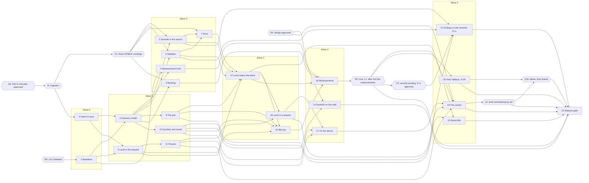

# Infinite Flow v3.3 — Build Plan

Status: v3 (2026-10-16): migrated to the build-plan model and waves re-formed (spec D341); not
approved (gate A0).

The Seventh chords level (richer chords, optional), written from
[master spec Part D](master-spec.md#part-d--v33) (v1.1, 2026-10-12, with spec D263–D275; awaiting
the owner's approval: gate A0) and the v3.3 design at the root of
[`ui_ux/`](../../../ui_ux/README.md) (ux D252–D264; awaiting the owner's approval: gate D0):
everything marked `[v3.3 new]`, `[v3.3 changed]` or with a `_v3.3 …:_` change-block line. Its
planning decisions, spec D276–D288, are proposed for approval with Part D. Code facts: the
[chord research's code table](../../../docs/music/chord-research.md#where-a-fourth-chord-note-meets-the-code),
re-checked on 62a90c7 on 2026-10-12 by `codebase-explorer` and `documentalist`. The plan follows the
build-plan model (`~/.local/share/dev_team/references/build-plan-model.md`) through the project's
[build workflow](build-workflow.md). Music terms: the [lexicon](../../../docs/music/lexicon.md).

**v3.3 is built on v3.0, v3.1 and v3.2**: every chunk of the [v3.0](build-plan.md),
[v3.1](build-plan-v3.1.md) and [v3.2](build-plan-v3.2.md) build plans merged and v3.2's release
gate passed (gate R0). Its baseline: v3.0's storage (one IndexedDB database under `src/storage/`,
records keyed per setting, tolerant loading, kept sessions with their played-notes record, the save
hold during a session, outdated-tab and failed-read visits) at **data version 4**, v3.2's last;
v3.0's session seed plan and pre-generation at Idle; v3.1's seven figure levels in the request, the
favored draw and the presets (eight built-ins and player presets, each holding ten controls, the
figure levels and a key and mode restriction; Custom); v3.2's doodle and rhythm-lock inputs, the
join from a doodle, Jam, Vary settings' six allowed groups and the `ifk4.` replay key (`ifk1.`–
`ifk3.` still decode). Chords are still root-position diatonic triads. This plan names those plans'
modules as they do ("v3.0 chunk _n_", "v3.1 chunk _n_", "v3.2 chunk _n_"); where one of them landed
a module elsewhere, the wave preflight follows the code.

## Read first: what v3.3 changes in v3.2, v3.1, v3.0 and v2

> With the level at Off (the default), v3.3 must generate exactly what v3.2 generates, note for
> note, and its backing, symbols and files must be byte-identical. A corpus recorded on v3.2 before
> any change
> ([chunk 1](#chunk-1--baselines-the-v32-corpus-the-goldens-at-off-and-the-bundle)) guards every
> chunk that touches generation, the backing, the notation or the exports. Until the control
> ships ([chunk 19](#chunk-19--the-seventh-chords-control)) the app always sends Off (D286): every
> earlier chunk is reachable only from tests, replay keys and the measurement tools, no feature
> switch is built, and no release is cut between waves.

**The melody learns the seventh before any plan offers one.** Chunks 2 and 3 add the chord type and
the level with no effect; chunks 5–8 teach the pitch search, the validator, the runs and the join to
read a seventh chord from hand-built chord plans; only then does chunk 12 let the planner offer one,
so a phrase with a seventh is never searched, validated or carried by code that does not know one.

**The Atoms lines name Part D sections until I0.** The v3.3 atoms do not exist until
`documentalist`'s ingestion of Part D (gate I0) creates them. Until then each chunk's **Atoms** line
names the Part D section whose `release-v3.3` atom it builds ("Part D §D5.1 until I0"), and chunk 0
replaces each with I0's ids in a plan commit on wave 0's branch. Wave 0's preflight has no new ids
to read (chunk 0 covers every `release-v3.3` atom by its tag, chunk 1 adds none); from wave 1 on,
the preflight works from ids.

[§D12](master-spec.md#d12-contract-changes-needing-owner-confirmation) lists what v3.3 changes on
purpose. Each enforcement point changes in exactly one chunk, never "along the way". Test titles are
as on 62a90c7 (2026-10-12) or as the earlier plans name them; those plans may move their lines, so a
chunk finds each one by its title. Most of v3.3 adds a form beside the triad rather than replacing
it: a test about a triad stays as it is, and the chunk adds the seventh-chord case beside it.

| What holds today | Changed in | Becomes |
| --- | --- | --- |
| Three STABLE guarantees: `req_session_backing_track` ("the highest close-position triad"), `rule_open_phrase_ending` ("a dominant chord tone"; a tense note "outside the final chord"), `rule_leap_recovery` ("a recognized three-note chord-tone run") | **C1**, before chunks 5, 6, 7 and 9 merge | The wordings C1 confirms. Each holds trivially at Off; chunks [9](#chunk-9--the-backing-plays-the-seventh), [5](#chunk-5--the-seventh-as-a-chord-tone-in-the-pitch-search)–[6](#chunk-6--the-validator-reads-the-seventh-as-a-chord-tone) and [7](#chunk-7--runs-may-include-the-seventh) build what each now allows. |
| A chord is a triad: `DiatonicTriad.pitchClasses` is a three-item tuple and `TriadQuality` has three values (`harmony-types.ts`); `deriveTriads` stacks d, d+2, d+4 (`collection.ts`) | [2](#chunk-2--seventh-chords-in-the-harmony-model) | A harmony event may carry a seventh as well as its triad; the triad stays as it is. A triad-form event is written exactly as today. |
| The harmony domain: the candidate identity `'harmony-domain-v1'` with the plan's fields (`harmony-planner.ts`), ranked by `harmonyTieKey` (`candidate-ranking.ts`); rebuilt by the orchestrator, the result validator and `carriedHarmonyFits` | [12](#chunk-12--the-level-orders-the-plans) | Unchanged at Off. Above Off, each ranked plan with a drawn seventh is followed by its triads-only variant; all three rebuild sites take the level. The atom `module_ranked_candidate_ordering` is revised. |
| The request is closed in three places: `GenerationIntent`, the resolved `GenerationRequest` and the worker's allowed keys (`tests/unit/generation-worker/generation-worker-protocol.spec.ts`) | [3](#chunk-3--the-level-in-the-generation-request) | It carries `chordFamilies`, the level by capability name, re-validated by the worker; any other field is still refused. |
| A chord tone is a triad tone: `chordPitchClasses = event.triad.pitchClasses` (`pitch-context.ts`), `chordTone` in `phrase-facts.ts`, the comment "a member adjacent by step to a triad tone can never itself be a triad tone" (`figure-rules.ts`) | [5](#chunk-5--the-seventh-as-a-chord-tone-in-the-pitch-search), [6](#chunk-6--the-validator-reads-the-seventh-as-a-chord-tone) | In a seventh-form event the seventh is a chord tone too; endings, tense notes and the join's landing still read the triad. |
| A recognized run is three tones of the triad: `recognizable` in `pitch-motion.ts` and its validator twin in `motion-rules.ts`; `tests/unit/domain/pitch/pitch-motion.spec.ts` › 'caps every level at exactly one recognized run per bar' | [7](#chunk-7--runs-may-include-the-seventh) | Still three notes; under a seventh chord they may include the seventh. A four-note one-way arpeggio stays rejected. |
| A carried chord must be a triad: `tests/unit/domain/generation/carry-in/carry-in.spec.ts` › 'refuses a carried chord whose pitch classes do not form a diatonic triad shape'; `sameTriad` (`harmony-join.ts`) compares three pitch classes | [8](#chunk-8--the-join-carries-a-seventh-chord) | A carried seventh chord is accepted and compared by its triad; any other shape is still refused. |
| The backing plays triads: `tests/unit/domain/backing/backing-renderer.spec.ts` › 'plays root then fifth in the bass and one held close-position triad…' | [9](#chunk-9--the-backing-plays-the-seventh) | Unchanged for triads; a seventh chord plays its four notes, highest close position at or below E4 (a new test beside it). |
| Three chord suffixes (`CHORD_SUFFIX_BY_TRIAD_QUALITY`, `notation-input.ts`); the spoken description reads any other suffix letter by letter (`score-description.ts`) | [10](#chunk-10--seventh-chord-symbols-and-their-spoken-words) | Four more suffixes, read as words. |
| MusicXML throws on an unknown suffix: `tests/unit/export/musicxml/musicxml-encoder.spec.ts` › 'rejects a chord suffix it has no MusicXML chord kind for' | [13](#chunk-13--musicxml-writes-the-seventh-chords) | Four more kinds; an unknown suffix is still refused (the test keeps a suffix no quality has). |
| Replay keys: encoding writes `ifk4.` (v3.2 chunk 12's tests in `phrase-replay-key.spec.ts`) | [15](#chunk-15--replay-key-ifk5) | Encoding writes `ifk5.` for every phrase; every `ifk1.`–`ifk4.` decoding test stays. |
| A preset holds ten controls and seven figure levels (v3.1 chunk 10's `src/domain/presets/`) | [11](#chunk-11--presets-hold-the-level) | It also holds the level; every built-in at Off. |
| Pre-generation's discard triggers (v3.0 chunk 24, v3.1 chunk 19, v3.2 chunk 26) | [16](#chunk-16--the-level-in-a-session-and-in-pre-generation) | One more: a level change discards them and drops a held doodle. |
| Data version 4 (v3.2 chunk 22) | [17](#chunk-17--the-level-on-the-device-data-version-5) | Data version 5: the level in settings, player presets and each kept phrase's inputs; a kept body may hold a seventh chord. |
| Vary settings' moves (`MUTABLE_SETTINGS`, `settings-mutation-scales.ts`, as v3.2 chunk 15 leaves it) | **Never** | The level is not in it and joins no allowed group; chunk 16 proves it. |
| The cold-generation goldens, `generation-outcome-golden.spec.ts`, the backing, MIDI and MusicXML goldens, and the `ifk1.`–`ifk4.` corpora of v2–v3.2 | **Never** | They stay byte-identical: at Off, v3.3 reproduces v3.2 (item 2). A chunk that needs to touch one is wrong. |

Every replaced or extended test gets its v3.3 counterpart in the same chunk, and the release gate
lists each pair (item 24).

## Gates

| Gate | What | Cleared by | Blocks | Status |
| --- | --- | --- | --- | --- |
| **A0** | The owner approves [Part D](master-spec.md#part-d--v33) (v1.1, D263–D275), the planning decisions D276–D288 and this plan, R0 included: no v3.3 coding chunk before v3.2's release, since chunk 1's corpus must be recorded on v3.2's code and chunks 3, 5, 12 and 15–17 change files v3.1 and v3.2 also change (chunks 2, 9, 10 and 13 would fit on v3.0 alone, if the owner wants v3.3 sooner). D276's "CONTRACT 3.0 to 4.0" predates v3.0's own bumps (the contract atom is at 6.1): C1's bump is the next major after v3.2's. | The owner | Everything | open |
| **I0** | Not an owner step: `documentalist` ingests Part D (skill `atd-spec-ingestion`). It creates the DRAFT atoms tagged `release-v3.3`, tags `changes-in-v3.3` and writes `docs/release/v3.3-intent-change-set.md`, whose part A holds the exact wording of the three STABLE changes, and which adds the atoms §D12 missed (D285). It confirms as drift checks the STABLE guarantees whose wording does not change (`rule_join_carry_in_limited`, `rule_harmony_change_drops_unfit_harmonic_carry_in`, `req_last_session_review`, the mutation guarantees and the others §D12 lists), and refreshes the vision's v3.3 line ("direction only and not yet designed") with the owner's sign-off. | `documentalist`, after A0 | C1; chunk 0 | open |
| **C1** | Contract sign-off: the owner confirms the exact wording of `req_session_backing_track`, `rule_open_phrase_ending` (first option: the triad reading) and `rule_leap_recovery` ([§D12](master-spec.md#d12-contract-changes-needing-owner-confirmation)); `documentalist` applies them with one MAJOR contract bump. They hold trivially at Off, so they are applied at once, proposed right after A0 (D276). | The owner; `documentalist`, after I0 | **Merging** chunks [5](#chunk-5--the-seventh-as-a-chord-tone-in-the-pitch-search), [6](#chunk-6--the-validator-reads-the-seventh-as-a-chord-tone), [7](#chunk-7--runs-may-include-the-seventh) and [9](#chunk-9--the-backing-plays-the-seventh); through 5 and 6, chunk 7's start; through 5–7, chunk 12 | open |
| **D0** | The owner approves the v3.3 design ([`ui_ux/todo.md`](../../../ui_ux/todo.md)); if `ux-writer` freezes it into `ui_ux/versions/v3.3/`, `spec-writer` repoints this plan's design links there. No token pass: v3.3 adds no token, class or motion (ux D261; D284). | The owner; `ux-writer`; `spec-writer` | Chunks 14 and 19 (the description sentences ship with 19) | open |
| **R0** | v3.2 is released: the [v3.2 release gate](build-plan-v3.2.md#chunk-27--v32-release-gate) passed and `3.2.0` is tagged, so chunk 1's corpus is recorded on the code v3.2 ships. | The owner, at v3.2's release | Chunk 1, and through wave 0 every later wave | open |
| **DP** | The finer-fallback decision ([M1](#m1--the-seventh-share)): chunk 18's M1 says whether Strongly favored reaches 3 in 4 harmony events in their seventh form. The owner is told the figures and the outcome; `spec-writer` records the decision. Re-checked at the release gate: if L2's tuning breaks 3 in 4, the decision is reopened. | Chunk 18's figures; `spec-writer` | Chunk 20 (built or skipped) | open (after chunk 18, wave 4) |
| **U1a** | `ux-writer` reads the first shares chunk 18 reports (item 5) and confirms the labels Off, Sometimes, Often, Mostly, or changes them (ux D254; ux Q77, closed by spec D275). | `ux-writer` | Chunk 19's labels | open (after chunk 18) |
| **U1b** | `ux-writer` confirms the labels again on the final shares: after chunk 20 if it is built, and after L2's tuning and the release gate's final M1 run (ux Q77, closed by spec D275). | `ux-writer` | The release gate | open (after L2) |
| **L1** | The listening check on endings ([H1](#hand-checks), [§D6.3](master-spec.md#d63-phrase-endings-and-the-join-read-the-triad-until-a-listening-check)): the owner listens to chunk 18's examples of phrases ending on the seventh and landing on the tonic chord's seventh, and says whether they sound open or wrong. `spec-writer` records the result either way. | The owner; `spec-writer` | Chunk 21 (built only if approved); the release gate (item 9) | open (after chunk 18) |
| **C2** | Only if L1 approves the seventh, a contract sign-off: the owner confirms the second option's wording of `rule_open_phrase_ending`, and `documentalist` applies it with its own bump (MAJOR, unless C1's bump is not yet applied). | The owner; `documentalist`, after L1 | **Merging** chunk [21](#chunk-21--endings-on-the-seventh-second-option-conditional) | open (only if L1 approves) |
| **L2** | The owner's listening check of the level and the four-note backing ([H2](#hand-checks), [§D5.2](master-spec.md#d52-four-levels); D282); the Sometimes and Favored shares are tuned from it. | The owner | The release gate's final M1 and M2 runs | open (after chunk 19) |

## Waves

| Wave | Chunks | Waits for | Status |
| --- | --- | --- | --- |
| 0 | 0 Intent re-sync · 1 Baselines | A0 and I0 (0); R0 (1). Two chunks: every other chunk needs both, chunk 0's ids in its own wave preflight and chunk 1's corpus as its guard, so nothing can join. | blocked (on A0, R0) |
| 1 | 2 Seventh chords in the harmony model · 3 The level in the request · 8 The join · 10 Symbols and spoken words · 11 Presets hold the level | Wave 0. In-wave 2 → 8 and 2 → 10: chunk 2's capture fixes the harmony event's optional seventh, its qualities and `chordTones`; 3 → 11: chunk 3's capture fixes `chordFamilies` and the level ids. | planned |
| 2 | 4 Measurement tools · 5 The seventh in the pitch search · 6 The validator · 7 Runs · 9 The backing | Wave 1; **C1 to merge 5, 6, 7 and 9**, best cleared before the wave starts. In-wave 5 → 7 and 6 → 7: chunks 5's and 6's captures fix the chord-tone facts 7's run rule reads; 7 starts once 5 and 6 are merged. | planned |
| 3 | 12 The level orders the plans · 15 Replay key `ifk5.` · 16 The level in a session | Wave 2 (5, 6 and 7 merged, so C1). In-wave 12 → 15 and 12 → 16: chunk 12's capture fixes the draw and the plan variants. | planned |
| 4 | 14 Symbols on the staff · 17 The level on the device · 18 Measurements, first run | Wave 3; D0 (14). DP, U1a and L1 open at its end. | planned |
| 5 | 13 MusicXML · 19 The Seventh chords control · 20 The finer fallback (**conditional**) · 21 Endings on the seventh (**conditional**) | Wave 4; D0 and U1a (19); DP (20, built only if DP adopts it); L1 (21, built only if L1 approves) and **C2 to merge 21**. Two sure chunks: 19 waits on U1a, which follows chunk 18's shares, and 13 is the only chunk left with slack to join it; 20 and 21 join only if DP and L1 call for them, otherwise they are recorded as skipped. L2 opens at its end. | planned |

The [release gate](#chunk-22--v33-release-gate) (chunk 22) follows wave 5, with L1, L2 and U1b. κ
is 1 ([build workflow](build-workflow.md#concurrency-and-order)); a chunk built and waiting only on
C1 or C2 does not count against it. The widest chunks are 5 and 12 (each with a split rule) and 17.

The critical path runs 0 → 2 → 5 → 7 → 12 → 15 → 18 → (DP, U1a, L1) → 19 → L2 → 22. The device
and screen branch (11 → 16 → 17 → 19) runs beside it. The longest owner-dependent detour is L1 → C2
→ 21, taken only if the owner approves the seventh as an ending.

## Workflow deltas

The [build workflow](build-workflow.md) holds for v3.3 with release name `v3.3`: wave branches
`v3.3-w<n>` in `/home/bastien/work/infinite_flow-v3.3-w<n>`, chunk branches `v3.3-c<id>-<slug>` in
`/home/bastien/work/infinite_flow-v3.3-c<id>`. v3.3's own:

- **Corpus guard** (a chunk check): chunks 2, 3, 5–10, 12, 13, 15, 16, 20 and 21, which touch
  generation, the backing, the notation or the exports, run chunk 1's two corpora (the `ifk4.`
  phrase corpus, `tests/unit/generation-worker/phrase-replay-key-v32-corpus.spec.ts`, and the
  backing and file corpus), the earlier corpora and the goldens unchanged. Red means a request at
  Off no longer reproduces v3.2.
- **Hand-built chord plans**: pitch and validation rules are tested on hand-built plans holding
  seventh-form events (chunk 2's fixture builder in `tests/unit/domain/harmony/`), so chunks 5–9
  need no planner change.
- **Sweep at the wave gate**: chunks 3, 5–8, 12, 16, 20 and 21 place it there, so waves 1, 2 and 3
  run it, and wave 5 when chunk 20 or 21 is built. At Off the sweep gives v3.2's figures.
- **Intent**: the DRAFT atoms are tagged `release-v3.3`, the atoms to revise `changes-in-v3.3`, in
  the v3.3 intent change set I0 writes (`docs/release/v3.3-intent-change-set.md`). The
  **Atoms** lines name Part D sections until I0 and chunk 0 writes the ids in
  ([Read first](#read-first-what-v33-changes-in-v32-v31-v30-and-v2)), so wave 0's preflight cannot
  use them. Chunks 1, 4 and 18 add no atom.
- **Contract sign-offs**: C1 gates the merge of chunks 5, 6, 7 and 9, C2 that of chunk 21
  ([build workflow](build-workflow.md#intent-atd)). A gated chunk built before its sign-off stays
  `built` on its branch, unmerged; still waiting when its wave is otherwise done, it moves to the
  next wave with the chunks that depend on it (7 on 5 and 6 in wave 2; 12 on 5–7). Each wave
  preflight reports the record of every gated chunk in its wave.
- **Chunk 0 is not a coding chunk**: the driver hands it to `documentalist` (spec ingestion,
  milestone refinement).
- **Area documents**: `docs/generation-latency.md`, `docs/notation-engraving.md`,
  `docs/export.md`, `docs/audio-transport.md`, `docs/phrase-workspace.md`,
  [`docs/music/`](../../../docs/music/README.md); and the project documents §D12 names, as D283
  assigns them: the harmony planner policy (chunks 2 and 12), the pitch planner validation note
  (chunks 5–7), the generator contract (`spec-writer`, from chunk 12's report, at wave 3's gate),
  the lexicon's "in Infinite Flow" lines (`documentalist`, at the release gate).
- **Entry budget**: 224 kB, or the figure v3.2's release gate leaves ([M4](#m4--the-first-load-bundle)).
- **Hand checks** go into a new v3.3 part of [`HARDWARE-CHECKLIST.md`](../../../HARDWARE-CHECKLIST.md),
  written by the chunk the [table](#hand-checks) names; the first of them opens the part.

## Measurements and hand checks

Four figures the spec leaves to the build ([§D16](master-spec.md#d16-deferred-and-open): "measured
before the gate, not open questions"). The release gate copies each into the release notes. Chunk
1's v3.2 corpus, which proves "Off reproduces v3.2" (item 2), is a guard, not a measurement: it
passes, or the chunk stops.

### M1 — The seventh share

- **What:** [§D15](master-spec.md#d15-definition-of-done) item 5 and
  [§D5.2](master-spec.md#d52-four-levels). At each level, the share of harmony events in their
  seventh form, and the share of phrases that fell back to triads. A **harmony event** is one span
  of one chord, a chord held across a barline counting once. A **fallback** is a phrase whose
  winning plan is the triads-only variant of a plan that had at least one seventh drawn (D281).
  Both are recorded per level and per mode: Major, Minor and the seven modes (Ionian to Locrian).
- **How:** chunk 4's seventh census, over the deadline sweep's 568 rhythm settings (`sweepCases()`,
  `tests/unit/session/deadline-sweep.ts`) × two seeds × the nine modes, with the Neutral and Jazz
  defaults, at each of the four levels (D281). It counts over phrases generated, not attempts.
- **Run by:** chunk 4 (at Off on v3.2: zero, the baseline); chunk 18 (DP is taken on it); chunk 20
  if built; the release gate, after L2's tuning.
- **Acceptance:** zero at Off; never lower from Sometimes to Favored to Strongly favored, in every
  mode; **at least 3 in 4 at Strongly favored over the whole sweep** (D281). Each mode's share is
  recorded. A mode under 3 in 4 alone does not trigger the finer fallback; it goes to `ux-writer`
  with the figures. The Sometimes and Favored shares start near 1 in 4 and 1 in 2 of the events
  drawn; their measured share is lower where plans fall back, and is recorded, not judged.
- **The finer fallback (DP):** [§D5.3](master-spec.md#d53-how-the-planner-applies-it) adds one
  mechanism only if M1 needs it. If Strongly favored misses 3 in 4 over the sweep at chunk 18 (on
  the reference machine, with the shares as they stand then), chunk 20 adds, before each plan's
  triads-only variant, variants that drop the seventh from one event at a time, in a fixed order,
  within the cost guard, then M1 and M2 run again; if the finer variants break the cost guard, it
  goes to `spec-writer` and `ux-writer` (the label "Mostly" rests on the share). Otherwise chunk 20
  is skipped. If 3 in 4 is not reached even with chunk 20, the label goes back to `ux-writer` (U1a,
  U1b).
- **Reported:** to `ux-writer` (item 5; U1a on the first shares, U1b on the final ones), with the
  table per level and mode.
- **Recorded:** a new "Seventh chords" section of `docs/generation-latency.md`; the share constants
  carry a comment pointing there.

### M2 — The cost guard

- **What:** [§D10](master-spec.md#d10-the-cost-guard-generation-time-with-seventh-chords) and item
  21: whether seventh chords slow the generator or make it fail. **The search allowance is not
  raised.** Recorded for each setting: the share of phrases generated, the slowest and the
  95th-percentile generation time, the seventh share, and at 240 BPM the share of phrases that fall
  back to being generated without the join and the share of a fresh Jam's phrase 1 ready by its
  deadline.
- **Settings**, exactly §D10's: the baseline, Off with the Neutral and Jazz defaults (it must equal
  v3.2's figures, since the phrases are the same); Sometimes, Favored and Strongly favored with the
  Neutral and Jazz defaults; Strongly favored with **Speed drill, measured first** (the most
  expensive setting v3.1 found), and with Bebop; each in every mode.
- **How:** v3.1 chunk 3's cost runner on the deadline sweep (`npm run test:sweep`: the 568 cases at
  60, 120 and 240 BPM, each attempt charged its measured time), in a 240 BPM session, and v3.2
  chunk 3's Jam sweep for a fresh Jam's phrase 1 at 240 BPM. Chunk 4 adds the level as a dimension
  to both. The owner runs the deciding runs on the reference machine.
- **Run by:** chunk 4 (the Off baseline); chunk 18; chunks 20 and 21 if built; the release gate,
  after L2's tuning.
- **Acceptance**, against the baseline, as §D10's:
  - at most 2 percentage points more fallbacks without the join at 240 BPM;
  - at most 2 percentage points fewer phrases generated at any swept setting;
  - at most 2 percentage points fewer Jam phrase 1s ready by their deadline;
  - no attempt generated on its own slower than the standalone reserve (1.075 s in Chromium,
    `STANDALONE_RESERVE_SECONDS`), which the failure ladder keeps for it.
- **If a level costs more:** its share is tuned down, or the fallback made finer (DP), before the
  release gate. The allowance is never raised and the triad fallback never removed. A level that
  still fails goes to `spec-writer` with the figures.
- **Recorded:** `docs/generation-latency.md` ("Seventh chords: the cost guard").

### M3 — The start-up read and the migration

- **What:** whether loading the level with the settings and player presets stays inside v3.0's
  start-up wait (Part A §4.4), and how long the data version 5 upgrade takes on v3.2's data.
- **Run by:** chunk 17: the version 5 upgrade on 10, 100 and 500 v3.2 kept sessions (Jam sessions
  and player presets among them), and the start-up read on the same databases, cold and warm. The
  owner repeats the deciding runs on the reference machine.
- **Acceptance:** each, upgrade included, well under the start-up wait constant. The upgrade
  rewrites no record (D279), so it should cost no more than opening at version 4.
- **Recorded:** `docs/storage.md`.

### M4 — The first-load bundle

- **What:** the entry chunk stays within its budget (224 kB today, `entryChunkByteBudget` in
  `scripts/verify-boundaries.mjs`, or the figure v3.2's gate leaves). The control and its options
  add a few lines to the entry chunk; the seventh-chord generation code lives in the generation
  worker's bundle and the notation changes in the VexFlow engraver chunk, whose budgets the same
  script checks.
- **Run by:** chunk 1 (the baseline on the v3.2 release); every wave gate; the release gate (`npm
  run verify:boundaries`, budget unchanged).
- **Recorded:** the wave log and each wave's merge commit message; the release notes.

### Hand checks

The owner runs these on the Travel Sax over USB and the reference machine.

| Check | Written by | Run at | What the owner does |
| --- | --- | --- | --- |
| H1 Listening: endings on the seventh (**L1**) | 18 | After wave 4; before chunk 21 and the release gate | Listen to chunk 18's examples, each beside the same phrase as the app writes it. **Ending on the seventh with no next phrase:** F over G7 in C major; the home chord's seventh in Dorian and in Mixolydian (B♭ over C7 in C Mixolydian). **The next phrase landing on the tonic chord's seventh.** Say for each whether ending on the seventh sounds open (the player can keep going) or like a mistake. Item 9. Approved: C2, then chunk 21. Not approved: the triad reading ships, and the result is recorded. |
| H2 Listening: the level and the backing (**L2**) | 19 | After chunk 19; used by the release gate | With Jazz, Bebop, Modal (Dorian) and Neutral, play short sessions at Sometimes, Often and Mostly. Say whether each step is clearly heard, whether Mostly sounds like "a seventh on nearly every chord", and whether the four-note backing (lowest note about D3) sits well under the bass and the line. The Sometimes and Favored shares are tuned from it, then M1 and M2 run again. |
| H3 Same phrase in Edge | 15 | Chunk 15 | Run chunk 15's in-browser replay test once with Playwright's Microsoft Edge channel (`msedge`), and replay one `ifk5.` key of a Mostly phrase copied from a Chrome session in Edge; the phrases match. Item 18's "Chrome and Edge" half. |
| H4 The files | 13 | Chunk 13 | Open a MusicXML file holding all four seventh-chord kinds in MuseScore: Cmaj7, Dm7, G7 and Bm7♭5 (in written pitch) show as the right symbols (item 12's recorded hand check). Open the MIDI file with the backing included in a DAW: the backing's chords hold four notes where the symbols say seventh. |
| H5 v3.2 data carried over | 17 | The release gate | In the installed app and a plain Chrome tab that used v3.2 (settings changed, a player preset, a pinned session and a kept Jam session), update to v3.3: the settings come back with the level at Off, the preset loads unchanged, and the sessions open and play back as before, with their triads. |
| H6 Symbols at the narrowest widths | 14 | After chunk 19 | On the reference machine, at the narrowest width of each named breakpoint, regenerate at Mostly in keys whose half-diminished chord has an accidental on its root (A major, whose degree-7 chord is G♯m7♭5, for each instrument's written key): no symbol touches the next or crosses a barline, and none is shrunk. Phones are low priority but must not break. |

## Chunks

"Item _n_" is item _n_ of the [definition of done](master-spec.md#d15-definition-of-done). The
**Atoms** and **Revisions** lines follow the [build workflow](build-workflow.md#intent-atd); "Part D
§Dn until I0" names the section whose `release-v3.3` atom the chunk builds, until chunk 0 writes in
the id.

### Chunk 0 — Intent re-sync

Status: blocked (on A0, I0)
Wave: 0
Depends on: A0, I0 (run right after R0, so it checks against the state v3.2's release gate left)
Architecture capture: none

- **Goal:** make sure I0's `release-v3.3` and `changes-in-v3.3` atoms still match Part D and the
  state v3.2's release gate left, before the first v3.3 chunk relies on them.
- **Scope:** `documentalist`, spec ingestion (milestone refinement); atoms and this plan's
  **Atoms** lines only, no code.
  - Part D as it stands when the build starts: the decisions recorded after I0 that touch Part D.
  - The atoms v3.0's, v3.1's and v3.2's release gates promoted or revised that v3.3 revises again:
    among them `rule_seeded_phrase_reproduction`, `rule_kept_session_content`,
    `rule_preset_contents`, `rule_built_in_preset_values`, `rule_choosing_preset_sets_its_settings`,
    `rule_presets_load_tolerantly`, `rule_preset_load_values_win`, `rule_settings_saved_on_change`,
    `rule_pregeneration_discarded_on_change`, `rule_vary_settings_allowed_groups`,
    `rule_jam_melody_follows_doodle_moves`, `rule_doodle_only_orders_candidates`,
    `module_phrase_replay_key` (now `ifk4.`): their `changes-in-v3.3` notes still name the right
    change.
  - The C1 record: the three wordings applied with C1's bump, the confirmation in each atom's
    notes.
  - In this plan, each chunk's "Part D §Dn until I0" is replaced with the atom ids (a plan commit
    on the wave branch).
- **Files:** `docs/*.atom.md`; the change set (`docs/release/v3.3-intent-change-set.md`, from I0);
  this plan.
- **Spec sections:** [Part D](master-spec.md#part-d--v33). No item directly; 25 rests on C1's
  record, and every later wave's preflight relies on it.
- **Atoms:** every atom tagged `release-v3.3` or `changes-in-v3.3`;
  `contract_infinite_flow_first_release` (after C1's bump); `vision_infinite_flow_first_release`.
- **Revisions:** none.
- **Done when:** each Part D behaviour is stated by an atom (still DRAFT); `npm run atd:lint` and
  `npm run atd:check` pass; the change set file records what changed, if anything; every chunk's
  **Atoms** line names ids.
- **Verification:** `documentalist`'s ingestion report; `npm run lint:links`.
- **Split rule:** none needed.

### Chunk 1 — Baselines: the v3.2 corpus, the goldens at Off and the bundle

Status: blocked (on R0)
Wave: 0
Depends on: R0
Architecture capture: none

- **Goal:** record, on the code v3.2 shipped, every fact v3.3 must not break at Off: the phrase each
  request gives, the backing it renders, the files it exports, and the entry chunk's size.
- **Scope:**
  - **The phrase corpus**, generated from the `3.2.0` tag before any v3.3 change: the eight
    built-in presets and a spread of figure levels × **every one of the nine modes** × the three
    built-in instruments and two player-made ones × a spread of the other controls (every harmonic
    motion and Tension value, Eighth and Sixteenth with Heavily varied) × several seeds, with and
    without carry-in (a carried null harmony included). It also holds the Jam and lock cases: a
    fresh Jam's phrase 1 by each rung, a locked phrase, a changed one, a forced bend and a drifted
    one. Each case is stored as its `ifk4.` key and the timeline it replays to, beside the earlier
    corpora, which stay.
  - **The backing and file corpus:** for a sample of the corpus's sessions, the backing's rendered
    notes, the generated-notes MusicXML and both MIDI files (backing included and not), and a unit
    test that renders and encodes each again and compares bytes. Items 2, 10 and 12's "triads as
    before" rest on it.
  - The entry chunk's size after `npm run build` on the tag ([M4](#m4--the-first-load-bundle)).
- **Files:** `tests/fixtures/replay-keys/v3.2-corpus.json`,
  `tests/unit/generation-worker/phrase-replay-key-v32-corpus.spec.ts`,
  `tests/fixtures/sessions/v3.2-backing-and-files/` and its unit test (all new), a generator script
  under `scripts/` (tooling, beside `scripts/record-replay-key-corpus.mjs`), `docs/testing.md`.
- **Spec sections:** items 2 (as the guard for chunks 2, 3, 5–10, 12, 13, 15, 16, 20 and 21), 18
  (`ifk4.` decoding), 10 and 12 (triads unchanged).
- **Atoms:** none (test plumbing). The corpus later backs Part D §D15 item 2's atom until I0 and
  `rule_seeded_phrase_reproduction`, whose test links chunks 12 and 15 add.
- **Revisions:** none.
- **Done when:** both corpus tests pass on the tag and on `main`; each is red if a stored value is
  changed by hand; the baseline size is recorded here and in `docs/testing.md`.
- **Verification:** chunk checks.
- **Split rule:** none needed.

### Chunk 2 — Seventh chords in the harmony model

Status: planned
Wave: 1
Depends on: 0, 1
Architecture capture: the seventh beside the triad (a revision of
`module_harmony_candidate_domain`). `HarmonyEvent` keeps `triad` exactly as it is and gains an
optional `seventh`: the seventh's pitch class and the chord's `SeventhQuality` (`major-seventh`,
`minor-seventh`, `dominant-seventh`, `half-diminished-seventh`). The field is absent in triad form,
never `null`, so a triad event, its candidate's JSON and its identity serialize byte for byte as
today (the result validator compares exact JSON). `collection.ts` derives the seventh on each
degree (d+6) with its quality, from the research's
[table A](../../../docs/music/chord-research.md#table-a-the-seventh-chord-on-each-degree), and throws
on any other shape. Two readers serve the rest of the code: `chordTones(event)` gives three or four
pitch classes; `event.triad` stays the triad, read by the endings, the join's comparison and the
colour chords (a modal plan's chord that holds the mode's characteristic note). Chunks 4, 8 and 10
in this wave build on it.

- **Goal:** give the harmony model the seventh chord on every degree of every mode, with no effect
  on any phrase.
- **Scope:**
  - `harmony-types.ts`: `SeventhQuality` (the four qualities), the optional `seventh` on
    `HarmonyEvent` (pitch class and quality, absent in triad form), and the readers `chordTones`
    and the triad.
  - `collection.ts`: the seventh chord on each degree (degrees d, d+2, d+4 and d+6 of the
    collection), its quality from the intervals: a major triad with a major seventh is major
    seventh; minor with minor seventh, minor seventh; major with minor seventh, dominant seventh;
    diminished with minor seventh, half-diminished. Any other shape throws. The triads and their
    order are untouched.
  - The fixture builder for hand-built plans with seventh-form events
    (`tests/unit/domain/harmony/`), which chunks 5–9 use.
  - Nothing reads the new field yet.
- **Files:** `src/domain/harmony/harmony-types.ts`, `src/domain/harmony/collection.ts`; tests
  `tests/unit/domain/harmony/collection.spec.ts` (extended),
  `tests/unit/domain/harmony/seventh-chord-fixtures.ts` (new);
  [`docs/music/harmony-planner-policy.md`](../../../docs/music/harmony-planner-policy.md)
  ("Collection and chord vocabulary": the sevenths exist, used only from chunk 12).
- **Spec sections:** [§D4](master-spec.md#d4-words-used-in-this-part),
  [§D5.1](master-spec.md#d51-the-chords); items 3 (the construction), 2 (guarded).
- **Atoms:** Part D §D5.1 until I0 (only the four diatonic sevenths). Drift check:
  `module_harmony_candidate_domain`.
- **Revisions:** revise `module_harmony_candidate_domain` ("triad material").
- **Done when:**
  - In each of the nine modes on every key, the seven seventh chords and their qualities equal the
    research's table A (Major: maj7, m7, m7, maj7, 7, m7, m7♭5 on degrees 1 to 7; each mode the
    same seven in rotation).
  - A shape that is not one of the four qualities throws.
  - A triad-form event serializes byte for byte as before (a JSON snapshot test); the corpus and
    the goldens pass unchanged.
- **Verification:** chunk checks.
- **Split rule:** none needed (two source files).

### Chunk 3 — The level in the generation request

Status: planned
Wave: 1
Depends on: 0, 1 (and v3.1 chunk 4, figure levels beside the controls, the pattern this follows)
Architecture capture: the level by capability name (revisions of
`module_generation_request_construction`, `service_generation_request_resolution` and
`module_generation_worker_protocol`). `src/domain/chords/chord-families.ts` (new) holds the one
family id `seventh-chords` and the four level ids `off`, `sometimes`, `favored` and
`stronglyFavored`: Part D's levels in the camelCase of v3.1's figure-level ids, never the
interface's labels (D277, D288), which the interface maps to its own words (`favored` → Often,
`stronglyFavored` → Mostly; ux D264). `GenerationIntent` and the resolved `GenerationRequest` gain
`chordFamilies: { 'seventh-chords': level }` beside `controls`, as v3.1's figure levels sit beside
them; keeping it out of `GenerationControls` leaves the replay key's control order, the sweep's
dimensions and the control catalog alone. Inside the app it is always present; an input from
before v3.3 (a key, a kept body, a saved record) reads Off where it is decoded. The worker
re-validates it. The capture says whether this is the mechanism
`module_musical_profile_capabilities` names "capability", or a separate one. Chunk 11 in this wave
builds on it.

- **Goal:** carry the Seventh chords level in every generation request, re-validated by the
  worker, with no effect yet.
- **Scope:**
  - `src/domain/chords/chord-families.ts` (new): the family id, the four level ids,
    `OFF_CHORD_FAMILIES`, and `parseChordFamilies` (exactly the known ids, each a known level, no
    extra field).
  - `GenerationIntent` and `GenerationIntentInput` gain `chordFamilies`; `makeGenerationIntent`
    takes it (the workspace passes Off until chunk 16). `resolveCoreRequests` copies it into the
    resolved `GenerationRequest`. The session's `buildAttemptIntent` passes it on unchanged, on
    every rung of v2's ladder and of a Jam's phrase 1 (D287).
  - The worker: `GENERATION_INTENT_ALLOWED_KEYS` and `GENERATION_REQUEST_ALLOWED_KEYS` gain the
    field; the inbound parser rebuilds it with `parseChordFamilies` before its deep-equal check;
    prewarm, pre-generation and cancellation carry it. An unknown family or level is refused with
    the typed protocol error.
- **Files:** `src/domain/chords/chord-families.ts` (new),
  `src/domain/generation/generation-intent.ts`, `src/domain/generation/generation-request.ts`,
  `src/domain/generation/orchestration/request-resolution.ts`,
  `src/generation-worker/generation-worker-inbound.ts`, `src/session/session-intents.ts`; tests
  under `tests/unit/domain/chords/`, `tests/unit/domain/generation/`,
  `tests/unit/generation-worker/generation-worker-protocol.spec.ts` (extended).
- **Spec sections:**
  [§D9](master-spec.md#d9-the-generation-request-the-replay-key-and-kept-sessions),
  [§D14](master-spec.md#d14-architectural-decisions-and-their-reasons) (by capability name); items
  20, 2 (guarded).
- **Atoms:** Part D §D9 until I0 (the request carries the level); (v2)
  `rule_seeded_phrase_reproduction`. Drift check: `module_generation_request_envelope`,
  `module_generation_worker_cancellation` (STABLE, unchanged).
- **Revisions:** revise `module_generation_request_construction`,
  `service_generation_request_resolution`, `module_generation_worker_protocol`.
- **Done when:**
  - Every intent the app builds carries `chordFamilies` at Off; the resolved request carries the
    same.
  - The worker refuses an intent with a missing family, an unknown family, an unknown level or an
    extra field, each with its protocol error; it accepts each of the four levels.
  - The corpus, the goldens and every v2–v3.2 generation and worker test pass unchanged.
- **Verification:** chunk checks; the sweep at the wave gate.
- **Split rule:** if the brief passes about five source files, 3a the level and the request
  (`chord-families.ts`, `generation-intent.ts`, `generation-request.ts`, `request-resolution.ts`,
  `session-intents.ts`), 3b the worker's allowed keys and inbound parser
  (`generation-worker-inbound.ts` and the protocol tests).

### Chunk 4 — Measurement tools: the seventh census, the cost runs and the ending renders

Status: planned
Wave: 2
Depends on: 1, 2 (and v3.1 chunk 3 and v3.2 chunk 3, the runners it extends)
Architecture capture: none

- **Goal:** the scripts M1, M2 and the listening check L1 need, run once on v3.2 for their
  baselines.
- **Scope:** tooling only, no product code.
  - **The seventh census** (M1): per phrase of the sweep, each harmony event's form, whether the
    winning plan was a triads-only fallback, the level and the mode. It classifies with chunk 2's
    types, so it reads hand-built and generated plans alike. It writes JSON like `LATENCY_OUT` and
    a table per level and mode.
  - **The cost runs** (M2): the level added as a dimension to v3.1 chunk 3's cost runner and to
    v3.2 chunk 3's Jam sweep, with §D10's settings as named profiles (Speed drill first).
  - **The ending renders** (L1): `scripts/render-seventh-endings.mjs` writes short MIDI files with
    the real backing: a phrase as generated, then the same phrase with its final note moved to the
    final chord's seventh (the nearest one inside the phrase's window); and a pair of phrases as
    generated, then with the second phrase's first note moved to the tonic chord's seventh. It
    only rewrites notes of phrases it is given; it never generates an ending the spec does not
    allow (D280).
  - Until chunk 12 exists the census and the runs see Off only, the baseline.
- **Files:** `tests/sweep/seventh-census.ts`, `tests/sweep/seventh-census.spec.ts` (new), the cost
  runner and Jam sweep modules of v3.1 chunk 3 and v3.2 chunk 3 (a level dimension),
  `scripts/render-seventh-endings.mjs` (new), `package.json` (`measure:sevenths`,
  `render:seventh-endings`), `docs/testing.md`, `docs/generation-latency.md` (the baseline).
- **Spec sections:** no item directly; M1 and M2 rest on it (items 5, 21), and L1 (item 9).
- **Atoms:** none (measurement).
- **Revisions:** none.
- **Done when:** the census runs at Off and records zero; it classifies a hand-built sweep fixture
  (seventh-form events, a triads-only fallback, a merged event across a barline) exactly; the cost
  runs record the Off baseline equal to v3.2's figures; the renders play in a MIDI player, from a
  hand-built phrase with a seventh-form final event.
- **Verification:** chunk checks (the census's own unit test); the baseline run (M1, M2).
- **Split rule:** none needed (tooling).

### Chunk 5 — The seventh as a chord tone in the pitch search

Status: planned
Wave: 2
Depends on: 2 (and v3.1 chunks 5–7, the figure rules as v3.1 leaves them; v3.2 chunk 9, the
doodle's move term); C1 to merge (`rule_open_phrase_ending`, first option)
Architecture capture: the attack's two chord facts (a revision of `module_pitch_search_context`).
`PitchAttack` keeps `chordPitchClasses`, now `chordTones(event)`, and gains `triadPitchClasses`.
Search order, decorating notes, figure targets, Arpeggio chaos, Tension's scheduled figure, runs
(through each note's `chordTone`, set from `chordPitchClasses` in `pitch-advance.ts`) and a Jam's
doodle ranks read the chord tones. The open ending, the tense note and the join's landing read the
triad (the first option of §D12). A triad event gives the same two lists, so nothing moves at Off.
Chunk 7 in this wave builds on it.

- **Goal:** in a seventh-form event, make the pitch search treat the seventh as a chord tone
  everywhere inside the phrase, while the ending and the join's landing still read the triad.
- **Scope:**
  - `compileAttacks` (`pitch-context.ts`): `chordPitchClasses` from `chordTones(event)`, and a new
    `triadPitchClasses` from the triad.
  - **Chord tones:** chord tones first in `pitchRank` (`pitch-ranking.ts`); decorating notes are
    the collection minus the chord tones (`diatonicNonChord`, `pitch-candidates.ts`), so a seventh
    chord leaves three, not four; figure targets and `freeToneResolves` (`pitch-figures.ts`), where
    every figure still resolves onto a chord tone, the seventh included; Arpeggio chaos orders the
    four chord tones; Tension's scheduled figure (`boundPaths`) may land on the seventh. A Jam's
    doodle ranks need no change: the doodle's move term orders within the rank, and the seventh
    now shares the first one.
  - **Triad tones** (first option of §D12): `isOpenEndpointMidi`'s final notes (a note of the
    degree-5 triad in tonal plans that move; scale degree 5 in tonal static plans; a non-home note
    of the home triad in modal plans), `tenseEndingCandidates` (a tense note is a scale note
    outside the final triad, so the seventh may end a joined phrase), and the first attack's
    landing after an owed tense note or recovery (the tonic triad).
  - With triad events the two lists are equal, so the order and every phrase are unchanged.
- **Files:** `src/domain/pitch/pitch-types.ts`, `src/domain/pitch/pitch-context.ts`,
  `src/domain/pitch/pitch-candidates.ts`, `src/domain/pitch/pitch-ranking.ts`,
  `src/domain/pitch/pitch-figures.ts`; tests under `tests/unit/domain/pitch/`
  (`pitch-candidates.spec.ts`, `pitch-ranking.spec.ts`, `pitch-figures.spec.ts` extended);
  [`docs/music/pitch-planner-validation.md`](../../../docs/music/pitch-planner-validation.md).
- **Spec sections:** [§D6.1](master-spec.md#d61-the-seventh-is-a-chord-tone),
  [§D6.3](master-spec.md#d63-phrase-endings-and-the-join-read-the-triad-until-a-listening-check),
  [§D8.4](master-spec.md#d84-pre-generation-jam-and-the-key-and-mode-suggestion) (a Jam's ranks);
  items 7 (the search's half), 9 (the triad reading, search half), 22 (a Jam's ranks), 2 (guarded).
- **Atoms:** Part D §D6.1 until I0 (the seventh is a chord tone, extensions are not), Part D §D6.3
  until I0 (endings read the triad); (v2, STABLE) `rule_open_phrase_ending`,
  `rule_join_carry_in_limited`; (v3.1) `rule_figures_resolve_onto_chord_tones`,
  `rule_figure_level_orders_search`; (v3.2) `rule_jam_melody_follows_doodle_moves`. Drift check:
  `module_pitch_search_context`, `module_pitch_search_transition`, `entity_pitch_candidate_domain`,
  `mechanic_pitch_search_policy`.
- **Revisions:** revise `rule_embellishment_figures_defined`, `rule_tension_arc_settled`,
  `rule_tension_arc_build`, `rule_arpeggio_chaos_respects_constraints`,
  `rule_doodle_only_orders_candidates`, `rule_join_tense_note_resolution`.
- **Done when:**
  - On hand-built plans with seventh-form events: the seventh is tried with the chord tones, before
    the decorating notes; every free figure's resolution may land on it; Arpeggio chaos orders four
    chord tones; Tension's scheduled figure may land on it; a doodle's move preference never lifts
    a decorating note above the seventh.
  - No phrase generated without a join ends on its final chord's seventh; a joined phrase may end
    on it as a tense note; the landing after an owed note is a tonic-triad note (property tests
    over hand-built final events of each plan kind).
  - Extensions (the ninth, eleventh and thirteenth) are never chord tones (named tests).
  - Triad events: the corpus and the goldens pass unchanged.
- **Verification:** chunk checks; the sweep at the wave gate.
- **Split rule:** if the brief passes about five source files, 5a the two facts and what reads the
  triad (`pitch-types.ts`, `pitch-context.ts`, the open ending, the tense ending and the landing in
  `pitch-candidates.ts`), 5b what reads the chord tones (`pitch-ranking.ts`, `pitch-figures.ts`,
  the decorating notes and Tension's scheduled figure in `pitch-candidates.ts`).

### Chunk 6 — The validator reads the seventh as a chord tone

Status: planned
Wave: 2
Depends on: 2; C1 to merge (`rule_open_phrase_ending`, first option)
Architecture capture: the validator's mirror of chunk 5's facts, recorded with chunk 5's capture.
`reconstructPhraseFacts` gives each note a chord-tone fact from `chordTones` and a triad-tone fact
beside it; the motion rules' runs read the chord-tone fact, the final note, the tense ending and the
landing read the triad-tone fact. Chunk 7 in this wave builds on it.

- **Goal:** make the pitch validator accept exactly what chunk 5's search writes: the seventh as a
  chord tone inside the phrase, the triad at the ending and the landing.
- **Scope:**
  - `reconstructPhraseFacts` (`validation/phrase-facts.ts`): a note's chord-tone fact from
    `chordTones`, with a triad-tone fact beside it.
  - `figure-rules.ts`: the premise "a member adjacent by step to a triad tone can never itself be a
    triad tone" is false over a seventh chord, whose seventh is one scale step from its root. The
    rule is rewritten for four chord tones (a passing or neighbor tone between the seventh and the
    root has no room), and the comment with it. `unexplained_non_chord_tone` no longer fires on the
    seventh.
  - `contour-endpoint-rules.ts` (the final note) and `join-rules.ts` (the tense ending, the
    landing) read the triad facts.
  - Named phrases over hand-built seventh plans, written by hand from §D6.1's rules, so the chunk
    needs neither chunk 5 nor chunk 7. The property test that runs the search and validates every
    result over seventh plans is chunk 12's, once both halves are merged.
- **Files:** `src/domain/pitch/validation/phrase-facts.ts`, `figure-rules.ts`,
  `contour-endpoint-rules.ts`, `join-rules.ts`, `pitch-validation-types.ts`; tests under
  `tests/unit/domain/pitch/validation/` (`figure-rules.spec.ts`, `pitch-phrase-validator.spec.ts`
  extended).
- **Spec sections:** [§D6.1](master-spec.md#d61-the-seventh-is-a-chord-tone),
  [§D6.3](master-spec.md#d63-phrase-endings-and-the-join-read-the-triad-until-a-listening-check);
  items 7 (the validator's half), 9 (validator half), 2 (guarded).
- **Atoms:** Part D §D6.1 and §D6.3 until I0; (v2, STABLE) `rule_open_phrase_ending`. Drift check:
  `module_pitch_domain_validation`, `module_pitch_search_transition`.
- **Revisions:** revise `rule_figures_resolve_onto_chord_tones`,
  `rule_levels_govern_free_figures_only`.
- **Done when:**
  - The validator accepts hand-written phrases that land on, resolve onto and run through the
    seventh of a seventh-form event, and refuses a phrase with no join ending on the final
    seventh, a landing on the tonic chord's seventh, and a ninth treated as a chord tone (named
    tests).
  - Over triad plans its answers are unchanged (the existing validator suites, the corpus).
- **Verification:** chunk checks; the sweep at the wave gate.
- **Split rule:** none needed (one validator; the facts and the rules that read them land
  together).

### Chunk 7 — Runs may include the seventh

Status: planned
Wave: 2
Depends on: 2, 5, 6 (the chord-tone facts its run rule reads); C1 to merge (`rule_leap_recovery`)
Architecture capture: none (it builds on chunks 5's and 6's)

- **Goal:** let a recognized three-note [run](../../../docs/music/lexicon.md#run) (three chord
  tones of one chord in a row, in one direction) include the seventh, and keep every four-note
  one-way [arpeggio](../../../docs/music/lexicon.md#arpeggio) rejected.
- **Scope:** `recognizable` in `pitch-motion.ts` and its validator twin in
  `validation/motion-rules.ts` read the chord tones (each note's chord-tone fact, as chunks 5 and 6
  set it). So E–G–B over Cmaj7, or B–D–F over G7, is a run. A large leap inside such a run may
  defer its recovery to the note after the run, at Leaping and Angular only. `WIDE`, the chain cap
  and `wide_chain_too_long` are unchanged: C–E–G–B in one direction is still refused, as C–E–G–C is
  today.
- **Files:** `src/domain/pitch/pitch-motion.ts`, `src/domain/pitch/validation/motion-rules.ts`;
  tests `tests/unit/domain/pitch/pitch-motion.spec.ts` (extended), the validator's motion tests.
- **Spec sections:** [§D6.2](master-spec.md#d62-runs-stay-three-notes),
  [§D12](master-spec.md#d12-contract-changes-needing-owner-confirmation) item 3; items 8, 7 (runs),
  2 (guarded).
- **Atoms:** Part D §D6.2 until I0; (v2, STABLE) `rule_leap_recovery`. Drift check:
  `module_pitch_search_transition`, `module_pitch_domain_validation`.
- **Revisions:** revise `rule_leapiness_arpeggio_run_limits`, `rule_join_inherits_leap_recovery`.
- **Done when:**
  - Over a seventh-form event, E–G–B (Cmaj7) and B–D–F (G7) are recognized runs, in both the
    search and the validator; C–E–G–B (Cmaj7) and E–G–B–D (Em7) in one direction never pass (named
    tests).
  - A large leap inside such a run defers its recovery at Leaping and Angular, never at the other
    levels; a run is never longer than three notes (property test).
  - Over triad events, runs and recoveries are unchanged (the existing motion suites, the corpus).
- **Verification:** chunk checks; the sweep at the wave gate.
- **Split rule:** none needed (two source files).

### Chunk 8 — The join carries a seventh chord

Status: planned
Wave: 1
Depends on: 2
Architecture capture: the carried chord's optional seventh (a revision of
`entity_phrase_carry_in`). The carry-in's harmony gains the optional seventh. `assertCarriedHarmony`
accepts three distinct pitch classes, or the triad plus exactly the same-degree seventh with its
quality, and nothing else. `sameTriad` compares the triads. `tonicTriadPitchClasses` stays the
landing.

- **Goal:** let the previous phrase's final chord cross the join as a seventh chord, compared with
  the next phrase's settings by its triad.
- **Scope:**
  - `carry-in.ts`: `assertCarriedHarmony` and `parseCarriedHarmony` accept a triad, or a triad with
    exactly its same-degree seventh and that seventh's quality; anything else is still refused.
    `copyCarriedHarmony` copies it.
  - `carry-in-derivation.ts` carries the final event's seventh when it has one.
  - `harmony-join.ts`: `sameTriad` compares the triads, so a carried G7 fits a phrase whose
    settings end on G (§D8.3: whether a seventh was added is a draw, not a property of the
    settings). A key or mode change, or a harmonic motion change the carried chord no longer fits,
    still drops it.
  - `phrase-ending-debt.ts`: the landing stays the tonic triad (no change, a named test).
- **Files:** `src/domain/generation/carry-in/carry-in.ts`, `carry-in-derivation.ts`,
  `src/domain/harmony/harmony-join.ts`; tests
  `tests/unit/domain/generation/carry-in/carry-in.spec.ts`, `carry-in-join-matrix.spec.ts`,
  `tests/unit/domain/harmony/harmony-join.spec.ts` (extended).
- **Spec sections:** [§D8.3](master-spec.md#d83-vary-settings-and-the-session) (the join),
  [§D9](master-spec.md#d9-the-generation-request-the-replay-key-and-kept-sessions); items 17, 9
  (the join's landing), 2 (guarded).
- **Atoms:** Part D §D8.3 until I0 (a carried chord compared by its triad); (v2, STABLE)
  `rule_join_carry_in_limited`, `rule_harmony_change_drops_unfit_harmonic_carry_in`,
  `rule_key_change_drops_harmonic_carry_in`. Drift check: `module_session_carry_in_after_change`.
- **Revisions:** revise `entity_phrase_carry_in`, `rule_no_carry_in_output_matches_v1` (at Off).
- **Done when:**
  - A carried seventh chord is accepted, and every refusal of `carry-in.spec.ts` still holds; a
    four-note chord that is not the same-degree seventh, or a wrong quality, is refused with the
    reason.
  - A carried G7 joins a phrase whose plan opens on degree 1, exactly where a carried G would; a key
    change still drops it (the join matrix, extended).
  - The landing after an owed note is a tonic-triad note with a carried seventh chord.
  - The corpus and the carry-in goldens (`carry-in-chains.golden.v1.json`,
    `no-carry-in-v1-bytes.spec.ts`) pass unchanged.
- **Verification:** chunk checks; the sweep at the wave gate.
- **Split rule:** none needed (three source files).

### Chunk 9 — The backing plays the seventh

Status: planned
Wave: 2
Depends on: 2; C1 to merge (`req_session_backing_track`)
Architecture capture: none

- **Goal:** make the backing's block chords play every note of the chord the phrase uses.
- **Scope:** `backing-renderer.ts`: the chord's notes from `chordTones`. A seventh chord is checked
  as a stacked seventh (root, third, fifth, seventh by quality), not just its triad: a fourth note
  today would be silently ignored. It is voiced in the highest **close position** (the notes packed
  inside one octave, here each of the four at the bottom in turn: four arrangements instead of
  three) whose top note is at or below E4 (MIDI 64), so its lowest note reaches about D3. The bass,
  the attack rhythm and the registers are unchanged. The MIDI export takes its backing from the
  renderer (`backingForExport`), so its four-note chords follow with no export change.
- **Files:** `src/domain/backing/backing-renderer.ts`; tests
  `tests/unit/domain/backing/backing-renderer.spec.ts` (a seventh case beside the triad one),
  `tests/unit/export/midi/` (a backing-included export with a seventh chord);
  [`docs/audio-transport.md`](../../../docs/audio-transport.md).
- **Spec sections:** [§D7.3](master-spec.md#d73-the-backing-plays-the-seventh),
  [§D7.2](master-spec.md#d72-exports) (MIDI); items 10, 2 (guarded).
- **Atoms:** Part D §D7.3 until I0; (v2, STABLE) `req_session_backing_track`. Drift check:
  `module_review_export_pipeline`, `module_session_phrase_steps`,
  `module_session_transport_tempo_map`.
- **Revisions:** revise `rule_generated_notes_midi_export`.
- **Done when:**
  - Each of the four qualities, on every root, renders its four notes in the highest close position
    with the top at or below E4 (property over the 48 chords); the bass is unchanged; the same
    harmony renders the same backing.
  - Triads render exactly as before (chunk 1's backing corpus); the MIDI golden
    `reference-session-backing.v1.mid` is unchanged.
  - A backing-included MIDI export of a seventh-chord phrase holds the same four notes as the
    renderer.
- **Verification:** chunk checks; H4's DAW half later, at chunk 13.
- **Split rule:** none needed (one source file).

### Chunk 10 — Seventh chord symbols and their spoken words

Status: planned
Wave: 1
Depends on: 2
Architecture capture: none

- **Goal:** name the four new qualities wherever a
  [chord symbol](../../../docs/music/lexicon.md#chord-symbol) is made, and read them aloud as words.
- **Scope:**
  - `notation-input.ts`: a suffix per seventh quality, `maj7`, `m7`, `7` and `m7♭5` (letters, the ♭
    sign for the lowered fifth), beside the triad suffixes, which do not change.
    `validateNotationPhraseInput` refuses a suffix that is in neither table: today a new quality
    would silently print "Cundefined".
  - `written-phrase.ts`: the suffix never changes under transposition (sounding G7 is written A7 for
    the B-flat tenor saxophone, as the convention already says).
  - `score-description.ts`: `maj7` read as "major seventh", `m7` "minor seventh", `7` "dominant
    seventh" and `m7♭5` "half-diminished seventh", each suffix as one whole, never letter by
    letter, and the ♭ never read as "flat" on its own; a root's own accidental is still read (ux
    D259).
  - The replay report's chord names (`phrase-replay-names.ts`) use the same table.
- **Files:** `src/domain/notation/notation-input.ts`, `src/domain/notation/written-phrase.ts`,
  `src/domain/notation/score-description.ts`, `src/generation-worker/phrase-replay-names.ts`; tests
  `tests/unit/domain/notation/notation-input.spec.ts`, `written-phrase.spec.ts`,
  `score-description.spec.ts` (extended).
- **Spec sections:** [§D7.1](master-spec.md#d71-chord-symbols); items 11 (the symbol text and the
  words), 18 (the replay tool names the qualities), 2 (guarded).
- **Design docs:** [`screens/phrase-workspace/handoff.md`](../../../ui_ux/screens/phrase-workspace/handoff.md)
  (Notation Contract: Seventh chord symbols; The score's spoken description),
  [`screens/last-session-review/handoff.md`](../../../ui_ux/screens/last-session-review/handoff.md)
  (Seventh chords).
- **Atoms:** Part D §D7.1 until I0 (the symbols and their words; a new BUSINESS atom, D285); (v2)
  `module_notation_display_convention`, `rule_notation_display_preserves_phrase`. Drift check:
  `module_notation_display_convention`.
- **Revisions:** revise `module_notation_layout_preflight` (the description's words).
- **Done when:**
  - A hand-built phrase with each quality on every root gives the symbol text in written pitch for
    each built-in instrument (Cmaj7, Dm7, G7, Bm7♭5 in C; their transpositions); triad texts are
    unchanged (the existing tests).
  - The description reads "chord B half-diminished seventh", "chord B flat major seventh"; never a
    letter-by-letter suffix.
  - An unknown suffix is refused with the reason.
- **Verification:** chunk checks.
- **Split rule:** none needed (four source files).

### Chunk 11 — Presets hold the level

Status: planned
Wave: 1
Depends on: 3 (the level type; and v3.1 chunk 10)
Architecture capture: none (it builds on chunk 3's)

- **Goal:** make the level a preset-held setting: every preset holds it, every built-in at Off,
  choosing a preset sets it, changing it makes Custom.
- **Scope:** in v3.1 chunk 10's `src/domain/presets/`: `Preset` gains `chordFamilies`; the eight
  built-ins hold Off; choosing sets it with the ten controls and the figure levels; a change of the
  level is a preset-held change that begins Custom based on the selection; the saving rules carry
  it. No built-in changes a value. The three description sentences that suggest raising the level
  ship with the control, in chunk 19, so they never point at a control that is not there yet.
- **Files:** `src/domain/presets/built-in-presets.ts`, `preset-selection.ts`,
  `preset-save-choices.ts` (v3.1), the preset types module; tests under
  `tests/unit/domain/presets/`.
- **Spec sections:** [§D8.1](master-spec.md#d81-presets); items 13 (the rules), 1 (held by every
  preset).
- **Design docs:** [`flows/presets/handoff.md`](../../../ui_ux/flows/presets/handoff.md) (Routing
  Rules, the `[v3.3 changed]` items),
  [`screens/phrase-workspace/handoff.md`](../../../ui_ux/screens/phrase-workspace/handoff.md)
  (Components and Content: Custom),
  [`screens/preset-sheet/handoff.md`](../../../ui_ux/screens/preset-sheet/handoff.md) (What the
  Main Action Does).
- **Atoms:** Part D §D8.1 until I0; (v3.1) `rule_custom_selection`.
- **Revisions:** revise `rule_preset_contents`, `rule_built_in_preset_values`,
  `rule_choosing_preset_sets_its_settings`.
- **Done when:**
  - Every built-in holds Off; choosing Bebop after raising the level returns it to Off; choosing
    any preset sets it to the preset's value.
  - A change of the level makes "Custom, based on {name}"; choosing a preset leaves Custom.
  - A player preset made from Custom holds the level by value.
- **Verification:** chunk checks.
- **Split rule:** none needed (four source files).

### Chunk 12 — The level orders the plans

Status: planned
Wave: 3
Depends on: 3, 5, 6, 7, 8 (a phrase with a seventh is never searched, validated or carried by code
that does not know one)
Architecture capture: the per-event draw and the plan variants after the seeded ranking (revisions
of `module_harmony_candidate_domain`, `module_ranked_candidate_ordering`,
`module_named_stream_pseudorandomness`, `service_generation_orchestration`,
`service_generation_result_validation`). `src/domain/harmony/seventh-draw.ts`: at Sometimes and
Favored, `fnv1a32` over the tie-key prefix `infinite-flow/seventh-chord/v1`, the phrase's seed and
the event's start (its bar index and start beat); the event's seventh form is drawn when the low
byte falls under the share, 64 of 256 at Sometimes, 128 at Favored (D278). Strongly favored draws
every event without hashing; Off calls nothing. Integer operations only (`Math.imul`, `>>> 0`,
masks), as v3.1's favored draw. The orchestrator ranks the plans exactly as today
(`rankHarmonyCandidates`, on the triad identity), then replaces each plan that has at least one
drawn seventh with two variants directly after each other: the plan with its drawn sevenths, whose
identity gains a `|sevenths:` suffix, then the plan as triads only, whose identity and JSON are
today's. At Off the list is today's list, object for object. The variants spend the same search
allowance (`DEFAULT_WINDOW_SEARCH_FUEL` 250,000; `CARRY_IN_WINDOW_SEARCH_FUEL` 160,000). The result
validator (`harmonyProvenanceFailures`) and the join's fit check (`carriedHarmonyFits`) rebuild the
same list from the level, the seed and the plans. Chunks 15 and 16 in this wave build on it.

- **Goal:** make the level decide which harmony events try their seventh form first, as a
  preference and never a quota, with each plan's triads-only form always reachable.
- **Scope:**
  - `src/domain/harmony/seventh-draw.ts` (new): the draw of D278, two share constants as
    numerators over 256, computed only at Sometimes and Favored.
  - **The plans are chosen as before.** `makeHarmonyCandidateDomain` builds the same candidates
    from triads, the modal colour chords still measured on the triads.
  - **The variants.** After `rankHarmonyCandidates`, each plan with at least one drawn seventh
    becomes its seventh variant then its triads-only variant; a plan with none drawn stays as it
    is. The window search walks the list as today (`searchWindow`); the search allowance is
    unchanged.
  - **The three rebuild sites take the level, in one change:** `buildHarmonyDomain` (the
    orchestrator), `harmonyProvenanceFailures` (the result validator, which now accepts a phrase
    whose plan is a variant built from the same level and seed, and nothing else) and
    `carriedHarmonyFits`; otherwise a session would refuse its own phrases.
  - Off calls no draw and builds no variant: the list is today's, object for object.
  - [`docs/music/harmony-planner-policy.md`](../../../docs/music/harmony-planner-policy.md): the
    chord vocabulary and the variants. The generator contract (`specs/generator-contract.md`,
    "seven root-position diatonic triads") goes to `spec-writer` with this chunk's report (D283).
- **Files:** `src/domain/harmony/seventh-draw.ts` (new),
  `src/domain/generation/orchestration/generation-orchestrator.ts`,
  `src/domain/generation/orchestration/harmony-variants.ts` (new),
  `src/domain/validation/generation-result-validator-checks.ts`,
  `src/domain/generation/carry-in/carry-in-fit.ts`; tests under `tests/unit/domain/harmony/`,
  `tests/unit/domain/generation/orchestration/`, `tests/unit/domain/validation/`.
- **Spec sections:** [§D5.2](master-spec.md#d52-four-levels),
  [§D5.3](master-spec.md#d53-how-the-planner-applies-it),
  [§D5.4](master-spec.md#d54-determinism),
  [§D14](master-spec.md#d14-architectural-decisions-and-their-reasons); items 3, 4, 5 (the order),
  6, 2 (guarded).
- **Atoms:** Part D §D5.2–§D5.4 until I0 (a preference, never a quota; the triad fallback per
  phrase; same plans; Off draws nothing; Off reproduces v3.2); (v2)
  `rule_seeded_phrase_reproduction`, `rule_neutral_profile_diatonic_harmony`,
  `rule_jazz_chromatic_resolution`. Drift check: `mechanic_pitch_search_policy` (the allowance
  unchanged), `service_generation_window_search`.
- **Revisions:** revise `module_harmony_candidate_domain`, `module_ranked_candidate_ordering`,
  `module_named_stream_pseudorandomness`, `service_generation_orchestration`,
  `service_generation_result_validation`.
- **Done when:**
  - Above Off, every chord is a triad or the seventh chord on the same degree, of the four
    qualities (property over the M1 sweep).
  - For the same request and seed, the candidates' degrees, roles, templates and colour chords are
    Off's at every level (item 4; property).
  - A plan whose seventh form has no solution is still found as triads (a named test with a forced
    dead end): no phrase is rejected or retried for lacking a seventh (an instrumented run counts
    zero).
  - The seventh share never decreases from Sometimes to Favored to Strongly favored, and a phrase
    is all its drawn sevenths or all triads (census properties over a reduced sweep).
  - The search and the validator agree over seventh plans: every phrase generated above Off passes
    the result validator (`planner-validator-property.spec.ts`, extended to each level).
  - No floating-point operation in the draw (a test over the module's source, and golden draws for
    a fixed seed list); the result validator refuses a phrase claiming a variant the level and seed
    do not give.
  - At Off the corpus, the cold-generation goldens and `generation-outcome-golden.spec.ts` pass
    unchanged.
- **Verification:** chunk checks; the sweep at the wave gate; the census at Strongly favored for
  the record.
- **Split rule:** if the brief passes about five source files, 12a the draw and the variant builder
  as pure modules with their tests (`seventh-draw.ts`, `harmony-variants.ts`), 12b the three
  rebuild sites taking the level together (`generation-orchestrator.ts`,
  `generation-result-validator-checks.ts`, `carry-in-fit.ts`).

### Chunk 13 — MusicXML writes the seventh chords

Status: planned
Wave: 5
Depends on: 10, 12 (its byte scan exports phrases generated at each level)
Architecture capture: none

- **Goal:** write each seventh chord into the generated-notes MusicXML with its chord kind and
  printed suffix, so no export fails for a seventh chord.
- **Scope:** `CHORD_KIND_BY_SUFFIX` (`musicxml-measure.ts`) gains `maj7` → `major-seventh`, `m7` →
  `minor-seventh`, `7` → `dominant`, `m7♭5` → `half-diminished`, each written with the suffix as the
  `kind` element's display text. An unknown suffix still throws `MusicXmlExportError`. The schema
  test covers a file with all four.
- **Files:** `src/export/musicxml/musicxml-measure.ts`; tests
  `tests/unit/export/musicxml/musicxml-encoder.spec.ts`, `musicxml-schema.spec.ts` (extended);
  [`docs/export.md`](../../../docs/export.md).
- **Spec sections:** [§D7.2](master-spec.md#d72-exports); items 12, 2 (guarded).
- **Design docs:** [`flows/review-and-export/handoff.md`](../../../ui_ux/flows/review-and-export/handoff.md)
  (Seventh chords in the files).
- **Atoms:** Part D §D7.2 until I0; (v2) `rule_export_contents_never_merged`. Drift check:
  `module_review_export_pipeline`.
- **Revisions:** revise `rule_generated_notes_musicxml_export`.
- **Done when:** a phrase with each quality exports with the four kinds and suffixes and passes the
  MusicXML schema test; the triad goldens are byte-identical; a suffix no quality has is still
  refused (the existing test, kept); no file carries the level (a byte scan of each export at each
  level). Then **H4** with the owner.
- **Verification:** chunk checks; H4.
- **Split rule:** none needed (one source file).

### Chunk 14 — Seventh chord symbols on the staff

Status: planned
Wave: 4
Depends on: 10, D0
Architecture capture: none

- **Goal:** draw the four symbols on one line at the one chord-symbol size, the ♭ as the music
  font's glyph, and prove the longest fits twice in a measure at every supported width.
- **Scope:**
  - `buildChordSymbol` (`vexflow-mapping.ts`): the suffix as text, with the ♭ of `m7♭5` drawn with
    the same glyph as a root's flat. No superscript, no smaller size, no signs (Δ, −, ø).
  - **Fit:** each symbol's full width counts toward its measure's minimum width
    (`measureMinWidths`, `vexflow-engraver.ts`), with at least one staff space between two symbols
    of one measure, never past its closing barline. The shared system position size
    (`NOTATION_SYSTEM_POSITION_UNITS`, `notation-layout-policy.ts`) includes the new ink.
  - **The calibration case** (ux D258): a measure holding two two-beat chords with the longest
    symbols (G♯m7♭5, E♭m7♭5), at Sixteenth in the one-system layout and Eighth in the split layout,
    at the narrowest width of each named breakpoint, at the legibility floor. It must fit without
    the symbols alone making the phrase too wide for Room for the staff. A failure at a supported
    width goes to `ux-writer`; a symbol is never shrunk to pass it.
  - **Below `bp-tablet-landscape`**, a phrase whose symbols still do not fit at the legibility floor
    takes the too-many-notes path (regenerated unseen), as any phrase that does not fit; it is
    never drawn overlapping.
  - **The triad guard.** `measureMinWidths` (`vexflow-engraver.ts:182` on 62a90c7) counts only the
    voices today, so counting the symbols' widths changes it for triads too. At Off, every triad
    layout and fit verdict of chunk 1's v3.2 corpus stays as v3.2 gives it. If one would move, it
    goes back to `ux-writer` before any snapshot is updated.
- **Files:** `src/notation/vexflow-mapping.ts`, `src/notation/vexflow-engraver.ts`,
  `src/notation/notation-layout-policy.ts`; tests `tests/unit/notation/notation-layout-policy.spec.ts`,
  `tests/e2e/notation/notation-calibration.spec.ts`, `notation-layout.spec.ts`,
  `notation-visual.spec.ts` (new snapshots for the seventh symbols only);
  [`docs/notation-engraving.md`](../../../docs/notation-engraving.md).
- **Spec sections:** [§D7.1](master-spec.md#d71-chord-symbols),
  [§D11](master-spec.md#d11-for-the-interface-design); item 11 (the layout holds the longest
  symbol; the review and the live view).
- **Design docs:** [`screens/phrase-workspace/handoff.md`](../../../ui_ux/screens/phrase-workspace/handoff.md)
  (Notation Contract: Seventh chord symbols, Fit; Layout Tree, `chord-symbol`),
  [`screens/last-session-review/handoff.md`](../../../ui_ux/screens/last-session-review/handoff.md)
  (Seventh chords).
- **Atoms:** Part D §D7.1 until I0 (the layout half); (v2) `module_notation_engraving_anchors`,
  `rule_session_layout_fixed_at_start`, `req_last_session_review` (STABLE, wording unchanged).
  Drift check: `module_session_display_fit`, `module_idle_fit_round`.
- **Revisions:** revise `module_notation_layout_preflight`.
- **Done when:**
  - The calibration case passes at every named breakpoint and both layouts; a measure with two
    longest symbols never overlaps (layout policy tests).
  - Below `bp-tablet-landscape`, a phrase whose symbols do not fit at the legibility floor takes
    the too-many-notes path and is never drawn overlapping (a named test).
  - At Off, every triad layout and fit verdict over chunk 1's corpus equals v3.2's (a corpus test
    of the layout policy).
  - The existing notation snapshots are unchanged; the new ones show the four symbols on the idle
    staff, the session's systems and the review.
  - It writes **H6** into the HARDWARE-CHECKLIST's v3.3 part; the owner runs it after chunk 19,
    once the level can be raised in the app.
- **Verification:** chunk checks; `npm run test:notation` (this chunk's area); H6 after chunk 19.
- **Split rule:** none needed (three source files).

### Chunk 15 — Replay key `ifk5.`

Status: planned
Wave: 3
Depends on: 3, 8, 10 (the quality names the replay tool prints), 12 (and v3.2 chunk 12, `ifk4.`)
Architecture capture: the `ifk5.` format (a revision of `module_phrase_replay_key`): `ifk4.`'s
tuple plus `chordFamilies` and a carried seventh. A key naming an unknown family is refused with the
reason.

- **Goal:** write `ifk5.` for every phrase, holding the level and a carried seventh chord, while
  every `ifk1.`–`ifk4.` key keeps decoding to the same phrase.
- **Scope:**
  - **The key.** `encodePhraseReplayKey` writes `ifk5.`: everything `ifk4.` carries, plus
    `chordFamilies` by capability name and a carried final chord with its seventh when it has one.
  - **Decoding** accepts all five versions. `ifk1.`–`ifk4.` decode with the level at Off, to the
    phrase their version wrote. `ifk5.` re-validates every field (`parseChordFamilies`,
    `parseCarryIn`). A key naming a family v3.3 does not know is refused with the reason, and an
    `ifk6.` key as an unsupported version.
  - `npm run replay:phrase` replays all five versions and names the four qualities (chunk 10).
  - An in-browser replay test (workspace harness) replays a Mostly phrase, a Sometimes phrase, a
    triads fallback and a phrase joined after a carried seventh through the worker, for H3.
  - Any atom wording that names the key version is raised to the owner, not left stale;
    `module_tension_arc_cycle`'s "the unchanged `ifk1.` format" ([O177](../../open-questions.md))
    is not repeated for `ifk5.`.
- **Files:** `src/generation-worker/phrase-replay-key.ts`, `phrase-replay-key-decode.ts`,
  `phrase-replay.ts`, `phrase-replay-bars.ts`, `scripts/replay-phrase.mjs`; tests under
  `tests/unit/generation-worker/`, `tests/unit/scripts/replay-phrase-script.spec.ts`,
  `tests/e2e/release/deterministic-replay.spec.ts` (extended).
- **Spec sections:**
  [§D9](master-spec.md#d9-the-generation-request-the-replay-key-and-kept-sessions); items 18, 2
  (older keys).
- **Atoms:** Part D §D9 until I0 (`ifk5.`; older keys at Off; an unknown capability refused); (v2)
  `rule_seeded_phrase_reproduction`. Drift check: `module_phrase_replay_key`,
  `module_generation_worker_protocol`.
- **Revisions:** revise `rule_seeded_phrase_reproduction` (the level),
  `service_headless_phrase_replay`.
- **Done when:**
  - Every phrase's key is `ifk5.`; encoding then decoding returns an equal intent, and replaying it
    gives the same timeline at each level, with and without a carried seventh.
  - Chunk 1's corpus and every earlier corpus pass: each `ifk1.`–`ifk4.` key decodes to the same
    phrase, at Off.
  - An `ifk5.` key with an unknown family, an unknown level or a malformed carried seventh is
    refused with the reason; an `ifk6.` key as an unsupported version.
  - `npm run replay:phrase` replays one key of each version and prints the four quality names.
- **Verification:** chunk checks; `npm run replay:phrase -- <key>` for each version by hand; H3.
- **Split rule:** none needed (one key module and its tooling).

### Chunk 16 — The level in a session and in pre-generation

Status: planned
Wave: 3
Depends on: 3, 11, 12 (and v3.0 chunk 24, v3.2 chunks 15 and 26)
Architecture capture: none (it builds on chunk 12's)

- **Goal:** carry the player's level from the workspace into every phrase of a session, a Jam and
  pre-generation, fixed for the whole session and never moved by Vary settings.
- **Scope:**
  - **The state:** the workspace's generation state gains the level (first-load Off); every intent
    it builds carries it (until chunk 17 it is never saved, until chunk 19 never changed by the
    player).
  - **The session:** the level is frozen at Start with the other generation settings, every attempt
    of every rung carries it (D287), and the session's settings change path does not touch it.
  - **Vary settings:** the level is not in `MUTABLE_SETTINGS` and in no allowed group. A property
    test says no draw ever moves it. v3.2's Vary settings corpus passes at each level, byte for
    byte.
  - **Pre-generation:** a level change, at Idle or in the review mode, discards every prepared
    phrase and lets a held doodle go, announcing nothing (ux D263), as a figure level does; a
    pre-generated phrase equals the session's at every level.
  - **Jam and the suggestion:** a Jam's phrases follow the level; the key and mode suggestion's
    answer for a doodle is the same at every level (a test over v3.2's doodle set).
- **Files:** `src/composables/use-generation-session.ts`,
  `src/composables/generation-session-pregeneration.ts` (v3.0),
  `src/components/workspace/use-held-doodle.ts` (v3.2), `src/session/session-intents.ts`,
  `src/session/settings-mutation-scales.ts` (a guard comment and its test only); tests under
  `tests/unit/composables/`, `tests/unit/session/`, `tests/e2e/workspace/pregeneration.spec.ts`
  (extended).
- **Spec sections:** [§D8.3](master-spec.md#d83-vary-settings-and-the-session),
  [§D8.4](master-spec.md#d84-pre-generation-jam-and-the-key-and-mode-suggestion), Part A §8; items
  15, 16, 22, 1 (locked during a session).
- **Design docs:** [`flows/play-session/handoff.md`](../../../ui_ux/flows/play-session/handoff.md)
  (the Seventh chords level never moves),
  [`flows/generate-phrase/handoff.md`](../../../ui_ux/flows/generate-phrase/handoff.md) (Prepared
  phrases), [`flows/presets/handoff.md`](../../../ui_ux/flows/presets/handoff.md) (prepared phrases
  and presets).
- **Atoms:** Part D §D8.3 and §D8.4 until I0; (v2, STABLE) `rule_mutation_setting_scales`,
  `rule_mutation_marks_profile_customized`, `rule_mutation_reverts_at_session_end`; (v3.0)
  `rule_pregenerated_phrase_matches_session`. Drift check: `module_settings_mutation`,
  `module_generation_prewarm`.
- **Revisions:** revise `rule_vary_settings_allowed_groups`,
  `rule_pregeneration_discarded_on_change`, `rule_held_doodle_dropped_on_change`.
- **Done when:**
  - Over many seeded sessions with Vary settings on and every group allowed, the level never moves
    and never makes Custom; v3.2's Vary settings corpus passes at each level.
  - Every attempt of a session, of every rung, and of a fresh Jam's phrase 1, carries the level the
    session started with (engine tests on the fake clock).
  - A level change at Idle and in the review mode discards the prepared phrases and drops a held
    doodle (queue spy); prepared phrases equal the session's at each level.
  - Choosing a preset that differs from the current settings only in the level discards the
    prepared phrases; choosing one identical in every value, the level included, discards nothing.
  - The suggestion's answer is the same at every level.
- **Verification:** chunk checks; the sweep at the wave gate.
- **Split rule:** none needed (one of its five source files takes a guard comment only).

### Chunk 17 — The level on the device: data version 5

Status: planned
Wave: 4
Depends on: 10, 11, 16 (and v3.0 chunks 4–7 and 9, v3.1 chunk 16, v3.2 chunk 22)
Architecture capture: data version 5 and its empty upgrade step (D279), inside v3.0's
[storage design](build-plan.md#the-storage-design-the-chunks-build-on): one new `settings` record
keyed `chordFamilies.seventh-chords`; each player preset record and each kept phrase's reproduction
inputs gain `chordFamilies`, and a kept body's harmony may carry a seventh. The upgrade step
rewrites no record: an absent level reads Off in every codec, and a kept body's harmony without a
seventh reads as triads.

- **Goal:** save the level with the settings and in each player preset, keep it in each kept
  phrase's inputs with its seventh chords, and migrate v3.2's data.
- **Scope:**
  - **Data version 5** (the migration runner of v3.0 chunk 4, after v3.2's 4): the upgrade step
    rewrites no record. Every codec reads an absent level as Off.
  - **Settings:** one record, `chordFamilies.seventh-chords`, saved on change under the save
    policy, never during a session. Tolerant: absent, unknown or invalid loads at Off, every other
    setting still loading.
  - **Player presets:** the record gains `chordFamilies` by value; the values win, so a saved level
    differing from the selected preset's loads as Custom based on it.
  - **Kept sessions:** each phrase's reproduction inputs hold `chordFamilies`; the body's harmony
    may hold a seventh, and the chord symbols are kept as displayed. A session kept before v3.3
    opens with its triads and timelines untouched.
  - **Delete everything** resets the level to Off. Visits that save nothing save no level.
  - M3's timings.
- **Files:** `src/storage/records/settings-record.ts`, `src/storage/records/preset-record.ts`
  (v3.1), `src/storage/records/kept-session-record.ts` (v3.0),
  `src/storage/migrations/data-v5.ts` (new), `src/storage/database.ts`, and the bootstrap that
  loads settings into the state (v3.0 chunk 7); tests under `tests/unit/storage/`,
  `tests/e2e/storage/seventh-chords-level.spec.ts` (new).
- **Spec sections:** [§D8.2](master-spec.md#d82-saving-on-the-device),
  [§D9](master-spec.md#d9-the-generation-request-the-replay-key-and-kept-sessions) (kept sessions),
  [§D17](master-spec.md#d17-access-model); items 14, 19, 1 (saved and restored), 13 (a player
  preset saves it by value).
- **Design docs:** [`flows/saved-data/handoff.md`](../../../ui_ux/flows/saved-data/handoff.md) (What
  Is Saved; Load),
  [`flows/review-and-export/handoff.md`](../../../ui_ux/flows/review-and-export/handoff.md) (Saving
  the Session).
- **Atoms:** Part D §D8.2 and §D9's kept-session atoms until I0; (v3.0)
  `rule_saved_settings_load_tolerantly`, `rule_saved_setting_is_players_choice`,
  `rule_no_save_during_session`, `rule_outdated_tab_stops_saving`, `rule_delete_everything`. Drift
  check: `service_session_history`, `req_last_session_review` (STABLE, wording unchanged).
- **Revisions:** revise `rule_settings_saved_on_change`, `rule_presets_load_tolerantly`,
  `rule_preset_load_values_win`, `rule_kept_session_content`,
  `rule_earlier_kept_sessions_carried_over`, `rule_session_history_keeps_timeline_and_inputs`.
- **Done when:**
  - The level survives a reload at each value (e2e, seeded through the storage seam); a corrupt or
    unknown value loads Off with every other setting kept (property test).
  - A player preset holding Mostly loads with it; a saved level differing from the selected
    built-in's loads as "Custom, based on {name}".
  - A database seeded with v3.2 data (settings, player presets, pinned and Jam sessions) opens at
    data version 5; each session opens as before, exports byte-identical; nothing was rewritten.
  - A session kept at Mostly reopens with its seventh-chord symbols as displayed and replays each
    phrase from its inputs.
  - Delete everything leaves the level at Off; an outdated tab and a failed-read visit write no
    level.
  - M3 recorded. Then **H5** at the release gate.
- **Verification:** chunk checks; M3; a debug run reloading with seeded v3.2 data.
- **Split rule:** if the brief passes about five source files, 17a data version 5 and the three
  records' codecs (`data-v5.ts`, `database.ts`, `settings-record.ts`, `preset-record.ts`,
  `kept-session-record.ts`), 17b the bootstrap that loads the level into the state, Delete
  everything, the visits that save nothing, the e2e and M3.

### Chunk 18 — Measurements, first run: shares, cost guard and ending examples

Status: planned
Wave: 4
Depends on: 4, 9, 12, 15
Architecture capture: none

- **Goal:** measure M1 and M2 on the complete generator, take the finer-fallback decision, report
  the shares to `ux-writer`, and prepare L1's examples.
- **Scope:** no product code beyond tuning the two share constants.
  - **M1** at each level and mode; the shares and the fallback share to `ux-writer` (U1a) and the
    owner; **DP** taken.
  - **M2** on §D10's settings, Speed drill first, at 60, 120 and 240 BPM, a 240 BPM session and a
    fresh Jam's phrase 1 at 240 BPM. A setting outside the acceptance is tuned down (Sometimes and
    Favored) or reported (Strongly favored, through DP); never by raising the allowance.
  - **Replay** a sample of every kind of phrase (each level, a fallback, a carried seventh, a Jam
    phrase 1) from its `ifk5.` key.
  - **L1's examples:** chunk 4's renders over phrases generated at Mostly in C major, C Dorian, C
    Mixolydian and two other keys, for the built-in instruments' registers. Each altered phrase
    sits beside its original. They are written to the HARDWARE-CHECKLIST's v3.3 part for H1.
- **Files:** `src/domain/harmony/seventh-draw.ts` (constants only, if tuned),
  `docs/generation-latency.md`, [`HARDWARE-CHECKLIST.md`](../../../HARDWARE-CHECKLIST.md) (the v3.3
  part: H1, with L1's examples).
- **Spec sections:** [§D5.2](master-spec.md#d52-four-levels),
  [§D6.3](master-spec.md#d63-phrase-endings-and-the-join-read-the-triad-until-a-listening-check),
  [§D10](master-spec.md#d10-the-cost-guard-generation-time-with-seventh-chords); items 5 (first
  measurement; reported), 21 (first measurement), 9 (the examples), 18 (every kind replays).
- **Atoms:** none (measurement).
- **Revisions:** none.
- **Done when:** M1 and M2 are recorded, on the reference machine for the deciding runs; DP is
  recorded by `spec-writer`; the shares are reported to `ux-writer`; every replayed sample matches;
  L1's examples are ready.
- **Verification:** the runs themselves (M1, M2); chunk checks if a constant changed.
- **Split rule:** none needed (measurement).

### Chunk 19 — The Seventh chords control

Status: planned
Wave: 5
Depends on: 11, 16, 17, D0, U1a (for the labels)
Architecture capture: none

- **Goal:** one control the player sets at Idle: Seventh chords, Off, Sometimes, Often, Mostly.
- **Scope:**
  - In the foundation group, after Harmonic motion and before Tension (ux D253): a `field-group`
    with the `field-label` "Seventh chords", a four-segment `segmented-control` with a figure
    level's look and keyboard behaviour, and its `field-note`, named by the `radiogroup`'s
    `aria-describedby`: "How often a chord gets one more note stacked on top, as G7 (G, B, D, F)
    instead of G (G, B, D): a richer, jazzier sound. A preference, never a promise." (ux D263).
  - The segments map the level ids to the interface's words (ux D264): `off` → Off, `sometimes` →
    Sometimes, `favored` → Often, `stronglyFavored` → Mostly, as U1a leaves them.
    `seventhChordsOptions` is its own list, never the figure levels' (Off, Rarely, Often, Very
    often), pinned by a unit test.
  - Editable at Idle and in the review mode, read-only (`is-readonly`) in Loading and for a whole
    session. A change never regenerates the phrase on screen; it makes Custom, discards the
    prepared phrases and lets a held doodle go (`jam-bar` leaving at once); under the
    too-many-notes notice it starts a round like any setting.
  - Vary settings' note reads, from v3.3, "Every 2 to 4 phrases, one setting from the groups below
    moves one step. Never the instrument, the tempo or Seventh chords. Keys and modes stay within
    what your preset is meant for. Your settings come back when the session ends." (ux D257).
  - Nothing announces the level, and nothing ever says a phrase holds fewer sevenths than the level
    suggests.
  - **The three built-in descriptions** gain their sentence here, with the control they point at
    (ux D256): Jazz and Bebop "Also try raising Seventh chords, the usual chords of jazz."; Modal
    (Dorian) "Also try raising Seventh chords, for a richer, jazzier bed."
- **Files:** `src/components/controls/FoundationControls.vue`,
  `src/components/controls/control-options.ts` (`seventhChordsOptions`), the Vary settings note's
  component (v3.2 chunk 19), `src/domain/presets/built-in-presets.ts` (v3.1; the three sentences);
  tests `tests/unit/components/controls/control-options.spec.ts` (the mapping),
  `ControlPanel.spec.ts`, `tests/e2e/workspace/seventh-chords-control.spec.ts` (new).
- **Spec sections:** [§D5.2](master-spec.md#d52-four-levels),
  [§D11](master-spec.md#d11-for-the-interface-design); items 1, 13 (changing the level makes
  Custom, in the app), 11 (symbols in the live view after raising the level), 23 (nothing marks a
  phrase).
- **Design docs:** [`screens/phrase-workspace/handoff.md`](../../../ui_ux/screens/phrase-workspace/handoff.md)
  (Layout Tree; Components and Content: Seventh chords, Custom, Vary settings; Responsive
  Behavior), [`flows/play-session/handoff.md`](../../../ui_ux/flows/play-session/handoff.md),
  [`flows/generate-phrase/handoff.md`](../../../ui_ux/flows/generate-phrase/handoff.md).
- **Atoms:** Part D §D5.2 and §D11 until I0 (the level, set at Idle, locked in a session); (v3.1)
  `rule_custom_selection`; (v3.0) `rule_session_settings_locked`.
- **Revisions:** revise `module_generation_control_catalog` (if the level gets its first-load value
  there).
- **Done when:**
  - The control sets the level in the next request (harness reads the intent), at Idle and in the
    review mode; first visit and after Delete everything, Off.
  - `seventhChordsOptions` maps `off`, `sometimes`, `favored`, `stronglyFavored` to Off, Sometimes,
    Often, Mostly, and is not the figure levels' list (unit test).
  - A change makes "Custom, based on {name}", discards the prepared phrases, drops a held doodle
    with `jam-bar` leaving at once, and leaves the phrase on screen; under the too-many-notes notice
    it starts a round; no live region announces it.
  - During a session and in Loading the control is read-only and shows the session's value from
    the count-in to the end.
  - Its segments and its note wrap within the field at every named breakpoint, none cut; keyboard
    and screen reader behave as a figure level's (the accessibility checks of what it adds).
  - The Vary settings note reads as above; the three descriptions end with their sentence and the
    others are unchanged.
  - Then **H2** (L2) and **H6** with the owner.
- **Verification:** chunk checks; the accessibility checks of what it adds; H2 and H6.
- **Split rule:** none needed (four source files).

### Chunk 20 — The finer fallback (conditional)

Status: planned (built only if DP adopts it)
Wave: 5
Depends on: DP, 18
Architecture capture: the finer variants and their fixed order.

- **Goal:** raise Strongly favored to 3 in 4 harmony events in their seventh form by dropping one
  event's seventh at a time before falling back to triads.
- **Scope:** in chunk 12's variant builder, before each plan's triads-only variant: the plan with
  one drawn seventh dropped, one event at a time, in a fixed order the capture records, within the
  search allowance. The triads-only variant stays last and reachable; the order stays
  deterministic. The result validator rebuilds the same list. M1 and M2 are run again.
- **Files:** `src/domain/generation/orchestration/harmony-variants.ts`,
  `src/domain/validation/generation-result-validator-checks.ts`; tests under
  `tests/unit/domain/generation/orchestration/`.
- **Spec sections:** [§D5.3](master-spec.md#d53-how-the-planner-applies-it),
  [§D10](master-spec.md#d10-the-cost-guard-generation-time-with-seventh-chords); items 5, 21, 6.
- **Atoms:** Part D §D5.3 until I0. Drift check: `service_generation_result_validation`.
- **Revisions:** revise `module_harmony_candidate_domain`.
- **Done when:** M1 at Strongly favored reaches 3 in 4 over the sweep; M2 still meets §D10; the
  triads-only variant is still found where nothing else works (chunk 12's dead-end test); at Off
  the corpus and goldens pass unchanged.
- **Verification:** chunk checks; M1 and M2 again; the sweep at the wave gate.
- **Split rule:** none needed (two source files).

### Chunk 21 — Endings on the seventh, second option (conditional)

Status: planned (built only if L1 approves the seventh)
Wave: 5
Depends on: L1, 5, 6, 8, 18; C2 to merge (`rule_open_phrase_ending`, second option)
Architecture capture: none

- **Goal:** let any phrase end on its final chord's seventh, and the next phrase land on the tonic
  chord's seventh, as the second option of §D12 says.
- **Scope:** in the search (`isOpenEndpointMidi`, `tenseEndingCandidates`, the landing) and the
  validator (`contour-endpoint-rules.ts`, `join-rules.ts`), plus `tonicTriadPitchClasses`'s landing
  in `phrase-ending-debt.ts`: the final chord's seventh is an ending note, the tonic chord's seventh
  a landing note when that chord is in its seventh form, and a tense note is a scale note outside
  the whole four-note chord. Triad events are unchanged. M1 and M2 are run again, since endings
  change the search.
- **Files:** `src/domain/pitch/pitch-context.ts`, `src/domain/pitch/pitch-candidates.ts`,
  `src/domain/pitch/validation/contour-endpoint-rules.ts`,
  `src/domain/pitch/validation/join-rules.ts`,
  `src/domain/generation/carry-in/phrase-ending-debt.ts`; tests in each area.
- **Spec sections:** [§D6.3](master-spec.md#d63-phrase-endings-and-the-join-read-the-triad-until-a-listening-check),
  [§D12](master-spec.md#d12-contract-changes-needing-owner-confirmation) item 2; items 9 (second
  option), 25 (its record).
- **Atoms:** Part D §D6.3 until I0 (second option); (v2, STABLE) `rule_open_phrase_ending`. Drift
  check: `module_pitch_search_context`, `module_pitch_search_transition`.
- **Revisions:** revise `rule_join_tense_note_resolution`, `entity_phrase_carry_in`.
- **Done when:** over seventh-form final events, a phrase with no join may end on the seventh, F
  over G7 and B♭ over C7 in C Mixolydian among the named tests; a tense note is outside the
  four-note chord; a landing may be the tonic chord's seventh; triad phrases are unchanged (the
  corpus); M1 and M2 still pass; the owner's C2 confirmation is cited in the merge commit.
- **Verification:** chunk checks; M1 and M2 again; the sweep at the wave gate.
- **Split rule:** if the brief passes about five source files, 21a the validator first
  (`contour-endpoint-rules.ts`, `join-rules.ts`: it accepts the seventh endings before the search
  writes any), 21b the search and the landing (`pitch-context.ts`, `pitch-candidates.ts`,
  `phrase-ending-debt.ts`).

## Chunk 22 — v3.3 release gate

Status: blocked (on L1, L2, U1b)
Depends on: every chunk (20 and 21 built or recorded as skipped), L1, L2, U1b

The release gate, not a wave; it keeps its chunk number because other plans and documents link it.
It runs the [build workflow's release gate](build-workflow.md#release-gate), plus:

- `docs/release/v3.3-release-notes.md`: one row per item 1–25 of §D15, then the table of every
  replaced or extended test and its v3.3 counterpart (item 24, from
  [Read first](#read-first-what-v33-changes-in-v32-v31-v30-and-v2)), then M1–M4 with their
  figures, DP's outcome and L1's result.
- **Final M1 and M2** after L2's tuning, on the reference machine; the final shares re-reported to
  `ux-writer` for U1b; DP re-checked (3 in 4 still reached).
- The v3.2 corpus, every earlier corpus, the Vary settings corpus, the backing and file corpus and
  the goldens re-run at Off.
- `npm run verify:boundaries` with the entry budget unchanged (M4).
- Hand checks H1–H6 done.
- `documentalist`'s post-task sync over every `release-v3.3` atom, promoting those the owner agrees
  to; every `changes-in-v3.3` atom revised; the contract's record checked (C1, and C2 if any); the
  vision's v3.3 scope checked. The lexicon's "in Infinite Flow" lines for seventh chord, chord
  symbol, chord tone, run, voicing and the four qualities are updated (§D16, D283). Atoms: every
  atom tagged `release-v3.3`; `contract_infinite_flow_first_release`,
  `vision_infinite_flow_first_release`, `specification_behavioral_quality_gates`.
- `package.json` version `3.3.0`.

**Done when:** every item of §D15 has a row with evidence; every measurement has its figure; the
owner says go.

### Definition-of-done coverage

| Item | Proved in | Verified by |
| --- | --- | --- |
| 1 The level | 3, 11, 16, 17, 19 | four values, Off at first; set at Idle and in the review, read-only in a session (e2e); reload e2e; held by every preset |
| 2 Off reproduces v3.2 | 1, guarded in 2, 3, 5–10, 12, 13, 15, 16, 20, 21; 22 | the v3.2 corpus (every mode, Jam and the lock included), earlier corpora, the goldens, the backing and file corpus |
| 3 Only the four diatonic sevenths | 2, 12 | table A per mode; property over the M1 sweep |
| 4 Same plans | 12 | plans at each level equal Off's, colour chords included (property) |
| 5 Ordered and audible | 4, 12, 18, 20 (if built), 22 | M1 per level and mode, the fallback share; ≥ 3 in 4 at Strongly favored; reported to `ux-writer` (U1a, U1b) |
| 6 No quota | 12, 20 | the forced dead-end test; zero level-tied rejections |
| 7 The seventh as a chord tone | 5, 6, 7 | search and validator tests on hand-built seventh plans; extensions never chord tones; triad events unchanged |
| 8 Runs | 7 | three-note runs with the seventh; no four-note one-way arpeggio (property) |
| 9 Endings and the join | 5, 6, 8, 18 (examples), L1 (H1), 21 (if approved), 22 | triad-reading properties; the recorded listening result; C2's record if approved |
| 10 The backing | 1, 9 | four-note close position under E4 for the 48 chords; triad corpus; MIDI export's backing |
| 11 Chord symbols | 10, 14, 17, 19 | symbol text in written pitch; calibration at every width (H6); review and kept sessions; spoken words |
| 12 MusicXML | 13 | the four kinds and suffixes; schema test; H4 in MuseScore |
| 13 Presets | 11, 17, 19 | built-ins at Off; choosing sets it; Custom; a player preset saves it by value |
| 14 Persistence | 17 | capability-named records; tolerant loading; values win; data version 5 on open; M3 |
| 15 Vary settings | 16 | never moved, in no group; v3.2's Vary settings corpus at each level |
| 16 Pre-generation | 16 | discard and held doodle dropped (queue spy); prepared phrases equal the session's at each level |
| 17 The join across phrases | 8 | a carried seventh accepted and compared by its triad; key change drops it |
| 18 Replay keys | 10, 15, 18 | `ifk5.` round trip; earlier corpora at Off; unknown capability refused; the tool's five versions; H3 (Edge) |
| 19 Kept sessions | 17 | inputs hold the level; symbols as displayed; v3.2 sessions untouched (H5) |
| 20 The worker re-validates | 3 | protocol tests per refusal |
| 21 The cost guard | 4, 18, 20, 22 | M2 on §D10's settings, recorded and met |
| 22 Jam and the suggestion | 5, 16 | a Jam's phrases and ranks follow the level; the suggestion the same at every level |
| 23 Acknowledgement unchanged | every wave gate, 19, 22 | the acknowledgement suites unchanged; nothing marks a phrase for its sevenths |
| 24 Otherwise unchanged | every wave gate | `npm run quality`; the table of [Read first](#read-first-what-v33-changes-in-v32-v31-v30-and-v2) |
| 25 The contract | C1, C2 (if any), 22 | the confirmations in the contract atom's notes |
