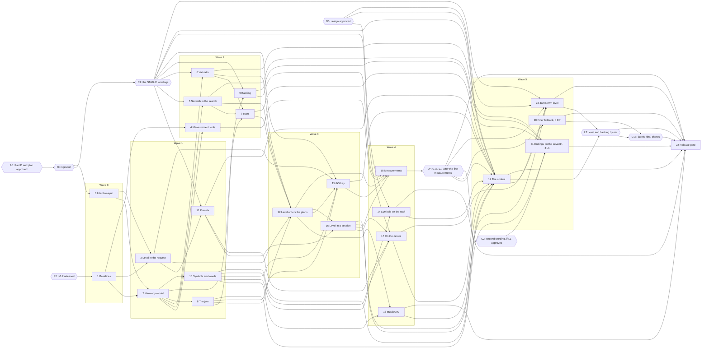

# Infinite Flow v3.3 — Build Plan

Status: v17 (2026-11-13): v16 with wave 3's chunk reports and spec D533 written in: chunk 12
names its built rebuild site; chunk 15's in-browser phrases as built; H3 checks Chrome only (spec
D399); chunk 17 saves the level with a preset's selection; chunk 18 measures M1 over a seed per
phrase (D533), counts fallbacks and clears the stale "until chunk 16" text.
v16 (2026-11-13): v15 with wave 3's preflight corrections and spec D532 written in: chunk
12 rebuilds at two sites and carries A4; chunk 15's capture is C1's A3; chunk 16 gains the level's
routing-point action, `Start with this phrase` and a three-way split.

The Seventh chords level (richer chords, optional), written from
[master spec Part D](master-spec.md#part-d--v33) (v1.4, 2026-11-12, with spec D263–D275,
D511–D519, D526 and D530; v1.2 approved by the owner on 2026-11-09: gate A0, spec D520) and the v3.3 design, frozen at its approval in
[`ui_ux/versions/v3.3/`](../../../ui_ux/versions/v3.3/README.md) (ux D252–D264, refreshed by ux D477–D481; approved by the owner on
2026-11-09: gate D0, ux D482):
everything marked `[v3.3 new]`, `[v3.3 changed]` or with a `_v3.3 …:_` change-block line. Its
planning decisions, spec D276–D288, are approved with Part D (spec D520). Code facts: the
[chord research's code table](../../../docs/music/chord-research.md#where-a-fourth-chord-note-meets-the-code),
re-checked on 62a90c7 on 2026-10-12 by `codebase-explorer` and `documentalist`, and again on
`main` d10de742 (v3.2 through wave 7) on 2026-11-09 (D511). The plan follows the
build-plan model (`~/.local/share/dev_team/references/build-plan-model.md`) through the project's
[build workflow](build-workflow.md). Music terms: the [lexicon](../../../docs/music/lexicon.md).

**v3.3 is built on v3.0, v3.1 and v3.2**: every chunk of the [v3.0](build-plan.md),
[v3.1](build-plan-v3.1.md) and [v3.2](build-plan-v3.2.md) build plans merged and v3.2's release
gate passed (gate R0). Its baseline: v3.0's storage (one IndexedDB database under `src/storage/`,
records keyed per setting, tolerant loading, kept sessions with their played-notes record, the save
hold during a session, outdated-tab and failed-read visits) at **data version 4**, v3.2's last;
v3.0's session seed plan and pre-generation at Idle; v3.1's seven figure levels in the request, the
favored draw and the presets (eight built-ins and player presets, each holding ten controls, the
figure levels and a key and mode restriction; Custom); v3.2's doodle and rhythm-lock inputs, the
join from a doodle, Jam as its own mode with its own settings group and the kept doodle, Vary
settings' six allowed groups, the guide playback in the mix and the `ifk4.` replay key (`ifk1.`–
`ifk3.` still decode). Chords are still root-position diatonic triads. This plan names those plans'
modules as they do ("v3.0 chunk _n_", "v3.1 chunk _n_", "v3.2 chunk _n_"); where one of them landed
a module elsewhere, the wave preflight follows the code.

## Read first: what v3.3 changes in v3.2, v3.1, v3.0 and v2

> With the level at Off (the default), v3.3 must generate exactly what v3.2 generates, note for
> note, and its backing, symbols and files must be byte-identical. A corpus recorded on v3.2 before
> any change
> ([chunk 1](#chunk-1--baselines-the-v32-corpus-the-goldens-at-off-and-the-bundle)) guards every
> chunk that touches generation, the backing, the notation or the exports. Until the control
> ships ([chunk 19](#chunk-19--the-seventh-chords-control)) the app always sends Off (D286): every
> earlier chunk is reachable only from tests, replay keys and the measurement tools, no feature
> switch is built, and no release is cut between waves.

**The melody learns the seventh before any plan offers one.** Chunks 2 and 3 add the chord type and
the level with no effect; chunks 5–8 teach the pitch search, the validator, the runs and the join to
read a seventh chord from hand-built chord plans; only then does chunk 12 let the planner offer one,
so a phrase with a seventh is never searched, validated or carried by code that does not know one.

**The Atoms lines name atom ids.** `documentalist`'s ingestion of Part D (gate I0) created the
v3.3 atoms, and chunk 0 wrote their ids into every chunk's **Atoms** line, in place of the Part D
section each named before (a plan commit on wave 0's branch). Every wave's preflight works from
those ids.

[§D12](master-spec.md#d12-contract-changes-needing-owner-confirmation) lists what v3.3 changes on
purpose. Each enforcement point changes in exactly one chunk, never "along the way". Test titles are
as on 62a90c7 (2026-10-12) or as the earlier plans name them; those plans may move their lines, so a
chunk finds each one by its title. Most of v3.3 adds a form beside the triad rather than replacing
it: a test about a triad stays as it is, and the chunk adds the seventh-chord case beside it.

| What holds today                                                                                                                                                                                                                                                                                                                                                                                                                 | Changed in                                                                                                                                                                      | Becomes                                                                                                                                                                                                                                                                                                                                                                                                                                                                                                                                                                                                                                                                                                                                                                                                                                                                                                                                                            |
| -------------------------------------------------------------------------------------------------------------------------------------------------------------------------------------------------------------------------------------------------------------------------------------------------------------------------------------------------------------------------------------------------------------------------------- | ------------------------------------------------------------------------------------------------------------------------------------------------------------------------------- | ------------------------------------------------------------------------------------------------------------------------------------------------------------------------------------------------------------------------------------------------------------------------------------------------------------------------------------------------------------------------------------------------------------------------------------------------------------------------------------------------------------------------------------------------------------------------------------------------------------------------------------------------------------------------------------------------------------------------------------------------------------------------------------------------------------------------------------------------------------------------------------------------------------------------------------------------------------------ |
| §D12's STABLE guarantees: two whose meaning changes, `req_session_backing_track` ("the highest close-position triad") and `rule_open_phrase_ending` ("a dominant chord tone"; a tense note "outside the final chord"), and those that grow to name the level (§D12 items 3–9: the replay key, reproduction, kept sessions and the database, player presets, presets and Custom, saved settings)                                  | **C1** (confirmed on 2026-11-10, D526), each applied at the sync of the wave that builds it (D517)                                                                              | The wordings C1 confirms. The two music rules hold trivially at Off; chunks [9](#chunk-9--the-backing-plays-the-seventh) and [5](#chunk-5--the-seventh-as-a-chord-tone-in-the-pitch-search)–[6](#chunk-6--the-validator-reads-the-seventh-as-a-chord-tone) build what they now allow; chunks [11](#chunk-11--presets-hold-the-level) and [16](#chunk-16--the-level-in-a-session-and-in-pre-generation) (D527), [15](#chunk-15--replay-key-ifk5), [17](#chunk-17--the-level-on-the-device-data-version-5) and [23](#chunk-23--jams-own-seventh-chords-level) build the rest. `rule_leap_recovery` ("a recognized three-note chord-tone run") keeps its wording (D517). I0 found two more to reword, the same promise: `rule_harmony_change_drops_unfit_harmonic_carry_in` (chunk [8](#chunk-8--the-join-carries-a-seventh-chord)) and, only if the level sits outside the controls, `module_saved_data_loader` (chunk [19](#chunk-19--the-seventh-chords-control)). |
| A chord is a triad: `DiatonicTriad.pitchClasses` is a three-item tuple and `TriadQuality` has three values (`harmony-types.ts`); `deriveTriads` stacks d, d+2, d+4 (`collection.ts`)                                                                                                                                                                                                                                             | [2](#chunk-2--seventh-chords-in-the-harmony-model)                                                                                                                              | A harmony event may carry a seventh as well as its triad; the triad stays as it is. A triad-form event is written exactly as today.                                                                                                                                                                                                                                                                                                                                                                                                                                                                                                                                                                                                                                                                                                                                                                                                                                |
| The harmony domain: the candidate identity `'harmony-domain-v1'` with the plan's fields (`harmony-planner.ts`), ranked by `harmonyTieKey` (`candidate-ranking.ts`); rebuilt by the orchestrator (`buildHarmonyDomain`), the result validator (`harmonyProvenanceFailures`) and `carriedHarmonyFits` (`carry-in-fit.ts`); walked by `window-search.ts` in two orders, `walkHarmonyMajor` and, with locked bars, `walkRhythmMajor` | [12](#chunk-12--the-level-orders-the-plans)                                                                                                                                     | Unchanged at Off. Above Off, each ranked plan with a drawn seventh is followed by its triads-only variant; the orchestrator (`searchedHarmonyOrder`, after a level-free `buildHarmonyDomain`) and the result validator take the level, `carriedHarmonyFits` takes none, and both walks keep each plan's two forms side by side (D516). The atom `module_ranked_candidate_ordering` is revised.                                                                                                                                                                                                                                                                                                                                                                                                                                                                                                                                                                     |
| The request is closed in two places: `GenerationIntent` (`generation-intent.ts`) and the worker's `GENERATION_INTENT_ALLOWED_KEYS` (`generation-worker-inbound.ts`; `tests/unit/generation-worker/generation-worker-protocol.spec.ts`); the resolved `GenerationRequest` holds neither the controls nor the figure levels                                                                                                        | [3](#chunk-3--the-level-in-the-generation-request)                                                                                                                              | The intent carries `chordFamilies`, the level by capability name, beside `figureLevels`, re-validated by the worker; the resolved request is unchanged (D514); any other field is still refused.                                                                                                                                                                                                                                                                                                                                                                                                                                                                                                                                                                                                                                                                                                                                                                   |
| A chord tone is a triad tone: `chordPitchClasses = event.triad.pitchClasses` (`pitch-context.ts`), `chordTone` in `phrase-facts.ts`, the landing check `leavesCarriedTensionUnresolved` (`pitch-advance.ts`), the carried note's fact `carriedPitchOnCarriedChord` (`carry-in.ts`), the comment "a member adjacent by step to a triad tone can never itself be a triad tone" (`figure-rules.ts`)                                 | [5](#chunk-5--the-seventh-as-a-chord-tone-in-the-pitch-search), [6](#chunk-6--the-validator-reads-the-seventh-as-a-chord-tone), [8](#chunk-8--the-join-carries-a-seventh-chord) | In a seventh-form event the seventh is a chord tone too; endings, tense notes and the join's landing and the carried note still read the triad.                                                                                                                                                                                                                                                                                                                                                                                                                                                                                                                                                                                                                                                                                                                                                                                                                    |
| A recognized run is three tones of the triad: `recognizable` in `pitch-motion.ts`, its validator twin in `motion-rules.ts`, and the motion replay `finalMotionState` (`carry-in-derivation.ts`) that derives what a phrase owes the next; `tests/unit/domain/pitch/pitch-motion.spec.ts` › 'caps every level at exactly one recognized run per bar'                                                                              | [7](#chunk-7--runs-may-include-the-seventh)                                                                                                                                     | Still three notes; under a seventh chord they may include the seventh. A four-note one-way arpeggio stays rejected.                                                                                                                                                                                                                                                                                                                                                                                                                                                                                                                                                                                                                                                                                                                                                                                                                                                |
| A carried chord must be a triad: `tests/unit/domain/generation/carry-in/carry-in.spec.ts` › 'refuses a carried chord whose pitch classes do not form a diatonic triad shape'; `sameTriad` (`harmony-join.ts`) compares three pitch classes                                                                                                                                                                                       | [8](#chunk-8--the-join-carries-a-seventh-chord)                                                                                                                                 | A carried seventh chord is accepted and compared by its triad; any other shape is still refused.                                                                                                                                                                                                                                                                                                                                                                                                                                                                                                                                                                                                                                                                                                                                                                                                                                                                   |
| The backing plays triads: `tests/unit/domain/backing/backing-renderer.spec.ts` › 'plays root then fifth in the bass and one held close-position triad…'                                                                                                                                                                                                                                                                          | [9](#chunk-9--the-backing-plays-the-seventh)                                                                                                                                    | Unchanged for triads; a seventh chord plays its four notes, highest close position at or below E4 (a new test beside it).                                                                                                                                                                                                                                                                                                                                                                                                                                                                                                                                                                                                                                                                                                                                                                                                                                          |
| Three chord suffixes (`CHORD_SUFFIX_BY_TRIAD_QUALITY`, `notation-input.ts`); the spoken description passes any other suffix through as written (`suffixWords`, `score-description.ts`)                                                                                                                                                                                                                                           | [10](#chunk-10--seventh-chord-symbols-and-their-spoken-words)                                                                                                                   | Four more suffixes, read as words; a suffix in neither table is refused. Replaced: `written-phrase.spec.ts` › 'preserves the exact suffix string "%s" at every instrument transposition' now lists `maj7`, `m7`, `7`, `m7♭5` (the free-form suffixes it used are refused by design).                                                                                                                                                                                                                                                                                                                                                                                                                                                                                                                                                                                                                                                                               |
| MusicXML throws on an unknown suffix: `tests/unit/export/musicxml/musicxml-encoder.spec.ts` › 'rejects a chord suffix it has no MusicXML chord kind for'                                                                                                                                                                                                                                                                         | [13](#chunk-13--musicxml-writes-the-seventh-chords)                                                                                                                             | Four more kinds; an unknown suffix is still refused (the test keeps a suffix no quality has).                                                                                                                                                                                                                                                                                                                                                                                                                                                                                                                                                                                                                                                                                                                                                                                                                                                                      |
| Replay keys: encoding writes `ifk4.` (v3.2 chunk 12's tests in `phrase-replay-key.spec.ts` and `phrase-replay-key-ifk4.spec.ts`)                                                                                                                                                                                                                                                                                                 | [15](#chunk-15--replay-key-ifk5)                                                                                                                                                | Encoding writes `ifk5.` for every phrase; every `ifk1.`–`ifk4.` decoding test stays.                                                                                                                                                                                                                                                                                                                                                                                                                                                                                                                                                                                                                                                                                                                                                                                                                                                                               |
| A preset holds ten controls and seven figure levels (v3.1 chunk 10's `src/domain/presets/`; v3.2 added nothing to a preset)                                                                                                                                                                                                                                                                                                      | [11](#chunk-11--presets-hold-the-level)                                                                                                                                         | It also holds the level; every built-in at Off.                                                                                                                                                                                                                                                                                                                                                                                                                                                                                                                                                                                                                                                                                                                                                                                                                                                                                                                    |
| Pre-generation's discard key (`settingsKeyOf`, `src/components/workspace/workspace-pregeneration.ts`, as v3.0 chunk 24, v3.1 chunk 19 and v3.2 chunk 26 leave it); Jam's own queue (`jam-pregeneration.ts`), keyed by phrase 1 and the kept doodle                                                                                                                                                                               | [16](#chunk-16--the-level-in-a-session-and-in-pre-generation), [23](#chunk-23--jams-own-seventh-chords-level)                                                                   | Session mode's level joins the key; Jam's level rewrites phrase 1 from the kept doodle, which stays (D513).                                                                                                                                                                                                                                                                                                                                                                                                                                                                                                                                                                                                                                                                                                                                                                                                                                                        |
| Data version 4 (v3.2 chunk 22; `DATABASE_DATA_VERSION`, `PRODUCTION_MIGRATIONS` in `database.ts`); settings are one record per setting, Jam's a `jam.*` group (`JAM_SETTING_FIELDS`), added with no step                                                                                                                                                                                                                         | [17](#chunk-17--the-level-on-the-device-data-version-5), [23](#chunk-23--jams-own-seventh-chords-level)                                                                         | Data version 5: the step rewrites the player presets and kept bodies with the level at Off (D515); the two levels are new settings records with no step; a kept body may hold a seventh chord.                                                                                                                                                                                                                                                                                                                                                                                                                                                                                                                                                                                                                                                                                                                                                                     |
| Vary settings' moves (`MUTABLE_SETTINGS`, `settings-mutation-scales.ts`, as v3.2 chunk 15 leaves it)                                                                                                                                                                                                                                                                                                                             | **Never**                                                                                                                                                                       | The level is not in it and joins no allowed group; chunk 16 proves it.                                                                                                                                                                                                                                                                                                                                                                                                                                                                                                                                                                                                                                                                                                                                                                                                                                                                                             |
| The cold-generation goldens, `generation-outcome-golden.spec.ts`, the backing, MIDI and MusicXML goldens, and the `ifk1.`–`ifk4.` corpora of v2–v3.2                                                                                                                                                                                                                                                                             | **Never**                                                                                                                                                                       | They stay byte-identical: at Off, v3.3 reproduces v3.2 (item 2). A chunk that needs to touch one is wrong.                                                                                                                                                                                                                                                                                                                                                                                                                                                                                                                                                                                                                                                                                                                                                                                                                                                         |

Every replaced or extended test gets its v3.3 counterpart in the same chunk, and the release gate
lists each pair (item 24).

## Gates

| Gate    | What                                                                                                                                                                                                                                                                                                                                                                                                                                                                                                                                                                                                                                                                                                                                                                                                                                                                                                                                                                                                                                                                                                                                                                                                                                                                                                                                       | Cleared by                            | Blocks                                                                                                                                                                                                                                                                                                                                                                                                                                                                                                                                                                                                                                                                                                                                                                                    | Status                                                                                                                                     |
| ------- | ------------------------------------------------------------------------------------------------------------------------------------------------------------------------------------------------------------------------------------------------------------------------------------------------------------------------------------------------------------------------------------------------------------------------------------------------------------------------------------------------------------------------------------------------------------------------------------------------------------------------------------------------------------------------------------------------------------------------------------------------------------------------------------------------------------------------------------------------------------------------------------------------------------------------------------------------------------------------------------------------------------------------------------------------------------------------------------------------------------------------------------------------------------------------------------------------------------------------------------------------------------------------------------------------------------------------------------------ | ------------------------------------- | ----------------------------------------------------------------------------------------------------------------------------------------------------------------------------------------------------------------------------------------------------------------------------------------------------------------------------------------------------------------------------------------------------------------------------------------------------------------------------------------------------------------------------------------------------------------------------------------------------------------------------------------------------------------------------------------------------------------------------------------------------------------------------------------- | ------------------------------------------------------------------------------------------------------------------------------------------ |
| **A0**  | The owner approves [Part D](master-spec.md#part-d--v33) (v1.2, D263–D275, D511–D519), the planning decisions D276–D288 and this plan, R0 included: no v3.3 coding chunk before v3.2's release, since chunk 1's corpus must be recorded on the code v3.2 ships (spec D521). D276's "CONTRACT 3.0 to 4.0" predates v3.0's to v3.2's own bumps (the contract atom is at 14.1.0 since v3.2's release sync): v3.3's first bump is the next major, 15.0.0 (D517, D526).                                                                                                                                                                                                                                                                                                                                                                                                                                                                                                                                                                                                                                                                                                                                                                                                                                                                          | The owner                             | Everything                                                                                                                                                                                                                                                                                                                                                                                                                                                                                                                                                                                                                                                                                                                                                                                | done (2026-11-09, the owner: "Approve both"; spec D520)                                                                                    |
| **I0**  | Not an owner step: `documentalist` ingests Part D (skill `atd-spec-ingestion`). It creates the DRAFT atoms tagged `release-v3.3`, tags `changes-in-v3.3` and writes `docs/release/v3.3-intent-change-set.md`, whose part A holds the exact wording of every STABLE change §D12 lists (D517), and which adds any atom §D12 still misses (D285). It confirms as drift checks the STABLE guarantees whose wording does not change (`rule_join_carry_in_limited`, `req_last_session_review`, the mutation guarantees and the others §D12 lists; it found two to reword, §D12 items 10 and 11), and refreshes the vision's v3.3 line ("direction only and not yet designed") with the owner's sign-off.                                                                                                                                                                                                                                                                                                                                                                                                                                                                                                                                                                                                                                         | `documentalist`, after A0             | C1; chunk 0                                                                                                                                                                                                                                                                                                                                                                                                                                                                                                                                                                                                                                                                                                                                                                               | done (2026-11-10, 521359be, merged into `main` eb28071d; spec D526)                                                                        |
| **C1**  | Contract sign-off, in one sitting: the owner confirms the exact wording of every STABLE change [§D12](master-spec.md#d12-contract-changes-needing-owner-confirmation) lists, items 1–11, as the change set's part A words them (A1–A11): `req_session_backing_track`, `rule_open_phrase_ending` (first option: the triad reading), items 3–9 (the replay key, reproduction, kept sessions and the database, player presets, presets and Custom, saved settings) and the two I0 found: `rule_harmony_change_drops_unfit_harmonic_carry_in` (A10) and, only if the level sits outside the controls, `module_saved_data_loader` (A11). `documentalist` applies each at the sync of the wave whose chunk builds it, with that sync's MAJOR bump, so `main` never holds code a STABLE atom contradicts (D517, after D422): 15.0.0 at wave 1 (A8 at the preset domain, A10), 16.0.0 at wave 2 (A1, A2), 17.0.0 at wave 3 (A3 with chunk 15; A4 with chunk 12, whose draw makes a phrase with seventh chords reproduce from its request and seed; A8's sentences on the Idle state, the request, the current settings and the routing point's level change, with chunk 16; D527, D532), 18.0.0 at wave 4 (A5–A7, A9's presets), 19.0.0 at wave 5 (A9's settings, A11). A chunk that moves to a later wave takes its wording and its bump with it. | The owner; `documentalist`, after I0  | **Merging** chunks [11](#chunk-11--presets-hold-the-level) (wave 1), [5](#chunk-5--the-seventh-as-a-chord-tone-in-the-pitch-search), [6](#chunk-6--the-validator-reads-the-seventh-as-a-chord-tone), [9](#chunk-9--the-backing-plays-the-seventh) (wave 2), [12](#chunk-12--the-level-orders-the-plans), [15](#chunk-15--replay-key-ifk5) and [16](#chunk-16--the-level-in-a-session-and-in-pre-generation) (wave 3), [17](#chunk-17--the-level-on-the-device-data-version-5) (wave 4), [19](#chunk-19--the-seventh-chords-control) (A11, if needed) and [23](#chunk-23--jams-own-seventh-chords-level) (wave 5). Not chunk [8](#chunk-8--the-join-carries-a-seventh-chord): A10's current wording holds until a seventh chord can be carried (chunk 12), so it only rides wave 1's sync. | done (2026-11-10, the owner: "approved", to the wordings, the bumps and the vision's line; spec D526)                                      |
| **D0**  | The owner approves the v3.3 design ([`ui_ux/versions/v3.3/`](../../../ui_ux/versions/v3.3/README.md)); if `ux-writer` freezes it into `ui_ux/versions/v3.3/`, `spec-writer` repoints this plan's design links there. No token pass: v3.3 adds no token, class or motion (ux D261; D284).                                                                                                                                                                                                                                                                                                                                                                                                                                                                                                                                                                                                                                                                                                                                                                                                                                                                                                                                                                                                                                                   | The owner; `ux-writer`; `spec-writer` | Chunks 14 and 19 (the description sentences ship with 19)                                                                                                                                                                                                                                                                                                                                                                                                                                                                                                                                                                                                                                                                                                                                 | done (2026-11-09, the owner: "Approve both"; ux D482, which froze the design into `ui_ux/versions/v3.3/`; the links point there (plan v6)) |
| **R0**  | v3.2 is released: the [v3.2 release gate](build-plan-v3.2.md#chunk-27--v32-release-gate) passed and `3.2.0` is tagged, so chunk 1's corpus is recorded on the code v3.2 ships. The release gate runs its machine half only; v3.2's hand and listening checks follow the tag (spec D521; [v3.2.x follow-ups](build-plan-v3.2.md#after-the-tag-v32x-follow-ups)). **After a 3.2.x fix:** a fix that changes anything chunk 1 recorded (a phrase, its backing or its files) has chunk 1's corpus recorded again on the fix's tag, and every v3.3 chunk merged by then re-checked against it (machine work, no new design); a fix that changes none of them needs nothing. 3.3.0 is released only on code that holds every 3.2.x fix.                                                                                                                                                                                                                                                                                                                                                                                                                                                                                                                                                                                                          | The owner, at v3.2's release          | Chunk 1, and through wave 0 every later wave                                                                                                                                                                                                                                                                                                                                                                                                                                                                                                                                                                                                                                                                                                                                              | done (2026-11-09, tag `v3.2.0`; spec D523)                                                                                                 |
| **DP**  | The finer-fallback decision ([M1](#m1--the-seventh-share)): chunk 18's M1 says whether Strongly favored reaches 3 in 4 harmony events in their seventh form. The owner is told the figures and the outcome; `spec-writer` records the decision. Re-checked at the release gate: if L2's tuning breaks 3 in 4, the decision is reopened.                                                                                                                                                                                                                                                                                                                                                                                                                                                                                                                                                                                                                                                                                                                                                                                                                                                                                                                                                                                                    | Chunk 18's figures; `spec-writer`     | Chunk 20 (built or skipped)                                                                                                                                                                                                                                                                                                                                                                                                                                                                                                                                                                                                                                                                                                                                                               | open (after chunk 18, wave 4)                                                                                                              |
| **U1a** | `ux-writer` reads the first shares chunk 18 reports (item 5) and confirms the labels Off, Sometimes, Often, Mostly, or changes them (ux D254; ux Q77, closed by spec D275).                                                                                                                                                                                                                                                                                                                                                                                                                                                                                                                                                                                                                                                                                                                                                                                                                                                                                                                                                                                                                                                                                                                                                                | `ux-writer`                           | Chunk 19's labels                                                                                                                                                                                                                                                                                                                                                                                                                                                                                                                                                                                                                                                                                                                                                                         | open (after chunk 18)                                                                                                                      |
| **U1b** | `ux-writer` confirms the labels again on the final shares: after chunk 20 if it is built, and after L2's tuning and the release gate's final M1 run (ux Q77, closed by spec D275).                                                                                                                                                                                                                                                                                                                                                                                                                                                                                                                                                                                                                                                                                                                                                                                                                                                                                                                                                                                                                                                                                                                                                         | `ux-writer`                           | The release gate                                                                                                                                                                                                                                                                                                                                                                                                                                                                                                                                                                                                                                                                                                                                                                          | open (after L2)                                                                                                                            |
| **L1**  | The listening check on endings ([H1](#hand-checks), [§D6.3](master-spec.md#d63-phrase-endings-and-the-join-read-the-triad-until-a-listening-check)): the owner listens to chunk 18's examples of phrases ending on the seventh and landing on the tonic chord's seventh, and says whether they sound open or wrong. `spec-writer` records the result either way.                                                                                                                                                                                                                                                                                                                                                                                                                                                                                                                                                                                                                                                                                                                                                                                                                                                                                                                                                                           | The owner; `spec-writer`              | Chunk 21 (built only if approved); the release gate (item 9)                                                                                                                                                                                                                                                                                                                                                                                                                                                                                                                                                                                                                                                                                                                              | open (after chunk 18)                                                                                                                      |
| **C2**  | Only if L1 approves the seventh, a contract sign-off: the owner confirms the second option's wording of `rule_open_phrase_ending`, and `documentalist` applies it with its own bump (MAJOR, unless C1's bump is not yet applied).                                                                                                                                                                                                                                                                                                                                                                                                                                                                                                                                                                                                                                                                                                                                                                                                                                                                                                                                                                                                                                                                                                          | The owner; `documentalist`, after L1  | **Merging** chunk [21](#chunk-21--endings-on-the-seventh-second-option-conditional)                                                                                                                                                                                                                                                                                                                                                                                                                                                                                                                                                                                                                                                                                                       | open (only if L1 approves)                                                                                                                 |
| **L2**  | The owner's listening check of the level and the four-note backing, with the guides on and off ([H2](#hand-checks), [§D5.2](master-spec.md#d52-four-levels), [§D7.3](master-spec.md#d73-the-backing-plays-the-seventh); D282, D518); the Sometimes and Favored shares are tuned from it.                                                                                                                                                                                                                                                                                                                                                                                                                                                                                                                                                                                                                                                                                                                                                                                                                                                                                                                                                                                                                                                   | The owner                             | The release gate's final M1 and M2 runs                                                                                                                                                                                                                                                                                                                                                                                                                                                                                                                                                                                                                                                                                                                                                   | open (after chunk 23)                                                                                                                      |

## Waves

| Wave | Chunks                                                                                                                                            | Waits for                                                                                                                                                                                                                                                                                                                                                                                                                                                                                            | Status                        |
| ---- | ------------------------------------------------------------------------------------------------------------------------------------------------- | ---------------------------------------------------------------------------------------------------------------------------------------------------------------------------------------------------------------------------------------------------------------------------------------------------------------------------------------------------------------------------------------------------------------------------------------------------------------------------------------------------- | ----------------------------- |
| 0    | 0 Intent re-sync · 1 Baselines                                                                                                                    | A0 and I0 (0); R0 (1). Two chunks: every other chunk needs both, chunk 0's ids in its own wave preflight and chunk 1's corpus as its guard, so nothing can join.                                                                                                                                                                                                                                                                                                                                     | merged (2026-11-10, 21843b4a) |
| 1    | 2 Seventh chords in the harmony model · 3 The level in the request (3a–3c) · 8 The join · 10 Symbols and spoken words · 11 Presets hold the level | Wave 0. In-wave 2 → 8 and 2 → 10: chunk 2's capture fixes the harmony event's optional seventh, its qualities and `chordTones`; 3 → 11: chunk 3's capture fixes `chordFamilies` and the level ids.                                                                                                                                                                                                                                                                                                   | merged (2026-11-10, 24e509fb) |
| 2    | 4 Measurement tools · 5 The seventh in the pitch search · 6 The validator · 7 Runs · 9 The backing                                                | Wave 1. In-wave 5 → 7 and 6 → 7: chunks 5's and 6's captures fix the chord-tone facts 7's run rule reads; 7 starts once 5 and 6 are merged.                                                                                                                                                                                                                                                                                                                                                          | merged (2026-11-12, b8e291e8) |
| 3    | 12 The level orders the plans · 15 Replay key `ifk5.` · 16 The level in a session (16a–16c)                                                       | Wave 2 (5, 6 and 7 merged). In-wave 12 → 15 and 12 → 16: chunk 12's capture fixes the draw and the plan variants.                                                                                                                                                                                                                                                                                                                                                                                    | merged (2026-11-13, 557a7e57) |
| 4    | 13 MusicXML · 14 Symbols on the staff · 17 The level on the device · 18 Measurements, first run                                                   | Wave 3; D0 (14). DP, U1a and L1 open at its end.                                                                                                                                                                                                                                                                                                                                                                                                                                                     | in progress                   |
| 5    | 19 The Seventh chords control · 23 Jam's own level · 20 The finer fallback (**conditional**) · 21 Endings on the seventh (**conditional**)        | Wave 4; D0 and U1a (19, 23); DP (20, built only if DP adopts it); L1 (21, built only if L1 approves) and **C2 to merge 21**. In-wave 19 → 23: chunk 19's capture fixes `seventhChordsOptions`, which Jam's control reuses. Two sure chunks: 19 makes a seventh reachable in the app and 23 builds on it, so both follow every chunk a seventh passes through, chunk 13 included (D528); 20 and 21 join only if DP and L1 call for them, otherwise they are recorded as skipped. L2 opens at its end. | planned                       |

The [release gate](#chunk-22--v33-release-gate) (chunk 22) follows wave 5, with L1, L2 and U1b. κ
is 1 ([build workflow](build-workflow.md#concurrency-and-order)); a chunk built and waiting only on
C2 does not count against it. The widest chunks are 3 and 16 (each split three ways), 5 and 12
(each with a split rule), 17 and 23 (each with a split rule too).

The critical path runs 0 → 2 → 5 → 7 → 12 → 15 → 18 → (DP, U1a, L1) → 19 → 23 → L2 → 22. The device
and screen branch (11 → 16 → 17 → 19 → 23) runs beside it. The longest owner-dependent detour is L1 → C2
→ 21, taken only if the owner approves the seventh as an ending.

## Workflow deltas

The [build workflow](build-workflow.md) holds for v3.3 with release name `v3.3`: wave branches
`v3.3-w<n>` in `/home/bastien/work/infinite_flow-v3.3-w<n>`, chunk branches `v3.3-c<id>-<slug>` in
`/home/bastien/work/infinite_flow-v3.3-c<id>`. v3.3's own:

- **Corpus guard** (a chunk check): chunks 2, 3, 5–10, 12, 13, 15, 16, 20, 21 and 23, which touch
  generation, the backing, the notation or the exports, run chunk 1's two corpora (the `ifk4.`
  phrase corpus, `tests/unit/generation-worker/phrase-replay-key-v32-corpus.spec.ts`, and the
  backing and file corpus), the earlier corpora and the goldens unchanged. Red means a request at
  Off no longer reproduces v3.2.
- **Hand-built chord plans**: pitch and validation rules are tested on hand-built plans holding
  seventh-form events (chunk 2's fixture builder in `tests/unit/domain/harmony/`), so chunks 5–9
  need no planner change.
- **Sweep at the wave gate**: chunks 3, 5–8, 12, 16, 20, 21 and 23 place it there, so waves 1, 2,
  3 and 5 run it. At Off the sweep gives v3.2's figures.
- **Intent**: the DRAFT atoms are tagged `release-v3.3`, the atoms to revise `changes-in-v3.3`, in
  the v3.3 intent change set I0 writes (`docs/release/v3.3-intent-change-set.md`). The
  **Atoms** lines name the atom ids, written in by chunk 0
  ([Read first](#read-first-what-v33-changes-in-v32-v31-v30-and-v2)). Chunks 1, 4 and 18 add no
  atom.
- **Contract sign-offs**: C1 is done (D526): each wave's sync applies the C1 wordings its chunks
  build, with that sync's MAJOR bump ([C1](#gates); D517), and a chunk that moves to a later wave
  takes its wording with it. Each wave preflight names the wordings its sync applies. C2, only if
  L1 calls for it, gates the merge of chunk 21 ([build workflow](build-workflow.md#intent-atd));
  built before its sign-off, chunk 21 stays `built` on its branch, unmerged.
- **Chunk 0 is not a coding chunk**: the driver hands it to `documentalist` (spec ingestion,
  milestone refinement).
- **Area documents**: `docs/generation-latency.md`, `docs/notation-engraving.md`,
  `docs/export.md`, `docs/audio-transport.md`, `docs/phrase-workspace.md`,
  [`docs/music/`](../../../docs/music/README.md); and the project documents §D12 names, as D283
  assigns them: the harmony planner policy (chunks 2 and 12), the pitch planner validation note
  (chunks 5–7), the generator contract (`spec-writer`, from chunk 12's report, at wave 3's gate),
  the lexicon's "in Infinite Flow" lines (`documentalist`, at the release gate).
- **Entry budget**: 320 KiB (327,680 B, spec D504), or the figure v3.2's release gate leaves
  ([M4](#m4--the-first-load-bundle)); v3.2's wave 7 gate left the entry chunk at 311,455 B.
- **Hand checks** go into a new v3.3 part of [`HARDWARE-CHECKLIST.md`](../../../HARDWARE-CHECKLIST.md),
  written by the chunk the [table](#hand-checks) names; the first of them opens the part.

## Measurements and hand checks

Four figures the spec leaves to the build ([§D16](master-spec.md#d16-deferred-and-open): "measured
before the gate, not open questions"). The release gate copies each into the release notes. Chunk
1's v3.2 corpus, which proves "Off reproduces v3.2" (item 2), is a guard, not a measurement: it
passes, or the chunk stops.

### M1 — The seventh share

- **What:** [§D15](master-spec.md#d15-definition-of-done) item 5 and
  [§D5.2](master-spec.md#d52-four-levels). At each level, the share of harmony events in their
  seventh form, and the share of phrases that fell back to triads. A **harmony event** is one span
  of one chord, a chord held across a barline counting once. A **fallback** is a phrase whose
  winning plan is the triads-only variant of a plan that had at least one seventh drawn (D281).
  Both are recorded per level and per mode: Major, Minor and the seven modes (Ionian to Locrian).
- **How:** chunk 4's seventh census, over the deadline sweep's 568 rhythm settings (`sweepCases()`,
  `tests/unit/session/deadline-sweep-cases.ts`) × two seeds × the nine modes, with the Neutral and Jazz
  defaults, at each of the four levels (D281). Each phrase takes a seed of its own, the same at
  the four levels, not the case's seed (7 or 13), so the draw reads a representative sample
  (D533). It counts over phrases generated, not attempts.
- **Run by:** chunk 4 (at Off on v3.2: zero, the baseline); chunk 18 (DP is taken on it); chunk 20
  if built; the release gate, after L2's tuning.
- **Acceptance:** zero at Off; never lower from Sometimes to Favored to Strongly favored, in every
  mode; **at least 3 in 4 at Strongly favored over the whole sweep** (D281). Each mode's share is
  recorded. A mode under 3 in 4 alone does not trigger the finer fallback; it goes to `ux-writer`
  with the figures. The Sometimes and Favored shares start near 1 in 4 and 1 in 2 of the events
  drawn; their measured share is lower where plans fall back, and is recorded, not judged.
- **The finer fallback (DP):** [§D5.3](master-spec.md#d53-how-the-planner-applies-it) adds one
  mechanism only if M1 needs it. If Strongly favored misses 3 in 4 over the sweep at chunk 18 (on
  the reference machine, with the shares as they stand then), chunk 20 adds, before each plan's
  triads-only variant, variants that drop the seventh from one event at a time, in a fixed order,
  within the cost guard, then M1 and M2 run again; if the finer variants break the cost guard, it
  goes to `spec-writer` and `ux-writer` (the label "Mostly" rests on the share). Otherwise chunk 20
  is skipped. If 3 in 4 is not reached even with chunk 20, the label goes back to `ux-writer` (U1a,
  U1b).
- **Reported:** to `ux-writer` (item 5; U1a on the first shares, U1b on the final ones), with the
  table per level and mode.
- **Recorded:** a new "Seventh chords" section of `docs/generation-latency.md`; the share constants
  carry a comment pointing there.

### M2 — The cost guard

- **What:** [§D10](master-spec.md#d10-the-cost-guard-generation-time-with-seventh-chords) and item
  21: whether seventh chords slow the generator or make it fail. **The search allowance is not
  raised.** Recorded for each setting: the share of phrases generated, the slowest and the
  95th-percentile generation time, the seventh share, at 240 BPM the share of phrases that fall
  back to being generated without the join, **join loss by cause** at each tempo beside Off's
  (D531: the standalone productions by kind, and the joins lost because the only first note left
  was the first chord's seventh, which D530 refuses), at 180 BPM (Jam's fastest, D506) the share
  of a fresh Jam's phrase 1 ready by its deadline, and with locked bars the share of locked
  rhythms kept (D516).
- **Settings**, exactly §D10's: the baseline, Off with the Neutral and Jazz defaults (it must equal
  v3.2's figures, since the phrases are the same); Sometimes, Favored and Strongly favored with the
  Neutral and Jazz defaults; Strongly favored with **Speed drill, measured first** (the most
  expensive setting v3.1 found), and with Bebop; each in every mode its preset allows; and a
  session with locked bars at Off and at Strongly favored. Bebop restricts the modes to Major, so
  Strongly favored with Bebop runs in Major only (the cost runner's `SEVENTH_SETTINGS`); every
  other setting runs in all nine modes. §D10's "each in every mode" reads this way; what is
  measured does not change.
- **How:** v3.1 chunk 3's cost runner (`tests/sweep/cost-guard*.ts`, `npm run measure:cost`) on
  the deadline sweep's 568 cases at 60, 120 and 240 BPM, each attempt charged its measured time, in
  a 240 BPM session; v3.2 chunk 3's Jam sweep (`tests/sweep/jam-sweep*.ts`, `npm run measure:jam`)
  for a fresh Jam's phrase 1 at 180 BPM; and v3.2's lock measurement (`npm run measure:lock`) for
  locked bars. Chunk 4 adds the level as a dimension to all three. The owner runs the deciding runs on the reference machine.
  Above Off, chunk 18 runs Jam's phrase 1 through the Jam sweep's double of the ladder: the real
  ladder (`JAM_LADDER=real`) builds its intents in `jam-phrase-one-attempts.ts`, which carries
  Jam's level only from chunk 23, so the release gate's final run uses the real ladder (D531).
- **Run by:** chunk 4 (the Off baseline); chunk 18; chunks 20 and 21 if built; the release gate,
  after L2's tuning.
- **Acceptance**, against the baseline, as §D10's:
  - at most 2 percentage points more fallbacks without the join at 240 BPM;
  - at most 2 percentage points fewer phrases generated at any swept setting;
  - at most 2 percentage points fewer Jam phrase 1s ready by their deadline;
  - at most 2 percentage points fewer locked rhythms kept;
  - no attempt generated on its own slower than the standalone reserve (1.075 s in Chromium,
    `STANDALONE_RESERVE_SECONDS`), which the failure ladder keeps for it.
- **If a level costs more:** its share is tuned down, or the fallback made finer (DP), before the
  release gate. The allowance is never raised and the triad fallback never removed. A level that
  still fails goes to `spec-writer` with the figures.
- **Recorded:** `docs/generation-latency.md` ("Seventh chords: the cost guard").

### M3 — The start-up read and the migration

- **What:** whether loading both levels with the settings and player presets stays inside v3.0's
  start-up wait (Part A §4.4), and how long the data version 5 upgrade takes on v3.2's data.
- **Run by:** chunk 17: the version 5 upgrade on 10, 100 and 500 v3.2 kept sessions (Jam sessions
  and player presets among them), and the start-up read on the same databases, cold and warm, with
  v3.2's tools (`npm run measure:kept-session-upgrade`, `npm run measure:startup-read`). The owner
  repeats the deciding runs on the reference machine.
- **Acceptance:** each, upgrade included, well under the start-up wait constant. The upgrade
  rewrites the player presets and kept bodies with the level at Off (D515), as v3.2's step 4
  rewrote kept sessions, so it should cost about what that step did.
- **Recorded:** `docs/storage.md`.

### M4 — The first-load bundle

- **What:** the entry chunk stays within its budget (320 KiB today, `entryChunkByteBudget` in
  `scripts/verify-boundaries.mjs`, spec D504, or the figure v3.2's gate leaves; 311,455 B at v3.2's
  wave 7 gate). The control and its options
  add a few lines to the entry chunk; the seventh-chord generation code lives in the generation
  worker's bundle and the notation changes in the VexFlow engraver chunk, whose budgets the same
  script checks.
- **Run by:** chunk 1 (the baseline on the v3.2 release); every wave gate; the release gate (`npm
run verify:boundaries`, budget unchanged).
- **Recorded:** the wave log and each wave's merge commit message; the release notes.

### Hand checks

The owner runs these on the Travel Sax over USB and the reference machine, in Chrome; none runs in
Edge (spec D399).

| Check                                            | Written by | Run at                                             | What the owner does                                                                                                                                                                                                                                                                                                                                                                                                                                                                                              |
| ------------------------------------------------ | ---------- | -------------------------------------------------- | ---------------------------------------------------------------------------------------------------------------------------------------------------------------------------------------------------------------------------------------------------------------------------------------------------------------------------------------------------------------------------------------------------------------------------------------------------------------------------------------------------------------- |
| H1 Listening: endings on the seventh (**L1**)    | 18         | After wave 4; before chunk 21 and the release gate | Listen to chunk 18's examples, each beside the same phrase as the app writes it. **Ending on the seventh with no next phrase:** F over G7 in C major; the home chord's seventh in Dorian and in Mixolydian (B♭ over C7 in C Mixolydian). **The next phrase landing on the tonic chord's seventh.** Say for each whether ending on the seventh sounds open (the player can keep going) or like a mistake. Item 9. Approved: C2, then chunk 21. Not approved: the triad reading ships, and the result is recorded. |
| H2 Listening: the level and the backing (**L2**) | 19         | After chunk 23; used by the release gate           | With Jazz, Bebop, Modal (Dorian) and Neutral, play short sessions at Sometimes, Often and Mostly, and one Jam at Mostly. Say whether each step is clearly heard, whether Mostly sounds like "a seventh on nearly every chord", and whether the four-note backing (lowest note about D3, each note as loud as a triad's) sits well under the bass and the line, with the Melody and Rhythm guides off and then on (D518). The Sometimes and Favored shares are tuned from it, then M1 and M2 run again.           |
| H3 Same phrase in Chrome                         | 15         | After chunk 19; used by the release gate           | In Chrome, generate a phrase at Mostly, copy its `ifk5.` key from the console line, and run chunk 15's in-browser replay test with it (`INFINITE_FLOW_REPLAY_KEY`, no browser channel); every test passes, none skipped. Item 18's "the same `ifk5.` key gives the same phrase in Chrome" on a key from a real session; nothing runs in Edge (spec D399).                                                                                                                                                        |
| H4 The files                                     | 13         | Chunk 13                                           | Open a MusicXML file holding all four seventh-chord kinds in MuseScore: Cmaj7, Dm7, G7 and Bm7♭5 (in written pitch) show as the right symbols (item 12's recorded hand check). Open the MIDI file with the backing included in a DAW: the backing's chords hold four notes where the symbols say seventh.                                                                                                                                                                                                        |
| H5 v3.2 data carried over                        | 17         | The release gate                                   | In the installed app and a plain Chrome tab that used v3.2 (settings changed, a player preset, a pinned session and a kept Jam session), update to v3.3: the settings come back with the level at Off, Jam's settings with Jam's level at Off, the preset loads unchanged, and the sessions open and play back as before, with their triads.                                                                                                                                                                     |
| H6 Symbols at the narrowest widths               | 14         | After chunk 19                                     | On the reference machine, at the narrowest width of each named breakpoint, regenerate at Mostly in keys whose half-diminished chord has an accidental on its root (A major, whose degree-7 chord is G♯m7♭5, for each instrument's written key): no symbol touches the next or crosses a barline, and none is shrunk. Phones are low priority but must not break.                                                                                                                                                 |

## Chunks

"Item _n_" is item _n_ of the [definition of done](master-spec.md#d15-definition-of-done). The
**Atoms** and **Revisions** lines follow the [build workflow](build-workflow.md#intent-atd) and
name atom ids, which chunk 0 wrote in for the `release-v3.3` atoms.

### Chunk 0 — Intent re-sync

Status: merged (w0, e5612be6)
Record: a108b5b4 (VISION 0.12, change set records C1 and the Part D v1.3 re-check), e5612be6 (Atoms lines name ids), committed on `v3.3-w0` directly (a docs chunk, no chunk branch); no drift, no atom revised.
Wave: 0
Depends on: A0, I0 (run right after R0, so it checks against the state v3.2's release gate left)
Architecture capture: none

- **Goal:** make sure I0's `release-v3.3` and `changes-in-v3.3` atoms still match Part D and the
  state v3.2's release gate left, before the first v3.3 chunk relies on them.
- **Scope:** `documentalist`, spec ingestion (milestone refinement); atoms and this plan's
  **Atoms** lines only, no code.
  - Part D as it stands when the build starts: the decisions recorded after I0 that touch Part D.
  - The atoms v3.0's, v3.1's and v3.2's release gates promoted or revised that v3.3 revises again:
    among them `rule_seeded_phrase_reproduction`, `rule_kept_session_content`,
    `rule_preset_contents`, `rule_built_in_preset_values`, `rule_choosing_preset_sets_its_settings`,
    `rule_presets_load_tolerantly`, `rule_preset_load_values_win`, `rule_settings_saved_on_change`,
    `rule_pregeneration_discarded_on_change`, `rule_vary_settings_allowed_groups`,
    `rule_jam_melody_follows_doodle_moves`, `rule_doodle_only_orders_candidates`,
    `module_phrase_replay_key` (now `ifk4.`), and v3.2's Jam settings atoms (`req_jam_settings`,
    `module_jam_settings` and the `rule_jam_settings_*` rules): their `changes-in-v3.3` notes still
    name the right change.
  - The C1 record: the owner's confirmation of every wording of the change set's part A (A1–A11),
    the bumps 15.0.0 to 19.0.0, and which wave's sync applies each (D517, D526). No C1 wording is
    applied here; each waits for its wave's sync.
  - The vision's v3.3 line: the change set's part C as the owner approved it (D526), its LOGIC
    paragraph, its TECHNICAL INTERFACE edit and its out-of-scope addition, VISION 0.11 → 0.12.
  - In this plan, each chunk's **Atoms** line named the Part D section of the `release-v3.3` atom
    it builds; chunk 0 replaced each with the atom's id (a plan commit on the wave branch).
- **Files:** `docs/*.atom.md`; the change set (`docs/release/v3.3-intent-change-set.md`, from I0);
  this plan.
- **Spec sections:** [Part D](master-spec.md#part-d--v33). No item directly; 25 rests on C1's
  record, and every later wave's preflight relies on it.
- **Atoms:** every atom tagged `release-v3.3` or `changes-in-v3.3`;
  `contract_infinite_flow_first_release` (C1's record; its first bump, 15.0.0, comes at wave 1's
  sync); `vision_infinite_flow_first_release` (0.12, part C).
- **Revisions:** none.
- **Done when:** each Part D behaviour is stated by an atom (still DRAFT); `npm run atd:lint` and
  `npm run atd:check` pass; the change set file records what changed, if anything; the vision
  holds part C's v3.3 line at 0.12; every chunk's **Atoms** line names ids.
- **Verification:** `documentalist`'s ingestion report; `npm run lint:links`.
- **Split rule:** none needed.

### Chunk 1 — Baselines: the v3.2 corpus, the goldens at Off and the bundle

Status: merged (w0, dd3412d6)
Record: 07914b9e: 297-key `ifk4.` corpus (1.1 MB, ~7 s), backing and file corpus of 8 sessions × 4 files (~340 KB, ~1 s), identical on the `v3.2.0` tag; entry 311,455 B. Beside the Files line: three tests-side case-builder modules (size limit), `.prettierignore` lists the byte-compared fixtures, the file-corpus spec links `req_session_backing_track` and the two generated-notes export rules (lint:health); the lock chain uses Heavily varied (no rhythm change is available under Strict or Slightly varied). No deviation from spec or design.
Wave: 0
Depends on: R0
Architecture capture: none

- **Goal:** record, on the code v3.2 shipped, every fact v3.3 must not break at Off: the phrase each
  request gives, the backing it renders, the files it exports, and the entry chunk's size.
- **Scope:**
  - **The phrase corpus**, generated from the `3.2.0` tag before any v3.3 change: the eight
    built-in presets and a spread of figure levels × **every one of the nine modes** × the three
    built-in instruments and two player-made ones × a spread of the other controls (every harmonic
    motion and Tension value, Eighth and Sixteenth with Heavily varied) × several seeds, with and
    without carry-in (a carried null harmony included). It also holds the Jam and lock cases: a
    fresh Jam's phrase 1 by each rung, a phrase 1 written again from a kept doodle after a Jam
    setting changed, a locked phrase, a changed one, a forced bend and a drifted one. Each case is stored as its `ifk4.` key and the timeline it replays to, beside the earlier
    corpora, which stay.
  - **The backing and file corpus:** for a sample of the corpus's sessions, the backing's rendered
    notes, the generated-notes MusicXML and both MIDI files (backing included and not), and a unit
    test that renders and encodes each again and compares bytes. Items 2, 10 and 12's "triads as
    before" rest on it.
  - The entry chunk's size after `npm run build` on the tag ([M4](#m4--the-first-load-bundle)).
    Recorded: 311,455 B on the `v3.2.0` tag (`f93e552d`) and on the chunk's branch, whose `src/`
    is the tag's; 16,225 B under the 320 KiB budget (2026-11-10).
  - **After a 3.2.x fix** (spec D521, gate R0): if the fix changes a recorded value, the corpus is
    recorded again from the fix's tag, the change read as the fix's own, and the v3.3 chunks merged
    by then re-checked against it.
- **Files:** `tests/fixtures/replay-keys/v3.2-corpus.json`,
  `tests/unit/generation-worker/phrase-replay-key-v32-corpus.spec.ts`,
  `tests/fixtures/sessions/v3.2-backing-and-files/` and its unit test (all new), a generator script
  under `scripts/` (tooling, beside `scripts/record-replay-key-corpus.mjs`), `docs/testing.md`.
- **Spec sections:** items 2 (as the guard for chunks 2, 3, 5–10, 12, 13, 15, 16, 20 and 21), 18
  (`ifk4.` decoding), 10 and 12 (triads unchanged).
- **Atoms:** (STABLE) `module_phrase_replay_key`, `rule_seeded_phrase_reproduction`, which the
  `ifk4.` corpus spec tests as the earlier corpus specs do: `@test-link [[module_phrase_replay_key]]`
  directly above each replay test, and `@test-link [[rule_seeded_phrase_reproduction]]` too above
  the one that replays each key to its stored phrase, as in `phrase-replay-key-v31-corpus.spec.ts`.
  No atom changes. The corpus later backs (v3.3) `rule_seventh_chords_off_changes_nothing`, whose
  test links chunks 12 and 15 add.
- **Revisions:** none.
- **Done when:** both corpus tests pass on the tag and on `main`; each is red if a stored value is
  changed by hand; the `ifk4.` corpus spec's replay tests carry the two test links above;
  `npm run atd:check` passes; the baseline size is recorded here and in `docs/testing.md`.
- **Verification:** chunk checks.
- **Split rule:** none needed.

### Chunk 2 — Seventh chords in the harmony model

Status: merged (w1, e4e9cbdc)
Record: 79b174e3: `SeventhQuality`, `ChordSeventh { pitchClass, quality }`, `HarmonyEvent.seventh?`, `chordTones(event)`, `HarmonyCollection.seventhChords` (by degree − 1), `deriveSeventhQuality` throws on other shapes; fixtures `seventhOf`, `withSeventh`, `seventhChordEvent`, `chordPlan`; corpus guard 21 files, 557 tests. No deviation from spec or design.
Wave: 1
Depends on: 0, 1
Architecture capture: the seventh beside the triad (a revision of
`module_harmony_candidate_domain`). `HarmonyEvent` keeps `triad` exactly as it is and gains an
optional `seventh`: the seventh's pitch class and the chord's `SeventhQuality` (`major-seventh`,
`minor-seventh`, `dominant-seventh`, `half-diminished-seventh`). The field is absent in triad form,
never `null`, so a triad event, its candidate's JSON and its identity serialize byte for byte as
today (the result validator compares exact JSON). `collection.ts` derives the seventh on each
degree (d+6) with its quality, from the research's
[table A](../../../docs/music/chord-research.md#table-a-the-seventh-chord-on-each-degree), and throws
on any other shape. Two readers serve the rest of the code: `chordTones(event)` gives three or four
pitch classes; `event.triad` stays the triad, read by the endings, the join's comparison and the
colour chords (a modal plan's chord that holds the mode's characteristic note). Chunks 4, 8 and 10
in this wave build on it.

- **Goal:** give the harmony model the seventh chord on every degree of every mode, with no effect
  on any phrase.
- **Scope:**
  - `harmony-types.ts`: `SeventhQuality` (the four qualities), the optional `seventh` on
    `HarmonyEvent` (pitch class and quality, absent in triad form), and the readers `chordTones`
    and the triad.
  - `collection.ts`: the seventh chord on each degree (degrees d, d+2, d+4 and d+6 of the
    collection), its quality from the intervals: a major triad with a major seventh is major
    seventh; minor with minor seventh, minor seventh; major with minor seventh, dominant seventh;
    diminished with minor seventh, half-diminished. Any other shape throws. The triads and their
    order are untouched.
  - The fixture builder for hand-built plans with seventh-form events
    (`tests/unit/domain/harmony/`), which chunks 5–9 use.
  - Nothing reads the new field yet.
- **Files:** `src/domain/harmony/harmony-types.ts`, `src/domain/harmony/collection.ts`; tests
  `tests/unit/domain/harmony/collection.spec.ts` (extended),
  `tests/unit/domain/harmony/seventh-chord-fixtures.ts` (new);
  [`docs/music/harmony-planner-policy.md`](../../../docs/music/harmony-planner-policy.md)
  ("Collection and chord vocabulary": the sevenths exist, used only from chunk 12).
- **Spec sections:** [§D4](master-spec.md#d4-words-used-in-this-part),
  [§D5.1](master-spec.md#d51-the-chords); items 3 (the construction), 2 (guarded).
- **Atoms:** (v3.3) `rule_seventh_chords_diatonic_only` (only the four diatonic sevenths). Drift
  check:
  `module_harmony_candidate_domain`.
- **Revisions:** revise `module_harmony_candidate_domain` ("triad material").
- **Done when:**
  - In each of the nine modes on every key, the seven seventh chords and their qualities equal the
    research's table A (Major: maj7, m7, m7, maj7, 7, m7, m7♭5 on degrees 1 to 7; each mode the
    same seven in rotation).
  - A shape that is not one of the four qualities throws.
  - A triad-form event serializes byte for byte as before (a JSON snapshot test); the corpus and
    the goldens pass unchanged.
- **Verification:** chunk checks.
- **Split rule:** none needed (two source files).

### Chunk 3 — The level in the generation request

Status: merged (w1, 056ea511)
Record: 1213728c (3a), 5bab9862 (3b), b06b844e (3c): `chord-families.ts` (`ChordFamilies`, `ChordFamilyLevel`, `OFF_CHORD_FAMILIES`, `parseChordFamilies`); `GenerationIntent.chordFamilies` required after `figureLevels`; `rebuildGenerationWorkerIntent(record, readCarryIn, readChordFamilies)`. Beside the Files line: `use-generation-session.ts` and `generation-session-prewarm.ts` also build intents and pass Off (reported to `spec-writer` via the wave log). No deviation from spec or design.
Wave: 1
Depends on: 0, 1 (and v3.1 chunk 4, figure levels beside the controls, the pattern this follows)
Architecture capture: the level by capability name (revisions of
`module_generation_request_construction` and `module_generation_worker_protocol`). `src/domain/chords/chord-families.ts` (new) holds the one
family id `seventh-chords` and the four level ids `off`, `sometimes`, `favored` and
`stronglyFavored`: Part D's levels in the camelCase of v3.1's figure-level ids, never the
interface's labels (D277, D288), which the interface maps to its own words (`favored` → Often,
`stronglyFavored` → Mostly; ux D264). `GenerationIntent` gains
`chordFamilies: { 'seventh-chords': level }` beside `figureLevels`, read from the intent as the
figure levels are (`window-search.ts`); the resolved `GenerationRequest`, which holds neither the
controls nor the figure levels, is unchanged, so `parseGenerationRequest` and every kept body's
stored request stay as they are (D514). Keeping it out of `GenerationControls` leaves the replay
key's control order, the sweep's dimensions and the control catalog alone. Inside the app it is always present; an input from
before v3.3 (a key, a kept body, a saved record) reads Off where it is decoded. The worker
re-validates it. The capture says whether this is the mechanism
`module_musical_profile_capabilities` names "capability", or a separate one. Chunk 11 in this wave
builds on it.

- **Goal:** carry the Seventh chords level in every generation request, re-validated by the
  worker, with no effect yet.
- **Scope:**
  - `src/domain/chords/chord-families.ts` (new): the family id, the four level ids,
    `OFF_CHORD_FAMILIES`, and `parseChordFamilies` (exactly the known ids, each a known level, no
    extra field).
  - `GenerationIntent` and `GenerationIntentInput` gain `chordFamilies`; `makeGenerationIntent`
    takes it. Every intent builder passes Off until chunks 16 and 23 give it a level: the session's
    `buildAttemptIntent` (`session-intents.ts`, every rung of v2's ladder and a Jam's later
    phrases), a fresh Jam's phrase-1 rungs (`jam-phrase-one-attempts.ts`, D287) and the carry-in
    intent (`carry-in-intent.ts`); each passes it on unchanged.
  - The worker: `GENERATION_INTENT_ALLOWED_KEYS` gains the field; the inbound parser rebuilds it with `parseChordFamilies` before its deep-equal check;
    prewarm, pre-generation and cancellation carry it. An unknown family or level is refused with
    the typed protocol error.
  - **The v3.2 forms read Off and are written without the level.** `rebuildGenerationWorkerIntent`
    is shared by the worker and the replay key decoder and has no default for a missing field, so
    it is told how its form reads the level: the worker requires it; an `ifk1.`–`ifk4.` key gives
    Off (`phrase-replay-key-decode.ts`), so an `ifk4.` key still decodes to an intent equal to the
    one encoded (STABLE `module_phrase_replay_key`). `encodePhraseReplayKey` still writes `ifk4.`
    and refuses an intent above Off rather than writing a key that would decode to Off (`ifk5.` is
    chunk 15's). A kept body stores `phrase.intent` as it is and the data-version-4 reader takes
    exact keys only (STABLE `module_kept_session_codec`, `entity_kept_session_record`): the body
    is written with data version 4's intent keys, without `chordFamilies` (an intent above Off
    refused, never stored as Off), and `parseKeptIntent`, `parseKeptIntentV1` and
    `parseKeptIntentV2` give Off, until chunk 17 writes data version 5 (A5, A6, wave 4). The app
    sends Off until chunk 19, so no refusal is reachable from it.
- **Files:** `src/domain/chords/chord-families.ts` (new),
  `src/domain/generation/generation-intent.ts`,
  `src/domain/generation/carry-in/carry-in-intent.ts`,
  `src/generation-worker/generation-worker-inbound.ts`, `src/session/session-intents.ts`,
  `src/jam/jam-phrase-one-attempts.ts`, `src/generation-worker/phrase-replay-key-decode.ts`,
  `src/generation-worker/phrase-replay-key.ts`, `src/storage/records/kept-intent-parsers.ts`,
  `src/storage/records/kept-session-body.ts`; tests under `tests/unit/domain/chords/`,
  `tests/unit/domain/generation/`,
  `tests/unit/generation-worker/generation-worker-protocol.spec.ts` (extended, after the pattern of
  `generation-worker-protocol-figure-levels.spec.ts`), the replay key tests
  (`phrase-replay-key.spec.ts`, `phrase-replay-key-ifk4.spec.ts`), and the kept-session codec
  tests under `tests/unit/storage/`.
- **Spec sections:**
  [§D9](master-spec.md#d9-the-generation-request-the-replay-key-and-kept-sessions),
  [§D14](master-spec.md#d14-architectural-decisions-and-their-reasons) (by capability name); items
  20, 2 (guarded).
- **Atoms:** (v3.3) `rule_seventh_chord_draws_reproducible` (the request carries the level); (v2)
  `rule_seeded_phrase_reproduction`. Drift check: `module_generation_request_envelope`,
  `module_generation_worker_cancellation` (STABLE, unchanged),
  `service_generation_request_resolution`, `module_musical_profile_capabilities` (the change set's
  part F), (STABLE) `module_phrase_replay_key`, `module_kept_session_codec`.
- **Revisions:** revise `module_generation_request_construction`,
  `module_generation_worker_protocol`.
- **Done when:**
  - Every intent the app builds, a Jam's included, carries `chordFamilies` at Off; the resolved
    request is byte for byte as before.
  - The worker refuses an intent with a missing family, an unknown family, an unknown level or an
    extra field, each with its protocol error; it accepts each of the four levels.
  - An `ifk4.` key round-trips to an equal intent, and every `ifk1.`–`ifk4.` key decodes with the
    level at Off; `encodePhraseReplayKey` refuses an intent above Off.
  - A kept session saved after this chunk reopens, as does one saved on v3.2; its stored body holds
    no `chordFamilies`.
  - The corpus, the goldens and every v2–v3.2 generation and worker test pass unchanged.
- **Verification:** chunk checks; the sweep at the wave gate.
- **Split rule:** split (ten source files), three ways, in this order, each its own commit leaving
  the app working. The level's field is required on the intent, so every constructor and every
  exact-key reader of a stored or sent intent changes in one commit (3b); the builders follow.
  - **3a** the level's ids and the kept writer: `chord-families.ts` (new, with its tests) and
    `kept-session-body.ts` writing exactly data version 4's intent keys (no stored byte changes).
  - **3b** the level on the intent, read everywhere: `generation-intent.ts` (the factory reads Off
    when its input has none, until 3c), `generation-worker-inbound.ts`,
    `phrase-replay-key-decode.ts`, `phrase-replay-key.ts`, `kept-intent-parsers.ts`, with the
    protocol, replay key and kept codec tests.
  - **3c** the builders pass it: `carry-in-intent.ts`, `session-intents.ts`,
    `jam-phrase-one-attempts.ts`, and the factory's input requires it (`generation-intent.ts`).

### Chunk 4 — Measurement tools: the seventh census, the cost runs and the ending renders

Status: merged (w2, fe934cc9)
Wave: 2
Depends on: 1, 2 (and v3.1 chunk 3 and v3.2 chunk 3, the runners it extends)
Architecture capture: none

- **Goal:** the scripts M1, M2 and the listening check L1 need, run once on v3.2 for their
  baselines.
- **Scope:** tooling only, no product code.
  - **The seventh census** (M1): per phrase of the sweep, each harmony event's form, whether the
    winning plan was a triads-only fallback, the level and the mode. It classifies with chunk 2's
    types, so it reads hand-built and generated plans alike. It writes JSON like `LATENCY_OUT` and
    a table per level and mode.
  - **The cost runs** (M2): the level added as a dimension to v3.1 chunk 3's cost runner
    (`tests/sweep/cost-guard*.ts`), v3.2 chunk 3's Jam sweep (`tests/sweep/jam-sweep*.ts`, at 60,
    120 and 180 BPM) and v3.2's lock measurement (`measure:lock`), with §D10's settings as named
    profiles (Speed drill first).
  - **The ending renders** (L1): `scripts/render-seventh-endings.mjs` writes short MIDI files with
    the real backing: a phrase as generated, then the same phrase with its final note moved to the
    final chord's seventh (the nearest one inside the phrase's window); and a pair of phrases as
    generated, then with the second phrase's first note moved to the tonic chord's seventh. It
    only rewrites notes of phrases it is given; it never generates an ending the spec does not
    allow (D280).
  - Until chunk 12 exists the census and the runs see Off only, the baseline.
- **Files:** following the figure census's files, `tests/sweep/seventh-census.ts` (the classifier),
  `tests/sweep/seventh-census-sweep.ts` (the population, the settings and the aggregate),
  `tests/sweep/seventh-census.measure.ts` (the harness, which the config's `*.measure.ts` pattern
  runs), `tests/sweep/seventh-census.spec.ts` (all new; the spec added to
  `vitest.measure-sweep.config.ts`'s list as `figure-census.spec.ts` is), the cost-guard, Jam
  sweep and lock measurement modules under `tests/sweep/` (a level dimension),
  `scripts/render-seventh-endings.mjs` (new), `package.json` (`measure:sevenths`,
  `render:seventh-endings`), `docs/testing.md`, `docs/generation-latency.md` (the baseline).
- **Spec sections:** no item directly; M1 and M2 rest on it (items 5, 21), and L1 (item 9).
- **Atoms:** none (measurement).
- **Revisions:** none.
- **Done when:** the census runs at Off and records zero; it classifies a hand-built sweep fixture
  (seventh-form events, a triads-only fallback, a merged event across a barline) exactly; the cost
  runs record the Off baseline equal to v3.2's figures; the renders play in a MIDI player, from a
  hand-built phrase with a seventh-form final event.
- **Verification:** chunk checks (the census's own unit test); the baseline run (M1, M2).
- **Split rule:** none needed (tooling).

Record: fe934cc9 (ad063119). No deviation. Beyond the Files line, plumbing only: `tests/sweep/seventh-levels.ts` (the levels a run may measure, Off today), `SweepCase.seventhLevel` in `tests/unit/session/deadline-sweep-cases.ts`, the two tooling specs on the ATD exemption list in `scripts/code-health/config.mjs`.

### Chunk 5 — The seventh as a chord tone in the pitch search

Status: merged (w2, eae28948)
Wave: 2
Depends on: 2 (and v3.1 chunks 5–7, the figure rules as v3.1 leaves them; v3.2 chunk 9, the
doodle's move term); C1, done (`rule_open_phrase_ending`, first option, applied at wave 2's sync)
Architecture capture: the attack's two chord facts (a revision of `module_pitch_search_context`).
`PitchAttack` keeps `chordPitchClasses`, now `chordTones(event)`, and gains `triadPitchClasses`.
Search order, decorating notes, figure targets, Arpeggio chaos, Tension's scheduled figure, runs
(through each note's `chordTone`, set from `chordPitchClasses` in `pitch-advance.ts`) and a Jam's
doodle ranks read the chord tones. The open ending, the tense note and the join's landing read the
triad (the first option of §D12). A triad event gives the same two lists, so nothing moves at Off.
Chunk 7 in this wave builds on it.

- **Goal:** in a seventh-form event, make the pitch search treat the seventh as a chord tone
  everywhere inside the phrase, while the ending and the join's landing still read the triad.
- **Scope:**
  - `compileAttacks` (`pitch-context.ts`): `chordPitchClasses` from `chordTones(event)`, and a new
    `triadPitchClasses` from the triad.
  - **Chord tones:** chord tones first in `pitchRank` (`pitch-ranking.ts`); decorating notes are
    the collection minus the chord tones (`diatonicNonChord`, `pitch-candidates.ts`), so a seventh
    chord leaves three, not four; figure targets and `freeToneResolves` (`pitch-figures.ts`), where
    every figure still resolves onto a chord tone, the seventh included; Arpeggio chaos orders the
    four chord tones; Tension's scheduled figure (`boundPaths`) may land on the seventh. A Jam's
    doodle ranks need no change: the doodle's move term orders within the rank, and the seventh
    now shares the first one. `pitch-ranking.ts` reads the candidate's `chord_tone` role and
    `pitch-figures.ts` each note's chord-tone fact, both set from `chordPitchClasses`
    (`pitch-candidates.ts`, `pitch-advance.ts`), so they likely need tests only.
  - **Triad tones** (first option of §D12): `isOpenEndpointMidi`'s final notes (`pitch-context.ts`,
    which also holds the final-MIDI filter in `compilePitchSearchContext`; `isOpenPitchEndpoint` in
    `pitch-planner.ts` calls it and needs no change): a note of the degree-5 triad in tonal plans
    that move; scale degree 5 in tonal static plans; a non-home note of the home triad in modal
    plans. `tenseEndingCandidates` (`pitch-candidates.ts`): a tense note is a scale note outside
    the final triad, so the seventh may end a joined phrase. It builds on `diatonicNonChord`, which
    now leaves the seventh out, so it must read "outside the triad", not "outside the chord tones".
    On the final attack the seventh is then both a chord-tone candidate, which the endpoint check
    stops, and a tense candidate; the final-MIDI check in `pitch-advance.ts` compares MIDI only, so
    the chunk decides how the duplicate is handled, and the seventh ends a phrase only as a tense
    note. And the first attack after an owed tense note resolves onto the tonic triad, which the
    search checks in `leavesCarriedTensionUnresolved` (`pitch-advance.ts`); after an owed recovery
    it is any note 1 to 4 semitones back except the tonic chord's seventh (the addendum, D530).
    `freeDomainKey` still determines the triad (the chord tones list root, third, fifth, then the
    seventh).
  - With triad events the two lists are equal, so the order and every phrase are unchanged.
  - **Addendum (spec D530), a fix on the wave branch in its own commit, before chunk 6:** in
    `pitch-advance.ts`, beside `leavesCarriedTensionUnresolved`, the first attack refuses a
    candidate whose pitch class is in `chordPitchClasses` but not in `triadPitchClasses` (the tonic
    chord's seventh) when the carry-in owes a recovery (`lastPitch.recovery.kind === 'owed'`).
    Nothing else about the recovery changes: any other note 1 to 4 semitones back still repays it,
    a figure's decorating note included, as in v3.2, and a first note that owes nothing may be the
    seventh. Over a triad first event the two lists are equal, so nothing moves at Off. It shares
    no helper with chunk 6, which reads its own facts, so no in-wave edge is added. Files:
    `pitch-advance.ts` and a test under `tests/unit/domain/pitch/`. `documentalist`'s peek before it
    starts extends `module_pitch_search_context` 0.4's capture, which names only the tense note's
    landing, to the recovery's.
- **Files:** `src/domain/pitch/pitch-types.ts`, `src/domain/pitch/pitch-context.ts` (the two facts,
  the open ending), `src/domain/pitch/pitch-candidates.ts` (the tense ending),
  `src/domain/pitch/pitch-advance.ts` (the landing); `pitch-ranking.ts` and
  `pitch-figures.ts` only if their tests show a change; tests under `tests/unit/domain/pitch/`
  (`pitch-candidates.spec.ts`, `pitch-ranking.spec.ts`, `pitch-figures.spec.ts` extended), and the
  fixtures that build a `PitchAttack` by hand, which a required `triadPitchClasses` breaks:
  `favored-fixtures.ts`, `pitch-search-equivalence.spec.ts`, `pitch-ranking.spec.ts` and
  `free-appoggiatura-enclosure-candidates.spec.ts` (`withChordChangeAtSix` overrides
  `chordPitchClasses` alone and needs the triad beside it);
  [`docs/music/pitch-planner-validation.md`](../../../docs/music/pitch-planner-validation.md).
- **Spec sections:** [§D6.1](master-spec.md#d61-the-seventh-is-a-chord-tone),
  [§D6.3](master-spec.md#d63-phrase-endings-and-the-join-read-the-triad-until-a-listening-check),
  [§D8.4](master-spec.md#d84-pre-generation-jam-and-the-key-and-mode-suggestion) (a Jam's ranks);
  items 7 (the search's half), 9 (the triad reading, search half), 22 (a Jam's ranks), 2 (guarded).
- **Atoms:** (v3.3) `rule_seventh_is_chord_tone`, `rule_extensions_never_chord_tones` (the seventh
  is a chord tone, extensions are not), `rule_join_reads_carried_chord_as_triad` (endings read the
  triad); (v2, STABLE) `rule_open_phrase_ending`,
  `rule_join_carry_in_limited`; (v3.1) `rule_figures_resolve_onto_chord_tones`,
  `rule_figure_level_orders_search`; (v3.2) `rule_jam_melody_follows_doodle_moves`. Drift check:
  `module_pitch_search_context`, `module_pitch_search_transition` (its "by a step onto a chord
  tone" becomes "a triad tone"), `entity_pitch_candidate_domain`, `mechanic_pitch_search_policy`,
  `module_pitch_steering`, (STABLE, contract; its wording holds) `module_favored_figure_draw`.
- **Revisions:** revise `rule_embellishment_figures_defined`, `rule_tension_arc_settled`,
  `rule_tension_arc_build`, `rule_arpeggio_chaos_respects_constraints`,
  `rule_join_tense_note_resolution`, `rule_figure_level_orders_search`,
  `rule_jam_melody_follows_doodle_moves`; the addendum revises `rule_join_reads_carried_chord_as_triad`
  (its recovery sentence, as D530 reads it).
- **Done when:**
  - On hand-built plans with seventh-form events: the seventh is tried with the chord tones, before
    the decorating notes; every free figure's resolution may land on it; Arpeggio chaos orders four
    chord tones; Tension's scheduled figure may land on it; a doodle's move preference never lifts
    a decorating note above the seventh.
  - No phrase generated without a join ends on its final chord's seventh; a joined phrase may end
    on it as a tense note, and never as a chord tone that passed the final check on the tense
    note's MIDI; the landing after an owed tense note is a tonic-triad note (property tests over
    hand-built final events of each plan kind).
  - Addendum: under a seventh-form first event, a recovery owed across the join is never repaid on
    the seventh, and is still repaid on any other note 1 to 4 semitones back; a first note owing
    nothing may be the seventh (named tests); the corpus guard passes unchanged.
  - Extensions (the ninth, eleventh and thirteenth) are never chord tones (named tests).
  - Triad events: the corpus and the goldens pass unchanged.
- **Verification:** chunk checks; the sweep at the wave gate.
- **Split rule:** about four source files, so likely none; only if the brief passes about five,
  5a the two facts and what reads the triad (`pitch-types.ts`, the open ending in
  `pitch-context.ts`, the tense ending and its duplicate in `pitch-candidates.ts`, the
  landing in `pitch-advance.ts`), 5b what reads the chord tones (`pitch-ranking.ts`,
  `pitch-figures.ts`, the decorating notes and Tension's scheduled figure in
  `pitch-candidates.ts`).

Record: eae28948 (7b89fa89; C1: spec D526). The final check reads the candidate, not only its MIDI (`mayEndPhrase`), and the final note's chord-tone fact reads the triad, so the seventh ends a phrase only as a tense note. Open point reported to `spec-writer` (wave log, chunk 5): §D6.3's leap recovery owed across the join "settles on a note of the tonic triad", which the capture does not name and the search never enforced. Addendum (D530): f77acbc7 (1a2a68b2), refusal `carried_recovery_on_seventh`.

### Chunk 6 — The validator reads the seventh as a chord tone

Status: merged (w2, aa114496)
Wave: 2
Depends on: 2; C1, done (`rule_open_phrase_ending`, first option, applied at wave 2's sync)
Architecture capture: the validator's mirror of chunk 5's facts, recorded with chunk 5's capture.
`reconstructPhraseFacts` gives each note a chord-tone fact from `chordTones` and a triad-tone fact
beside it; the motion rules' runs read the chord-tone fact, the final note, the tense ending and the
landing read the triad-tone fact. Chunk 7 in this wave builds on it.

- **Goal:** make the pitch validator accept exactly what chunk 5's search writes: the seventh as a
  chord tone inside the phrase, the triad at the ending and the landing.
- **Scope:**
  - `reconstructPhraseFacts` (`validation/phrase-facts.ts`): a note's chord-tone fact from
    `chordTones`, with a triad-tone fact beside it.
  - `figure-rules.ts`: the premise "a member adjacent by step to a triad tone can never itself be a
    triad tone" is false over a seventh chord, whose seventh is one scale step from its root. The
    rule is rewritten for four chord tones (a passing or neighbor tone between the seventh and the
    root has no room), and the comment with it. `unexplained_non_chord_tone` no longer fires on the
    seventh.
  - `contour-endpoint-rules.ts` (the final note) and `join-rules.ts` (the tense ending, the
    landing) read the triad facts.
  - The recovery's landing (D530, chunk 5's addendum mirrored): when the carried pitch owes a
    recovery (`joinLead`'s `owedLeapDirection`), `join-rules.ts` refuses a first attack that repays
    it on a chord tone outside the triad, the tonic chord's seventh, as a failure at attack 0 (its
    code the chunk's). The recovery's own interval rule is unchanged: any other note 1 to 4
    semitones back passes, a figure's decorating note included, as in v3.2.
  - Named phrases over hand-built seventh plans, written by hand from §D6.1's rules, so the chunk
    needs neither chunk 5 nor chunk 7. The property test that runs the search and validates every
    result over seventh plans is chunk 12's, once both halves are merged.
- **Files:** `src/domain/pitch/validation/phrase-facts.ts`, `figure-rules.ts`,
  `contour-endpoint-rules.ts`, `join-rules.ts`, `pitch-validation-types.ts`; tests under
  `tests/unit/domain/pitch/validation/` (`figure-rules.spec.ts`, `pitch-phrase-validator.spec.ts`
  extended).
- **Spec sections:** [§D6.1](master-spec.md#d61-the-seventh-is-a-chord-tone),
  [§D6.3](master-spec.md#d63-phrase-endings-and-the-join-read-the-triad-until-a-listening-check);
  items 7 (the validator's half), 9 (validator half), 2 (guarded).
- **Atoms:** (v3.3) `rule_seventh_is_chord_tone`, `rule_extensions_never_chord_tones`,
  `rule_join_reads_carried_chord_as_triad`; (v2, STABLE) `rule_open_phrase_ending`. Drift check:
  `module_pitch_domain_validation`, `module_pitch_search_transition`.
- **Revisions:** revise `rule_figures_resolve_onto_chord_tones`,
  `rule_levels_govern_free_figures_only`.
- **Done when:**
  - The validator accepts hand-written phrases that land on, resolve onto and run through the
    seventh of a seventh-form event, and a phrase owing nothing across the join that starts on
    the seventh; it refuses a phrase with no join ending on the final seventh, a tense carried
    note resolved onto the tonic chord's seventh, a carried recovery repaid on it, and a ninth
    treated as a chord tone (named tests).
  - Over triad plans its answers are unchanged (the existing validator suites, the corpus).
- **Verification:** chunk checks; the sweep at the wave gate.
- **Split rule:** none needed (one validator; the facts and the rules that read them land
  together).

Record: aa114496 (52ea7ede; C1: spec D526; D530). No deviation; as the search's `noteFacts` does, the final note's chord-tone fact reads the triad (wording for `module_pitch_domain_validation` at the sync). Code `carried_recovery_on_seventh` at attack 0.

### Chunk 7 — Runs may include the seventh

Status: merged (w2, 24b7bf6e)
Wave: 2
Depends on: 2, 5, 6 (the chord-tone facts its run rule reads), 8 (wave 1, the derivation it
extends); `rule_leap_recovery` keeps its wording (D517), so no sign-off of its own
Architecture capture: none (it builds on chunks 5's and 6's)

- **Goal:** let a recognized three-note [run](../../../docs/music/lexicon.md#run) (three chord
  tones of one chord in a row, in one direction) include the seventh, and keep every four-note
  one-way [arpeggio](../../../docs/music/lexicon.md#arpeggio) rejected.
- **Scope:** `recognizable` in `pitch-motion.ts` and its validator twin in
  `validation/motion-rules.ts` already read each note's chord-tone fact, so once chunks 5 and 6 set
  it from the chord tones they recognize runs through the seventh with no source change there: E–G–B
  over Cmaj7, or B–D–F over G7, is a run. A large leap inside such a run may defer its recovery to
  the note after the run, at Leaping and Angular only. The source change is the third place that
  recognizes runs, `finalMotionState` in `carry-in-derivation.ts`, which replays a phrase's motion
  to derive what it owes the next phrase and builds each note's chord-tone fact from the event's
  triad: it reads `chordTones` instead, so a run through the seventh with a deferred recovery
  derives the right owed recovery instead of throwing `CarryInError` (unreachable before chunk
  12). `WIDE`, the chain cap and `wide_chain_too_long` are unchanged: C–E–G–B in one direction is
  still refused, as C–E–G–C is today.
- **Files:** `src/domain/generation/carry-in/carry-in-derivation.ts` (`finalMotionState`); tests
  `tests/unit/domain/pitch/pitch-motion.spec.ts` (extended), the validator's run and chain cases in
  `tests/unit/domain/pitch/validation/pitch-phrase-validator.spec.ts`, a derivation case in
  `tests/unit/domain/generation/carry-in/`.
- **Spec sections:** [§D6.2](master-spec.md#d62-runs-stay-three-notes),
  [§D12](master-spec.md#d12-contract-changes-needing-owner-confirmation) (`rule_leap_recovery`,
  wording unchanged); items 8, 7 (runs), 2 (guarded).
- **Atoms:** (v3.3) `rule_seventh_is_chord_tone` (its run clause); (v2, STABLE) `rule_leap_recovery`.
  Drift check:
  `module_pitch_search_transition`, `module_pitch_domain_validation`.
- **Revisions:** revise `rule_leapiness_arpeggio_run_limits`, `rule_join_inherits_leap_recovery`.
- **Done when:**
  - Over a seventh-form event, E–G–B (Cmaj7) and B–D–F (G7) are recognized runs, in both the
    search and the validator; C–E–G–B (Cmaj7) and E–G–B–D (Em7) in one direction never pass (named
    tests).
  - A large leap inside such a run defers its recovery at Leaping and Angular, never at the other
    levels; a run is never longer than three notes (property test).
  - A phrase holding such a run with a deferred recovery derives its carry-in without error, owing
    what the search wrote (a named test).
  - Over triad events, runs and recoveries are unchanged (the existing motion suites, the corpus).
- **Verification:** chunk checks; the sweep at the wave gate.
- **Split rule:** none needed (one source file).

Record: 24b7bf6e (d3ef2aa7). No deviation; `finalMotionState` reads the chord tones inside the phrase and the triad on the final note, as the search and the validator do.

### Chunk 8 — The join carries a seventh chord

Status: merged (w1, 553691c2)
Record: d0b9e670 (8a), 5c3551c7 (8b): `CarriedHarmony.seventh?`, `CarriedChordReading`; `parseGenerationRequest` stays triad-only, the worker reads through `parseCarryInTakingSeventh` and `parseGenerationRequestTakingSeventh`. Beside the Files line: tests `phrase-replay-key-carried-seventh.spec.ts`, `kept-carried-seventh-refused.spec.ts` (new), `generation-request.spec.ts` (extended); docs `session-engine.md`, `music/pitch-planner-validation.md`, `phrase-workspace.md`. No deviation from spec or design.
Wave: 1
Depends on: 2
Architecture capture: the carried chord's optional seventh (a revision of
`entity_phrase_carry_in`). The carry-in's harmony gains the optional seventh. `assertCarriedHarmony`
accepts three distinct pitch classes, or the triad plus exactly the same-degree seventh with its
quality, and nothing else. `sameTriad` compares the triads. `tonicTriadPitchClasses` stays the
landing.

- **Goal:** let the previous phrase's final chord cross the join as a seventh chord, compared with
  the next phrase's settings by its triad.
- **Scope:**
  - `carry-in.ts`: `assertCarriedHarmony` and `parseCarriedHarmony` accept a triad, or a triad with
    exactly its same-degree seventh and that seventh's quality; anything else is still refused.
    `copyCarriedHarmony` copies it.
  - `carry-in-derivation.ts` carries the final event's seventh when it has one.
  - `harmony-join.ts`: `sameTriad` compares the triads, so a carried G7 fits a phrase whose
    settings end on G (§D8.3: whether a seventh was added is a draw, not a property of the
    settings). A key or mode change, or a harmonic motion change the carried chord no longer fits,
    still drops it.
  - `phrase-ending-debt.ts`: the landing stays the tonic triad (no change, a named test).
  - `carriedPitchOnCarriedChord` (`carry-in.ts`): the carried final note's chord-tone fact keeps
    reading the carried chord's triad, since it decides both whether the note is tense and its
    part in runs and chains across the join (`pitch-carry-in.ts`, `join-rules.ts`): a final note on
    the seventh is a tense note, and no run is recognized across the join through it (§D6.3, D516).
  - **Only the worker's readers take a carried seventh.** `parseCarriedHarmony` is shared by
    `parseCarryIn` (the worker, an `ifk4.` key, the data-version-4 kept intent and, through
    `parseGenerationRequest`, both the worker's results and the kept body's stored request) and
    `parsePhraseCarryIn` (`ifk1.`–`ifk3.` keys, data versions 1 and 2). The forms that cannot hold
    a seventh keep refusing one until chunks 15 (`ifk5.`) and 17 (data version 5). The plan's
    default, which the chunk may replace with any that keeps every other reader refusing: the
    triad-only reading stays the default of `parseCarryIn`, `parsePhraseCarryIn` and
    `parseGenerationRequest`, and only the worker's two readers, the inbound intent
    (`generation-worker-inbound.ts`) and the result's request (`generation-worker-protocol.ts`),
    take the reading that accepts the seventh, so a carry-in round-trips through the worker
    protocol (`entity_phrase_carry_in`). Nothing in the app makes a seventh before chunk 12 and
    sends one before chunk 19, so no writer changes.
- **Files:** `src/domain/generation/carry-in/carry-in.ts`, `carry-in-derivation.ts`,
  `src/domain/harmony/harmony-join.ts`, `src/domain/generation/generation-request.ts`,
  `src/generation-worker/generation-worker-inbound.ts`, `generation-worker-protocol.ts`; tests
  `tests/unit/domain/generation/carry-in/carry-in.spec.ts`, `carry-in-join-matrix.spec.ts`,
  `tests/unit/domain/harmony/harmony-join.spec.ts` (extended), the worker protocol, replay key and
  kept codec tests (a carried seventh accepted or refused by each reader).
- **Spec sections:** [§D8.3](master-spec.md#d83-vary-settings-and-the-session) (the join),
  [§D9](master-spec.md#d9-the-generation-request-the-replay-key-and-kept-sessions); items 17, 9
  (the join's landing), 2 (guarded).
- **Atoms:** (v3.3) `rule_carried_seventh_chord_compared_by_triad` (a carried chord compared by its
  triad), `rule_join_reads_carried_chord_as_triad`; (v2, STABLE)
  `rule_join_carry_in_limited`, `rule_harmony_change_drops_unfit_harmonic_carry_in`,
  `rule_key_change_drops_harmonic_carry_in`. Drift check: `module_session_carry_in_after_change`,
  `module_generation_worker_protocol`, (STABLE) `module_phrase_replay_key`.
- **Revisions:** revise (STABLE, C1's wording, §D12 item 10, applied at wave 1's sync)
  `rule_harmony_change_drops_unfit_harmonic_carry_in`; revise `entity_phrase_carry_in`,
  `rule_no_carry_in_output_matches_v1` (at Off).
- **Done when:**
  - A carried seventh chord is accepted, and every refusal of `carry-in.spec.ts` still holds; a
    four-note chord that is not the same-degree seventh, or a wrong quality, is refused with the
    reason.
  - A carried G7 joins a phrase whose plan opens on degree 1, exactly where a carried G would; a key
    change still drops it (the join matrix, extended).
  - The landing after an owed note is a tonic-triad note with a carried seventh chord; a carried
    final note on the seventh is tense (a named test).
  - A carried seventh crosses the worker protocol both ways unchanged, and is refused by every
    reader of a form that cannot hold one: `ifk1.`–`ifk4.` keys and the data-version-4 kept body
    (its intent and its stored request), until chunks 15 and 17.
  - The corpus and the carry-in goldens (`carry-in-chains.golden.v1.json`,
    `no-carry-in-v1-bytes.spec.ts`) pass unchanged.
- **Verification:** chunk checks; the sweep at the wave gate.
- **Split rule:** if the brief passes about five source files (six named): 8a the carried chord,
  read triad-only everywhere (`carry-in.ts` with both readings, `carry-in-derivation.ts`,
  `harmony-join.ts`); 8b the worker's readers take the seventh (`generation-request.ts`,
  `generation-worker-inbound.ts`, `generation-worker-protocol.ts`).

### Chunk 9 — The backing plays the seventh

Status: merged (w2, 75274107)
Wave: 2
Depends on: 2; C1, done (`req_session_backing_track`, applied at wave 2's sync)
Architecture capture: none

- **Goal:** make the backing's block chords play every note of the chord the phrase uses.
- **Scope:** `backing-renderer.ts`: the chord's notes from `chordTones`. A seventh chord is checked
  as a stacked seventh (root, third, fifth, seventh by quality), not just its triad: a fourth note
  today would be silently ignored. It is voiced in the highest **close position** (the notes packed
  inside one octave, here each of the four at the bottom in turn: four arrangements instead of
  three) whose top note is at or below E4 (MIDI 64), so its lowest note reaches about D3. The bass,
  the attack rhythm and the registers are unchanged. The session plays the renderer's notes
  (`queuePhrase`, `src/audio/transport-session.ts`), and `scheduleBacking`
  (`src/audio/backing-track.ts`) puts every chord note on the backing channel's `chord` voice at
  today's loudness, so a fourth note sounds with no audio change (D518). The MIDI
  export takes its backing from the renderer (`backingForExport`, `src/export/generated-notes-file.ts`),
  so its four-note chords follow with no export change. The Rhythm guide
  (`src/domain/backing/guide-renderer.ts`) reads only the root, unchanged.
- **Files:** `src/domain/backing/backing-renderer.ts`; tests
  `tests/unit/domain/backing/backing-renderer.spec.ts` (a seventh case beside the triad one),
  `tests/unit/export/generated-notes-file.spec.ts` (a backing-included export with a seventh chord,
  through `backingForExport`), the guide renderer's
  tests (a seventh-form event's root unchanged);
  [`docs/audio-transport.md`](../../../docs/audio-transport.md).
- **Spec sections:** [§D7.3](master-spec.md#d73-the-backing-plays-the-seventh),
  [§D7.2](master-spec.md#d72-exports) (MIDI); items 10, 2 (guarded).
- **Atoms:** no v3.3 atom of its own (the four-note backing is `req_session_backing_track`'s, C1's
  A1); (v2, STABLE) `req_session_backing_track`. Drift check:
  `module_review_export_pipeline`, `module_session_phrase_steps`,
  `module_session_transport_tempo_map`, `module_guide_playback_layers`.
- **Revisions:** revise `rule_generated_notes_midi_export`.
- **Done when:**
  - Each of the four qualities, on every root, renders its four notes in the highest close position
    with the top at or below E4 (property over the 48 chords); the bass is unchanged; the same
    harmony renders the same backing.
  - Triads render exactly as before (chunk 1's backing corpus); the MIDI golden
    `reference-session-backing.v1.mid` is unchanged.
  - A backing-included MIDI export of a seventh-chord phrase holds the same four notes as the
    renderer.
  - The Rhythm guide plays the same roots over a seventh-form event as over its triad form.
- **Verification:** chunk checks; H4's DAW half later, at chunk 13; the balance by ear at H2.
- **Split rule:** none needed (one source file).

Record: 75274107 (660ef0af; C1: spec D526). No deviation.

### Chunk 10 — Seventh chord symbols and their spoken words

Status: merged (w1, c5c10eb1)
Record: 3bdcc98a: `CHORD_SUFFIX_BY_SEVENTH_QUALITY` (maj7, m7, 7, m7♭5), `chordSuffixOf`; the validator and the description refuse an unknown suffix; `triadSymbolInKey` renamed `chordSymbolInKey`. Beside the Files line: `tests/e2e/notation/notation-my-instrument.spec.ts` (C♯7 now read "chord C sharp dominant seventh"), `written-phrase-types.ts` (comment); the free-form-suffix test in `written-phrase.spec.ts` now lists the four seventh suffixes. No deviation from spec or design.
Wave: 1
Depends on: 2
Architecture capture: none

- **Goal:** name the four new qualities wherever a
  [chord symbol](../../../docs/music/lexicon.md#chord-symbol) is made, and read them aloud as words.
- **Scope:**
  - `notation-input.ts`: a suffix per seventh quality, `maj7`, `m7`, `7` and `m7♭5` (letters, the ♭
    sign for the lowered fifth), beside the triad suffixes, which do not change.
    `validateNotationPhraseInput` refuses a suffix that is in neither table: today a new quality
    would silently print "Cundefined".
  - `written-phrase.ts`: the suffix never changes under transposition (sounding G7 is written A7 for
    the B-flat tenor saxophone, as the convention already says).
  - `score-description.ts`: `maj7` read as "major seventh", `m7` "minor seventh", `7` "dominant
    seventh" and `m7♭5` "half-diminished seventh", each suffix as one whole, never letter by
    letter, and the ♭ never read as "flat" on its own; a root's own accidental is still read (ux
    D259).
  - The replay report's chord names (`phrase-replay-names.ts`) use the same table.
- **Files:** `src/domain/notation/notation-input.ts`, `src/domain/notation/written-phrase.ts`,
  `src/domain/notation/score-description.ts`, `src/generation-worker/phrase-replay-names.ts`; tests
  `tests/unit/domain/notation/notation-input.spec.ts`, `written-phrase.spec.ts`,
  `score-description.spec.ts`, `tests/unit/generation-worker/phrase-replay-names.spec.ts`
  (extended).
- **Spec sections:** [§D7.1](master-spec.md#d71-chord-symbols); items 11 (the symbol text and the
  words), 18 (the replay tool names the qualities), 2 (guarded).
- **Design docs:** [`screens/phrase-workspace/handoff.md`](../../../ui_ux/versions/v3.3/screens/phrase-workspace/handoff.md)
  (Notation Contract: Seventh chord symbols; The score's spoken description),
  [`screens/last-session-review/handoff.md`](../../../ui_ux/versions/v3.3/screens/last-session-review/handoff.md)
  (Seventh chords).
- **Atoms:** (v3.3) `rule_seventh_chord_symbols`, `rule_seventh_chord_symbols_spoken` (the symbols
  and their words, D285); (v2)
  `module_notation_display_convention`, `rule_notation_display_preserves_phrase`. Drift check:
  `service_headless_phrase_replay`.
- **Revisions:** revise `module_notation_layout_preflight` (the description's words).
- **Done when:**
  - A hand-built phrase with each quality on every root gives the symbol text in written pitch for
    each built-in instrument (Cmaj7, Dm7, G7, Bm7♭5 in C; their transpositions); triad texts are
    unchanged (the existing tests).
  - The description reads "chord B half-diminished seventh", "chord B flat major seventh"; never a
    letter-by-letter suffix.
  - An unknown suffix is refused with the reason.
- **Verification:** chunk checks.
- **Split rule:** none needed (four source files).

### Chunk 11 — Presets hold the level

Status: merged (w1, 70f425b1)
Record: 367794ab (11a), 32df286e (11b): `Preset.chordFamilies`, `PresetSettings.chordFamilies` beside the figure levels; `SettingChange` `chordFamilyLevel` makes Custom; `selectPreset` and `currentSettings` pass Off (D527); `preset-record.ts` decodes Off, writes v3.2's bytes and refuses a level above Off. Beside the Files line: a type-only change to `preset-record.ts` in 11a; the corpus and Vary settings case builders and the e2e `seedPresets` seam pass Off (outputs checked unchanged, nothing re-recorded); about 15 test `makePreset` sites; `docs/storage.md`. No deviation from spec or design. C1: spec D526, D527.
Wave: 1
Depends on: 3 (the level type; and v3.1 chunk 10); C1, done (the presets and Custom atoms of
§D12 item 8, applied at wave 1's sync)
Architecture capture: none (it builds on chunk 3's)

- **Goal:** make the level a preset-held setting: every preset holds it, every built-in at Off,
  choosing a preset sets it, changing it makes Custom.
- **Scope:** in v3.1 chunk 10's `src/domain/presets/`: `Preset` gains `chordFamilies`; the eight
  built-ins hold Off; choosing sets it with the ten controls and the figure levels; a change of the
  level is a preset-held change that begins Custom based on the selection; the saving rules carry
  it. No built-in changes a value. The three description sentences that suggest raising the level
  ship with the control, in chunk 19, so they never point at a control that is not there yet.
  - **The level stops at the preset domain** (spec D527): the Idle session state holds no level
    until chunk 16, so `choosePreset`'s callers give it Off as the current level and keep no chosen
    level (`selectPreset`, `generation-session-control-actions.ts`), and a save's current settings
    hold Off (`currentSettings`, `use-player-presets.ts`). Every preset is at Off until chunk 19,
    so nothing is lost.
  - **The player preset record** (`preset-record.ts`): decoding builds each preset through
    `makePreset` with the level at Off; encoding writes v3.2's shape, unchanged until chunk 17
    (STABLE `entity_player_preset_record`; A7, wave 4), and refuses a preset above Off rather than
    storing it as Off.
- **Files:** `src/domain/presets/built-in-presets.ts`, `preset-selection.ts` (`Preset`,
  `PresetSettings`, `makePreset`, `choosePreset`), `preset-save-choices.ts` (v3.1),
  `src/storage/records/preset-record.ts`, `src/composables/generation-session-control-actions.ts`,
  `src/components/workspace/use-player-presets.ts`; tests under `tests/unit/domain/presets/`,
  `tests/unit/storage/preset-record.spec.ts`.
- **Spec sections:** [§D8.1](master-spec.md#d81-presets); items 13 (the rules), 1 (held by every
  preset).
- **Design docs:** [`flows/presets/handoff.md`](../../../ui_ux/versions/v3.3/flows/presets/handoff.md) (Choosing
  a preset; Prepared phrases), Routing Rules' two `[v3.3 changed]` items,
  [`screens/phrase-workspace/handoff.md`](../../../ui_ux/versions/v3.3/screens/phrase-workspace/handoff.md)
  (Components and Content: Custom),
  [`screens/preset-sheet/handoff.md`](../../../ui_ux/versions/v3.3/screens/preset-sheet/handoff.md) (What the
  Main Action Does).
- **Atoms:** (v3.3) `req_seventh_chords_level` (held by every preset); (v3.1) `rule_custom_selection`.
- **Revisions:** revise (STABLE, C1's wordings, A8 at wave 1's sync, except its sentences on the
  Idle state and the current settings, which apply with chunk 16 at wave 3's sync, D527)
  `rule_choosing_preset_sets_its_settings`, `module_preset_model`,
  `module_generative_profile_selection`, `module_profile_control_customization`; revise
  `rule_preset_contents`,
  `rule_built_in_preset_values`, `rule_profile_presets_apply_defined_controls`,
  `rule_profile_control_customization`.
- **Done when:**
  - Every built-in holds Off; choosing Bebop after raising the level returns it to Off; choosing
    any preset sets it to the preset's value.
  - A change of the level makes "Custom, based on {name}"; choosing a preset leaves Custom.
  - A player preset made from Custom holds the level by value.
  - A player preset saved on v3.2 loads with the level at Off; one saved after this chunk is
    stored byte for byte in v3.2's shape.
- **Verification:** chunk checks.
- **Split rule:** if the brief passes about five source files (about six named): 11a the preset
  domain and its callers (`built-in-presets.ts`, `preset-selection.ts`, `preset-save-choices.ts`,
  `generation-session-control-actions.ts`, `use-player-presets.ts`; `makePreset` reads Off when
  its input has none, until 11b); 11b the player preset record (`preset-record.ts`, which writes
  field by field and so keeps v3.2's shape with no change: decoding passes Off, encoding's refusal
  above Off, and `makePreset`'s input requires the level).

### Chunk 12 — The level orders the plans

Status: merged (w3, 2a0317b9)
Wave: 3
Depends on: 3, 5, 6, 7, 8 (a phrase with a seventh is never searched, validated or carried by code
that does not know one); C1, done (`rule_seeded_phrase_reproduction`, A4, applied at wave 3's sync)
Architecture capture: the per-event draw and the plan variants after the seeded ranking, captured
in wave 3's preflight (43cd9728) as `module_named_stream_pseudorandomness` 0.7,
`service_generation_orchestration` 0.7, `service_generation_result_validation` 0.5,
`module_harmony_candidate_domain` 0.5 and `module_ranked_candidate_ordering` 0.8.
`src/domain/harmony/seventh-draw.ts`: at Sometimes and
Favored, `fnv1a32` over the tie-key prefix `infinite-flow/seventh-chord/v1`, the phrase's seed and
the event's start (its bar index and start beat); the event's seventh form is drawn when the low
byte falls under the share, 64 of 256 at Sometimes, 128 at Favored (D278). Strongly favored draws
every event without hashing; Off calls nothing. Integer operations only (`Math.imul`, `>>> 0`,
masks), as v3.1's favored draw. The orchestrator ranks the plans exactly as today
(`rankHarmonyCandidates`, on the triad identity), then replaces each plan that has at least one
drawn seventh with two variants directly after each other: the plan with its drawn sevenths, whose
identity gains a `|sevenths:` suffix, then the plan as triads only, whose identity and JSON are
today's. At Off the list is today's list, object for object. The variants spend the same search
allowance (`DEFAULT_WINDOW_SEARCH_FUEL` 250,000; `CARRY_IN_WINDOW_SEARCH_FUEL` 160,000). The result
validator (`harmonyProvenanceFailures`) rebuilds the same list from the level, the seed and the
plans. The join's fit check (`carriedHarmonyFits`) takes no level: it compares the carried chord's
triad, role and endpoint, which no variant changes. Chunks 15 and 16 in this wave build on it.

- **Goal:** make the level decide which harmony events try their seventh form first, as a
  preference and never a quota, with each plan's triads-only form always reachable.
- **Scope:**
  - `src/domain/harmony/seventh-draw.ts` (new): the draw of D278, two share constants as
    numerators over 256, computed only at Sometimes and Favored.
  - **The plans are chosen as before.** `makeHarmonyCandidateDomain` builds the same candidates
    from triads, the modal colour chords still measured on the triads.
  - **The variants.** After `rankHarmonyCandidates`, each plan with at least one drawn seventh
    becomes its seventh variant then its triads-only variant; a plan with none drawn stays as it
    is. The window search walks the list as today (`searchWindow`, `window-search.ts`), in either
    of its two orders: `walkHarmonyMajor`, every rhythm for each plan, and, with locked bars,
    `walkRhythmMajor`, every plan for each locked rhythm. In both, a plan's two forms stay side by
    side, so a locked rhythm gives way only after every plan has been tried in both forms (D516).
    The search allowance is unchanged.
  - **The two rebuild sites take the level, in one change:** the orchestrator's
    `searchedHarmonyOrder(intent, domain)` (new, `generation-orchestrator.ts`: the carry-in filter,
    the ranking on the triad identity, then `harmonyPlanVariants`), and `harmonyProvenanceFailures`
    (the result validator, which now accepts a phrase whose plan is a variant built from the same
    level and seed, and nothing else); otherwise a session would refuse its own phrases.
    `buildHarmonyDomain` stays level-free (capture `module_harmony_candidate_domain` 0.5): the
    rhythm prewarm shares it.
  - **The join's fit check takes no level.** `carriedHarmonyFits` (`carry-in-fit.ts`) is no
    provenance check: it asks `carriedHarmonyEndsDomain` (`harmony-join.ts`), which compares the
    carried chord's triad, role and endpoint, none of which a variant changes, and its session
    caller (`carry-in-adaptation.ts`) holds no seed. A fit that read the level or the seed would
    break STABLE `rule_harmony_change_drops_unfit_harmonic_carry_in` ("a carried chord is compared
    by its triad"). It gains tests only.
  - Off calls no draw and builds no variant: the list is today's, object for object.
  - **The census reads the draw** (chunk 4's hand-off): `drawnSeventhsOf`
    (`tests/sweep/seventh-census.ts`), which refuses any level above Off today, counts the events
    the draw gave their seventh form first, from `seventh-draw.ts`, so a fallback is classified as
    the generator made it. The measurement harnesses stay at Off until chunk 18 opens them
    (`MEASURABLE_SEVENTH_LEVELS`); this chunk's census properties call the census directly.
  - [`docs/music/harmony-planner-policy.md`](../../../docs/music/harmony-planner-policy.md): the
    chord vocabulary and the variants. The generator contract (`specs/generator-contract.md`,
    "seven root-position diatonic triads") goes to `spec-writer` with this chunk's report (D283),
    and states each level's chord vocabulary from wave 3's gate.
- **Files:** `src/domain/harmony/seventh-draw.ts` (new),
  `src/domain/generation/orchestration/generation-orchestrator.ts`,
  `src/domain/generation/orchestration/harmony-variants.ts` (new),
  `src/domain/generation/orchestration/window-search.ts` (both walks; tests only if the walks need
  no change),
  `src/domain/validation/generation-result-validator-checks.ts`; `tests/sweep/seventh-census.ts`
  (`drawnSeventhsOf`) and `tests/sweep/seventh-census.spec.ts`; tests under
  `tests/unit/domain/harmony/`, `tests/unit/domain/generation/orchestration/`,
  `tests/unit/domain/generation/carry-in/` (`carry-in-fit.ts`, tests only),
  `tests/unit/domain/validation/`, `tests/unit/domain/pitch/validation/`.
- **Spec sections:** [§D5.2](master-spec.md#d52-four-levels),
  [§D5.3](master-spec.md#d53-how-the-planner-applies-it),
  [§D5.4](master-spec.md#d54-determinism),
  [§D14](master-spec.md#d14-architectural-decisions-and-their-reasons); items 3, 4, 5 (the order),
  6, 2 (guarded).
- **Atoms:** (v3.3) `rule_seventh_chords_diatonic_only` (a triad or the seventh chord on its
  degree), `rule_seventh_chords_level_steps`, `rule_seventh_chords_level_never_a_quota`
  (a preference, never a quota), `rule_triad_fallback_per_phrase` (the triad fallback per phrase),
  `rule_seventh_chords_keep_the_chord_plan` (same plans), `rule_seventh_chance_same_at_every_degree`,
  `rule_seventh_chord_draws_reproducible`, `rule_seventh_chords_off_changes_nothing` (Off draws
  nothing; Off reproduces v3.2), `rule_rhythm_lock_tries_both_forms`; (v2)
  `rule_seeded_phrase_reproduction`, `rule_neutral_profile_diatonic_harmony`,
  `rule_jazz_chromatic_resolution`; (STABLE, as C1's A10 worded it)
  `rule_harmony_change_drops_unfit_harmonic_carry_in` (the fit check unchanged at every level). Drift check: `mechanic_pitch_search_policy` (the
  allowance unchanged), `service_generation_window_search`, `module_rhythm_lock_order`,
  `rule_rhythm_lock_strict`.
- **Revisions:** revise `module_harmony_candidate_domain`, `module_ranked_candidate_ordering`,
  `module_named_stream_pseudorandomness`, `service_generation_orchestration`,
  `service_generation_result_validation`; (STABLE, C1's A4, at wave 3's sync with 17.0.0)
  `rule_seeded_phrase_reproduction` (the level among the inputs that reproduce a phrase).
- **Done when:**
  - Above Off, every chord is a triad or the seventh chord on the same degree, of the four
    qualities (property over the M1 sweep).
  - For the same request and seed, the candidates' degrees, roles, templates and colour chords are
    Off's at every level (item 4; property).
  - A plan whose seventh form has no solution is still found as triads (a named test with a forced
    dead end): no phrase is rejected or retried for lacking a seventh (an instrumented run counts
    zero).
  - The seventh share never decreases from Sometimes to Favored to Strongly favored, and a phrase
    is all its drawn sevenths or all triads (census properties over a reduced sweep).
  - The search and the validator agree over seventh plans: every phrase generated above Off passes
    the result validator (`planner-validator-property.spec.ts`, extended to each level), **phrases
    searched with a carry-in included**. The property counts the joined phrases that end on their
    final chord's seventh as a tense note, and the count is above zero (seeds added until it is),
    so the final-note-on-the-seventh path (`mayEndPhrase`, the final note's triad fact,
    `isOwedTenseEnding`) runs over searched phrases, not only chunk 5's and 6's hand-written
    tests.
  - The census counts a phrase's drawn sevenths above Off (`drawnSeventhsOf`; its refusal test
    replaced).
  - No floating-point operation in the draw (a test over the module's source, and golden draws for
    a fixed seed list); the result validator refuses a phrase claiming a variant the level and seed
    do not give.
  - `carriedHarmonyFits` gives the same answer for a carried chord at every level and seed, with
    and without its seventh (a table test over the fit matrix), and the session's carry-in
    adaptation keeps or drops the same chords as at Off.
  - With locked bars, each plan's seventh and triads-only forms are tried in turn before a locked
    rhythm gives way, and the lock's outcomes at Off are unchanged (a named test and the corpus's
    locked cases).
  - At Off the corpus, the cold-generation goldens and `generation-outcome-golden.spec.ts` pass
    unchanged.
- **Verification:** chunk checks; the sweep at the wave gate. The census's first run above Off is
  chunk 18's.
- **Split rule:** if the brief passes about five source files, 12a the draw and the variant builder
  as pure modules with their tests (`seventh-draw.ts`, `harmony-variants.ts`, and the census's
  `drawnSeventhsOf`), 12b the two
  rebuild sites taking the level together, the walks and the fit check's tests
  (`generation-orchestrator.ts`, `generation-result-validator-checks.ts`, `window-search.ts`).

Record: 2a0317b9 (733af8ee 12a, b3b4af6a 12b). One deviation in naming only, reported to the driver: the orchestrator's rebuild site is a new `searchedHarmonyOrder(intent, domain)` (carry-in filter, ranking, then the variants), not `buildHarmonyDomain`, which stays level-free (capture `module_harmony_candidate_domain` 0.5; the rhythm prewarm shares it); behaviour as planned and captured. Sent to `spec-writer` at the wave gate.

### Chunk 13 — MusicXML writes the seventh chords

Status: planned
Wave: 4
Depends on: 10, 12 (its byte scan exports phrases generated at each level)
Architecture capture: none

- **Goal:** write each seventh chord into the generated-notes MusicXML with its chord kind and
  printed suffix, so no export fails for a seventh chord. Until it merges, `CHORD_KIND_BY_SUFFIX`
  knows only `''`, `m` and `dim` and throws on a seventh, which nothing in the app makes before
  chunk 19 (D528).
- **Scope:** `CHORD_KIND_BY_SUFFIX` (`musicxml-measure.ts`) gains `maj7` → `major-seventh`, `m7` →
  `minor-seventh`, `7` → `dominant`, `m7♭5` → `half-diminished`, each written with the suffix as the
  `kind` element's display text. An unknown suffix still throws `MusicXmlExportError`. The schema
  test covers a file with all four.
- **Files:** `src/export/musicxml/musicxml-measure.ts`; tests
  `tests/unit/export/musicxml/musicxml-encoder.spec.ts`, `musicxml-schema.spec.ts` (extended);
  [`docs/export.md`](../../../docs/export.md).
- **Spec sections:** [§D7.2](master-spec.md#d72-exports); items 12, 2 (guarded).
- **Design docs:** [`flows/review-and-export/handoff.md`](../../../ui_ux/versions/v3.3/flows/review-and-export/handoff.md)
  (Seventh chords in the files).
- **Atoms:** (v3.3) `rule_no_export_carries_seventh_chords_level`; (v2)
  `rule_export_contents_never_merged`. Drift check:
  `module_review_export_pipeline`.
- **Revisions:** revise `rule_generated_notes_musicxml_export`.
- **Done when:** a phrase with each quality exports with the four kinds and suffixes and passes the
  MusicXML schema test; the triad goldens are byte-identical; a suffix no quality has is still
  refused (the existing test, kept); no file carries the level (a byte scan of each export at each
  level). Then **H4** with the owner.
- **Verification:** chunk checks; H4.
- **Split rule:** none needed (one source file).

### Chunk 14 — Seventh chord symbols on the staff

Status: planned
Wave: 4
Depends on: 10, D0
Architecture capture: none

- **Goal:** draw the four symbols on one line at the one chord-symbol size, the ♭ as the music
  font's glyph, and prove the longest fits twice in a measure at every supported width.
- **Scope:**
  - `buildChordSymbol` (`vexflow-mapping.ts`): the suffix as text, with the ♭ of `m7♭5` drawn with
    the same glyph as a root's flat. No superscript, no smaller size, no signs (Δ, −, ø).
  - **Fit:** each symbol's full width counts toward its measure's minimum width
    (`measureMinWidths`, `vexflow-engraver.ts`), with at least one staff space between two symbols
    of one measure, never past its closing barline. The shared system position size
    (`NOTATION_SYSTEM_POSITION_UNITS`, `notation-layout-policy.ts`) includes the new ink.
  - **The calibration case** (ux D258): a measure holding two two-beat chords with the longest
    symbols (G♯m7♭5, E♭m7♭5), at Sixteenth in the one-system layout and Eighth in the split layout,
    at the narrowest width of each named breakpoint, at the legibility floor. It must fit without
    the symbols alone making the phrase too wide for Room for the staff. A failure at a supported
    width goes to `ux-writer`; a symbol is never shrunk to pass it.
  - **Below `bp-tablet-landscape`**, a phrase whose symbols still do not fit at the legibility floor
    takes the too-many-notes path (regenerated unseen), as any phrase that does not fit; it is
    never drawn overlapping.
  - **The triad guard.** `measureMinWidths` (`vexflow-engraver.ts:176` on d10de742) counts only the
    voices today, so counting the symbols' widths changes it for triads too. At Off, every triad
    layout and fit verdict of chunk 1's v3.2 corpus stays as v3.2 gives it. If one would move, it
    goes back to `ux-writer` before any snapshot is updated.
- **Files:** `src/notation/vexflow-mapping.ts`, `src/notation/vexflow-engraver.ts`,
  `src/notation/notation-layout-policy.ts`; tests `tests/unit/notation/notation-layout-policy.spec.ts`,
  `tests/e2e/notation/notation-calibration.spec.ts`, `notation-layout.spec.ts`,
  `notation-visual.spec.ts` (new snapshots for the seventh symbols only);
  [`docs/notation-engraving.md`](../../../docs/notation-engraving.md).
- **Spec sections:** [§D7.1](master-spec.md#d71-chord-symbols),
  [§D11](master-spec.md#d11-for-the-interface-design); item 11 (the layout holds the longest
  symbol; the review and the live view).
- **Design docs:** [`screens/phrase-workspace/handoff.md`](../../../ui_ux/versions/v3.3/screens/phrase-workspace/handoff.md)
  (Notation Contract: Seventh chord symbols; Fit; Layout Tree), the Layout Tree for its
  `chord-symbol` nodes,
  [`screens/last-session-review/handoff.md`](../../../ui_ux/versions/v3.3/screens/last-session-review/handoff.md)
  (Seventh chords).
- **Atoms:** (v3.3) `rule_seventh_chord_symbols` (the layout half); (v2)
  `module_notation_engraving_anchors`,
  `rule_session_layout_fixed_at_start`, `req_last_session_review` (STABLE, wording unchanged).
  Drift check: `module_session_display_fit`, `module_idle_fit_round`.
- **Revisions:** revise `module_notation_layout_preflight`.
- **Done when:**
  - The calibration case passes at every named breakpoint and both layouts; a measure with two
    longest symbols never overlaps (layout policy tests).
  - Below `bp-tablet-landscape`, a phrase whose symbols do not fit at the legibility floor takes
    the too-many-notes path and is never drawn overlapping (a named test).
  - At Off, every triad layout and fit verdict over chunk 1's corpus equals v3.2's (a corpus test
    of the layout policy).
  - The existing notation snapshots are unchanged; the new ones show the four symbols on the idle
    staff, the session's systems and the review.
  - It writes **H6** into the HARDWARE-CHECKLIST's v3.3 part; the owner runs it after chunk 19,
    once the level can be raised in the app.
- **Verification:** chunk checks; `npm run test:notation` (this chunk's area); H6 after chunk 19.
- **Split rule:** none needed (three source files).

### Chunk 15 — Replay key `ifk5.`

Status: merged (w3, e0d5b7c2)
Wave: 3
Depends on: 3, 8, 10 (the quality names the replay tool prints), 12 (and v3.2 chunk 12, `ifk4.`);
C1, done (`module_phrase_replay_key`, A3, applied at wave 3's sync)
Architecture capture: the `ifk5.` format: `ifk4.`'s tuple plus `chordFamilies` and a carried
seventh; a key naming an unknown family is refused with the reason. Held as C1's A3 text in
`docs/release/v3.3-intent-change-set.md` (wave 3's preflight, 43cd9728): `module_phrase_replay_key`
is STABLE and on the contract, so it changes only at the 17.0.0 sync.

- **Goal:** write `ifk5.` for every phrase, holding the level and a carried seventh chord, while
  every `ifk1.`–`ifk4.` key keeps decoding to the same phrase.
- **Scope:**
  - **The key.** `encodePhraseReplayKey` writes `ifk5.`: everything `ifk4.` carries, plus
    `chordFamilies` by capability name and a carried final chord with its seventh when it has one.
  - **Decoding** accepts all five versions. `ifk1.`–`ifk4.` decode with the level at Off, to the
    phrase their version wrote, and keep chunk 8's triad-only reading of a carried chord. `ifk5.`
    re-validates every field (`parseChordFamilies`, and the carry-in through chunk 8's reading that
    takes a seventh, as the worker's). That reading checks the seventh's stack and quality, not its
    fit to the key, as it does the triad's: a hand-made C7 on degree 1 in C major passes, while
    every carry-in the app derives holds the key's own seventh, since a key or mode change drops
    the carried chord; fit is judged by the triad (§D8.3), so no key check is added (D528). A key
    naming a family v3.3 does not know is refused with the reason, and an `ifk6.` key as an
    unsupported version.
  - **The `ifk4.` writer goes.** It refuses a level above Off (chunk 3) but not a carried seventh
    (chunk 8). No interim refusal is added: nothing in the app makes a seventh before chunk 19,
    which follows this chunk (D528). From here `src/` writes only `ifk5.`; the `ifk4.` suites keep
    their recorded keys for decoding, and a test helper kept to write `ifk4.` keys refuses a
    carried seventh as it refuses a level above Off.
  - `npm run replay:phrase` replays all five versions and names the four qualities (chunk 10).
  - **The replay report shows the chord as it sounds.** `phrase-replay-report.ts` copies the
    intent's fields by name and gains `chordFamilies`. Each bar's chord (`phrase-replay-bars.ts`)
    and the named carried chord (`NamedCarriedChord`, `phrase-replay-names.ts`) give the quality,
    pitch classes and pitch names of the chord the symbol names: for a seventh-form event, the
    seventh's quality and its four notes (`chordTones`); today they give the triad's beside a
    seventh symbol. A triad event's report is unchanged.
  - An in-browser replay test (workspace harness) replays a Mostly phrase, a Sometimes phrase, a
    Sometimes phrase whose plan stays triads (seed 4246) and a phrase joined after a carried
    seventh through the worker, for item 18 and H3. It holds no fallback: no request above Off
    falls back to triads through a key and the worker (none in about 2,700 Mostly phrases); only
    injected dependencies reach the fallback (chunk 12's unit test), and chunk 18 counts natural
    fallbacks with M1.
  - Any atom wording that names the key version is raised to the owner, not left stale;
    `module_tension_arc_cycle`'s "the unchanged `ifk1.` format" ([O230](../../open-questions.md))
    is not repeated for `ifk5.`.
- **Files:** `src/generation-worker/phrase-replay-key.ts`, `phrase-replay-key-decode.ts`,
  `phrase-replay.ts`, `phrase-replay-bars.ts`, `phrase-replay-report.ts`,
  `phrase-replay-names.ts`, `scripts/replay-phrase.mjs`; tests under
  `tests/unit/generation-worker/`, `tests/unit/scripts/replay-phrase-script.spec.ts`,
  `tests/e2e/release/deterministic-replay.spec.ts` (extended); the `ifk4.` suites
  (`phrase-replay-key.spec.ts`, `phrase-replay-key-ifk4.spec.ts`,
  `phrase-replay-key-carried-seventh.spec.ts`) stay as decoding suites;
  [`docs/phrase-workspace.md`](../../../docs/phrase-workspace.md) (the key's sections, and the
  worker protocol's "Until the `ifk4.` key exists, `encodePhraseReplayKey` refuses an intent
  holding either group", stale since v3.2).
- **Spec sections:**
  [§D9](master-spec.md#d9-the-generation-request-the-replay-key-and-kept-sessions); items 18, 2
  (older keys).
- **Atoms:** (v3.3) `rule_seventh_chords_off_changes_nothing` (older keys at Off),
  `rule_seventh_chord_draws_reproducible` (the level carried with every phrase's request; the key
  itself, `ifk5.` and an unknown capability refused, is `module_phrase_replay_key`, C1's A3); (v2)
  `rule_seeded_phrase_reproduction` (its wording is chunk 12's, A4). Drift check:
  `entity_request_rhythm_lock` and `entity_steering_block` (`ifk5.` carries both as `ifk4.`
  does).
- **Revisions:** revise (STABLE, C1's A3) `module_phrase_replay_key`; revise
  `service_headless_phrase_replay`, `rule_jam_and_lock_off_reproduce_earlier_phrases`,
  `entity_phrase_carry_in` (the `ifk5.` decoder is a third reader that takes a seventh, beside the
  worker's two; decoders up to `ifk4.` stay triad-only), `module_generation_worker_protocol` (an
  `ifk5.` key's carried seventh and level; for an `ifk4.` key, `parseCarryIn` stays triad-only and
  the level is Off).
- **Done when:**
  - Every phrase's key is `ifk5.`; encoding then decoding returns an equal intent, and replaying it
    gives the same timeline at each level, with and without a carried seventh.
  - Chunk 1's corpus and every earlier corpus pass: each `ifk1.`–`ifk4.` key decodes to the same
    phrase, at Off.
  - An `ifk5.` key with an unknown family, an unknown level or a malformed carried seventh is
    refused with the reason; an `ifk6.` key as an unsupported version.
  - `npm run replay:phrase` replays one key of each version and prints the four quality names; its
    report holds the level, and a seventh-form bar and a carried seventh chord show the seventh's
    quality and four pitch classes beside their symbol; a triad-only phrase's report is unchanged.
  - Nothing in `src/` writes an `ifk4.` key.
- **Verification:** chunk checks; `npm run replay:phrase -- <key>` for each version by hand; H3
  written into the checklist (run after chunk 19).
- **Split rule:** if the brief passes about five source files (seven named): 15a the key
  (`phrase-replay-key.ts`, `phrase-replay-key-decode.ts`, `phrase-replay.ts`), 15b the report and
  the tool (`phrase-replay-bars.ts`, `phrase-replay-report.ts`, `phrase-replay-names.ts`,
  `scripts/replay-phrase.mjs`).

Record: e0d5b7c2 (3b6522cf 15a the key, ed656b70 15b the report and the tool). Two points reported to the driver, sent to `spec-writer` at the wave gate: the in-browser test's "triads fallback" phrase is a Sometimes phrase whose plan stays triads (seed 4246), since no request above Off falls back to triads through a key and the worker (only with injected deps, chunk 12's test); H3's Edge half and "Chrome and Edge" disagree with item 18 (Chrome only; Edge waived by D399). H3 left for the owner in `HARDWARE-CHECKLIST.md` (no `msedge` here).

### Chunk 16 — The level in a session and in pre-generation

Status: merged (w3, 38295847)
Wave: 3
Depends on: 3, 11, 12 (and v3.0 chunk 24, v3.2 chunks 15 and 26); C1, done (A8's sentences on the
Idle state, the request, the current settings and the routing point's level change, applied at
wave 3's sync; D527, D532)
Architecture capture: none (it builds on chunk 12's; the level joining the Idle state, the session
settings and the Idle result's recorded settings is in its Revisions)

- **Goal:** carry session mode's level from the workspace into every phrase of a session and of
  pre-generation, fixed for the whole session and never moved by Vary settings, phrase 1 after
  `Start with this phrase` keeping its own. Jam's own level is chunk 23's.
- **Scope:**
  - **The state:** the workspace's generation state (`GenerationSessionState`) gains the level,
    first-load Off (`InitialGenerationSettings`, given Off by `create-workspace-session.ts` until
    chunk 17 loads it); every intent it builds carries it (until chunk 17 it is never saved, until
    chunk 19 no control reaches it). Choosing a preset writes the preset's level into it
    (`selectPreset`, which chunk 11 left giving Off), Regenerate keeps it, and a player preset
    saved takes it (`currentSettings` in `use-player-presets.ts`); A8's sentences on the Idle
    state, the request and the current settings apply at this wave's sync (D527). The intent
    builders that pass Off since chunk 3 take the state's level: the Idle intent
    (`freshIntentFromControls`, `use-generation-session.ts`), the session's (`buildAttemptIntent`)
    and `currentSettings`. The rhythm-domain prewarm (`createRhythmPrewarmTrigger`,
    `generation-session-prewarm.ts`, Jam's doodle prewarm included) keeps Off: it only warms the
    rhythm-domain memo, keyed by five rhythm controls the level does not shape, so a level change
    posts no prewarm; its comment says why instead of "for now".
  - **The routing point's level change** (D532): a level action beside a figure level's in
    `generation-session-control-actions.ts`, through `applyChosen`, refused while a generation or
    a drawing is in flight like every configuration change. With a preset selected it makes Custom
    based on it (`selectionAfterChange` with chunk 11's `chordFamilyLevel` change), and it reacts
    as a figure level's edit does (no prewarm is posted, since the rhythm setting is unchanged).
    It saves nothing until chunk 17 (no record holds the level), and nothing calls it but tests
    until chunk 19's control. `module_profile_control_customization`'s two A8 changes apply with
    it at this wave's sync.
  - **The session:** the level joins the session settings (`SessionSettings`) and is frozen at
    Start with the other generation settings (`chosenSessionSettings`, which Start and the Idle
    pre-generation's start share); every attempt of every rung carries it, and the session's
    settings change path does not touch it. A Jam's settings (`freshJamSettings`) hold Off until
    chunk 23 gives Jam its own level, through the same path.
  - **`Start with this phrase`** (§D8.3, spec D519): the Idle result's recorded settings
    (`IdlePhraseSettings`, read at the generate seam in `create-workspace-session.ts`) hold the
    level phrase 1 was generated with. The out-of-date comparison counts it (`isPhraseOneStale`,
    `staleSettingsOf`, against `currentSettings` in `workspace-stale-phrase.ts`), and the prompt
    names it "Seventh chords", after Harmonic motion (`StalePhrasePrompt.vue`'s labels). After
    `Start with this phrase`, phrase 1's settings (`phraseOneSettings`) hold its own level, and the
    session's level holds from the first phrase generated under the session's settings. What the
    control shows meanwhile is chunk 19's; how the kept session stores phrase 1's level, chunk
    17's.
  - **Vary settings:** the level is not in `MUTABLE_SETTINGS` and in no allowed group
    (`VARY_SETTINGS_GROUPS`). A property test says no draw ever moves it. The recorded Vary
    settings draws (`tests/fixtures/vary-settings/v3.1-mutation-draws.json`) and v3.2's group cases
    (`vary-settings-groups-cases.ts`) pass at each level, byte for byte.
  - **Pre-generation:** the level joins session mode's discard key (`settingsKeyOf`), so a level
    change, at Idle or in the review mode, discards every prepared phrase, announcing nothing (ux
    D263), as a figure level does; a pre-generated phrase equals the session's at every level.
    Session mode holds no doodle since v3.2, so nothing else goes (D513).
  - **The suggestion:** the key and mode suggestion's answer for a doodle is the same at every
    level (a test over v3.2's doodle set).
  - **The sweep's sessions take the level** (chunk 4's hand-off, measurement plumbing):
    `caseSettings` (`tests/unit/session/deadline-sweep-cases.ts`) puts a case's `seventhLevel` into
    its session settings instead of refusing it above Off; the sweep's phrase 1
    (`phraseOneIntent`, `tests/unit/session/deadline-sweep.ts`) and the Jam double's
    (`jamPhraseOneIntent`, `tests/sweep/jam-sweep-ladder.ts`, whose steering and lock branch passes
    `OFF_CHORD_FAMILIES`) carry it, as the session's attempts do. The cost runner, the lock census
    and the Jam double then build their intents at the case's level; their gate
    (`MEASURABLE_SEVENTH_LEVELS`) stays at Off until chunk 18.
- **Files:** `src/composables/generation-session-types.ts` (`GenerationSessionState`,
  `InitialGenerationSettings`), `src/composables/use-generation-session.ts`,
  `src/composables/generation-session-control-actions.ts` (`selectPreset`, the level action),
  `src/composables/generation-session-prewarm.ts` (a comment and its test only),
  `src/composables/workspace-session-result.ts` (`IdlePhraseSettings`),
  `src/components/workspace/create-workspace-session.ts` (`initialSettings`, the generate seam),
  `src/components/workspace/use-player-presets.ts` (its `currentSettings`),
  `src/session/session-types.ts` (`SessionSettings`), `src/session/session-intents.ts`,
  `src/components/workspace/workspace-session-lock-choices.ts` (`chosenSessionSettings`),
  `src/jam/fresh-jam-settings.ts` (Off), `src/session/settings-mutation-scales.ts` (a guard
  comment and its test only), `src/session/stale-phrase-one.ts`,
  `src/components/workspace/workspace-stale-phrase.ts` (its `currentSettings`),
  `src/components/workspace/StalePhrasePrompt.vue` (one label),
  `src/components/workspace/workspace-pregeneration.ts` (`settingsKeyOf`); the sweep's
  `tests/unit/session/deadline-sweep-cases.ts` (`caseSettings`),
  `tests/unit/session/deadline-sweep.ts` (`phraseOneIntent`), `tests/sweep/jam-sweep-ladder.ts`
  (`jamPhraseOneIntent`) and `tests/sweep/seventh-census.spec.ts` (its `/chunk 16/` refusal
  test); tests under `tests/unit/composables/`, `tests/unit/session/`,
  `tests/unit/components/workspace/`, `tests/e2e/workspace/pregeneration.spec.ts` (extended).
- **Spec sections:** [§D8.3](master-spec.md#d83-vary-settings-and-the-session),
  [§D8.4](master-spec.md#d84-pre-generation-jam-and-the-key-and-mode-suggestion), Part A §8; items
  15, 16, 22, 1 (locked during a session).
- **Design docs:** [`flows/play-session/handoff.md`](../../../ui_ux/versions/v3.3/flows/play-session/handoff.md)
  (A phrase made before the settings changed; The Seventh chords level never moves),
  [`screens/stale-phrase-prompt/handoff.md`](../../../ui_ux/versions/v3.3/screens/stale-phrase-prompt/handoff.md)
  (Components and Content: {changed settings}),
  [`flows/generate-phrase/handoff.md`](../../../ui_ux/versions/v3.3/flows/generate-phrase/handoff.md) (Prepared
  phrases and presets), with the `[v3.3 new]` line after it,
  [`flows/presets/handoff.md`](../../../ui_ux/versions/v3.3/flows/presets/handoff.md) (Prepared phrases).
- **Atoms:** (v3.3) `rule_vary_settings_never_moves_seventh_chords_level`,
  `rule_seventh_chord_draws_reproducible` (a phrase generated ahead equals the session's at every
  level); (v2, STABLE) `rule_mutation_setting_scales`,
  `rule_mutation_marks_profile_customized`, `rule_mutation_reverts_at_session_end`; (v3.0)
  `rule_pregenerated_phrase_matches_session`, `rule_stale_phrase_prompt_at_start` (the level
  counts; phrase 1 keeps its own), `rule_session_settings_locked` (the level locked for a
  session). Drift check: `module_settings_mutation`, `module_generation_prewarm`,
  `service_idle_generation_session` (the Idle result's recorded settings),
  `module_session_pregeneration_plan`.
- **Revisions:** revise `rule_vary_settings_allowed_groups`,
  `rule_mutation_draws_setting_then_direction`, `rule_pregeneration_discarded_on_change`,
  `module_generation_request_construction` (the Idle and session states give the level, Jam's Off
  until chunk 23), `module_idle_pregeneration_queue` (its key list gains the level),
  `service_session_engine` (Start's chosen settings hold the level); (STABLE, C1's A8, its
  sentences on the Idle state, the request, the current settings and the routing point's level
  change, at wave 3's sync with 17.0.0, D527, D532) `rule_choosing_preset_sets_its_settings`,
  `module_generative_profile_selection`, `module_profile_control_customization`. Drift check:
  `rule_held_doodle_dropped_on_change` (unchanged: a level change keeps the kept doodle).
- **Done when:**
  - Over many seeded sessions with Vary settings on and every group allowed, the level never moves
    and never makes Custom; the recorded draws and the group cases pass at each level.
  - Every attempt of a session, of every rung, carries the level the session started with (engine
    tests on the fake clock).
  - A level change through the routing point at Idle makes Custom based on the selected preset,
    is refused while a generation is in flight, and saves nothing (save spy) until chunk 17.
  - A level change at Idle and in the review mode discards the prepared phrases (queue spy);
    prepared phrases equal the session's at each level.
  - Choosing a preset that differs from the current settings only in the level discards the
    prepared phrases; choosing one identical in every value, the level included, discards nothing.
  - The suggestion's answer is the same at every level.
  - Choosing a preset sets the state's level to the preset's; the request built next carries it,
    and Regenerate keeps it.
  - Phrase 1 generated at one level is out of date once the level differs, the prompt naming
    "Seventh chords" after Harmonic motion; a level changed and changed back makes it current
    again. After `Start with this phrase`, phrase 1 plays with its own level and every attempt
    from the first phrase generated under the session's settings carries the session's (engine
    tests on the fake clock).
  - A Jam's session settings hold Off.
  - A level change posts no rhythm-domain prewarm; the prewarm intent holds Off.
  - A sweep case above Off gives session settings at its level, and the sweep's phrase 1 and the
    Jam double's carry it (the census spec's refusal test replaced); at Off both are unchanged.
- **Verification:** chunk checks; the sweep at the wave gate.
- **Split rule:** split three ways (sixteen source files, two taking a comment only), in order,
  each leaving the app working:
  16a the Idle state, its recorded settings and the routing point (`generation-session-types.ts`,
  `use-generation-session.ts`, `generation-session-control-actions.ts`,
  `create-workspace-session.ts`, `workspace-session-result.ts`, `use-player-presets.ts`, and
  `generation-session-prewarm.ts`'s comment); 16b the session settings, at every place that builds
  them (`session-types.ts`, `session-intents.ts`, `workspace-session-lock-choices.ts`,
  `fresh-jam-settings.ts`, `stale-phrase-one.ts`'s `phraseOneSettings`,
  `workspace-stale-phrase.ts`'s `currentSettings`, and `settings-mutation-scales.ts`'s comment),
  reading 16a's state; 16c the out-of-date comparison and pre-generation (`stale-phrase-one.ts`'s
  `isPhraseOneStale` and `staleSettingsOf`, `StalePhrasePrompt.vue`,
  `workspace-pregeneration.ts`, and the sweep's plumbing), reading both.

Record: 38295847 (f95a0f03 16a the Idle state and the routing point, 333ec35f 16b the session settings everywhere, 5eadbffa 16c the out-of-date comparison and pre-generation). No deviation; `IdlePhraseSettings` moved from 16a to 16b (it is `SessionSettings`-shaped and both gained the level together). The first owner stopped on an API error after 16a; a fresh owner resumed from the driver's WIP commit.

### Chunk 17 — The level on the device: data version 5

Status: planned
Wave: 4
Depends on: 10, 11, 16 (and v3.0 chunks 4–7 and 9, v3.1 chunk 16, v3.2 chunk 22); C1, done
(the kept-session, database and player preset atoms of §D12 items 5–7 and the presets' half of
item 9, applied at wave 4's sync; the saved-settings half of item 9 at wave 5's)
Architecture capture: data version 5 and its upgrade step (D279 as amended by D515), inside v3.0's
[storage design](build-plan.md#the-storage-design-the-chunks-build-on): one new `settings` record
keyed `chordFamilies.seventh-chords`, added with no step as v3.2 added its `jam.*` and guide
records; each player preset record and each kept phrase's stored intent gain `chordFamilies`, and a
kept body's harmony may carry a seventh. The two changed shapes, the player preset record and the
kept body, move to data version 5; the step to 5 rewrites them with the level at Off and changes
nothing else, as `module_on_device_database` requires, so a v3.2 tab leaves a v3.3 record unread as
newer. A kept body's harmony without a seventh reads as triads.

- **Goal:** save the level with the settings and in each player preset, keep it in each kept
  phrase's inputs with its seventh chords, and migrate v3.2's data.
- **Scope:**
  - **Data version 5** (`PRODUCTION_MIGRATIONS`, after v3.2's 4): the upgrade step rewrites the
    player presets and kept bodies at version 5 with the level at Off; nothing else changes. Every
    codec reads an absent level as Off.
  - **Settings:** one record, `chordFamilies.seventh-chords`, saved on change under the save
    policy, never during a session. Tolerant: absent, unknown or invalid loads at Off, every other
    setting still loading.
  - **Player presets:** the record gains `chordFamilies` by value; the values win, so a saved level
    differing from the selected preset's loads as Custom based on it.
  - **Choosing a preset saves its level with the selection:** the changes a player's choice
    saves (`chosenControlChanges`, `settings-saver.ts`) gain the level beside the figure levels.
    Until this chunk, choosing a preset that differs from the current settings only in its level
    saves the selection but not the level, so a reload restores that preset at Off (chunk 16's
    report; unreachable before chunk 19's control).
  - **Kept sessions:** each phrase's stored intent (`parseKeptIntent`) holds `chordFamilies`; the
    stored harmony (`kept-phrase-parsers.ts`, whose `parseTriad` takes three pitch classes today)
    may hold a seventh, and the chord symbols, which are not stored, are drawn again from it as
    displayed. The data-version-5 body reads a carried chord, in its stored intent and its stored
    request, through chunk 8's reading that takes a seventh; data versions 1–4 keep the
    triad-only reading. A session kept before v3.3, a Jam's included, opens with its triads and
    timelines untouched.
  - **The data-version-4 body writer goes.** It refuses a level above Off (chunk 3) but not a
    carried seventh (chunk 8). No interim refusal is added: nothing in the app makes a seventh
    before chunk 19, which follows this chunk (D528). From here `src/` writes only data version
    5's body, with the level and any seventh, in the harmony or the carried chord; a test seeding
    v3.2 data writes data version 4's bytes and never a seventh.
  - **Delete everything** resets the level to Off. Visits that save nothing save no level.
  - M3's timings.
- **Files:** `src/storage/records/settings-record.ts`, `src/storage/settings-saver.ts`
  (`chosenControlChanges`), `src/storage/records/preset-record.ts` (v3.1), the kept phrase's codec (`src/storage/records/kept-session-body.ts`,
  `kept-session-body-read.ts`, `kept-intent-parsers.ts`, `kept-phrase-parsers.ts`),
  `src/storage/migrations/presets-and-kept-sessions-v5.ts` (new, named after
  `kept-sessions-v4.ts`), `src/storage/database.ts`, and the bootstrap that loads settings into the
  state (`src/storage-bootstrap.ts`); tests under `tests/unit/storage/`,
  `tests/e2e/storage/seventh-chords-level.spec.ts` (new).
- **Spec sections:** [§D8.2](master-spec.md#d82-saving-on-the-device),
  [§D9](master-spec.md#d9-the-generation-request-the-replay-key-and-kept-sessions) (kept sessions),
  [§D17](master-spec.md#d17-access-model); items 14, 19, 1 (saved and restored), 13 (a player
  preset saves it by value).
- **Design docs:** [`flows/saved-data/handoff.md`](../../../ui_ux/versions/v3.3/flows/saved-data/handoff.md) (What
  Is Saved, and When; Load),
  [`flows/review-and-export/handoff.md`](../../../ui_ux/versions/v3.3/flows/review-and-export/handoff.md) (Saving
  the Session).
- **Atoms:** (v3.3) `rule_earlier_kept_sessions_read_at_off`; (v3.0)
  `rule_saved_settings_load_tolerantly`, `rule_saved_setting_is_players_choice`,
  `rule_no_save_during_session`, `rule_outdated_tab_stops_saving`, `rule_delete_everything`. Drift
  check: `service_session_history`, `req_last_session_review` (STABLE, wording unchanged).
- **Revisions:** revise (STABLE, C1's wordings; the two saved-settings rules are applied at wave
  5's sync, with chunk 23's half) `rule_settings_saved_on_change`,
  `rule_saved_settings_load_tolerantly`, `rule_presets_load_tolerantly`,
  `rule_kept_session_content`, `entity_kept_session_record`, `module_kept_session_codec`,
  `module_on_device_database`, `entity_player_preset_record`,
  `rule_player_presets_saved_on_device`; revise `rule_session_history_keeps_timeline_and_inputs`.
  Drift check: `rule_preset_load_values_win`, `rule_earlier_kept_sessions_carried_over`,
  `rule_outdated_tab_reads_what_it_can` (STABLE, wording unchanged).
- **Done when:**
  - The level survives a reload at each value (e2e, seeded through the storage seam); a corrupt or
    unknown value loads Off with every other setting kept (property test).
  - A player preset holding Mostly loads with it; a saved level differing from the selected
    built-in's loads as "Custom, based on {name}".
  - Choosing a preset that differs from the current settings only in its level saves that level
    with the selection: a reload restores the preset with its level, both from Off to a player
    preset at Mostly and from it back to a built-in at Off (e2e).
  - A database seeded with v3.2 data (settings, player presets, pinned and Jam sessions) opens at
    data version 5; each session opens as before, exports byte-identical; the player presets and
    kept bodies are at version 5 with the level at Off, and nothing else was rewritten; a v3.2
    reader leaves each version 5 record unread as newer.
  - A session kept at Mostly reopens with its seventh-chord symbols as displayed and replays each
    phrase from its inputs.
  - A kept phrase joined after a carried seventh chord, at Mostly and at Off (the phrase after
    `Start with this phrase`, spec D519), round-trips through the data-version-5 body; a body of
    data versions 1–4 holding one is still refused.
  - Delete everything leaves the level at Off; an outdated tab and a failed-read visit write no
    level.
  - M3 recorded. Then **H5** at the release gate.
- **Verification:** chunk checks; M3; a debug run reloading with seeded v3.2 data.
- **Split rule:** if the brief passes about five source files, 17a data version 5 and the records'
  codecs (the migration, `database.ts`, `preset-record.ts`, the kept phrase's codec files), 17b
  the settings record, the bootstrap that loads the level into the state, Delete everything, the
  visits that save nothing, the e2e and M3.

### Chunk 18 — Measurements, first run: shares, cost guard and ending examples

Status: planned
Wave: 4
Depends on: 4, 9, 12, 15, 16 (the sweep's sessions carry the level)
Architecture capture: none

- **Goal:** measure M1 and M2 on the complete generator, take the finer-fallback decision, report
  the shares to `ux-writer`, and prepare L1's examples.
- **Scope:** no product code beyond tuning the two share constants.
  - **The runs open to every level** (chunk 4's hand-off): `MEASURABLE_SEVENTH_LEVELS`
    (`tests/sweep/seventh-levels.ts`) lists all four, so the census, the cost runner, the lock
    census and the Jam sweep measure each; the tests that pin today's refusal follow
    (`seventh-census.spec.ts`'s `seventhLevelsFrom` cases, `lock-census-runner.spec.ts`'s
    `/chunk 12/` case), and `unmeasurableSeventhSettings` (`cost-guard.ts`) is empty. Jam's
    phrase 1 runs through the double of the ladder above Off (M2's How; the real one at the
    release gate). The text that still says a level above Off can't be measured "until … the
    session carries it (chunk 16)", `seventh-levels.ts`'s comment and refusal message and
    `docs/generation-latency.md`'s [Seventh chords](../../../docs/generation-latency.md#seventh-chords)
    section, says what holds once this chunk opens the runs.
  - **M1** at each level and mode, **over a seed per phrase** (D533): the census population
    (`seventh-census-sweep.ts`) keeps `sweepCases()`'s settings, cases and modes, but each
    phrase takes a seed of its own, the same at the four levels, as chunk 12's census property
    does, instead of the case's seed from `carry-in-matrix` `SEEDS` (7 and 13 only). The draw
    reads only the seed and the event's start, so those two seeds give the whole sweep 16 draw
    bytes, and Sometimes and Favored draw nearly the same events (a reduced run: 0.11 against
    0.11). `sweepCases()` and `SEEDS` are unchanged: M2, the lock census and the Jam sweep keep
    them. M1 records, at each level and mode, the share of events in their seventh form, the
    share drawn, and the **fallback share** (D281's fallback, a natural one: zero is a figure,
    recorded); the shares and the fallback share go to `ux-writer` (U1a) and the owner; **DP**
    taken.
  - **M2** on §D10's settings, Speed drill first, at 60, 120 and 240 BPM, a 240 BPM session, a
    fresh Jam's phrase 1 at 180 BPM (D506) and a session with locked bars. A setting outside the acceptance is tuned down (Sometimes and
    Favored) or reported (Strongly favored, through DP); never by raising the allowance.
  - **Join loss by cause** (M2, D531): at each level and tempo, the standalone productions by kind
    beside Off's (the cost runner's `productions`: after the cutover, after a failure past it,
    after no legal pitch plan, after three retries, carry-in unusable), and a count of the failed
    joins whose carry-in owed a recovery and whose only first note 1 to 4 semitones back was the
    first chord's seventh (refused by D530, `carried_recovery_on_seventh`). The phrase before may
    end owing a recovery only when a tonic-triad tone lies 1 to 4 semitones back inside the window
    (`owedRecoveryCanSettle`), and the first chord is the tonic chord, so that count is expected
    to be zero or near it. If it is not, this chunk adds the case and its share to the joins
    section's "Known limit" note in
    [`docs/music/pitch-planner-validation.md`](../../../docs/music/pitch-planner-validation.md);
    either way the figure is recorded with M2.
  - **Replay** a sample of every kind of phrase (each level, a fallback if M1 finds one, otherwise
    a phrase above Off whose plan stays triads, a carried seventh, a Jam phrase 1) from its `ifk5.`
    key.
  - **L1's examples:** chunk 4's renders over phrases generated at Mostly in C major, C Dorian, C
    Mixolydian and two other keys, for the built-in instruments' registers. Each altered phrase
    sits beside its original. They are written to the HARDWARE-CHECKLIST's v3.3 part for H1.
- **Files:** `src/domain/harmony/seventh-draw.ts` (constants only, if tuned),
  `tests/sweep/seventh-levels.ts` (the levels, its comment and refusal message),
  `tests/sweep/seventh-census-sweep.ts` and `tests/sweep/seventh-census.measure.ts` (a seed per
  phrase), `tests/sweep/seventh-census.spec.ts`, `tests/sweep/lock-census-runner.spec.ts`,
  `tests/sweep/cost-guard*.ts` (the join-loss count), `docs/generation-latency.md` (§Seventh
  chords: the figures and the stale text), `docs/music/pitch-planner-validation.md` (only if the
  count is above zero), [`HARDWARE-CHECKLIST.md`](../../../HARDWARE-CHECKLIST.md) (the v3.3
  part: H1, with L1's examples).
- **Spec sections:** [§D5.2](master-spec.md#d52-four-levels),
  [§D6.3](master-spec.md#d63-phrase-endings-and-the-join-read-the-triad-until-a-listening-check),
  [§D10](master-spec.md#d10-the-cost-guard-generation-time-with-seventh-chords); items 5 (first
  measurement; reported), 21 (first measurement), 9 (the examples), 18 (every kind replays).
- **Atoms:** none (measurement).
- **Revisions:** none.
- **Done when:**
  - Every level is measurable, and no comment, message or document still says a level above Off
    waits on chunk 16.
  - M1's population gives each phrase its own seed, the same at the four levels (a test over the
    census population: no two phrases of one level share a seed); over the whole sweep the drawn
    share of events is within 0.02 of 64/256 at Sometimes and of 128/256 at Favored.
  - M1 is recorded with the fallback share at each level and mode, and M2 with join loss by cause
    at each level and the D530 count (the "Known limit" note written if it is above zero), both on
    the reference machine for the deciding runs.
  - DP is recorded by `spec-writer`; the shares are reported to `ux-writer`; every replayed sample
    matches; L1's examples are ready.
- **Verification:** the runs themselves (M1, M2); chunk checks (the tooling changes, and a constant
  if one is tuned).
- **Split rule:** none needed (measurement).

### Chunk 19 — The Seventh chords control

Status: planned
Wave: 5
Depends on: 11, 16, 17, D0, U1a (for the labels); and every chunk a seventh passes through once
the app can make one: 9 (the backing), 10 (the symbols), 13 (MusicXML), 14 (the staff), 15
(`ifk5.`) and 17 (data version 5) (D528); C1, done (`module_saved_data_loader`, §D12
item 11, only if the level sits outside the controls, applied at wave 5's sync)
Architecture capture: none

- **Goal:** one control the player sets at Idle: Seventh chords, Off, Sometimes, Often, Mostly.
- **Scope:**
  - In the foundation group, after Harmonic motion and before Tension (ux D253): a `field-group`
    with the `field-label` "Seventh chords", a four-segment `segmented-control` with a figure
    level's look and keyboard behaviour, and its `field-note`, named by the `radiogroup`'s
    `aria-describedby`: "How often a chord gets one more note stacked on top, as G7 (G, B, D, F)
    instead of G (G, B, D): a richer, jazzier sound. A preference, never a promise." (ux D263).
  - The segments map the level ids to the interface's words (ux D264): `off` → Off, `sometimes` →
    Sometimes, `favored` → Often, `stronglyFavored` → Mostly, as U1a leaves them.
    `seventhChordsOptions` is its own list, never the figure levels' (Off, Rarely, Often, Very
    often), pinned by a unit test.
  - Editable at Idle and in the review mode, read-only (`is-readonly`) in Loading and for a whole
    session. It sets the level through chunk 16's level action at the routing point (D532). A
    change never regenerates the phrase on screen; it makes Custom and discards the
    prepared phrases (D513); under the too-many-notes notice it starts a round like any setting.
  - Vary settings' note (`VarySettingsField.vue`, today "…Never the instrument or the tempo. …")
    reads, from v3.3, "Every 2 to 4 phrases, one setting from the groups below moves one step.
    Never the instrument, the tempo or Seventh chords. Keys and modes stay within what your preset
    is meant for. Your settings come back when the session ends." (ux D257).
  - Nothing announces the level, and nothing ever says a phrase holds fewer sevenths than the level
    suggests.
  - **The three built-in descriptions** gain their sentence here, with the control they point at
    (ux D256): Jazz and Bebop "Also try raising Seventh chords, the usual chords of jazz."; Modal
    (Dorian) "Also try raising Seventh chords, for a richer, jazzier bed."
- **Files:** `src/components/controls/FoundationControls.vue`,
  `src/components/controls/control-options.ts` (`seventhChordsOptions`),
  `src/components/controls/VarySettingsField.vue`,
  `src/components/controls/preset-bar-model.ts` (`BUILT_IN_DESCRIPTIONS`; the three sentences);
  tests `tests/unit/components/controls/control-options.spec.ts` (the mapping),
  `ControlPanel.spec.ts`, `tests/e2e/workspace/seventh-chords-control.spec.ts` (new).
- **Spec sections:** [§D5.2](master-spec.md#d52-four-levels),
  [§D11](master-spec.md#d11-for-the-interface-design); items 1, 13 (changing the level makes
  Custom, in the app), 11 (symbols in the live view after raising the level), 23 (nothing marks a
  phrase).
- **Design docs:** [`screens/phrase-workspace/handoff.md`](../../../ui_ux/versions/v3.3/screens/phrase-workspace/handoff.md)
  (Layout Tree; Components and Content: Seventh chords, Custom, Vary settings; Responsive
  Behavior), [`flows/play-session/handoff.md`](../../../ui_ux/versions/v3.3/flows/play-session/handoff.md)
  (A phrase made before the settings changed; The Seventh chords level never moves),
  [`flows/generate-phrase/handoff.md`](../../../ui_ux/versions/v3.3/flows/generate-phrase/handoff.md)
  (Saved settings; Prepared phrases and presets), with the `[v3.3 new]` line after the last.
- **Atoms:** (v3.3) `req_seventh_chords_level` (the level, set at Idle, locked in a session); (v3.1)
  `rule_custom_selection`; (v3.0) `rule_session_settings_locked`.
- **Revisions:** revise `user_story_controlled_phrase_generation` (its controls gain the level);
  `module_generation_control_catalog` (if the level gets its first-load value there); revise
  (STABLE, C1's wording, only if the level's state and change handler sit outside the controls;
  applied at wave 5's sync) `module_saved_data_loader`.
- **Done when:**
  - The control sets the level in the next request (harness reads the intent), at Idle and in the
    review mode; first visit and after Delete everything, Off.
  - `seventhChordsOptions` maps `off`, `sometimes`, `favored`, `stronglyFavored` to Off, Sometimes,
    Often, Mostly, and is not the figure levels' list (unit test).
  - A change makes "Custom, based on {name}", discards the prepared phrases, and leaves the phrase
    on screen; under the too-many-notes notice it starts a round; no live region announces it.
  - During a session and in Loading the control is read-only and shows the session's value from
    the count-in to the end.
  - Its segments and its note wrap within the field at every named breakpoint, none cut; keyboard
    and screen reader behave as a figure level's (the accessibility checks of what it adds).
  - The Vary settings note reads as above; the three descriptions end with their sentence and the
    others are unchanged.
  - Then **H6** with the owner (H2 after chunk 23).
- **Verification:** chunk checks; the accessibility checks of what it adds; H6.
- **Split rule:** none needed (four source files).

### Chunk 20 — The finer fallback (conditional)

Status: planned (built only if DP adopts it)
Wave: 5
Depends on: DP, 18
Architecture capture: the finer variants and their fixed order.

- **Goal:** raise Strongly favored to 3 in 4 harmony events in their seventh form by dropping one
  event's seventh at a time before falling back to triads.
- **Scope:** in chunk 12's variant builder, before each plan's triads-only variant: the plan with
  one drawn seventh dropped, one event at a time, in a fixed order the capture records, within the
  search allowance. The triads-only variant stays last and reachable; the order stays
  deterministic. The result validator rebuilds the same list. M1 and M2 are run again.
- **Files:** `src/domain/generation/orchestration/harmony-variants.ts`,
  `src/domain/validation/generation-result-validator-checks.ts`; tests under
  `tests/unit/domain/generation/orchestration/`.
- **Spec sections:** [§D5.3](master-spec.md#d53-how-the-planner-applies-it),
  [§D10](master-spec.md#d10-the-cost-guard-generation-time-with-seventh-chords); items 5, 21, 6.
- **Atoms:** none until gate DP adopts the finer fallback; it then revises (v3.3)
  `rule_triad_fallback_per_phrase`. Drift check: `service_generation_result_validation`.
- **Revisions:** revise `module_harmony_candidate_domain`.
- **Done when:** M1 at Strongly favored reaches 3 in 4 over the sweep; M2 still meets §D10; the
  triads-only variant is still found where nothing else works (chunk 12's dead-end test); at Off
  the corpus and goldens pass unchanged.
- **Verification:** chunk checks; M1 and M2 again; the sweep at the wave gate.
- **Split rule:** none needed (two source files).

### Chunk 21 — Endings on the seventh, second option (conditional)

Status: planned (built only if L1 approves the seventh)
Wave: 5
Depends on: L1, 5, 6, 7, 8, 18; C2 to merge (`rule_open_phrase_ending`, second option)
Architecture capture: none

- **Goal:** let any phrase end on its final chord's seventh, and the next phrase land on the tonic
  chord's seventh, as the second option of §D12 says.
- **Scope:** in the search (`isOpenEndpointMidi`, `tenseEndingCandidates`, the landing of a
  tense note and of a recovery in `pitch-advance.ts`, D530) and the validator
  (`contour-endpoint-rules.ts`, `join-rules.ts`), plus `tonicTriadPitchClasses`'s landing in
  `phrase-ending-debt.ts`, unless O310 keeps the phrase before's settle checks on the triad: the
  final chord's seventh is an ending note, the tonic chord's seventh a landing note when that chord
  is in its seventh form, and a tense note is a scale note outside
  the whole four-note chord. Triad events are unchanged. M1 and M2 are run again, since endings
  change the search.
  - **The three fact readers move together** (chunks 5, 6 and 7's mirror): the search's
    `noteFacts` (`pitch-advance.ts`), the validator's `reconstructPhraseFacts`
    (`validation/phrase-facts.ts`) and the carry-in derivation's `finalMotionState`
    (`carry-in/carry-in-derivation.ts`) each read the chord tones inside the phrase and the triad
    on the final note. The final note's chord-tone fact changes in all three in one commit, or the
    validator refuses phrases the search writes, or a carry-in derived from a phrase differs from
    the one the search wrote (`CarryInError`).
- **Files:** `src/domain/pitch/pitch-context.ts`, `src/domain/pitch/pitch-candidates.ts`,
  `src/domain/pitch/pitch-advance.ts` (`noteFacts` and the landings),
  `src/domain/pitch/validation/contour-endpoint-rules.ts`,
  `src/domain/pitch/validation/join-rules.ts`, `src/domain/pitch/validation/phrase-facts.ts`
  (`reconstructPhraseFacts`), `src/domain/generation/carry-in/phrase-ending-debt.ts`,
  `src/domain/generation/carry-in/carry-in-derivation.ts` (`finalMotionState`); tests in each
  area.
- **Spec sections:** [§D6.3](master-spec.md#d63-phrase-endings-and-the-join-read-the-triad-until-a-listening-check),
  [§D12](master-spec.md#d12-contract-changes-needing-owner-confirmation) item 2; items 9 (second
  option), 25 (its record).
- **Atoms:** none new (the second option); it revises (v3.3) `rule_join_reads_carried_chord_as_triad`,
  only once gate L1 approves it; (v2, STABLE) `rule_open_phrase_ending`. Drift
  check: `module_pitch_search_context`, `module_pitch_search_transition`.
- **Revisions:** revise `rule_join_tense_note_resolution`, `entity_phrase_carry_in`.
- **Done when:** over seventh-form final events, a phrase with no join may end on the seventh, F
  over G7 and B♭ over C7 in C Mixolydian among the named tests; a tense note is outside the
  four-note chord; a landing may be the tonic chord's seventh; triad phrases are unchanged (the
  corpus); M1 and M2 still pass; the owner's C2 confirmation is cited in the merge commit.
- **Verification:** chunk checks; M1 and M2 again; the sweep at the wave gate.
- **Split rule:** if the brief passes about five source files, 21a the validator's rules first
  (`contour-endpoint-rules.ts`, `join-rules.ts`: they accept the seventh endings and landings
  before the search writes any), only if they can while the final note's fact still reads the
  triad; 21b the search, the landing and the three fact readers in one commit
  (`pitch-context.ts`, `pitch-candidates.ts`, `pitch-advance.ts`, `phrase-ending-debt.ts`,
  `phrase-facts.ts`, `carry-in-derivation.ts`). If 21a needs the fact changed, there is no split:
  the mirror outranks the size rule.

### Chunk 23 — Jam's own Seventh chords level

Status: planned
Wave: 5
Depends on: 3, 12, 16, 17, 19 (in-wave: chunk 19's capture fixes `seventhChordsOptions`), D0, U1a
(the labels); C1, done (the saved-settings atoms of §D12 item 9, whose wording names both
modes' levels, applied at wave 5's sync)
Architecture capture: Jam's level as one more of Jam's own settings (a revision of
`module_jam_settings`; D512). `JamSettings` (`src/jam/jam-settings.ts`) gains the level by
capability name, first value Off, saved as one more `jam.*` record of the settings store
(`JAM_SETTING_FIELDS`, `settings-record.ts`), with no database step, as v3.2 added the group, and
loaded tolerantly at Off. It is never shared with session mode's level.

- **Goal:** give Jam mode its own Seventh chords level, set at Jam's Idle and carried by every
  phrase of a Jam ([§D8.4](master-spec.md#d84-pre-generation-jam-and-the-key-and-mode-suggestion)).
- **Scope:**
  - **State and saving:** the level in `JamSettings` and `use-jam-settings.ts`, first value Off,
    saved on change outside a Jam, an absent, unknown or invalid value loading Off with every other
    Jam setting kept; Delete everything resets it.
  - **Generation:** every rung of a fresh Jam's phrase 1 (`jam-phrase-one-attempts.ts`, D287), a
    phrase 1 written again from the kept doodle (`use-kept-doodle-phrase.ts`,
    `kept-doodle-phrase-one.ts`), and a Jam's later phrases, through the session path chunk 16
    built, carry Jam's level, fixed for the whole Jam. Wave 5's preflight names any other place
    Jam's settings feed a request (`fresh-jam-settings.ts`).
  - **At Jam's Idle**, with a kept doodle, a change writes phrase 1 again from it and discards
    Jam's prepared phrases (`jam-pregeneration.ts`), as every Jam setting but the tempo does; the
    kept doodle stays (D513). "Jam again on this doodle" generates with Jam's level as it stands.
  - **The control:** in Jam's own Foundation group (`src/jam/JamControls.vue`), after Harmonic
    motion (ux Q86), with chunk 19's segments and note (`seventhChordsOptions`); read-only during a
    Jam.
  - Session mode's level and Jam's never move each other, and neither enters the other mode's
    pre-generation.
  - **The Jam sweep's real ladder** (chunk 4's hand-off, measurement plumbing): `JAM_REAL_LADDER`
    (`tests/sweep/jam-sweep-real-ladder.ts`) runs `createJamPhraseOne`, whose intents this chunk
    gives Jam's level; it takes the case's level, and `jam-sweep-real-ladder.spec.ts`, which
    checks that the real ladder and the double chunk 16 opened make the same attempts from the
    same intents, also runs above Off, so the double chunk 18 measured with still matches the app.
- **Files:** `src/jam/jam-settings.ts`, `src/storage/records/settings-record.ts`,
  `src/components/workspace/use-jam-settings.ts`, `src/jam/jam-phrase-one-attempts.ts`,
  `src/components/workspace/use-kept-doodle-phrase.ts`, `src/jam/JamControls.vue`;
  `tests/sweep/jam-sweep-real-ladder.ts` and `jam-sweep-real-ladder.spec.ts`; tests under
  `tests/unit/jam/`, `tests/unit/storage/`, `tests/e2e/workspace/` (a Jam at Mostly).
- **Spec sections:** [§D8.4](master-spec.md#d84-pre-generation-jam-and-the-key-and-mode-suggestion),
  [§D11](master-spec.md#d11-for-the-interface-design),
  [§D17](master-spec.md#d17-access-model); items 1, 14, 16, 19, 22 (Jam's halves), 2 (guarded).
- **Design docs:** [`screens/phrase-workspace/handoff.md`](../../../ui_ux/versions/v3.3/screens/phrase-workspace/handoff.md)
  (Jam's Seventh chords level),
  [`flows/jam/handoff.md`](../../../ui_ux/versions/v3.3/flows/jam/handoff.md) (A Jam setting changed with a kept
  doodle), [`flows/saved-data/handoff.md`](../../../ui_ux/versions/v3.3/flows/saved-data/handoff.md)
  (What Is Saved, and When; Load; What each deletion removes),
  [`flows/generate-phrase/handoff.md`](../../../ui_ux/versions/v3.3/flows/generate-phrase/handoff.md)
  (One of Jam's settings changed; Prepared phrases and presets), with the `[v3.3 new]` line after the
  last, [`flows/review-and-export/handoff.md`](../../../ui_ux/versions/v3.3/flows/review-and-export/handoff.md)
  (Saving the Session; `Jam again on this doodle`), for a Jam's kept phrases and Jam again.
- **Atoms:** (v3.3) `rule_jam_has_own_seventh_chords_level` (Jam's own level); (v3.2)
  `rule_jam_phrase_one_failure_ladder`,
  `rule_held_doodle_dropped_on_change`. Drift check: `module_kept_doodle`,
  `rule_jam_pregeneration_only_for_kept_doodle`, `rule_shared_setting_changed_in_jam_mode`.
- **Revisions:** revise (STABLE, C1's wordings, applied at wave 5's sync with both modes' halves
  built) `rule_settings_saved_on_change`, `rule_saved_settings_load_tolerantly`; revise
  `req_jam_settings`, `module_jam_settings`, `rule_jam_settings_saved_on_change`,
  `rule_jam_settings_first_values`, `rule_jam_settings_load_tolerantly`,
  `rule_jam_setting_change_rewrites_kept_phrase_one`, `rule_held_doodle_phrase_one_at_idle`,
  `rule_doodle_only_orders_candidates` (the chords' forms come from Jam's level, never from the
  doodle; D529).
- **Done when:**
  - Jam's level is Off on a first visit and after Delete everything, survives a reload at each
    value, and a corrupt or unknown value loads Off with every other Jam setting kept.
  - Changing it never changes session mode's level, and the reverse (an e2e across both modes).
  - Every attempt of a fresh Jam's phrase 1, each rung, and every later phrase carries Jam's level
    (engine tests on the fake clock); a Jam at Mostly writes seventh chords.
  - At Jam's Idle with a kept doodle, a change writes phrase 1 again and discards Jam's prepared
    phrases (queue spy), the kept doodle staying; "Jam again on this doodle" uses the current
    level.
  - The control sits after Harmonic motion in Jam's settings, read-only during a Jam, with chunk
    19's segments and note.
  - The corpus's Jam cases pass at Off.
  - The sweep's real ladder and its double make the same attempts from the same intents at a level
    above Off.
  - Then **H2**'s Jam half with the owner.
- **Verification:** chunk checks; the sweep at the wave gate; the accessibility checks of what it
  adds.
- **Split rule:** if the brief passes about five source files, 23a Jam's level in its state, saving
  and generation (`jam-settings.ts`, `settings-record.ts`, `use-jam-settings.ts`,
  `jam-phrase-one-attempts.ts`, `use-kept-doodle-phrase.ts`, and the real ladder's plumbing), 23b
  the control in `JamControls.vue` and its e2e.

## Chunk 22 — v3.3 release gate

Status: blocked (on L1, L2, U1b)
Depends on: every chunk (20 and 21 built or recorded as skipped), L1, L2, U1b

The release gate, not a wave; it keeps its chunk number because other plans and documents link it.
It runs the [build workflow's release gate](build-workflow.md#release-gate), plus:

- `docs/release/v3.3-release-notes.md`: one row per item 1–27 of §D15, then the table of every
  replaced or extended test and its v3.3 counterpart (item 24, from
  [Read first](#read-first-what-v33-changes-in-v32-v31-v30-and-v2)), then M1–M4 with their
  figures, DP's outcome and L1's result.
- **Final M1 and M2** after L2's tuning, on the reference machine, Jam's phrase 1 through the real
  ladder (D531); the final shares re-reported to
  `ux-writer` for U1b; DP re-checked (3 in 4 still reached).
- The v3.2 corpus, every earlier corpus, the Vary settings draws, the backing and file corpus and
  the goldens re-run at Off.
- `npm run verify:boundaries` with the entry budget unchanged (M4).
- Hand checks H1–H6 done.
- `documentalist`'s post-task sync over every `release-v3.3` atom, promoting those the owner agrees
  to; every `changes-in-v3.3` atom revised; the contract's record checked (C1's wordings each
  applied, and C2 if any); the
  vision's v3.3 scope checked. The lexicon's "in Infinite Flow" lines for seventh chord, chord
  symbol, chord tone, run, voicing and the four qualities are updated (§D16, D283). Atoms: every
  atom tagged `release-v3.3`; `contract_infinite_flow_first_release`,
  `vision_infinite_flow_first_release`, `specification_behavioral_quality_gates`.
- `package.json` version `3.3.0`.

**Done when:** every item of §D15 has a row with evidence; every measurement has its figure; the
owner says go.

### Definition-of-done coverage

| Item                              | Proved in                                                | Verified by                                                                                                                                                                   |
| --------------------------------- | -------------------------------------------------------- | ----------------------------------------------------------------------------------------------------------------------------------------------------------------------------- |
| 1 The level                       | 3, 11, 16, 17, 19, 23                                    | four values, Off at first; set at Idle and in the review, read-only in a session (e2e); reload e2e; held by every preset; Jam's own level likewise, apart from session mode's |
| 2 Off reproduces v3.2             | 1, guarded in 2, 3, 5–10, 12, 13, 15, 16, 20, 21, 23; 22 | the v3.2 corpus (every mode, Jam and the lock included), earlier corpora, the goldens, the backing and file corpus                                                            |
| 3 Only the four diatonic sevenths | 2, 12                                                    | table A per mode; property over the M1 sweep                                                                                                                                  |
| 4 Same plans                      | 12                                                       | plans at each level equal Off's, colour chords included (property)                                                                                                            |
| 5 Ordered and audible             | 4, 12, 18, 20 (if built), 22                             | M1 per level and mode, the fallback share; ≥ 3 in 4 at Strongly favored; reported to `ux-writer` (U1a, U1b)                                                                   |
| 6 No quota                        | 12, 20                                                   | the forced dead-end test; zero level-tied rejections                                                                                                                          |
| 7 The seventh as a chord tone     | 5, 6, 7                                                  | search and validator tests on hand-built seventh plans; extensions never chord tones; triad events unchanged                                                                  |
| 8 Runs                            | 7                                                        | three-note runs with the seventh; no four-note one-way arpeggio (property)                                                                                                    |
| 9 Endings and the join            | 5, 6, 8, 18 (examples), L1 (H1), 21 (if approved), 22    | triad-reading properties; the recorded listening result; C2's record if approved                                                                                              |
| 10 The backing                    | 1, 9                                                     | four-note close position under E4 for the 48 chords; triad corpus; MIDI export's backing                                                                                      |
| 11 Chord symbols                  | 10, 14, 17, 19                                           | symbol text in written pitch; calibration at every width (H6); review and kept sessions; spoken words                                                                         |
| 12 MusicXML                       | 13                                                       | the four kinds and suffixes; schema test; H4 in MuseScore                                                                                                                     |
| 13 Presets                        | 11, 17, 19                                               | built-ins at Off; choosing sets it; Custom; a player preset saves it by value                                                                                                 |
| 14 Persistence                    | 17, 23                                                   | capability-named records, Jam's level in Jam's group; tolerant loading; values win; data version 5 on open, presets and kept bodies rewritten at Off; M3                      |
| 15 Vary settings                  | 16                                                       | never moved, in no group; the recorded draws and v3.2's group cases at each level                                                                                             |
| 16 Pre-generation                 | 16, 23                                                   | session mode's discard (queue spy); Jam's phrase 1 written again from the kept doodle, which stays; prepared phrases equal the session's at each level                        |
| 17 The join across phrases        | 8                                                        | a carried seventh accepted and compared by its triad; key change drops it                                                                                                     |
| 18 Replay keys                    | 10, 15, 18                                               | `ifk5.` round trip; earlier corpora at Off; unknown capability refused; the tool's five versions; H3 (Chrome)                                                                 |
| 19 Kept sessions                  | 17, 23                                                   | inputs hold the level, a Jam's Jam's level; symbols as displayed; v3.2 sessions untouched (H5)                                                                                |
| 20 The worker re-validates        | 3                                                        | protocol tests per refusal                                                                                                                                                    |
| 21 The cost guard                 | 4, 18, 20, 22                                            | M2 on §D10's settings, recorded and met                                                                                                                                       |
| 22 Jam and the suggestion         | 3, 5, 16, 23                                             | every Jam phrase, each phrase-1 rung included, and a Jam's ranks follow Jam's level; "Jam again on this doodle" uses it; the suggestion the same at every level               |
| 23 Acknowledgement unchanged      | every wave gate, 19, 22                                  | the acknowledgement suites unchanged; nothing marks a phrase for its sevenths                                                                                                 |
| 24 Otherwise unchanged            | every wave gate                                          | `npm run quality`; the table of [Read first](#read-first-what-v33-changes-in-v32-v31-v30-and-v2)                                                                              |
| 25 The contract                   | C1, C2 (if any), 22                                      | the confirmations in the contract atom's notes; each C1 wording applied at its wave's sync                                                                                    |
| 26 The rhythm lock                | 12, 18, 22                                               | both forms tried before a locked rhythm gives way (named test); M2's locked-bar run                                                                                           |
| 27 The guides                     | 9                                                        | the Rhythm guide's roots unchanged over seventh-form events; H2 with the guides on                                                                                            |
