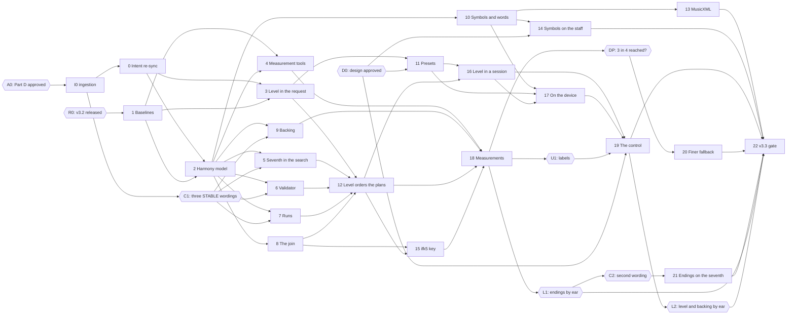

# Infinite Flow v3.3 — Build Plan

Status: **draft v1 (2026-10-12), not approved; depends on owner approval of Part D.** Written on
branch `v3.3-chord-research` while v3.0 is being built (wave 2) and before v3.1 and v3.2 are built.
The owner reviews it with master spec Part D and the v3.3 design.

Build plan for v3.3, richer chords (optional): the Seventh chords level. It is written from
[master spec Part D](master-spec.md#part-d--v33) (v1.1, 2026-10-12, awaiting the owner's approval,
with spec decisions D263–D275) and the v3.3 design at the root of
[`ui_ux/`](../../../ui_ux/README.md) (ux D252–D263): everything marked `[v3.3 new]`,
`[v3.3 changed]` or with a `_v3.3 …:_` change-block line. It adds no behaviour: what the app does is
in the master spec, what the interface looks like is in the design set, and where this plan
disagrees with either, they win and the plan is corrected. The code facts it relies on are in the
[chord research](../../../docs/music/chord-research.md#where-a-fourth-chord-note-meets-the-code),
re-checked on this branch (62a90c7) on 2026-10-12 by `codebase-explorer` and `documentalist`
([§9](#9-code-facts-checked-on-2026-10-12)). The planning answers it needed are spec decisions
D276–D287 ([§10](#10-decisions-taken-while-planning)), proposed for the owner's approval with
Part D.

**v3.3 is built on v3.0, v3.1 and v3.2.** This plan assumes every chunk of the
[v3.0](build-plan.md), [v3.1](build-plan-v3.1.md) and [v3.2](build-plan-v3.2.md) build plans is
merged and the three release gates passed, `3.2.0` tagged. Its baseline is that code:

- **Storage** (v3.0): one IndexedDB database under `src/storage/`, records keyed per setting,
  tolerant loading, kept sessions with their played-notes record, the save hold during a session,
  outdated-tab and failed-read visits. **Data version 4** is v3.2's last (v3.0 wrote 1, v3.1 2 and
  3, v3.2 4); v3.3 writes **5**.
- **Generation** (v3.0–v3.2): the session seed plan and pre-generation at Idle (v3.0); the seven
  figure levels in the request and the favored draw (v3.1); the doodle and rhythm-lock groups in
  the request, the join from a doodle, the rhythm-major search under the lock (v3.2). Chords are
  still root-position diatonic triads.
- **The replay key is `ifk4.`** (v3.2 chunk 12), and `ifk1.`–`ifk3.` still decode.
- **Presets** (v3.1): eight built-ins (Neutral, Jazz, Gentle, Speed drill, Reel, Bebop, Pop song,
  Modal (Dorian)) and player presets, each holding ten controls, the seven figure levels and a key
  and mode restriction; Custom; the restriction in force. Vary settings' six allowed groups and Jam
  are v3.2's.

The plan names those plans' modules as they name them ("v3.0 chunk _n_", "v3.1 chunk _n_", "v3.2
chunk _n_"). Where one of them lands a module elsewhere, the wave's preflight follows the code.

It is read by whoever builds v3.3, and by the owner. Music terms are explained where they first
appear, with a link to the project [lexicon](../../../docs/music/lexicon.md).

> **Read first:** [what v3.3 changes](#2-read-first-what-v33-changes-in-v32-v31-v30-and-v2).
> With the level at Off (the default), v3.3 must generate exactly what v3.2 generates, note for
> note, and its backing, symbols and files must be byte-identical. A corpus recorded on v3.2 before
> any change guards every chunk that touches generation, the backing or the exports. Until the
> control ships ([chunk 19](#chunk-19--the-seventh-chords-control)) the app always sends Off: every
> earlier chunk is reachable only from tests, replay keys and the measurement tools.

## 1. Overview

### Release sequence

v3.3 ships as one release, with one gate, [chunk 22](#chunk-22--v33-release-gate). Chunk 0 re-syncs
the intent record and chunk 1 records the baselines. Chunks 2–8 teach the generator what a
[seventh chord](../../../docs/music/lexicon.md#seventh-chord) is (a
[triad](../../../docs/music/lexicon.md#triad), three notes stacked in thirds, plus the note a
seventh above its root) without yet choosing one. Chunks 9–15 make it audible and lasting: the
backing, the symbols, presets, the planner's choice, the files and the replay key. Chunks 16–19 bring
the level to the session, the device and the screen. Chunk 18 measures. Chunks 20 and 21 are
conditional. The gate checks all 25 items of the
[definition of done](master-spec.md#d15-definition-of-done) on the merged code and produces
`docs/release/v3.3-release-notes.md`.

The order follows one rule: **the melody learns the seventh before any plan offers one.** The chord
type exists first, with no effect (chunk 2), and the request carries the level, also with no effect
(chunk 3). Then the pitch search, the validator, the runs and the join learn to read a seventh chord
from hand-built chord plans (5–8). Only then does the planner offer seventh chords (12), so a phrase
with a seventh is never searched by code that does not know one. The cost is measured as soon as
the generator and the key are complete (18), before the control exists.

### Owner steps and gates

Some steps are not code and need the owner. They are part of the sequence.

| Step   | What                                                                                                                                                                                                                                                                                                                                                                                                                            | When                             | Blocks                                                                                                                                                                                                                                                                      |
| ------ | ------------------------------------------------------------------------------------------------------------------------------------------------------------------------------------------------------------------------------------------------------------------------------------------------------------------------------------------------------------------------------------------------------------------------------- | -------------------------------- | --------------------------------------------------------------------------------------------------------------------------------------------------------------------------------------------------------------------------------------------------------------------------- |
| **A0** | The owner approves [Part D](master-spec.md#part-d--v33) (v1.1, D263–D275) and this plan's decisions D276–D287.                                                                                                                                                                                                                                                                                                                  | First.                           | Everything below.                                                                                                                                                                                                                                                           |
| **I0** | Not an owner step: `documentalist` ingests Part D (skill `atd-spec-ingestion`). It creates the DRAFT atoms tagged `release-v3.3`, tags `changes-in-v3.3` and writes `docs/release/v3.3-intent-change-set.md`. Part A of that file holds the exact wording of the three STABLE changes. The file also adds the atoms the preflight found missing from §D12 ([D285](#10-decisions-taken-while-planning)).                         | After A0.                        | C1; chunk 0.                                                                                                                                                                                                                                                                |
| **C1** | **The contract confirmation.** The owner confirms the exact wording of `req_session_backing_track`, `rule_open_phrase_ending` (first option: the triad reading) and `rule_leap_recovery` ([§D12](master-spec.md#d12-contract-changes-needing-owner-confirmation)). `documentalist` applies them with one contract bump: MAJOR, CONTRACT 3.0 → 4.0, as D246 did. They hold trivially at Off, so they are applied at once (D276). | After I0; best together with A0. | **Merging** chunks [5](#chunk-5--the-seventh-as-a-chord-tone-in-the-pitch-search), [6](#chunk-6--the-validator-reads-the-seventh-as-a-chord-tone), [7](#chunk-7--runs-may-include-the-seventh) and [9](#chunk-9--the-backing-plays-the-seventh) ([§3](#the-contract-gate)). |
| **D0** | The owner approves the v3.3 design ([`ui_ux/todo.md`](../../../ui_ux/todo.md), Next Unit). If `ux-writer` freezes it into `ui_ux/versions/v3.3/`, this plan's design links are repointed there. No token pass is needed: v3.3 adds no token, class or motion (ux D261; spec D284).                                                                                                                                              | Before chunk 11.                 | Chunks 11 (the description sentences), 14 and 19.                                                                                                                                                                                                                           |
| **R0** | v3.2 is released: the [v3.2 gate](build-plan-v3.2.md#chunk-27--v32-release-gate) passed and `3.2.0` is tagged.                                                                                                                                                                                                                                                                                                                  | Before chunk 1.                  | Every coding chunk (1–22). Chunk 1's corpus must be recorded on the code v3.2 ships.                                                                                                                                                                                        |
| **DP** | The [finer-fallback decision](#decision-point-the-finer-fallback): chunk 18's M1 says whether Strongly favored reaches 3 in 4 harmony events in their seventh form. The owner is told the figures and the outcome.                                                                                                                                                                                                              | After chunk 18.                  | Chunk 20 (built or skipped).                                                                                                                                                                                                                                                |
| **U1** | `ux-writer` reads the shares chunk 18 reports (done item 5) and confirms the labels Off, Sometimes, Often, Mostly, or changes them (ux D254, Q77).                                                                                                                                                                                                                                                                              | After chunk 18 (and 20).         | Chunk 19's labels; the gate.                                                                                                                                                                                                                                                |
| **L1** | **The listening check on endings** ([H1](#5-hand-checks), [§D6.3](master-spec.md#d63-phrase-endings-and-the-join-read-the-triad-until-a-listening-check)). The owner listens to chunk 18's examples of phrases ending on the seventh and landing on the tonic chord's seventh, and says whether they sound open or wrong. `spec-writer` records the result either way.                                                          | After chunk 18.                  | Chunk 21 (built only if approved); the gate (item 9).                                                                                                                                                                                                                       |
| **C2** | **Only if L1 approves the seventh:** the owner confirms the second option's wording of `rule_open_phrase_ending`, and `documentalist` applies it with its own bump (MAJOR, unless 4.0 is not yet applied).                                                                                                                                                                                                                      | After L1.                        | **Merging** chunk 21.                                                                                                                                                                                                                                                       |
| **L2** | The owner's listening check of the level and the four-note backing ([H2](#5-hand-checks)). The Sometimes and Favored shares are tuned from it ([§D5.2](master-spec.md#d52-four-levels)).                                                                                                                                                                                                                                        | After chunk 19.                  | The gate's final M1 and M2 runs.                                                                                                                                                                                                                                            |

### Waves

Waves run one after another. Inside a wave, chunks run one at a time in number order: the owner's
rule is **one coding chunk in flight at a time**. Each wave starts with one intent preflight, ends
with one wave gate (the full test pass, the sweep, the bundle and the post-task sync), and reaches
`main` as one merge ([§3](#3-workflow-waves-and-chunks)). The chunks in a wave are independent of
each other and touch different source files, so one preflight can cover them all. A chunk still
blocked when the rest of its wave is done moves to the next wave. Blocked here means waiting for the
owner (C1, D0, L1, C2), a design answer or a measurement.

| Wave | Chunks                                                                                                  | Waits for                                                                                     |
| ---- | ------------------------------------------------------------------------------------------------------- | --------------------------------------------------------------------------------------------- |
| 0    | 0 Intent re-sync · 1 Baselines                                                                          | Chunk 0: A0 and I0 (best run right after R0). Chunk 1: R0.                                    |
| 1    | 2 Seventh chords in the harmony model · 3 The level in the request                                      | Chunks 0 and 1 (both)                                                                         |
| 2    | 4 Measurement tools · 5 The seventh in the pitch search · 6 The validator · 7 Runs · 8 The join         | Chunks 1, 2 (4); chunk 2 (5–8); **C1 to merge 5, 6 and 7**                                    |
| 3    | 9 The backing · 10 Symbols and spoken words · 11 Presets hold the level · 12 The level orders the plans | Chunk 2 and **C1 to merge** (9); chunk 2 (10); chunk 3 and D0 (11); chunks 3, 5, 6, 7, 8 (12) |
| 4    | 13 MusicXML · 14 Symbols on the staff · 15 Replay key `ifk5.` · 16 The level in a session               | Chunk 10 (13); chunk 10 and D0 (14); chunks 3, 8, 12 (15); chunks 3, 11, 12 (16)              |
| 5    | 17 The level on the device · 18 Measurements, first run                                                 | Chunks 10, 11, 16 (17); chunks 4, 9, 12, 15 (18)                                              |
| 6    | 19 The Seventh chords control                                                                           | Chunks 11, 16, 17; D0; U1 for the labels                                                      |
| 7    | 20 The finer fallback (**conditional**) · 21 Endings on the seventh (**conditional**)                   | DP and chunk 18 (20); L1, C2 and chunks 5, 6, 8, 18 (21)                                      |
| 8    | 22 v3.3 release gate                                                                                    | Every other chunk; L1, L2, U1                                                                 |

Wave 7 is skipped when DP skips chunk 20 and L1 keeps the triad reading. Then the gate is wave 7.

The critical path runs 0 → 2 → 5 → 12 → 15 → 18 → L1 → 22, with 6, 7 and 8 before 12. The device
and screen branch (11 → 16 → 17 → 19 → L2) runs beside it. The backing (9), the symbols (10, 13, 14)
and the tools (4) can fill any wait on it. The longest owner-dependent detour is L1 → C2 → 21, taken
only if the owner approves the seventh as an ending.

## 2. Read first: what v3.3 changes in v3.2, v3.1, v3.0 and v2

[§D12](master-spec.md#d12-contract-changes-needing-owner-confirmation) lists what v3.3 changes on
purpose. Each enforcement point changes in exactly one chunk, never "along the way". Test titles are
as on this branch (62a90c7) or as the earlier plans name them; those plans may move their lines, so
the chunk finds each one by its title. Most of v3.3 adds a form beside the triad rather than
replacing it: a test about a triad stays as it is, and the chunk adds the seventh-chord case beside
it.

| What holds today                                                                                                                                                                                                                                        | Changed in                                                                                                                                                | Becomes                                                                                                                                                                                                                                                                                                            |
| ------------------------------------------------------------------------------------------------------------------------------------------------------------------------------------------------------------------------------------------------------- | --------------------------------------------------------------------------------------------------------------------------------------------------------- | ------------------------------------------------------------------------------------------------------------------------------------------------------------------------------------------------------------------------------------------------------------------------------------------------------------------ |
| Three STABLE guarantees: `req_session_backing_track` ("the highest close-position triad"), `rule_open_phrase_ending` ("a dominant chord tone"; a tense note "outside the final chord"), `rule_leap_recovery` ("a recognized three-note chord-tone run") | **C1**, before chunks 5, 6, 7 and 9 merge                                                                                                                 | CONTRACT 4.0 wordings. Each holds trivially at Off; chunks [9](#chunk-9--the-backing-plays-the-seventh), [5](#chunk-5--the-seventh-as-a-chord-tone-in-the-pitch-search)–[6](#chunk-6--the-validator-reads-the-seventh-as-a-chord-tone) and [7](#chunk-7--runs-may-include-the-seventh) build what each now allows. |
| A chord is a triad: `DiatonicTriad.pitchClasses` is a three-item tuple and `TriadQuality` has three values (`harmony-types.ts`); `deriveTriads` stacks d, d+2, d+4 (`collection.ts`)                                                                    | [2](#chunk-2--seventh-chords-in-the-harmony-model)                                                                                                        | A harmony event may carry a seventh as well as its triad; the triad stays as it is. A triad-form event is written exactly as today.                                                                                                                                                                                |
| The harmony domain: candidate identity `harmony-domain-v1                                                                                                                                                                                               | …` (`harmony-planner.ts`), ranked by `harmonyTieKey` (`candidate-ranking.ts`); rebuilt by the orchestrator, the result validator and `carriedHarmonyFits` | [12](#chunk-12--the-level-orders-the-plans)                                                                                                                                                                                                                                                                        | Unchanged at Off. Above Off, each ranked plan with a drawn seventh is followed by its triads-only variant; all three rebuild sites take the level. The atom `module_ranked_candidate_ordering` is revised. |
| The request is closed in three places: `GenerationIntent`, the resolved `GenerationRequest` and the worker's allowed keys (`tests/unit/generation-worker/generation-worker-protocol.spec.ts`)                                                           | [3](#chunk-3--the-level-in-the-generation-request)                                                                                                        | It carries `chordFamilies`, the level by capability name, re-validated by the worker; any other field is still refused.                                                                                                                                                                                            |
| A chord tone is a triad tone: `chordPitchClasses = event.triad.pitchClasses` (`pitch-context.ts`), `chordTone` in `phrase-facts.ts`, the comment "a member adjacent by step to a triad tone can never itself be a triad tone" (`figure-rules.ts`)       | [5](#chunk-5--the-seventh-as-a-chord-tone-in-the-pitch-search), [6](#chunk-6--the-validator-reads-the-seventh-as-a-chord-tone)                            | In a seventh-form event the seventh is a chord tone too; endings, tense notes and the join's landing still read the triad.                                                                                                                                                                                         |
| A recognized run is three tones of the triad: `recognizable` in `pitch-motion.ts` and its validator twin in `motion-rules.ts`; `tests/unit/domain/pitch/pitch-motion.spec.ts` › 'caps every level at exactly one recognized run per bar'                | [7](#chunk-7--runs-may-include-the-seventh)                                                                                                               | Still three notes; under a seventh chord they may include the seventh. A four-note one-way arpeggio stays rejected.                                                                                                                                                                                                |
| A carried chord must be a triad: `tests/unit/domain/generation/carry-in/carry-in.spec.ts` › 'refuses a carried chord whose pitch classes do not form a diatonic triad shape'; `sameTriad` (`harmony-join.ts`) compares three pitch classes              | [8](#chunk-8--the-join-carries-a-seventh-chord)                                                                                                           | A carried seventh chord is accepted and compared by its triad; any other shape is still refused.                                                                                                                                                                                                                   |
| The backing plays triads: `tests/unit/domain/backing/backing-renderer.spec.ts` › 'plays root then fifth in the bass and one held close-position triad…'                                                                                                 | [9](#chunk-9--the-backing-plays-the-seventh)                                                                                                              | Unchanged for triads; a seventh chord plays its four notes, highest close position at or below E4 (a new test beside it).                                                                                                                                                                                          |
| Three chord suffixes (`CHORD_SUFFIX_BY_TRIAD_QUALITY`, `notation-input.ts`); the spoken description reads any other suffix letter by letter (`score-description.ts`)                                                                                    | [10](#chunk-10--seventh-chord-symbols-and-their-spoken-words)                                                                                             | Four more suffixes, read as words.                                                                                                                                                                                                                                                                                 |
| MusicXML throws on an unknown suffix: `tests/unit/export/musicxml/musicxml-encoder.spec.ts` › 'rejects a chord suffix it has no MusicXML chord kind for'                                                                                                | [13](#chunk-13--musicxml-writes-the-seventh-chords)                                                                                                       | Four more kinds; an unknown suffix is still refused (the test keeps a suffix no quality has).                                                                                                                                                                                                                      |
| Replay keys: encoding writes `ifk4.` (v3.2 chunk 12's tests in `phrase-replay-key.spec.ts`)                                                                                                                                                             | [15](#chunk-15--replay-key-ifk5)                                                                                                                          | Encoding writes `ifk5.` for every phrase; every `ifk1.`–`ifk4.` decoding test stays.                                                                                                                                                                                                                               |
| A preset holds ten controls and seven figure levels (v3.1 chunk 10's `src/domain/presets/`)                                                                                                                                                             | [11](#chunk-11--presets-hold-the-level)                                                                                                                   | It also holds the level; every built-in at Off.                                                                                                                                                                                                                                                                    |
| Pre-generation's discard triggers (v3.0 chunk 24, v3.1 chunk 19, v3.2 chunk 26)                                                                                                                                                                         | [16](#chunk-16--the-level-in-a-session-and-in-pre-generation)                                                                                             | One more: a level change discards them and drops a held doodle.                                                                                                                                                                                                                                                    |
| Data version 4 (v3.2 chunk 22)                                                                                                                                                                                                                          | [17](#chunk-17--the-level-on-the-device-data-version-5)                                                                                                   | Data version 5: the level in settings, player presets and each kept phrase's inputs; a kept body may hold a seventh chord.                                                                                                                                                                                         |
| Vary settings' moves (`MUTABLE_SETTINGS`, `settings-mutation-scales.ts`, as v3.2 chunk 15 leaves it)                                                                                                                                                    | **Never**                                                                                                                                                 | The level is not in it and joins no allowed group; chunk 16 proves it.                                                                                                                                                                                                                                             |
| The cold-generation goldens, `generation-outcome-golden.spec.ts`, the backing, MIDI and MusicXML goldens, and the `ifk1.`–`ifk4.` corpora of v2–v3.2                                                                                                    | **Never**                                                                                                                                                 | They stay byte-identical: at Off, v3.3 reproduces v3.2 (item 2). A chunk that needs to touch one is wrong.                                                                                                                                                                                                         |

Every replaced or extended test gets its v3.3 counterpart in the same chunk, and the gate lists each
pair (item 24).

### The seventh-chord design the chunks build on

Proposed here and settled by `documentalist`'s architecture captures in the chunks named. Each
proposal is shaped by one constraint: at Off, every byte the generator writes or hashes stays as
v3.2 wrote it.

- **The seventh rides beside the triad** ([chunk 2](#chunk-2--seventh-chords-in-the-harmony-model)).
  `HarmonyEvent` keeps `triad` exactly as it is and gains an optional `seventh`: the seventh's pitch
  class and the chord's seventh quality (`major-seventh`, `minor-seventh`, `dominant-seventh`,
  `half-diminished-seventh`). The field is absent in triad form, never `null`, so a triad event, its
  candidate's JSON and its identity serialize byte for byte as today. The result validator compares
  exact JSON, so this matters. `collection.ts` derives the seventh on each degree (d+6) with its
  quality, from the research's
  [table A](../../../docs/music/chord-research.md#table-a-the-seventh-chord-on-each-degree), and
  throws on any other shape. Two small readers serve the rest of the code. `chordTones(event)`
  gives three or four pitch classes. `event.triad` stays the triad, read by the endings, the join's
  comparison and the colour chords (a modal plan's chord that holds the mode's characteristic
  note).
- **The level is a named capability, not a control** ([chunk 3](#chunk-3--the-level-in-the-generation-request)).
  `src/domain/chords/chord-families.ts` (new) holds the one family id `seventh-chords` and the four
  level ids `off`, `sometimes`, `favored` and `strongly-favored`: the spec's names, never the
  interface's labels (D277). `GenerationIntent` and the resolved `GenerationRequest` gain
  `chordFamilies: { 'seventh-chords': level }` beside `controls`, as v3.1's figure levels sit beside
  them. Keeping it out of `GenerationControls` leaves the replay key's control order, the sweep's
  dimensions and the control catalog alone. Inside the app it is always present. An input from
  before v3.3 (a key, a kept body, a saved record) reads Off where it is decoded (D277).
  `documentalist`'s capture says whether this is the mechanism `module_musical_profile_capabilities`
  names "capability", or a separate one (preflight finding).
- **One draw per harmony event, after the seeded ranking** ([chunk 12](#chunk-12--the-level-orders-the-plans)).
  `src/domain/harmony/seventh-draw.ts` (new): at Sometimes and Favored, `fnv1a32` over the tie-key
  prefix `infinite-flow/seventh-chord/v1`, the phrase's seed and the event's start (its bar index
  and start beat). The event's seventh form is drawn when the low byte falls under the share: 64 of
  256 at Sometimes, 128 at Favored (D278). Strongly favored draws every event without hashing. Off
  calls nothing. Integer operations only (`Math.imul`, `>>> 0`, masks), as v3.1's favored draw.
  The orchestrator ranks the plans exactly as today (`rankHarmonyCandidates`, on the triad
  identity). It then replaces each plan that has at least one drawn seventh with two variants
  directly after each other: the plan with its drawn sevenths, whose identity gains a
  `|sevenths:` suffix, then the plan as triads only, whose identity and JSON are today's. At Off the
  list is today's list, object for object. The variants spend the same search allowance
  (`DEFAULT_WINDOW_SEARCH_FUEL` 250,000; `CARRY_IN_WINDOW_SEARCH_FUEL` 160,000). The result
  validator (`harmonyProvenanceFailures`) and the join's fit check (`carriedHarmonyFits`) rebuild
  the same list from the level, the seed and the plans.
- **Two facts per attack in the pitch search** (chunks [5](#chunk-5--the-seventh-as-a-chord-tone-in-the-pitch-search)–[7](#chunk-7--runs-may-include-the-seventh)).
  `PitchAttack` keeps `chordPitchClasses`, now `chordTones(event)`, and gains
  `triadPitchClasses`. Search order, decorating notes, figure targets, Arpeggio chaos, Tension's
  scheduled figure, runs and a Jam's doodle ranks read the chord tones. The open ending, the tense
  note and the join's landing read the triad (the first option of §D12). The validator mirrors it
  through `reconstructPhraseFacts`. A triad event gives the same two lists, so nothing moves at Off.
- **The carried chord** ([chunk 8](#chunk-8--the-join-carries-a-seventh-chord)). The carry-in's
  harmony gains the optional seventh. `assertCarriedHarmony` accepts three distinct pitch classes, or
  the triad plus exactly the same-degree seventh with its quality, and nothing else. `sameTriad`
  compares the triads. `tonicTriadPitchClasses` stays the landing.
- **`ifk5.`** ([chunk 15](#chunk-15--replay-key-ifk5)): `ifk4.`'s tuple plus `chordFamilies` and a
  carried seventh. A key naming an unknown family is refused with the reason.
- **Storage** ([chunk 17](#chunk-17--the-level-on-the-device-data-version-5), inside v3.0's
  [storage design](build-plan.md#the-storage-design-the-chunks-build-on)). One new `settings` record
  keyed `chordFamilies.seventh-chords`. Each player preset record and each kept phrase's
  reproduction inputs gain `chordFamilies`, and a kept body's harmony may carry a seventh. **Data
  version 5**, whose upgrade step rewrites no record: an absent level reads Off in every codec
  (D279).
- **Code loaded on demand:** the level control is a few lines in the entry chunk. The seventh-chord
  generation code lives in the generation worker's bundle. The notation changes live in the
  VexFlow engraver chunk (M4).

## 3. Workflow: waves and chunks

Work runs **wave by wave**, as for v3.0–v3.2 (spec D252). The intent checks and the full test and
performance pass happen once per wave; a chunk tests only what it changed. The owner accepts that
the chunks of one wave may drift a little apart before the wave gate catches it.

**Order.** One wave at a time, in wave order. Inside a wave, one chunk at a time, in number order.
**One coding chunk is in flight at a time.** A chunk may go ahead of a blocked lower-numbered chunk
of the same wave. If a chunk is still blocked when the rest of its wave is done, it leaves the wave:
the wave closes without it, and it joins the next wave, whose preflight covers it.

**Branches.** At the start of a wave, a wave branch `v3.3-w<n>` is made from `main` in its own
worktree (`/home/bastien/work/infinite_flow-v33-w<n>`). Each chunk runs in its own worktree
(`/home/bastien/work/infinite_flow-v33-c<n>`) on a branch made from the wave branch
(`v3.3-c<n>-<slug>`). It ends with one commit, merged `--no-ff` into the wave branch as soon as its
chunk checks pass and, for a gated chunk, its contract gate is open ([below](#the-contract-gate));
that merge needs no owner approval. The wave branch merges `--no-ff` into `main` after the wave
gate, when the owner asks, so `main` only ever receives waves that passed the full gate. Never reuse
`../infinite_flow-perf-investigation`.

### Wave start: intent preflight

1. `documentalist` runs its preflight **once for the whole wave**. It does the full pass, then runs
   again with the files of every chunk in the wave, starting from the chunks' **Atoms** lines. A
   missing or conflicting atom stops the chunk it concerns until it is resolved: a spec gap goes to
   `spec-writer`, a design gap to `ux-writer`. The wave's other chunks go on, because chunks in one
   wave are independent.
2. For every chunk of the wave marked **Architecture capture**, `documentalist` records the
   architecture now, before any code, in a commit on the wave branch.
3. The preflight reports, for each gated chunk of the wave, whether its contract confirmation is
   recorded ([below](#the-contract-gate)).
4. A chunk runs no preflight of its own. If a chunk still meets an atom that contradicts it, it
   stops and reports it as in step 1. It never fixes it silently.

ATD covers business behaviour and architecture only, never tooling, tests' plumbing or measurement
scripts (chunks 1, 4 and 18 add no atom). The new atoms do not exist yet: each chunk's **Atoms**
line names the Part D sections whose `release-v3.3` atoms it builds. Chunk 0 replaces each with the
ids I0 created.

### Every chunk: four steps

A chunk is finished when step 4 is done and it is merged into the wave branch.

1. **Tests first, red to green.** Write the tests for the chunk's **Done when** first and see them
   fail on an assertion about the missing behaviour, not an import error.
   - Pure logic gets Vitest unit tests under `tests/unit/`, mirroring `src/`. Storage runs on
     `fake-indexeddb` and saved data is seeded through the harness's storage seam (v3.0 chunks 4
     and 7), never by hand-built records.
   - Pitch and validation rules are tested on **hand-built chord plans** holding seventh-form
     events (a fixture builder in `tests/unit/domain/harmony/`), so chunks 5–8 need no planner
     change.
   - Behaviour gets Playwright scenarios on the workspace harness, each from an empty browser
     context. A new spec outside `tests/e2e/notation/` is added to the explicit `test:e2e` list in
     `package.json`, or it never runs in `npm run quality`.
   - **Every chunk that touches generation, the backing, the notation or the exports (2, 3, 5–10,
     12, 13, 15, 16, 20, 21) runs chunk 1's v3.2 corpus, the earlier corpora and the goldens
     unchanged.** A red corpus means a request at Off no longer reproduces v3.2: stop and find why,
     never re-record. This guard is part of the chunk checks, not the wave gate.
2. **Implement** until the tests pass, following [`CODING_RULE.md`](../../../CODING_RULE.md): crash
   early, no silent fallbacks (tolerant loading is the spec's explicit exception, and lives in the
   codecs), injected seams instead of test-only branches, the file-size limits. Interface code uses
   only the classes and tokens of `src/styles/`; no raw visual value.
3. **Verify the change, not the whole app.** These are the **chunk checks**; each chunk's
   **Verification** line starts from them:
   - The chunk's **Done when** holds.
   - The tests the chunk adds or changes pass, and so does the corpus guard of step 1. So do the
     existing unit tests of the source files it touches (`npx vitest related --run <those files>`)
     and the Playwright specs it adds or edits.
   - `npm run typecheck`, `npm run lint` and `npm run format:check` pass, and `npm run lint:links`
     passes when the chunk changed a Markdown file.
   - A debug run shows the behaviour on screen (`npm run dev` in Chromium, or the workspace
     harness), with a landscape phone-sized window for anything below `bp-tablet-landscape`.
     **Never edit the repository while the owner is testing on the dev server**: Vite reloads his
     page. Batch any write until he pauses.
   - The chunk does **not** run `npm run quality`, the full end-to-end, accessibility or notation
     suites, the sweep, a bundle measurement or a timing measurement, unless its **Verification**
     line names that check. A line names one only when the check is the chunk's point: the
     measurement chunks (4, 18), or a chunk whose change is that area (the notation suites in
     chunk 14). A check the line places "at the wave gate" waits for the wave gate.
4. **Documents.** `README.md` (directory boundaries, the quality-gate table), `docs/storage.md`
   (records, data versions), `docs/testing.md` (every new seam, fake, fixture and script), the area's
   own document (`docs/generation-latency.md`, `docs/notation-engraving.md`, `docs/export.md`,
   `docs/audio-transport.md`, `docs/phrase-workspace.md`,
   [`docs/music/`](../../../docs/music/README.md)), and the project documents §D12 names, as D283
   assigns them. A place where the code had to differ from the spec or the design is reported to
   `spec-writer` or `ux-writer`, never fixed silently.

### The contract gate

Three STABLE guarantees change. **No chunk that changes a STABLE rule merges before the owner has
confirmed that rule's wording** and `documentalist` has recorded the confirmation in the atom's
notes (D246's rule, D276).

| STABLE rule                                                 | Wording                    | Confirmed at               | Chunks it gates                                                                                                                |
| ----------------------------------------------------------- | -------------------------- | -------------------------- | ------------------------------------------------------------------------------------------------------------------------------ |
| `req_session_backing_track`                                 | §D12 item 1                | C1                         | [9](#chunk-9--the-backing-plays-the-seventh)                                                                                   |
| `rule_open_phrase_ending`, first option (the triad reading) | §D12 item 2, first option  | C1                         | [5](#chunk-5--the-seventh-as-a-chord-tone-in-the-pitch-search), [6](#chunk-6--the-validator-reads-the-seventh-as-a-chord-tone) |
| `rule_leap_recovery`                                        | §D12 item 3                | C1                         | [7](#chunk-7--runs-may-include-the-seventh)                                                                                    |
| `rule_open_phrase_ending`, second option                    | §D12 item 2, second option | C2, only after L1 approves | [21](#chunk-21--endings-on-the-seventh-second-option-conditional)                                                              |

- A gated chunk may be built and pass its chunk checks before the confirmation. It stays on its
  own branch, unmerged. If its wave is otherwise done and the confirmation is still missing, it
  leaves the wave like any blocked chunk. Chunks that depend on it (12 depends on 5, 6 and 7) wait
  with it.
- The chunk's **Contract gate** line names the rule. The wave's preflight checks the record, and
  the merge commit message cites the decision that records the confirmation.
- STABLE guarantees whose wording does not change (`rule_join_carry_in_limited`,
  `rule_harmony_change_drops_unfit_harmonic_carry_in`, `req_last_session_review`, the mutation
  guarantees and the others §D12 lists) are drift checks. `documentalist` confirms them at I0.
  `module_tension_arc_cycle` (STABLE, outside the contract surface) still says "the unchanged
  `ifk1.` format": a stale wording from before v3.0, raised for the owner
  ([§11](#11-questions-for-the-owner), question 4). Chunk 15 must not repeat it for `ifk5.`.

### Wave end: the wave gate

"The gate" alone still means the release gate, chunk 22; "the wave gate" is this one.

When the wave's last chunk is merged into the wave branch, on that branch and on an idle machine
(**never run `atd audit` alongside tests**: it saturates the machine and makes timing tests fail):

1. **The full test pass.** `npm run quality`, and `npm run test:sweep` when a chunk of the wave
   places the sweep at the wave gate (every generation or session chunk does; it takes long), with
   every other check or measurement a chunk's **Verification** line places there. At Off the sweep
   must give v3.2's figures. A failure is traced to the chunk that caused it and fixed on the wave
   branch in a commit of its own. A fix that would change behaviour the spec or the design states
   goes to `spec-writer` or `ux-writer` instead.
2. **The bundle.** The entry chunk's size after `npm run build`, with its change since the previous
   wave ([M4](#m4--the-first-load-bundle)), is written in the wave's merge commit message.
3. **Performance.** A figure measured on a virtual machine never gates: it is recorded with the
   machine and date, for reference. The owner checks budgets on the reference machine.
4. **Post-task sync, once for the wave.** `documentalist` runs it over the wave's whole diff. It
   checks the `@spec-link` / `@test-link` tags (**directly above the function or test, never at the
   top of a file**), confirms the atoms still describe the code, applies every chunk's **Revise**
   list (the non-STABLE atoms tagged `changes-in-v3.3`) and runs every chunk's **Drift check** list.
   It advances a status only with the owner's agreement. `npm run atd:lint` and `npm run atd:check`
   pass. The sync is committed on the wave branch.
5. **Merge.** The owner gets a short report: the chunks merged, any chunk moved to the next wave
   (a contract gate still closed among them), the gate's results, the bundle figure and the sync's
   changes. The wave branch merges into `main` when he asks. Then its worktrees and branches are
   removed.

## 4. Measurements

Four figures the spec leaves to the build ([§D16](master-spec.md#d16-deferred-and-open): "measured
before the gate, not open questions"), each with the chunk that takes it and where it is recorded.
The gate copies each into the release notes. The v3.2 corpus of [chunk 1](#chunk-1--baselines-the-v32-corpus-the-goldens-at-off-and-the-bundle)
that proves "Off reproduces v3.2" (item 2) is a guard, not a measurement: it either passes or the
chunk stops.

### M1 — The seventh share

- **What:** [§D15](master-spec.md#d15-definition-of-done) item 5 and [§D5.2](master-spec.md#d52-four-levels).
  At each level, the share of harmony events in their seventh form, and the share of phrases that
  fell back to triads. A **harmony event** is one span of one chord, a chord held across a barline
  counting once. A **fallback** is a phrase whose winning plan is the triads-only variant of a plan
  that had at least one seventh drawn (D281). Both are recorded per level and per mode: Major,
  Minor and the seven modes (Ionian to Locrian).
- **How:** chunk 4's seventh census, over the deadline sweep's 568 rhythm settings
  (`sweepCases()`, `tests/unit/session/deadline-sweep.ts`) × two seeds × the nine modes, with the
  Neutral and Jazz defaults, at each of the four levels (D281). It counts over phrases generated,
  not attempts. Run at Off on v3.2 in chunk 4 (zero, the baseline), at chunk 18, at chunk 20 if
  built, and at the gate after L2's tuning.
- **Acceptance:** zero at Off; never lower from Sometimes to Favored to Strongly favored, in every
  mode; **at least 3 in 4 at Strongly favored over the whole sweep** (D281). Each mode's share is
  recorded. A mode under 3 in 4 alone does not trigger the finer fallback; it goes to `ux-writer`
  with the figures. The Sometimes and Favored shares start near 1 in 4 and 1 in 2 of the events
  drawn. Their measured share is lower where plans fall back, and is recorded, not judged.
- **Reported:** to `ux-writer` (done item 5; U1), with the table per level and mode.
- **Recorded:** a new "Seventh chords" section of `docs/generation-latency.md`; the share constants
  carry a comment pointing there.

### M2 — The cost guard

- **What:** [§D10](master-spec.md#d10-the-cost-guard-generation-time-with-seventh-chords) and item
  21: whether seventh chords slow the generator or make it fail. **The search allowance is not
  raised.** Recorded for each setting: the share of phrases generated, the slowest and the
  95th-percentile generation time, the seventh share, and at 240 BPM the share of phrases that fall
  back to being generated without the join and the share of a fresh Jam's phrase 1 ready by its
  deadline.
- **Settings**, exactly §D10's: the baseline, Off with the Neutral and Jazz defaults (it must equal
  v3.2's figures, since the phrases are the same); Sometimes, Favored and Strongly favored with the
  Neutral and Jazz defaults; Strongly favored with **Speed drill, measured first** (the most
  expensive setting v3.1 found), and with Bebop; each in every mode.
- **How:** v3.1 chunk 3's cost runner on the deadline sweep (`npm run test:sweep`: the 568 cases at
  60, 120 and 240 BPM, each attempt charged its measured time), in a 240 BPM session, and v3.2
  chunk 3's Jam sweep for a fresh Jam's phrase 1 at 240 BPM. Chunk 4 adds the level as a dimension
  to both. The owner runs the deciding runs on the reference machine.
- **Generation-time expectations**, against the baseline, as §D10's acceptance:
  - at most 2 percentage points more fallbacks without the join at 240 BPM;
  - at most 2 percentage points fewer phrases generated at any swept setting;
  - at most 2 percentage points fewer Jam phrase 1s ready by their deadline;
  - no attempt generated on its own slower than the standalone reserve (1.075 s in Chromium,
    `STANDALONE_RESERVE_SECONDS`), which the failure ladder keeps for it.
- **If a level costs more:** its share is tuned down, or the fallback made finer (DP), before the
  gate. The allowance is never raised and the triad fallback never removed. A level that still
  fails goes to `spec-writer` with the figures.
- **Recorded:** `docs/generation-latency.md` ("Seventh chords: the cost guard").

### Decision point: the finer fallback

[§D5.3](master-spec.md#d53-how-the-planner-applies-it) adds one mechanism only if M1 needs it.
**If Strongly favored misses 3 in 4 over the sweep**, the build adds, before each plan's
triads-only variant, variants that drop the seventh from one event at a time, in a fixed order,
within the cost guard.

- **Taken in [chunk 18](#chunk-18--measurements-first-run-shares-cost-guard-and-ending-examples)**,
  on the reference machine, with the shares as they stand then. The figures and the outcome go to
  the owner and to `spec-writer`, who records the decision.
- **Adopted:** [chunk 20](#chunk-20--the-finer-fallback-conditional) builds it, then M1 and M2 are
  run again. If the finer variants break the cost guard, it goes to `spec-writer` and `ux-writer`
  (the label "Mostly" rests on the share).
- **Not needed:** chunk 20 is skipped.
- **Re-checked at the gate:** the final run, after L2's tuning, must still reach 3 in 4. If tuning
  breaks it, the decision is reopened.

### M3 — The start-up read and the migration

- **What:** whether loading the level with the settings and player presets stays inside v3.0's
  start-up wait (Part A §4.4), and how long the data version 5 upgrade takes on v3.2's data.
- **How:** chunk 17 times the version 5 upgrade on 10, 100 and 500 v3.2 kept sessions (Jam sessions
  and player presets among them), and the start-up read on the same databases, cold and warm. The
  owner repeats the deciding runs on the reference machine.
- **Acceptance:** each, upgrade included, well under the start-up wait constant. The upgrade
  rewrites no record (D279), so it should cost no more than opening at version 4.
- **Recorded:** `docs/storage.md`.

### M4 — The first-load bundle

- **What:** the entry chunk stays within its budget (224 kB today, `entryChunkByteBudget` in
  `scripts/verify-boundaries.mjs`, or the figure v3.2's gate leaves). The control and its options
  add a little; everything else lives in the generation worker and the VexFlow engraver chunks,
  whose budgets the same script checks.
- **How:** chunk 1 records the baseline on the v3.2 release; every wave gate records the entry size
  and its change since the previous wave. Raising a budget needs the owner.
- **Recorded:** each merge commit message, and the gate's release notes.

## 5. Hand checks

The owner runs these himself, on the Travel Sax over USB and the reference machine. Each is written
into a new v3.3 part of [`HARDWARE-CHECKLIST.md`](../../../HARDWARE-CHECKLIST.md) by the chunk named,
and run at that chunk or at the gate.

| Check                                            | Chunk                | What the owner does                                                                                                                                                                                                                                                                                                                                                                                                                                                                                              |
| ------------------------------------------------ | -------------------- | ---------------------------------------------------------------------------------------------------------------------------------------------------------------------------------------------------------------------------------------------------------------------------------------------------------------------------------------------------------------------------------------------------------------------------------------------------------------------------------------------------------------- |
| H1 Listening: endings on the seventh (**L1**)    | 18, before 21 and 22 | Listen to chunk 18's examples, each beside the same phrase as the app writes it. **Ending on the seventh with no next phrase:** F over G7 in C major; the home chord's seventh in Dorian and in Mixolydian (B♭ over C7 in C Mixolydian). **The next phrase landing on the tonic chord's seventh.** Say for each whether ending on the seventh sounds open (the player can keep going) or like a mistake. Item 9. Approved: C2, then chunk 21. Not approved: the triad reading ships, and the result is recorded. |
| H2 Listening: the level and the backing (**L2**) | 19, used by 22       | With Jazz, Bebop, Modal (Dorian) and Neutral, play short sessions at Sometimes, Often and Mostly. Say whether each step is clearly heard, whether Mostly sounds like "a seventh on nearly every chord", and whether the four-note backing (lowest note about D3) sits well under the bass and the line. The Sometimes and Favored shares are tuned from it, then M1 and M2 run again.                                                                                                                            |
| H3 Same phrase in Edge                           | 15                   | Run chunk 15's in-browser replay test once with Playwright's Microsoft Edge channel (`msedge`), and replay one `ifk5.` key of a Mostly phrase copied from a Chrome session in Edge; the phrases match. Item 18's "Chrome and Edge" half.                                                                                                                                                                                                                                                                         |
| H4 The files                                     | 13                   | Open a MusicXML file holding all four seventh-chord kinds in MuseScore: Cmaj7, Dm7, G7 and Bm7♭5 (in written pitch) show as the right symbols (item 12's recorded hand check). Open the MIDI file with the backing included in a DAW: the backing's chords hold four notes where the symbols say seventh.                                                                                                                                                                                                        |
| H5 v3.2 data carried over                        | 17, at 22            | In the installed app and a plain Chrome tab that used v3.2 (settings changed, a player preset, a pinned session and a kept Jam session), update to v3.3: the settings come back with the level at Off, the preset loads unchanged, and the sessions open and play back as before, with their triads.                                                                                                                                                                                                             |
| H6 Symbols at the narrowest widths               | 14                   | On the reference machine, at the narrowest width of each named breakpoint, regenerate at Mostly in keys whose half-diminished chord has an accidental on its root (A major, whose degree-7 chord is G♯m7♭5, for each instrument's written key): no symbol touches the next or crosses a barline, and none is shrunk. Phones are low priority but must not break.                                                                                                                                                 |

## 6. Chunks

Each chunk names its goal, what it builds and where, the spec sections and design documents, the
atoms, what it waits for (the earlier v3.3 chunks, and the v3.0–v3.2 chunks it relies on), how to
tell it is done, which definition-of-done items it covers, and how it is verified. "Item _n_" is item
_n_ of [§D15](master-spec.md#d15-definition-of-done). **Atoms** first names the Part D sections whose
DRAFT `release-v3.3` atoms the chunk builds (ids from I0, written in by chunk 0), then, marked
"(v2)", "(v3.0)", "(v3.1)" or "(v3.2)", existing atoms it must keep true. **Revise** lists the atoms
its post-task sync revises (tagged `changes-in-v3.3` at I0). **Drift check** lists the ARCHITECTURE
atoms it checks against the new code. **Contract gate** names the STABLE rule whose confirmation the
merge waits for.

### Chunk 0 — Intent re-sync

**Goal.** Make sure the `release-v3.3` and `changes-in-v3.3` atoms of I0 still match Part D and the
state v3.2's gate left, before the first v3.3 chunk relies on them.

**Scope.** `documentalist`, spec ingestion (milestone refinement). Atoms and this plan's **Atoms**
lines only; no code.

- Part D as it stands when the build starts: decisions recorded after I0 that touch Part D (D276
  onwards, and any owner answer to [§11](#11-questions-for-the-owner)).
- The atoms v3.0's, v3.1's and v3.2's gates promoted or revised that v3.3 revises again: among them
  `rule_seeded_phrase_reproduction`, `rule_kept_session_content`, `rule_preset_contents`,
  `rule_built_in_preset_values`, `rule_choosing_preset_sets_its_settings`,
  `rule_presets_load_tolerantly`, `rule_preset_load_values_win`, `rule_settings_saved_on_change`,
  `rule_pregeneration_discarded_on_change`, `rule_vary_settings_allowed_groups`,
  `rule_jam_melody_follows_doodle_moves`, `rule_doodle_only_orders_candidates`,
  `module_phrase_replay_key` (now `ifk4.`). Their `changes-in-v3.3` notes still name the right
  change.
- The C1 record: the three wordings applied, CONTRACT 4.0, the confirmation in each atom's notes.
- In this plan, each chunk's "§Dn atoms" is replaced with the atom ids (a plan commit on the wave
  branch).

**Atoms:** every atom tagged `release-v3.3` or `changes-in-v3.3`;
`contract_infinite_flow_first_release` (4.0 after C1); `vision_infinite_flow_first_release`.

**Depends on:** A0 and I0 (best run right after R0).

**Done when:** each Part D behaviour is stated by an atom (still DRAFT); `npm run atd:lint` and
`npm run atd:check` pass; the change set file records what changed, if anything; every chunk's
**Atoms** line names ids.

**Items covered:** none directly; 25 rests on C1's record. Every later wave's preflight relies on it.

**Verification:** `documentalist`'s ingestion report; `npm run lint:links`.

### Chunk 1 — Baselines: the v3.2 corpus, the goldens at Off and the bundle

**Goal.** Record, on the code v3.2 shipped, every fact v3.3 must not break at Off: the phrase each
request gives, the backing it renders, the files it exports, and the entry chunk's size.

**Scope.**

- **The phrase corpus**, generated from the `3.2.0` tag before any v3.3 change. It covers the eight
  built-in presets and a spread of figure levels × **every one of the nine modes** × the three
  built-in instruments and two player-made ones × a spread of the other controls (every harmonic
  motion and Tension value, Eighth and Sixteenth with Heavily varied) × several seeds, with and
  without carry-in (a carried null harmony included). It also holds the Jam and lock cases: a fresh
  Jam's phrase 1 by each rung, a locked phrase, a changed one, a forced bend and a drifted one. Each
  case is stored as its `ifk4.` key and the timeline it replays to. Fixture
  `tests/fixtures/replay-keys/v3.2-corpus.json` and a unit test,
  `tests/unit/generation-worker/phrase-replay-key-v32-corpus.spec.ts`, beside the earlier corpora,
  which stay.
- **The backing and file corpus:** for a sample of the corpus's sessions, the backing's rendered
  notes, the generated-notes MusicXML and both MIDI files (backing included and not). Fixture
  `tests/fixtures/sessions/v3.2-backing-and-files/` and a unit test that renders and encodes each
  again and compares bytes. Items 2, 10 and 12's "triads as before" rest on it.
- The entry chunk's size after `npm run build` on the tag, recorded here and in `docs/testing.md`.

**Files:** the fixtures and specs above, a generator script under `scripts/` (tooling, beside
`scripts/record-replay-key-corpus.mjs`), `docs/testing.md`.

**Atoms:** none new (test plumbing). The corpus later backs the §D15 item 2 atom and
`rule_seeded_phrase_reproduction`, whose test links chunks 12 and 15 add.

**Depends on:** R0.

**Done when:** both corpus tests pass on the tag and on `main`; each is red if a stored value is
changed by hand; the baseline size is recorded.

**Items covered:** 2 (as the guard for chunks 2, 3, 5–10, 12, 13, 15, 16, 20, 21), 18 (`ifk4.`
decoding), 10 and 12 (triads unchanged).

**Verification:** the chunk checks.

### Chunk 2 — Seventh chords in the harmony model

**Architecture capture:** the seventh beside the triad on a harmony event; the seventh qualities
(a revision of `module_harmony_candidate_domain`;
[§2](#the-seventh-chord-design-the-chunks-build-on)).

**Goal.** Give the harmony model the seventh chord on every degree of every mode, with no effect on
any phrase.

**Scope.**

- `harmony-types.ts`: `SeventhQuality` (the four qualities), the optional `seventh` on
  `HarmonyEvent` (pitch class and quality, absent in triad form), and the readers `chordTones` and
  the triad.
- `collection.ts`: the seventh chord on each degree (degrees d, d+2, d+4 and d+6 of the collection),
  its quality from the intervals: a major triad with a major seventh is major seventh; minor with
  minor seventh, minor seventh; major with minor seventh, dominant seventh; diminished with minor
  seventh, half-diminished. Any other shape throws. The triads and their order are untouched.
- The fixture builder for hand-built plans with seventh-form events (`tests/unit/domain/harmony/`),
  which chunks 5–9 use.
- Nothing reads the new field yet.

**Files:** `src/domain/harmony/harmony-types.ts`, `src/domain/harmony/collection.ts`; tests
`tests/unit/domain/harmony/collection.spec.ts` (extended), `tests/unit/domain/harmony/seventh-chord-fixtures.ts`
(new); [`docs/music/harmony-planner-policy.md`](../../../docs/music/harmony-planner-policy.md)
("Collection and chord vocabulary": the sevenths exist, used only from chunk 12).

**Spec sections:** [§D4](master-spec.md#d4-words-used-in-this-part), [§D5.1](master-spec.md#d51-the-chords).

**Atoms:** §D5.1's atom (only the four diatonic sevenths). **Revise:**
`module_harmony_candidate_domain` ("triad material"). **Drift check:**
`module_harmony_candidate_domain`.

**Depends on:** chunks 0 and 1.

**Done when:**

- In each of the nine modes on every key, the seven seventh chords and their qualities equal the
  research's table A (Major: maj7, m7, m7, maj7, 7, m7, m7♭5 on degrees 1 to 7; each mode the same
  seven in rotation).
- A shape that is not one of the four qualities throws.
- A triad-form event serializes byte for byte as before (a JSON snapshot test); the corpus and the
  goldens pass unchanged.

**Items covered:** 3 (the construction), 2 (guarded).

**Verification:** the chunk checks.

### Chunk 3 — The level in the generation request

**Architecture capture:** `chordFamilies` by capability name in the intent, the resolved request
and the worker protocol ([§2](#the-seventh-chord-design-the-chunks-build-on)); the relation to
`module_musical_profile_capabilities`.

**Goal.** Carry the Seventh chords level in every generation request, re-validated by the worker,
with no effect yet.

**Scope.**

- `src/domain/chords/chord-families.ts` (new): the family id, the four level ids, `OFF_CHORD_FAMILIES`,
  and `parseChordFamilies` (exactly the known ids, each a known level, no extra field).
- `GenerationIntent` and `GenerationIntentInput` gain `chordFamilies`; `makeGenerationIntent` takes
  it (the workspace passes Off until chunk 16). `resolveCoreRequests` copies it into the resolved
  `GenerationRequest`. The session's `buildAttemptIntent` passes it on unchanged, on every rung of
  v2's ladder and of a Jam's phrase 1 (D287).
- The worker: `GENERATION_INTENT_ALLOWED_KEYS` and `GENERATION_REQUEST_ALLOWED_KEYS` gain the
  field; the inbound parser rebuilds it with `parseChordFamilies` before its deep-equal check;
  prewarm, pre-generation and cancellation carry it. An unknown family or level is refused with the
  typed protocol error.

**Files:** `src/domain/chords/chord-families.ts` (new), `src/domain/generation/generation-intent.ts`,
`src/domain/generation/generation-request.ts`,
`src/domain/generation/orchestration/request-resolution.ts`,
`src/generation-worker/generation-worker-inbound.ts`, `src/session/session-intents.ts`; tests under
`tests/unit/domain/chords/`, `tests/unit/domain/generation/`,
`tests/unit/generation-worker/generation-worker-protocol.spec.ts` (extended).

**Spec sections:** [§D9](master-spec.md#d9-the-generation-request-the-replay-key-and-kept-sessions), [§D14](master-spec.md#d14-architectural-decisions-and-their-reasons) (by capability name).

**Atoms:** §D9's atom (the request carries the level); (v2) `rule_seeded_phrase_reproduction`.
**Revise:** `module_generation_request_construction`, `service_generation_request_resolution`,
`module_generation_worker_protocol`. **Drift check:** `module_generation_request_envelope`,
`module_generation_worker_cancellation` (STABLE, unchanged).

**Depends on:** chunks 0 and 1; v3.1 chunk 4 (figure levels beside the controls, the pattern this
follows).

**Done when:**

- Every intent the app builds carries `chordFamilies` at Off; the resolved request carries the same.
- The worker refuses an intent with a missing family, an unknown family, an unknown level or an
  extra field, each with its protocol error; it accepts each of the four levels.
- The corpus, the goldens and every v2–v3.2 generation and worker test pass unchanged.

**Items covered:** 20, 2 (guarded).

**Verification:** the chunk checks; the sweep at the wave gate.

### Chunk 4 — Measurement tools: the seventh census, the cost runs and the ending renders

**Goal.** The scripts M1, M2 and the listening check L1 need, run once on v3.2 for their baselines.

**Scope.** Tooling only, no product code.

- **The seventh census** (M1): per phrase of the sweep, each harmony event's form, whether the
  winning plan was a triads-only fallback, the level and the mode. It classifies with chunk 2's
  types, so it reads hand-built and generated plans alike. It writes JSON like `LATENCY_OUT` and a
  table per level and mode.
- **The cost runs** (M2): the level added as a dimension to v3.1 chunk 3's cost runner and to
  v3.2 chunk 3's Jam sweep, with §D10's settings as named profiles (Speed drill first).
- **The ending renders** (L1): `scripts/render-seventh-endings.mjs` writes short MIDI files with the
  real backing: a phrase as generated, then the same phrase with its final note moved to the final
  chord's seventh (the nearest one inside the phrase's window). It also writes a pair of phrases as
  generated, then with the second phrase's first note moved to the tonic chord's seventh. It only
  rewrites notes of phrases it is given; it never generates an ending the spec does not allow (D280).
- Until chunk 12 exists the census and the runs see Off only, the baseline.

**Files:** `tests/sweep/seventh-census.ts`, `tests/sweep/seventh-census.spec.ts` (new), the cost
runner and Jam sweep modules of v3.1 chunk 3 and v3.2 chunk 3 (a level dimension),
`scripts/render-seventh-endings.mjs` (new), `package.json` (`measure:sevenths`,
`render:seventh-endings`), `docs/testing.md`, `docs/generation-latency.md` (the baseline).

**Atoms:** none (measurement).

**Depends on:** chunks 1 and 2; v3.1 chunk 3 and v3.2 chunk 3 (the runners it extends).

**Done when:** the census runs at Off and records zero; it classifies a hand-built sweep fixture
(seventh-form events, a triads-only fallback, a merged event across a barline) exactly; the cost
runs record the Off baseline equal to v3.2's figures; the renders play in a MIDI player, from a
hand-built phrase with a seventh-form final event.

**Items covered:** none directly; M1 and M2 rest on it (items 5, 21), and L1 (item 9).

**Verification:** the chunk checks (the census's own unit test); the baseline run.

### Chunk 5 — The seventh as a chord tone in the pitch search

**Contract gate:** `rule_open_phrase_ending`, first option (C1).

**Architecture capture:** the attack's two chord facts, chord tones and triad tones (a revision of
`module_pitch_search_context`).

**Goal.** In a seventh-form event, make the pitch search treat the seventh as a chord tone
everywhere inside the phrase, while the ending and the join's landing still read the triad.

**Scope.**

- `compileAttacks` (`pitch-context.ts`): `chordPitchClasses` from `chordTones(event)`, and a new
  `triadPitchClasses` from the triad.
- **Chord tones:** chord tones first in `pitchRank` (`pitch-ranking.ts`); decorating notes are the
  collection minus the chord tones (`diatonicNonChord`, `pitch-candidates.ts`), so a seventh chord
  leaves three, not four; figure targets and `freeToneResolves` (`pitch-figures.ts`), where every
  figure still resolves onto a chord tone, the seventh included; Arpeggio chaos orders the four
  chord tones; Tension's scheduled figure (`boundPaths`) may land on the seventh. A Jam's doodle
  ranks need no change: the doodle's move term orders within the rank, and the seventh now shares
  the first one.
- **Triad tones** (first option of §D12): `isOpenEndpointMidi`'s final notes (a note of the degree-5
  triad in tonal plans that move; scale degree 5 in tonal static plans; a non-home note of the home
  triad in modal plans), `tenseEndingCandidates` (a tense note is a scale note outside the final
  triad, so the seventh may end a joined phrase), and the first attack's landing after an owed
  tense note or recovery (the tonic triad).
- With triad events the two lists are equal, so the order and every phrase are unchanged.

**Files:** `src/domain/pitch/pitch-types.ts`, `src/domain/pitch/pitch-context.ts`,
`src/domain/pitch/pitch-candidates.ts`, `src/domain/pitch/pitch-ranking.ts`,
`src/domain/pitch/pitch-figures.ts`; tests under `tests/unit/domain/pitch/`
(`pitch-candidates.spec.ts`, `pitch-ranking.spec.ts`, `pitch-figures.spec.ts` extended);
[`docs/music/pitch-planner-validation.md`](../../../docs/music/pitch-planner-validation.md).

**Spec sections:** [§D6.1](master-spec.md#d61-the-seventh-is-a-chord-tone), [§D6.3](master-spec.md#d63-phrase-endings-and-the-join-read-the-triad-until-a-listening-check), [§D8.4](master-spec.md#d84-pre-generation-jam-and-the-key-and-mode-suggestion) (a Jam's ranks).

**Atoms:** §D6.1's atom (the seventh is a chord tone, extensions are not), §D6.3's atom (endings
read the triad); (v2, STABLE) `rule_open_phrase_ending`, `rule_join_carry_in_limited`; (v3.1)
`rule_figures_resolve_onto_chord_tones`, `rule_figure_level_orders_search`; (v3.2)
`rule_jam_melody_follows_doodle_moves`. **Revise:** `rule_embellishment_figures_defined`,
`rule_tension_arc_settled`, `rule_tension_arc_build`, `rule_arpeggio_chaos_respects_constraints`,
`rule_doodle_only_orders_candidates`, `rule_join_tense_note_resolution`. **Drift check:**
`module_pitch_search_context`, `module_pitch_search_transition`, `entity_pitch_candidate_domain`,
`mechanic_pitch_search_policy`.

**Depends on:** chunk 2; v3.1 chunks 5–7 (the figure rules as v3.1 leaves them); v3.2 chunk 9 (the
doodle's move term).

**Done when:**

- On hand-built plans with seventh-form events: the seventh is tried with the chord tones, before
  the decorating notes; every free figure's resolution may land on it; Arpeggio chaos orders four
  chord tones; Tension's scheduled figure may land on it; a doodle's move preference never lifts a
  decorating note above the seventh.
- No phrase generated without a join ends on its final chord's seventh; a joined phrase may end on
  it as a tense note; the landing after an owed note is a tonic-triad note (property tests over
  hand-built final events of each plan kind).
- Extensions (the ninth, eleventh and thirteenth) are never chord tones (named tests).
- Triad events: the corpus and the goldens pass unchanged.

**Items covered:** 7 (the search's half), 9 (the triad reading, search half), 22 (a Jam's ranks),
2 (guarded).

**Verification:** the chunk checks; the sweep at the wave gate.

### Chunk 6 — The validator reads the seventh as a chord tone

**Contract gate:** `rule_open_phrase_ending`, first option (C1).

**Goal.** Make the pitch validator accept exactly what chunk 5's search writes: the seventh as a
chord tone inside the phrase, the triad at the ending and the landing.

**Scope.**

- `reconstructPhraseFacts` (`validation/phrase-facts.ts`): a note's chord-tone fact from
  `chordTones`, with a triad-tone fact beside it.
- `figure-rules.ts`: the premise "a member adjacent by step to a triad tone can never itself be a
  triad tone" is false over a seventh chord, whose seventh is one scale step from its root. The rule
  is rewritten for four chord tones (a passing or neighbor tone between the seventh and the root has
  no room), and the comment with it. `unexplained_non_chord_tone` no longer fires on the seventh.
- `contour-endpoint-rules.ts` (the final note) and `join-rules.ts` (the tense ending, the landing)
  read the triad facts.
- Named phrases over hand-built seventh plans, written by hand from §D6.1's rules, so the chunk
  needs no other chunk of its wave. The property test that runs the search and validates every
  result over seventh plans is chunk 12's, once both halves are merged.

**Files:** `src/domain/pitch/validation/phrase-facts.ts`, `figure-rules.ts`,
`contour-endpoint-rules.ts`, `join-rules.ts`, `pitch-validation-types.ts`; tests under
`tests/unit/domain/pitch/validation/` (`figure-rules.spec.ts`, `pitch-phrase-validator.spec.ts` extended).

**Spec sections:** [§D6.1](master-spec.md#d61-the-seventh-is-a-chord-tone), [§D6.3](master-spec.md#d63-phrase-endings-and-the-join-read-the-triad-until-a-listening-check).

**Atoms:** §D6.1's and §D6.3's atoms; (v2, STABLE) `rule_open_phrase_ending`. **Revise:**
`rule_figures_resolve_onto_chord_tones`, `rule_levels_govern_free_figures_only`. **Drift check:**
`module_pitch_domain_validation`, `module_pitch_search_transition`.

**Depends on:** chunk 2.

**Done when:**

- The validator accepts hand-written phrases that land on, resolve onto and run through the
  seventh of a seventh-form event, and refuses a phrase with no join ending on the final seventh, a landing on the
  tonic chord's seventh, and a ninth treated as a chord tone (named tests).
- Over triad plans its answers are unchanged (the existing validator suites, the corpus).

**Items covered:** 7 (the validator's half), 9 (validator half), 2 (guarded).

**Verification:** the chunk checks; the sweep at the wave gate.

### Chunk 7 — Runs may include the seventh

**Contract gate:** `rule_leap_recovery` (C1).

**Goal.** Let a recognized three-note [run](../../../docs/music/lexicon.md#run) (three chord tones of
one chord in a row, in one direction) include the seventh, and keep every four-note one-way
[arpeggio](../../../docs/music/lexicon.md#arpeggio) rejected.

**Scope.** `recognizable` in `pitch-motion.ts` and its validator twin in `validation/motion-rules.ts`
read the chord tones. So E–G–B over Cmaj7, or B–D–F over G7, is a run. A large leap inside such a
run may defer its recovery to the note after the run, at Leaping and Angular only. `WIDE`, the chain
cap and `wide_chain_too_long` are unchanged: C–E–G–B in one direction is still refused, as C–E–G–C
is today.

**Files:** `src/domain/pitch/pitch-motion.ts`, `src/domain/pitch/validation/motion-rules.ts`; tests
`tests/unit/domain/pitch/pitch-motion.spec.ts` (extended), the validator's motion tests.

**Spec sections:** [§D6.2](master-spec.md#d62-runs-stay-three-notes), [§D12](master-spec.md#d12-contract-changes-needing-owner-confirmation) item 3.

**Atoms:** §D6.2's atom; (v2, STABLE) `rule_leap_recovery`. **Revise:**
`rule_leapiness_arpeggio_run_limits`, `rule_join_inherits_leap_recovery`. **Drift check:**
`module_pitch_search_transition`, `module_pitch_domain_validation`.

**Depends on:** chunk 2.

**Done when:**

- Over a seventh-form event, E–G–B (Cmaj7) and B–D–F (G7) are recognized runs, in both the search
  and the validator; C–E–G–B (Cmaj7) and E–G–B–D (Em7) in one direction never pass (named tests).
- A large leap inside such a run defers its recovery at Leaping and Angular, never at the other
  levels; a run is never longer than three notes (property test).
- Over triad events, runs and recoveries are unchanged (the existing motion suites, the corpus).

**Items covered:** 8, 7 (runs), 2 (guarded).

**Verification:** the chunk checks; the sweep at the wave gate.

### Chunk 8 — The join carries a seventh chord

**Architecture capture:** the carried chord's optional seventh (a revision of
`entity_phrase_carry_in`).

**Goal.** Let the previous phrase's final chord cross the join as a seventh chord, compared with the
next phrase's settings by its triad.

**Scope.**

- `carry-in.ts`: `assertCarriedHarmony` and `parseCarriedHarmony` accept a triad, or a triad with
  exactly its same-degree seventh and that seventh's quality; anything else is still refused.
  `copyCarriedHarmony` copies it.
- `carry-in-derivation.ts` carries the final event's seventh when it has one.
- `harmony-join.ts`: `sameTriad` compares the triads, so a carried G7 fits a phrase whose settings
  end on G (§D8.3: whether a seventh was added is a draw, not a property of the settings). A key or
  mode change, or a harmonic motion change the carried chord no longer fits, still drops it.
- `phrase-ending-debt.ts`: the landing stays the tonic triad (no change, a named test).

**Files:** `src/domain/generation/carry-in/carry-in.ts`, `carry-in-derivation.ts`,
`src/domain/harmony/harmony-join.ts`; tests `tests/unit/domain/generation/carry-in/carry-in.spec.ts`,
`carry-in-join-matrix.spec.ts`, `tests/unit/domain/harmony/harmony-join.spec.ts` (extended).

**Spec sections:** [§D8.3](master-spec.md#d83-vary-settings-and-the-session) (the join), [§D9](master-spec.md#d9-the-generation-request-the-replay-key-and-kept-sessions).

**Atoms:** §D8.3's atom (a carried chord compared by its triad); (v2, STABLE)
`rule_join_carry_in_limited`, `rule_harmony_change_drops_unfit_harmonic_carry_in`,
`rule_key_change_drops_harmonic_carry_in`. **Revise:** `entity_phrase_carry_in`,
`rule_no_carry_in_output_matches_v1` (at Off). **Drift check:**
`module_session_carry_in_after_change`.

**Depends on:** chunk 2.

**Done when:**

- A carried seventh chord is accepted, and every refusal of `carry-in.spec.ts` still holds; a
  four-note chord that is not the same-degree seventh, or a wrong quality, is refused with the
  reason.
- A carried G7 joins a phrase whose plan opens on degree 1, exactly where a carried G would; a key
  change still drops it (the join matrix, extended).
- The landing after an owed note is a tonic-triad note with a carried seventh chord.
- The corpus and the carry-in goldens (`carry-in-chains.golden.v1.json`,
  `no-carry-in-v1-bytes.spec.ts`) pass unchanged.

**Items covered:** 17, 9 (the join's landing), 2 (guarded).

**Verification:** the chunk checks; the sweep at the wave gate.

### Chunk 9 — The backing plays the seventh

**Contract gate:** `req_session_backing_track` (C1).

**Goal.** Make the backing's block chords play every note of the chord the phrase uses.

**Scope.** `backing-renderer.ts`: the chord's notes from `chordTones`. A seventh chord is checked as
a stacked seventh (root, third, fifth, seventh by quality), not just its triad: a fourth note today
would be silently ignored. It is voiced in the highest **close position** (the notes packed inside
one octave, here each of the four at the bottom in turn: four arrangements instead of three) whose
top note is at or below E4 (MIDI 64), so its lowest note reaches about D3. The bass, the attack
rhythm and the registers are unchanged. The MIDI export takes its backing from the renderer
(`backingForExport`), so its four-note chords follow with no export change.

**Files:** `src/domain/backing/backing-renderer.ts`; tests
`tests/unit/domain/backing/backing-renderer.spec.ts` (a seventh case beside the triad one),
`tests/unit/export/midi/` (a backing-included export with a seventh chord);
[`docs/audio-transport.md`](../../../docs/audio-transport.md).

**Spec sections:** [§D7.3](master-spec.md#d73-the-backing-plays-the-seventh), [§D7.2](master-spec.md#d72-exports) (MIDI).

**Atoms:** §D7.3's atom; (v2, STABLE) `req_session_backing_track`. **Revise:**
`rule_generated_notes_midi_export`. **Drift check:** `module_review_export_pipeline`,
`module_session_phrase_steps`, `module_session_transport_tempo_map`.

**Depends on:** chunk 2.

**Done when:**

- Each of the four qualities, on every root, renders its four notes in the highest close position
  with the top at or below E4 (property over the 48 chords); the bass is unchanged; the same harmony
  renders the same backing.
- Triads render exactly as before (chunk 1's backing corpus); the MIDI golden
  `reference-session-backing.v1.mid` is unchanged.
- A backing-included MIDI export of a seventh-chord phrase holds the same four notes as the
  renderer.

**Items covered:** 10, 2 (guarded).

**Verification:** the chunk checks; H4's DAW half later, at chunk 13.

### Chunk 10 — Seventh chord symbols and their spoken words

**Goal.** Name the four new qualities wherever a [chord symbol](../../../docs/music/lexicon.md#chord-symbol)
is made, and read them aloud as words.

**Scope.**

- `notation-input.ts`: a suffix per seventh quality, `maj7`, `m7`, `7` and `m7♭5` (letters, the ♭
  sign for the lowered fifth), beside the triad suffixes, which do not change.
  `validateNotationPhraseInput` refuses a suffix that is in neither table: today a new quality would
  silently print "Cundefined".
- `written-phrase.ts`: the suffix never changes under transposition (sounding G7 is written A7 for
  the B-flat tenor saxophone, as the convention already says).
- `score-description.ts`: `maj7` read as "major seventh", `m7` "minor seventh", `7` "dominant
  seventh" and `m7♭5` "half-diminished seventh", each suffix as one whole, never letter by letter,
  and the ♭ never read as "flat" on its own; a root's own accidental is still read (ux D259).
- The replay report's chord names (`phrase-replay-names.ts`) use the same table.

**Files:** `src/domain/notation/notation-input.ts`, `src/domain/notation/written-phrase.ts`,
`src/domain/notation/score-description.ts`, `src/generation-worker/phrase-replay-names.ts`; tests
`tests/unit/domain/notation/notation-input.spec.ts`, `written-phrase.spec.ts`,
`score-description.spec.ts` (extended).

**Spec sections:** [§D7.1](master-spec.md#d71-chord-symbols).

**Design docs:** [`screens/phrase-workspace/handoff.md`](../../../ui_ux/screens/phrase-workspace/handoff.md)
(Notation Contract: Seventh chord symbols; The score's spoken description).

**Atoms:** §D7.1's atom (the symbols and their words; a new BUSINESS atom, per the preflight);
(v2) `module_notation_display_convention`, `rule_notation_display_preserves_phrase`. **Revise:**
`module_notation_layout_preflight` (the description's words). **Drift check:**
`module_notation_display_convention`.

**Depends on:** chunk 2.

**Done when:**

- A hand-built phrase with each quality on every root gives the symbol text in written pitch for
  each built-in instrument (Cmaj7, Dm7, G7, Bm7♭5 in C; their transpositions); triad texts are
  unchanged (the existing tests).
- The description reads "chord B half-diminished seventh", "chord B flat major seventh"; never a
  letter-by-letter suffix.
- An unknown suffix is refused with the reason.

**Items covered:** 11 (the symbol text and the words), 18 (the replay tool names the qualities).

**Verification:** the chunk checks.

### Chunk 11 — Presets hold the level

**Pending the owner's D0** (the three description sentences).

**Goal.** Make the level a preset-held setting: every preset holds it, every built-in at Off,
choosing a preset sets it, changing it makes Custom.

**Scope.** In v3.1 chunk 10's `src/domain/presets/`: `Preset` gains `chordFamilies`; the eight
built-ins hold Off; choosing sets it with the ten controls and the figure levels; a change of the
level is a preset-held change that begins Custom based on the selection; the saving rules carry it.
Three built-in descriptions gain their sentence (ux D256): Jazz and Bebop "Also try raising Seventh
chords, the usual chords of jazz."; Modal (Dorian) "Also try raising Seventh chords, for a richer,
jazzier bed." No built-in changes a value.

**Files:** `src/domain/presets/built-in-presets.ts`, `preset-selection.ts`,
`preset-save-choices.ts` (v3.1), the preset types module; tests under `tests/unit/domain/presets/`.

**Spec sections:** [§D8.1](master-spec.md#d81-presets).

**Design docs:** [`flows/presets/handoff.md`](../../../ui_ux/flows/presets/handoff.md) (Routing
Rules, the `[v3.3 changed]` items), [`screens/phrase-workspace/handoff.md`](../../../ui_ux/screens/phrase-workspace/handoff.md)
(Components and Content: Custom; the preset descriptions).

**Atoms:** §D8.1's atom; (v3.1) `rule_custom_selection`. **Revise:** `rule_preset_contents`,
`rule_built_in_preset_values`, `rule_choosing_preset_sets_its_settings`.

**Depends on:** chunk 3 (the level type); v3.1 chunk 10; D0.

**Done when:**

- Every built-in holds Off; choosing Bebop after raising the level returns it to Off; choosing any
  preset sets it to the preset's value.
- A change of the level makes "Custom, based on {name}"; choosing a preset leaves Custom.
- A player preset made from Custom holds the level by value.
- The three descriptions end with their sentence; the others are unchanged.

**Items covered:** 13 (the rules), 1 (held by every preset).

**Verification:** the chunk checks.

### Chunk 12 — The level orders the plans

**Architecture capture:** the per-event draw and the plan variants after the seeded ranking
(revisions of `module_harmony_candidate_domain`, `module_ranked_candidate_ordering`,
`module_named_stream_pseudorandomness`, `service_generation_orchestration`,
`service_generation_result_validation`; [§2](#the-seventh-chord-design-the-chunks-build-on)).

**Goal.** Make the level decide which harmony events try their seventh form first, as a preference
and never a quota, with each plan's triads-only form always reachable.

**Scope.**

- `src/domain/harmony/seventh-draw.ts` (new): the draw of D278, two share constants as numerators
  over 256, computed only at Sometimes and Favored.
- **The plans are chosen as before.** `makeHarmonyCandidateDomain` builds the same candidates from
  triads, the modal colour chords still measured on the triads.
- **The variants.** After `rankHarmonyCandidates`, each plan with at least one drawn seventh becomes
  its seventh variant then its triads-only variant; a plan with none drawn stays as it is. The
  window search walks the list as today (`searchWindow`); the search allowance is unchanged.
- **The three rebuild sites take the level:** `buildHarmonyDomain` (the orchestrator),
  `harmonyProvenanceFailures` (the result validator, which now accepts a phrase whose plan is a
  variant built from the same level and seed, and nothing else) and `carriedHarmonyFits`.
- Off calls no draw and builds no variant: the list is today's, object for object.
- [`docs/music/harmony-planner-policy.md`](../../../docs/music/harmony-planner-policy.md): the chord
  vocabulary and the variants. The generator contract (`specs/generator-contract.md`, "seven
  root-position diatonic triads") goes to `spec-writer` with this chunk's report (D283).

**Files:** `src/domain/harmony/seventh-draw.ts` (new),
`src/domain/generation/orchestration/generation-orchestrator.ts`,
`src/domain/generation/orchestration/harmony-variants.ts` (new),
`src/domain/validation/generation-result-validator-checks.ts`,
`src/domain/generation/carry-in/carry-in-fit.ts`; tests under `tests/unit/domain/harmony/`,
`tests/unit/domain/generation/orchestration/`, `tests/unit/domain/validation/`.

**Spec sections:** [§D5.2](master-spec.md#d52-four-levels), [§D5.3](master-spec.md#d53-how-the-planner-applies-it), [§D5.4](master-spec.md#d54-determinism), [§D14](master-spec.md#d14-architectural-decisions-and-their-reasons).

**Atoms:** §D5.2–§D5.4's atoms (a preference, never a quota; the triad fallback per phrase; same
plans; Off draws nothing; Off reproduces v3.2); (v2) `rule_seeded_phrase_reproduction`,
`rule_neutral_profile_diatonic_harmony`, `rule_jazz_chromatic_resolution`. **Revise:**
`module_harmony_candidate_domain`, `module_ranked_candidate_ordering`,
`module_named_stream_pseudorandomness`, `service_generation_orchestration`,
`service_generation_result_validation`. **Drift check:** `mechanic_pitch_search_policy` (the
allowance unchanged), `service_generation_window_search`.

**Depends on:** chunks 3, 5, 6, 7 and 8 (a phrase with a seventh is never searched, validated or
carried by code that does not know one).

**Done when:**

- Above Off, every chord is a triad or the seventh chord on the same degree, of the four qualities
  (property over the M1 sweep).
- For the same request and seed, the candidates' degrees, roles, templates and colour chords are
  Off's at every level (item 4; property).
- A plan whose seventh form has no solution is still found as triads (a named test with a forced
  dead end): no phrase is rejected or retried for lacking a seventh (an instrumented run counts
  zero).
- The seventh share never decreases from Sometimes to Favored to Strongly favored, and a phrase is
  all its drawn sevenths or all triads (census properties over a reduced sweep).
- The search and the validator agree over seventh plans: every phrase generated above Off passes
  the result validator (`planner-validator-property.spec.ts`, extended to each level).
- No floating-point operation in the draw (a test over the module's source, and golden draws for a
  fixed seed list); the result validator refuses a phrase claiming a variant the level and seed do
  not give.
- At Off the corpus, the cold-generation goldens and `generation-outcome-golden.spec.ts` pass
  unchanged.

**Items covered:** 3, 4, 5 (the order), 6, 2 (guarded).

**Verification:** the chunk checks; the sweep at the wave gate; the census at Strongly favored for
the record.

### Chunk 13 — MusicXML writes the seventh chords

**Goal.** Write each seventh chord into the generated-notes MusicXML with its chord kind and printed
suffix, so no export fails for a seventh chord.

**Scope.** `CHORD_KIND_BY_SUFFIX` (`musicxml-measure.ts`) gains `maj7` → `major-seventh`, `m7` →
`minor-seventh`, `7` → `dominant`, `m7♭5` → `half-diminished`, each written with the suffix as the
`kind` element's display text. An unknown suffix still throws `MusicXmlExportError`. The schema test
covers a file with all four.

**Files:** `src/export/musicxml/musicxml-measure.ts`; tests
`tests/unit/export/musicxml/musicxml-encoder.spec.ts`, `musicxml-schema.spec.ts` (extended);
[`docs/export.md`](../../../docs/export.md).

**Spec sections:** [§D7.2](master-spec.md#d72-exports).

**Design docs:** [`flows/review-and-export/handoff.md`](../../../ui_ux/flows/review-and-export/handoff.md)
(Seventh chords in the files).

**Atoms:** §D7.2's atom; (v2) `rule_export_contents_never_merged`. **Revise:**
`rule_generated_notes_musicxml_export`. **Drift check:** `module_review_export_pipeline`.

**Depends on:** chunk 10.

**Done when:** a phrase with each quality exports with the four kinds and suffixes and passes the
MusicXML schema test; the triad goldens are byte-identical; a suffix no quality has is still
refused (the existing test, kept). Then **H4** with the owner.

**Items covered:** 12, 2 (guarded).

**Verification:** the chunk checks; H4.

### Chunk 14 — Seventh chord symbols on the staff

**Pending the owner's D0.**

**Goal.** Draw the four symbols on one line at the one chord-symbol size, the ♭ as the music font's
glyph, and prove the longest fits twice in a measure at every supported width.

**Scope.**

- `buildChordSymbol` (`vexflow-mapping.ts`): the suffix as text, with the ♭ of `m7♭5` drawn with the
  same glyph as a root's flat. No superscript, no smaller size, no signs (Δ, −, ø).
- **Fit:** each symbol's full width counts toward its measure's minimum width
  (`measureMinWidths`, `vexflow-engraver.ts`), with at least one staff space between two symbols of
  one measure, never past its closing barline. The shared system position size
  (`NOTATION_SYSTEM_POSITION_UNITS`, `notation-layout-policy.ts`) includes the new ink.
- **The calibration case** (ux D258): a measure holding two two-beat chords with the longest symbols
  (G♯m7♭5, E♭m7♭5), at Sixteenth in the one-system layout and Eighth in the split layout, at the
  narrowest width of each named breakpoint, at the legibility floor. It must fit without the symbols
  alone making the phrase too wide for Room for the staff. A failure at a supported width goes to
  `ux-writer`; a symbol is never shrunk to pass it.

**Files:** `src/notation/vexflow-mapping.ts`, `src/notation/vexflow-engraver.ts`,
`src/notation/notation-layout-policy.ts`; tests `tests/unit/notation/notation-layout-policy.spec.ts`,
`tests/e2e/notation/notation-calibration.spec.ts`, `notation-layout.spec.ts`,
`notation-visual.spec.ts` (new snapshots for the seventh symbols only);
[`docs/notation-engraving.md`](../../../docs/notation-engraving.md).

**Spec sections:** [§D7.1](master-spec.md#d71-chord-symbols), [§D11](master-spec.md#d11-for-the-interface-design).

**Design docs:** [`screens/phrase-workspace/handoff.md`](../../../ui_ux/screens/phrase-workspace/handoff.md)
(Notation Contract: Seventh chord symbols, Fit; Layout Tree, `chord-symbol`),
[`screens/last-session-review/handoff.md`](../../../ui_ux/screens/last-session-review/handoff.md)
(Seventh chords).

**Atoms:** §D7.1's atom (the layout half); (v2) `module_notation_engraving_anchors`,
`rule_session_layout_fixed_at_start`, `req_last_session_review` (STABLE, wording unchanged).
**Revise:** `module_notation_layout_preflight`. **Drift check:** `module_session_display_fit`,
`module_idle_fit_round`.

**Depends on:** chunk 10; D0.

**Done when:**

- The calibration case passes at every named breakpoint and both layouts; a measure with two
  longest symbols never overlaps (layout policy tests).
- The existing notation snapshots are unchanged; the new ones show the four symbols on the idle
  staff, the session's systems and the review.
- Then **H6** with the owner.

**Items covered:** 11 (the layout holds the longest symbol; the review and the live view).

**Verification:** the chunk checks; `npm run test:notation` (this chunk's area); H6.

### Chunk 15 — Replay key `ifk5.`

**Architecture capture:** the `ifk5.` format (a revision of `module_phrase_replay_key`).

**Goal.** Write `ifk5.` for every phrase, holding the level and a carried seventh chord, while every
`ifk1.`–`ifk4.` key keeps decoding to the same phrase.

**Scope.**

- **The key.** `encodePhraseReplayKey` writes `ifk5.`: everything `ifk4.` carries, plus
  `chordFamilies` by capability name and a carried final chord with its seventh when it has one.
- **Decoding** accepts all five versions. `ifk1.`–`ifk4.` decode with the level at Off, to the
  phrase their version wrote. `ifk5.` re-validates every field (`parseChordFamilies`,
  `parseCarryIn`). A key naming a family v3.3 does not know is refused with the reason, and an
  `ifk6.` key as an unsupported version.
- `npm run replay:phrase` replays all five versions and names the four qualities (chunk 10).
- An in-browser replay test (workspace harness) replays a Mostly phrase, a Sometimes phrase, a
  triads fallback and a phrase joined after a carried seventh through the worker, for H3.
- Any atom wording that names the key version (`module_tension_arc_cycle` among them) is raised to
  the owner, not left stale (§3).

**Files:** `src/generation-worker/phrase-replay-key.ts`, `phrase-replay-key-decode.ts`,
`phrase-replay.ts`, `phrase-replay-bars.ts`, `scripts/replay-phrase.mjs`; tests under
`tests/unit/generation-worker/`, `tests/unit/scripts/replay-phrase-script.spec.ts`,
`tests/e2e/release/deterministic-replay.spec.ts` (extended).

**Spec sections:** [§D9](master-spec.md#d9-the-generation-request-the-replay-key-and-kept-sessions).

**Atoms:** §D9's atoms (`ifk5.`; older keys at Off; an unknown capability refused); (v2)
`rule_seeded_phrase_reproduction`. **Revise:** `rule_seeded_phrase_reproduction` (the level),
`service_headless_phrase_replay`. **Drift check:** `module_phrase_replay_key`,
`module_generation_worker_protocol`.

**Depends on:** chunks 3, 8 and 12; v3.2 chunk 12 (`ifk4.`).

**Done when:**

- Every phrase's key is `ifk5.`; encoding then decoding returns an equal intent, and replaying it
  gives the same timeline at each level, with and without a carried seventh.
- Chunk 1's corpus and every earlier corpus pass: each `ifk1.`–`ifk4.` key decodes to the same
  phrase, at Off.
- An `ifk5.` key with an unknown family, an unknown level or a malformed carried seventh is refused
  with the reason; an `ifk6.` key as an unsupported version.
- `npm run replay:phrase` replays one key of each version and prints the four quality names.

**Items covered:** 18, 2 (older keys).

**Verification:** the chunk checks; `npm run replay:phrase -- <key>` for each version by hand; H3.

### Chunk 16 — The level in a session and in pre-generation

**Goal.** Carry the player's level from the workspace into every phrase of a session, a Jam and
pre-generation, fixed for the whole session and never moved by Vary settings.

**Scope.**

- **The state:** the workspace's generation state gains the level (first-load Off); every intent it
  builds carries it (until chunk 17 it is never saved, until chunk 19 never changed by the player).
- **The session:** the level is frozen at Start with the other generation settings, every attempt
  of every rung carries it (D287), and the session's settings change path does not touch it.
- **Vary settings:** the level is not in `MUTABLE_SETTINGS` and in no allowed group. A property test
  says no draw ever moves it. v3.2's Vary settings corpus passes at each level, byte for byte.
- **Pre-generation:** a level change at Idle discards every prepared phrase and lets a held doodle
  go, unseen, as a figure level does; a pre-generated phrase equals the session's at every level.
- **Jam and the suggestion:** a Jam's phrases follow the level; the key and mode suggestion's answer
  for a doodle is the same at every level (a test over v3.2's doodle set).

**Files:** `src/composables/use-generation-session.ts`, `src/composables/generation-session-pregeneration.ts`
(v3.0), `src/components/workspace/use-held-doodle.ts` (v3.2), `src/session/session-intents.ts`,
`src/session/settings-mutation-scales.ts` (a guard comment and its test only); tests under
`tests/unit/composables/`, `tests/unit/session/`, `tests/e2e/workspace/pregeneration.spec.ts`
(extended).

**Spec sections:** [§D8.3](master-spec.md#d83-vary-settings-and-the-session), [§D8.4](master-spec.md#d84-pre-generation-jam-and-the-key-and-mode-suggestion), Part A §8.

**Design docs:** [`flows/play-session/handoff.md`](../../../ui_ux/flows/play-session/handoff.md) (the
Seventh chords level never moves), [`flows/generate-phrase/handoff.md`](../../../ui_ux/flows/generate-phrase/handoff.md)
(Prepared phrases).

**Atoms:** §D8.3's and §D8.4's atoms; (v2, STABLE) `rule_mutation_setting_scales`,
`rule_mutation_marks_profile_customized`, `rule_mutation_reverts_at_session_end`; (v3.0)
`rule_pregenerated_phrase_matches_session`. **Revise:** `rule_vary_settings_allowed_groups`,
`rule_pregeneration_discarded_on_change`, `rule_held_doodle_dropped_on_change`. **Drift check:**
`module_settings_mutation`, `module_generation_prewarm`.

**Depends on:** chunks 3, 11 and 12; v3.0 chunk 24, v3.2 chunks 15 and 26.

**Done when:**

- Over many seeded sessions with Vary settings on and every group allowed, the level never moves
  and never makes Custom; v3.2's Vary settings corpus passes at each level.
- Every attempt of a session, of every rung, and of a fresh Jam's phrase 1, carries the level the
  session started with (engine tests on the fake clock).
- A level change at Idle discards the prepared phrases and drops a held doodle (queue spy); prepared
  phrases equal the session's at each level.
- The suggestion's answer is the same at every level.

**Items covered:** 15, 16, 22, 1 (locked during a session).

**Verification:** the chunk checks; the sweep at the wave gate.

### Chunk 17 — The level on the device: data version 5

**Architecture capture:** data version 5 and its empty upgrade step (D279).

**Goal.** Save the level with the settings and in each player preset, keep it in each kept phrase's
inputs with its seventh chords, and migrate v3.2's data.

**Scope.**

- **Data version 5** (the migration runner of v3.0 chunk 4, after v3.2's 4): the upgrade step
  rewrites no record. Every codec reads an absent level as Off.
- **Settings:** one record, `chordFamilies.seventh-chords`, saved on change under the save policy,
  never during a session. Tolerant: absent, unknown or invalid loads at Off, every other setting
  still loading.
- **Player presets:** the record gains `chordFamilies` by value; the values win, so a saved level
  differing from the selected preset's loads as Custom based on it.
- **Kept sessions:** each phrase's reproduction inputs hold `chordFamilies`; the body's harmony may
  hold a seventh, and the chord symbols are kept as displayed. A session kept before v3.3 opens with
  its triads and timelines untouched.
- **Delete everything** resets the level to Off. Visits that save nothing save no level.
- M3's timings.

**Files:** `src/storage/records/settings-record.ts`, `src/storage/records/preset-record.ts` (v3.1),
`src/storage/records/kept-session-record.ts` (v3.0), `src/storage/migrations/data-v5.ts` (new),
`src/storage/database.ts`, and the bootstrap that loads settings into the state (v3.0 chunk 7);
tests under `tests/unit/storage/`, `tests/e2e/storage/seventh-chords-level.spec.ts` (new).

**Spec sections:** [§D8.2](master-spec.md#d82-saving-on-the-device), [§D9](master-spec.md#d9-the-generation-request-the-replay-key-and-kept-sessions) (kept sessions), [§D17](master-spec.md#d17-access-model).

**Design docs:** [`flows/saved-data/handoff.md`](../../../ui_ux/flows/saved-data/handoff.md) (What Is
Saved; Load), [`flows/review-and-export/handoff.md`](../../../ui_ux/flows/review-and-export/handoff.md)
(Saving the Session).

**Atoms:** §D8.2's and §D9's kept-session atoms; (v3.0) `rule_saved_settings_load_tolerantly`,
`rule_saved_setting_is_players_choice`, `rule_no_save_during_session`,
`rule_outdated_tab_stops_saving`, `rule_delete_everything`. **Revise:**
`rule_settings_saved_on_change`, `rule_presets_load_tolerantly`, `rule_preset_load_values_win`,
`rule_kept_session_content`, `rule_earlier_kept_sessions_carried_over`,
`rule_session_history_keeps_timeline_and_inputs`. **Drift check:** `service_session_history`,
`req_last_session_review` (STABLE, wording unchanged).

**Depends on:** chunks 10, 11 and 16; v3.0 chunks 4–7 and 9, v3.1 chunk 16, v3.2 chunk 22.

**Done when:**

- The level survives a reload at each value (e2e, seeded through the storage seam); a corrupt or
  unknown value loads Off with every other setting kept (property test).
- A player preset holding Mostly loads with it; a saved level differing from the selected
  built-in's loads as "Custom, based on {name}".
- A database seeded with v3.2 data (settings, player presets, pinned and Jam sessions) opens at data
  version 5; each session opens as before, exports byte-identical; nothing was rewritten.
- A session kept at Mostly reopens with its seventh-chord symbols as displayed and replays each
  phrase from its inputs.
- Delete everything leaves the level at Off; an outdated tab and a failed-read visit write no level.
- M3 recorded. Then **H5** at the gate.

**Items covered:** 14, 19, 1 (saved and restored), 13 (a player preset saves it by value).

**Verification:** the chunk checks; M3; a debug run reloading with seeded v3.2 data.

### Chunk 18 — Measurements, first run: shares, cost guard and ending examples

**Goal.** Measure M1 and M2 on the complete generator, take the finer-fallback decision, report the
shares to `ux-writer`, and prepare L1's examples.

**Scope.** No product code beyond tuning the two share constants.

- **M1** at each level and mode; the shares and the fallback share to `ux-writer` (U1) and the
  owner; **DP** taken.
- **M2** on §D10's settings, Speed drill first, at 60, 120 and 240 BPM, a 240 BPM session and a
  fresh Jam's phrase 1 at 240 BPM. A setting outside the acceptance is tuned down (Sometimes and
  Favored) or reported (Strongly favored, through DP); never by raising the allowance.
- **Replay** a sample of every kind of phrase (each level, a fallback, a carried seventh, a Jam
  phrase 1) from its `ifk5.` key.
- **L1's examples:** chunk 4's renders over phrases generated at Mostly in C major, C Dorian, C
  Mixolydian and two other keys, for the built-in instruments' registers. Each altered phrase sits
  beside its original. They are written to the HARDWARE-CHECKLIST's v3.3 part for H1.

**Files:** `src/domain/harmony/seventh-draw.ts` (constants only, if tuned),
`docs/generation-latency.md`, [`HARDWARE-CHECKLIST.md`](../../../HARDWARE-CHECKLIST.md) (the v3.3
part: H1–H6).

**Spec sections:** [§D5.2](master-spec.md#d52-four-levels), [§D6.3](master-spec.md#d63-phrase-endings-and-the-join-read-the-triad-until-a-listening-check), [§D10](master-spec.md#d10-the-cost-guard-generation-time-with-seventh-chords), [§D15](master-spec.md#d15-definition-of-done) items 5, 9, 21.

**Atoms:** none (measurement).

**Depends on:** chunks 4, 9, 12 and 15.

**Done when:** M1 and M2 are recorded, on the reference machine for the deciding runs; DP is
recorded by `spec-writer`; the shares are reported to `ux-writer`; every replayed sample matches;
L1's examples are ready.

**Items covered:** 5 (first measurement; reported), 21 (first measurement), 9 (the examples), 18
(every kind replays).

**Verification:** the runs themselves; the chunk checks if a constant changed.

### Chunk 19 — The Seventh chords control

**Pending the owner's D0, and U1 for the labels.**

**Goal.** One control the player sets at Idle: Seventh chords, Off, Sometimes, Often, Mostly.

**Scope.** In the foundation group, after Harmonic motion and before Tension (ux D253): a
`field-group` with the `field-label` "Seventh chords", a four-segment `segmented-control` with a
figure level's look and keyboard behaviour, and its `field-note`, named by the `radiogroup`'s
`aria-describedby`: "How often a chord gets one more note stacked on top, as G7 (G, B, D, F) instead
of G (G, B, D): a richer, jazzier sound. A preference, never a promise." (ux D263). The labels are
as U1 leaves them. Editable at Idle and in the review mode, read-only (`is-readonly`) in Loading and
for a whole session. A change never regenerates the phrase on screen; it makes Custom, discards the
prepared phrases and lets a held doodle go (`jam-bar` leaving at once); under the too-many-notes
notice it starts a round like any setting. Vary settings' note reads, from v3.3, "Every 2 to 4
phrases, one setting from the groups below moves one step. Never the instrument, the tempo or
Seventh chords. Keys and modes stay within what your preset is meant for. Your settings come back
when the session ends." (ux D257). Nothing announces the level, and nothing ever says a phrase holds
fewer sevenths than the level suggests.

**Files:** `src/components/controls/FoundationControls.vue`,
`src/components/controls/control-options.ts` (`seventhChordsOptions`), the Vary settings note's
component (v3.2 chunk 19); tests `tests/unit/components/controls/control-options.spec.ts`,
`ControlPanel.spec.ts`, `tests/e2e/workspace/seventh-chords-control.spec.ts` (new).

**Spec sections:** [§D5.2](master-spec.md#d52-four-levels), [§D11](master-spec.md#d11-for-the-interface-design).

**Design docs:** [`screens/phrase-workspace/handoff.md`](../../../ui_ux/screens/phrase-workspace/handoff.md)
(Layout Tree; Components and Content: Seventh chords, Custom, Vary settings; Responsive Behavior),
[`flows/play-session/handoff.md`](../../../ui_ux/flows/play-session/handoff.md),
[`flows/generate-phrase/handoff.md`](../../../ui_ux/flows/generate-phrase/handoff.md).

**Atoms:** §D5.2's and §D11's atoms (the level, set at Idle, locked in a session); (v3.1)
`rule_custom_selection`; (v3.0) `rule_session_settings_locked`. **Revise:**
`module_generation_control_catalog` (if the level gets its first-load value there).

**Depends on:** chunks 11, 16 and 17; D0; U1.

**Done when:**

- The control sets the level in the next request (harness reads the intent); first visit and after
  Delete everything, Off.
- A change makes "Custom, based on {name}", discards the prepared phrases, drops a held doodle, and
  leaves the phrase on screen.
- During a session and in Loading the control is read-only and shows the session's value from the
  count-in to the end.
- Its segments wrap within the field at every named breakpoint, none cut; keyboard and screen
  reader behave as a figure level's (the accessibility checks of what it adds).
- The Vary settings note reads as above.
- Then **H2** (L2) with the owner.

**Items covered:** 1, 13 (changing the level makes Custom, in the app), 11 (symbols in the live view
after raising the level), 23 (nothing marks a phrase).

**Verification:** the chunk checks; the accessibility checks of what it adds; H2.

### Chunk 20 — The finer fallback (conditional)

**Built only if DP adopts it.**

**Architecture capture:** the finer variants and their fixed order.

**Goal.** Raise Strongly favored to 3 in 4 harmony events in their seventh form by dropping one
event's seventh at a time before falling back to triads.

**Scope.** In chunk 12's variant builder, before each plan's triads-only variant: the plan with one
drawn seventh dropped, one event at a time, in a fixed order the capture records, within the search
allowance. The triads-only variant stays last and reachable; the order stays deterministic. The
result validator rebuilds the same list. M1 and M2 are run again.

**Files:** `src/domain/generation/orchestration/harmony-variants.ts`,
`src/domain/validation/generation-result-validator-checks.ts`; tests under
`tests/unit/domain/generation/orchestration/`.

**Spec sections:** [§D5.3](master-spec.md#d53-how-the-planner-applies-it), [§D10](master-spec.md#d10-the-cost-guard-generation-time-with-seventh-chords).

**Atoms:** §D5.3's atom. **Revise:** `module_harmony_candidate_domain`. **Drift check:**
`service_generation_result_validation`.

**Depends on:** DP; chunk 18.

**Done when:** M1 at Strongly favored reaches 3 in 4 over the sweep; M2 still meets §D10; the
triads-only variant is still found where nothing else works (chunk 12's dead-end test); at Off the
corpus and goldens pass unchanged.

**Items covered:** 5, 21, 6.

**Verification:** the chunk checks; M1 and M2 again; the sweep at the wave gate.

### Chunk 21 — Endings on the seventh, second option (conditional)

**Built only if L1 approves the seventh. Contract gate:** `rule_open_phrase_ending`, second option
(C2).

**Goal.** Let any phrase end on its final chord's seventh, and the next phrase land on the tonic
chord's seventh, as the second option of §D12 says.

**Scope.** In the search (`isOpenEndpointMidi`, `tenseEndingCandidates`, the landing) and the
validator (`contour-endpoint-rules.ts`, `join-rules.ts`), plus `tonicTriadPitchClasses`'s landing in
`phrase-ending-debt.ts`: the final chord's seventh is an ending note, the tonic chord's seventh a
landing note when that chord is in its seventh form, and a tense note is a scale note outside the
whole four-note chord. Triad events are unchanged. M1 and M2 are run again, since endings change the
search.

**Files:** `src/domain/pitch/pitch-context.ts`, `src/domain/pitch/pitch-candidates.ts`,
`src/domain/pitch/validation/contour-endpoint-rules.ts`, `src/domain/pitch/validation/join-rules.ts`,
`src/domain/generation/carry-in/phrase-ending-debt.ts`; tests in each area.

**Spec sections:** [§D6.3](master-spec.md#d63-phrase-endings-and-the-join-read-the-triad-until-a-listening-check), [§D12](master-spec.md#d12-contract-changes-needing-owner-confirmation) item 2.

**Atoms:** §D6.3's atom (second option); (v2, STABLE) `rule_open_phrase_ending`. **Revise:**
`rule_join_tense_note_resolution`, `entity_phrase_carry_in`. **Drift check:**
`module_pitch_search_context`, `module_pitch_search_transition`.

**Depends on:** L1 and C2; chunks 5, 6, 8 and 18.

**Done when:** over seventh-form final events, a phrase with no join may end on the seventh, F over
G7 and B♭ over C7 in C Mixolydian among the named tests; a tense note is outside the four-note chord;
a landing may be the tonic chord's seventh; triad phrases are unchanged (the corpus); M1 and M2 still
pass; the owner's C2 confirmation is cited in the merge commit.

**Items covered:** 9 (second option), 25 (its record).

**Verification:** the chunk checks; M1 and M2 again; the sweep at the wave gate.

### Chunk 22 — v3.3 release gate

**Goal.** Check the whole definition of done on the merged code, record every measurement and hand
check, close the intent record, and get the owner's go for the `3.3.0` tag.

**Scope.**

- `docs/release/v3.3-release-notes.md`, on the model of v3.0's to v3.2's: one row per item 1–25 of
  §D15 with its evidence (named tests as `file` › 'title', or a written hand check), then the table
  of every replaced or extended test and its v3.3 counterpart (item 24, from
  [§2](#2-read-first-what-v33-changes-in-v32-v31-v30-and-v2)), then M1–M4 with their figures, DP's
  outcome and L1's result.
- **Final M1 and M2** after L2's tuning, on the reference machine; the final shares re-reported to
  `ux-writer`.
- The v3.2 corpus, every earlier corpus, the Vary settings corpus, the backing and file corpus and
  the goldens re-run at Off.
- `npm run verify:boundaries` with the entry budget unchanged (M4).
- Hand checks H1–H6 done.
- `documentalist`'s post-task sync over every `release-v3.3` atom, promoting those the owner agrees
  to; every `changes-in-v3.3` atom revised; the contract's record checked (C1, and C2 if any); the
  vision's v3.3 scope checked. The lexicon's "in Infinite Flow" lines for seventh chord, chord
  symbol, chord tone, run, voicing and the four qualities are updated (§D16, D283).
- `package.json` version `3.3.0`; the tag only when the owner asks.

**Atoms:** every atom tagged `release-v3.3`; `contract_infinite_flow_first_release`,
`vision_infinite_flow_first_release`, `specification_behavioral_quality_gates`.

**Depends on:** every other chunk (20 and 21 built or recorded as skipped); L1, L2, U1.

**Done when:** every item of §D15 has a row with evidence; every measurement has its figure; the
owner says go.

**Items covered:** all; 2, 21, 23, 24 and 25 in particular.

**Verification:** `npm run quality` on an idle machine (never with `atd audit` running); the release
notes reviewed by the owner; `npm run lint:links`. After the tag: `spec-writer` and `ux-writer`
archive the v3.3 working records (milestone archive).

## 7. Definition-of-done coverage

Every item of [§D15](master-spec.md#d15-definition-of-done), the chunk that proves it, and its
verification. The gate copies this into the release notes with the final test names.

| Item                              | Proved in                                             | Verified by                                                                                                              |
| --------------------------------- | ----------------------------------------------------- | ------------------------------------------------------------------------------------------------------------------------ |
| 1 The level                       | 3, 11, 16, 17, 19                                     | four values, Off at first; set at Idle and in the review, read-only in a session (e2e); reload e2e; held by every preset |
| 2 Off reproduces v3.2             | 1, guarded in 2, 3, 5–10, 12, 13, 15, 16, 20, 21; 22  | the v3.2 corpus (every mode, Jam and the lock included), earlier corpora, the goldens, the backing and file corpus       |
| 3 Only the four diatonic sevenths | 2, 12                                                 | table A per mode; property over the M1 sweep                                                                             |
| 4 Same plans                      | 12                                                    | plans at each level equal Off's, colour chords included (property)                                                       |
| 5 Ordered and audible             | 4, 12, 18, 20 (if built), 22                          | M1 per level and mode, the fallback share; ≥ 3 in 4 at Strongly favored; reported to `ux-writer` (U1)                    |
| 6 No quota                        | 12, 20                                                | the forced dead-end test; zero level-tied rejections                                                                     |
| 7 The seventh as a chord tone     | 5, 6, 7                                               | search and validator tests on hand-built seventh plans; extensions never chord tones; triad events unchanged             |
| 8 Runs                            | 7                                                     | three-note runs with the seventh; no four-note one-way arpeggio (property)                                               |
| 9 Endings and the join            | 5, 6, 8, 18 (examples), L1 (H1), 21 (if approved), 22 | triad-reading properties; the recorded listening result; C2's record if approved                                         |
| 10 The backing                    | 1, 9                                                  | four-note close position under E4 for the 48 chords; triad corpus; MIDI export's backing                                 |
| 11 Chord symbols                  | 10, 14, 17, 19                                        | symbol text in written pitch; calibration at every width (H6); review and kept sessions; spoken words                    |
| 12 MusicXML                       | 13                                                    | the four kinds and suffixes; schema test; H4 in MuseScore                                                                |
| 13 Presets                        | 11, 17, 19                                            | built-ins at Off; choosing sets it; Custom; a player preset saves it by value                                            |
| 14 Persistence                    | 17                                                    | capability-named records; tolerant loading; values win; data version 5 on open; M3                                       |
| 15 Vary settings                  | 16                                                    | never moved, in no group; v3.2's Vary settings corpus at each level                                                      |
| 16 Pre-generation                 | 16                                                    | discard and held doodle dropped (queue spy); prepared phrases equal the session's at each level                          |
| 17 The join across phrases        | 8                                                     | a carried seventh accepted and compared by its triad; key change drops it                                                |
| 18 Replay keys                    | 10, 15, 18                                            | `ifk5.` round trip; earlier corpora at Off; unknown capability refused; the tool's five versions; H3 (Edge)              |
| 19 Kept sessions                  | 17                                                    | inputs hold the level; symbols as displayed; v3.2 sessions untouched (H5)                                                |
| 20 The worker re-validates        | 3                                                     | protocol tests per refusal                                                                                               |
| 21 The cost guard                 | 4, 18, 20, 22                                         | M2 on §D10's settings, recorded and met                                                                                  |
| 22 Jam and the suggestion         | 5, 16                                                 | a Jam's phrases and ranks follow the level; the suggestion the same at every level                                       |
| 23 Acknowledgement unchanged      | every wave gate, 19, 22                               | the acknowledgement suites unchanged; nothing marks a phrase for its sevenths                                            |
| 24 Otherwise unchanged            | every wave gate                                       | `npm run quality`; the table of [§2](#2-read-first-what-v33-changes-in-v32-v31-v30-and-v2)                               |
| 25 The contract                   | C1, C2 (if any), 22                                   | the confirmations in the CONTRACT 4.0 atom's notes                                                                       |

## 8. Risks

From [§D13](master-spec.md#d13-existing-code-and-risks), with where each is handled.

- **Reproducibility at Off.** Every existing key, golden and kept session depends on Off adding no
  draw, no candidate and no byte. A triad event's `seventh` is absent, never `null`; variants exist
  only above Off; `chordFamilies` lives outside `controls`; the corpora run in every generation,
  backing, notation and export chunk.
- **The candidate identity.** `harmonyTieKey` hashes the plan's identity, so the seeded order would
  move if a triad plan's identity changed. Chunk 12 ranks on today's identities and builds the
  variants after the ranking.
- **Three rebuild sites.** The orchestrator, the result validator and `carriedHarmonyFits` each build
  the harmony domain; chunk 12 threads the level through all three in one change, or a session
  would refuse its own phrases.
- **Silent triads.** Today a fourth note would be ignored, not refused, by the backing and the
  chord symbols ("Cundefined"); chunks 9 and 10 make both refuse an unknown shape or suffix.
- **Generation cost** (§D10): M2 at chunk 18, before the control exists, and again at the gate; a
  share is tuned down, never the allowance raised or the triad fallback removed.
- **The share at Mostly:** if 3 in 4 is not reached even with chunk 20, the label goes back to
  `ux-writer` (U1).
- **Layout:** the longest symbol at narrow widths; chunk 14's calibration case; a failure goes to
  `ux-writer`, never shrunk away.
- **The contract gate holding a wave.** Chunks 5, 6, 7 and 9 cannot merge before C1; chunk 12
  waits on 5–7. C1 is best given with A0, long before the build reaches them.
- **The baseline moving.** v3.0 is being built and v3.1 and v3.2 are only planned; every file this
  plan names in their code is as their plans name it. Each wave's preflight follows the code, and
  chunk 0 re-checks the atoms against what v3.2's gate left.
- **The widest chunks** are 5, 12 and 17. If a brief is too large for one executor, it is
  decomposed into units inside the chunk's worktree, with one commit at the end.

## 9. Code facts checked on 2026-10-12

The [chord research's code table](../../../docs/music/chord-research.md#where-a-fourth-chord-note-meets-the-code)
was re-checked on this branch (62a90c7) by `codebase-explorer`, and the atoms by `documentalist`'s
read-only preflight (385 atoms, 41 STABLE, none tagged for v3.3; verdict
PROCEED-WITH-SIGNOFF-PENDING, for the plan only). What the plan relies on, and what differs from
the research:

- **v3.0 is mid-build; v3.1 and v3.2 are not built.** This branch has v2's code plus v3.0 wave 1:
  `src/storage/` holds only `records/settings-record.ts` (per-record `SETTINGS_DATA_VERSION = 1`,
  `:61`; any other version reads as unreadable, `:336`) and `setting-defaults.ts`, not yet wired
  into the app. No migration, pre-generation, kept session, preset or `ifk2.`–`ifk4.` code exists.
  Every v3.0–v3.2 module this plan names is planned.
- **The chord is a triad only at compile time.** `DiatonicTriad.pitchClasses` is a three-item tuple
  (`harmony-types.ts:17`, `:19`); `HarmonyEvent` (`:44`) holds `triad`. At run time
  `deriveTriadQuality` (`collection.ts:33`) reads indices 0–2, and the backing's
  `assertStackedTriad` (`backing-renderer.ts:93`) and `bassNotes` (`:174`) destructure three notes,
  so a fourth would be **ignored, not refused**. The only run-time refusal is the carry-in's
  `assertCarriedHarmony` (`carry-in.ts:149`).
- **Chord symbols are not validated.** `CHORD_SUFFIX_BY_TRIAD_QUALITY` (`notation-input.ts:23`)
  with an unknown quality gives `undefined`, which would print "Cundefined";
  `validateNotationPhraseInput` (`:141`) does not check the suffix. MusicXML's `CHORD_KIND_BY_SUFFIX`
  (`musicxml-measure.ts:42`) throws on an unknown suffix, as the research says; the spoken
  description's `suffixWords` (`score-description.ts:65`) reads it verbatim.
- **The identity.** A plan's identity is `'harmony-domain-v1'` with the collection, centre, motion,
  template, degrees, boundaries and tension (`harmony-planner.ts:351`); `harmonyTieKey`
  (`candidate-ranking.ts:26`) hashes it with the seed. The result validator's
  `harmonyProvenanceFailures` (`generation-result-validator-checks.ts:313`) rebuilds the domain and
  requires an exact identity and JSON match.
- **Three rebuild sites:** `buildHarmonyDomain` (`generation-orchestrator.ts:63`),
  `harmonyProvenanceFailures`, and `carriedHarmonyFits` (`carry-in-fit.ts:56`, the domain at `:61`),
  which the research did not list. `generatePhrase` ranks with `rankHarmonyCandidates` (`:270–278`)
  and `searchWindow` (`window-search.ts:248`) walks plans outside, rhythms inside.
- **The colour chords** are the non-tonic triads holding the colour degree (`modalPlans`,
  `harmony-planner.ts:234`, `:238–258`); events merge across barlines in `serializeEvents` (`:301`).
- **The pitch search.** `compileAttacks` sets `chordPitchClasses = event.triad.pitchClasses`
  (`pitch-context.ts:99`), typed `readonly number[]`, so the search side has no length assumption;
  `isOpenEndpointMidi` (`:117`); `diatonicNonChord` (`pitch-candidates.ts:110`); `boundPaths`
  (`:132`), Tension's scheduled figure; `tenseEndingCandidates` (`:314`); `pitchRank`
  (`pitch-ranking.ts:14`). Tension's binding (`makeTensionBindingDomain`, `pitch-policy.ts:169`)
  reads timing only, never chords.
- **The validator.** `reconstructPhraseFacts` takes `chordTone` from the triad
  (`validation/phrase-facts.ts:88`); the false premise is the comment at `figure-rules.ts:103–104`;
  `endpointFailures` reads `triad.degree === 5` (`contour-endpoint-rules.ts:78`);
  `carriedTensionFailures` reads the triad (`join-rules.ts:131`). The run rule exists twice:
  `recognizable` in `pitch-motion.ts:133` and in `validation/motion-rules.ts:91`; `WIDE` is 3
  (`pitch-motion.ts:55`).
- **The join.** `sameTriad` (`harmony-join.ts:38`) compares degree, quality and pitch classes;
  `tonicTriadPitchClasses` (`phrase-ending-debt.ts:69`) is degrees 1, 3, 5;
  `deriveCarryIn` reads `finalHarmony.triad` (`carry-in-derivation.ts:91`).
- **The backing.** `BACKING_REGISTER.chordTopHighest` is 64, E4 (`backing-renderer.ts:46`);
  `closePositionTriad` (`:191`) tries three arrangements. The audio takes it through `queueBacking`
  (`audio-transport.ts:285`); the MIDI export through `backingForExport`
  (`generated-notes-file.ts:75`) and `backingNotes` (`midi-tracks.ts:125`).
- **The replay key** today writes `ifk1.` (`phrase-replay-key.ts:15`) as a seven-item tuple whose
  carry-in embeds the final triad; `PHRASE_REPLAY_KEY_CONTROL_ORDER` (`:33`) has a compile-time
  completeness check over `GenerationControls`. Keeping the level out of `controls` leaves it alone.
  `phrase-replay-names.ts:129` names triad symbols.
- **The request.** `GenerationIntent` (`generation-intent.ts:31`), `GenerationRequest`
  (`generation-request.ts:128`, allowed keys `:196`), `resolveCoreRequests`
  (`request-resolution.ts:80`), the worker's `GENERATION_INTENT_ALLOWED_KEYS`
  (`generation-worker-inbound.ts:77`), whose parser rebuilds the controls then deep-compares the
  intent; `parseGenerationProvenance` (`generation-worker-protocol.ts:118`) does not deep-check the
  harmony.
- **Draws.** `fnv1a32` (`src/domain/random/hash32.ts:20`); tie-key prefixes `harmony-tie`,
  `rhythm-tie`, `pitch-tie` and `register-window`, all `infinite-flow/<name>/v1`. No per-position
  draw exists yet (v3.1 chunk 6 adds the first).
- **The control's home:** Harmonic motion is a `SegmentedControl` in
  `src/components/controls/FoundationControls.vue` (`:248–255`), its options in `control-options.ts`
  (`:76`).
- **Atoms §D12 did not list,** found by the preflight and added to the change set by D285:
  `service_generation_result_validation`, `module_named_stream_pseudorandomness`,
  `module_ranked_candidate_ordering`, `service_generation_orchestration`,
  `service_generation_request_resolution`, `module_pitch_search_context` (the final notes) and
  `module_pitch_search_transition` (the landing), `rule_no_carry_in_output_matches_v1`,
  `rule_doodle_only_orders_candidates`, `rule_preset_load_values_win`,
  `rule_session_history_keeps_timeline_and_inputs`, `rule_earlier_kept_sessions_carried_over`,
  `module_session_carry_in_after_change`, and the naming of `module_musical_profile_capabilities`.
  No BUSINESS atom states the chord-symbol vocabulary yet; I0 adds one.
- **A stale STABLE wording outside v3.3:** `module_tension_arc_cycle` says the replay key keeps "the
  unchanged `ifk1.` format", which v3.0's `ifk2.` already breaks and neither earlier change set
  lists ([§11](#11-questions-for-the-owner), question 4).

## 10. Decisions taken while planning

Questions this plan raised that were small enough to answer here. Each is recorded in
[`specs/decisions.md`](../../decisions.md) as D276–D287, proposed for the owner's approval with
Part D (A0).

- **D276: the contract confirmation, once, early.** The three STABLE wordings (the open ending's
  first option) are confirmed together (C1) and applied at once with one MAJOR bump, CONTRACT 4.0,
  as D246 did. They hold trivially at Off. The second option is a separate confirmation (C2) after
  L1, with its own bump. A gated chunk may be built before its confirmation but merges only after
  it, else it leaves its wave.
- **D277: the level's ids.** Stored and sent as `chordFamilies: { 'seventh-chords': level }`, levels
  `off`, `sometimes`, `favored`, `strongly-favored` (the spec's names, never the interface's
  labels, so a label change migrates nothing). Always present inside the app; an input from before
  v3.3 reads Off where it is decoded (a key, a kept body, a settings or preset record).
- **D278: the draw's position and shares.** "The event's position in the phrase" (§D5.3) is its
  start, bar index and start beat, so one place draws the same in every candidate plan. Shares are
  numerators over 256: 64 at Sometimes, 128 at Favored (starting values); Strongly favored and Off
  draw nothing.
- **D279: data version 5 with an empty upgrade.** v3.3's data version is 5; its upgrade step
  rewrites no record, every codec reading an absent level as Off and a kept body's harmony without a
  seventh as triads.
- **D280: L1's examples are rewritten phrases, not new rules.** The examples are phrases generated
  at Mostly with their final note (or the next phrase's first note) moved to the seventh, rendered
  to MIDI with the real backing beside the original. No second-option code exists before the owner
  approves it.
- **D281: what M1 counts.** Harmony events (merged across barlines) of the phrases generated, over
  the deadline sweep's 568 rhythm settings × two seeds × nine modes, Neutral and Jazz defaults,
  per level. A fallback is a phrase won by a triads-only variant of a plan that drew a seventh. The
  3 in 4 at Strongly favored is over the whole sweep; each mode's share is recorded and reported,
  and a mode under it goes to `ux-writer` without triggering the finer fallback alone.
- **D282: a second listening check, L2.** §D5.2 tunes the shares "by listening": the owner listens
  to the level and the four-note backing once the control exists (H2), and the final M1 and M2 run
  after it.
- **D283: who updates the project documents.** The harmony planner policy: chunks 2 and 12. The
  pitch planner validation note: chunks 5–7. The generator contract (`specs/`): `spec-writer`, from
  chunk 12's report, at that wave's gate. The lexicon's "in Infinite Flow" lines: `documentalist`,
  at the gate (§D16).
- **D284: no token-source chunk.** v3.3 adds no token, class or motion (ux D261), so there is no
  token pass and no owner step for one; D0 still gates the interface chunks and the description
  sentences.
- **D285: the change set adds what §D12 missed.** I0's change set also revises the atoms the
  preflight found ([§9](#9-code-facts-checked-on-2026-10-12)) and adds a BUSINESS atom for the
  chord-symbol vocabulary and its spoken words.
- **D286: until the control ships, the app sends Off.** Chunks 2–18 change nothing a player can
  reach; no feature switch is built for them, and no release is cut between waves.
- **D287: a Jam's phrase 1 carries the level on every rung.** §D8.4's "a Jam's phrases follow the
  level like any session's" holds on each rung of phrase 1's ladder (v3.2's C5.7), the doodle-free
  rung included, and on every later phrase.

## 11. Questions for the owner

1. **Approval.** Do you approve master spec Part D (v1.1, D263–D275) and this plan's decisions
   D276–D287? The plan stays a draft until then.
2. **When to confirm the contract (C1).** Recommended: confirm the three §D12 wordings (the backing,
   the open ending's first option, leap recovery) together with Part D, so `documentalist` applies
   them with one bump before the build. If you prefer to confirm each when its chunk is ready,
   chunks 5, 6, 7 and 9 wait for you, and chunk 12 with them.
3. **Start before v3.2 ships?** Recommended: no v3.3 coding chunk starts before v3.2 is released
   (R0), since the corpus must be recorded on v3.2's code and chunks 3, 5, 12, 15–17 change files
   v3.1 and v3.2 also change. A few chunks (2, 9, 10, 13) would fit on v3.0 alone, if you want
   v3.3 sooner.
4. **A stale STABLE wording, outside v3.3.** `module_tension_arc_cycle` says the replay key keeps
   "the unchanged `ifk1.` format", which v3.0's `ifk2.` already breaks. Recommended: correct it at
   v3.0 chunk 18's capture (the session building v3.0), with your confirmation; v3.3 then only
   keeps it true for `ifk5.`. The vision's line that v3.3 is "direction only and not yet designed"
   also goes stale once Part D is approved; `documentalist` can refresh it at I0 with your sign-off.
