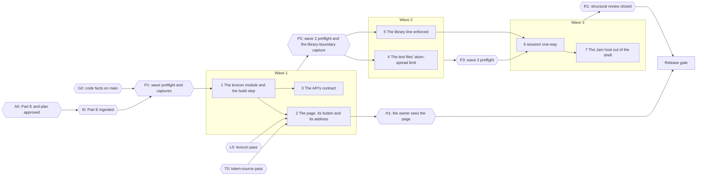

# Infinite Flow v3.4 — Build Plan

Status: v5.2 (2026-11-23): P2's plan corrections: wave 2's fast-gate leftover removed; chunk 5 names its atoms.
v5.1 (2026-11-23): the driver's rulings on v5's open points (spec D575): wave 2's gate is
the full one; chunk 6 comes before 7 for order, not for a shared file.
v5 (2026-11-23): the structural review's waves 2 and 3 added (chunks 4–7, gates P2 and P3,
gate R1 updated; spec D569–D574).
v4 (2026-11-23): chunk 2's two spec-silent choices written in (Part E v1.2, spec D568):
the stale-phrase prompt counts as an open sheet for `#lexicon`, and a sheet opened during the
first load stops the opening.
v3 (2026-11-23): gate T0's notes written into chunk 2 (ux D492, D493, D495), and §E8's
open-sheet rule (Part E v1.1, spec D567).
v2 (2026-11-23): wave 1's preflight corrections (gate P1) written in: the captured atoms'
IDs, the atoms the preflight found, chunk 2's widened revisions and its notes; no new ruling.
v1 (2026-11-22): written; the lexicon wave (wave 1) approved by the wave driver under the
owner's delegation (spec D556, D565). Gates A0, G0 and L0 done.

The lexicon page and the lexicon API, written from
[master spec Part E](master-spec.md#part-e--v34) (v1.0, 2026-11-22, approved by the wave driver:
gate A0, spec D564) and the v3.4 design at the `ui_ux/` root (ux D488–D491; validated by the owner
on 2026-11-22, spec D549): the [lexicon page](../../../ui_ux/screens/lexicon-page/handoff.md), the
[look up a word](../../../ui_ux/flows/look-up-a-word/handoff.md) flow, and the lines marked
`[v3.4 new]` or `[v3.4 changed]` in the
[phrase workspace](../../../ui_ux/screens/phrase-workspace/handoff.md) and the
[play session](../../../ui_ux/flows/play-session/handoff.md) flow. Code facts:
[§E13](master-spec.md#e13-existing-code-and-risks), read on `main` 828ab396 on 2026-11-22 (gate
G0). The plan follows the build-plan model (`~/.local/share/dev_team/references/build-plan-model.md`)
through the project's [build workflow](build-workflow.md). Music terms: the
[lexicon](../../../docs/music/lexicon.md).

Waves 2 and 3 are v3.4's other item, the [structural review](structural-review.md): the refactors
its [report](structural-review-report.md#6-ranked-recommendations) recommends and the wave driver
took under the owner's delegation ([report §7](structural-review-report.md#7-rulings); spec
D569–D574), written from the principal-advisor's
[chunk sketches](structural-review-evidence/F-principal-advisor-ranking.md#3-sketches-of-the-v34-items)
and [risks](structural-review-evidence/F-principal-advisor-ranking.md#4-risks-and-open-points-for-the-driver)
(evidence part F, which cites the measurement pass,
[part E](structural-review-evidence/E-measurement-pass.md), measured on `main` 2ea48d1c).

**v3.4 is built on v3.3 as released** (version 3.3.0, tag `v3.3.0`): every chunk of the
[v3.3 build plan](build-plan-v3.3.md) merged and its release gate passed.

## Read first: what v3.4's lexicon part changes

> Nothing v3.3 does changes. The page adds one button to the footer, one history entry, and one
> more "open sheet" for the starting note; no setting, record, phrase, file or STABLE guarantee
> changes ([§E12](master-spec.md#e12-what-v34s-lexicon-part-changes-in-earlier-guarantees-and-atoms)).

- **The lexicon becomes a build input.** From chunk 1, `npm run build` reads
  `docs/music/lexicon.md` and fails on an empty or malformed lexicon
  ([§E5.3](master-spec.md#e53-the-build-fails-on-an-empty-or-malformed-lexicon)). A lexicon edit is
  then a change like any other: it runs `npm run quality`.
- **Counts are never constants.** The lexicon's numbers (334 entries, 323 shown at v1.9) change
  with the file; no code, test or document of this plan's chunks holds them as fixed values. Tests
  compare against the file itself.
- **The first use of the history.** Chunk 2 is the first code to touch `window.history` and the
  address's `#` part; it does so through one injected seam, never directly from a component.
- **`WorkspaceShell.vue` is at its size limit** (595 effective lines of 600 on 828ab396). Chunk 2
  wires the page through a module of its own and, if the shell would still pass 600, first moves an
  existing block out of it along a seam, behaviour unchanged.

## Read first: what the structural review's waves change

> No behaviour changes. Waves 2 and 3 move code and add checks; no setting, record, phrase, file
> or screen changes, and no business atom is added.

- **The library line becomes a check.** From chunk 5, `npm run verify:boundaries` fails when a file
  under `src/domain/`, `src/generation-worker/`, `src/export/midi/` or `src/export/musicxml/`
  imports anything outside that set (types included) or any package, and `src/domain/` type-checks
  with no DOM library. From chunk 6, `src/session/` may import only session and that set.
- **The atom-spread limit above 10 is a warning for test files** from chunk 4 (spec D570); source
  files keep their error above 10.
- **Files move.** Chunk 6 moves `count-in-display.ts` out of `src/session/` and types and constants
  out of `src/notation/notation-layout-policy.ts` and two composables; chunk 7 moves the Jam host
  wiring out of `WorkspaceShell.vue`. A builder starting after them reads the new paths.

## Gates

| Gate   | What                                                                                                                                                                                                                                                                                                                                                                                                                                                                                                                                                                                                                                | Cleared by                     | Blocks                | Status                                                                                        |
| ------ | ----------------------------------------------------------------------------------------------------------------------------------------------------------------------------------------------------------------------------------------------------------------------------------------------------------------------------------------------------------------------------------------------------------------------------------------------------------------------------------------------------------------------------------------------------------------------------------------------------------------------------------- | ------------------------------ | --------------------- | --------------------------------------------------------------------------------------------- |
| **A0** | [Part E](master-spec.md#part-e--v34) v1.0 and this plan approved, under the owner's delegation of v3.4 (spec D556). The owner keeps the `3.4.0` tag's go.                                                                                                                                                                                                                                                                                                                                                                                                                                                                           | The wave driver                | Every chunk           | done (2026-11-22, spec D564, D565)                                                            |
| **G0** | The draft's code facts ([lexicon page §6](lexicon-page.md#6-what-the-code-says-blast-radius-2026-10-21), read on v3.1 code) read again on `main`, so the **Files** lines name real code.                                                                                                                                                                                                                                                                                                                                                                                                                                            | `spec-writer`                  | Every chunk           | done (2026-11-22, on 828ab396: [§E13](master-spec.md#e13-existing-code-and-risks))            |
| **L0** | The lexicon pass (spec D560): player-worthy words out of Internal, the longest app meanings shortened, docs only. It must be on `main` before wave 1's branch is cut, or merged into the wave branch before chunk 2's branch is cut.                                                                                                                                                                                                                                                                                                                                                                                                | `documentalist`, `ux-writer`   | 2                     | done (2026-11-22, lexicon v1.9, 32868c5d and its follow-up on `v3.4-lexicon-pass`; spec D560) |
| **T0** | The token-source pass: `ux-writer` adds the page's `lexicon-*` classes to `src/styles/components.css`, from existing tokens only, as [`screens/lexicon-page/handoff.md`](../../../ui_ux/screens/lexicon-page/handoff.md) specifies them (Layout Tree: New classes; Components and Content), and writes Part E's two flow points ([§E11](master-spec.md#e11-for-the-interface-design)) into [`flows/look-up-a-word/handoff.md`](../../../ui_ux/flows/look-up-a-word/handoff.md); `ux-critic` checks the classes against the handoff, as it required. On the wave branch before chunk 2's branch is cut (or on `main` before wave 1). | `ux-writer`, `ux-critic`       | 2                     | done (2026-11-23, 86a57594, merged 05556e43; ux D492–D495)                                    |
| **I0** | `documentalist` ingests Part E (skill `atd-spec-ingestion`, milestone refinement): the BUSINESS atom of [§E12](master-spec.md#e12-what-v34s-lexicon-part-changes-in-earlier-guarantees-and-atoms) as DRAFT, tagged `release-v3.4`; `changes-in-v3.4` on the atoms §E12 says to revise; no STABLE atom, CONTRACT or VISION touched. It may run in the same pass as P1.                                                                                                                                                                                                                                                               | `documentalist`                | P1                    | done (2026-11-23, 667164f6: `req_lexicon_page` DRAFT)                                         |
| **P1** | Wave 1's preflight: a verdict per chunk, and before any code the captures the chunks name: the single-source rule and its build step (chunk 1), the API's read contract (chunk 1), the page's `#lexicon` history entry (chunk 2). In the same pass, the wording checks of §E12: `module_session_starting_note` (the page joins its sheets), and the portrait wordings for spec D562 (`req_landscape_phrase_workspace`, `rule_session_ends_on_portrait_view`, and [the first release master spec](../../first-release-master-spec.md)'s lines on portrait views, around its lines 19, 122 and 158).                                  | `documentalist`                | 1, 2, 3               | done (2026-11-23, be24541d; plan v2 7293457e)                                                 |
| **DP** | Data preflight: not run. The repo has no data register ([build workflow](build-workflow.md#data-register)), so no chunk carries a **Data** line.                                                                                                                                                                                                                                                                                                                                                                                                                                                                                    | —                              | —                     | not needed                                                                                    |
| **H1** | The owner sees the page before the `3.4.0` tag's go ([§E15](master-spec.md#e15-definition-of-done) item 18).                                                                                                                                                                                                                                                                                                                                                                                                                                                                                                                        | The owner                      | Release gate          | open                                                                                          |
| **R1** | The structural review closes: its [report](structural-review-report.md) and the driver's rulings on it under the owner's delegation ([§7](structural-review-report.md#7-rulings); spec D556, D569–D574), then the refactor waves they add, waves 2 and 3, built and gated.                                                                                                                                                                                                                                                                                                                                                          | `spec-writer`, the wave driver | Release gate          | open: the report and the rulings done (2026-11-23, spec D569–D574); waves 2 and 3 remain      |
| **P2** | Wave 2's preflight: a verdict for chunks 4 and 5, and before chunk 5's branch is cut the architecture capture of the library boundary (skill `atd-architecture-capture`, an ARCHITECTURE atom as `module_jam_code_boundary` is): chunk 5's **Architecture capture**. Chunk 4 is tooling and has no atom.                                                                                                                                                                                                                                                                                                                            | `documentalist`                | 4, 5 (the capture: 5) | done (2026-11-23, 66f4dec5: `module_library_code_boundary` DRAFT; plan v5.2 6d48ba3b)         |
| **P3** | Wave 3's preflight: a verdict for chunks 6 and 7 over their **Files**, naming the atoms whose links move with the code and whose interface prose names a moved path; it says whether session's one-way line (chunk 6) is recorded in P2's library-boundary atom before chunk 6 or needs no intent work. No other capture: neither chunk decides an interface.                                                                                                                                                                                                                                                                       | `documentalist`                | 6, 7                  | open                                                                                          |

## Waves

| Wave | Chunks                                                                                                                                    | Waits for                                                                                                                                                                                                                                                                                                                                                                               | Status                        |
| ---- | ----------------------------------------------------------------------------------------------------------------------------------------- | --------------------------------------------------------------------------------------------------------------------------------------------------------------------------------------------------------------------------------------------------------------------------------------------------------------------------------------------------------------------------------------- | ----------------------------- |
| 1    | 1 The lexicon module and the build step (1a, 1b) · 2 The lexicon page, its button and its address (2a, 2b) · 3 The lexicon API's contract | A0, G0, I0, P1; L0 and T0 (2). In-wave 1 → 2 and 1 → 3: chunk 1's captures fix the entry contract, the read interface and the build-only module the other two read. Chunks 2 and 3 have no path between them and share no source file.                                                                                                                                                  | merged (2026-11-23, 977e795a) |
| 2    | 4 The test files' atom-spread limit · 5 The library line enforced                                                                         | Wave 1 merged; R1's rulings (done); P2 (5: the library-boundary capture). Tooling, with the full gate, like any wave: chunk 5 adds a type project that `vue-tsc --build` and `npm run build` both use. Chunks 4 and 5 have no path between them and share no file. Two chunks: chunk 6 needs chunk 5's check, and 5 → 6 → 7 is a chain of three, longer than an in-wave chain may be.   | in progress                   |
| 3    | 6 `session/` one-way · 7 The Jam host out of the shell                                                                                    | Wave 2 merged; P3. App code, with the full end-to-end gate. In-wave 6 → 7: an order edge, not an interface, and no file forces it (spec D575): κ is 1, and R3 is easier to judge once R2's moves are settled. Chunk 7 starts from chunk 6's merged code and reads no new interface from it, so no capture fixes one. Two chunks: the chain above, and nothing else is planned for v3.4. | planned                       |

The [release gate](#release-gate) follows wave 3. κ is 1
([build workflow](build-workflow.md#concurrency-and-order)): inside wave 2 the order is 4, then 5;
inside wave 3, 6, then 7.

The critical path now runs P2 → 5 → wave 2's gate → P3 → 6 → 7 → wave 3's gate → the release gate.

## Workflow deltas

The [build workflow](build-workflow.md) holds for v3.4 with release name `v3.4`: wave branches
`v3.4-w<n>` in `/home/bastien/work/infinite_flow-v3.4-w<n>`, chunk branches `v3.4-c<id>-<slug>` in
`/home/bastien/work/infinite_flow-v3.4-c<id>`. v3.4's own:

- **No corpus guard and no sweep.** No chunk touches generation, the backing, the notation or the
  exports, so none runs a replay corpus and no wave gate runs `npm run test:sweep`. Chunks 4 to 7
  change no behaviour at all: they move code and add checks.
- **Intent:** the DRAFT atoms are tagged `release-v3.4`, the atoms to revise `changes-in-v3.4`
  (gate I0). No contract sign-off: no STABLE wording changes. ATD covers business behaviour only:
  waves 2 and 3 add no business atom; their one piece of intent work is the library-boundary
  capture (gate P2), to which chunk 5's check links. Links move with the code they sit on, atom
  IDs never change.
- **Atom-spread limit:** from chunk 4, more than 10 distinct atoms in a test file is a warning
  (spec D570). A chunk report still names every link it left out because of the limit, source or
  test.

- **The sync sees moves only against a base.** Default `atd check` cannot see moves, staged changes
  or untracked files
  ([ISS-020](../../../issues/ISS-020_20261114_atd_check_empty_on_committed_tree.md)). Wave 3's
  sync (and wave 2's) runs `atd check main...HEAD`, or `atd check --full`, and compares it with the
  baseline of 15 NO_IMPL and 1 NO_TESTS; anything beyond it is drift to report. Path prose inside an
  atom is checked by no tool: the sync reads the interface sections of the atoms P3 names.
- **Harness aliases by exact path.** `vite.workspace-harness.config.ts` swaps three modules by
  exact path (`@/notation/vexflow-engraver-loader`, `@/export/load-generated-notes-export`,
  `@/components/workspace/workspace-session-runner`); moving one of those files silently disables
  its seam. No chunk moves them; each chunk owner checks its moves against that list.
- **`vi.mock` strings follow moved files.** A moved module's path is updated in every `vi.mock`
  call that names it; the type-check does not catch a stale one, so the chunk greps `tests/` for
  the old path.
- **Start-up budget:** all JavaScript loaded at start-up, 400 KiB (409,600 B); 387,038 B at the
  `3.3.0` release. The wave gate reports the total and the entry file against that figure; in wave
  1 only the footer's button and the page's host may add to it
  ([§E10](master-spec.md#e10-size-offline-and-the-first-load)); waves 2 and 3 expect a delta of
  about 0. The budget stays at 400 KiB (spec D571,
  [report §3](structural-review-report.md#3-q2-the-start-up-budget)): an overrun takes a lever,
  first lazy audio voices (R6), then lazy migration codecs (R7), never a raise. Raising it is the
  owner's call only; no wave driver or chunk may do it.
- **The lexicon's words' budget:** 448 KiB (458,752 B) for the words' own file, set by chunk 1 in
  `scripts/verify-boundaries.mjs`; every other new file keeps the 100 KiB limit.
- **Area documents:** `README.md` (directory boundaries: `src/lexicon/`, `src/components/lexicon/`;
  the quality-gate table for the new checks); `docs/testing.md` (the sample lexicon, the history
  seam, the new specs); `docs/phrase-workspace.md` (the footer's button, the page, its history
  entry); `docs/lexicon-api.md`, new (chunk 3); `CODING_RULE.md` §6 (chunk 4); `README.md`'s
  Directory Boundaries, the library line and session's (chunks 5, 6).
- **Wave log:** [wave-log-v3.4.md](wave-log-v3.4.md).
- **Never edit the lexicon in a chunk.** `docs/music/lexicon.md` belongs to its owners; a chunk that
  finds an entry breaking the template stops and reports it to the driver.

## Measurements and hand checks

### M1 — The lexicon's words' file

The size of the words' built file, in bytes and gzip-compressed, against its 448 KiB budget:
recorded by chunk 1 (1b) and again at the wave gate, with the lexicon version it was built from.
Part E expects about 300 KB, 85 to 90 KB compressed ([§E10](master-spec.md#e10-size-offline-and-the-first-load)).

### M2 — The start-up figure

The wave gate's bundle figure (the build workflow's step 3): all start-up JavaScript and the entry
file, against 387,038 B at `3.3.0`, with what the page's host added named. Waves 2 and 3 report it
against the previous wave, expecting a delta of about 0; an overrun of the budget takes a lever,
never a raise (spec D571).

### M3 — The library type project's type-check time

The time `npm run typecheck` adds once chunk 5's no-DOM type project over `src/domain/` is
referenced, against 15.9 s before it
([part E §E6](structural-review-evidence/E-measurement-pass.md#e6-timings-idle-machine-one-run-each-one-after-the-other-12-cores)),
recorded by chunk 5 with the machine and the date; it informs and never gates.

### Hand checks

| Check | What                                                                                                               | Who, when                                                     |
| ----- | ------------------------------------------------------------------------------------------------------------------ | ------------------------------------------------------------- |
| H1    | The owner opens the page, browses, searches and closes it ([§E15](master-spec.md#e15-definition-of-done) item 18). | The owner, after wave 1's gate, before the tag's go (gate H1) |

## Chunks

### Chunk 1 — The lexicon module and the build step

Status: merged (w1, 688a86d3)
Record: 1a b7bc417a, 1b 7cdca3a6, merged 688a86d3. No deviation from the spec or the design. The
words' file is an entry chunk the plugin emits itself; `verify-boundaries.mjs` reads the first load
from the page entries (the words' file excluded by name) and requires exactly one `lexicon-words-*`
file. `src/lexicon/` imports carry `.ts` extensions (`allowImportingTsExtensions`).
Wave: 1
Depends on: A0, G0, P1 (its captures)
Architecture capture: (a) **the single-source rule and its build step**: the lexicon file is the
only source of the words; a build step reads it at build time and hands the app a build-only module
of shown entries; nothing generated is committed; the words load on demand in a file of their own,
never in the first load. (b) **The API's read contract**: the entry contract's nine fields
([§E9.2](master-spec.md#e92-the-entry-contract)) and the read interface over handed-in entries
(the entries in the lexicon's order, one entry by id or none, the groups' names in order), in
`src/lexicon/`, with no DOM, browser storage, Vite-only import or network inside it.

- **Goal:** the lexicon is parsed when the app is built, behind the API's typed read interface; an
  empty or malformed lexicon fails the build; the words get a file and a budget of their own, out
  of the first load; and a check proves an edit shows with no other change.
- **Scope:**
  - **The lexicon module, `src/lexicon/`:** the parser (the file's text in, every entry out with its
    group, its group's place and its line), failing on each rule of
    [§E5.3](master-spec.md#e53-the-build-fails-on-an-empty-or-malformed-lexicon) with the entry's
    word and line; the shaping into shown entries
    ([§E5.2](master-spec.md#e52-how-the-text-reaches-the-page)): Internal entries dropped, related
    ids naming them dropped, `sources` dropped, `aliases` split into other names (`none` giving
    none), no app meaning as null, the text of every field as written; the entry's type; the read
    interface; an index exporting them. No Vite, browser or network code in it.
  - **The build step:** a Vite plugin that reads `docs/music/lexicon.md` through the parser, serves
    the shown entries as a build-only module, fails the build with the parser's message, and
    rebuilds on a lexicon edit in `npm run dev`; the module's type declaration; registered in the
    app's, the workspace harness's and the unit tests' configurations. The plugin's file and
    extension are the chunk's choice, as long as it runs the parser in `src/lexicon/`.
  - **The words' file:** the build-only module emitted as a file of its own, reached only through a
    dynamic `import()`, with a name `verify:boundaries` recognises; its 448 KiB budget; and a
    first-load boundary, read from the module graph as Jam's is: no module under `src/lexicon/` or
    `src/components/lexicon/`, and not the build-only module, in the first load. The rule is in
    place before the page exists.
  - **The single-source checks** ([§E5.4](master-spec.md#e54-the-check-that-an-edit-shows-with-no-other-change)):
    the parser's tests on the real file, compared against the file itself; the sample-lexicon test
    (an added entry, and an entry moved out of Internal, reach the output with nothing else
    changed); the committed-copy check (no file under `src/`, `public/` or `tests/` holds a real
    entry's plain line), shown failing on a planted copy.
  - **Out:** the page and its button (chunk 2); the JSON Schema, the browser-free check and the
    API's document (chunk 3); any edit to `docs/music/lexicon.md`.
- **Files:** new `src/lexicon/parse-lexicon.ts`, `src/lexicon/shown-entries.ts`,
  `src/lexicon/lexicon-entry.ts`, `src/lexicon/read-lexicon.ts`, `src/lexicon/index.ts`, the
  build-only module's declaration in `src/lexicon/`, the plugin beside
  `scripts/module-graph-plugin.mjs`; changed `vite.config.ts`, `vite.workspace-harness.config.ts`,
  `vitest.config.ts`, `scripts/verify-boundaries.mjs`; tests `tests/unit/lexicon/` (new: the parser
  on the real file and on each malformed case, the shaping, the read interface, the build step on
  the sample lexicon, the committed-copy check; the sample lexicon as a fixture there),
  `tests/unit/boundaries/verify-boundaries.spec.ts` (the budget and the first-load boundary);
  `README.md`, `docs/testing.md`.
- **Spec sections:** [§E5](master-spec.md#e5-the-single-source),
  [§E9.1](master-spec.md#e91-what-it-is), [§E9.2](master-spec.md#e92-the-entry-contract),
  [§E10](master-spec.md#e10-size-offline-and-the-first-load),
  [§E13](master-spec.md#e13-existing-code-and-risks); items 1 (the shown set: no Internal entry, no
  sources), 5, 6, 13.
- **Design docs:** [`screens/lexicon-page/handoff.md`](../../../ui_ux/screens/lexicon-page/handoff.md)
  (What the Page Shows of the Lexicon; States: Empty).
- **Atoms:** (v3.4) the two ARCHITECTURE atoms P1 captured: `module_lexicon_single_source` (the
  single-source rule and its build step) and `api_lexicon_read_contract` (the API's read contract);
  (v3.2) `module_jam_code_boundary` (drift check: linked in `scripts/verify-boundaries.mjs`, whose
  first-load boundary the lexicon's copies, and in `tests/unit/boundaries/verify-boundaries.spec.ts`);
  (v2) `specification_browser_only_operation_verification` (STABLE: the no-network check in
  `verify-boundaries.mjs` stays as it is); (v1) `req_browser_only_first_release`.
- **Revisions:** none.
- **Done when:**
  - The parser's output on the real lexicon holds every entry outside the Internal group, with the
    same id and fields as the file, and none inside it (compared against the file, no stored copy).
  - Each rule of §E5.3 fails the parse with the entry's word and its line; a lexicon with no shown
    entry fails naming the file; the real lexicon passes.
  - The shaped entries have exactly the nine fields of §E9.2, related ids only to shown entries, in
    the lexicon's order, and no `sources` text.
  - The read interface gives the entries in the lexicon's order, one entry by id (none for an
    unknown id) and the groups' names in order, from entries handed to it.
  - `npm run build` emits the words' file of its own; `npm run verify:boundaries` holds it within
    448 KiB and fails when a planted static import puts `src/lexicon/` in the first load (a test);
    a malformed sample lexicon fails the build step with the parser's message (a test).
  - The sample-lexicon test and the committed-copy check pass, and the committed-copy check fails
    on a planted copy.
  - M1 recorded.
- **Verification:** chunk checks; `npm run build` and `npm run verify:boundaries` (the budget and the
  first-load boundary are this chunk's point); M1.
- **Split rule:** 1a, the lexicon module in `src/lexicon/` (parser, shaping, type, read interface,
  index) and its tests on the real file and the malformed cases; 1b, the build step, the build-only
  module and its declaration, the three configurations, `verify-boundaries.mjs`, the sample-lexicon
  test, the committed-copy check and M1.

### Chunk 2 — The lexicon page, its button and its address

Status: merged (w1, a1660fd9)
Record: 2a 57c05801, 2b 0e6f8878, merged a1660fd9. Stopped once on a design gap (the searching
state's heading order), settled by ux D496 and resumed. Spec-silent choices recorded as spec D568.
The starts moved out of `WorkspaceShell.vue` into `workspace-starts.ts` with their tags (596
effective lines); the lexicon accessibility checks are in `accessibility-lexicon.spec.ts`; the
host makes `.layout-app` inert while the page shows; bar controls take focus without scrolling.
Wave: 1
Depends on: 1, L0, T0, P1 (its capture)
Architecture capture: **the page's `#lexicon` history entry**
([§E8](master-spec.md#e8-the-browsers-history-and-the-address)): one history entry of the page's
own, marked as such and pushed at every opening on top of the bare address; Back closes the page;
Close and Escape step back over the entry; Forward onto it reopens the page except during a session,
where the address is replaced with the bare one; a load, a reload or a typed `#lexicon` is replaced
with the bare address, then the page opens and adds its entry; under an open sheet, the
stale-phrase prompt included, `#lexicon` reached any way opens nothing and only the address is
replaced (spec D567, D568); jumps inside the page
cancel their link's navigation. All through one injected history seam.

- **Goal:** the player opens the lexicon page from the footer between sessions, browses it A to Z,
  searches it, and closes it by Close, Escape or Back, offline, by keyboard alone and in any
  orientation.
- **Scope:**
  - **2a, the page (`src/components/lexicon/`):** the view as the design lays it out (the bar, the
    count, the search field, `Letters` with T0's `lexicon-letters-button` class, the letter row,
    the reading column, the entries with More, the related links, the "Mentioned in other words"
    group, the no-match state and the result count; ux D492), and its model: the A to Z order and letters, doubled words, the search's matching, tiers and
    mentions ([§E6](master-spec.md#e6-the-page)), and the inline marks built as text, never as HTML.
    It reads the entries only through chunk 1's read interface over the build-only module. Focus
    targets, the trap and the keys inside the page; its state kept for the visit. The bar's
    measurement: the page measures the part of the bar that stays at the top (`lexicon-bar`, or
    `lexicon-bar-row` below `bp-tablet-landscape`) and keeps its height current on `lexicon-view`
    as `--lexicon-bar-block-size`, which the view's scroll padding in `components.css` reads, so
    no jump target and no element focused by Tab lands under the bar (ux D492; the lexicon page's
    Moving Around the Page: Below the bar).
  - **2b, opening and the address (`src/components/workspace/`):** the footer's `Your data` and
    `Lexicon` held in a `footer-actions` wrapper in `LayoutFooter.vue`, so the two wrap together
    under the note (ux D493; the phrase workspace's Layout Tree and Responsive Behavior: Footer),
    `Lexicon` after `Your data`, disabled only while a session runs, count-in included (the footer's one `disabled`
    flag becomes one per button: `Your data` keeps waiting for the controller, `Lexicon` does not);
    the page's host, in a module of its own: the loader, loading once, keeping the module and asking
    for a fresh address on Try again as `load-jam-mode.ts` does; the button's loading state; a session
    started during the load cancelling the opening, and a sheet opened during it (the stale-phrase
    prompt included) stopping it, even if closed again before the load ends (spec D568); the
    load-failure notice in `AppNoticeRow.vue`
    after Jam's, with Try again and Dismiss and the focus on Try again; the page counted in
    `anySheetOpen` and in the open-sheet flag `reportSheetsOpen` emits (the flag the MIDI side
    reads as `connectionSheetOpen`, which already counts My instrument, Your data and the preset
    sheet), so no MIDI note starts a session, a count-in or a Jam and the starting note's line
    hides; focus back to the button on close; the history seam and §E8's model (a load at
    `#lexicon` opens the page once the shell is mounted: `main.ts` mounts the app only after the
    saved data is read, so `src/App.vue` needs no change; `#lexicon` reached while any sheet is
    open, the stale-phrase prompt counted as one, opens nothing, only the address being replaced
    and the sheet left as it was, spec D567, D568, ux D495, the look up a word flow's Routing
    Rules); the page rendered beside the sheets, outside
    `.layout-app`, so the portrait guard leaves it shown ([§E7](master-spec.md#e7-opening-and-closing),
    spec D562); an ESLint import rule: only the loader imports `src/components/lexicon/` statically,
    as Jam's rule does (copying `jamImportPattern`). `WorkspaceShell.vue` stays within 600
    effective lines; a block moved out of it to stay there takes its `@spec-link` tags with it
    (the shell carries 18).
  - **The end-to-end tests:** a new spec for the page (A to Z, a letter, search and its tiers, one
    match, no match, mentions, a related jump, More, Close, Escape, Back, Forward, a load at
    `#lexicon`, a typed `#lexicon`, `#lexicon` reached under an open sheet and under the
    stale-phrase prompt, a session started during the load, a sheet opened during the load, a
    failed load and Try again,
    a MIDI note while open, a portrait view, the keyboard alone), added to the `test:e2e` list; the
    page's states in the accessibility suite; the page and its words offline in the release suite.
  - **Out:** the API's schema and document (chunk 3); any change to `src/styles/` (T0's) or to
    `docs/music/lexicon.md`; word popups elsewhere.
- **Files:** new `src/components/lexicon/` (the page's view, its entry part and its model: A to Z,
  search, inline marks), `src/components/workspace/use-lexicon-page.ts` (the host),
  `src/components/workspace/load-lexicon-page.ts` (the loader),
  `src/components/workspace/lexicon-history.ts` (the history seam); changed
  `src/components/workspace/LayoutFooter.vue`, `src/components/workspace/WorkspaceShell.vue`,
  `src/components/workspace/AppNoticeRow.vue`, `eslint.config.js`, `package.json` (the `test:e2e`
  list); tests `tests/unit/components/lexicon/` (new), `tests/unit/components/workspace/` (the host,
  the loader, the history seam, the footer), `tests/unit/boundaries/eslint-boundaries.spec.ts`,
  `tests/e2e/workspace/lexicon-page.spec.ts` (new), `tests/e2e/accessibility.spec.ts`,
  `tests/e2e/release/offline-and-fonts.spec.ts`; `docs/phrase-workspace.md`, `docs/testing.md`,
  `README.md`.
- **Spec sections:** [§E6](master-spec.md#e6-the-page), [§E7](master-spec.md#e7-opening-and-closing),
  [§E8](master-spec.md#e8-the-browsers-history-and-the-address),
  [§E10](master-spec.md#e10-size-offline-and-the-first-load),
  [§E13](master-spec.md#e13-existing-code-and-risks); items 1–4, 7–12, 13 (the start-up figure),
  14, 15 (the page reads only through the read interface), 16.
- **Design docs:** [`screens/lexicon-page/handoff.md`](../../../ui_ux/screens/lexicon-page/handoff.md)
  (Layout Tree; Components and Content; What the Page Shows of the Lexicon; How Search Works; Moving
  Around the Page; Focus and Keyboard; Responsive Behavior; States),
  [`flows/look-up-a-word/handoff.md`](../../../ui_ux/flows/look-up-a-word/handoff.md) (Flow; Routing
  Rules), [`screens/phrase-workspace/handoff.md`](../../../ui_ux/screens/phrase-workspace/handoff.md)
  (Layout Tree; Page frame: Footer; The Lexicon button; The lexicon's load-failure notice; Responsive Behavior:
  Footer; Session count-in: The lexicon; The starting note line: Under the lexicon page),
  [`flows/play-session/handoff.md`](../../../ui_ux/flows/play-session/handoff.md) (Starting note: The
  lexicon page), [`flows/saved-data/handoff.md`](../../../ui_ux/flows/saved-data/handoff.md)
  (Notices), [`motion.md`](../../../ui_ux/motion.md) (Rules).
- **Atoms:** (v3.4) `req_lexicon_page` (the BUSINESS atom I0 recorded: the player looks up every
  shown word, A to Z and by search, offline, between sessions), `module_lexicon_page_history_entry`
  (the history entry P1 captured), and chunk 1's `module_lexicon_single_source` and
  `api_lexicon_read_contract` (drift check); (v3.2) `rule_jam_start_conditions`;
  `module_jam_code_boundary` (the new ESLint rule copies `jamImportPattern`;
  `tests/unit/boundaries/eslint-boundaries.spec.ts`); `module_workspace_mode` (linked in
  `AppNoticeRow.vue` and `WorkspaceShell.vue`: Jam's load-failure notice leaves the focus where it
  is while any sheet is open, and the page now counts as one); (v3.0) `req_your_data` (STABLE: the
  footer's other button, unchanged); `rule_failed_save_never_disturbs_session` (STABLE, linked in
  `AppNoticeRow.vue`); `rule_first_phrase_waits_for_saved_settings` (STABLE: a load at `#lexicon`
  waits for the saved settings); (v2) `module_session_starting_note`,
  `rule_session_start_conditions` and `rule_session_ends_on_portrait_view`; `rule_midi_starting_note`
  (STABLE, wording unchanged); `service_session_midi` (drift check at the wave sync: its interface
  reads "whether the connection sheet is open", a flag that counts every sheet and the page);
  (v1) `req_landscape_phrase_workspace` (the portrait rule, still true of the workspace).
- **Revisions:** revise `module_session_starting_note`: its rule and its interface name the sheets
  under which no note starts a session as all the flag counts (the connection sheet, the
  stale-phrase prompt, My instrument, Your data, the preset sheet) and the lexicon page;
  `rule_session_ends_on_portrait_view`: "As outside a session, the app has no portrait layout below
  the desktop layout's width: …" becomes "As outside a session, the phrase workspace has no
  portrait layout below the desktop layout's width: …", the rest unchanged (spec D562); and
  `module_lexicon_page_history_entry` as built, the open-sheet rule included with the stale-phrase
  prompt counted as a sheet, and a sheet opened during the first load stopping the opening
  (spec D567, D568).
- **Done when:**
  - Every shown entry is on the page under its letter and found by its word and each other name;
    the count matches the file; an entry shows and opens as §E6 says, marks shown as text.
  - A to Z, the letters, doubled words and the search behave as §E6 says, each case a unit test on
    a fixture list read through the read interface.
  - The button sits after `Your data`, the two in `footer-actions` and wrapping together under the
    note, `Lexicon` disabled during a session and the count-in, enabled before the controller has
    loaded; the first opening loads; a session started during the load cancels
    it, and a sheet opened during it stops it, the page staying closed when the load ends even if
    the sheet has closed by then; a failed load shows the notice and Try again opens the page.
  - No MIDI note starts a session, a count-in or a Jam while the page is open, and the starting
    note's line hides and returns.
  - Each history rule of §E8 holds in the end-to-end spec, the open-sheet rule included, under a
    sheet and under the stale-phrase prompt: the sheet stays open with what was typed in it; the
    address is `#lexicon` only while the page is open.
  - At one and at two letter rows, and below `bp-tablet-landscape`, a letter's jump and a Tab
    focus land clear of the bar's staying part: `--lexicon-bar-block-size` on `lexicon-view`
    follows its measured height.
  - The page opens, reads and closes in a portrait view below the desktop layout's width.
  - The page and its words open offline after one visit; the accessibility suite passes on its
    states; the keyboard alone reaches everything in the design's order.
  - `WorkspaceShell.vue` is within 600 effective lines (`npm run lint:health`); the ESLint rule
    rejects a planted static import of the page (a test).
- **Verification:** chunk checks; the new end-to-end spec and the accessibility and offline specs it
  edits (its point); the start-up figure (M2) is placed at the wave gate.
- **Split rule:** 2a, the page in `src/components/lexicon/` with its component and model tests,
  reached only from tests (the bar's measurement included); 2b, the footer's `footer-actions` and
  its button, the host, the loader, the notice, the open-sheet flag,
  the history seam, the shell's wiring (and any block moved out of it, with its `@spec-link`
  tags), the ESLint rule and the
  end-to-end, accessibility and offline tests.

### Chunk 3 — The lexicon API's contract

Status: merged (w1, a7200fe5)
Record: ff146150, merged a7200fe5. No deviation. The browser-free check also refuses a file read
(`node:fs`) and a package import (the capture's "no runtime dependency"); the ambient
`declare module 'virtual:lexicon-words'` in `lexicon-words.d.ts` is a type declaration, not a use.
`api_lexicon_read_contract` is a revision candidate at the wave sync.
Wave: 1
Depends on: 1, P1 (chunk 1's API read contract capture)
Architecture capture: none of its own; it checks chunk 1's API read contract and states it.

- **Goal:** the lexicon module becomes an API another caller, or a service in another language,
  can rely on: its entry contract written as a JSON Schema and proven against the real output, and
  its freedom from browser-only assumptions checked.
- **Scope:**
  - **The JSON Schema** (draft 2020-12, version 1) of one shown entry, beside the module in
    `src/lexicon/`: the nine required fields of [§E9.2](master-spec.md#e92-the-entry-contract), no
    other field allowed.
  - **The conformance test:** every entry the parser and shaping give on the real lexicon conforms
    to the schema, checked by a small checker of the schema's own subset (types, required fields,
    items, no extra fields) with no new dependency; and the schema's fields are exactly the entry
    type's.
  - **The browser-free check:** a test that fails when a file under `src/lexicon/` uses the DOM
    (`window`, `document`), browser storage, a Vite-only import (a build-only module, a `?raw`
    import, `import.meta.env`), Vue or the network.
  - **`docs/lexicon-api.md`:** the read interface, the entry contract and the schema's place, what
    the module guarantees (no network, no browser-only assumption, one parser), its first caller,
    and how a backend could later serve the same data without its callers changing
    ([§E9.3](master-spec.md#e93-where-it-lives-later) for where it may move).
  - **Out:** any change to the parser, the shaping or the read interface (chunk 1's; a gap found
    goes to the driver), the page (chunk 2), a backend.
- **Files:** new `src/lexicon/lexicon-entry.schema.json`, `tests/unit/lexicon/lexicon-entry-schema.spec.ts`,
  `tests/unit/lexicon/lexicon-api-boundary.spec.ts`, `docs/lexicon-api.md`; `README.md` (the
  directory boundary line for `src/lexicon/`), `docs/testing.md`.
- **Spec sections:** [§E9](master-spec.md#e9-the-lexicon-api), [§E14](master-spec.md#e14-architectural-decisions-and-their-reasons);
  item 15.
- **Design docs:** none (no interface).
- **Atoms:** (v3.4) `api_lexicon_read_contract`, chunk 1's (drift check against the schema and
  the document); (v1) `req_browser_only_first_release`.
- **Revisions:** `api_lexicon_read_contract`, if the document words its contract more exactly than
  the capture did.
- **Done when:**
  - The schema is in `src/lexicon/`, its nine fields required and no other allowed; the real
    lexicon's output conforms, and an entry with a field missing, a wrong type or an extra field is
    refused (tests).
  - The schema's fields and the entry type's are the same set (a test).
  - The browser-free check passes on `src/lexicon/` and fails on a planted `window` use and a planted
    build-only import (tests).
  - `docs/lexicon-api.md` states the contract; `npm run lint:links` passes.
- **Verification:** chunk checks.
- **Split rule:** none needed (one new source file, the schema, and two tests).

### Chunk 4 — The test files' atom-spread limit

Status: in progress
Wave: 2
Size: S
Depends on: P2 (its verdict)
Architecture capture: none (tooling).

- **Goal:** a test file linking more than 10 distinct atoms gets a warning instead of an error, so a
  broad spec links every atom it covers; source files keep their limits (spec D570).
- **Scope:**
  - **The code-health rule:** the ATD rule of `npm run lint:health` reports more than 10 distinct
    atoms in a file classified as a test (`isTestFile`, `scripts/code-health/sources.mjs`) as a
    **warning**; source files keep warn above 5 and error above 10.
  - **`CODING_RULE.md` §6** states the test files' limit.
  - **Out:** which files count as tests; the source files' limits; adding back any link left out
    earlier because of the limit.
- **Files:** `scripts/code-health/rules/atd.mjs`, `scripts/code-health/config.mjs`; tests
  `tests/unit/code-health/atd.spec.ts`; `CODING_RULE.md`.
- **Spec sections:** [report §6](structural-review-report.md#6-ranked-recommendations) (R4) and
  [§7](structural-review-report.md#7-rulings) (spec D570); the
  [sketch](structural-review-evidence/F-principal-advisor-ranking.md#3-sketches-of-the-v34-items)
  (R4).
- **Design docs:** none (no interface).
- **Atoms:** none (tooling; the code-health specs are ATD-exempt).
- **Revisions:** none.
- **Done when:**
  - A test file with 11 distinct atoms gives a warning and the check exits 0 on it (a test).
  - A source file with 11 distinct atoms still fails, and one with 6 still warns (tests).
  - `CODING_RULE.md` §6 states the test files' limit; `npm run lint:health` passes on the
    repository.
- **Verification:** chunk checks; `npm run lint:health`.
- **Split rule:** none needed (two scripts, one spec, one document).

### Chunk 5 — The library line enforced

Status: planned
Wave: 2
Size: S
Depends on: P2 (the library-boundary capture)
Architecture capture: **the library boundary** (gate P2): the library set is `src/domain/`,
`src/generation-worker/`, `src/export/midi/` and `src/export/musicxml/`; a file in it imports only
files in it, types included, and no package; `src/domain/` type-checks with no DOM library. The
check that holds it is in `scripts/verify-boundaries.mjs` and resolves every specifier, because an
ESLint pattern cannot tell `domain/notation` (`../notation`) from `src/notation`
(`../../notation`).

- **Goal:** the library line is checked, not just described, so no coupling grows into the library
  during v4.0; it costs no code change, the line having no violation today
  ([part E §E2.3](structural-review-evidence/E-measurement-pass.md#e23-candidate-import-rule-set-outdepcruise-candidatecjs)).
- **Scope:**
  - **The check:** a new source check in `scripts/verify-boundaries.mjs`. For every `.ts` file in
    the library set it resolves every `import … from`, `export … from`, `import('…')` and
    `new URL('…')` specifier (`@/` to `src/`, a relative one against the file); the target must lie
    inside the set, and no bare package specifier is allowed. It links to the library-boundary
    atom.
  - **The type project:** a tsconfig over `src/domain/**` with `lib: ["ES2023"]`, `types: []` and
    the app's strict flags, referenced from `tsconfig.json` so `vue-tsc --build` checks it (M3).
  - **`README.md`'s Directory Boundaries** states the line and corrects the 8 drift points of
    [part A §2.3](structural-review-evidence/A-import-graph-and-seams.md).
  - **Out:** session's rule (chunk 6); any change under `src/` (a violation found is reported to
    the driver, never fixed here); a no-DOM project over the other three folders.
- **Files:** `scripts/verify-boundaries.mjs`; a new tsconfig at the root (its name the chunk's
  choice) and `tsconfig.json`; tests `tests/unit/boundaries/verify-boundaries.spec.ts`, a breaking
  fixture under `tests/fixtures/boundaries/src/domain/` (new); `README.md`, `docs/testing.md` (the
  fixture).
- **Spec sections:** [report §6](structural-review-report.md#6-ranked-recommendations) (R1) and
  [§7](structural-review-report.md#7-rulings) (spec D569); the
  [sketch](structural-review-evidence/F-principal-advisor-ranking.md#3-sketches-of-the-v34-items)
  (R1); the [candidate rule table](structural-review-report.md#8-the-candidate-rule-table-e-23).
- **Design docs:** none (no interface).
- **Atoms:** (v3.4) `module_library_code_boundary` (DRAFT, captured at P2); (v3.2)
  `module_jam_code_boundary` (REVIEW; drift check: linked in `scripts/verify-boundaries.mjs`, whose Jam first-load check stays as it is);
  (v2) `specification_browser_only_operation_verification` (STABLE: the no-network check stays as
  it is).
- **Revisions:** none.
- **Done when:**
  - `npm run verify:boundaries` passes on the code as it is.
  - It fails, naming the file, the line and the specifier, on the fixture for each case: a relative
    import leaving the set, a type-only import leaving it, an `@/` import leaving it, an
    `export … from`, an `import()` and a `new URL()` leaving it, and a bare package specifier
    (tests).
  - `npm run typecheck` checks `src/domain/` under the no-DOM project and passes; a `document` use
    planted under `src/domain/` fails it (shown once, not committed).
  - `README.md` states the line; `preset-model-purity.spec.ts` passes unchanged; M3 recorded.
- **Verification:** chunk checks; `npm run build`, `npm run verify:boundaries` and
  `npm run typecheck` (its point); M3.
- **Split rule:** none needed (one script, one tsconfig and its reference, one spec and its
  fixture, the README).

### Chunk 6 — `session/` one-way

Status: planned
Wave: 3
Size: M
Depends on: 5 (its check and its spec), P3
Architecture capture: none of its own: session's line is a rule of chunk 5's check; whether it is
written into the library-boundary atom is P3's verdict.

- **Goal:** `src/session/` imports only session and the library set, so the session core is ready
  to join the library, and the one value cycle between session and audio is gone.
- **Scope:** the cuts of
  [part E §E2.3](structural-review-evidence/E-measurement-pass.md#e23-candidate-import-rule-set-outdepcruise-candidatecjs)
  that remain once chunk 5 makes the encoders library (the type imports of
  `session-history-export.ts:14-16` are then allowed):
  1. **The count-in display.** `src/session/count-in-display.ts` (a value import of
     `audio/click-track.ts`, line 7) moves to the app side, beside its callers
     (`workspace-session-controller-types.ts`, `workspace-session-begin.ts` in
     `src/components/workspace/`), its test with it. `audio/click-track.ts`'s import of session
     stays, the allowed direction, so the value cycle disappears.
  2. **The layout values.** What `session-window.ts` (values and a type, its import ending at line 20) and `rolling-display.ts:10` (types) take from `src/notation/notation-layout-policy.ts`
     moves into `src/domain/notation/`: the breakpoint constants, `StaffLayout` and `SystemPart`,
     and `planStaffPositions` and `planStaffWidthRoom`, which `session-window.ts` imports too;
     `notation-layout-policy.ts` re-imports them, so notation stays a sink. A moved value that needs
     code outside the library set (`NotationError`, say) stops the chunk: it reports to the driver
     and moves nothing wider.
  3. **The two composable types.** `ViewportWidthProvider` (`src/composables/viewport-width.ts`,
     imported by `session-runner.ts:13` and `session-types.ts:8`) and `IdlePhraseSettings`
     (`src/composables/workspace-session-result.ts`, imported by `stale-phrase-one.ts:9`) move into
     session; the composables re-import them.
  4. **The rule.** Chunk 5's check gains one: `src/session/` imports only session and the library
     set, types included, no package.
  - `session-types.ts` is at 10 atoms: a moved type carrying links goes into a new session file.
    Every moved path is updated in the `vi.mock` strings that name it; no harness-aliased file
    moves ([workflow deltas](#workflow-deltas)).
  - **Out:** the audio, MIDI and storage edges and the 77-file type cycle (deferred, spec D572);
    any behaviour.
- **Files:** `src/session/count-in-display.ts` moved to `src/components/workspace/` with
  `tests/unit/session/count-in-display.spec.ts` moved to `tests/unit/components/workspace/`, and
  its importers `src/components/workspace/workspace-session-controller-types.ts`,
  `src/components/workspace/workspace-session-begin.ts`; `src/session/session-window.ts`,
  `rolling-display.ts`, `session-runner.ts`, `session-types.ts` (or a new session file),
  `stale-phrase-one.ts`; `src/notation/notation-layout-policy.ts` and a new file in
  `src/domain/notation/`; `src/composables/viewport-width.ts`,
  `src/composables/workspace-session-result.ts`; `scripts/verify-boundaries.mjs`; tests: the
  importers' and the moved names' unit tests, the `vi.mock` strings naming a moved path,
  `tests/unit/boundaries/verify-boundaries.spec.ts` and a breaking fixture under
  `tests/fixtures/boundaries/src/session/`; `README.md` (Directory Boundaries).
- **Spec sections:** [report §6](structural-review-report.md#6-ranked-recommendations) (R2) and
  [§7](structural-review-report.md#7-rulings) (spec D569); the
  [sketch](structural-review-evidence/F-principal-advisor-ranking.md#3-sketches-of-the-v34-items)
  (R2).
- **Design docs:** none (no interface).
- **Atoms:** no new atom; links move with their code, among them `rule_count_in_shown_on_screen`
  (in `count-in-display.ts`); the others on moved names P3 lists. Drift check: the library-boundary
  atom (P2), and the ARCHITECTURE atoms linked in the files it edits, `module_session_rolling_display`,
  `module_notation_layout_preflight`, `module_idle_window_width_density` and
  `module_session_seed_plan`.
- **Revisions:** path rewordings only, in the interface sections of the atoms P3 names (a moved
  file's path); IDs and rules unchanged.
- **Done when:**
  - `npm run verify:boundaries` passes with session's rule, and fails on a session fixture
    importing audio, notation, a composable or a package (tests).
  - Every importer of a moved name reads it from its new home; no `vi.mock` string names an old
    path (a grep over `tests/`); no harness-aliased file moved.
  - The session, notation and composables unit tests, the end-to-end specs that cover the count-in,
    and `npm run typecheck` pass; `session-types.ts` stays within 10 atoms (`npm run lint:health`).
- **Verification:** chunk checks; `npm run verify:boundaries`; the count-in end-to-end specs (its
  point: the display moved); M2 at the wave gate (a delta of about 0).
- **Split rule:** 6a, cuts 1 to 3 with their tests and `vi.mock` strings, behaviour unchanged; 6b,
  session's rule in `verify-boundaries.mjs`, its spec cases and fixture, and `README.md`.

### Chunk 7 — The Jam host out of the shell

Status: planned
Wave: 3
Size: M
Depends on: 6 (order only, spec D575: R3 is judged once R2's moves are settled), P3
Architecture capture: none: the Jam boundary is unchanged.

- **Goal:** the Jam host wiring leaves `WorkspaceShell.vue`, the file every feature passes through
  (596 effective lines of 600 after chunk 2), for one composable, so v4.0's chunks pass its size
  gate.
- **Scope:**
  - **The move:** the Jam host imports (`WorkspaceShell.vue:115-127`, `loadJamMode`,
    `useJamIdleCue` … `useJamPortsAndBar`) and their setup calls (about lines 326–422) into one
    composable in `src/components/workspace/`, which returns what the template binds; the setup
    order kept; the `@spec-link` tags move with the code they sit on.
  - **The Jam boundary:** `loadJamMode` stays the only value route to `src/jam/` (the ESLint Jam
    rule; `verify-boundaries.mjs`' Jam first-load check).
  - **Out:** regrouping `src/components/workspace/` (dropped, spec D572); the sheet hosts and the
    shell's other blocks, unless one is needed to reach the targets below; any behaviour.
- **Files:** a new composable in `src/components/workspace/` (its name the chunk's choice);
  `src/components/workspace/WorkspaceShell.vue`; tests: the composable's unit spec (new) in
  `tests/unit/components/workspace/`, `WorkspaceShell.spec.ts`, `WorkspaceShell-kept-doodle.spec.ts`
  and the `vi.mock` strings naming a moved path.
- **Spec sections:** [report §6](structural-review-report.md#6-ranked-recommendations) (R3) and
  [§7](structural-review-report.md#7-rulings) (spec D569); the
  [sketch](structural-review-evidence/F-principal-advisor-ranking.md#3-sketches-of-the-v34-items)
  (R3).
- **Design docs:** none (no interface).
- **Atoms:** no new atom; links move with their code: (v3.2) `module_workspace_mode` (linked on the
  shell's Jam block; its other links in the shell count toward the target below); drift check
  `module_jam_code_boundary`, `module_workspace_mode`, and the atoms P3 lists.
- **Revisions:** path rewordings only, in the interface sections of the atoms P3 names; IDs and
  rules unchanged.
- **Done when:**
  - `WorkspaceShell.vue` is at 500 effective lines or fewer and links 8 distinct atoms or fewer;
    the new composable links 10 or fewer (`npm run lint:health`).
  - `loadJamMode` is the only value import of `src/jam/`: the ESLint Jam rule and
    `npm run verify:boundaries` pass.
  - `WorkspaceShell.spec.ts`, `WorkspaceShell-kept-doodle.spec.ts` and the Jam and kept-Jam
    end-to-end specs (`tests/e2e/session/jam-fresh.spec.ts`,
    `tests/e2e/session/jam-ends-before-phrase-one.spec.ts`,
    `tests/e2e/storage/kept-jam-session.spec.ts`) pass, their assertions unchanged.
- **Verification:** chunk checks; the Jam and kept-Jam end-to-end specs (its point); M2 at the wave
  gate (a delta of about 0).
- **Split rule:** none needed (one new composable, the shell, their tests).

## Release gate

After waves 1 to 3 (wave 3 closing gate R1), on the merged code, as the
[build workflow](build-workflow.md#release-gate) says: `docs/release/v3.4-release-notes.md`, one
row per item of [§E15](master-spec.md#e15-definition-of-done) with its evidence (a named test, or
H1 written), then M1 and M2 with their figures, and the structural review's own definition of done
([structural review §6](structural-review.md#6-deliverables)); `npm run quality` on an idle machine
and `npm run lint:links`; `package.json` at 3.4.0; the `3.4.0` tag only on the owner's go (spec
D550, D556). After the tag, `spec-writer` and `ux-writer` archive v3.4's working records.
