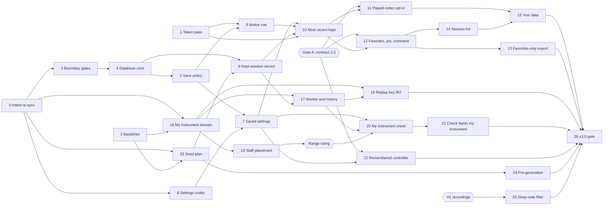

# Infinite Flow v3.0 — Build Plan

Status: v6 (2026-10-12): the owner's rulings after the wave-2 preflight (spec D290–D292, master
spec Part A v1.8) and one coordinator call, chunk 18 moving to wave 5 after chunk 17, written into
the wave table and chunks 16, 18, 19 and 24; the preflight's plan corrections applied to §2, §3,
M5 and chunks 4, 18, 19 and 24 ([Wave records](#wave-records)); v5 (2026-10-12): a wording fix
the owner approved at the wave-1 gate, no behaviour changed: chunk 23's "Done when" now says a skipped rung's seed is unused under the seed plan;
v4 (2026-10-09): the owner's answers to spec O163 and O164 (spec D257, D258, master spec
v1.6) written into chunks 9, 16 and 20 and the wave table; v3 (2026-10-09): the owner's rulings after the wave-1 preflight (spec D253–D256, master
spec v1.5) written into chunks 6, 9, 16 and 23, and chunk 23's code facts corrected
([Wave records](#wave-records)); v2 (2026-10-09): the workflow moves to wave level (spec D252,
[§3](#3-workflow-waves-and-chunks)); v1 (2026-10-07) approved by the product owner; Gate A and the
token-source pass (Q66) confirmed the same day

Build plan for v3.0, Storage, written from [master spec v1.3](master-spec.md) and the v3.0 design
in [`ui_ux/versions/v3.0/`](../../../ui_ux/versions/v3.0/README.md), the copy frozen when the
v3.1 and v3.2 design started at the `ui_ux/` root (its links were repointed there on
2026-10-08). Approved for execution. It adds no behaviour:
what the app does is in the master spec, what the interface looks like is in the design set, and
where this plan disagrees with either, they win and the plan is corrected. The code facts it
relies on are in [storage-grounding.md](storage-grounding.md); the generation-worker facts that
pre-generation needs are in [jam-grounding.md](jam-grounding.md#a7-performance-budget).

It is read by whoever builds v3.0, and by the owner. Music terms are explained where they first
appear, with a link to the project [lexicon](../../../docs/music/lexicon.md) when it has an entry.

> **Read first:** [what v3.0 undoes in v2](#2-read-first-what-v30-undoes-in-v2). v2 is built and
> tested around "nothing survives a reload". v3.0 reverses that on purpose, and about ten tests,
> two code gates and three contract guarantees change with it, each in a named chunk.

## 1. Overview

### Release sequence

v3.0 ships as one release, with one gate,
[chunk 26](#chunk-26--v30-release-gate). Chunks 0–2 are prerequisites; chunks 3–25 build the
release in the order below; the gate checks all 23 items of the
[definition of done](master-spec.md#13-definition-of-done) on the merged code and produces
`docs/release/v3.0-release-notes.md`. v3.1 (embellishment flags and presets) and v3.2 (Jam) are
not specified yet and are not planned here.

The order follows the owner's direction: the storage foundation first, then saved settings, kept
sessions and the played-notes opt-in, favorites and the export scope, the session list and Your
data, my instrument (the widest change), the check's new action and the remembered controller,
pre-generation, the stray-note filter, then the gate.

### Owner steps and gates

Some steps are not code and need the owner. They are part of the sequence:

| Step | What | When | Blocks |
| --- | --- | --- | --- |
| **Q66** | The owner allows one `ux-writer` pass on `src/styles/theme.css` and `components.css` ([ux Q66](../../../ui_ux/open-questions.md)). | Now. | [Chunk 1](#chunk-1--token-source-pass-pending-owner-approval), so every interface chunk (8, 10–15, 20–22, 25). |
| **Gate A** | The owner confirms the contract change set, part A, in the words of [`v3.0-intent-change-set.md`](../../../docs/release/v3.0-intent-change-set.md#a-contract-18--20-major-three-narrowed-guarantees); `documentalist` applies A1–A4 (CONTRACT 1.8 → 2.0) in its own commit on `main`. | As soon as the owner confirms: the narrowed wording still holds for v2.0, so it can land before any v3.0 code. | Chunks 11, 12 and 22 may not **merge** before it (each breaks one of the three old guarantees); chunk 14 follows from 12. |
| **H1** | The owner records stray notes on the Travel Sax breath controller with v2.0's played-notes export ([measurement M1](#m1--the-stray-note-threshold)). | Any time; v2.0 already exports raw played notes. | Chunk 25's threshold. |
| **Range ruling** | The owner rules on a bound for my instrument's written range from measurement M3 ([chunk 16](#chunk-16--my-instrument-in-the-domain) and [chunk 19](#chunk-19--my-instrument-on-the-staff)); `spec-writer` writes it into master spec §7.1 and §14. | After chunk 19. | Chunk 20's refusal rule. |
| **Part B1** | The owner confirms the revised `rule_instrument_profile_range` (change set part B, a MINOR contract bump). | After chunk 20's wave gate (its post-task sync revises the atom). | Nothing; the gate checks it is done. |
| **Part B2** | The owner confirms the revised `rule_controller_transposition_check` (part B, MINOR). | After chunk 21's wave gate (its post-task sync revises the atom). | Nothing; the gate checks it is done. |
| **Part C** | The owner confirms the VISION 0.7 → 0.8 text and the retirement of the four chord-fit atoms (part C). | In chunk 26. | The gate. |

### Waves

Waves run one after another. Inside a wave, chunks run one at a time in number order: the owner's
rule is **one coding chunk in flight at a time**. Each wave starts with one intent preflight, ends
with one wave gate (the full test pass, the bundle and the post-task sync), and reaches `main` as
one merge ([§3](#3-workflow-waves-and-chunks)). The chunks in a wave are independent of each other
and touch different source files, so one preflight can cover them all. One exception: in wave 5,
chunk 18 needs chunk 17, and runs after it is merged into the wave branch. A chunk still blocked
when the rest of its wave is done (waiting for the owner, a design answer or a measurement) moves to the
next wave.

**Wave 0 is the switch-over** (spec D252). Chunk 0 ran under the earlier per-chunk workflow and is
on `main`. Chunk 1 is done on its own branch, `v3-c1-token-source`. It merges into the wave branch
`v3.0-w0`, not into `main`. Chunk 2 runs on that wave branch under the new workflow, and the
wave-0 gate covers chunks 1 and 2.

| Wave | Chunks | Waits for |
| --- | --- | --- |
| 0 | 0 Intent re-sync · 1 Token-source pass · 2 Baselines | Nothing (chunk 1: the owner's Q66 answer). H1 can run now. |
| 1 | 3 Storage boundary gates · 6 Tolerant settings codec · 16 My instrument in the domain · 23 Session seed plan | Chunk 0 (and chunk 2 for 16 and 23, which its replay corpus guards) |
| 2 | 4 Database core · 19 My instrument on the staff · 24 Pre-generation at Idle | Chunk 3 (4); 16 (19); 23 (24) |
| 3 | 5 Save policy · 9 Kept-session record | Chunk 4; chunk 23 (9) |
| 4 | 7 Saved settings · 8 Notice row | Chunks 5, 6; chunk 1 for 8 |
| 5 | 10 Most recent session kept · 17 My instrument across worker and history · 18 Replay key `ifk2.` | Chunks 7, 8, 9 (10); 9, 16 (17); 17 (18, which runs after 17 inside the wave) |
| 6 | **Gate A**, then 11 Played-notes opt-in · 12 Favorites, pin, comment · 22 Remembered controller · 25 Stray-note filter | Chunk 10 and Gate A (11, 12); chunk 7 and Gate A (22); H1 and chunk 1 (25) |
| 7 | 13 Favorites-only export · 14 Session list · 20 My instrument sheet | Chunk 12 (13, 14); chunks 7, 17, 19, the range ruling and ux Q76 (20) |
| 8 | 15 Your data · 21 The check feeds my instrument | Chunks 11, 14 (15); 20 (21) |
| 9 | 26 v3.0 release gate | Every other chunk |

The critical path runs 0 → 3 → 4 → 5 → 7 → 10 → 12 → 14 → 15 → 26. My instrument (16–21) and
pre-generation (23–24) are side branches; their chunks share waves with the critical path's.

### Wave records

#### Wave 0 (2026-10-09)

Chunk 0 is on `main`. Chunk 1 merged into `v3.0-w0` from `v3-c1-token-source`. Chunk 2 merged into
`v3.0-w0` (its record is under [chunk 2](#chunk-2--baselines-replay-key-corpus-and-bundle-headroom)).
The wave-0 gate (the full test pass, the bundle and the post-task sync) has not run yet.

#### Wave 1 preflight (2026-10-09)

`documentalist` ran the full pass and the file pass for chunks 3, 6, 16 and 23, without an LLM
(classifications from `atd query`, `atd trace`, grep and reading the atoms). `atd lint` passes. No
atom was written. Of the atoms the chunks name as "(v2)", only `rule_instrument_profile_range` and
`rule_session_generation_failure_ladder` are STABLE; `entity_instrument_profile`,
`rule_seeded_phrase_reproduction`, `module_named_stream_pseudorandomness` and
`rule_ephemeral_session_state` are REVIEW.

| Chunk | Verdict | Governing atoms | Open before code |
| --- | --- | --- | --- |
| 3 | PROCEED-WITH-SIGNOFF-PENDING | `req_on_device_storage`; `rule_session_data_never_sent_or_stored`, `specification_ephemeral_state_verification` (REVIEW); `specification_browser_only_operation_verification` (STABLE); Part D `rule_ephemeral_session_state` (REVIEW, BUSINESS) | The owner confirms the Part D wording of `rule_ephemeral_session_state` at the wave gate. No ARCHITECTURE atom yet records "storage code in `src/storage/` only" (§4.3); chunk 4's capture comes after chunk 3. Keep true: the network, `sendBeacon`, microphone and cookie bans, Web Audio in `src/audio/` only, Web MIDI in `src/midi/` only, every existing `@test-link` in `tests/unit/boundaries/` (`rule_optional_midi_privacy` and `req_session_backing_track`, both STABLE, are linked in the gate files). |
| 6 | PROCEED | `rule_saved_settings_load_tolerantly`, `rule_saved_setting_is_players_choice`, `rule_settings_saved_on_change`, `rule_outdated_tab_reads_what_it_can`, `rule_played_notes_kept_only_after_opt_in` (all DRAFT) | The record shape (one record per setting, `dataVersion`) comes before chunk 4's storage capture. The saved instrument selection needs chunk 16's open instrument id. Keep true: `rule_key_change_drops_harmonic_carry_in` (STABLE, on `rebuildGenerationWorkerIntent`; chunk 6 only exports the parser) and the strict `module_generation_control_catalog` validators. |
| 16 | PROCEED-WITH-SIGNOFF-PENDING | `req_my_instrument`, `rule_my_instrument_range_limits`, `rule_my_instrument_transposition_named_interval` (DRAFT); `entity_instrument_profile`, `module_generation_request_construction`, `module_generation_control_catalog` (REVIEW); `rule_instrument_profile_range` (STABLE) | Architecture capture: a new `entity_my_instrument` (ENTITY, ARCHITECTURE, DRAFT), after the leader settles the open id's literal, how the intent gets the profile, the profile's fields and the transposition input. `entity_instrument_profile` says a new profile needs no new enumeration member; the capture scopes that to the built-ins. Keep true: the three built-ins' ranges, windows and transpositions exactly; the transposition never changes the concert range or the generated events. Part B1 also lists the concert range derived from the written range as a use of the transposition. |
| 23 | PROCEED-WITH-SIGNOFF-PENDING | `rule_pregenerated_phrase_matches_session` (DRAFT); `rule_seeded_phrase_reproduction`, `module_named_stream_pseudorandomness` (REVIEW); `rule_session_generation_failure_ladder` (STABLE); in the files also `rule_session_density_only_steps_down`, `rule_tempo_never_affects_generation`, `rule_count_in_shown_on_screen` (STABLE) | Architecture capture: a new `module_session_seed_plan` (MODULE, ARCHITECTURE, DRAFT), after the leader settles where and when the session seed is drawn, what renews it, how the seeds derive from it, the request ids, and where it is recorded. Keep true: each ladder rung its own seed; the standalone attempt's request and seed independent of how many rungs ran; nothing generated depends on machine speed; density decided at request time and only stepping down; tempo never feeding the plan; phrase 1 exactly the Idle phrase. |

Plan corrections the preflight found. Chunk 23's scope is wrong on two code facts: the generator
draws from no named random stream (it orders candidates by seeded tie keys; only the settings
mutation uses the indexed streams), and the tension arc draws nothing (it is a pure function of
the phrase number, `src/session/tension-arc-cycle.ts`). Its Files list has no Idle-side file
(`src/composables/use-generation-session.ts`), though the session seed is drawn at Idle. Chunk 16
still says the transposition spelling is "flagged to `spec-writer`"; §8 item 2 says master spec
v1.3 settled it. The Atoms lines of chunks 6 and 16 below gain the atoms the preflight added.

Conflict for `ux-writer` (blocks chunk 20, not chunk 16): the my-instrument design enters the
transposition with a semitone stepper ("{n} lower / Same / {n} higher"), while master spec §7.1
and `rule_my_instrument_transposition_named_interval` enter it as a named interval, a number of
octaves and a direction, never as a bare number of semitones.

#### Owner rulings after the wave-1 preflight (2026-10-09)

The owner settled four points the preflight raised (spec D253–D256, master spec v1.5):

- **The transposition is entered in octaves and semitones** (spec D253): a number of octaves and a
  signed semitone count, the interval name derived and shown; §7.1's spelling table stays. This
  settles the conflict above on the spec's side: the design's stepper is consistent, and
  `ux-writer` adds the derived name ([ux Q76](../../../ui_ux/open-questions.md)). The owner then
  settled where the sign sits (spec D257, closing O163): it is the direction of the whole
  transposition, octaves included, and the value is entered with the design's one stepper
  counting semitones across octaves, the derived name beside it. Chunk 16 below takes the
  octaves, semitones and direction; chunk 20 shows the name.
- **My instrument's id is `my-instrument`**, fixed and apart from its display name (spec D254):
  the open id's literal chunk 16's capture needed. Chunks 6, 9, 16 and 20 below say it.
- **A session-wide record keeps the session's own facts, its session seed among them** (spec
  D255): chunk 23 puts the session seed there, chunk 9 keeps it. The owner adds no other facts
  (spec D258, closing O164): the record holds what master spec §5.2 lists and the session seed,
  and nothing derivable from the session seed; any further fact replay needs is settled in chunk
  9's architecture capture and put to the owner then.
- **The Part D wording of `rule_ephemeral_session_state` is confirmed** (spec D256): chunk 3's
  open point is closed; `documentalist` applies it in the wave-1 post-task sync.

The plan corrections above are applied: chunk 23's Scope and Files now state the code facts,
chunk 16 no longer says the spelling is flagged to `spec-writer`, and the Atoms lines of chunks 6
and 16 carry the atoms the preflight added.

#### Wave 2 preflight (2026-10-12)

`documentalist` ran the full pass and the file pass for chunks 4, 18, 19 and 24 on `v3.0-w2`
(made from `main` a84739a), without an LLM: classifications from `atd query`, `atd trace`, `atd
check --full`, grep over the atoms and the chunks' files, and reading the atoms, the master spec,
the design and the code they name. `atd lint` passes; `atd check --full` finds no dangling link
(385 atoms). No atom was written. The three architecture captures (chunks 4, 18, 24) are made at
the start of their chunk, once its leader has settled the design points listed below. Statuses as
found: `module_generation_worker_cancellation` and `rule_dropped_attempt_cancelled` are STABLE
and on the contract's surface; `module_phrase_replay_key`, `module_notation_layout_preflight`,
`module_notation_display_convention`, `module_generation_prewarm`, `rule_seeded_phrase_reproduction`,
`rule_look_ahead_deadline`, `rule_session_start_conditions` and `service_idle_generation_session`
are REVIEW; the v3.0 atoms are DRAFT, except `entity_my_instrument`, `module_session_seed_plan`
and `rule_my_instrument_range_limits` (REVIEW since the wave-1 sign-off).

| Chunk | Verdict | Governing atoms | Open before code |
| --- | --- | --- | --- |
| 4 | PROCEED | `req_on_device_storage`, `rule_outdated_tab_stops_saving`, `rule_saved_data_belongs_to_browser_profile` (DRAFT); in the port's reach also `rule_outdated_tab_reads_what_it_can`, `rule_delete_everything`, `rule_persistent_storage_requested`, `req_your_data` (DRAFT) and the one-directory clause of `rule_ephemeral_session_state` (REVIEW) | The architecture capture (its design points below). Keep true: the chunk-3 gates as merged (`specification_browser_only_operation_verification`, STABLE); `rule_session_data_never_sent_or_stored` (REVIEW; its never-stored half is chunk 10's Part D, and chunk 4 stores nothing of a session); chunk 6's codec, which already defines the record versions (`RecordVersions`, `SETTINGS_DATA_VERSION = 1` in `src/storage/records/settings-record.ts`) and reads a record without them, or with a newer data version, as unreadable, its setting falling back to the default, never as a thrown error (`rule_saved_settings_load_tolerantly`); an outdated tab writes and deletes nothing, delete everything included. |
| 18 | PROCEED-WITH-SIGNOFF-PENDING | `module_phrase_replay_key` (REVIEW, revised by the capture), `req_my_instrument` (DRAFT), `entity_my_instrument` (REVIEW); (v2) `rule_seeded_phrase_reproduction`, `service_headless_phrase_replay`, `module_generation_worker_protocol` (REVIEW) | First the coordinator settles the overlap with chunk 17 (plan corrections below), then the capture. The capture replaces the owner's 2026-10-01 rationale, "a later generator change may replay an older key differently, which is accepted", with what master spec item 19 and chunk 2's corpus now require: every `ifk1.` key decodes to the same phrase as in v2, and v3.1 extends this to `ifk2.` keys (master spec Part B). The key still holds no app version. The owner signs the revised text at the wave gate, since it changes a rationale he recorded. Keep true: the 87-case `ifk1.` corpus byte for byte; a built-in phrase still `ifk1.`, byte-identical; one console line per accepted phrase; no played notes and no app version in a key; the decoder sharing the worker's intent validation (no parallel schema). |
| 19 | PROCEED-WITH-SIGNOFF-PENDING | `req_my_instrument` (DRAFT), `module_notation_layout_preflight` (REVIEW); in the files also `module_notation_display_convention` (REVIEW), `rule_my_instrument_transposition_named_interval` (DRAFT), `entity_my_instrument` (REVIEW), `rule_staff_needs_room_notice`, `rule_session_layout_fixed_at_start` (REVIEW) | `module_notation_layout_preflight` gives the system positions "one block size that depends on the viewport and never on a phrase or a profile", one named height for every profile. Chunk 19 makes that size follow my instrument's written range. The design settles this (phrase-workspace handoff, Notation Contract; [master spec §14](master-spec.md#14-deferred-and-open)), so it is not a spec gap, but the atom's guarantee changes. Proposed: the atom is revised before code, at the chunk's start (version 0.8, back to DRAFT for the owner's sign-off on the text, as for 0.5 to 0.7), not changed silently at the sync. The spelling question below goes to `spec-writer`. It holds back only the chunk's spelling assertions for a "higher" transposition, not the placement and height work. Keep true: every v2 notation test and the four snapshots; each built-in's placement (top line at 73.5 units for the saxophones, 60 for the keyboard); the 16-space size while no saved instrument needs more; the size changes only when my instrument is saved or deleted; no concert-pitch display. Verification ends with the owner's **range ruling**, which blocks chunk 20, not this chunk. |
| 24 | HALT-NEEDS-CONTRACT-VISION-DECISION | `req_idle_pregeneration`, `rule_pregeneration_yields_to_player`, `rule_pregeneration_discarded_on_change`, `rule_start_never_waits_for_pregeneration`, `rule_pregenerated_phrase_matches_session` (DRAFT); `module_session_seed_plan` (REVIEW); (v2) `module_generation_worker_cancellation`, `rule_dropped_attempt_cancelled` (STABLE, contract surface), `rule_look_ahead_deadline`, `module_generation_prewarm` (REVIEW); in the files also `rule_session_density_only_steps_down`, `rule_tempo_never_affects_generation`, `req_last_session_review` (STABLE). **Part D:** `rule_session_start_conditions` (REVIEW, BUSINESS); drift check `service_idle_generation_session` (REVIEW) | The owner rules on `module_generation_worker_cancellation` (conflict 1 below) before the chunk is built. The chunk is last in the wave, so chunks 4, 18 and 19 run meanwhile. Then the capture. Part D against the wave-1 sync: the sync left `rule_session_start_conditions` unchanged, and its pending note (a background pre-generation is not "a new phrase being generated") still matches `rule_start_never_waits_for_pregeneration`. It is revised at the wave-2 sync with the owner's agreement. `service_idle_generation_session` 0.2 (the sync's seed-plan revision) agrees with `module_session_seed_plan`. Its "at most one operation runs at a time" must not take in a background attempt, or edits would lock and Start would wait. Keep true: the seed plan as merged (each rung's seed from the session seed and its label, nothing drawn during a session, phrase 1 exactly the Idle phrase); no deadline cancels anything at Idle; a prewarm draws nothing from the seed and request-id providers; density only steps down; tempo never feeds generation; nothing starts while a review shows; nothing is saved. |

Plan corrections the preflight found (listed, not applied: none is a stale file path):

- **Chunk 4.** §2's storage design and chunk 4 cite "about 8.8 kB" of entry-chunk headroom. Chunk 2
  measured 5,759 B, and the wave-1 gate 4,840 B (entry 224,536 B of 229,376 B); the raw-IndexedDB
  or `idb` choice weighs that figure. A `define` in `vite.config.ts` alone reaches neither
  `vitest.config.ts` nor the workspace and notation harness configs, since none of them imports
  `vite.config.ts`. The Atoms line lacks `rule_outdated_tab_reads_what_it_can` (the reopen without
  a version), `rule_delete_everything` (delete everything), `rule_persistent_storage_requested`
  (persist, persisted) and `req_your_data` (estimate). Done when's "a record without them is
  rejected on read" must mean "unreadable", as chunk 6's codec already reads it, never a throw
  past tolerant loading.
- **Chunk 18.** The decoder rebuilds the intent through `rebuildGenerationWorkerIntent`
  (`src/generation-worker/generation-worker-inbound.ts`, a chunk-17 file). Replay runs through
  the worker runtime's own parser (`service_headless_phrase_replay`), which refuses `my-instrument`
  until chunk 17 (`entity_my_instrument`). So any `ifk2.` round trip or replay, not only "an
  end-to-end replay of a session phrase", needs the inbound half of [chunk 17](#chunk-17--my-instrument-across-the-worker-and-the-history).
  Either chunk 18 takes that half (adding `generation-worker-inbound.ts` and
  `generation-worker-protocol.ts` to its Files), or it moves after chunk 17, to wave 5. The
  coordinator decides. Three existing tests assert that `ifk2.` is refused as unsupported:
  `tests/unit/generation-worker/phrase-replay-key.spec.ts`, `phrase-replay.spec.ts` and
  `tests/unit/scripts/replay-phrase-script.spec.ts`, the last outside the Files line.
- **Chunk 19.** Scope says "the notation already transposes by a profile's chromatic and diatonic
  pair". It reads only the chromatic count (`src/domain/notation/written-phrase.ts`); only the
  MusicXML `<transpose>` reads the diatonic one. Done when says "the key signature … moved by its
  transposition", but the written key is the written tonal center the player chose, the same for
  every instrument. The transposition moves the concert key the phrase is generated in, and the
  written notes and chord roots come back from concert pitch. "The placement helper it uses" is
  `planStaffPlacement`, inside `notation-layout-policy.ts`. The 16-space size is the constant
  `NOTATION_SYSTEM_POSITION_UNITS`, read by `vexflow-engraver.ts` and
  `vexflow-two-system-engraver.ts`, with `planStaffPositions` called from `PhraseScore.vue`,
  `ReviewPanel.vue` and `src/session/session-window.ts`, and cited in `theme.css`'s sizing note.
  A size that varies reaches all of them.
- **Chunk 24.** Files has no Idle-side file: `src/composables/use-generation-session.ts` publishes
  phrase 1 with its session seed and receives the edits that discard. It has no Start-side file
  either (`workspace-session-begin.ts`, and the session engine or runner that takes the ready
  phrases). The abort signal is passed in `src/generation-worker/generation-worker-client.ts`.
- **§3.** The worktree paths read `infinite_flow-v3-w<n>` and `infinite_flow-v3-c<n>`; wave 2's is
  `infinite_flow-v3.0-w2`.
- **Key versions** are consistent: v3.0 writes `ifk2.` for a player-made instrument only, built-ins
  staying `ifk1.`; v3.1 writes `ifk3.` for every phrase; v3.2 writes `ifk4.`; and fde9188 (O171)
  puts v3.3's richer chords after `ifk4.`. `ifk3.` carries my instrument "inline, as `ifk2.`
  does", so chunk 18's choice about the name carries into `ifk3.` and `ifk4.`.
  [build-plan-v3.2.md](build-plan-v3.2.md)'s "`main` has no `src/storage/` … no `ifk2.`" has been
  stale since wave 1. It is left for that plan's own preflight.

Conflicts and gaps:

1. **For the owner (contract), blocks chunk 24.** `module_generation_worker_cancellation` (STABLE,
   contract surface) says "a generate call with no signal is never cancelled; the Idle flow passes
   none". `rule_pregeneration_yields_to_player` (master spec §8) has any player request at Idle
   cancel the background attempt through that cancellation, so a background attempt must carry a
   signal. The v3.0 change set does not list this atom. Proposed wording: "the Idle flow's player
   requests pass none; a background pre-generation attempt passes one, aborted by any player
   request at Idle". It needs the owner's agreement and a CONTRACT bump in the same change.
   Altering a surfaced guarantee is MAJOR under the grid, unless the owner rules it a narrowing.
   `rule_dropped_attempt_cancelled` (STABLE) stays true as written ("at Idle there is no
   deadline, so nothing is cancelled *for this reason*"); no change is proposed.
2. **Change-set gap (`documentalist`, owner's agreement at the wave-2 sync), does not block.**
   `rule_look_ahead_deadline` (REVIEW, BUSINESS) says "phrase 2 is generated during the one-measure
   count-in". That stops holding when phrase 2 was pre-generated. The atom has no `changes-in-v3.0`
   tag and is not in Part D. Proposed: chunk 24's sync revises it, as Part D.
3. **For `spec-writer`, the written spelling (chunk 19, and chunk 16's merged code).** Master spec
   §7.1 and `rule_my_instrument_transposition_named_interval` say the letter-name steps spell the
   notes, the key signature and the chord symbols. `module_notation_display_convention` and the
   code (`spellWrittenKey`) spell the written key from the chosen written tonal center by the
   fewest accidentals, ties toward sharps, and never read the steps. The two differ, for example,
   for "6 semitones higher" with concert C. The code writes F♯ major; an augmented fourth below C
   is G♭ major. Which one holds?
4. **For `ux-writer`:** none found.

Design points each capture waits for:

- **Chunk 4** (new ARCHITECTURE atom or atoms; parents among `req_on_device_storage`,
  `rule_outdated_tab_stops_saving`, `rule_outdated_tab_reads_what_it_can`,
  `rule_saved_data_belongs_to_browser_profile`, `rule_ephemeral_session_state`,
  `rule_delete_everything`, `rule_persistent_storage_requested`). The scope: §2's directory and
  port, database and stores, record envelope and migrations, and outdated-tab detection. The hold
  and "saving off" are chunk 5's. One atom, or a MODULE plus an ENTITY for the envelope? Is the
  database's data version the records' `dataVersion`, one number or one per store, and does
  `RecordVersions` move to `record-envelope.ts`? "Read-only" has no IndexedDB counterpart: the
  port refuses every write and delete once outdated, delete everything included, while a visit
  whose read failed may still delete everything (chunk 5's rule, but the port's error kinds must
  allow it). The store list is fixed now, since a later store needs an upgrade step. Raw
  IndexedDB or `idb`, against 4,840 B of headroom. How the app version reaches tests and harnesses.
  Is "`src/session/` and `src/export/` never import `src/storage/`" enforced by a gate (none
  exists) or left to review and the storage-free test? Links: the storage files link the new
  atom. The chunk-3 gate entries (the `src/storage/` override in `eslint.config.js`, the
  directory-scoped entry in `scripts/verify-boundaries.mjs`) link `req_on_device_storage`
  today; whether they also link the new atom is the sync's call.
- **Chunk 18** (revision of `module_phrase_replay_key`). Is the display name in `ifk2.`? The
  generator-facing profile carries it (`entity_my_instrument`). Leaving it out needs a decode-side
  rule for the name, or the name leaves that profile, or "encoding then decoding returns an equal
  intent" no longer holds. Putting it in places player text in a console line (local only) and,
  later, in `ifk3.` and `ifk4.`. What does the inline instrument hold: my instrument's owning
  fields (written range, transposition as octaves, semitones and direction, and the template only
  if it affects generation) rebuilt through `makeMyInstrument`, or the derived profile checked by
  rebuild-and-compare? The tuple shape: an eighth slot, or the instrument in place of the id. The
  refusals: an `ifk2.` key naming a built-in, an `ifk1.` key naming `my-instrument`. Who changes
  the shared rebuild (the chunk-17 overlap)? The `keyVersion` union and the console line's
  `ifk1.`-only pattern. The restated per-version replay guarantee.
- **Chunk 24** (new ARCHITECTURE atom for the Idle background queue, after the owner's ruling).
  Which calls carry an abort signal, and who aborts them? Is the cancellation's prewarm of the
  cancelled intent wanted for a background attempt? A background attempt is not an operation of
  `service_idle_generation_session`. Seeds: phrases 2 to 5 take the plan's rung seeds with no
  deadline, the standalone rung only after every carry-in rung fails. The mutation seed is derived
  at Idle when Vary settings is on, and `module_session_seed_plan` says "at Start", which needs a
  wording revision (REVIEW, owner's sign-off). Request ids are drawn at Idle from the page-wide
  provider, so "identical" with pre-generation on and off compares timelines and seeds, request
  ids aside. If `rule_pregenerated_phrase_matches_session`'s "the same request" is meant to
  include the id, that is a question for `spec-writer`. Pre-generation is not a prewarm: it never
  reuses the prewarm's fixed seed and id. Also to settle: where the ready phrases live and how
  Start hands them over (`SessionStart`); where the session's look-ahead resumes; how a ready
  phrase is checked against the layout the session holds; the discard triggers, tempo and Rising
  tempo excluded; the window re-check from the first phrase that no longer fits; stopping and
  resuming around a review; when a pre-generated phrase's replay key is emitted (at generation,
  or when spent, a discarded one never); and starting only after the prewarm.

#### Owner rulings after the wave-2 preflight (2026-10-12)

The owner settled the three points the preflight put to him (spec D290–D292, master spec Part A
v1.8). In his words: "1. ok; 2. less accidental the better, sharp in case of tie; 3. ok".

- **A background pre-generation attempt can be cancelled** (spec D290; conflict 1 above, chunk
  24). The owner agrees to revise `module_generation_worker_cancellation` (STABLE, on the
  contract's surface) to: "the Idle flow's player requests pass no signal and are never
  cancelled; a background pre-generation attempt passes one, aborted by any player request at
  Idle". He rules it a **MINOR** contract bump, not MAJOR: every guarantee the player relied on
  still holds, and the change only adds a background attempt that gives way to the player.
  `rule_dropped_attempt_cancelled` stays as written. `documentalist` applies the atom and the
  contract bump in its own commit. Chunk 24 is no longer blocked; its capture follows.
- **A written key with two spellings takes the one with fewer sharps or flats, sharps on a tie**
  (spec D291; conflict 3 above, chunks 16 and 19). The code's rule holds (`spellWrittenKey`,
  `module_notation_display_convention`), and master spec §7.1's "the letter-name steps spell the
  written notes, the key signature and chord symbols" is withdrawn. The written key is the one
  the player chose, spelled with fewer sharps or flats in its key signature; written notes and
  chord symbols (root and slash bass) are spelled in that key. For example, an instrument whose
  written notes sound 6 semitones higher writes concert C major as F♯ major, not G♭ major. The
  interval name is still derived by §7.1's table and shown; its letter-name steps stay in the
  profile's transposition and a MusicXML file's `<transpose>`, and spell nothing on the staff.
  Chunk 16's merged code needs no change. `rule_my_instrument_transposition_named_interval` still
  says the steps spell the written part; `documentalist` revises it.
- **The staff's shared height follows my instrument's written range** (spec D292; chunk 19's open
  point). The one system-position size, which `module_notation_layout_preflight` (REVIEW) says
  "never depends on a phrase or a profile", now takes my instrument's written range into account.
  It changes only when my instrument is saved or deleted, never from phrase to phrase, as the
  design already says. `documentalist` revises the atom before chunk 19's code.

One call by the coordinator, with no decision number:

- **Chunk 18 moves to wave 5, after chunk 17.** Its `ifk2.` decoder rebuilds the intent through
  `rebuildGenerationWorkerIntent` (chunk 17's file), and replay goes through the worker runtime's
  own parser, which refuses `my-instrument` until chunk 17. Taking chunk 17's inbound half into
  chunk 18 would blur both chunks, and chunk 18 is off the critical path. Wave 2 is now chunks 4,
  19 and 24; wave 5 is chunks 10, 17 and 18. Chunk 18 is the first chunk that depends on another
  chunk of its own wave: number order runs it after chunk 17 is merged into the wave branch, and
  their files stay apart.

The preflight's plan corrections are applied: §2's storage design and M5 give the headroom left
after the wave-1 gate; chunk 4's Scope, Files, Atoms and Done when take the `define` reach, the
four missing atoms and "unreadable"; chunk 18's Scope, Files and Depends on take chunk 17's
rebuild and the three tests that assert `ifk2.` is refused; chunk 19's Scope, Files and Done when
take the chromatic-only notation, the written key the player chose, `planStaffPlacement` and the
readers of `NOTATION_SYSTEM_POSITION_UNITS`; chunk 24's Files take the Idle-side and Start-side
files and the worker client; §3 gives the worktree paths in use; and
[build-plan-v3.2.md](build-plan-v3.2.md)'s stale "`main` has no `src/storage/`" line is
corrected. Chunk 16's Scope no longer says the diatonic count decides the spelling (spec D291).

Not blocking: `rule_look_ahead_deadline`'s "phrase 2 is generated during the one-measure
count-in" (conflict 2 above) is revised in chunk 24's sync, as Part D, with the owner's agreement
then. Chunk 24's Part D line names it.

## 2. Read first: what v3.0 undoes in v2

v2 promised that nothing survives a reload and enforced it three ways: two code gates, about ten
tests and three contract guarantees. v3.0 reverses the promise on purpose
([master spec §10](master-spec.md#10-what-v30-changes-in-v2s-guarantees)). Each enforcement point
changes in exactly one chunk, never "along the way":

| What says "nothing is saved" today | Changed in | Becomes |
| --- | --- | --- |
| `eslint.config.js` `forbiddenPersistenceApis`; `scripts/verify-boundaries.mjs` `forbiddenPersistence` | [3](#chunk-3--storage-boundary-gates) | Storage APIs allowed in `src/storage/` only, still banned everywhere else; `navigator.storage` and `cookieStore` banned outside it too (a gap today). |
| `tests/e2e/release/persistence-absence.spec.ts` › 'no customized control, generated phrase, or instrument profile survives a reload' | [7](#chunk-7--saved-settings) | Settings come back; a generated phrase still does not. |
| same file › 'a retryable generation failure does not survive a reload' | [7](#chunk-7--saved-settings) | Same behaviour; its storage-length checks become "no failure record in the database". |
| `tests/e2e/workspace/theme.spec.ts` › 'nothing about the theme choice persists across a reload' | [7](#chunk-7--saved-settings) | The theme comes back. |
| `tests/e2e/review/review-navigation.spec.ts` › reloading discards the Review | [10](#chunk-10--most-recent-session-kept) | After a reload, `Review last session` opens the kept session. |
| `tests/e2e/review/review-privacy.spec.ts`, storage half | [11](#chunk-11--played-notes-opt-in-and-deletion) | Only allowed data is written; played notes only after the opt-in. The network half stays as it is. |
| `tests/e2e/review/review-opens.spec.ts` › 'the Review has no favorites…' | [12](#chunk-12--favorites-pin-and-comment-in-the-review) | Favorites exist; still no grading wording anywhere. |
| `tests/e2e/controller/controller-status.spec.ts` › 'after a page reload no controller is remembered…' | [22](#chunk-22--remembered-controller) | The remembered controller is reattached when access is already allowed; after `Disconnect`, nothing is. |
| Reload-based determinism tests in `audio-transport-mix.spec.ts`, `midi/midi-input.spec.ts`, `release/deterministic-replay.spec.ts` | [7](#chunk-7--saved-settings) re-checks them | They must not depend on a reload returning to defaults; each is fixed or proved unaffected. |
| `tests/unit/session/session-history-export.spec.ts` › 'touches no browser storage…' | **Never** | Stays green: the history and export modules stay storage-free (definition-of-done item 4). |
| Contract guarantees in `req_last_session_review`, `rule_optional_midi_privacy`, `rule_same_controller_reattaches` | **Gate A** | Narrowed to what holds in both v2.0 and v3.0 (CONTRACT 2.0). |

Every replaced test gets its v3.0 counterpart in the same chunk, and the gate lists each pair
(item 22).

### The storage design the chunks build on

Proposed here, settled in [chunk 4](#chunk-4--database-core) with `documentalist`'s architecture
capture before code, and written down in a new `docs/storage.md`:

- **One directory, `src/storage/`.** Everything that touches IndexedDB or `navigator.storage`
  lives there: the database adapter, and the pure codecs that decide what a record holds, so "what
  is saved" is auditable in one place. The rest of the app reaches it through an injected port
  (the pattern `src/audio/` and `src/midi/` already use), never by import of a browser API.
  `src/session/` and `src/export/` never import it.
- **Raw IndexedDB, no library.** 4,840 bytes of entry-chunk headroom are left after the wave-1
  gate (entry 224,536 of 229,376 bytes; 8.8 kB when this was written, 5,759 bytes at chunk 2); a
  hand-written promise wrapper over the few calls needed costs less than `idb`. If chunk 4 finds otherwise,
  `idb` (about 1.5 kB gzip) is the fallback, never a larger library.
- **One database, a few object stores:** `meta` (the database's data version and the app version
  that last upgraded it), `settings` (one record per setting, so each loads and fails on its own),
  `instrument` (my instrument), `controller` (the remembered controller), `sessionSummaries`
  (what a list row and Your data's counts show), `sessionBodies` (the phrases, read only when a
  session is opened) and `playedNotes` (one record per session, a store of its own so the opt-in
  and the deletions are provable).
- **Every record carries `dataVersion` (an integer, 1 for v3.0) and `appVersion`** (the package
  version, injected at build time). Migrations run in the database's upgrade step, one step per
  data version.
- **Saving is off, not failing, when it must be:** an outdated tab, or a visit started from the
  defaults because the read failed or was too slow. A **hold** queues every write while a session
  runs and flushes the latest value per record at its end.
- **Outdated tab detection:** at open (a stored data version above the code's, or a `VersionError`
  from a database upgraded by a newer app, in which case the tab reopens it without a version to
  read what it can); while open (the `versionchange` event, and a check of `meta` inside every
  write transaction, so a newer tab that wrote without an upgrade is caught before this tab
  writes).

## 3. Workflow: waves and chunks

Work runs **wave by wave**. The intent checks and the full test and performance pass happen once
per wave; a chunk tests only what it changed. The owner chose this on 2026-10-09 (spec D252) for a
better quality-to-cost ratio. He accepts that the chunks of one wave may drift a little apart
before the wave gate catches it.

**Order.** One wave at a time, in wave order. Inside a wave, one chunk at a time, in number order.
**One coding chunk is in flight at a time.** A chunk may go ahead of a blocked lower-numbered chunk
of the same wave. If a chunk is still blocked when the rest of its wave is done (it is waiting for
the owner, a design answer or a measurement), it leaves the wave: the wave closes without it, and
it joins the next wave, whose preflight covers it.

**Branches.** At the start of a wave, a wave branch `v3.0-w<n>` is made from `main` in its own
worktree (`/home/bastien/work/infinite_flow-v3.0-w<n>`). Each chunk runs in its own worktree
(`/home/bastien/work/infinite_flow-v3.0-c<n>`) on a branch made from the wave branch
(`v3.0-c<n>-<slug>`). It ends with one commit, merged `--no-ff` into the wave branch as soon as
its chunk checks pass; that merge needs no owner approval. The wave branch merges `--no-ff` into
`main` after the wave gate, when the owner asks, so `main` only ever receives waves that passed
the full gate. Never reuse `../infinite_flow-perf-investigation`.

### Wave start: intent preflight

1. `documentalist` runs its preflight **once for the whole wave**. It does the full pass, then
   runs again with the files of every chunk in the wave, starting from the chunks' **Atoms**
   lines. A missing or conflicting atom stops the chunk it concerns until it is resolved: a spec
   gap goes to `spec-writer`, a design gap to `ux-writer`. The wave's other chunks go on, because
   chunks in one wave are independent.
2. For every chunk of the wave marked **Architecture capture**, `documentalist` records the
   architecture now, before any code, in a commit on the wave branch.
3. A chunk runs no preflight of its own. If a chunk still meets an atom that contradicts it, it
   stops and reports it as in step 1. It never fixes it silently.

ATD covers business behaviour and architecture only, never tooling, tests' plumbing or
measurement scripts.

### Every chunk: four steps

A chunk is finished when step 4 is done and it is merged into the wave branch.

1. **Tests first, red to green.** Write the tests for the chunk's **Done when** first and see them
   fail on an assertion about the missing behaviour, not an import error.
   - Pure logic gets Vitest unit tests under `tests/unit/`, mirroring `src/`. IndexedDB in Vitest
     runs on `fake-indexeddb` (a dev dependency added in chunk 4); its quota and failure cases are
     injected through the port, never by a test-only branch.
   - Behaviour gets Playwright scenarios on the workspace harness. Each test starts with an empty
     browser context; a test that needs saved data seeds it through the harness's storage seam
     (added in [chunk 7](#chunk-7--saved-settings)), never by hand-built records.
   - A new Playwright spec outside `tests/e2e/notation/` is added to the explicit `test:e2e` list
     in `package.json`, or it never runs in `npm run quality`.
2. **Implement** until the tests pass, following [`CODING_RULE.md`](../../../CODING_RULE.md):
   crash early, no silent fallbacks (tolerant loading is the spec's explicit exception, and lives
   in one codec), injected seams instead of test-only branches, an injected clock, the file-size
   limits. Interface code uses only the classes and tokens of `src/styles/`; no raw visual value.
3. **Verify the change, not the whole app.** These are the **chunk checks**; each chunk's
   **Verification** line starts from them:
   - The chunk's **Done when** holds.
   - The tests the chunk adds or changes pass. So do the existing unit tests of the source files
     it touches (`npx vitest related --run <those files>`) and the Playwright specs it adds or
     edits.
   - `npm run typecheck`, `npm run lint` and `npm run format:check` pass, and
     `npm run lint:links` passes when the chunk changed a Markdown file.
   - A debug run shows the behaviour on screen (`npm run dev` in Chromium, or the workspace
     harness), with a landscape phone-sized window for anything that shows below
     `bp-tablet-landscape`. Never edit the repository while the owner is testing on the dev
     server: Vite reloads the page.
   - The chunk does **not** run `npm run quality`, the full end-to-end, accessibility or notation
     suites, the sweep, a bundle measurement or a timing measurement, unless its **Verification**
     line names that check. A line names one only when the check is the chunk's point: a
     measurement chunk, or a chunk whose change is that area (the boundary gates in chunk 3,
     notation in chunk 19). A check the line places "at the wave gate" waits for the wave gate.
4. **Documents.** `README.md` (directory boundaries, the forbidden-API lists, the quality-gate
   table), `docs/storage.md` (new, from chunk 4), `docs/testing.md` (every new seam, fake and
   fixture), and the area's own document. A place where the code had to differ from the spec or
   the design is reported to `spec-writer` or `ux-writer`, never fixed silently.

### Wave end: the wave gate

"The gate" alone still means the release gate, chunk 26; "the wave gate" is this one.

When the wave's last chunk is merged into the wave branch, on that branch and on an idle machine
(never while `atd audit` runs: it saturates the machine and makes timing tests fail):

1. **The full test pass.** `npm run quality`, and `npm run test:sweep` when a chunk of the wave
   places the sweep at the wave gate, with every other check or measurement a chunk's
   **Verification** line places there. A failure is traced to the chunk that caused it and fixed
   on the wave branch in a commit of its own. A fix that would change behaviour the spec or the
   design states goes to `spec-writer` or `ux-writer` instead.
2. **The bundle.** The entry chunk's size after `npm run build`, with its change since the
   previous wave ([measurement M5](#m5--the-first-load-bundle)), is written in the wave's merge
   commit message. A chunk's "lazy" or "unchanged" claim about the entry chunk is checked here.
3. **Performance.** A figure measured on a virtual machine never gates: it is recorded with the
   machine and date, for reference. The owner checks budgets on the reference machine.
4. **Post-task sync, once for the wave.** `documentalist` runs it over the wave's whole diff. It
   checks the `@spec-link` / `@test-link` tags (directly above the function or test, never at the
   top of a file), confirms the atoms still describe the code, and applies every chunk's
   **Part D** revisions (the non-STABLE atoms the change set tags `changes-in-v3.0`). It advances
   a status only with the owner's agreement. `npm run atd:lint` and `npm run atd:check` pass. The
   sync is committed on the wave branch.
5. **Merge.** The owner gets a short report: the chunks merged, any chunk moved to the next wave,
   the gate's results, the bundle figure and the sync's changes. The wave branch merges into
   `main` when he asks. Then its worktrees and branches are removed.

## 4. Measurements

Five figures the spec leaves to the build, each with the chunk that takes it and where it is
recorded. The gate copies each into the release notes.

### M1 — The stray-note threshold

- **What:** the constant under which a played note counts as a very short "stray" note
  ([§9](master-spec.md#9-stray-notes)): a note a controller sends for a few milliseconds while the
  fingers move between two positions. It must stay well under 62.5 ms, a sixteenth note at
  240 BPM. Measurement starts around 30–40 ms.
- **How:** the owner (step H1) plays, on the Travel Sax over USB in v2.0 as it ships (nothing new
  is needed), three sessions of a few minutes: slow scales, fast scales at 240 BPM, and free
  playing with many finger changes, then exports each session's played notes (v2.0's MIDI file,
  960 ticks per quarter note, so under 1 ms of resolution at any tempo). Chunk 25 adds a script
  that lists every note's length in ms from those files and draws the distribution. Stray notes
  show as a separate cluster of very short lengths, often in pairs at full velocity; the
  threshold goes in the gap between that cluster and the shortest intended notes.
- **Recorded:** a new section of [`docs/midi-tuning.md`](../../../docs/midi-tuning.md), with the
  files kept under `tests/fixtures/stray-notes/` so the filter's tests replay real data.

### M2 — The start-up wait for saved settings

- **What:** how long the first draw waits for saved data before starting from the defaults
  ([§4.4](master-spec.md#44-loading-saved-settings)). The design proposes 2 seconds.
- **How:** chunk 7 times the load read (settings, my instrument, the remembered controller and
  every session summary) on a seeded database with 0, 10, 100 and 500 kept sessions, cold (first
  load after a browser start) and warm, on the reference machine; the owner repeats it on the
  Chromium tablet if at hand. The constant is set at no more than 2 s and well above the slowest
  measured read.
- **Recorded:** `docs/storage.md`.

### M3 — My instrument: generator success and a written-range bound

- **What:** whether a range of exactly two octaves, or an extreme one, makes phrase generation
  fail too often ([§7.1](master-spec.md#71-what-it-is), item 16), and how far a written range may
  reach before it makes the staff taller for every instrument
  ([§14](master-spec.md#14-deferred-and-open)).
- **How:** chunk 16 runs a sweep like `npm run test:sweep` over player-made instruments: 24-semitone
  ranges placed low, middle and high in the MIDI range, the extreme ends (MIDI 0–24 and
  103–127), and wide ranges (48 and 60 semitones), each against every supported rhythm setting
  with two seeds, recording the share of failed generations by failure code. Chunk 19 measures,
  with the engraving calibration, the staff height a written range needs, and the written range
  beyond which the shared height grows past today's.
- **Recorded:** `docs/generation-latency.md` (a new "My instrument ranges" section) and
  `docs/notation-engraving.md`. The owner's **range ruling** follows; `spec-writer` writes it into
  the spec, and chunk 20 enforces it.

### M4 — Phrase 2 joining phrase 1 at 240 BPM after pre-generation

- **What:** the share of 240 BPM sessions whose phrase 2 joins phrase 1 smoothly (generated with a
  **carry-in**: the generator continues from phrase 1's last note and chord instead of starting
  afresh) once pre-generation runs; v2's figure is 0 % (item 20).
- **How:** chunk 24 extends the real-cost sweep (568 cases, every supported rhythm setting × two
  seeds) with an Idle phase before Start, no deadline, then the session as today. It counts the
  cases whose phrase 2 is a carry-in phrase. Run by the owner on the reference machine.
- **Also, for information** (from the pre-generation draft, not the definition of done): the cost
  of up to four background generations after each change, on the tablet on battery, as a hand
  check.
- **Recorded:** `docs/generation-latency.md`.

### M5 — The first-load bundle

- **What:** the entry chunk stays within its 224 kB budget (`scripts/verify-boundaries.mjs`); about
  8.8 kB were left on 2026-10-05, 5,759 bytes at chunk 2 and 4,840 bytes after the wave-1 gate.
- **How:** chunk 2 measures the baseline on `main`; every wave gate records the entry size and its
  change since the previous wave ([§3](#wave-end-the-wave-gate)). Code that is not needed before the
  first draw loads on demand: the kept-session codec and the session list with the review's code,
  the Your data and my instrument sheets like the connection sheet. Raising the budget needs the
  owner.
- **Recorded:** each commit message, and the gate's release notes.

## 5. Hand checks

The owner runs these himself. His hardware is the Travel Sax breath controller over USB and the
reference machine; he owns no USB keyboard, so no keyboard check is part of v3.0 (v2.0's carried
keyboard checks stay where they are). Each is written into a new v3.0 part of
[`HARDWARE-CHECKLIST.md`](../../../HARDWARE-CHECKLIST.md) by the chunk named, and run at that chunk
or at the gate.

| Check | Chunk | What the owner does |
| --- | --- | --- |
| H1 Stray-note recordings | Wave 0, used by 25 | M1's three sessions, played-notes exports kept. |
| H2 Start-up wait | 7 | M2 on the reference machine, and the tablet if at hand. |
| H3 Use this for my instrument | 21 | Set the Travel Sax's transpose to a value that does not match the selected profile, run the check, use the result, confirm the written part now matches, reload, confirm it stayed. |
| H4 Remembered controller | 22 | Connect the Travel Sax, reload: it reattaches with no prompt; the starting note waits for one click; unplug and replug; `Disconnect`, reload: nothing reattaches. |
| H5 Stray notes in real playing | 25 | Play a fast passage, open the review: the lane shows no stray notes; the played-notes export leaves them out by default and keeps them with `Include very short notes`. |
| H6 Pre-generation at 240 BPM | 24 | Start several 240 BPM sessions right after phrase 1 appears and after waiting a few seconds; note the tablet's battery cost (M4, for information). |
| H7 Persistent storage in real Chrome | 26 | Pin a session in the installed app and in a plain tab; read Your data's Protection line. For information: Chrome decides silently. |
| H8 Favorites-only files in real programs | 26 | Open a favorites-only MusicXML in MuseScore and both MIDI files in a MIDI tool; phrase numbers and markers match the session. May follow the tag as a v3.0.x note, as in v2. |

## 6. Chunks

Each chunk names its goal, what it builds and where, the spec sections and design documents, the
atoms, what it waits for, how to tell it is done, which definition-of-done items it covers, and
how it is verified. "Item _n_" is item _n_ of [§13](master-spec.md#13-definition-of-done).
**Atoms** are ids of `docs/<id>.atom.md`; "(v2)" marks an existing atom the chunk must keep true
or revises. **Part D** lists the non-STABLE atoms tagged `changes-in-v3.0` that the chunk's
post-task sync revises.

### Chunk 0 — Intent re-sync to master spec v1.3

**Goal.** Bring the 37 v3.0 atoms in line with master spec v1.3. They were ingested from v1.0, and
v1.1 and v1.2 add behaviours the atoms do not have yet: `Disconnect` also forgets the remembered
controller; Delete everything reloads into a first visit; saving a session deletes every unpinned
session, not only the previous one; removing a session's last favorite never unpins it; switching
`Keep my played notes` on keeps the session that just ended; the start-up wait and the saving-off
visit; my instrument's written range kept when the transposition changes, and the range bound
still open; the remembered controller reattached only when MIDI access is already allowed; theme
and audio-mix changes made during a session saved at its end; the starting note waiting for the
page's first click after a load.

**Scope.** `documentalist`, spec ingestion (milestone refinement). Atoms only; no code. It also
puts the Gate A confirmation request in front of the owner, unchanged from the change set.

**Atoms:** every atom tagged `release-v3.0`; `rule_last_controller_remembered`,
`rule_delete_everything`, `rule_most_recent_session_kept`, `rule_favorite_pins_session`,
`rule_played_notes_kept_only_after_opt_in`, `req_on_device_storage`,
`rule_saved_settings_load_tolerantly`, `rule_settings_saved_on_change`, `req_my_instrument`,
`rule_my_instrument_range_limits` in particular.

**Depends on:** nothing.

**Done when:** each v1.1/v1.2 behaviour above is stated by an atom (still DRAFT); `npm run atd:lint`
and `npm run atd:check` pass; the change set file says which atoms changed.

**Items covered:** none directly; every later wave's preflight relies on it.

**Verification:** `documentalist`'s ingestion report; `npm run quality`.

### Chunk 1 — Token-source pass (pending owner approval)

**Pending the owner's go-ahead on [ux Q66](../../../ui_ux/open-questions.md).**

**Goal.** Write v3.0's new tokens and component classes into the canonical token source, so every
interface chunk can style its components without inventing a value.

**Scope.** `ux-writer`, not a coding executor. Edits `src/styles/theme.css` and
`src/styles/components.css` only: everything in
`ui_ux/token-source-v3.md` (deleted by this chunk once merged) (`--color-error-hover`,
`--sheet-wide-max-inline-size`, the stepper, text-input, comment-field and favorite-icon sizes, and
the new classes such as `sheet-wide`, `app-notice-row`, `layout-footer`, `sessions-panel`,
`session-row*`, `favorite-toggle`, `review-comment`, `review-scope`, `note-stepper`,
`range-alert`, `toggle-button`); clears the old `v2 new` / `v2 changed` comments; fixes the
audio-mix comment; then deletes `token-source-v3.md` and points `ui_ux/README.md` and the
handoffs at the token source alone. The chunk was built before the v3.0 design was frozen into
`ui_ux/versions/v3.0/`, so after the merge `ux-writer` applies the same clean-up there too (that
folder's README and handoffs), as `ui_ux/todo.md` records.

**Design docs:** `ui_ux/token-source-v3.md`,
[`ui_ux/README.md`](../../../ui_ux/README.md).

**Atoms:** none (styling is not business behaviour).

**Depends on:** the owner's Q66 answer.

**Done when:** every class and token `token-source-v3.md` names exists in `src/styles/`; no v3.0
handoff names a class that exists nowhere; `npm run quality` passes with no snapshot change
(nothing uses the new classes yet); `npm run lint:links` passes after the document is deleted.

**Items covered:** none directly; it unblocks 8, 10–15, 20–22 and 25.

**Verification:** `npm run quality`; a `grep` of each handoff's class names against `src/styles/`.

### Chunk 2 — Baselines: replay-key corpus and bundle headroom

**Goal.** Record, on the code v2.0.0 shipped, the two facts later chunks must not break: the
phrase every `ifk1.` replay key gives, and the entry chunk's size.

**Scope.**

- A corpus of `ifk1.` keys with the timeline each one replays to, generated from `main` before
  any v3.0 change: the three built-in instruments × Neutral and Jazz × a spread of controls ×
  several seeds, with and without carry-in (including a carry-in whose final harmony is null).
  Fixture `tests/fixtures/replay-keys/ifk1-v2.0.json` and a unit test,
  `tests/unit/generation-worker/phrase-replay-key-corpus.spec.ts`, that decodes each key and
  regenerates it through the worker runtime and expects the stored timeline byte for byte.
- The entry chunk's size after `npm run build` on `main`, written in this plan's chunk 2 record
  and in `docs/testing.md`'s fixture list with the corpus. It is measured on `main`, which still
  holds the v2.0.0 code, not on the wave-0 branch, which also holds chunk 1's styles. The wave-0
  gate's figure then shows what chunk 1 added.

**Files:** `tests/fixtures/replay-keys/ifk1-v2.0.json`, the spec above, a small generator script
under `scripts/` (tooling), `docs/testing.md`.

**Atoms:** none new (test plumbing); the corpus later backs `module_phrase_replay_key` and
`rule_seeded_phrase_reproduction` (v2), whose tags chunk 18 adds.

**Depends on:** nothing.

**Done when:** the corpus test passes on `main`; the baseline size is recorded.

**Items covered:** 19 (its "every `ifk1.` key still decodes to the same phrase" half, as a guard
for chunks 16, 17, 18 and 23).

**Verification:** the chunk checks; the corpus test is red if any timeline is changed by hand.

**Record (2026-10-09).** Measured on `main`'s v2.0.0 code, on a cloud VM (a VM figure is for
reference only). After `npm run build`, the entry chunk `dist/assets/index-*.js` is 223,617 bytes,
counted as `scripts/verify-boundaries.mjs` counts it: the minified file's size on disk, with no
compression (Vite reports 73.6 kB gzip, which no budget checks). Its budget is 224 kB of 1,024
bytes, 229,376 bytes, so 5,759 bytes (about 5.6 kB) of headroom are left, less than the 8,831 bytes
(the "about 8.8 kB" above) of the 2026-10-05 build: v2.0.0 took further source changes on
2026-10-06 and 2026-10-07. The corpus holds 87 cases: 72 standalone phrase-1 keys (three built-in
instruments × Neutral and Jazz × four control spreads × seeds 1, 7 and 42), 12 carry-in keys
(phrases 2 and 3 of a three-phrase chain on the eighths spread, per instrument and profile) and 3
key-change phrase-2 keys whose carry-in has a null final harmony. The fixture is about 711 kB.

### Chunk 3 — Storage boundary gates

**Goal.** Move the storage ban from "nowhere" to "one directory": allow IndexedDB and
`navigator.storage` in `src/storage/` only, and keep every other ban.

**Scope.** Per-directory allowance on the model of `src/audio/` (Web Audio) and `src/midi/` (Web
MIDI). `indexedDB` and `navigator.storage` allowed in `src/storage/` only; `localStorage`,
`sessionStorage`, `caches`, `document.cookie` and `cookieStore` still banned everywhere,
`src/storage/` included; `navigator.storage` and `cookieStore` newly banned outside it (today only
the end-to-end spy watches them). The PWA rules (`runtimeCaching: []`, the precache manifest)
are untouched.

**Files:** `eslint.config.js`, `scripts/verify-boundaries.mjs`,
`tests/unit/boundaries/eslint-boundaries.spec.ts`,
`tests/unit/boundaries/verify-boundaries.spec.ts`, fixtures under
`tests/fixtures/boundaries/src/storage/` (allowed) and the existing `src/audio/storage.ts` and
`src/midi/storage.ts` fixtures (still rejected); `README.md` (forbidden lists, quality-gate
table), [`docs/release/browser-and-offline-limits.md`](../../../docs/release/browser-and-offline-limits.md).

**Spec sections:** [§4.3](master-spec.md#43-where-and-how), [§12](master-spec.md#12-architectural-decisions-and-their-reasons).

**Atoms:** `req_on_device_storage`; (v2) `rule_session_data_never_sent_or_stored`,
`specification_ephemeral_state_verification`, `specification_browser_only_operation_verification`.
**Part D:** `rule_ephemeral_session_state` (its "never stored" clause gets the one-directory
wording, confirmed by the owner on 2026-10-09, spec D256; the full revision is chunk 7's).

**Depends on:** chunk 0.

**Done when:**

- An `indexedDB.open` and a `navigator.storage.persist()` call under `src/storage/` pass both
  gates; the same calls in `src/audio/`, `src/midi/`, `src/session/`, `src/export/` and
  `src/components/` fail both, each proved by a fixture.
- `localStorage`, `sessionStorage`, `caches`, `document.cookie` and `cookieStore` fail both gates
  even inside `src/storage/`.
- `tests/unit/session/session-history-export.spec.ts` is unchanged and green.

**Items covered:** 4.

**Verification:** the chunk checks; `npm run verify:boundaries`.

### Chunk 4 — Database core

**Architecture capture:** the storage design of [§2](#the-storage-design-the-chunks-build-on).

**Goal.** One IndexedDB database for the app, with versioned records, migrations, and the
outdated-tab rule, behind a port. No setting is saved yet.

**Scope.**

- `src/storage/database.ts`: open with the code's data version; create the object stores of §2;
  a migration runner (one step per data version, tested with a fake version 0 → 1 step and a
  synthetic 1 → 2 step that only the test registers through the port); on `VersionError`, reopen
  without a version, read-only, and report "outdated"; `versionchange` closes the connection and
  reports "outdated"; every write transaction reads `meta` first and aborts with "outdated" when
  its data version is above the code's.
- `src/storage/record-envelope.ts`: `dataVersion` and `appVersion` on every record; reading a
  record with a higher data version reports it as "newer" rather than failing.
- `src/storage/app-version.ts`: the package version, injected at build time. A `define` in
  `vite.config.ts` alone reaches neither `vitest.config.ts` nor the workspace and notation harness
  configs (`vite.workspace-harness.config.ts`, `vite.notation-harness.config.ts`), since none of
  them imports `vite.config.ts`; the capture settles how the version reaches them.
- `src/storage/storage-port.ts`: the interface the app sees (read, write, delete, delete
  everything, estimate, persisted, persist), and the error kinds: `quota`, `outdated`, `other`.
- `fake-indexeddb` as a dev dependency.

**Files:** the four `src/storage/` files above, `vite.config.ts` (`define`), and
`vitest.config.ts` and the two harness configs as the capture settles, `package.json`, tests
under `tests/unit/storage/`, `docs/storage.md` (new).

**Spec sections:** [§4.3](master-spec.md#43-where-and-how), [§4.6](master-spec.md#46-storage-belongs-to-one-address).

**Design docs:** [`flows/saved-data/handoff.md`](../../../ui_ux/versions/v3.0/flows/saved-data/handoff.md) (Load,
the newer-version branch).

**Atoms:** `req_on_device_storage`, `rule_outdated_tab_stops_saving`,
`rule_saved_data_belongs_to_browser_profile`, `rule_outdated_tab_reads_what_it_can` (the reopen
without a version), `rule_delete_everything` (delete everything),
`rule_persistent_storage_requested` (persist, persisted), `req_your_data` (estimate).

**Depends on:** chunk 3.

**Done when:**

- Every record written carries `dataVersion` and `appVersion`; a record without them is read as
  unreadable, as chunk 6's codec already reads it (its setting falls back to the default), never
  as an error thrown past tolerant loading.
- A database at data version 0 is migrated to 1 on open; a test-only step 1 → 2 runs in order.
- Two connections in one test: the newer opens with a higher version; the older gets
  `versionchange`, reports "outdated" and never writes again. A newer tab that writes a higher
  `meta` version without an upgrade makes the older tab's next write abort with "outdated".
- Opening a database already at a higher version gives a read-only connection and "outdated".
- Delete everything removes the database.

**Items covered:** 14 (the storage layer's half).

**Verification:** the chunk checks; the bundle at the wave gate (nothing imports the module yet, so
no change is expected).

### Chunk 5 — Save policy

**Goal.** Decide, in one place, when a write happens: saving on or off for the visit, held during
a session, failures classified and reported, persistent storage asked for once.

**Scope.** `src/storage/save-policy.ts` (pure, with the port injected):

- **Saving state:** `on`, `off-outdated`, `off-unreadable`. Every write is skipped while off.
- **Session hold:** `hold()` at Start, `release()` at the session's end; writes made in between
  are queued, coalesced to the latest value per record, and flushed in one transaction at
  release. Nothing touches the database while held.
- **Failure report:** each failed write reports `quota` or `other` to one listener (the notice
  row, chunk 8); a run of refusals with no success between them reports once.
- **Persistent storage:** `requestProtection()` calls `navigator.storage.persist()` at most once
  per visit, never while saving is off, never when `persisted()` is already true.
- **Space and protection:** `estimate()` and `persisted()` wrappers for Your data.

**Files:** `src/storage/save-policy.ts`, `src/storage/storage-port.ts` (extended),
`tests/unit/storage/save-policy.spec.ts`, `docs/storage.md`.

**Spec sections:** [§4.1](master-spec.md#41-principles), [§4.2](master-spec.md#42-what-is-saved-automatically) (saved at the session's end), [§4.5](master-spec.md#45-keeping-the-data-safe-from-the-browser), [§5.1](master-spec.md#51-which-sessions-are-kept).

**Design docs:** [`flows/saved-data/handoff.md`](../../../ui_ux/versions/v3.0/flows/saved-data/handoff.md) (What
Is Saved, Notices).

**Atoms:** `rule_no_save_during_session`, `rule_failed_save_never_disturbs_session`,
`rule_persistent_storage_requested`, `rule_outdated_tab_stops_saving`.

**Depends on:** chunk 4.

**Done when:**

- Between `hold()` and `release()` the fake database sees no call at all; at `release()` it
  sees each held record once, with its latest value.
- While off, no write reaches the database and no protection request is made.
- A quota failure and an other failure are reported with their kind; a second refusal in a row
  is not reported again; one after a success is.
- `persist()` is called once per visit, after the first protection request, and never when
  already persisted.

**Items covered:** 7, 13 and 15 (the storage layer's half of each).

**Verification:** the chunk checks.

### Chunk 6 — Tolerant settings codec

**Goal.** Load each saved setting on its own: an unknown or invalid value becomes that setting's
default, and every other setting is kept.

**Scope.** `src/storage/records/settings-record.ts`: encode and decode one record per setting:
each of the 14 controls (instrument selection included, which may name my instrument by its fixed
id, `my-instrument`, never by its display name; master spec §7.1), the
musical profile selection, the theme, the audio mix (each on/off and volume), the three "During a
session" options, the review's format, backing-track and `Played notes` choices, and
`Keep my played notes`. Decoding validates each value through the existing validators
(`validateControlValue`, `normalizeTempo`, `validateClickVolume`, `validateBackingVolume`) and
falls back to that setting's default, never throwing; the musical profile parser is exported from
`src/generation-worker/generation-worker-inbound.ts` or a tolerant twin is added. After decoding,
the whole set goes through `makeGenerationControls` once, so the strict builders still guard what
the app runs. A saved instrument selection naming my instrument is kept only if my instrument
itself loads (the my-instrument record arrives in chunk 20; until then it falls back).

**Files:** `src/storage/records/settings-record.ts`, maybe `src/storage/records/setting-defaults.ts`,
`src/generation-worker/generation-worker-inbound.ts` (export only),
`tests/unit/storage/settings-record.spec.ts`.

**Spec sections:** [§4.2](master-spec.md#42-what-is-saved-automatically), [§4.4](master-spec.md#44-loading-saved-settings).

**Atoms:** `rule_saved_settings_load_tolerantly`, `rule_saved_setting_is_players_choice`,
`rule_settings_saved_on_change`, `rule_outdated_tab_reads_what_it_can`,
`rule_played_notes_kept_only_after_opt_in`.

**Depends on:** chunk 0. Independent of chunks 3–5 (pure code).

**Done when:**

- For every setting, a record with an unknown value, a wrong type, or an out-of-range number
  decodes to that setting's default, and every other setting in the same load keeps its saved
  value (property test over random corruptions).
- A record with a higher data version is treated as unreadable for that setting only.
- `Sixteenth` density round-trips as `Sixteenth` whatever the window width: the codec stores the
  chosen controls, never the generated ones.
- Rising tempo's reached tempo has no record.

**Items covered:** 2, 3.

**Verification:** the chunk checks.

### Chunk 7 — Saved settings

**Goal.** Read the saved data before the workspace is first drawn, and save every setting when the
player changes it.

**Scope.**

- **Load:** `App.vue` (or a bootstrap module beside `main.ts`) reads settings, the session
  summaries' presence and the remembered-controller record through the port, with the start-up
  wait as a constant ([M2](#m2--the-start-up-wait-for-saved-settings)); the page shows only its
  background until then; the workspace is drawn once with the loaded values. A read that fails or
  is too slow starts from the defaults with saving off for the visit (the notice comes in chunk
  8). Nothing is generated until the player asks, as today.
- **Save on change:** the generation session composable (controls, profile selection), the audio
  transport (mix, on slider release), the theme, the session options and the review host's
  preferences each call the save policy when the player changes them. Values the app changes by
  itself during a session (a mutated setting, the rising tempo) are never saved.
- **Session hold:** the session controller calls `hold()` at Start and `release()` at its end, so
  theme and mix changes made during a session are saved then.
- **Harness seam:** `window.__workspaceHarness.storage` to seed records before load and read
  what was written, documented in `docs/testing.md`.

**Files:** `src/App.vue` or `src/storage-bootstrap.ts`, `src/composables/use-generation-session.ts`,
`src/audio/audio-transport.ts` (or its composable), `src/components/workspace/use-session-options.ts`,
`src/components/workspace/use-review-host.ts`, the theme control's composable; tests:
`tests/e2e/storage/saved-settings.spec.ts` (new), the rewritten tests of
[§2](#2-read-first-what-v30-undoes-in-v2). This is the widest wiring chunk; if its brief exceeds
about five source files, split it into 7a (load before first draw) and 7b (save on change).

**Spec sections:** [§4.2](master-spec.md#42-what-is-saved-automatically), [§4.4](master-spec.md#44-loading-saved-settings).

**Design docs:** [`flows/saved-data/handoff.md`](../../../ui_ux/versions/v3.0/flows/saved-data/handoff.md) (What
Is Saved, Load), [`flows/generate-phrase/handoff.md`](../../../ui_ux/versions/v3.0/flows/generate-phrase/handoff.md)
(the load step), [`screens/phrase-workspace/handoff.md`](../../../ui_ux/versions/v3.0/screens/phrase-workspace/handoff.md)
(saved settings, the load wait).

**Atoms:** `rule_settings_saved_on_change`, `rule_saved_setting_is_players_choice`,
`rule_saved_settings_load_tolerantly`, `rule_no_save_during_session`, `req_on_device_storage`;
(v2) `rule_mutation_reverts_at_session_end`, `rule_adaptive_tempo_resets_after_session`.
**Part D:** `rule_ephemeral_session_state`, `specification_ephemeral_state_verification`,
`req_adaptive_tempo`, `module_session_adaptive_tempo_control`,
`rule_sixteenth_unavailable_below_tablet_width`, `req_settings_mutation_flag`,
`req_multi_phrase_tension_arc`, `module_session_vary_settings_flag`,
`module_session_tension_across_phrases_flag`, `module_review_played_notes_lane` (the switch is
saved), `service_idle_generation_session`.

**Depends on:** chunks 5 and 6.

**Done when:**

- Every setting of §4.2's table, changed and reloaded, comes back with the player's value; a
  rising-tempo session's reached tempo does not; each "During a session" option comes back on
  only if the player turned it on (one e2e test per row of the table).
- Below `bp-tablet-landscape`, a chosen `Sixteenth` reloads as `Sixteenth`.
- A seeded invalid value loads as its default, silently, and the other seeded values load.
- A write spy on IndexedDB sees no write from Start to the session's end, then the theme or mix
  change made during it.
- The rewritten `persistence-absence`, `theme` and reload-based determinism tests pass.

**Items covered:** 1 (but my instrument and the controller), 2, 3, 7.

**Verification:** the chunk checks; [M2](#m2--the-start-up-wait-for-saved-settings) and hand check
H2; the bundle at the wave gate (the loader is in the entry chunk).

### Chunk 8 — Notice row

**Goal.** Tell the player, outside a running session, when saving failed, when storage is full,
when the tab is outdated, and when the saved data could not be read.

**Scope.** `app-notice-row` at the top of `layout-workspace` with its four notices, one at a
time, by the rules of the saved-data flow: the save-problem notice in two wordings, outdated and
unusable notices replacing it, `Dismiss` and `Reload`; a notice arising during a session held
until it ends; a notice showing at Start kept still, its buttons disabled. `Your data` in the
storage-full notice is rendered disabled until chunk 15 adds the sheet (or added by chunk 15).

**Files:** `src/components/workspace/AppNoticeRow.vue` (new), `src/components/workspace/use-app-notices.ts`
(new), `src/components/workspace/WorkspaceShell.vue`, tests `tests/unit/...use-app-notices.spec.ts`,
`tests/e2e/storage/notices.spec.ts`.

**Spec sections:** [§4.1](master-spec.md#41-principles), [§4.3](master-spec.md#43-where-and-how) (outdated tab), [§4.4](master-spec.md#44-loading-saved-settings).

**Design docs:** [`flows/saved-data/handoff.md`](../../../ui_ux/versions/v3.0/flows/saved-data/handoff.md)
(Notices), [`screens/phrase-workspace/handoff.md`](../../../ui_ux/versions/v3.0/screens/phrase-workspace/handoff.md)
(notice row).

**Atoms:** `rule_failed_save_never_disturbs_session`, `rule_outdated_tab_stops_saving`.

**Depends on:** chunks 1 and 5 (and 7 for the load notices).

**Done when:**

- Seeded data with a higher data version: the outdated notice shows, and a write spy sees no
  write for the rest of the visit, a session's end included.
- An injected slow or failing read: the unusable-data notice, defaults on screen, no write.
- An injected quota refusal at a setting change: the storage-full notice; another refusal keeps
  one notice; a success then a refusal shows it again after `Dismiss`.
- An outdated condition raised during a session shows only when it ends; the session's timing is
  unchanged (fake clock).
- No focus move and no live region on any notice; phone and desktop layouts checked.

**Items covered:** 14, 15.

**Verification:** the chunk checks; a debug run with two tabs on the dev server (the newer one
simulated through the harness).

### Gate A — Contract 2.0

Not a chunk: an owner step with a commit of its own, made by `documentalist` on `main`. The owner
confirms part A of the change set in its own words; `documentalist` applies A1
(`req_last_session_review` 0.5), A2 (`rule_optional_midi_privacy` 0.3), A3
(`rule_same_controller_reattaches` 0.2) and A4 (`contract_infinite_flow_first_release` 2.0, with
the date and the confirmation in its notes). **Chunks 11, 12 and 22 may not merge before it.**
The confirmation is item 23's evidence.

### Chunk 9 — Kept-session record

**Architecture capture:** the kept-session shape (summary, body, played notes) and the mapping
layer beside the history. The capture checks whether replaying a kept session needs any fact
beyond master spec §5.2's list; if it does, the leader names it and it goes to the owner as a new
spec question before the record is built (spec D258). One candidate to raise if replay needs it,
not settled: the three "During a session" options as they were at Start (Vary settings, Tension
across phrases, Rising tempo), since each phrase's inputs show their effects but not the choices.

**Goal.** Turn a finished session's in-memory history into the record v3.0 keeps, and back into
what the review reads, keeping only what the review and the exports need.

**Scope.** `src/storage/records/kept-session-record.ts`: from `SessionHistory` to a summary
(start date and time, length, phrase count, musical profile, instrument by its id, with its
display name as shown then, starting and reached tempo, pinned, favorites count, comment, whether
played notes are kept, app version), the session-wide record's facts that are not for the list
(the session seed of chunk 23; master spec §5.2; nothing derivable from the session seed, such
as the later phrases', ladder rungs' or mutation seeds, spec D258), and a body (per phrase: the timeline, the chord symbols' harmony, the reproduction intent, the
tempo, the repeat flag, the favorite mark); played notes, when asked for, as a separate record
with times in seconds from the session's start. Never acknowledgements, rhythm or tension
provenance, or diagnostics. Decoding validates through the existing parsers (outcome and
timeline parsers, `parseInstrumentProfile` on the intent's own profile, never a rebuild by id)
and produces the same review input the in-memory history gives. `src/session/` and
`src/export/` are not changed.

**Files:** `src/storage/records/kept-session-record.ts`, maybe `kept-session-summary.ts`, a review
input adapter in `src/components/review/` if the review reads `SessionHistory` directly, tests
`tests/unit/storage/kept-session-record.spec.ts`.

**Spec sections:** [§5.2](master-spec.md#52-what-a-kept-session-holds), [§7.1](master-spec.md#71-what-it-is) (the id), [§12](master-spec.md#12-architectural-decisions-and-their-reasons).

**Atoms:** `rule_kept_session_content`, `rule_kept_session_holds_no_acknowledgements`; (v2)
`rule_session_history_keeps_timeline_and_inputs`, `service_session_history`.

**Depends on:** chunk 4 (envelope); chunk 23 (the session-wide record and its session seed in the
history). Independent of chunks 5–8.

**Done when:**

- A recorded five-phrase session with played notes and acknowledgements encodes to records whose
  keys are an allowlist: no `acknowledgements`, `provenance.rhythm`, `provenance.tensionBinding`
  or `diagnostics` anywhere.
- Decoding gives a review input from which MusicXML and MIDI exports are byte-identical to the
  exports of the in-memory session, for the three instruments.
- Played-note times decode relative to the session start and export identically.
- The session-wide record round-trips: the session seed decodes to the value the history held,
  and the instrument decodes by its id, with the display name it had then.
- A 30-minute 240 BPM Jazz `Sixteenth` session encodes to at most about 3.5 MB (the spec's
  estimate), measured in the test.
- `session-history-export.spec.ts`'s storage trap stays green.

**Items covered:** 8; 4 (the history stays storage-free).

**Verification:** the chunk checks.

### Chunk 10 — Most recent session kept

**Goal.** Save the session once, as its review opens; keep it across a reload; delete every
unpinned older session in the same save; open it again from `Review last session`.

**Scope.** At the session's end, after the review opens: release the hold, then one transaction
that writes the new session (summary and body; played notes only when `Keep my played notes` is
on, which is always off until chunk 11) and deletes every unpinned kept session. A session ended
during its count-in saves and deletes nothing. A failed save keeps the session in memory as the
most recent one, deletes nothing, and the review's keep line says "Not saved on this device…";
storage full also raises the notice. After a reload, `review-link` shows when the most recent
kept session can be read, and opens it (reading it first, `is-loading`). The review title and
summary use the session date. `review-keep-line` in its three wordings (only "Not saved" on the
phone).

**Files:** `src/components/workspace/workspace-session-ends.ts` (save at end),
`src/components/workspace/session-review-state.ts`, `src/components/workspace/use-review-navigation.ts`,
`src/components/review/ReviewPanel.vue` (keep line, title), `src/components/workspace/SessionCueRow.vue`
(`review-link` rule), tests `tests/e2e/storage/kept-session.spec.ts`, the rewritten
`review-navigation` reload test.

**Spec sections:** [§5.1](master-spec.md#51-which-sessions-are-kept), [§5.4](master-spec.md#54-reaching-earlier-sessions).

**Design docs:** [`flows/kept-sessions/handoff.md`](../../../ui_ux/versions/v3.0/flows/kept-sessions/handoff.md)
(Keeping at a Session's End, the cue-row links),
[`flows/review-and-export/handoff.md`](../../../ui_ux/versions/v3.0/flows/review-and-export/handoff.md) (Saving
the Session), [`screens/last-session-review/handoff.md`](../../../ui_ux/versions/v3.0/screens/last-session-review/handoff.md)
(`review-keep-line`, title).

**Atoms:** `rule_most_recent_session_kept`, `req_kept_sessions`, `req_kept_session_review`,
`rule_no_save_during_session`, `rule_failed_save_never_disturbs_session`; (v2)
`req_last_session_review`. **Part D:** `rule_session_data_never_sent_or_stored`,
`rule_new_session_discards_review`, `req_rolling_practice_session`,
`rule_session_history_keeps_timeline_and_inputs`, `service_session_history`.

**Depends on:** chunks 1, 7, 8 and 9.

**Done when:**

- A session played, the page reloaded: `Review last session` opens the same review (notation and
  exports byte-identical to before the reload).
- A second session's save leaves one kept session; a pinned one (seeded) survives it.
- A session ended in its count-in changes nothing kept.
- A write spy sees nothing between Start and the end, then exactly one save transaction.
- An injected failure at the end: the session's end is not delayed (fake clock), the keep line
  says "Not saved…", the review works in full.

**Items covered:** 6, 7, 15.

**Verification:** the chunk checks; a debug run with a real session and a reload.

### Chunk 11 — Played-notes opt-in and deletion

**Gate A must be applied before this chunk merges** (it breaks the old `rule_optional_midi_privacy`
guarantee).

**Goal.** Keep the player's played notes only after they opt in, and let them delete them.

**Scope.** `Keep my played notes` (off by default, saved) in the review's `review-view`; switching
it on in the review of the session that just ended keeps that session's played notes too;
switching it off saves at once and, when some are kept, opens "Delete the played notes already
kept?". `Delete played notes` for one session, with its confirmation; the lane, `review-view` and
the played-notes export leave that review at once. A kept session without played notes has no
lane. The review privacy spy rewritten: the network half unchanged; the storage half now checks
that only the allowed stores are written and that no played note reaches storage while the switch
is off.

**Files:** `src/components/review/ReviewPanel.vue` (or a new `ReviewView.vue` part),
`src/components/workspace/use-review-host.ts`, `src/storage/records/kept-session-record.ts`
(played-notes record), tests `tests/e2e/review/review-privacy.spec.ts` (rewritten),
`tests/e2e/storage/played-notes-opt-in.spec.ts`.

**Spec sections:** [§5.3](master-spec.md#53-played-notes-opt-in-and-deletion), [§10](master-spec.md#10-what-v30-changes-in-v2s-guarantees).

**Design docs:** [`flows/review-and-export/handoff.md`](../../../ui_ux/versions/v3.0/flows/review-and-export/handoff.md)
(Played Notes, Privacy), [`screens/last-session-review/handoff.md`](../../../ui_ux/versions/v3.0/screens/last-session-review/handoff.md).

**Atoms:** `rule_played_notes_kept_only_after_opt_in`, `rule_kept_played_notes_deletable`; (v2,
STABLE after Gate A) `rule_optional_midi_privacy`, `rule_review_played_notes_toggle`.

**Depends on:** chunk 10 and Gate A.

**Done when:**

- With the switch off, a full session, its review and both exports under the spy: no played note
  written; after a reload the kept session has no lane.
- With it on: the played notes are kept and come back after a reload, times relative to the
  session start.
- Switched on in the just-ended session's review: that session's notes are kept too.
- Per-session deletion removes that session's played notes and nothing else (summary, body,
  favorites, comment unchanged).
- The network half of the privacy spy still sees no request carrying player data, with storage
  in use.

**Items covered:** 5, 9.

**Verification:** the chunk checks.

### Chunk 12 — Favorites, pin and comment in the review

**Gate A must be applied before this chunk merges** (it breaks the old "the review has no
favorites" guarantee).

**Goal.** Mark whole phrases as favorites, pin and unpin, delete, and comment, from any review.

**Scope.** `favorite-toggle` per phrase (marking pins the session; removing the last favorite
leaves it pinned); `review-session-tools` with `Pin` / `Unpin` (confirmation when the session has
favorites) and `Delete session` (confirmation; the list it leads to arrives in chunk 14, so until
then deletion returns to idle); `review-comment` (at most 500 characters, saved on `Done`, blur
and leaving the review); the first pin or favorite of a visit asks for persistent storage. Each
change is saved when made; a session whose save had failed is retried on the next change. A new
session's Start never asks anything. The "no favorites" test is replaced by a test that the review
still holds no grading or scoring wording.

**Files:** `src/components/review/ReviewPhrase.vue` (favorite), `src/components/review/ReviewSessionTools.vue`
(new), `src/components/review/ReviewComment.vue` (new), a shared confirmation sheet component in
`src/components/workspace/` (reused by 14, 15, 20), `src/components/workspace/use-review-host.ts`;
tests `tests/e2e/review/review-favorites.spec.ts`, `review-comment.spec.ts`, the rewritten
`review-opens` check.

**Spec sections:** [§5.1](master-spec.md#51-which-sessions-are-kept), [§5.5](master-spec.md#55-a-comment-on-a-session), [§6](master-spec.md#6-favorites), [§4.5](master-spec.md#45-keeping-the-data-safe-from-the-browser).

**Design docs:** [`flows/review-and-export/handoff.md`](../../../ui_ux/versions/v3.0/flows/review-and-export/handoff.md)
(Favorites, Comment, Pin and Delete), [`flows/kept-sessions/handoff.md`](../../../ui_ux/versions/v3.0/flows/kept-sessions/handoff.md)
(Pin and Unpin, Deleting a Session, The Confirmation Pattern),
[`screens/last-session-review/handoff.md`](../../../ui_ux/versions/v3.0/screens/last-session-review/handoff.md).

**Atoms:** `req_favorite_phrases`, `rule_favorite_pins_session`, `rule_pinned_session_kept`,
`rule_session_comment`, `rule_persistent_storage_requested`,
`rule_new_session_never_asks_about_favorites`; (v2, STABLE after Gate A) `req_last_session_review`.

**Depends on:** chunk 10 and Gate A.

**Done when:**

- Marking a favorite pins the session; after a new session and a reload, it and its favorite are
  still there; removing the last favorite leaves it pinned.
- Unpinning a session with favorites asks first; without favorites it does not.
- A comment of 600 pasted characters keeps 500; it survives a reload.
- A persist spy sees one `navigator.storage.persist()` call at the first pin or favorite of a
  visit, none after.
- Starting a session from a review with favorites asks nothing.
- Phone: every new control present (the star without its word).

**Items covered:** 10 (marking, pinning, confirmation, no question at Start), 11 (the comment's
limit and keeping), 13 (the request), 6 (pinned sessions kept).

**Verification:** the chunk checks.

### Chunk 13 — Favorites-only export

**Goal.** Export only the favorite phrases, in session order with their phrase numbers, for the
generated notes (MusicXML or MIDI) and the played notes (MIDI).

**Scope.** A pure selection in `src/export/` that takes the review input and a set of phrase
numbers: phrases in session order, each keeping its session phrase number (markers, measure
numbers); a played note held past the end of a favorite phrase stops there when the next phrase
is not exported. `review-scope` (`Whole session` / `Favorites only`, never saved, disabled with
no favorite, and says why); `Export played notes` disabled under `Favorites only` when no favorite
holds a played note; file names gain `-favorites`. The comment never enters a file.

**Files:** `src/export/favorites-selection.ts` (new), `src/export/generated-notes-file.ts`,
`src/export/played-notes-file.ts`, `src/export/export-file.ts` (names),
`src/components/review/ReviewPanel.vue` (scope); tests under `tests/unit/export/` and
`tests/e2e/review/review-export-favorites.spec.ts`.

**Spec sections:** [§6](master-spec.md#6-favorites), [§5.5](master-spec.md#55-a-comment-on-a-session).

**Design docs:** [`flows/review-and-export/handoff.md`](../../../ui_ux/versions/v3.0/flows/review-and-export/handoff.md)
(Export), [`screens/last-session-review/handoff.md`](../../../ui_ux/versions/v3.0/screens/last-session-review/handoff.md)
(`review-scope`).

**Atoms:** `rule_favorites_only_export`; (v2) `rule_generated_notes_musicxml_export`,
`rule_generated_notes_midi_export`. **Part D:** `req_session_export`, `req_played_notes_export`
(the scope half), `module_review_export_pipeline`.

**Depends on:** chunk 12.

**Done when:**

- For favorites {2, 5, 6} of a seven-phrase session, each of the three file kinds holds exactly
  those phrases, in order, numbered 2, 5, 6 (unit tests on the encoders' input and output).
- A played note held from phrase 2 into phrase 3 stops at phrase 2's end when 3 is not exported,
  and is kept whole when 3 is.
- A comment with a distinctive string is absent from every exported file's bytes.
- The scope is disabled, with its reason, when the session has no favorite.
- `Whole session` exports are byte-identical to v2's.

**Items covered:** 10 (the export), 11 (the comment absent from every file).

**Verification:** the chunk checks; hand check H8 at the gate.

### Chunk 14 — Session list

**Goal.** List every kept session, newest first, and open, pin, unpin and delete from it.

**Scope.** `sessions-panel` in the review mode (the same place and rules as `review-panel`), its
title, intro, rows (session date, " · Last session" on the most recent, the detail line, the
status line, the comment's first line), `Pin` / `Unpin`, `Delete`, the empty states; opening a
row reads its body (`is-loading`, the latest press wins, `Close review` cancels); a row that
cannot be read or was saved by a newer version shows its note. `sessions-link` ("All sessions") in
the cue row, decided at load with the settings; `All sessions` in a review. Row summaries are
read at load and kept current, so the list shows at once. The list ships with the review's code,
loaded on demand. No row or count shows how well the player played. `Your data` in the header is
added by chunk 15.

**Files:** `src/components/review/SessionList.vue` (new), `src/components/review/SessionRow.vue`
(new), `src/components/workspace/use-kept-sessions.ts` (new: summaries in memory),
`src/components/workspace/SessionCueRow.vue`, `src/components/review/load-review-panel.ts`; tests
`tests/e2e/review/session-list.spec.ts`, `tests/unit/...session-row-text.spec.ts`.

**Spec sections:** [§5.4](master-spec.md#54-reaching-earlier-sessions).

**Design docs:** [`flows/kept-sessions/handoff.md`](../../../ui_ux/versions/v3.0/flows/kept-sessions/handoff.md),
[`screens/session-list/handoff.md`](../../../ui_ux/versions/v3.0/screens/session-list/handoff.md),
[`screens/phrase-workspace/handoff.md`](../../../ui_ux/versions/v3.0/screens/phrase-workspace/handoff.md) (the
cue row).

**Atoms:** `req_kept_session_list`, `req_kept_session_review`, `rule_pinned_session_kept`.

**Depends on:** chunk 12 (its confirmation sheet and pin rules).

**Done when:**

- Seeded with five sessions (two pinned, one with played notes, one with a comment, one saved by
  a newer version): the rows show exactly the specified fields, newest first; the newer one
  cannot be opened and has no pin button.
- A text scan of the list finds no number other than date, time, length, phrase count and
  favorite count, and no wording of hits, misses, score or accuracy.
- Each row opens its review; `All sessions` returns to that row; pin, unpin and delete behave as
  in the review; deleting the last row shows the empty state, focus on the title.
- A row whose body read fails shows its note and keeps focus.
- Phone layout: every row keeps every line and both buttons.

**Items covered:** 11, 6 (opening any kept session).

**Verification:** the chunk checks; the bundle at the wave gate (unchanged: the list is lazy).

### Chunk 15 — Your data

**Goal.** One sheet that shows what is kept, the space it uses and whether the browser protects
it, with every deletion, Delete everything included.

**Scope.** `layout-footer` with `Your data`; the sheet's overview (settings, my instrument,
controller, sessions, played notes with the same `Keep my played notes` switch, space used,
protection), its four confirmations (every session, all played notes, the played notes already
kept, everything), the saving-off state, failures kept in the confirmation. Delete everything
deletes the database and reloads into a first visit (the MIDI permission and the offline copy
stay). `Your data` in the session list's header and the storage-full notice. The sheet loads on
demand.

**Files:** `src/components/workspace/YourDataSheet.vue` (new), `src/components/workspace/use-your-data.ts`
(new), `src/components/workspace/LayoutFooter.vue` (new), `src/components/workspace/WorkspaceShell.vue`,
`src/components/review/SessionList.vue` (header button); tests
`tests/e2e/storage/your-data.spec.ts`.

**Spec sections:** [§4.1](master-spec.md#41-principles), [§4.5](master-spec.md#45-keeping-the-data-safe-from-the-browser), [§5.3](master-spec.md#53-played-notes-opt-in-and-deletion), [§15](master-spec.md#15-access-model).

**Design docs:** [`flows/saved-data/handoff.md`](../../../ui_ux/versions/v3.0/flows/saved-data/handoff.md) (Your
Data), [`screens/your-data/handoff.md`](../../../ui_ux/versions/v3.0/screens/your-data/handoff.md),
[`screens/phrase-workspace/handoff.md`](../../../ui_ux/versions/v3.0/screens/phrase-workspace/handoff.md)
(footer).

**Atoms:** `req_your_data`, `rule_delete_everything`, `rule_kept_played_notes_deletable`,
`rule_saved_data_belongs_to_browser_profile`, `rule_persistent_storage_requested` (the report).
**Part D:** `rule_single_local_user`.

**Depends on:** chunks 11 and 14.

**Done when:**

- Seeded data: the counts, the space line and the protection line show as specified, the
  protection line from a stubbed `persisted()`.
- Delete every session removes every session and the one in memory; settings, my instrument and
  the controller stay.
- Delete all played notes removes every played-notes record and nothing else.
- Delete everything: after the reload, the database holds nothing (no store, no record), the
  workspace is in its first-visit state, and Your data shows the empty overview.
- An injected deletion failure keeps the confirmation with its error line.
- Openers disabled during a session; no MIDI note starts a session while the sheet is open.
- An injected failed or slow read: Your data offers Delete everything and no other deletion; once
  newer data is detected (at load, or written later by a stubbed newer version), no deletion is
  offered and an open confirmation closes without deleting (master spec §4.4, v1.4).

**Items covered:** 9 (all-sessions deletion), 12, 13 (the report), 14 (Your data's deletions in
both saving-off states).

**Verification:** the chunk checks; the bundle at the wave gate (the sheet is lazy).

### Chunk 16 — My instrument in the domain

**Architecture capture:** opening the closed instrument id: how a player-made profile is named in
the controls (by its fixed id, `my-instrument`) and carried as data.

**Goal.** Let a player-made instrument exist as a valid instrument profile: built from a template,
a written range, a transposition and a name, held to the rules every profile obeys. This is the
first step of the widest change in v3.0.

**Scope.**

- `InstrumentProfileId` gains one member for my instrument, the fixed id `my-instrument`
  (kebab-case like `c-keyboard`; spec D254): it is what saved settings, kept sessions and replay
  keys store, and it is never renamed. `makeGenerationControls` accepts it; the profile itself
  travels as data beside the controls (in the generation intent, which already embeds the full
  profile). The display name is a separate property of the profile, changeable at any time,
  never part of the id.
- `makeMyInstrument({ template, name, writtenRange, transposition })` in `src/domain/profile/`,
  `name` being the display name and `transposition` a number of octaves (from 0 up), a number of
  semitones (0 to 11) and one direction for the whole transposition, octaves included (lower,
  the same or higher: a written note sounds lower or higher), never an interval name (master spec
  §7.1, spec D253, D257). So "one octave lower" is 1 octave, 0 semitones, lower, and the sheet's
  one stepper ("14 lower") maps to 1 octave, 2 semitones, lower; the octaves' only bound is the
  MIDI one below. The concert range follows from the written range and the transposition; whole-number
  endpoints; a span of at least 24 semitones, refused with a reason; both ends sounding inside
  MIDI 0–127; register windows derived by the built-in profiles' algorithm; input kind "MIDI
  controller". The interval name, and with it the transposition's letter-step part (its
  **diatonic** count, which the profile and a MusicXML file's `<transpose>` carry; the staff's
  spelling never reads it, spec D291), is derived from the semitones by §7.1's fixed table (0 = unison, 1 = minor second, 2 = major second … 6 =
  augmented fourth … 11 = major seventh; each octave adds 12 semitones and 7 steps), and exposed
  so the sheet (chunk 20) can show it.
- Measurement M3's generator sweep, as a script and a sweep config (tooling).

**Files:** `src/domain/profile/instrument-profiles.ts`, `src/domain/profile/my-instrument.ts`
(new), `src/domain/controls/generation-controls.ts`, `src/domain/generation/generation-intent.ts`
(`getInstrumentProfile` no longer the only source), tests under `tests/unit/domain/profile/`, the
sweep under `tests/sweep/` or `scripts/`.

**Spec sections:** [§7.1](master-spec.md#71-what-it-is), [§11](master-spec.md#11-existing-code-and-risks), [§14](master-spec.md#14-deferred-and-open).

**Design docs:** [`flows/my-instrument/handoff.md`](../../../ui_ux/versions/v3.0/flows/my-instrument/handoff.md)
(Routing Rules: valid range, the transposition).

**Atoms:** `req_my_instrument`, `rule_my_instrument_range_limits`,
`rule_my_instrument_transposition_named_interval` (to revise for spec D253: entered in octaves,
semitones and one direction, the name derived), the new `entity_my_instrument` (its capture: the
fixed id and the display name, spec D254; the transposition as octaves, semitones and one
direction, spec D257); (v2)
`entity_instrument_profile`, `module_generation_request_construction`,
`module_generation_control_catalog`, `rule_instrument_profile_range` (STABLE: must stay true of the
three built-ins; its revision is Part B1).

**Depends on:** chunks 0 and 2.

**Done when:**

- A range of 23 semitones, or with its lowest note above its highest, is refused with its
  reason; 24 is accepted.
- Every transposition from 0 to 11 semitones, with and without octaves, in both directions,
  derives §7.1's interval name and letter-name steps; 6 semitones is an augmented fourth; the
  tenor saxophone's 1 octave and 2 semitones lower is a major ninth lower, 8 steps, as the
  built-in's transposition is.
- My instrument's id is `my-instrument` whatever its display name; two instruments differing only
  by display name give the same generated phrase for the same request and seed.
- Each built-in template turned into my instrument without change gives a profile deep-equal to
  the built-in's, windows included.
- The derived windows of random valid ranges obey every rule the built-in windows obey (property
  test).
- The `ifk1.` corpus of chunk 2 still passes; every v2 generation test passes.
- M3's sweep has run and its table is recorded (a VM figure for reference; the owner's run
  gates nothing until the range ruling).

**Items covered:** 16 (the refusal, the success-rate measurement).

**Verification:** the chunk checks; M3.

**Record (2026-10-11).** Merged into `v3.0-w1`. `documentalist` captured `entity_my_instrument`
(DRAFT) first, scoped `entity_instrument_profile`'s "no new enumeration member" to the built-ins
and revised `rule_my_instrument_transposition_named_interval` for octaves, semitones and one
direction (DRAFT); no status advanced. The id set is now the three built-ins and `my-instrument`;
`INSTRUMENT_PROFILE_IDS` stays the three built-ins (tests and the deadline sweep enumerate it to
build profiles from the table), and the controls, and the saved-settings codec while my instrument
loads, accept the four. The generation intent takes my instrument's profile as data and refuses a
missing or mismatched one; a built-in still resolves from its id. Refusals carry a reason code,
available without throwing for chunk 20's live check. The interval name beyond the table: an
octave is "octave", one octave plus a table interval takes the compound name ("major ninth"), two
or more octaves read "2 octaves and a major second". Paths that still rebuild an intent from the
controls alone (the session's attempt intents, the carry-in receiver, the worker's inbound
message) refuse `my-instrument` until chunk 17. M3's generator sweep: no failure in any range case
(table in [`generation-latency.md`](../../../docs/generation-latency.md#my-instrument-ranges-2026-10-11)),
measured on the build machine, not a VM, for reference.

### Chunk 17 — My instrument across the worker and the history

**Goal.** Carry a player-made profile through the generation worker, into the session's history
and into a kept session.

**Scope.** `rebuildGenerationWorkerIntent` / `parseGenerationWorkerIntent` accept my instrument's
profile as data, validated by `parseInstrumentProfile` and `makeMyInstrument`'s rules, instead of
rebuilding it by id (the built-ins keep their rebuild-and-compare check); the session history
records it; the kept-session codec stores and decodes it, so a kept session keeps the instrument
it was played with, even after my instrument is edited or deleted. The prewarm and the
cancellation paths carry it unchanged.

**Files:** `src/generation-worker/generation-worker-inbound.ts`, `generation-worker-protocol.ts`,
`src/session/session-history.ts` (type only, if needed), `src/storage/records/kept-session-record.ts`;
tests under `tests/unit/generation-worker/` and `tests/unit/storage/`.

**Spec sections:** [§7.4](master-spec.md#74-phrase-replay-key), [§11](master-spec.md#11-existing-code-and-risks).

**Atoms:** `req_my_instrument`, `rule_kept_session_content`; (v2) `rule_seeded_phrase_reproduction`.
**Part D / drift check:** `module_generation_worker_protocol`, `service_session_history`.

**Depends on:** chunks 9 and 16.

**Done when:**

- A generation with a player-made profile (e.g. written C3–C6, sounding a minor third lower)
  crosses the worker and every note of the timeline lies in its concert range.
- A malformed profile (23-semitone span, inconsistent transposition, windows set by hand) is
  rejected by the worker with a typed error.
- A built-in profile whose data was altered is still rejected (rebuild-and-compare kept).
- A session played with my instrument encodes and decodes as a kept session with that profile.
- The `ifk1.` corpus passes.

**Items covered:** 16 (generates in its range).

**Verification:** the chunk checks.

### Chunk 18 — Replay key `ifk2.`

**Architecture capture:** the `ifk2.` format (revision of `module_phrase_replay_key`).

**Goal.** A new key version that carries my instrument inline, while every `ifk1.` key keeps
decoding to the same phrase.

**Scope.** `encodePhraseReplayKey` writes `ifk2.` only when the profile is not a built-in, with
the profile's owning fields (name excluded or included as the capture decides; never played
notes, never an app version); `ifk1.` otherwise, unchanged. `decodePhraseReplayKey` accepts both.
`npm run replay:phrase` replays both. The decoder rebuilds the intent through
`rebuildGenerationWorkerIntent`, which chunk 17 opens to my instrument; chunk 18 does not change
it.

**Files:** `src/generation-worker/phrase-replay-key.ts`, `phrase-replay-key-decode.ts`,
`scripts/replay-phrase.mjs` (if it parses the prefix), tests under `tests/unit/generation-worker/`.
Three existing tests assert that `ifk2.` is refused as unsupported and change here:
`tests/unit/generation-worker/phrase-replay-key.spec.ts`, `phrase-replay.spec.ts`, and
`tests/unit/scripts/replay-phrase-script.spec.ts`.

**Spec sections:** [§7.4](master-spec.md#74-phrase-replay-key).

**Atoms:** `module_phrase_replay_key`, `req_my_instrument`; (v2) `rule_seeded_phrase_reproduction`.

**Depends on:** chunk 17 (and so 16): any `ifk2.` round trip or replay needs chunk 17's
inbound parser, which accepts `my-instrument`.

**Done when:**

- Encoding then decoding a key for a player-made phrase returns an equal intent, and replaying it
  gives the same timeline.
- The chunk 2 corpus passes unchanged; a built-in phrase still encodes as `ifk1.`, byte-identical
  to v2.
- A malformed `ifk2.` key throws the typed key error.

**Items covered:** 19.

**Verification:** the chunk checks; `npm run replay:phrase -- <ifk2 key>` by hand.

### Chunk 19 — My instrument on the staff

**Goal.** Show my instrument in its own written pitch, placed on the staff from its written range,
and measure what its range costs the staff's shared height.

**Scope.** The notation already writes a phrase in any profile's written pitch: it moves each
note and chord root by the transposition's semitones (its chromatic count; only the MusicXML
`<transpose>` reads the diatonic one) and spells them in the written key the player chose, by
master spec §7.1's rule (spec D291). This chunk proves it for any player-made transposition and
makes the staff placement and the shared system-position size take my instrument's written range
into account (the size changes only when my instrument is saved or deleted; spec D292, after
`documentalist` revises `module_notation_layout_preflight`). The 16-space size is the constant
`NOTATION_SYSTEM_POSITION_UNITS`, read by `vexflow-engraver.ts` and
`vexflow-two-system-engraver.ts`, with `planStaffPositions` called from `PhraseScore.vue`,
`ReviewPanel.vue` and `src/session/session-window.ts`, and cited in `theme.css`'s sizing note; a
size that varies reaches all of them. The engraving calibration gains player-made fixtures: low, high and wide
written ranges. Measurement M3's staff half: the written range beyond which the shared size grows.

**Files:** `src/notation/notation-layout-policy.ts` (with its placement helper,
`planStaffPlacement`), the readers of the shared size named in Scope as the size reaches them,
`tests/e2e/notation/notation-calibration.spec.ts` and its fixtures, `tests/e2e/notation-harness/fixtures.ts`,
[`docs/notation-engraving.md`](../../../docs/notation-engraving.md).

**Spec sections:** [§7.1](master-spec.md#71-what-it-is), [§14](master-spec.md#14-deferred-and-open).

**Design docs:** [`screens/phrase-workspace/handoff.md`](../../../ui_ux/versions/v3.0/screens/phrase-workspace/handoff.md)
(Notation Contract: my instrument's placement and the shared size).

**Atoms:** `req_my_instrument`; (v2) `module_notation_layout_preflight` (revised for spec D292
before code), `module_notation_display_convention`.

**Depends on:** chunk 16.

**Done when:**

- A phrase for a player-made instrument engraves in its written pitch: its notes and chord roots
  are the concert ones moved by its transposition's semitones, and the key signature, notes and
  chord symbols are spelled in the written key the player chose, by master spec §7.1's rule (6
  semitones higher, concert C major: F♯ major) (notation harness).
- A written range inside every built-in's reach leaves the shared size unchanged; one reaching
  further makes it grow, and the calibration confirms every profile's ink stays inside.
- The four known notation snapshots and every v2 notation test pass unchanged for the built-ins.
- The written-range figure for M3 is recorded.

**Items covered:** 16 (notation in written pitch).

**Verification:** the chunk checks; `npm run test:notation`; the calibration run; then the **range
ruling**.

### Chunk 20 — My instrument sheet and the instrument control

**Goal.** Let the player make, select, change and delete their instrument, and keep it across
reloads.

**Scope.** The my-instrument record in `src/storage/records/` (one value: it loads whole or not at
all, then the saved selection falls back); the instrument control's fourth segment, labelled with
the name, present only while my instrument exists; `instrument-actions` (`Create my instrument` /
`Edit my instrument`); the sheet (template, name, range steppers, the live refusal, the windows,
the staff-reach note, the transposition on the design's one stepper counting semitones across
octaves, one direction for the whole, with its derived interval name shown beside it (master spec
§7.1, spec D253, D257; the display as `ux-writer` settles it under ux Q76), delete
with confirmation), loaded on demand; the record keeps the fixed id `my-instrument` and the display
name apart (spec D254); save outcomes
(replace the phrase as on an instrument switch only when selected and its range or transposition
changed); the first save asks for persistent storage; the range bound of the owner's ruling, if
any, with its refusal wording; deleting returns to its template only when it was selected.

**Files:** `src/storage/records/my-instrument-record.ts` (new), `src/components/controls/FoundationControls.vue`
(the fourth segment and the button), `src/components/workspace/MyInstrumentSheet.vue` (new),
`src/components/workspace/use-my-instrument.ts` (new), `src/composables/generation-session-profile-switch.ts`;
tests `tests/e2e/storage/my-instrument.spec.ts`, unit tests for the sheet's model. If the brief
exceeds about five source files, split the sheet (20b) from the record and the control (20a).

**Spec sections:** [§7.1](master-spec.md#71-what-it-is), [§4.2](master-spec.md#42-what-is-saved-automatically), [§4.5](master-spec.md#45-keeping-the-data-safe-from-the-browser).

**Design docs:** [`flows/my-instrument/handoff.md`](../../../ui_ux/versions/v3.0/flows/my-instrument/handoff.md),
[`screens/my-instrument/handoff.md`](../../../ui_ux/versions/v3.0/screens/my-instrument/handoff.md),
[`screens/phrase-workspace/handoff.md`](../../../ui_ux/versions/v3.0/screens/phrase-workspace/handoff.md) (the
instrument control).

**Atoms:** `req_my_instrument`, `rule_my_instrument_range_limits`, `rule_settings_saved_on_change`,
`rule_persistent_storage_requested`, `rule_saved_settings_load_tolerantly`. **Part B1** follows
the merge.

**Depends on:** chunks 1, 7, 17, 19, the range ruling and `ux-writer`'s answer to ux Q76.

**Done when:**

- Creating from the tenor template with a new name and range: saved, selected, the phrase
  replaced, notation in its written pitch; after a reload, back and selected.
- A range under two octaves disables `Save` with the refusal; the stepper never stops at the
  two-octave limit; the transposition change keeps the written range.
- Editing only the name relabels the segment and leaves the phrase; the saved selection still
  names `my-instrument`.
- Each step of the transposition updates the shown interval name (14 lower: a major ninth lower;
  6 higher: an augmented fourth higher; 12 lower: one octave lower, saved and reloaded as lower).
- Deleting while selected returns to the template; while not selected, changes nothing else; the
  remembered controller is untouched.
- A seeded invalid my-instrument record loads as absent, and a saved selection of it falls back
  to the default profile.
- The first save makes one persist request.

**Items covered:** 16 (survives a reload, deleting returns to its template), 1 (my instrument), 13.

**Verification:** the chunk checks; phone layout; then Part B1 with the owner.

### Chunk 21 — The check feeds my instrument

**Goal.** Turn a transposition check result that is not a match into my instrument's
transposition, in one confirmed step.

**Scope.** `Use this for my instrument` on every non-match result (absent when the result would
sound outside MIDI 0–127); the **Use for my instrument** confirmation; on confirm, create my
instrument from the selected built-in (named "My instrument", its written range) or update its
transposition, keep the written range, save, select, replace the phrase, and go to **Connected**
with "{name} now matches your controller."; the check run against my instrument when it is
selected. Played notes are still compared at the pitch received: nothing in acknowledgement
changes.

**Files:** `src/components/controller-connection/SheetStateBody.vue`,
`src/components/controller-connection/connection-sheet-model.ts`,
`src/domain/controller-check/transposition-check.ts` (my instrument as the expected profile),
`src/components/workspace/use-my-instrument.ts`; tests
`tests/e2e/controller/controller-connection-check.spec.ts` (extended), unit tests of the model.

**Spec sections:** [§7.2](master-spec.md#72-the-transposition-check-feeds-it).

**Design docs:** [`flows/controller-connection/handoff.md`](../../../ui_ux/versions/v3.0/flows/controller-connection/handoff.md),
[`screens/controller-connection/handoff.md`](../../../ui_ux/versions/v3.0/screens/controller-connection/handoff.md),
[`flows/my-instrument/handoff.md`](../../../ui_ux/versions/v3.0/flows/my-instrument/handoff.md) (From the
Transposition Check).

**Atoms:** `rule_transposition_check_sets_my_instrument`; (v2, STABLE)
`rule_controller_transposition_check` (Part B2 follows the merge), `rule_acknowledgement_exact_pitch`.

**Depends on:** chunk 20.

**Done when:**

- With the fake MIDI access sending a note 2 semitones above what the tenor profile expects: the
  action is offered; after confirming, my instrument exists with the matching transposition and
  the tenor's written range; the check run again is a match; after a reload it is still there.
- `Back` changes nothing.
- An acknowledgement test still lights only exact concert pitches.

**Items covered:** 17.

**Verification:** the chunk checks; hand check H3; then Part B2 with the owner.

### Chunk 22 — Remembered controller

**Gate A must be applied before this chunk merges** (it breaks the old "forgotten on reload"
guarantee).

**Goal.** Remember the last controller the player chose and reattach it at load, without a
prompt, until the player disconnects it.

**Scope.** The controller record (written when a device counts as connected, cleared by
`Disconnect`, untouched by an unplug or by deleting my instrument, gone with Delete everything);
at load, only when the permission query says MIDI is already granted and a controller is
remembered, request access (which cannot prompt) and attach it when present, the no-controller
badge otherwise; through the sheet, **Requesting access** chooses it directly; after a load the
starting note starts nothing until the page's first click, tap or key press, and the
starting-note line says so. The remembered controller's identity matches the way v2 recognises a
device that comes back within a page.

**Files:** `src/midi/web-midi-access.ts`, `src/midi/midi-controller.ts` (load path),
`src/storage/records/controller-record.ts` (new), `src/components/workspace/use-controller-connection.ts`,
`src/components/workspace/SessionCueRow.vue` (the line); tests: the rewritten
`controller-status` reload test, `tests/e2e/controller/controller-remembered.spec.ts`.

**Spec sections:** [§7.3](master-spec.md#73-remembering-the-controller).

**Design docs:** [`flows/controller-connection/handoff.md`](../../../ui_ux/versions/v3.0/flows/controller-connection/handoff.md)
(At load, Routing rules), [`screens/controller-connection/handoff.md`](../../../ui_ux/versions/v3.0/screens/controller-connection/handoff.md),
[`screens/phrase-workspace/handoff.md`](../../../ui_ux/versions/v3.0/screens/phrase-workspace/handoff.md) (the
header at load, the starting-note line).

**Atoms:** `rule_last_controller_remembered`, `rule_delete_everything`; (v2, STABLE after Gate A)
`rule_same_controller_reattaches`, `rule_audio_unlocked_by_player_click`.

**Depends on:** chunk 7 and Gate A (and 15 for the Delete everything test).

**Done when:**

- Fake MIDI with permission granted and the device present: after a reload it is attached with no
  `requestMIDIAccess` prompt path taken and no sheet; with permission `prompt`, nothing is
  requested and `Connect controller` shows.
- The starting note after a load starts nothing before a click; after one click it starts a
  session.
- `Disconnect`, reload: nothing reattaches. Delete everything, reload: nothing reattaches.
- A different device plugged in is not picked up.

**Items covered:** 18, 12 (the controller included), 1 (the controller).

**Verification:** the chunk checks; hand check H4.

### Chunk 23 — Session seed plan

**Architecture capture:** the session's seeds and schedules fixed from phrase 1, before Start.

**Goal.** Make every seed and schedule a session will use known before Start, so that a phrase
generated early is exactly the phrase the session would have generated at that place.

**Scope.** Today each attempt draws a fresh random seed when it runs (`nextSeed` in
`src/session/session-intents.ts`; the Idle phrase's own in
`src/composables/use-generation-session.ts`), and the settings-mutation seed is drawn at Start
(`mutationFlagFor` in `src/components/workspace/workspace-session-runner.ts`). The generator
itself draws from no named random stream: it orders its candidates by seeded tie keys, so a
phrase depends only on its request and its seed. Only the settings mutation uses the indexed
streams (`deriveIndexedStream` in `src/domain/random/streams.ts`). The tension arc draws nothing:
it is a pure function of the phrase number (`src/session/tension-arc-cycle.ts`), so it is already
fixed before Start and this chunk leaves it alone.

This chunk draws one **session seed** at Idle, when a phrase 1 becomes a phrase a session could
start from (master spec §8), and derives from it, by one fixed integer derivation that the
architecture capture settles, the seed of every later phrase, of every failure-ladder rung and the
settings-mutation seed. Phrase 1 keeps the seed it was generated with. The session takes its plan
from phrase 1 at Start and holds the session seed in its **session-wide record** in the history
(spec D255, master spec §5.2), which chunk 9 keeps. Each phrase still carries its own seed, so
replay keys are unchanged in form. Pre-generation itself comes in chunk 24.

**Files:** `src/session/session-intents.ts`, `src/session/session-seed-plan.ts` (new),
`src/composables/use-generation-session.ts` (Idle side: the session seed drawn with phrase 1),
`src/components/workspace/workspace-session-runner.ts` (mutation seed),
`src/components/workspace/workspace-session-begin.ts`, `src/session/session-history.ts` (the
session-wide record), the harness's queued-seed seam; tests under `tests/unit/session/` and
`tests/unit/composables/`.

**Spec sections:** [§8](master-spec.md#8-pre-generating-phrases-at-idle) (the same phrases either way, the session seed), [§5.2](master-spec.md#52-what-a-kept-session-holds) (the session-wide record), [§11](master-spec.md#11-existing-code-and-risks).

**Atoms:** `rule_pregenerated_phrase_matches_session`; (v2) `rule_seeded_phrase_reproduction`,
`module_named_stream_pseudorandomness`, `rule_session_generation_failure_ladder`.

**Depends on:** chunks 0 and 2. Independent of every storage chunk.

**Done when:**

- Two runs of the same session from the same phrase 1 and session seed, on the fake clock, give
  identical phrases, including with Vary settings and Tension across phrases on.
- The session's history holds the session seed in its session-wide record from Start; a new
  phrase 1 at Idle comes with a newly drawn session seed.
- A skipped ladder rung's seed is simply unused; the next rung's seed does not depend on it, so the
  phrase after it is unchanged. The skipped rung's request id is still drawn and discarded.
- The `ifk1.` corpus passes unchanged.
- At the wave gate: the v2 sweep's results are unchanged in kind (no new repeat at any deadline).
  A new repeat there is traced back to this chunk first.

**Items covered:** 20 (its identity half).

**Verification:** the chunk checks; the sweep at the wave gate.

**Record (2026-10-11).** Merged into `v3.0-w1`. `documentalist` captured `module_session_seed_plan`
(DRAFT) first; no status advanced. The Idle session draws one session seed, from its own provider
apart from the phrase seeds', each time a fit run publishes a phrase 1 (one draw however many fit
attempts it took); re-showing that phrase 1 keeps it. Every later seed is the session seed XOR the
FNV-1a hash of a versioned label (`session-seed-plan-v1:phrase:<n>:rung:<r>` per phrase and ladder
rung, `session-seed-plan-v1:settings-mutation`), in `src/session/session-seed-plan.ts`: a session
draws no seed. A skipped rung's seed is simply unused, so the standalone attempt and the next
phrase keep theirs however many rungs ran, at any tempo (the Done-when's "consumes its seed
exactly as before" holds in that sense: nothing after the skip changes); a phrase requested again after a settings
change gets the same rung seeds. Request ids stay drawn from the page-wide provider, so they stay
unique, and a skipped rung still discards its request id. The session history holds the session
seed from Start (`SessionHistory.sessionSeed`), with nothing derived from it. The workspace harness
gains `queueSessionSeeds` / `sessionSeedsDrawn` and the two derivations; the e2e specs that queued
a session's seeds now queue a session seed (for a fixed label the derivation is its own inverse).
The export hand-check files were regenerated because their later phrases changed: their hand
checks need redoing. The `ifk1.` corpus passes unchanged.

### Chunk 24 — Pre-generation at Idle

**Architecture capture:** the Idle background queue on the one generation worker.

**Goal.** While the app is Idle with a phrase 1 a session could start from, generate up to four
following phrases in the background, never making the player wait, and spend them at Start.

**Scope.** After the prewarm, on the same worker: phrases 2 to 5 one after another, with no
deadline and the seed plan of chunk 23 (so a carry-in attempt gets all its retries). Any player
request at Idle cancels the background attempt in progress through the worker's existing
cancellation. Anything that replaces phrase 1 or changes a setting phrases are generated from
(a control, the profile, the instrument, a regeneration) discards every pre-generated phrase and
starts again; a window change that changes the generated density or the staff layout re-checks
them and discards from the first that no longer fits. Not while a review shows. A background
attempt never counts as "a phrase being generated" for Start. At Start the session takes the
ready phrases, then looks one phrase ahead as in v2; nothing is topped up during a session.
Nothing is saved. Measurement M4.

**Files:** `src/composables/generation-session-pregeneration.ts` (new),
`src/composables/generation-session-prewarm.ts`, `src/components/workspace/prewarm-policy.ts`,
`src/session/session-start-conditions.ts`, `src/components/workspace/workspace-session-phrases.ts`;
on the Idle side `src/composables/use-generation-session.ts` (it publishes phrase 1 with its
session seed and receives the edits that discard); on the Start side
`src/components/workspace/workspace-session-begin.ts` and the session engine or runner that takes
the ready phrases (`src/session/session-engine.ts`, `session-runner.ts`, as the capture settles);
`src/generation-worker/generation-worker-client.ts`, where the abort signal is passed; tests under `tests/unit/composables/`, `tests/e2e/workspace/pregeneration.spec.ts`, the sweep's
Idle phase.

**Spec sections:** [§8](master-spec.md#8-pre-generating-phrases-at-idle).

**Design docs:** [`flows/generate-phrase/handoff.md`](../../../ui_ux/versions/v3.0/flows/generate-phrase/handoff.md)
and [`flows/play-session/handoff.md`](../../../ui_ux/versions/v3.0/flows/play-session/handoff.md) (phrases
prepared at idle, no interface), [`screens/phrase-workspace/handoff.md`](../../../ui_ux/versions/v3.0/screens/phrase-workspace/handoff.md)
(Ready).

**Atoms:** `req_idle_pregeneration`, `rule_pregeneration_yields_to_player`,
`rule_pregeneration_discarded_on_change`, `rule_start_never_waits_for_pregeneration`,
`rule_pregenerated_phrase_matches_session`; (v2) `rule_dropped_attempt_cancelled`,
`module_generation_worker_cancellation` (revised for spec D290, a MINOR contract bump),
`rule_look_ahead_deadline`. **Part D:** `rule_session_start_conditions`,
`service_idle_generation_session`, and `rule_look_ahead_deadline` ("phrase 2 is generated during
the one-measure count-in" no longer holds when phrase 2 was pre-generated; revised at the sync,
with the owner's agreement then).

**Depends on:** chunk 23.

**Done when:**

- With every attempt succeeding at once (fake clock, instant generator), a session's phrases are
  identical with pre-generation on and off, for the same phrase 1 and session seed.
- A regeneration requested while a background attempt runs: the attempt is cancelled and the
  regeneration answers as fast as with pre-generation off (held-generation harness).
- Start pressed while a background attempt runs starts at once.
- A control change, a profile change, an instrument change and a regeneration each discard the
  ready phrases; a window change that steps the density down discards from the first that no
  longer fits.
- Nothing runs while a review shows; nothing is written to storage.
- M4's sweep has run; the share is recorded.

**Items covered:** 20.

**Verification:** the chunk checks; M4 on the reference machine; hand check H6.

### Chunk 25 — Stray-note filter

**Goal.** Leave very short stray notes out of the review's lane and, by default, out of the
played-notes export, while storing every note as received.

**Scope.** The threshold constant from M1, with its measured basis in a comment and in
`docs/midi-tuning.md`; one pure filter (`src/session/` or `src/domain/`, not `src/midi/`, since
it reads recorded notes) applied on reading: the lane, and the played-notes export unless
`Include very short notes` (never saved, off at every review opening) is on. Acknowledgement and
storage untouched. M1's duration script (tooling).

**Files:** `src/domain/played-notes/stray-notes.ts` (new), `src/components/review/played-notes-lane-view.ts`,
`src/export/played-notes-file.ts`, the review's export block for the option, `scripts/` (the
duration script); tests under `tests/unit/` with the M1 fixtures, `tests/e2e/review/review-played-notes.spec.ts`
(extended).

**Spec sections:** [§9](master-spec.md#9-stray-notes).

**Design docs:** [`flows/review-and-export/handoff.md`](../../../ui_ux/versions/v3.0/flows/review-and-export/handoff.md)
(Export: very short notes; Played Notes), [`screens/last-session-review/handoff.md`](../../../ui_ux/versions/v3.0/screens/last-session-review/handoff.md).

**Atoms:** `rule_stray_note_definition`, `rule_stray_notes_filtered_on_reading`,
`rule_played_notes_export_omits_stray_notes`; (v2) `rule_acknowledgement_exact_pitch`,
`rule_review_played_notes_toggle`. **Part D:** `req_played_notes_export`,
`module_review_played_notes_lane`.

**Depends on:** H1 (the recordings), chunk 1. Independent of the storage chunks; if chunk 11 has
merged, a kept session's played notes are filtered the same way.

**Done when:**

- The threshold is under 62.5 ms with a margin the M1 record justifies.
- On the M1 fixtures, the lane holds none of the notes under the threshold; the default export
  holds none; with the option, the export holds every note as received.
- A stored session's played notes include the very short ones.
- Acknowledgement tests are unchanged.

**Items covered:** 21.

**Verification:** the chunk checks; hand check H5.

### Chunk 26 — v3.0 release gate

**Goal.** Check the whole definition of done on the merged code, record every measurement and hand
check, close the intent record, and get the owner's go for the `3.0.0` tag.

**Scope.**

- `docs/release/v3.0-release-notes.md`, on the model of
  [`v2.0-release-notes.md`](../../../docs/release/v2.0-release-notes.md): one row per item 1–23
  with its evidence (named tests as `file` › 'title', or a written hand check), then a table of
  every replaced v2 test and its v3.0 counterpart (item 22), then M1–M5 with their figures.
- The privacy spy (network half) re-run with a database full of every kind of record (item 5).
- `npm run verify:boundaries` with the 224 kB entry budget unchanged (M5).
- Hand checks H3–H8 done or, for H8, written down as a v3.0.x note.
- Part B1 and B2 confirmed; **Part C** put to the owner and applied by `documentalist`;
  `documentalist`'s post-task sync over every `release-v3.0` atom, promoting those the owner
  agrees to.
- `package.json` version `3.0.0`; the tag only when the owner asks.

**Atoms:** every atom tagged `release-v3.0`; `contract_infinite_flow_first_release`,
`vision_infinite_flow_first_release`, `specification_behavioral_quality_gates`,
`specification_ephemeral_state_verification`; the four chord-fit atoms (retired).

**Depends on:** every other chunk, Gate A, Parts B1 and B2.

**Done when:** every item of §13 has a row with evidence; every measurement has its figure; the
owner says go.

**Items covered:** all, 22 and 23 in particular.

**Verification:** `npm run quality` on an idle machine; the release notes reviewed by the owner;
`npm run lint:links`. After the tag: `spec-writer` and `ux-writer` archive the v3.0 working
records (milestone archive).

## 7. Definition-of-done coverage

Every item of [§13](master-spec.md#13-definition-of-done), the chunk that builds it, and its
verification. The gate copies this into the release notes with the final test names.

| Item | Built in | Verified by |
| --- | --- | --- |
| 1 Settings survive a reload | 7; 20 (my instrument); 22 (controller); 11 (`Keep my played notes`) | e2e `tests/e2e/storage/saved-settings.spec.ts`, one test per §4.2 row; reached tempo not saved |
| 2 Chosen density saved | 6, 7 | codec unit test; e2e at phone width |
| 3 Tolerant loading | 6, 7 | property test over corruptions; e2e with a seeded invalid value |
| 4 Storage in one place | 3, 9 | boundary unit tests and fixtures; `session-history-export` storage trap unchanged |
| 5 Nothing sent | 11, 26 | privacy spy, network half, with storage in use |
| 6 Most recent survives; save deletes unpinned, keeps pinned | 10, 12, 14 | e2e reload and second-session tests |
| 7 No save during a session | 5, 7, 10 | save-policy unit test; IndexedDB write spy across a session |
| 8 Kept session holds only §5.2 | 9 | record allowlist test; byte-identical exports after decoding |
| 9 Played notes only after opt-in | 11, 15 | privacy spy, storage half; deletion tests |
| 10 Favorites | 12, 13 | e2e favorites; encoder tests of the favorites scope |
| 11 Session list; comment | 14, 12, 13 | e2e list; text scan for figures; comment limit; comment absent from files |
| 12 Delete everything | 15, 22 | e2e: empty database after the reload, controller forgotten |
| 13 Persistent storage | 5, 12, 15, 20 | persist spy; Protection line with stubbed `persisted()`; H7 for information |
| 14 Outdated tab | 4, 8 | two-connection unit tests; e2e with newer seeded data |
| 15 Failed save | 5, 8, 10 | injected quota and other failures; session timing on the fake clock |
| 16 My instrument | 16, 17, 19, 20 | refusal tests; worker range test; notation harness; reload e2e; M3 recorded |
| 17 The check feeds my instrument | 21 | fake-MIDI e2e; H3 |
| 18 Controller remembered | 22 | fake-MIDI e2e with permission states; H4 |
| 19 Replay keys | 2, 18 | `ifk1.` corpus; `ifk2.` round trip |
| 20 Pre-generation | 23, 24 | identity on the fake clock; cancellation, Start, discard tests; M4 recorded; H6 |
| 21 Stray notes | 25 (M1 from H1) | filter tests on real recordings; H5 |
| 22 v2 behaviour otherwise unchanged | every wave gate | `npm run quality`; the replaced-tests table of [§2](#2-read-first-what-v30-undoes-in-v2) |
| 23 Contract | Gate A, 26 | the confirmation recorded in the CONTRACT atom's notes |

## 8. Open points for spec-writer

All seven points found while planning were settled in master spec v1.3 (2026-10-07):

1. Pre-generation identity: a pre-generated phrase equals the session's phrase wherever the
   session's own attempt succeeds in time, and is what a successful attempt would have produced
   elsewhere (master spec §8, item 20). Chunk 24 tests identity when the same attempts succeed.
2. Transposition spelling: chosen by interval name plus octaves and direction; each name fixes
   semitones and letter-name steps; the tritone is spelled as an augmented fourth (§7.1). Chunk
   16's interval names follow it. **Changed by master spec v1.5 (2026-10-09, spec D253):** the
   transposition is entered as octaves and a signed semitone count, and the name is derived from
   it by the same table and shown; the spelling rule is unchanged. **Changed by master spec v1.8
   (2026-10-12, spec D291):** the interval name no longer spells anything; the written part is
   spelled in the written key the player chose, with the fewer sharps or flats, sharps on a tie,
   as the code already does.
3. Vary settings and Tension across phrases discard pre-generated phrases; the tempo and Rising
   tempo do not (§8, item 20).
4. Persistent storage is asked for once per visit, on the first keep, unless already granted
   (§4.5, item 13), as this plan and the design have it.
5. An outdated tab saves and deletes nothing and offers no Delete everything (§4.3, item 14). The
   design offers it there today; `ux-writer` aligns `ui_ux/screens/your-data/handoff.md` (in the
   "Saving off this visit" state, `Delete everything` stays only for the unreadable-data case).
6. An outdated tab reads what it can; records written by a newer version are left unread, and a
   kept session saved by a newer version is listed as such and does not open (§4.3).
7. Pre-generation's battery cost is measured for information (§14; M4, H6).

Master spec v1.4 (2026-10-07) only fixes two wordings the chunk 0 re-sync found, and no chunk
changes: the starting note waiting for the page's first click, tap or key press widens v2's
audio-unlock rule (§7.3, §10; chunk 22 already uses any first gesture), and
item 6 deletes every unpinned kept session, as §5.1 says (chunk 10 already does).

Later the same day, v1.4 also settled three behaviours, and only chunk 15's tests change. An
outdated tab offers no deletion of any kind (§4.3, item 14). A visit whose read failed or was slow
offers Delete everything and nothing else (§4.4). Newer data wins over a failed read (§4.4).
Chunks 11 to 15 build the missing restrictions, as `ui_ux/` now specifies ("While Saving Is
Off" in `flows/kept-sessions/`). Neither saving-off state (an outdated tab, a visit whose read
failed or was slow) offers a deletion in the session list or a review, the review of the session
held in memory included. Turning `Keep my played notes` off there asks nothing, and no change
there retries a save. Item 14 now also covers the failed-read visit. Chunk 12 (review) and
chunk 14 (session list) test these with an injected failed read and with a stubbed newer version.
