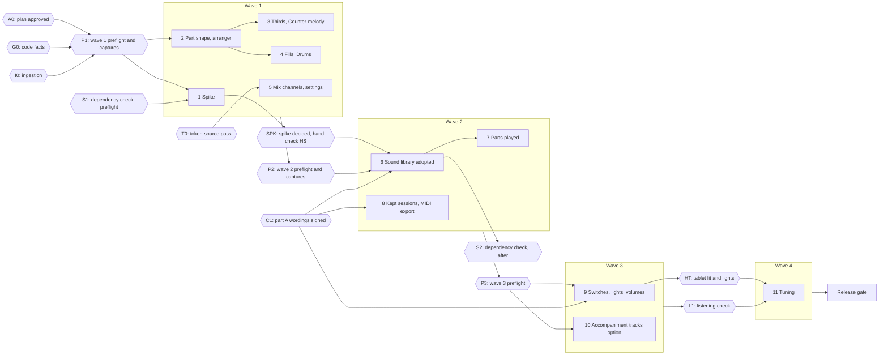

# Infinite Flow v4.0 — Build Plan

Status: v1 (2026-11-24): first draft, for the owner's approval (gate A0).

Written from the [v4.0 master spec](master-spec.md) v1.0.1 (approved by the owner on 2026-11-24,
spec D596; v1.0.1 by spec D597) and the v4.0 design at the `ui_ux/` root (ux D499–D507, merged on
`main` at ade38c12): the [phrase workspace](../../../ui_ux/screens/phrase-workspace/handoff.md),
the [last session review](../../../ui_ux/screens/last-session-review/handoff.md), and the
[play session](../../../ui_ux/flows/play-session/handoff.md),
[Jam](../../../ui_ux/flows/jam/handoff.md),
[review and export](../../../ui_ux/flows/review-and-export/handoff.md) and
[saved data](../../../ui_ux/flows/saved-data/handoff.md) flows, in their lines marked
`[v4.0 new]` or `[v4.0 changed]`. Declared intent: the
[v4.0 intent change set](../../../docs/release/v4.0-intent-change-set.md) (ingested on `main` at
256031e6: 41 DRAFT atoms tagged `release-v4.0`, 7 atoms tagged `changes-in-v4.0`, part A's STABLE
wordings for the owner's sign-off, part F's captures). Code facts:
[master spec §11](master-spec.md#11-the-existing-system), read on `main` 6d4c33c3 and checked
again on ade38c12 for this plan (gate G0). The plan follows the build-plan model
(`~/.local/share/dev_team/references/build-plan-model.md`) through the project's
[build workflow](../v3/build-workflow.md). Music terms: the
[lexicon](../../../docs/music/lexicon.md).

## Read first

- **The lead does not change.** No chunk touches the generator, `src/domain/events/`, the
  notation, acknowledgement, the replay keys or the guides' notes. The backing's notes and the
  guides' notes stay byte-identical to v3.4 on the recorded corpora; only the backing's sound
  changes (once the sound library is adopted).
- **Wave 1 opens with a spike** whose prototype is never merged: it settles O322 (Tone.js 15.1.22
  or plain Web Audio with a small AudioWorklet) by the survey's fixed decision rule, the owner's
  acceptance by ear being its last criterion (gate SPK). Chunk 6's scope depends on the outcome;
  the fallback's scope is written beside it, so the plan only marks which one stands.
- **Start-up is nearly full:** 394,052 B of the 400 KiB (409,600 B) start-up budget at v3.4. The
  sound library never enters the first load. Raising the budget is the owner's call only (spec
  D571); an overrun takes a lever.
- **Contract bumps** (spec D600): none at ingestion; one MAJOR per wave sync that applies a part A
  item (the first 20.0.0); a MINOR per promotion at the release sync. `rule_no_recorded_sound`
  goes STABLE in the sync that applies A1, and the first such sync also drops "playback of the
  generated lead line" from `specification_browser_only_operation_verification` (spec D599).

## Gates

| Gate    | What                                                                                                                                                                                                                                                                                                                                                                                   | Cleared by                       | Blocks                                       | Status                                  |
| ------- | -------------------------------------------------------------------------------------------------------------------------------------------------------------------------------------------------------------------------------------------------------------------------------------------------------------------------------------------------------------------------------------- | -------------------------------- | -------------------------------------------- | --------------------------------------- |
| **A0**  | This plan approved by the owner (the master spec is: spec D596).                                                                                                                                                                                                                                                                                                                      | The owner                        | Every chunk                                  | done (2026-11-24, the owner's "you may work on v4.0 wave 1") |
| **D0**  | The v4.0 design set approved and merged (ux D499–D507).                                                                                                                                                                                                                                                                                                                                | The owner, `ux-writer`           | 5, 9, 10                                     | done (2026-11-24, ade38c12; the approval to be recorded in `ui_ux/decisions.md`) |
| **G0**  | The master spec's code facts read again on `main`, so the **Files** lines name real code.                                                                                                                                                                                                                                                                                             | `spec-writer`                    | Every chunk                                  | done (2026-11-24, on ade38c12)          |
| **I0**  | `documentalist` ingests the master spec: DRAFT atoms, `changes-in-v4.0` marks, part A's wordings drafted.                                                                                                                                                                                                                                                                             | `documentalist`                  | P1                                           | done (2026-11-24, 256031e6)             |
| **T0**  | The token-source pass ([`ui_ux/todo.md`](../../../ui_ux/todo.md), v4.0's token-source pass): the three `v3.4` comments cleared, then `mix-row`, `mix-parts`, `part-light` (`is-lit`), `mix-volume-panel`, `mix-parts-note`, `--part-light-size`, `--part-light-ring-width` and `--mix-{thirds,counter-melody,fills,drums}-volume-{min,default}` at ux D503's starting values, in `src/styles/`; `ux-critic` checks them against the handoff. On `main` before wave 1, or on the wave branch before chunk 5's branch is cut. | `ux-writer`, `ux-critic`         | 5, 9                                         | open                                    |
| **S1**  | `security-advisor` dependency check (skill `dependency-gating-protocol`, preflight) on `tone` 15.1.22 and its runtime dependencies (`standardized-audio-context`, `tslib`), before chunk 1 installs it on the spike branch.                                                                                                                                                             | `security-advisor`               | 1                                            | done (2026-11-24, clear; see the wave log) |
| **C1**  | The owner signs off part A's STABLE wordings (A1–A6), recorded in the change set and in the commit that applies each (build workflow, contract sign-off).                                                                                                                                                                                                                             | The owner, `documentalist`       | The merges of 6 (A1), 8 (A5, A6), 9 (A2–A4)  | open                                    |
| **P1**  | Wave 1's preflight: a verdict per chunk; before any code, the captures of chunk 2 (`entity_accompaniment_part`, `module_accompaniment_arranger`); `rule_responding_part_target` and `rule_responding_part_shapes` reworded to master spec v1.0.1 (spec D597: the target's chord, the four-note turn).                                                                                     | `documentalist`                  | 1–5                                          | done (2026-11-24, d00357dd)             |
| **SPK** | The spike's decision (O322): the measure table of [M3](#m3--the-spike) on the reference laptop and the owner's Android phone, and **hand check HS**, the owner hearing adapters A and B and accepting one. Decided by the survey's rule ([master spec §9.1](master-spec.md#91-the-library)); recorded as a decision closing O322; `spec-writer` marks chunk 6's standing scope.         | The wave driver, the owner       | 6                                            | open                                    |
| **P2**  | Wave 2's preflight: a verdict per chunk; before any code, chunk 6's capture (the sound library's loading and sounding, and the recorded-sound boundary with the library chunk's budget and the security policy) and chunk 7's (a phrase's parts queued and sounded by part).                                                                                                          | `documentalist`                  | 6, 7, 8                                      | open                                    |
| **S2**  | `security-advisor` dependency check after chunk 6 merges: the resolved versions in the lockfile, `.tech` brought up to date. Not run if the fallback is taken (no dependency).                                                                                                                                                                                                       | `security-advisor`               | Wave 2's gate                                | open                                    |
| **P3**  | Wave 3's preflight: a verdict for chunks 9 and 10. No capture: neither decides an interface.                                                                                                                                                                                                                                                                                         | `documentalist`                  | 9, 10                                        | open                                    |
| **HT**  | **Hand check on the reference tablet on its stand**, right after chunk 9 merges: Q90 (do both staff systems stay in view under the two-row toolbar at a session's start?) and the playing light's readability at 70 to 100 cm (a filled disc told from a hollow ring). `ux-writer` stands by: a failure gets its remedy, one that keeps Stop in view (Q90) or a token value (the light), built in chunk 11. | The owner; `ux-writer` on a fail | 11                                           | open                                    |
| **L1**  | **The listening check** ([master spec §13](master-spec.md#13-definition-of-done) item 11), after wave 3 merges: every timbre (spec D591), the parts' default volumes (ux D503), the lanes' numbers, the floor and the velocities (spec D598), and whether the chords' top at E4 moves down. Each change is recorded as a decision; chunk 11 builds them.                                | The owner                        | 11                                           | open                                    |
| **DP**  | Data preflight: not run. The repo has no data register, so no chunk carries a **Data** line.                                                                                                                                                                                                                                                                                         | —                                | —                                            | not needed                              |
| **DEP** | The VPS's next deploy carries the security policy's `worker-src 'self' blob:` (chunk 6; not if the fallback is taken). The deploy is the owner's, by `scripts/vps.sh`.                                                                                                                                                                                                                | The owner                        | Nothing in the build; the deployed app's sounds | open, after the release              |

## Waves

| Wave | Chunks                                                                                                                                                               | Waits for                                                                                                                                                                                                                                                                              | Status  |
| ---- | -------------------------------------------------------------------------------------------------------------------------------------------------------------------- | -------------------------------------------------------------------------------------------------------------------------------------------------------------------------------------------------------------------------------------------------------------------------------------- | ------- |
| 1    | 1 The sound-library spike · 2 The part shape and the arranger · 3 Thirds and Counter-melody · 4 Fills and Drums · 5 The parts' mix channels and saved settings      | A0, G0, I0, P1; S1 (1); T0 (5). In-wave 2 → 3 and 2 → 4: P1's captures fix the part shape and the arranger's per-part functions, so 3 and 4 fill files 2 creates. 1, 3, 4 and 5 have no path between them and share no source file.                                                     | in progress |
| 2    | 6 The sound library adopted · 7 The parts played · 8 Kept sessions and the MIDI export                                                                                | Wave 1 merged; SPK (6); P2; C1 (merges of 6 and 8). In-wave 6 → 7: P2's capture of the sounding fixes what 7 calls. 8 has no path to 6 or 7 and shares no source file with them.                                                                                                        | planned |
| 3    | 9 The part switches, lights and volumes · 10 The accompaniment tracks option                                                                                         | Wave 2 merged; T0; P3; C1 (merge of 9). Two chunks: both need wave 2's sounding and records, and nothing else is left before the owner's checks. Hand check HT follows 9's merge.                                                                                                     | planned |
| 4    | 11 Tuning after the listening check and the tablet fit                                                                                                                | Wave 3 merged; HT; L1. One chunk: it can only be written from the owner's checks on the built app. Dropped by decision if HT and L1 change nothing; the wave sync still runs to reword any atom number L1 moved (spec D598).                                                              | planned |

The [release gate](#release-gate) follows wave 4. κ is 1: inside wave 1 the order is 1, 2, 3, 4,
5 (chunk 1 waits on the owner's listening while 2 to 5 build); inside wave 2, 6, 7, 8; inside wave
3, 9, then 10.

The critical path runs P1 → 1 → SPK → 6 → 7 → wave 2's gate → 9 → HT and L1 → 11 → the release
gate. SPK waits on the owner's listening; wave 1's other chunks build meanwhile.

## Workflow deltas

The [build workflow](../v3/build-workflow.md) holds for v4.0 with release name `v4.0`: wave
branches `v4.0-w<n>` in `/home/bastien/work/infinite_flow-v4.0-w<n>`, chunk branches
`v4.0-c<id>-<slug>` in `/home/bastien/work/infinite_flow-v4.0-c<id>`. v4.0's own:

- **Chunk 1 is a spike and is not merged.** It runs on `v4.0-c1-spike` and stays there: its
  record is the measure table and the listening result in the wave log (`wave-log.md`, the wave driver's), and gate
  SPK. Its branch is removed with wave 1's.
- **Corpus guard** (chunk level) for chunks 2, 4, 7 and 8: the v3.2 backing and file corpus
  (`tests/fixtures/sessions/v3.2-backing-and-files/`), the replay-key corpora
  (`tests/fixtures/replay-keys/`) and the cold-generation goldens run unchanged. Chunk 4's new
  stream must leave every lead draw as it was.
- **The sweep:** `npm run test:sweep` at wave 1's gate (chunks 2 and 4 render parts for every
  phrase of the sweep).
- **Two budgets at every wave gate** (M1, M2): all start-up JavaScript and the entry file against
  394,052 B and the 409,600 B budget; and from wave 2, the sound library's lazy chunk against its
  own budget, 300 KiB minified and 80 KiB compressed (spec D592). Both figures go in the wave log
  and the wave's merge commit.
- **Phone figures** gate only on the owner's reference phone (the Android phone in Chrome); the
  wave driver records them with the machine and the date.
- **Intent:** **Atoms** lines name the `release-v4.0` DRAFT atoms first, then existing atoms kept
  true; **Revisions** name the `changes-in-v4.0` atoms and the part A items. A part A item applies
  at the sync of the wave whose chunk builds it, with that wave's MAJOR bump (spec D600): wave 2
  applies A1, A5 and A6 (20.0.0), with `rule_no_recorded_sound` promoted and spec D599's rewording;
  wave 3 applies A2, A3 and A4 (21.0.0). Wave 4's sync rewords any number L1 moved (spec D598).
- **The lexicon entries land with the chunks that build what they describe** (ux D501): chunk 9
  adds the four App controls entries (`Thirds`, `Counter-melody`, `Fills`, `Drums`, from the popup
  lines in the [phrase workspace handoff](../../../ui_ux/screens/phrase-workspace/handoff.md)) and
  the app-meaning updates of Accompaniment, Accompaniment role, Counter-melody, Fill, Groove and
  Parallel thirds and sixths; chunk 10 the export option's word if ux D501 lists one. Written by
  the lexicon's owners (`documentalist`, `ux-writer`) on the chunk's branch, never by the chunk
  owner alone; the lexicon page shows the file, so no entry may describe a part before it plays.
- **Area documents:** `docs/audio-transport.md` (chunks 6, 7: the library, the parts on the bus,
  the lights' timing), `docs/export.md` (chunk 8), `docs/storage.md` (chunks 5, 8),
  `docs/phrase-workspace.md` (chunks 9, 10), `docs/testing.md` (every new seam: the library loader's
  fake, the parts' corpus), `README.md` (the quality-gate table: the recorded-sound check, the
  library chunk's budget). `.tech` is `security-advisor`'s (gate S2).
- **Wave log:** `wave-log.md` beside this plan, the wave driver's (created at wave 1's start).

## Measurements and hand checks

### M1 — The start-up figure

At every wave gate: all start-up JavaScript and the entry file, against 394,052 B (v3.4, wave 3's
gate) and the 409,600 B budget. Waves 1 and 4 expect a delta of about 0; wave 2 only the loader's
few hundred bytes; wave 3 the controls' share. The library's code in the first load is a failure.

### M2 — The sound library's chunk

From wave 2: the library's lazy chunk, minified and compressed, against 300 KiB and 80 KiB
(Tone.js 15.1.22 measured about 245 KiB minified for the classes used). Absent if the fallback is
taken; its worklet file then keeps the 100 KiB default.

### M3 — The spike

Chunk 1, by the [sound library survey's spike plan](../../../docs/sound-library-survey.md#spike-plan):
chunk size, offline availability, one audio context, onset accuracy, in-graph delay, main thread,
audio thread (5 minutes, every part and the reverb on, on the phone), playhead, start-up, stop and
lifecycle, sound. The table goes in the wave log with the machine and the date.

### M4 — The arranger's cost

At wave 1's gate, on the reference phone: the longest render of one phrase's parts at queue time.
Over 50 ms moves the render into the generation worker ([master spec §10.2](master-spec.md#102-one-pure-arranger-on-the-library-side)):
`spec-writer` revises chunk 7's scope before wave 2's preflight.

### M5 — Timing with every part on

At wave 2's gate, on the reference laptop and phone, the built app with every part and the reverb
on at 240 BPM: the playhead within 20 ms of the audio, no main-thread task over 50 ms attributable
to audio, no underrun over 5 minutes ([master spec §13](master-spec.md#13-definition-of-done)
item 7). Wave 3's gate adds the lights against the playhead's tolerance (item 6).

### Hand checks

| Check | What                                                                                                                         | Who, when                                                    |
| ----- | ---------------------------------------------------------------------------------------------------------------------------- | ------------------------------------------------------------ |
| HS    | The owner hears the spike's adapters A and B playing the test pattern and accepts one (gate SPK).                            | The owner, in wave 1, once M3's measures are taken           |
| HT    | Q90 and the lights' readability on the reference tablet on its stand (gate HT).                                              | The owner, right after chunk 9 merges; `ux-writer` standing by |
| L1    | The listening check (gate L1).                                                                                               | The owner, after wave 3 merges                               |

## Chunks

### Chunk 1 — The sound-library spike

Status: in progress
Wave: 1
Depends on: A0, P1, S1
Architecture capture: none (nothing is merged)

- **Goal:** settle O322 by measurement and by ear: Tone.js 15.1.22 as an instrument and effect
  library, or plain Web Audio with a small AudioWorklet.
- **Scope:** the survey's spike plan on the branch `v4.0-c1-spike`: the seam widened for the spike;
  adapter A (Tone.js, deep imports, dynamic import on the Start click, `setContext(appContext,
  true)`, the timbres of [master spec §9.2](master-spec.md#92-timbres)) and adapter B (native
  nodes plus one noise and drum AudioWorklet and one shared reverb) behind the same session bus;
  the fixed test pattern (four phrases, every voice, sixteenth hi-hats as the worst case, at 120
  and 240 BPM, voices joining and leaving at phrase boundaries); M3's measures. Out: anything
  merged, exports, settings, the interface.
- **Files:** on the spike branch only: `src/audio/sound-roles.ts`, `src/audio/web-audio-session-bus.ts`,
  `src/audio/web-audio-voices.ts`, new adapter files under `src/audio/`, a measurement page or
  script, `package.json` and the lockfile.
- **Spec sections:** [§9.1](master-spec.md#91-the-library), [§9.2](master-spec.md#92-timbres),
  [§9.4](master-spec.md#94-loading), [§10.6](master-spec.md#106-budgets-security-policy-and-boundaries); item 7.
- **Atoms:** none (a spike); its outcome informs `rule_voices_keep_lead_clear` and
  `rule_no_recorded_sound` (v4.0).
- **Revisions:** none.
- **Done when:** M3's table is complete on both machines; the owner has heard A and B (HS); the
  survey's decision rule names one; the decision is recorded and closes O322.
- **Verification:** M3 only; the branch is not merged.

### Chunk 2 — The part shape and the arranger

Status: planned
Wave: 1
Depends on: A0, P1 (its captures)
Architecture capture: (a) **`entity_accompaniment_part`**: a phrase's accompaniment as a list of
parts beside the unchanged timeline, each with its voice, role, mix channel and notes; a note's
start and length in whole-note fractions from the phrase's start, a concert pitch or a drum sound
(kick, snare, closed hi-hat), and a velocity; the backing's two voices and the two guides in the
same shape. (b) **`module_accompaniment_arranger`**: one pure function in `src/domain/backing/`
from the phrase's timeline, harmony, window, scale, seed and the accompaniment settings to the
phrase's parts, with one function per new part in a file of its own, and the lead's facts
(chord tones, long notes, rests) recomputed in a shared helper; inside the library line.

- **Goal:** one shape for every system voice, and the arranger that renders it, with the four new
  parts present and empty (a rest is always legal), so chunks 3 and 4 fill their own files.
- **Scope:** the part and note types; the arranger; the lead-facts helper; `renderBacking` and
  `renderGuide` giving parts (their rules unchanged); the four part functions returning no notes;
  the transport and the generated-notes export reading the backing's and guides' parts. Out: any
  part's notes, any sound, settings, the interface.
- **Files:** `src/domain/backing/backing-renderer.ts`, `guide-renderer.ts`, new
  `accompaniment-part.ts`, `accompaniment-arranger.ts`, `lead-facts.ts`, `thirds-part.ts`,
  `counter-melody-part.ts`, `fills-part.ts`, `drums-part.ts`; `src/audio/transport-session.ts`;
  `src/export/generated-notes-file.ts`; their unit tests.
- **Spec sections:** [§6.1](master-spec.md#61-rules-every-part-keeps),
  [§6.2](master-spec.md#62-backing), [§10.1](master-spec.md#101-the-lead-stays-one-voice-the-accompaniment-sits-beside-it),
  [§10.2](master-spec.md#102-one-pure-arranger-on-the-library-side); items 2, 3.
- **Atoms:** `rule_parts_rendered_from_phrase_alone`, `rule_parts_read_chord_as_written`,
  `rule_part_rests_when_no_note_fits`, `rule_parts_deterministic` (v4.0); `req_session_backing_track`,
  `entity_concert_event_timeline` (kept true). Drift check: `module_library_code_boundary`,
  `module_guide_playback_layers`.
- **Revisions:** none (the layers' atom is revised with chunk 7).
- **Done when:** the backing's and guides' notes are byte-identical on the corpora; the arranger
  returns the four parts empty for every corpus phrase; `src/domain/` still type-checks with no DOM
  and imports no package.
- **Verification:** chunk checks; the corpus guard; M4's harness placed at wave 1's gate.

### Chunk 3 — Thirds and Counter-melody

Status: planned
Wave: 1
Depends on: 2 (P1's captures fix the per-part function)
Architecture capture: none

- **Goal:** the highlighting and contrasting parts' notes, as §6.3 and §6.4 state them.
- **Scope:** Thirds: which lead notes, the third or sixth by chord tone, the MIDI 48 floor,
  chromatic notes left out, the lead note's timing. Counter-melody: the lane by the phrase's
  window, the guide tones (third and seventh, or third and fifth), nearest-note voice leading with
  the parallels to the bass skipped, held common tones, the timing that moves when the lead holds.
  The numbers as constants, tuned later (gate L1). Out: sound, settings.
- **Files:** `src/domain/backing/thirds-part.ts`, `counter-melody-part.ts`, `lead-facts.ts` (only
  if a fact is missing); their unit tests.
- **Spec sections:** [§6.3](master-spec.md#63-thirds-highlighting),
  [§6.4](master-spec.md#64-counter-melody-contrasting),
  [§6.6](master-spec.md#66-how-many-relation-parts-sound-at-once); items 1, 3, 4.
- **Atoms:** `req_highlighting_part`, `rule_highlighting_part_doubled_notes`,
  `rule_highlighting_part_pitch`, `rule_highlighting_part_floor`, `req_contrasting_part`,
  `rule_contrasting_part_lane`, `rule_contrasting_part_guide_tones`,
  `rule_contrasting_part_voice_leading`, `rule_contrasting_part_timing`,
  `rule_at_most_two_relation_parts` (v4.0).
- **Revisions:** none.
- **Done when:** every rule of §6.3 and §6.4 holds as an invariant over a seeded corpus of phrases
  covering every built-in window, My instrument, seventh chords on and off, and chromatic lead
  notes; no Counter-melody note crosses the lead.
- **Verification:** chunk checks.

### Chunk 4 — Fills and Drums

Status: planned
Wave: 1
Depends on: 2 (P1's captures fix the per-part function), P1 (the two responding atoms reworded)
Architecture capture: none

- **Goal:** the responding part and the drum part, as §6.5 and §6.7 state them, with the fill
  shape's one named stream.
- **Scope:** Fills: rests of a beat or longer; eighths from one eighth in, at most four; the target
  on the chord sounding at its start; the five four-note shapes, a shorter fill playing a shape's
  last notes; the window, reversing a shape that would leave it; the shape drawn from a new named
  stream of the phrase's seed, the registry's version stepped. Drums: the one groove with its
  velocities. Out: sound, settings.
- **Files:** `src/domain/backing/fills-part.ts`, `drums-part.ts`; `src/domain/random/streams.ts`;
  their unit tests.
- **Spec sections:** [§6.5](master-spec.md#65-fills-responding), [§6.7](master-spec.md#67-drums-foundation),
  [§6.6](master-spec.md#66-how-many-relation-parts-sound-at-once); items 1, 3, 4.
- **Atoms:** `req_responding_part`, `rule_responding_part_in_long_rests`,
  `rule_responding_part_rhythm`, `rule_responding_part_target`, `rule_responding_part_shapes`,
  `rule_responding_part_register`, `req_drum_part`, `rule_at_most_two_relation_parts` (v4.0);
  `module_named_stream_pseudorandomness` (kept true).
- **Revisions:** `module_named_stream_pseudorandomness` (the new stream, the registry's step).
- **Done when:** every rule of §6.5 and §6.7 holds over the corpus of chunk 3; Thirds and Fills
  never overlap; the lead's draws are unchanged on every replay-key corpus.
- **Verification:** chunk checks; the corpus guard; the sweep placed at wave 1's gate.

### Chunk 5 — The parts' mix channels and saved settings

Status: planned
Wave: 1
Depends on: A0, P1, T0 (the volume tokens)
Architecture capture: none

- **Goal:** the mix and the saved settings know the four parts: a switch and a volume each, off by
  default, starting volumes from the token source.
- **Scope:** four mix channels in `sound-roles.ts`' channel list and `AudioMix`; their gains;
  eight settings keys with defaults and tolerant loading, so v3.4 settings load with the parts off
  at their default volumes; saving on change through the existing path. Out: the switches on
  screen (chunk 9), any sound (chunks 6, 7).
- **Files:** `src/audio/audio-mix.ts`, `src/audio/sound-roles.ts` (the channel list only),
  `src/storage/records/settings-record.ts`, `src/storage/records/setting-defaults.ts`; their unit
  tests.
- **Spec sections:** [§8](master-spec.md#8-controls), [§10.3](master-spec.md#103-playing); item 5.
- **Design docs:** [phrase workspace](../../../ui_ux/screens/phrase-workspace/handoff.md)
  (Saving and automatic changes: The parts in the mix);
  [saved data](../../../ui_ux/flows/saved-data/handoff.md) (What Is Saved, and When).
- **Atoms:** `rule_parts_off_by_default` (v4.0); `req_session_audio_mix`,
  `rule_settings_saved_on_change`, `rule_saved_settings_load_tolerantly` (kept true; A2–A4 apply
  with chunk 9).
- **Revisions:** none in wave 1 (A2–A4 at wave 3's sync).
- **Done when:** v3.4 settings records load unchanged with the four parts off; a changed part
  setting saves and reloads.
- **Verification:** chunk checks (storage on `fake-indexeddb`).

### Chunk 6 — The sound library adopted

Status: planned (scope A or B by gate SPK)
Wave: 2
Depends on: SPK, P2 (its capture), C1 (merge, A1)
Architecture capture: **the sound library's loading and sounding**: the lazy chunk fetched when
the page is idle after its first paint, kept by the service worker; one audio context, the
library set onto it, its own transport never started; ready, loading and failed states; a voice's
sound as one data entry behind the sound-roles seam, sounded with an exact audio time; the
backing on oscillators when the library is late; the recorded-sound boundary, the library chunk's
budget and the security policy's `worker-src` (part F's last item). Recorded as a new module or as
a revision of `module_guide_playback_layers`, as P2 decides.

- **Goal:** the system voices have their v4.0 sounds, loaded without touching start-up or the
  synchronous Start.
- **Scope A (Tone.js):** `tone` 15.1.22 pinned; the loader (idle fetch, `setContext(appContext,
  true)`, the console banner silenced, ready and failed states); the timbre table's voices and the
  shared reverb as data entries in `sound-roles.ts`; the sounding layer playing library voices
  beside the oscillator voices, the backing on library voices when ready; the fade cutting every
  voice and the reverb's tail; no AudioWorklet class. `verify:boundaries`: the library chunk's
  named budget; the recorded-sound rewording (decoding and streaming recorded audio, `new Audio(`,
  `fetch(` and audio files stay banned; `createBufferSource` and `new AudioBuffer(` leave the ban;
  "no recorded sound" in its messages). `docker/security-headers.conf`: `worker-src 'self' blob:`.
- **Scope B (the fallback, if SPK takes it):** no dependency; native-node voices with §9.2's
  intentions; one noise and drum AudioWorklet emitted as a `.js` file from `'self'` (precached, no
  security policy change); one shared convolution reverb with a generated impulse; the loader
  reduces to the worklet's module load. The same boundary rewording; no named budget (the
  worklet keeps the 100 KiB default); gate S2 and DEP not run.
- **Out:** queuing the parts (chunk 7), the switches (chunk 9), the guides' and the click's sounds
  (unchanged).
- **Files:** `package.json` and the lockfile (A); new `src/audio/sound-library-loader.ts`,
  `src/audio/library-voices.ts` (A) or `src/audio/worklets/` (B); `src/audio/sound-roles.ts`,
  `src/audio/web-audio-session-bus.ts`, `src/audio/web-audio-voices.ts`,
  `src/audio/web-audio-output.ts`; `scripts/verify-boundaries.mjs`; `docker/security-headers.conf`
  (A); `vite.config.ts` only if the precache needs it; their tests.
- **Spec sections:** [§9.1](master-spec.md#91-the-library), [§9.2](master-spec.md#92-timbres),
  [§9.3](master-spec.md#93-sound-as-data-selection-locked), [§9.4](master-spec.md#94-loading),
  [§10.6](master-spec.md#106-budgets-security-policy-and-boundaries); items 7, 8, 9.
- **Atoms:** `rule_voice_sounds_not_chosen`, `rule_voices_keep_lead_clear`, `rule_no_recorded_sound`,
  `rule_session_start_never_waits_for_sound_library`, `rule_parts_unavailable_without_sound_library`
  (v4.0); `rule_audio_unlocked_by_player_click`, `rule_guide_sound_from_oscillators` (kept true).
  Drift check: `module_guide_playback_layers`.
- **Revisions:** A1, `req_session_backing_track` (gate C1); `rule_no_recorded_sound` to STABLE;
  `specification_browser_only_operation_verification` (spec D599).
- **Done when:** one audio context in a Playwright run; the library absent from the first load
  (M1) and within its budget (M2); a Start while the library is loading starts at once with the
  oscillator backing; a failed load leaves the parts unavailable; the boundary check passes with
  no audio file in the build.
- **Verification:** chunk checks; the Playwright context count; M1 and M2 at wave 2's gate.
- **Split rule:** 6a the loader, the boundary check, the budget and the security policy; 6b the
  voices, the reverb and the sounding layer.

### Chunk 7 — The parts played

Status: planned
Wave: 2
Depends on: 6 (P2's capture fixes the sounding), wave 1 (2–5)
Architecture capture: **a phrase's parts queued and sounded by part**: the transport queues the
arranger's parts per phrase; the session bus sounds a note by part through the part's channel
gains; each part's notes as heard are available to the interface on the audio clock, corrected
for the output latency as the playhead is (the lights' source).

- **Goal:** in a running session the four parts sound as switched, from phrase 1's first beat, in
  plain sessions and in Jam, and stop with Stop.
- **Scope:** the transport queuing the arranger's output; every part rendered whether on or off;
  a part switched off silent at once, switched on joining at its next note; never in the count-in
  or a fresh Jam's capture, writing or read-in; the parts joining at the next phrase start when the
  library becomes ready mid-session; the heard-note signal for the lights; the arranger's render
  where M4 put it. Out: the switches and lights on screen (chunk 9).
- **Files:** `src/audio/transport-session.ts`, `src/audio/audio-transport.ts`,
  `src/audio/audio-ports.ts`, `src/audio/backing-track.ts`; the workspace session start and phrase
  wiring (`src/components/workspace/workspace-session-start.ts`,
  `workspace-session-phrases.ts`); their tests.
- **Spec sections:** [§6.1](master-spec.md#61-rules-every-part-keeps),
  [§7](master-spec.md#7-the-playing-lights), [§8](master-spec.md#8-controls),
  [§10.3](master-spec.md#103-playing); items 1, 5, 6.
- **Design docs:** [play session](../../../ui_ux/flows/play-session/handoff.md) (Count-in and
  Session Running: The parts and their lights; Ending and Saving: The parts);
  [Jam](../../../ui_ux/flows/jam/handoff.md) (Routing Rules: Phrase 1 sounds).
- **Atoms:** `req_accompaniment_parts`, `rule_parts_play_from_phrase_one`,
  `rule_parts_change_only_sound`, `rule_part_switch_takes_effect`, `rule_app_writes_every_part_note`,
  `rule_playing_light_follows_heard_sound` (v4.0); `rule_jam_no_backing_before_phrase_one`,
  `rule_click_volume_never_silent` (kept true). Drift check: `module_guide_playback_layers`.
- **Revisions:** `rule_stop_ends_session`, `rule_playhead_follows_audio_clock`,
  `module_guide_playback_layers`.
- **Done when:** a harness session with every part on plays each part's notes at their audio times;
  a mid-session switch behaves as §8 states; Jam's parts start with phrase 1; Stop fades every
  voice and the reverb's tail.
- **Verification:** chunk checks; the corpus guard; M5 at wave 2's gate.
- **Split rule:** 7a the transport and the bus; 7b the session wiring, Jam and the heard-note signal.

### Chunk 8 — Kept sessions and the MIDI export

Status: planned
Wave: 2
Depends on: wave 1 (2–5), C1 (merge, A5 and A6)
Architecture capture: none (the kept record's new fields are worded from the built code at the
sync, A6)

- **Goal:** a kept session remembers which parts were on at its end, and the MIDI export carries
  them as tracks.
- **Scope:** the kept-session record's parts at the end and the arranger's version (1), with its
  codec and tolerant reading (sessions kept before v4.0 have none and render the backing only); a
  part whose sounds failed during the session recorded off; the MIDI encoder writing the Backing
  track plus one track per part on at the end, rendered again for every exported phrase, drums on
  channel 10 with GM notes 36, 38, 42, the other parts at velocity 64; for the whole session and for
  favorites. MusicXML unchanged. Out: the option's wording on screen (chunk 10).
- **Files:** `src/storage/records/kept-session-record.ts`, `kept-session-body.ts`,
  `kept-session-body-read.ts`; `src/session/session-history.ts`; `src/export/generated-notes-file.ts`,
  `src/export/midi/midi-encoder.ts`, `src/export/midi/midi-tracks.ts`,
  `src/export/midi/midi-export-input.ts`; their tests.
- **Spec sections:** [§10.4](master-spec.md#104-keeping-and-replay),
  [§10.5](master-spec.md#105-exports); items 5, 10.
- **Design docs:** [last session review](../../../ui_ux/screens/last-session-review/handoff.md)
  (Exports: Generated-notes export).
- **Atoms:** `rule_accompaniment_export_parts`, `rule_accompaniment_export_tracks`,
  `rule_earlier_kept_sessions_export_backing_only` (v4.0); `rule_guide_never_exported`,
  `rule_generated_notes_musicxml_export`, `rule_favorites_only_export` (kept true).
- **Revisions:** A5 `rule_kept_session_content`, A6 (the shapes, gate C1);
  `rule_generated_notes_midi_export`, `module_review_export_pipeline`.
- **Done when:** a v3.4 kept session loads and exports byte-identically; a v4.0 session with parts
  on exports their tracks; the MIDI file of the backing-only case is unchanged.
- **Verification:** chunk checks; the corpus guard.
- **Split rule:** 8a the record and the session's end; 8b the MIDI encoder.

### Chunk 9 — The part switches, lights and volumes

Status: planned
Wave: 3
Depends on: wave 2, T0, P3, C1 (merge, A2–A4)
Architecture capture: none

- **Goal:** the player sees, switches and hears the four parts, and their lights say which one is
  playing.
- **Scope:** the mix's two fixed rows (the parts and `Volume` on the second); the four part switches
  with their state word and the light inside, lit as the heard-note signal says, steady across
  silences under a beat, only while a part can sound, not colour alone, not announced; the
  `Volume` panel's eight sliders in two columns from `bp-tablet-landscape`; sounds still loading
  (nothing shown) and sounds unavailable (switches disabled, reading off, the one line; a failure
  mid-session waiting for the end); the phone's lights where the toolbar is. The lexicon entries of
  the workflow deltas. Out: tuning (chunk 11), Q90's remedy (chunk 11, if HT fails).
- **Files:** `src/components/workspace/MixControls.vue`, `MixVolumePanel.vue`, `MixVolumeButton.vue`,
  `mix-volume-popover.ts`, a new part-switch component; `docs/music/lexicon.md` (by its owners);
  their unit and Playwright tests.
- **Spec sections:** [§7](master-spec.md#7-the-playing-lights), [§8](master-spec.md#8-controls),
  [§12](master-spec.md#12-for-the-design); items 5, 6.
- **Design docs:** [phrase workspace](../../../ui_ux/screens/phrase-workspace/handoff.md)
  (Audio mix: Two lines; Audio mix: The part switches; Audio mix: The playing light; Audio mix:
  Sounds unavailable; Audio mix: Sounds still loading; Audio mix: Volume popover; Audio mix: The
  parts' lexicon words; Cue row: Playing lights on a phone;
  Responsive Behavior: The mix's lines; Volume panel columns; Edge cases: Sounds unavailable).
- **Atoms:** `req_part_playing_lights`, `rule_playing_light_follows_heard_sound`,
  `rule_playing_light_steady`, `rule_playing_light_only_while_part_can_sound`,
  `rule_playing_light_not_colour_alone`, `rule_parts_never_drawn`, `rule_parts_off_by_default`,
  `rule_parts_unavailable_without_sound_library` (v4.0).
- **Revisions:** A2 `req_session_audio_mix`, A3 `rule_settings_saved_on_change`, A4
  `rule_saved_settings_load_tolerantly` (gate C1).
- **Done when:** the handoff's pieces hold in the harness at every breakpoint; the lights follow the
  heard notes within the playhead's tolerance; no new part is drawn on the score.
- **Verification:** chunk checks; the accessibility suite for the mix; hand check HT after merge.
- **Split rule:** 9a the rows, switches and lights; 9b the `Volume` panel and the unavailable state.

### Chunk 10 — The accompaniment tracks option

Status: planned
Wave: 3
Depends on: 8, P3
Architecture capture: none

- **Goal:** the review's MIDI option reads `Accompaniment tracks`, with its line naming what it
  holds.
- **Scope:** the option's label and its line ("The backing only." or the parts on at the end); a
  choice saved for `Backing track` carried over. Out: the encoder (chunk 8).
- **Files:** `src/components/workspace/use-review-exports.ts`, `review-export.ts`,
  `ReviewArea.vue`, `src/storage/records/settings-record.ts` (the review preference only); their
  tests.
- **Spec sections:** [§10.5](master-spec.md#105-exports); item 10.
- **Design docs:** [last session review](../../../ui_ux/screens/last-session-review/handoff.md)
  (Exports: Generated-notes export); [review and export](../../../ui_ux/flows/review-and-export/handoff.md)
  (Export).
- **Atoms:** `rule_accompaniment_export_tracks` (v4.0); `rule_generated_notes_midi_export` (revised
  with chunk 8).
- **Revisions:** none beyond chunk 8's.
- **Done when:** the option and its line read as the handoff says for a backing-only session and
  for one with parts; a saved `Backing track` choice shows as `Accompaniment tracks`.
- **Verification:** chunk checks.

### Chunk 11 — Tuning after the listening check and the tablet fit

Status: planned
Wave: 4
Depends on: HT, L1
Architecture capture: none

- **Goal:** the values the owner's checks moved, and Q90's remedy if HT failed.
- **Scope:** only what HT and L1 decided: timbre options and effect levels in `sound-roles.ts`;
  the lanes' numbers, the floor and the velocities in the part functions; the default volumes and
  `--part-light-size` in the token source (by `ux-writer`); the chords' top if L1 moves it; the
  remedy `ux-writer` chose for Q90. Dropped by decision if nothing moved.
- **Files:** as decided by HT and L1, among `src/audio/sound-roles.ts`, `src/domain/backing/*-part.ts`,
  `src/domain/backing/backing-renderer.ts`, `src/styles/`, the mix's components; their tests.
- **Spec sections:** [§14](master-spec.md#14-deferred-and-open); item 11.
- **Atoms:** the atoms whose numbers L1 moved (spec D598).
- **Revisions:** the moved numbers, at wave 4's sync.
- **Done when:** each decision of HT and L1 is built and its tests updated; the owner hears or sees
  the change once.
- **Verification:** chunk checks; the corpus guard if the backing's chords move.

## Release gate

After wave 4 (or wave 3, if chunk 11 is dropped), on the merged code, as the
[build workflow](../v3/build-workflow.md#release-gate) says: `docs/release/v4.0-release-notes.md`
with one row per item of [master spec §13](master-spec.md#13-definition-of-done) and its evidence,
then M1 to M5 with their figures; `npm run quality` on an idle machine and `npm run lint:links`;
the intent change set's promotions with their MINOR bumps and the owner's agreement (spec D600),
`specification_behavioral_quality_gates` revised for v4.0's definition of done; `package.json` at
4.0.0; the tag only on the owner's go. Gate DEP follows the tag. After the tag, `spec-writer` and
`ux-writer` archive v4.0's working records.
