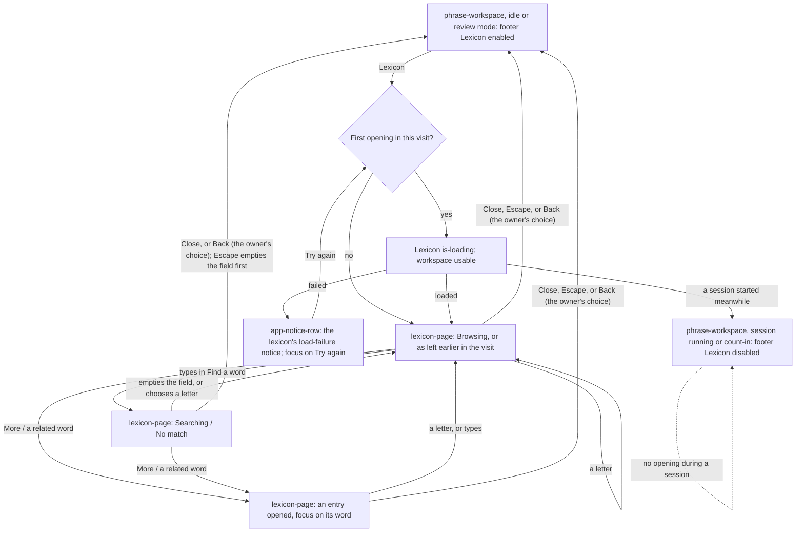

# Look Up a Word Handoff

> **New in v3.4.**

> **Draft, proposed.** Nothing here is approved or buildable yet; it moves to
> `ui_ux/flows/look-up-a-word/` once the owner has ruled. An item marked _the owner's choice_
> waits on a ruling.

The page itself, its entries, its search and its keys, are in
[`screens/lexicon-page/handoff.md`](../../screens/lexicon-page/handoff.md).

## Flow

## Routing Rules

- **Opening.** The footer's `Lexicon` opens the page from the workspace at idle, in either mode,
  or in the review mode, with or without a sheet having been open before; never during a session,
  count-in included, where it is disabled.
- **Loading once.** The page's part of the app loads at the first opening of a visit and stays
  loaded; later openings show the page at once, as it was left.
- **A session during the load.** A session that starts while the page is loading (by `Start
  session` or the starting note) cancels the opening; the page does not open when the load ends.
- **Load failure.** A failed load opens nothing and shows the lexicon's load-failure notice in
  `app-notice-row`, whose `Try again` is a press of `Lexicon`.
- **Closing.** `Close`, or Escape outside a search field holding text, closes the page and
  returns focus to the footer's `Lexicon`. The workspace is as it was: the page changes no
  setting, no phrase and no kept data.
- **The browser's Back button.** _The owner's choice._ Proposed: opening the page adds one entry
  to the browser's history, with the address `#lexicon`; Back closes the page as `Close` does, and
  `Close` and Escape step back over that entry, so after closing, Back and Forward behave as if
  the page had never opened. Jumps to a letter or a related word inside the page add no history
  entry. A load or reload at `#lexicon` opens the workspace, then the page, once the saved
  settings are read. The alternative is no history entry and no address: Back then leaves the app
  from the page, as it does from the workspace.
- **No MIDI start.** While the page is open, a MIDI note starts nothing; the starting note line
  under the staff keeps its words, and works again once the page is closed.
- **Nothing kept.** Opening, searching and reading save nothing on the device; the page's state
  lasts for the visit only.
