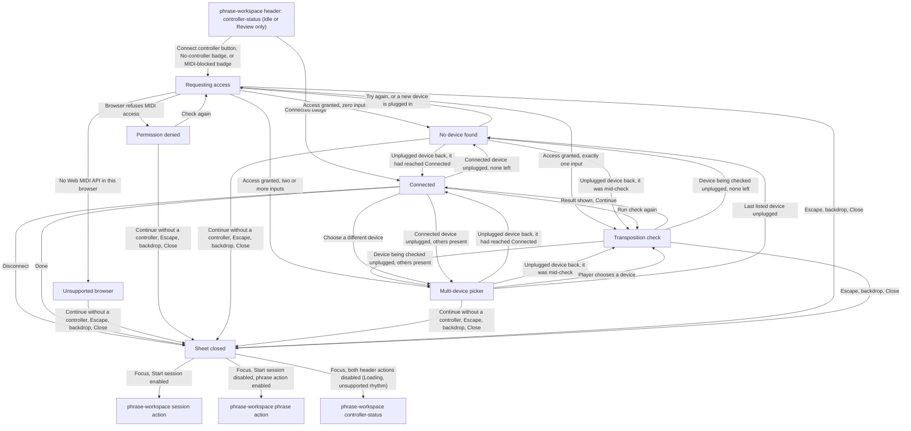
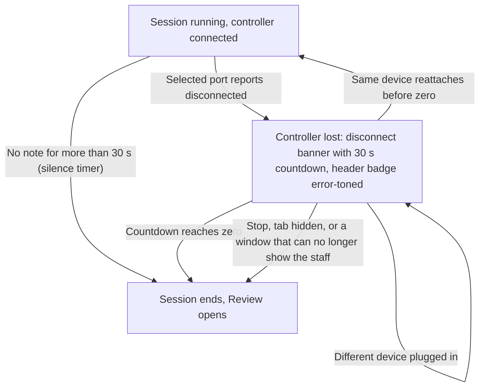
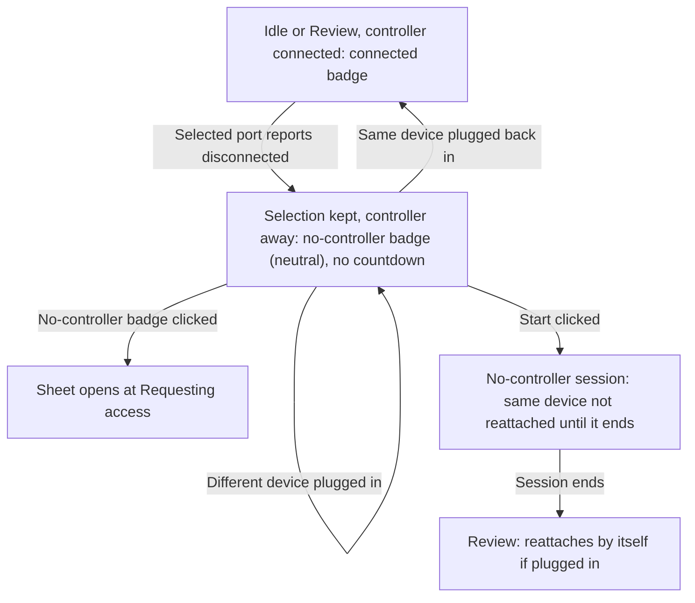

# Controller Connection Handoff

> **New in v2.**

## Entry and exit

## Mid-session controller loss (never enters the sheet)

## Between-session unplug (sheet closed; never enters the sheet)

## Routing rules

- Screens: `screens/controller-connection/` for every state inside the sheet;
  `screens/phrase-workspace/` for the header `controller-status` entry point, the disconnect
  banner, and the mid-session loss state.
- The sheet opens only at Idle or while the Review is showing, and only from a click on the header
  `controller-status` element. It never opens by itself, and never during a session: in a session
  the header element is disabled (see `screens/phrase-workspace/handoff.md`).
- The `Connect controller` click is the page's audio-unlock click and the MIDI permission request
  in one. There is no other audio-unlock step.
- No MIDI note received while the sheet is open, in any state, can start a session or its
  count-in — including the note the transposition check asks for, and including a note equal to the
  one phrase 1 starts on.
- **Connected** means: MIDI permission granted, one input selected (chosen in the picker, or the
  only one present), and that input's port present and open. The header shows the connected badge
  from the moment those three hold — on entering **Transposition check** — not only after the check
  result. Dismissing the sheet during the check leaves the controller connected but unchecked.
- **Lost** means: the selected input's port reports disconnected.
- Header element forms and where a click opens the sheet:

  | Header form | Shown when | Click opens at |
  | --- | --- | --- |
  | `Connect controller` button | No controller has connected in this page session, and the latest request was not refused (includes after Unsupported browser, No device found, or a dismissal) | Requesting access |
  | Connected badge | A controller is connected (including the same device reattached by itself between sessions) | Connected |
  | No-controller badge | A controller had connected in this page session and is not attached now: disconnected by the player, lost in a session that has ended, or unplugged between sessions (selection kept) | Requesting access |
  | MIDI-blocked badge (error tone) | The browser refused MIDI permission on the latest request | Requesting access |
  | Disconnected badge (error tone) | Session only: a controller lost mid-session, while its countdown runs | Not clickable (session) |

- Every badge form has the same width: the label area has one fixed inline size, and a long
  device name is cut with an ellipsis (see `screens/phrase-workspace/handoff.md`). No change of
  form ever moves another header element.
- A later successful request replaces the MIDI-blocked badge: the connected badge if it connects a
  device; otherwise the no-controller badge if a controller had connected earlier in this page
  session, or the `Connect controller` button only if none ever had. Once a controller has
  connected in the page session, the header never returns to the `Connect controller` button.
- **Between sessions (Idle or Review), the selected controller unplugged:** the selection is kept;
  the header shows the no-controller badge (neutral, never error-toned; no countdown). The **same
  device** plugged back in reattaches by itself: no click, no sheet, no transposition check; the
  header returns to the connected badge. A **different device** plugged in is not picked up; it
  connects only through the sheet. While the sheet is open, its own device-change rules apply
  instead (see `screens/controller-connection/handoff.md`).
- **Start clicked while the selected controller is away:** the session starts with no
  controller and stays without one; the same device plugged back in during it is not reattached.
  The header keeps the no-controller badge, disabled. When the session ends, the device
  reattaches by itself if it is plugged in.
- **Controller still away when a session ends** (countdown reached zero, Stop, a hidden tab,
  or a window that can no longer show the staff): its selection carries into the Review, handled
  as unplugged between sessions.
- `Unsupported browser` has no retry: nothing about asking again changes which browser is running.
- `Requesting access` resolves on its own; while the browser's own permission prompt is waiting for
  an answer, it shows its waiting sub-state (see the screen handoff). If the sheet is closed while
  the browser prompt is still waiting, the attempt is abandoned: a later "allow" answer selects
  nothing and opens nothing (the next `Connect controller` click then resolves without a prompt);
  a later "block" answer switches the header to the MIDI-blocked badge, but only between
  sessions: if a session is running (count-in included), the header keeps its current form and
  the switch waits until the session ends, so the header never changes shape while the player is
  reading.
- `Check again` from **Permission denied** re-requests access. If the player has allowed MIDI in the
  browser meanwhile, or the browser is still willing to ask, the request proceeds normally;
  otherwise it lands back on **Permission denied**.
- `Choose a different device` is present on **Connected** only when more than one input has been
  seen this page session.
- Every dismiss path returns to the same place: the sheet closes, `phrase-workspace` is exactly as
  it was, and focus moves to the first enabled of, in order: the workspace's session action; the
  phrase action (when `Start session` is disabled: an empty workspace, a generation-failure banner
  showing, a notation error); `controller-status`, the element that opened the sheet (when both
  are disabled: **Loading**, or an unsupported rhythm combination), which is always interactive
  outside a session. The header element reflects
  whatever is current (unchanged if nothing was resolved, the connected badge if a device was
  selected before the dismiss).
- A running session's controller loss is handled only on `screens/phrase-workspace/`: 30 seconds
  counted from the unplug, whatever silence came before; silence timer suspended while unplugged
  and restarted from the reattachment; only the same device reattaches, automatically, with no
  check; at zero the session ends exactly like a silence timeout.
- A session started with no controller (none ever connected, or the selected one away) stays
  controller-less until it ends; only Stop ends it, apart from a hidden tab or a window that can
  no longer show the staff.
