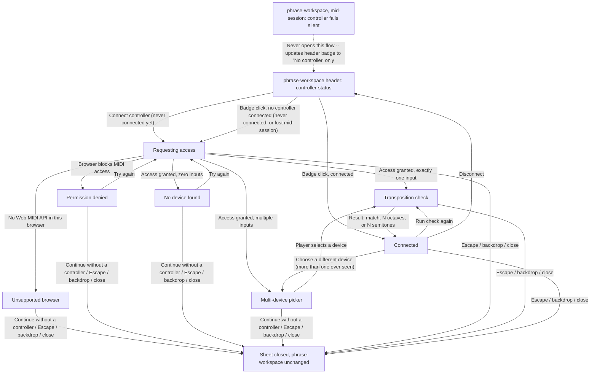

# Controller Connection Handoff

- Screen: `screens/controller-connection/` for every state box above; `screens/phrase-workspace/`
  for the header entry point and the mid-session note.
- `Unsupported browser` has no `Try again` — there is nothing to retry without a different browser
  — so its only resolution is dismissal.
- `Requesting access` is a brief transient state; it resolves on its own into one of the five states
  it points to and is never itself a place the player acts from beyond dismissing it.
- The `Choose a different device` edge exists only once more than one input device has ever been
  seen this session; with only one device ever seen, `Connected` has no such option.
- Every dismiss path (`Continue without a controller`, Escape, backdrop click, or the sheet's close
  action) returns to the same place: the sheet closes and `phrase-workspace` is exactly as it was,
  with the header badge reflecting whatever connection state is actually current (unchanged if
  nothing was resolved, updated if a device was connected before the dismiss).
- Re-entry from the header badge is state-dependent, not always a restart: a never-yet-attempted
  badge (plain `btn`, `Connect controller`) or a "No controller" badge left by a prior disconnect or
  a mid-session loss both start over at `Requesting access`, since there is no device currently
  resolved to skip ahead to; a "connected" badge instead opens directly at `Connected`, from which
  `Run check again` reaches the check without repeating permission or device resolution.
- The dotted edge from a mid-session controller loss is not a flow transition — it never opens this
  sheet. It is shown only to make explicit that the badge update it causes is the sole visible
  effect, documented on `screens/phrase-workspace/` itself (see that screen's States section).
