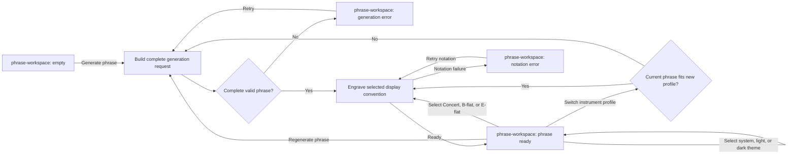

# Generate Phrase Handoff

- Screen: `screens/phrase-workspace/` for every step.
- Generation request uses the current control values, selected instrument profile policy, and a fresh seed on `Generate phrase` or `Regenerate phrase`.
- The result must contain four complete common-time measures before engraving starts.
- Display-mode selection routes to engraving only. It preserves controls, seed, concert-pitch events, harmonic plan, and profile-derived range policy.
- Theme selection changes presentation only. It neither routes to generation nor engraving, and it does not change the phrase, controls, request, seed, profile policy, or result.
- Instrument-profile selection first validates unchanged concert events against the new profile active range and the resolved whole-phrase register window. A retained phrase routes to engraving; a phrase that does not fit regenerates with retained controls and a fresh seed. Source events never transpose to fit.
- Successful initial generation enters the phrase with the `staff-content` fade. Successful regeneration applies `staff-content is-fading-out` to the old score, then inserts the ready replacement with the `staff-content` fade.
- A failed request retains the last valid score; initial failure shows the empty-state error variant. A notation failure preserves valid phrase data but replaces the score region with its retryable error panel.
