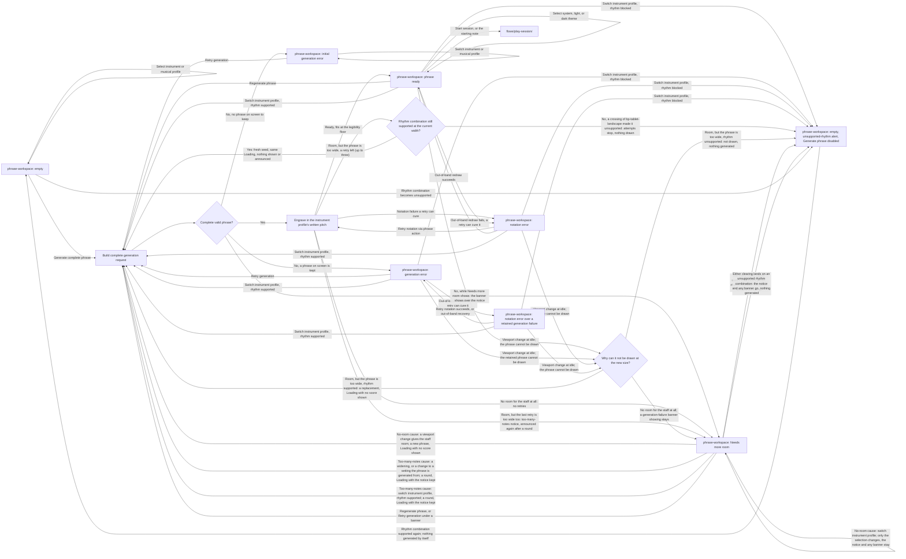

# Generate Phrase Handoff

> **Changes since v1**
>
> - _New:_ a result is ready only if it fits the room the window gives the staff; a phrase too
>   wide is retried with fresh seeds inside the same Loading, and a viewport change at idle can
>   replace the phrase on screen (the diagram, and the bullets tagged **[v2 new]**)
> - _New:_ **Needs more room**, its two causes and how each clears, and **Empty** with the
>   unsupported-rhythm alert wherever a blocked rhythm combination leaves the workspace (the
>   diagram, and the bullets tagged **[v2 new]**)
> - _New:_ which header action is primary when, `Start session` during a Loading, the Loadings
>   that show no score (the one a session end starts included), and where a session starts (the
>   bullets tagged **[v2 new]**)
> - _Changed:_ the notation error covers only failures a retry can cure; a generation failure
>   with no phrase on screen to keep takes the empty-state error variant; a profile switch under
>   a blocked rhythm combination is drawn to the Empty-with-alert node (the diagram's edges marked
>   `v2 changed`, and the notation-failure bullet; v1 in the
>   [frozen copy](../../versions/v1/flows/generate-phrase/handoff.md))
> - _Changed:_ the fades apply to each `staff-content` unit, two in the split layout (the fade
>   bullet; v1 in the [frozen copy](../../versions/v1/flows/generate-phrase/handoff.md))
> - _Removed:_ nothing

- Screen: `screens/phrase-workspace/` for every step.
- **[v2 new]** The states above are defined in that screen's handoff, under States; the fit rules under Notation Contract, **Room for the staff**. This diagram is the one place the idle transitions are drawn. `flows/play-session/` draws only what concerns starting a session (in **Generation error**, **Notation error** and **Needs more room**, `Start session` is disabled and a note does nothing), and the states a session ended during its count-in returns to; `flows/review-and-export/` draws the Loading a session end starts, which runs out of sight while the Review shows.
- Before initial generation, every musical control, instrument profile, and musical-profile preset is editable on the empty workspace. Those selections update the pending direction only; they do not create a partial result or an implicit request.
- Generation request uses the current control values, selected instrument profile policy, and a fresh seed on the explicit `Generate phrase`, `Regenerate phrase`, or `Retry generation` action. An instrument-profile switch made while a phrase is shown builds the same kind of fresh request automatically, keeping the written key and collection; it never validates the old phrase against the new profile's range and never retains or transposes it.
- **[v2 new]** The app also builds that kind of fresh request by itself, at idle only: a retry for a phrase too wide for the room, up to three inside the same **Loading**; a replacement for a phrase that a viewport change leaves too wide; the new phrase when the no-room notice clears; the next phrase generated when a session ends and opens the Review (`flows/review-and-export/`); and a round of attempts under the too-many-notes notice, started by a widening, a change to a setting the phrase is generated from (tempo, the audio mix and the theme are not), or `Regenerate phrase`. A widening during a round starts nothing, and narrowing never starts one. Each attempt takes the note density the viewport gives when it is generated. A session's own look-ahead is in `flows/play-session/`.
- **[v2 new]** **Attempt budget.** Every idle fit run is the first attempt plus up to three fresh-seed retries, so at most four attempts, all inside one **Loading**, whatever starts it: `Generate phrase`, `Regenerate phrase`, `Retry generation`, a profile-switch regeneration, the new phrase when the no-room notice clears, the replacement when a viewport change leaves the phrase on screen too wide, the next phrase at a session end that opens the Review, and a round under the too-many-notes notice. Every trigger goes through "Build complete generation request" in the diagram, and "a retry left (up to three)" counts from there; each round under the notice starts a new count.
- The result must contain four complete common-time measures before engraving starts.
- **[v2 new]** It is **Ready** only if it also engraves at the legibility floor in the staff layout for the current breakpoint. No room for that layout at all, whatever the phrase: **Needs more room** with its no-room sentence, and no retries. Room, but this phrase too wide: fresh-seed retries, with nothing shown or announced beyond the Loading's own; if a crossing of `bp-tablet-landscape` makes the rhythm combination unsupported meanwhile, they stop and the workspace shows **Empty** with the unsupported-rhythm alert; if every attempt is too wide, **Needs more room** with its too-many-notes sentence. An attempt that finds no phrase at all ends the run with the generation-failure banner: over the notice while **Needs more room** shows, otherwise as any failed request below.
- Theme selection changes presentation only. It neither routes to generation nor engraving, and it does not change the phrase, controls, request, seed, profile policy, or result.
- Instrument-profile selection: with a phrase shown — whether the workspace is currently on a ready phrase, a generation error over a retained phrase, a notation error, or a notation error over a retained generation failure — it always regenerates a complete replacement with a fresh seed and the retained written key, collection, and every other control, except when the current rhythm combination (note density, syncopation, silence density) is already unsupported, in which case the switch still applies but clears the phrase to Empty instead of requesting one. With no phrase shown (Empty or an initial generation error, which has no phrase to retain), the switch only changes the selection; nothing generates.
- **[v2 new]** Instrument-profile selection while **Needs more room** shows, which has no phrase on screen: with the too-many-notes cause, the switch starts a round like any other change to a setting the phrase is generated from, in **Loading** with the notice kept, dimmed; if the rhythm combination is unsupported, the notice and any generation-failure banner go and the workspace shows **Empty** with the unsupported-rhythm alert, as for any round trigger. With the no-room cause, the switch only changes the selection, and the notice and any banner stay: no phrase can be shown in a window with no room.
- **[v2 new]** Header actions: `Generate phrase` is primary in **Empty**, with `Start session` secondary and disabled. Once a phrase is shown, in **Ready**, `Regenerate phrase` is secondary and `Start session` primary. The phrase action takes the primary emphasis back in the generation-error states (`Retry generation`, **Needs more room** under a banner included) and the notation-error states (`Retry notation`). In **Needs more room** without a banner, `Regenerate phrase` stays enabled and secondary, and `Start session` keeps its primary emphasis, disabled. The full table is in `screens/phrase-workspace/handoff.md`, Components and Content.
- **[v2 new]** **Loading:** `Start session` is disabled for the whole Loading, retries included, and the starting note does nothing. The phrase on screen stays visible through it when there is one to keep. A Loading that replaces a phrase a viewport change left too wide, that follows the no-room notice clearing, or that follows a session end that opened the Review, shows no score until the new phrase lands; a round under the too-many-notes notice keeps the notice, dimmed, as `staff-frame staff-no-room staff-loading`.
- **[v2 new]** **Empty** with the unsupported-rhythm alert, wherever the diagram leads to it: whatever was on screen goes, a notice and a generation-failure banner included, and nothing is generated by itself afterwards. `Generate phrase` stays disabled until the rhythm combination changes; the player then generates by hand, as from **Empty**. A phrase in **Ready** that still fits stays on screen when the combination becomes unsupported, with both header actions disabled.
- **[v2 new]** A session starts only from **Ready**, by `Start session` or the starting note (`flows/play-session/`).
- **[v2 changed]** Successful initial generation enters the phrase with the `staff-content` fade, on each of its units: one in the one-system layout, two in the split layout, entering together. Successful regeneration applies `staff-content is-fading-out` to each unit of the old score, then inserts the ready replacement with the `staff-content` fade. A Loading that showed no score has nothing to fade out.
- A failed request retains the last valid score; initial failure (no prior phrase) shows the empty-state error variant. A generation failure with a phrase already retained keeps that phrase visible behind its retryable error banner.
- **[v2 new]** A failed request whose Loading showed no score has no phrase to keep, so it also shows the empty-state error variant.
- **[v2 changed]** A notation failure a retry can cure preserves valid phrase data but replaces the score region with its retryable error panel; if that notation failure occurs from an out-of-band redraw while a generation error banner is already active over the retained phrase, the workspace shows both together (notation error over a retained generation failure) rather than one silently overwriting the other. A lack of room for the staff, or a phrase too wide for it, never takes the notation error.
