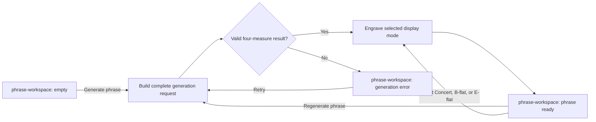

# Generate Phrase Handoff

- Screen: `screens/phrase-workspace/` for every step.
- Generation request uses the current control values and a fresh seed on `Generate phrase` or `Regenerate phrase`.
- The result must contain four complete 4/4 measures before engraving starts.
- Display-mode selection routes to engraving only. It preserves controls, seed, concert-pitch events, harmonic plan, and active range.
- Successful initial generation enters the phrase with the `staff-content` fade. Successful regeneration fades out old `staff-content`, then fades in the ready replacement.
- A failed request or engraving failure retains the last valid phrase; initial failure shows the empty-state error variant.
