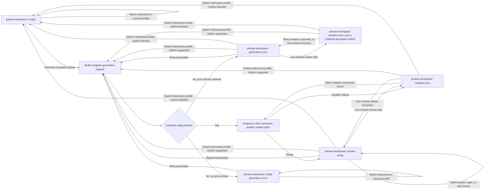

# Generate Phrase Handoff

- Screen: `screens/phrase-workspace/` for every step.
- Before initial generation, every musical control, instrument profile, and musical-profile preset is editable on the empty workspace. Those selections update the pending direction only; they do not create a partial result or an implicit request.
- Generation request uses the current control values, selected instrument profile policy, and a fresh seed on the explicit `Generate phrase`, `Regenerate phrase`, or `Retry generation` action. An instrument-profile switch made while a phrase is shown builds the same kind of fresh request automatically, keeping the written key and collection; it never validates the old phrase against the new profile's range and never retains or transposes it.
- The result must contain four complete common-time measures before engraving starts.
- Theme selection changes presentation only. It neither routes to generation nor engraving, and it does not change the phrase, controls, request, seed, profile policy, or result.
- Instrument-profile selection: with a phrase shown — whether the workspace is currently on a ready phrase, a generation error over a retained phrase, a notation error, or a notation error over a retained generation failure — it always regenerates a complete replacement with a fresh seed and the retained written key, collection, and every other control, except when the current rhythm combination (note density, syncopation, silence density) is already unsupported, in which case the switch still applies but clears the phrase to Empty instead of requesting one. With no phrase shown (Empty or an initial generation error, which has no phrase to retain), the switch only changes the selection; nothing generates.
- Successful initial generation enters the phrase with the `staff-content` fade. Successful regeneration applies `staff-content is-fading-out` to the old score, then inserts the ready replacement with the `staff-content` fade.
- A failed request retains the last valid score; initial failure (no prior phrase) shows the empty-state error variant. A generation failure with a phrase already retained keeps that phrase visible behind its retryable error banner. A notation failure preserves valid phrase data but replaces the score region with its retryable error panel; if that notation failure occurs from an out-of-band redraw while a generation error banner is already active over the retained phrase, the workspace shows both together (notation error over a retained generation failure) rather than one silently overwriting the other.
