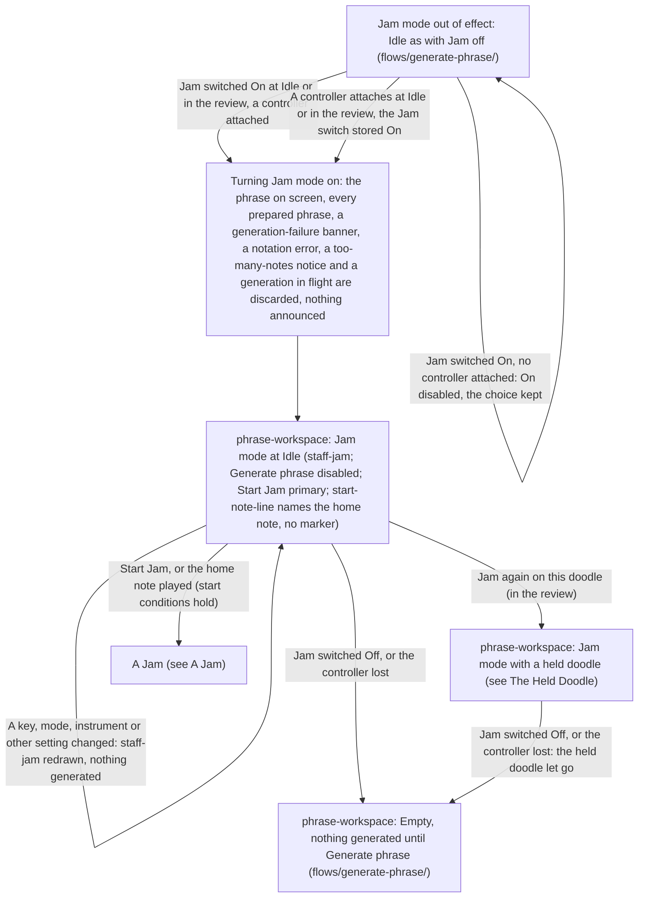
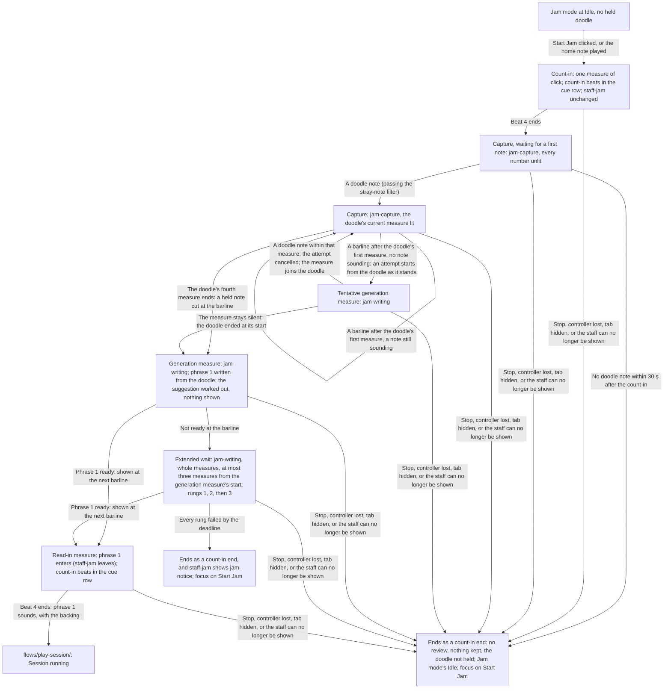
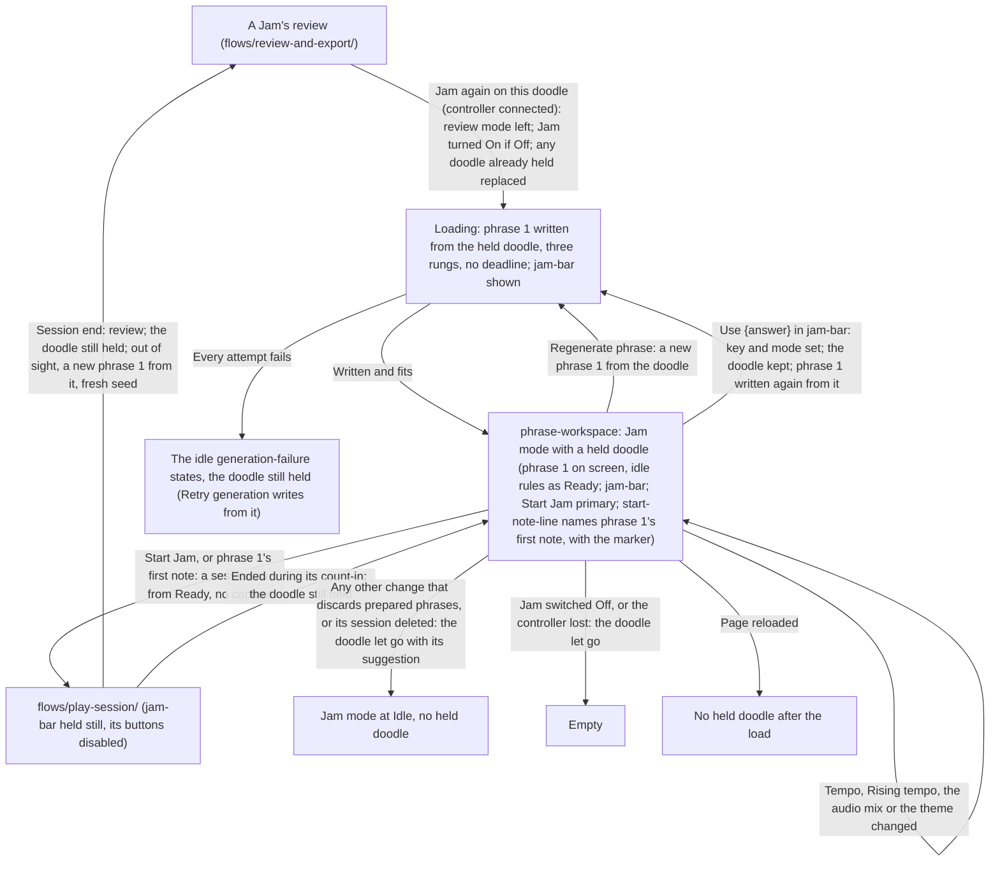

# Jam Handoff

> **New in v3.2.**

Screens: `screens/phrase-workspace/` for every step (the Jam field and its dependents in "During a
session", `staff-jam` with `jam-instruction` and `jam-notice`, the cue row's `jam-capture` and
`jam-writing`, `jam-bar` with its `suggestion-row`, the header's `Start Jam`, and the Jam states
under States); `screens/last-session-review/` for a Jam's review. From phrase 1 on, a Jam is a
session: `flows/play-session/`. The review side (the doodle section, `Use`, `Keep`,
`Jam again on this doodle`, the exports) is routed in `flows/review-and-export/handoff.md`, The
Doodle and the Suggestion. The reasoning is in [`intent.md`](intent.md).

## Jam Mode In and Out of Effect

## A Jam

## The Held Doodle

## Routing Rules

- **Terms.** _Jam mode is in effect_ while the Jam switch is `On` and a controller is attached
  (`controller-status` shows the connected badge). A _fresh Jam_ is one started without a held
  doodle; a _Jam on a held doodle_ is one started with one. _Ends as a count-in end_: back to Jam
  mode's Idle, no review, nothing kept (the most recent session stays what it was), the doodle not
  held, as a session ended during its count-in (`flows/play-session/handoff.md`).
- **Jam mode in and out of effect.** Judged at Idle and while the review mode shows, never during
  a session. The switch turned `On` with a controller attached, or a controller attaching with the
  switch stored `On`, puts it in effect; the switch turned `Off`, or the controller lost (the
  selected controller unplugged or disconnected), takes it out. Without a controller the switch's
  `On` is unavailable and Idle and every start behave exactly as with Jam off. The switch is
  read-only during **Loading** and a session, like every control; a controller attaching or lost
  during **Loading** acts on Jam mode at once, the generation in flight cancelled silently and its
  result never shown. While the review mode shows, these changes happen out of sight and are what
  the player finds on leaving it.
- **Turning Jam mode on** discards, at once and silently: the phrase on screen, every prepared
  phrase, any generation-failure banner, a notation error, a too-many-notes notice and any
  generation in flight. A no-room notice stays until the window gives the staff room. Then the
  workspace shows **Jam mode at Idle**.
- **Leaving Jam mode at Idle** (the switch off, the controller lost, or a held doodle let go while
  Jam is out of effect) shows **Empty**, as at first load: nothing is generated until the player
  presses `Generate phrase`. A held doodle is let go with it. Turning Jam off discards nothing else
  that is kept.
- **Jam mode at Idle, no held doodle.** `staff-frame staff-jam`: the empty system (clef, the key
  signature of the selected written key and collection, 4/4) and `jam-instruction`. The phrase
  action reads `Generate phrase`, disabled, secondary; the session action `Start Jam`, primary. No
  phrase is generated, prepared or replaced: v2's idle phrase rules and pre-generation do not run;
  the warm-up of the rhythm candidates still does, unseen. A change of key, mode or instrument
  redraws the empty system at once, with no animation and nothing announced. The idle states that
  need no phrase still apply: **Needs more room** with its no-room cause (cleared by a viewport
  change, then `staff-jam` again, nothing generated), the unsupported-rhythm alert, and the
  portrait guard. If the empty system cannot be engraved for a reason a retry can cure, the
  workspace shows **Notation error** as at any idle engraving, `Retry notation` redrawing it.
- **Start conditions, fresh Jam.** Every condition of a session start (`flows/play-session/`,
  Start conditions) except "a phrase is on screen" and "no new phrase is being generated": Jam mode
  in effect, the review mode not showing, no sheet or confirmation open, the staff shown (no
  `orientation-notice`, no **Needs more room**, no **Notation error**), and the rhythm combination
  supported (the unsupported-rhythm alert disables `Start Jam`). `Start Jam` is disabled whenever
  one fails; `start-note-line` is hidden whenever `Start Jam` is disabled.
- **The starting note, fresh Jam.** The selected written key's home note, in the instrument's
  written pitch, in the octave nearest the middle of its written range (the lower of two equally
  near), matched at its exact concert pitch, octave included, as the v2 starting note is.
  `start-note-line` names it in its usual wording, spelled as the empty staff's key signature
  spells it, with its octave number ("Play this note to start: G4"), or in its
  before-the-first-click wording until the page's first click, tap or key press; no
  `start-note-marker` is drawn. It starts the count-in only and belongs to no doodle. Any other note
  at Idle is ignored.
- **Count-in.** v2's, in every respect, with `staff-jam` on the staff instead of phrase 1: one
  measure of click, its beats in `count-in`, the start's jump, the wake and orientation locks, the
  phone's `session-cue-actions`. No phrase 2 is requested and nothing enters the bottom system.
- **The click** sounds from the count-in to the end of the read-in measure whatever `Click` says,
  at the click volume, as the count-in always does; `Click`'s toggle keeps showing what the
  player chose. From phrase 1 on, `Click` governs. No backing sounds before phrase 1.
- **Capture.** From the end of the count-in, `session-cue-row` holds `jam-capture` ("Your doodle"
  and the numbers 1 to 4, all unlit). Notes pass the stray-note filter first; a note belongs to
  the doodle by its snapped start, so a note played a little early onto the first beat after the
  count-in is a doodle note. The doodle's first measure is the measure holding its first note:
  `1` takes `is-current` when that note is played, and each later number takes `is-current` at
  the barline that begins its measure, the one before moving to `is-past`. Nothing is drawn on the
  staff: `staff-jam` and its instruction stay as they are, and no doodle note, playhead or mark
  appears.
  - **No note within 30 seconds** after the count-in (very short notes not counting): the Jam
    ends as a count-in end.
  - **End by silence.** From the end of the doodle's first measure, at each barline with no note
    sounding, an attempt at phrase 1 starts from the doodle as it stands and the row shows
    `jam-writing`. A doodle note played within that measure cancels the attempt and makes the
    measure part of the doodle: the row returns to `jam-capture` at once, with that measure's
    number `is-current`. A measure that stays silent is the generation measure: the doodle ended
    at its start. A measure beginning with a note still sounding is never silent, even if the note
    ends at once.
  - **End by length.** When the doodle's fourth measure ends, the doodle ends whatever is
    sounding; a held note is cut at that barline. The next measure is the generation measure.
  - **Notes after the doodle's end** (in the generation measure, an extended wait or the read-in
    measure) belong to no doodle and no phrase, and change nothing on screen.
- **Generation measure.** `session-cue-row` holds `jam-writing`, "Writing your first phrase"
  ("Writing" below `bp-tablet-landscape`), static. Phrase 1 is written from the quantized doodle;
  the key and mode suggestion is worked out and nothing about it is shown. The staff keeps
  `staff-jam`.
- **Extended wait.** When phrase 1 is not ready at the generation measure's end, the wait grows by
  whole measures: `jam-writing` stays, the click goes on, and phrase 1 is shown at the first
  barline at or after it is ready. The deadline is three measures after the generation measure
  begins. Attempts follow three rungs: the doodle's join and preferences, with fresh-seed retries;
  then one attempt with the preferences and no join; then a plain phrase with no doodle, which is
  always given the time it needs before the deadline. Phrase 1 is valid only if it also engraves
  in the session staff layout at the legibility floor at the current viewport size; a misfit is a
  failed attempt, as for any session phrase. Nothing shows which rung wrote phrase 1.
- **Every rung failed by the deadline:** the Jam ends as a count-in end, and `staff-jam` adds
  `jam-notice` under `jam-instruction`: "The app couldn't continue your doodle with these
  settings. Try again, or change a setting." (below `bp-tablet-landscape`, in place of
  `jam-instruction` while it shows). It stays until the next start, by either kind, or a change to
  any control below the staff (the tempo and the session options included; not the theme or the
  audio mix). `Start Jam` names it with `aria-describedby` while it shows, so focus there reads it.
  No other end before phrase 1 says anything.
- **Read-in measure.** At its barline phrase 1 enters: `staff-jam` takes the fast fade-out and
  phrase 1's `staff-content` the ordinary fade, in the session staff layout held from the start
  (the top system in the one-system layout; bars 1–2 on top and 3–4 below in the split layout).
  `session-cue-row` holds `count-in`, its four beats lit on the audio clock as during a count-in.
  Phrase 2 is requested as soon as phrase 1 is ready; in the one-system layout it enters the
  bottom system when engraved, as after v2's count-in. No playhead yet.
- **Phrase 1 sounds** at the end of the read-in measure, with the backing: the Jam is
  **Session running** (`flows/play-session/`), from which it runs, ends and opens its review as
  any session. The silence timer waits for a first note played from phrase 1 on.
- **Ends before phrase 1 sounds.** Stop, the controller lost (at once, no countdown), the tab
  hidden, or the staff no longer shown (the viewport-change rule of `flows/play-session/`), at any
  point from the count-in to the read-in measure: the Jam ends as a count-in end. Sound stops, the
  locks are released, `session-cue-actions` goes, a phrase 1 already entered is removed and
  `staff-jam` returns; every control and button the session disabled is enabled again; focus
  moves to `Start Jam`. After a viewport change the empty system is redrawn in the layout chosen
  afresh, or the workspace shows **Needs more room** (focus on `room-notice`). Nothing more is
  said. A controller lost leaves Jam mode: the workspace shows **Empty** and focus moves to the
  phrase action, `Generate phrase`.
- **Jam on a held doodle.** A v2 session start from Jam mode with a held doodle, in every respect
  (`flows/play-session/`): `Start Jam` or phrase 1's first note, the count-in, phrase 1, with no
  capture, no 30-second wait, no generation or read-in measures and no `jam-capture` or
  `jam-writing`. The controller lost during its count-in shows the disconnect banner and its
  countdown, as in any session. Its review shows the held doodle as its doodle, with no played
  doodle notes (`flows/review-and-export/`).
- **The held doodle at Idle.** Held only by `Jam again on this doodle` in a Jam's review; a fresh
  Jam's doodle is never held by itself. While it is held: `jam-bar` shows; phrase 1 is generated
  from it at Idle with no deadline, through the three rungs, a fresh seed each time, and every v2
  idle rule applies to it as to any phrase 1 (the fit retries and their replacements written from
  the held doodle too, **Needs more room**, the errors, `Retry generation` writing from it), with
  pre-generation running from it; the starting note is phrase 1's first note, with
  `start-note-marker`; `Regenerate phrase` writes a new phrase 1 from it. Where the idle rules
  would show **Empty** (a widening making a stored `Sixteenth` combination unsupported), the staff
  shows `staff-jam` with the unsupported-rhythm alert, the doodle still held, and phrase 1 is
  written from it again once the combination is supported.
- **What keeps a held doodle:** the tempo, `Rising tempo`, the audio mix, the theme, a viewport
  change, `Regenerate phrase`, `Use {answer}` (its own suggestion, at Idle or in the review of a
  session it was played in), `Jam again on this doodle` on the same doodle, a Jam played on it
  (unless the controller is away when it ends), and opening, pinning, favoriting or commenting a
  kept session or deleting its played notes.
- **What lets it go,** with its suggestion: every other change that discards prepared phrases,
  that is a musical control, a figure level, a preset choice that changes a setting, the
  instrument, a change of the restriction in force (a preset saved or deleted), the rhythm lock,
  the allowed rhythm changes, the drift, Vary settings and what it may vary, Tension across
  phrases; the Jam switch turned off; the controller lost at Idle, or away when a session played
  on it ends; deleting the kept session it came from (or `Delete everything`); `Jam again on this
  doodle` on another doodle (which replaces it); a reload. Idle then shows Jam mode at Idle
  without a held doodle, or, with Jam mode out of effect, **Empty**. Letting it go announces
  nothing; `jam-bar` leaves at once.
- **`jam-bar`** sits between `score-toolbar` and the generation-failure banner's place while a
  doodle is held: one `p`, "Jamming again on your doodle: phrase 1 continues it. Changing a setting
  other than the tempo lets it go.", then `suggestion-row` when there is a suggestion. Hidden with
  the staff area while the review mode shows. During a Jam played on it, it is held still,
  unchanged, its buttons disabled; it appears, changes and leaves only at Idle, with the player's
  action.
- **The suggestion at Idle** (`suggestion-row` in `jam-bar`), judged as in the review
  (`flows/review-and-export/handoff.md`): offered while the current key and mode are not among the
  close answers and the doodle's suggestion has not been declined, in the review's words ("Your
  doodle sounds like {answer}.", `Use {answer}`, `Keep {key} {mode}`, and the restriction line when
  the answer lies outside the restriction in force). There is no no-fit form at Idle: a doodle
  that fits no mode shows no row there. A suggestion left unanswered in the review is offered
  again here.
  - **`Use {answer}`** sets Written key and Collection as a change by hand does (saved like any
    setting, prepared phrases discarded, Custom when the restriction in force excludes the
    answer), keeps the doodle, and writes phrase 1 again from it in the new key and mode, through
    **Loading**. The row reads "Key and mode set to {answer}." until the key or mode changes
    again, the doodle is let go, or a session starts on it (then held still, and absent once that
    session has ended). Focus moves to that sentence (`tabindex="-1"`, never in the tab order).
  - **`Keep {key} {mode}`** changes nothing and declines the suggestion for good, the decline kept
    with the session the doodle came from (in memory only while saving is off) and recorded in any
    session played on it. The row leaves; focus moves to `jam-bar`'s sentence (`tabindex="-1"`).
- **Saving.** The Jam switch, the drift, the rhythm lock, the allowed rhythm changes and what Vary
  settings may move are saved when the player changes them, Jam also when
  `Jam again on this doodle` turns it on (`flows/saved-data/`). A held doodle is never saved. A
  Jam is saved like any session once phrase 1 has sounded; a Jam that ends before then saves
  nothing (`flows/kept-sessions/`). While saving is off, a Jam, its review, the suggestion's
  answers and `Jam again on this doodle` work in memory for the visit.
- **At load.** No held doodle ever comes back. With Jam stored `On`, the workspace opens in
  **Empty** as at every load, and the remembered controller attaching (`flows/controller-connection/`)
  puts Jam mode in effect at once, as any controller attaching does; `start-note-line` takes its
  before-the-first-click wording until the page's first click.
