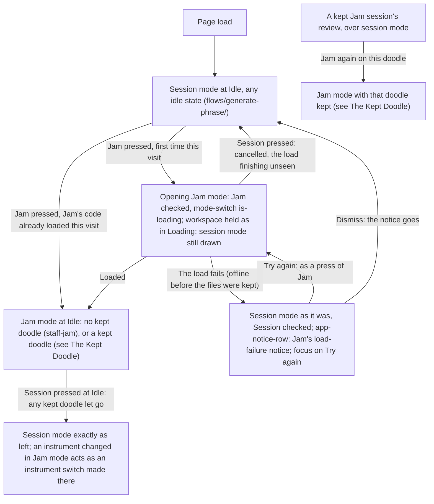
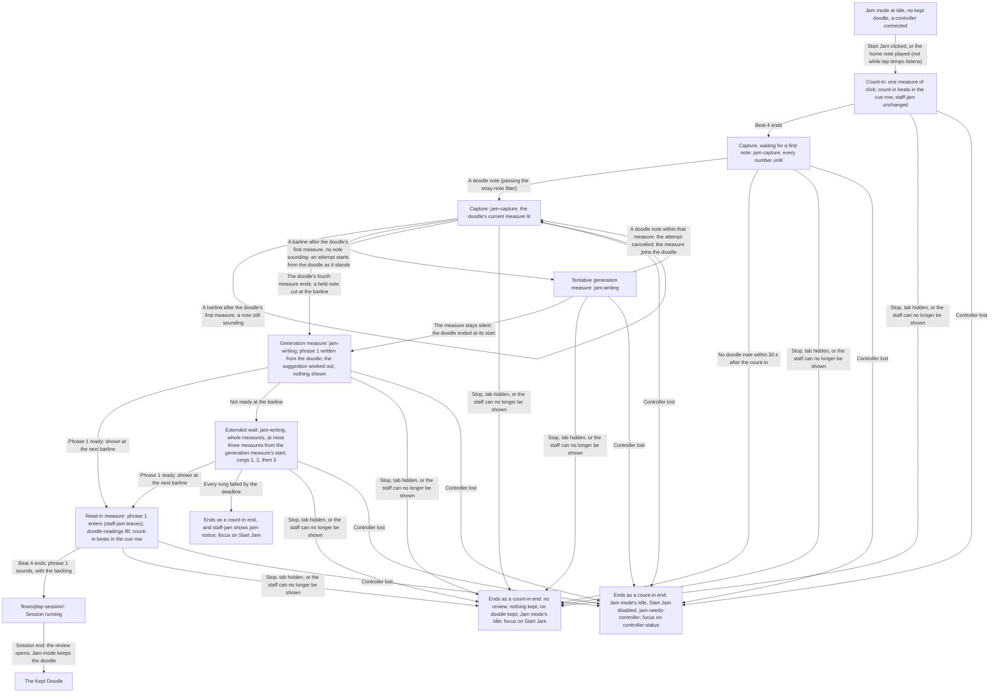
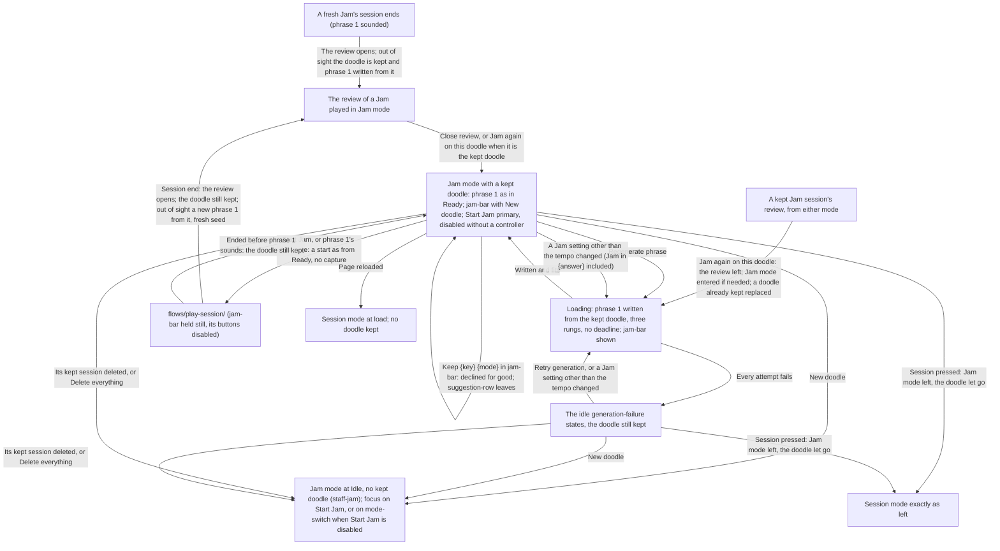

# Jam Handoff

> **New in v3.2.**

Screens: `screens/phrase-workspace/` for every step (the header's `mode-switch`, Jam's controls
with `tap-tempo` and `doodle-readings`, `staff-jam` with `jam-instruction` and `jam-notice`, the
cue row's `jam-capture`, `jam-writing` and `jam-needs-controller`, `jam-bar` with `New doodle` and
its `suggestion-row`, the header's `Start Jam`, Jam's load-failure notice in `app-notice-row`, and
the Jam states under States); `screens/last-session-review/` for a Jam's review. From phrase 1 on,
a Jam is a session: `flows/play-session/`. The review side (the doodle section, `Jam in {answer}`,
`Keep {key} {mode}`, `Jam again on this doodle`, the exports) is routed in
`flows/review-and-export/handoff.md`, The Doodle and the Suggestion. The reasoning is in
[`intent.md`](intent.md).

## Entering and Leaving Jam Mode

## A Jam

## The Kept Doodle

## Routing Rules

- **Terms.** _Jam mode_ is the mode `mode-switch` shows as `Jam`; _session mode_ the one it shows
  as `Session`. A _fresh Jam_ is one started without a kept doodle; a _Jam on the kept doodle_ is
  one started with one. _Ends as a count-in end_: back to Jam mode's Idle, no review, nothing
  saved (the most recent session stays what it was), as a session ended during its count-in
  (`flows/play-session/handoff.md`). _A controller connected_: `controller-status` shows the
  connected badge (a selected controller that is away counts as none). _Jam's settings_: the
  controls of Jam's control section (`screens/phrase-workspace/handoff.md`, Jam's controls).
- **The mode switch.** Pressing the segment not checked, or an arrow key, switches the mode. It is
  read-only (`is-readonly`) during **Loading** (in either mode), a session (count-in included)
  and while the review mode shows (a review or the session list), with no note; only these
  presses switch, never a controller arriving or leaving, a session's end or a load. The switch
  is instant, with no animation; focus stays on the segment pressed. Each mode keeps its own
  staff, phrase, prepared phrases, generation-failure banner and staff notices; the header, the
  score toolbar, `app-notice-row` and the footer are shared.
- **Opening Jam mode.** The first press of `Jam` in a visit loads Jam's code. At once `Jam` is
  checked, `mode-switch` takes `is-loading` and `aria-busy="true"`, and the workspace is held as
  in **Loading**: every control read-only, both header actions disabled in place (their session
  mode labels kept), `session-cue-row` empty, the starting note ignored; session mode stays drawn.
  `Session` stays pressable and cancels: session mode as it was, focus on `Session`, the load
  finishing unseen (a later press of `Jam` then waits for nothing). Loaded: Jam mode's Idle at
  once. Every later press in the visit shows Jam mode at once.
  - **The load fails** (offline before the app's files were kept): session mode as it was,
    `Session` checked, and `app-notice-row` shows Jam's load-failure notice, "Jam mode couldn't
    open because part of the app didn't load. Check that you're online, then try again.", with
    `Try again` and `Dismiss`; focus moves to `Try again`. `Try again` acts as a press of `Jam`;
    the notice leaves when Jam mode opens or on `Dismiss`. Never error-toned. Like every notice,
    it is held still during a session, its buttons disabled.
- **Session mode while Jam mode shows.** Kept exactly as it was: its staff state, the phrase on
  screen, its prepared phrases (preparing more waits until session mode returns), a
  generation-failure banner, a notation error or a no-room notice. Nothing in Jam mode changes
  session mode's settings; Jam's settings never enter session mode's pre-generation.
- **Leaving Jam mode.** `Session` pressed at Idle, in any idle state of Jam mode: session mode
  returns exactly as it was left. A kept doodle is let go silently, with its suggestion;
  `doodle-readings` empties; `tap-tempo` stops listening; `jam-notice` goes. Two shared changes
  are taken on return as though made in session mode: an instrument changed in Jam mode is an
  instrument switch there (with a phrase on screen, a fresh phrase for the new instrument,
  prepared phrases discarded, or **Empty** under an unsupported rhythm combination;
  `flows/generate-phrase/`), and so is my instrument saved with a new range or clef while it is
  selected. Session mode's idle rules apply at the window's current size, as after any viewport
  change at Idle. Focus stays on `Session`.
- **At load.** The app always opens in session mode; Jam's code is not loaded and no doodle is
  kept. Being in Jam mode is never saved.
- **No controller in Jam mode.** Jam mode opens and every one of Jam's settings can be set.
  `Start Jam` is disabled, and `session-cue-row` holds `jam-needs-controller` where
  `start-note-line` goes, "A Jam needs a connected controller. Connect one to start." ("Connect a
  controller to start." below `bp-tablet-landscape`), named by `Start Jam`'s `aria-describedby`.
  A kept doodle stays, its phrase 1 still written and shown. A controller attaching enables
  `Start Jam` and `jam-needs-controller` gives way to `start-note-line`; nothing else changes. A
  controller arriving or leaving never switches the mode.
- **Jam mode at Idle, no kept doodle.** `staff-frame staff-jam`: the empty system (clef, the key
  signature of Jam's written key and collection, 4/4) and `jam-instruction`. The phrase action
  reads `Generate phrase`, disabled, secondary; the session action `Start Jam`, primary. No phrase
  is generated, prepared or replaced; the warm-up of the rhythm candidates still runs, unseen. A
  change of Jam's key or mode, or of the instrument, redraws the empty system at once, with no
  animation and nothing announced; no other setting changes the staff. The idle states that need
  no phrase still apply: **Needs more room** with its no-room cause (cleared by a viewport
  change, then `staff-jam` again, nothing generated), the portrait guard, and **Notation error**
  when the empty system cannot be engraved for a reason a retry can cure, `Retry notation`
  redrawing it. Jam mode shows no rhythm control, so the unsupported-rhythm alert, which belongs
  to session mode's rhythm group, never shows there.
- **Start conditions, fresh Jam.** Every condition of a session start (`flows/play-session/`,
  Start conditions) except "a phrase is on screen", "no new phrase is being generated" and the
  supported rhythm combination: a controller connected, the review mode not showing, no sheet or
  confirmation open, the staff shown (no `orientation-notice`, no **Needs more room**, no
  **Notation error**). `Start Jam` is disabled whenever one fails; `start-note-line` is hidden
  whenever `Start Jam` is disabled.
- **The starting note, fresh Jam.** The home note of Jam's written key, in the instrument's
  written pitch, in the octave nearest the middle of its written range (the lower of two equally
  near), matched at its exact concert pitch, octave included, as the v2 starting note is.
  `start-note-line` names it in its usual wording, spelled as the empty staff's key signature
  spells it, with its octave number ("Play this note to start: G4"); no `start-note-marker` is
  drawn. It starts the count-in only and belongs to no doodle. Any other note at Idle is ignored,
  except as a tap while `tap-tempo` listens.
- **Tap tempo** (`btn tap-tempo`, in Jam's Tempo field, at Idle and in the review mode, disabled
  in **Loading** and a session). Each press of the button is a tap (key repeats ignored) and
  starts listening, or keeps it going. While listening, every controller note is a tap too, the
  starting note included: `start-note-line` is hidden and the note starts nothing; `Start Jam`
  still works and ends listening. Listening ends 2 seconds after the last tap, or when anything
  else is used (another control, a header action, `mode-switch`, a sheet opened, the page left).
  - From the fourth tap of a listening run, the tempo is the mean beat of the last four taps,
    rounded to the stepper's step of 10 BPM and kept within 60–180 BPM: set at once in the
    stepper and `tempo-readout`, saved like a change by hand, and set again by each further tap.
    Fewer than four taps change nothing.
  - Its `field-note`, a polite live region (`aria-live="polite"`), reads at rest "Tap the beat
    here, or press once and tap on your controller." ("Tap the beat here." without a controller
    connected); after a first tap, "Keep tapping: four beats set the tempo."; once set, "Set to
    {tempo} BPM. Keep tapping to correct it."; at a limit, "Set to 180 BPM, the fastest a Jam
    goes." or "Set to 60 BPM, the slowest a Jam goes.". When listening ends, a "Set to" sentence
    stays until the tempo is changed another way or Jam mode is left, then the note reads its rest
    wording again; "Keep tapping" returns to the rest wording at once.
  - Unevenness is never judged or told; tapping starts nothing and sounds nothing.
- **Count-in.** v2's, in every respect, with `staff-jam` on the staff instead of phrase 1: one
  measure of click at Jam's tempo, its beats in `count-in`, the start's jump, the wake and
  orientation locks, the phone's `session-cue-actions`. No phrase 2 is requested and nothing
  enters the bottom system.
- **The click** sounds from the count-in to the end of the read-in measure whatever `Click` says,
  at the click volume, as the count-in always does; `Click`'s toggle keeps showing what the
  player chose. From phrase 1 on, `Click` governs. No backing sounds before phrase 1.
- **Capture.** From the end of the count-in, `session-cue-row` holds `jam-capture` ("Your doodle"
  and the numbers 1 to 4, all unlit). Notes pass the stray-note filter first; a note belongs to
  the doodle by its snapped start, so a note played a little early onto the first beat after the
  count-in is a doodle note. The doodle's first measure is the measure holding its first note:
  `1` takes `is-current` when that note is played, and each later number takes `is-current` at
  the barline that begins its measure, the one before moving to `is-past`. Nothing is drawn on the
  staff: `staff-jam` and its instruction stay as they are, and no doodle note, playhead or mark
  appears. The home note and the doodle's notes never start the silence timer.
  - **No note within 30 seconds** after the count-in (very short notes not counting): the Jam
    ends as a count-in end.
  - **End by silence.** From the end of the doodle's first measure, at each barline with no note
    sounding, an attempt at phrase 1 starts from the doodle as it stands and the row shows
    `jam-writing`. A doodle note played within that measure cancels the attempt and makes the
    measure part of the doodle: the row returns to `jam-capture` at once, with that measure's
    number `is-current`. A measure that stays silent is the generation measure: the doodle ended
    at its start. A measure beginning with a note still sounding is never silent, even if the note
    ends at once.
  - **End by length.** When the doodle's fourth measure ends, the doodle ends whatever is
    sounding; a held note is cut at that barline. The next measure is the generation measure.
  - **Notes after the doodle's end** (in the generation measure, an extended wait or the read-in
    measure) belong to no doodle and no phrase, and change nothing on screen.
- **Generation measure.** `session-cue-row` holds `jam-writing`, "Writing your first phrase"
  ("Writing" below `bp-tablet-landscape`), static. Phrase 1 is written from the quantized doodle,
  with the rhythm and shape controls read from it (`doodle-readings`); the key and mode
  suggestion is worked out and nothing about it is shown. The staff keeps `staff-jam`.
- **Extended wait.** When phrase 1 is not ready at the generation measure's end, the wait grows by
  whole measures: `jam-writing` stays, the click goes on, and phrase 1 is shown at the first
  barline at or after it is ready. The deadline is three measures after the generation measure
  begins. Attempts follow three rungs: the doodle's join and preferences, with fresh-seed retries;
  then one attempt with the preferences and no join; then a plain phrase with no doodle, which is
  always given the time it needs before the deadline. Phrase 1 is valid only if it also engraves
  in the session staff layout at the legibility floor at the current viewport size; a misfit is a
  failed attempt, as for any session phrase. Nothing shows which rung wrote phrase 1.
- **Every rung failed by the deadline:** the Jam ends as a count-in end, and `staff-jam` adds
  `jam-notice` under `jam-instruction`: "The app couldn't continue your doodle with these
  settings. Try again, or change a setting." (below `bp-tablet-landscape`, in place of
  `jam-instruction` while it shows). It stays until the next start or a change to any of Jam's
  settings (the tempo included; not the theme or the audio mix), and goes when Jam mode is left.
  `Start Jam` names it with `aria-describedby` while it shows, so focus there reads it. No other
  end before phrase 1 says anything.
- **Read-in measure.** At its barline phrase 1 enters: `staff-jam` takes the fast fade-out and
  phrase 1's `staff-content` the ordinary fade, in the session staff layout held from the start
  (the top system in the one-system layout; bars 1–2 on top and 3–4 below in the split layout).
  `doodle-readings` fills, silently, in the controls below. `session-cue-row` holds `count-in`,
  its four beats lit on the audio clock as during a count-in. Phrase 2 is requested as soon as
  phrase 1 is ready; in the one-system layout it enters the bottom system when engraved, as after
  v2's count-in. No playhead yet.
- **Phrase 1 sounds** at the end of the read-in measure, with the backing: the Jam is
  **Session running** (`flows/play-session/`), from which it runs, ends and opens its review as
  any session, without Vary settings, Tension across phrases or Rising tempo. The silence timer
  waits for a first note played from phrase 1 on. A controller lost from here on shows the
  disconnect banner and its countdown, as in any session.
- **Ends before phrase 1 sounds.** Stop, the controller lost (at once, no countdown), the tab
  hidden, or the staff no longer shown (the viewport-change rule of `flows/play-session/`), at any
  point from the count-in to the read-in measure: the Jam ends as a count-in end. Sound stops, the
  locks are released, `session-cue-actions` goes, a phrase 1 already entered is removed and
  `staff-jam` returns, `doodle-readings` empties again; every control and button the session
  disabled is enabled again; focus moves to `Start Jam`. No doodle is kept. After a viewport change
  the empty system is redrawn in the layout chosen afresh, or the workspace shows **Needs more
  room** (focus on `room-notice`). After a lost controller Jam mode stays: `Start Jam` is
  disabled, `jam-needs-controller` shows, and focus moves to `controller-status`. Nothing more is
  said.
- **A fresh Jam's session end.** Once its phrase 1 has sounded, however the session ends (a lost
  controller's countdown included), Jam mode keeps its doodle: the review opens, and out of sight,
  under it, phrase 1 is written from the doodle with a fresh seed, `jam-bar` is shown (hidden with
  the staff area until the review mode is left), and `doodle-readings` keeps the doodle's
  readings.
- **Jam on the kept doodle.** A v2 session start from **Ready**, in every respect
  (`flows/play-session/`): `Start Jam` or phrase 1's first note, the count-in, phrase 1, with no
  capture, no 30-second wait, no generation or read-in measures and no `jam-capture` or
  `jam-writing`. The controller lost during its count-in shows the disconnect banner and its
  countdown, as in any session. Ended before phrase 1 sounds (Stop, a hidden tab, a staff that can
  no longer be shown), it keeps the doodle and Idle shows the same phrase 1
  again, as after any count-in end. Its review shows the kept doodle as its doodle, with no played
  doodle notes (`flows/review-and-export/`); at its end the doodle stays kept, and a new phrase 1
  is written from it, fresh seed, out of sight.
- **The kept doodle at Idle.** While a doodle is kept, `jam-bar` shows; phrase 1 is written from
  it at Idle with no deadline, through the three rungs, a fresh seed each time, and every v2 idle
  rule applies to it as to any phrase 1 (the fit retries and their replacements written from the
  doodle too, **Needs more room**, the generation and notation errors, `Retry generation` writing
  from it), with pre-generation running from it, unseen; the starting note is phrase 1's first
  note, with `start-note-marker`; `Regenerate phrase` writes a new phrase 1 from it.
  `doodle-readings` shows its readings.
- **A Jam setting changed with a kept doodle.** A change at Idle to any of Jam's settings phrase 1
  is written from, that is every one but the tempo (Jam's written key or collection, the
  instrument, Harmonic motion, Tension, Embellishments, Drift, Rhythm lock, Allowed rhythm
  changes), rewrites phrase 1 from the kept doodle at once, through **Loading** (a fresh seed;
  prepared phrases discarded), so a Jam never meets the out-of-date phrase prompt. The tempo, the
  theme and the audio mix rewrite nothing. A change made while the review mode shows takes effect
  the same way, out of sight.
- **What lets the kept doodle go,** with its suggestion, and nothing else: `New doodle`; leaving
  Jam mode; the player deleting the kept session it now comes from, or `Delete everything`
  (`flows/kept-sessions/`, `flows/saved-data/`); `Jam again on this doodle` on another doodle, which replaces it; a reload.
  The session it comes from is the latest session played on it: a Jam on the kept doodle that
  reaches phrase 1 is saved holding the same doodle, and from then on the doodle comes from it.
  So the save at that session's end, which deletes the unpinned session the doodle came from
  before, never lets it go. A setting change, a lost or attached controller, a viewport change, a
  Jam on it (ended before phrase 1 or not) and opening, pinning, favoriting or commenting a kept session or deleting its
  played notes keep it. Letting it go announces nothing.
- **`New doodle`** (plain `btn` at `jam-bar`'s inline end, at Idle; disabled in **Loading** and
  held disabled during a session) asks for no confirmation: the kept session still holds the
  doodle. The doodle and its suggestion go, a generation from it in flight is cancelled, prepared
  phrases are discarded, `jam-bar` leaves, `staff-jam` returns, `doodle-readings` empties, and
  focus moves to `Start Jam`, or to `controller-status` when `Start Jam` is disabled (never to
  `mode-switch`, where an arrow key would leave Jam mode). Nothing is announced.
- **`jam-bar`** sits between `score-toolbar` and the generation-failure banner's place while a
  doodle is kept: its sentence, "Jamming again on your doodle: phrase 1 continues it. Leaving Jam
  mode lets it go.", `New doodle` at its inline end, then `suggestion-row` when there is a
  suggestion. Hidden with the staff area while the review mode shows. During a Jam played on the
  doodle it is held still, unchanged, its buttons disabled; it appears, changes and leaves only
  at Idle, with the player's action.
- **The suggestion at Idle** (`suggestion-row` in `jam-bar`), judged against Jam's key and mode as
  in the review (`flows/review-and-export/handoff.md`): offered while Jam's key and mode are not
  among the close answers and the doodle's suggestion has not been declined: "Your doodle sounds
  like {answer}.", `Jam in {answer}`, `Keep {key} {mode}` ({key} {mode} being Jam's). There is no
  no-fit form at Idle: a doodle that fits no mode shows no row there. A suggestion left unanswered
  in the review is offered again here.
  - **`Jam in {answer}`** sets Jam's written key and collection only (saved like any of Jam's
    settings; session mode's key and mode untouched), keeps the doodle, and writes phrase 1 again
    from it in the new key and mode, through **Loading**. The row reads "Jams now play in
    {answer}." until Jam's key or mode changes again, the doodle is let go, or a session starts
    on it (then held still, and absent once that session has ended). Focus moves to that sentence
    (`tabindex="-1"`, never in the tab order).
  - **`Keep {key} {mode}`** changes nothing and declines the suggestion for good, the decline kept
    with the session the doodle came from (in memory only while saving is off) and recorded in any
    session played on it. The row leaves; focus moves to `jam-bar`'s sentence (`tabindex="-1"`).
- **Saving.** Jam's settings are their own saved record, apart from session mode's, each saved
  when the player changes it (by hand, by a tap, or by `Jam in {answer}`), reset to their defaults
  by `Delete everything`; the instrument, the theme and the audio mix are shared with session
  mode. Being in Jam mode and the kept doodle are never saved. A Jam is saved like any session
  once phrase 1 has sounded; a Jam that ends before then saves nothing (`flows/kept-sessions/`).
  The settings, their defaults and what comes back at load are in `flows/saved-data/` and
  `screens/phrase-workspace/handoff.md`, Saved settings. While saving is off, Jam mode, a Jam, its
  review, the suggestion's answers and `Jam again on this doodle` work in memory for the visit.
