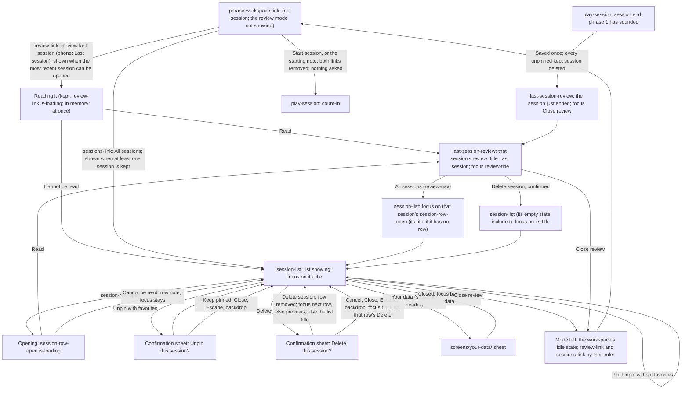

# Kept Sessions Handoff

> **New in v3.**

## Flow

- Screens: `screens/phrase-workspace/` (the cue row and its two links, the header's session
  action, every idle state), `screens/session-list/` (the list), `screens/last-session-review/`
  (a session's review) and `screens/your-data/` (the sheet). What happens inside a review is
  routed in `flows/review-and-export/handoff.md`; this flow routes the links, the list and the
  moves between the list and a review.

## Terms

- **Kept session:** a session saved on this device, pinned or not.
- **The most recent session:** the last session that ended with a review, while it still exists:
  in memory during the visit it ended in (kept, or held in memory only because its save failed),
  or, after a reload, the session that was saved last. Deleting it leaves no most recent session
  until the next session ends with a review. A session ended during its count-in changes nothing.
- **Can be opened:** held in memory, or kept and readable by this version of the app.
- **Session date:** a session's start in local time, written with the browser's locale as the
  short weekday, the day, the short month, the year, then the hour and minutes ("Tue 6 Oct 2026,
  18:42" in British English, "Tue, Oct 6, 2026, 6:42 PM" in US English). The same text in the
  review's title or summary and in the list's rows, never written any other way.

## The Cue-Row Links

Drawn in `screens/phrase-workspace/` (`session-cue-row`); routed here.

- **When each shows.** Both only at idle: never from a session's start (count-in included) to its
  end, and never while the review mode shows (a review or the list). `review-link` while the most
  recent session can be opened; `sessions-link` while at least one session is kept, readable or
  not. Both, one, or none may show. They are decided with the saved settings at load, inside the
  load wait, so neither appears under the player's eyes once the first phrase is drawn; after
  that they change only at a session end, at `Close review` and when a deletion changes what is
  kept.
- **Labels.** `review-link`: "Review last session" from `bp-tablet-landscape` up, "Last session"
  below it. `sessions-link`: "All sessions" at every breakpoint.
- **Order.** At the row's trailing end, `review-link` then `sessions-link`, beside
  `start-note-line` or alone.
- **`review-link` activation.** Shows the review mode with the most recent session's review,
  scrolls the page instantly to its top, and moves focus to `review-title`. A session held in
  memory shows at once. A kept one is read first: `review-link` takes `is-loading` and
  `disabled` until it is read; if it cannot be read, the mode shows the list instead, that
  session's row in its failed-to-open state, focus on the list's title.
- **`sessions-link` activation.** Shows the review mode with the list, scrolls the page instantly
  to its top, and moves focus to the list's title.
- **At a session start** (Start, or the starting note), both links are removed before the start's
  jump; if one had focus when the starting note started the session, focus moves to the session
  action (now `Stop`); focus anywhere else is left where it is.

## The List in the Review Mode

- **Showing the list** puts `sessions-panel` in the staff area's place, exactly where
  `review-panel` goes and with the same mode rules (`flows/review-and-export/handoff.md`,
  Showing): the session action reads `Close review`, primary and always enabled; the phrase action
  is disabled; no session starts, by click or by MIDI note; `score-toolbar` (without
  `score-title`), the audio mix, `control-section`, `controller-status` with the connection sheet,
  `theme-control` and the page footer stay usable. At most one of `review-panel` and
  `sessions-panel` is rendered.
- **Switching levels.** A row's `session-row-open` replaces the list with that session's review;
  the review's `All sessions` button replaces the review with the list. Each switch scrolls the
  page instantly to its top. Neither leaves the mode.
- **`Close review`** leaves the mode from either level, with v2's focus rules unchanged
  (`flows/review-and-export/handoff.md`, Close review), then shows each link by its rule.
- **Focus.** List shown from `sessions-link`, from a review's deletion, or after a failed open
  from `review-link`: the list's title. From a review's `All sessions`: that session's
  `session-row-open`, or the list's title when the session has no row (it is held in memory
  only). A row's title pressed and its session read: `review-title`.

## Opening a Session

- Activating `session-row-open` reads the session from the device: the button takes `is-loading`
  and `disabled`; the rest of the list and the page stay usable. Pressing another row's title
  meanwhile replaces the pending opening (the latest press wins). `Close review` cancels it.
- **Read:** its review replaces the list (`screens/last-session-review/`), focus on
  `review-title`.
- **Cannot be read:** the list stays; the row shows `session-row-note` "This session couldn't be
  opened. Try again, or delete it." in place of its comment; `session-row-open` returns enabled
  and keeps focus. The note goes at the next successful open.
- **Saved by a newer version** (known from the row itself): `session-row-open` is disabled from
  the start; see `screens/session-list/handoff.md`, States.

## Pin and Unpin

From a row (`session-row-actions`) or a review (`review-session-tools`), the same rules:

- **`Pin`** pins at once, with no confirmation and no message. The button becomes `Unpin`, keeps
  focus, and the row's status line or the review's keep line changes in place.
- **`Unpin`, no favorites in the session:** unpins at once, the same way.
- **`Unpin`, favorites in the session:** opens the confirmation sheet (pattern below): title
  "Unpin this session?"; body "It will be deleted, with its {k} favorites, when your next session
  is saved." ("its favorite" when one); actions `Unpin` (`btn`) then `Keep pinned` (`btn`). On
  `Unpin`, the session is unpinned and focus returns to the button, now `Pin`; on the way back,
  nothing changes and focus returns to `Unpin`.
- Marking a favorite pins its session (`flows/review-and-export/handoff.md`); removing a session's
  last favorite never unpins it.

## Deleting a Session

- **From a row:** `Delete` opens the confirmation sheet: title "Delete this session?"; body "This
  deletes the session from {session date}, with {what it holds}." then "This can't be undone.",
  where {what it holds} names, in this order and only when present, "its {k} favorite phrases"
  ("its favorite phrase" when one), "its comment" and "its played notes", joined with commas and
  "and"; with none of them the first sentence is "This deletes the session from
  {session date}."; actions `Delete session`
  (`btn btn-error`) then `Cancel` (`btn`). On `Delete session`, the session is deleted and its row
  removed; focus moves to the next row's `session-row-open` (that row's `Delete` when it cannot be
  opened), else the previous row's, else the list's title over `sessions-empty`. On the way back,
  focus returns to the row's `Delete`.
- **From a review:** `Delete session` opens the same sheet; on confirmation the list replaces the
  review, its empty state included, focus on the list's title. On the way back, focus returns to
  `Delete session`.
- **The session that just ended:** deleting it also removes it from memory; there is then no most
  recent session, and `review-link` is not shown until the next session ends with a review.
- **A session held in memory only** (its save failed): `Delete session` in its review deletes it
  from memory, with the same sheet.
- **A deletion that fails** keeps the confirmation open, adding `inline-alert alert-error` under
  its paragraphs: "That couldn't be deleted. Try again." The confirming action tries again; the
  line leaves when it does. The session stays as it was.

## The Confirmation Pattern

Every confirmation here is a `sheet` of its own, opened from the page: `sheet-backdrop`, `sheet`
(`role="dialog"`, `aria-modal="true"`, `aria-labelledby` its `sheet-title`), `sheet-header` with
`sheet-title` (the question) and `btn sheet-close` ("Close"), `sheet-body` with a `p` naming what
goes and, for a deletion, a second `p` reading "This can't be undone.", and `sheet-actions` holding the confirming action then the way back, in markup, visual and focus
order. On open, focus goes to the way back. Escape, a press on the backdrop and `Close` are the
way back. Focus is trapped in the sheet while it is open. No MIDI note starts a session while it
is open (none could anyway: the review mode shows). It opens and closes with the sheet's own
opacity transition (`motion.md`).

## Keeping at a Session's End

- A session that ends once phrase 1 has sounded is saved once, as its review opens; nothing is
  written during a session and nothing is shown on success (`flows/review-and-export/handoff.md`).
- The same save deletes every kept session that is not pinned, the previous most recent one
  included. The new session becomes the most recent one.
- A session ended during its count-in saves and deletes nothing; the most recent session stays,
  and the links return by their rules.
- A save that fails deletes nothing; the session stays in memory as the most recent one, until
  the next session ends with a review or the page closes. Its review's keep line says it is not
  saved; it has no row.

## Deletions Made Elsewhere

From `Your data` (`screens/your-data/`), opened from the list's header or the page footer:

- **`Delete every session`:** every kept session goes, and the session held in memory with them.
  If the review mode shows, it shows the list's empty state; when the sheet closes, focus
  returns to the button that opened it, as from every sheet (the list's `Your data` button stays
  in its header). Neither link is shown afterwards.
- **`Delete all played notes`:** every row loses "Played notes kept"; a review showing a session
  whose played notes were kept loses its `Played notes` lane, its view row and its played-notes
  export at once (`screens/last-session-review/handoff.md`).
- **`Delete everything`:** the page reloads into its first visit; nothing here needs routing.
