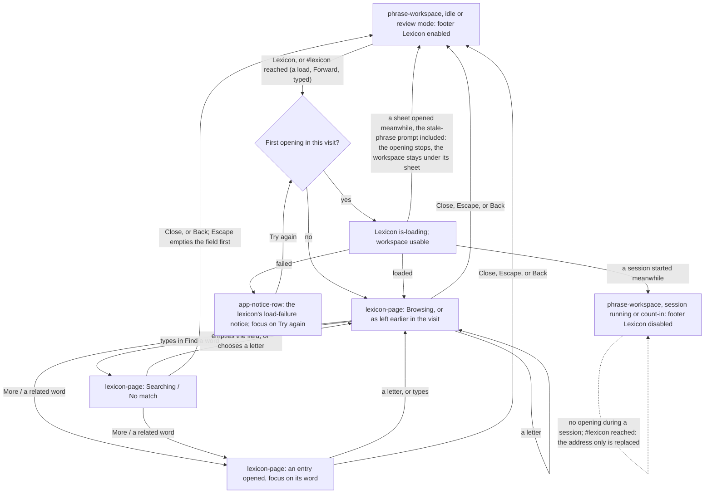

# Look Up a Word Handoff

> **New in v3.4.**

The page itself, its entries, its search and its keys, are in
[`screens/lexicon-page/handoff.md`](../../screens/lexicon-page/handoff.md).

## Flow

## Routing Rules

- **Opening.** The footer's `Lexicon` opens the page from the workspace at idle, in either mode,
  or in the review mode, with or without a sheet having been open before; never during a session,
  count-in included, where it is disabled.
  - **No wait for the session controller.** Unlike `Your data`, which stays disabled until the
    session controller has loaded, `Lexicon` does not wait for it: the page does not need it, so
    the button is enabled while the controller still loads, as long as no session runs.
- **Loading once.** The page's part of the app loads at the first opening of a visit and stays
  loaded; later openings show the page at once, as it was left.
- **A session during the load.** A session that starts while the page is loading (by `Start
  session` or the starting note) cancels the opening; the page does not open when the load ends.
  - **A sheet during the load.** A sheet opened while the page is loading (Your data, the
    connection sheet, My instrument, the preset sheet, the stale-phrase prompt or another) stops
    the opening too: the page does not open when the load ends, even if the sheet has closed by
    then, so it never stacks over a sheet. A later press of `Lexicon` opens it, at once if the
    load has ended.
- **Load failure.** A failed load opens nothing and shows the lexicon's load-failure notice in
  `app-notice-row`, whose `Try again` is a press of `Lexicon`.
- **Closing.** `Close`, or Escape outside a search field holding text, closes the page and
  returns focus to the footer's `Lexicon`. The workspace is as it was: the page changes no
  setting, no phrase and no kept data.
- **The browser's Back button.** The page has one history entry of its own, with the address
  `#lexicon`, and no other. Back closes the page as `Close` does.
  - **Its entry.** Every opening adds that entry, marked as the page's own, on top of the
    workspace's bare address, so Back from the page always lands on the workspace and never
    leaves the app.
  - **Closing by `Close` or Escape.** Closing steps back over the page's entry, so the
    browser's history holds no lexicon visit and Back next goes where it would have before the
    page opened.
  - **Forward.** After the page closed, Forward onto its entry opens the page on that entry, as
    the footer's `Lexicon` would but adding no entry. Wherever the footer's `Lexicon` is
    disabled (a session, count-in included), Forward onto it opens nothing and the address is
    replaced with the bare one.
  - **A load at `#lexicon`.** A load or reload at `#lexicon` replaces the address with the bare
    one, opens the workspace, then, once the saved settings are read and the workspace is drawn,
    opens the page as a press of `Lexicon` does, adding its entry.
  - **`#lexicon` reached any other way.** `#lexicon` reached while the app is open, other than
    by the page's own entry (typed into the address bar, for one), is handled as a load at
    `#lexicon`: the address is replaced with the bare one and the page opens as a press of
    `Lexicon` does, adding its own entry. During a session, count-in included, only the address
    is replaced; the page does not open.
  - **Under an open sheet.** While any sheet is open over the workspace (Your data, the
    connection sheet, My instrument, the preset sheet, the stale-phrase prompt or another; for
    these rules the stale-phrase prompt counts as a sheet), the footer's `Lexicon` cannot be
    pressed, so
    `#lexicon` reached by Forward, by a load or any other way opens nothing: only the address is
    replaced with the bare one, and the sheet stays as it is, nothing in it lost.
  - **Jumps inside the page.** A letter or a related word moves within the page without
    navigating: its link's own navigation is cancelled, so it adds no history entry and leaves
    the address at `#lexicon`. Its `href` stays, so it is still a link to assistive technology.
- **No MIDI start.** While the page is open, a MIDI note starts nothing: the page counts as an
  open sheet for the starting note, whose line under the staff is hidden, as under a sheet, and
  comes back as it was once the page is closed.
- **Nothing kept.** Opening, searching and reading save nothing on the device; the page's state
  lasts for the visit only.
