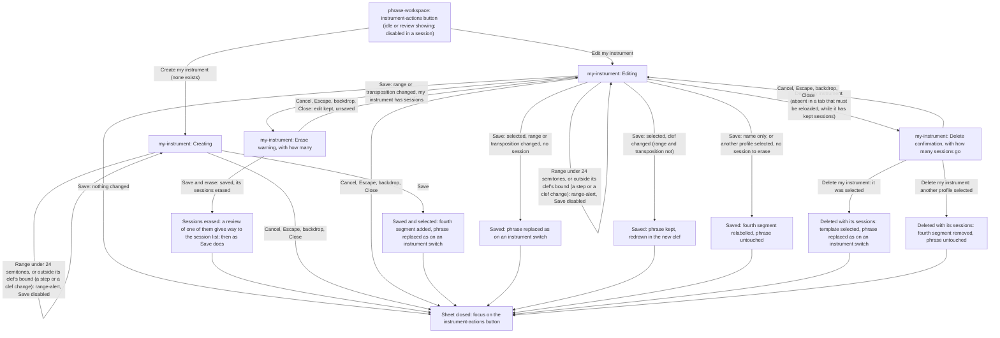
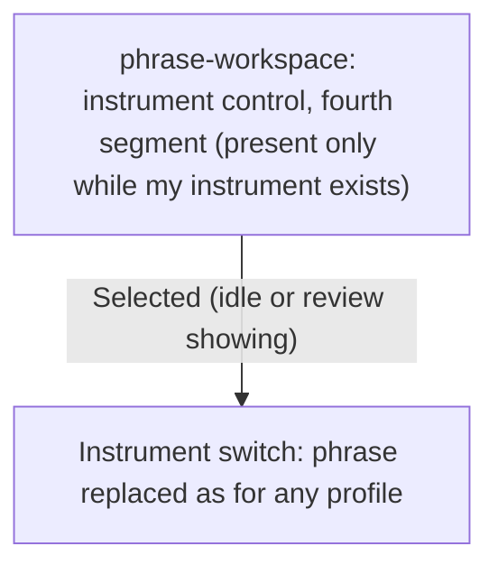
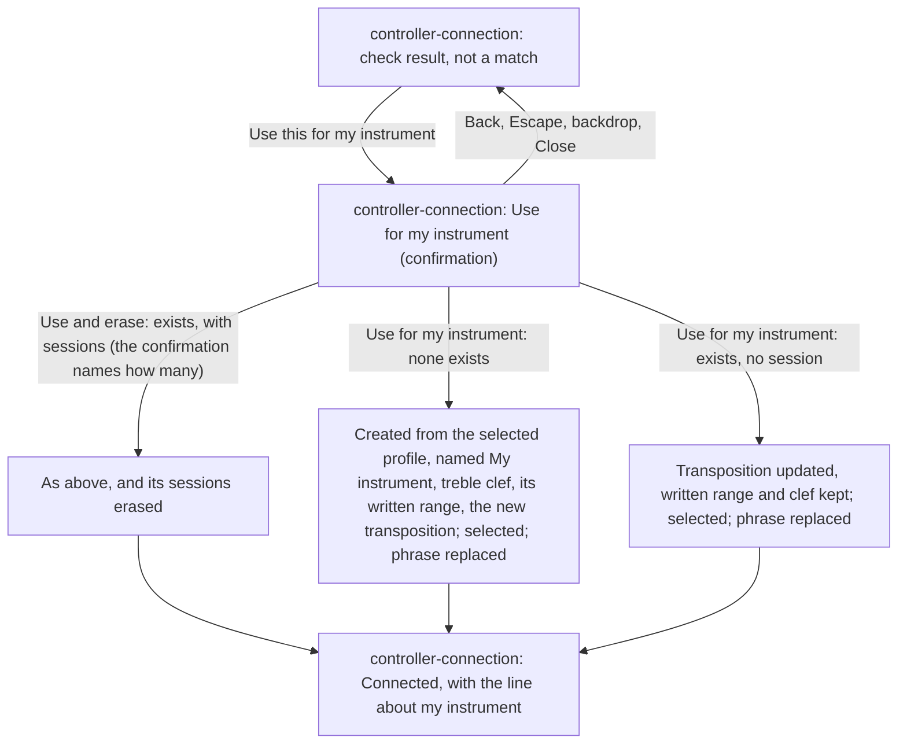

# My Instrument Handoff

> **New in v3.**

## Making, Changing and Deleting

## Selecting

## From the Transposition Check

## Routing Rules

- Screens: `screens/my-instrument/` for the sheet and its confirmation;
  `screens/phrase-workspace/` for the instrument control, its fourth segment and the
  `instrument-actions` button; `screens/controller-connection/` for the check's way in.
- **Availability.** The `instrument-actions` button and the fourth segment work at idle and while
  the review shows, and are disabled during a session, like every control. The sheet never opens
  by itself and never during a session. While it is open, no MIDI note starts a session, the
  starting note included.
- **One instrument.** At most one my instrument exists. `instrument-actions` reads
  `Create my instrument` while none exists and `Edit my instrument` once it does; the fourth
  segment exists exactly while it exists, labelled with its name.
- **Creating** starts from the built-in profile selected in the workspace. Choosing another
  template refills the range and the transposition, never the name.
- **Valid range:** the highest written note at least 24 semitones above the lowest, and both ends
  inside the clef's bound, written C2 to C7 in treble clef, E0 to E5 in bass clef, both ends
  included. Anything else is refused live, with the reason in note names, and `Save` is disabled;
  nothing is refused after `Save`. Changing the clef checks the range again at once. Each range
  stepper's only bound is the MIDI note range of the note it sounds; the transposition stepper's
  bound keeps both range notes sounding inside it.
- **The clef** is treble or bass, treble for a new my instrument and for one the check creates;
  choosing a template never changes it. It is display only: it changes no written note and nothing
  generated, and travels with each phrase, so each phrase is drawn in the clef it was made with.
- **The transposition** is the number of semitones from a written note to the note it sounds.
  Changing it, in the sheet or from the check, keeps the written range; the sounding range follows.
- **Replacing the phrase** "as on an instrument switch" means the existing profile-switch rule
  (`screens/phrase-workspace/handoff.md`): fresh seed; written key, collection and every other
  control kept; with no phrase shown, only the selection changes; under an unsupported rhythm
  combination the phrase clears. While the review shows, this is the phrase under the review.
  When a phrase is being generated at that moment, the switch is applied when that generation
  ends.
- **Save outcomes:** creating saves and selects. Editing saves; it replaces the phrase only when my
  instrument is selected and its range or transposition changed; a clef change keeps the phrase
  and redraws it at once; a name change relabels the fourth segment; an unchanged `Save` only
  closes the sheet. A save that changes the staff's shared height has the phrases prepared in the
  background checked again against it, as after a window change.
- **The sessions of my instrument** are the kept sessions played with it, and the session that
  just ended when played with it and held in memory after a failed save. Saving a range or
  transposition change while there is at least one opens the erase warning, with their number;
  confirmed, the change is saved and they are erased together; cancelled, nothing changes and the
  edit stays in the form. With none, `Save` saves with no warning. A name or clef change never
  warns and keeps every session.
- **Sessions erased** (by that warning or by deleting my instrument): each goes as if deleted
  from its own review (`flows/kept-sessions/handoff.md`): a review of one of them on screen gives
  way to the session list, its empty state included; the session that just ended, if one of them,
  leaves memory and `Review last session` goes. Focus follows the sheet's own rule.
- **Leaving the form** by `Cancel`, Escape, the backdrop or `Close` discards unsaved changes and
  asks nothing.
- **Deleting** asks once (the sheet's delete confirmation, naming how many sessions go). It
  deletes my instrument and its sessions; it selects its template, in treble clef, only when my
  instrument was selected; it never touches the remembered controller. `Delete everything` in
  `Your data` deletes it too (`flows/saved-data/`).
- **While saving is off.** In a tab that must be reloaded, while my instrument has kept sessions,
  the sheet offers neither `Delete my instrument` nor a range or transposition change (its
  steppers disabled, a notice line saying a reload comes first), and the check offers no `Use
  this for my instrument`; name and clef changes still apply, for the visit. In a visit whose
  saved data couldn't be read, my instrument has no kept session: nothing is erased or asked.
- **From the check.** `Use this for my instrument` sets my instrument's transposition to the
  semitones from the written note asked for to the note the controller sent, after one
  confirmation. With no instrument yet, it creates one from the selected built-in profile, named
  "My instrument", in treble clef, with that profile's written range. An existing one keeps its
  range and clef, and when it has sessions the confirmation warns that they go, with how many.
  Either way my instrument is then saved and selected, and the phrase is replaced as on an
  instrument switch. Full rules in `flows/controller-connection/handoff.md`.
- **Keeping.** Every save is silent. The first save of my instrument, from the sheet or from the
  check, also asks the browser to protect the kept data; nothing shows it, and `Your data` reports
  the outcome. A refused save is told in the workspace's notice row once the sheet is closed
  (`flows/saved-data/`); the instrument still applies for the visit.
- **After a reload** my instrument is back, and selected if it was the selected instrument when the
  page was left.
- Focus on close: the `instrument-actions` button (see `screens/my-instrument/handoff.md`).
