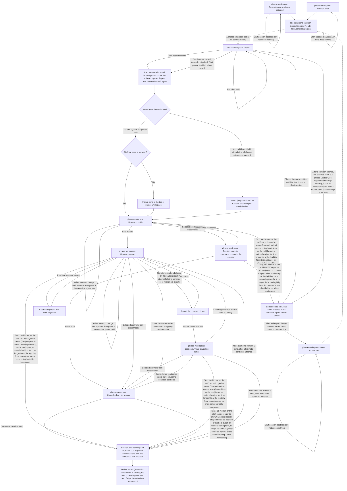

# Play Session Handoff

> **New in v2.**

- Screen: `screens/phrase-workspace/` for every step. The session states named above are defined in its handoff, under States. This flow ends where the Review opens; what follows (the Review, the next phrase on the staff, focus, and starting again once the player has left it) is `flows/review-and-export/`.
- **Idle states.** This diagram shows only what concerns starting a session. How the idle states reach **Ready**, or each other (the generation and notation errors, **Needs more room** and its clearing, **Loading**, and **Empty** with the unsupported-rhythm alert), is drawn once, in `flows/generate-phrase/handoff.md`. This flow picks up again at the session end, including the idle states a session ended during the count-in returns to.
- **Start conditions.** A session can start only from the idle workspace in **Ready**, never while the Review shows (see `flows/review-and-export/`): a phrase shown, no generation-failure banner, `Start session` enabled. `Start session` is disabled in **Empty**, **Initial generation error**, **Generation error** (the banner showing over a retained phrase), **Loading**, **Notation error**, **Notation error over a retained generation failure**, **Needs more room**, and while the rhythm combination is unsupported. In **Generation error** the phrase action, `Retry generation`, is primary; a successful retry lands in **Ready**. The phrase on screen becomes phrase 1.
- **No start while the staff is not shown.** No session starts while the staff cannot be shown: while `orientation-notice` replaces the workspace (the viewport is portrait-shaped below `bp-desktop`), while the staff has no room for the staff layout a session would hold, because the viewport is too narrow for it at the legibility floor or, below `bp-tablet-landscape`, too short for it, or because every attempt at a phrase narrow enough for it has failed (the workspace is then in **Needs more room**, with `room-notice` in place of the score; see `screens/phrase-workspace/`, Notation Contract, **Room for the staff**, and the phone scale that fits the height as well as the width); and in **Notation error**, where the staff is blank. In all three, the starting note does nothing and `Start session` is not reachable (hidden with the workspace under `orientation-notice`, disabled in **Needs more room** and **Notation error**); a session started there would end at once under the viewport-change rule below. Once the view can show the staff again, the start conditions above apply as usual. How **Needs more room** clears, by itself or through a round of fresh-seed attempts, and when it gives way to **Empty** with the unsupported-rhythm alert, is in `flows/generate-phrase/handoff.md`; `Start session` stays disabled throughout, since a round of attempts is a **Loading**.
- **Starting note.** Starts a session only when all hold: a controller is attached; `Start session` is enabled, so never while a generation-failure banner shows, while `orientation-notice` shows, in **Needs more room**, or in **Notation error**; the connection sheet is closed (nothing played while connecting or during the transposition check starts anything); and the note is phrase 1's first attacked note, in exact concert pitch under the instrument's transposition, octave included. Any other note changes nothing on screen.
- **Jump.** On either kind of start, once, instantly, before the count-in's first click. At `bp-tablet-landscape` and above: if the top edge of `staff-viewport` is outside the viewport, scroll the page to the top of `phrase-workspace`. At `bp-mobile-landscape` (below `bp-tablet-landscape`): scroll the page by the least distance that puts the whole of `session-cue-row` and `staff-viewport` inside the viewport, which may leave `layout-header` and `score-toolbar` above it; no scroll if they already are. Below `bp-tablet-landscape` the engraving scale is sized so that `session-cue-row` and both systems always fit together inside the small viewport height, so this jump always succeeds whenever a session can run. No other scroll is made by the app until the session ends.
- **Orientation lock.** At the start, alongside the wake lock, ask the browser to lock the screen orientation to landscape; release the lock at the session end, whichever way it ends, including an end during the count-in. A refusal or an unsupported browser shows nothing. (Chromium grants the lock only in fullscreen, so on a phone in an ordinary tab it is usually refused, and the viewport-change rule below is what applies.)
- **Session staff layout.** Fixed by the breakpoint at the start and held until the session ends, never chosen from phrase 1's content. Below `bp-tablet-landscape`, always the split layout: bars 1–2 on the top system, bars 3–4 on the bottom. At `bp-tablet-landscape` and up, always one system per phrase. This is the same layout the idle workspace shows at that breakpoint (see `screens/phrase-workspace/`, Notation Contract), so phrase 1 is already in it at the start: nothing is re-engraved and no note moves.
- **Viewport change.** One rule covers every viewport change during a session, count-in included, whatever caused it (a turned device, a split screen, a resized window, a breakpoint crossing). The session ends exactly as Stop ends it (during the count-in, as in **Ended before phrase 1 sounds** below) when the staff can no longer be shown, that is when either holds:
  - the viewport becomes portrait-shaped below `bp-desktop`, where `orientation-notice` would replace the workspace, whether or not the device was turned;
  - the session staff layout can no longer be engraved at the legibility floor at the new size: too narrow for it, or, below `bp-tablet-landscape`, too short for it (there the scale fits the height as well as the width, measured against the small viewport height, so a browser toolbar hiding or reappearing changes nothing and redraws nothing);
  - any material already checked and waiting to be drawn (in the split layout, the next phrase's bars 3–4, or a repeated phrase's bars 1–2) no longer fits the session staff layout at the legibility floor at the new size.

  Otherwise both systems re-engrave at once at the new size, keeping the session staff layout held from the start (one system per phrase, or the split layout, even across `bp-tablet-landscape`) and its refill order. A re-engrave is not a refill: each system keeps the material it holds (a cleared system stays blank until its refill enters), the playhead stays on the measure being played, and notes already lit stay lit. The layout is chosen afresh once the session has ended.

- **Volume popover.** Either kind of start closes the `Volume` popover if it is open, whichever `Volume` opened it. If focus was inside it, focus returns to the `Volume` button that opened it, as Escape does, without scrolling the page (the jump above is the only scroll); otherwise focus does not move, and a Start click leaves it on the session action as usual. A popover the player opens during the session closes only the usual ways (Escape, a pointer press outside it, Tab out of it), and at the session end if the phone's compact `Volume` opened it (see End). See `screens/phrase-workspace/`, Components and Content, `mix-controls`.
- **Phone session actions.** At `bp-mobile-landscape`, from the start (count-in included) until the session ends, `session-cue-row` also shows a compact `Stop` and the `Volume` button at its trailing end (see `screens/phrase-workspace/`). Desktop and tablet show neither.
- **Wake lock.** Request a screen wake lock at the start (the Start click or the starting note, before the count-in) and release it at the session end, whichever way it ends. A refusal, an unsupported browser, or a lock the browser drops mid-session shows nothing.
- **Count-in.** One measure of click at the session tempo, always audible whatever the click toggle says, at the click volume. Beat marks light on the audio clock. If the selected controller disconnects during the count-in, the disconnect banner takes `session-cue-row` at once while the count-in keeps clicking; its countdown runs from the unplug; after beat 4 the session runs as **Controller lost mid-session**. The same device reattaching before beat 4 removes the banner and the row shows the count-in again. Phrase 2 is requested at the start of the count-in; in the one-system layout it enters the lower system when engraved; in the split phone layout it waits for the top system's refill.
- **Look-ahead.** As soon as phrase _N_ starts sounding, request phrase _N+1_; its deadline is the start of phrase _N_'s last measure. A look-ahead phrase is valid only if it also engraves in the session staff layout at the legibility floor at the current viewport size; a phrase that does not fit is a failed attempt, exactly like one the generator could not find. On failure of either kind: up to three silent retries with a fresh seed and the same carry-in, then one retry without carry-in, then, past the deadline, repeat the previous phrase. None of these steps shows anything, the fit check included, and a repeat is unmarked. A session never shows the notation-error state: a look-ahead phrase that does not fit is retried; a repeat is the phrase just played, already shown in the held layout; and material already checked and waiting is re-tested on every viewport change, where a misfit ends the session (see Viewport change). `generation-status` and `notation-status` stay silent for in-session generation.
- **Note density.** Phrase 1 was generated at idle, with the effective Note density at that moment, so the session's own generation starts with phrase 2. Each look-ahead phrase is generated with the effective density at the moment it is generated, which during a session only steps down: once a phrase has been generated as `Eighth` in place of a stored `Sixteenth`, every later phrase of the session is too (see `screens/phrase-workspace/`, Components and Content, Note density).
- **Struggling notice.** Shown from the second consecutive repeat until a freshly generated phrase starts sounding. Only repeats count: a misfit that a retry fixes never counts, and a repeat counts whatever caused its failed attempts, misfits included. The disconnect banner replaces it while a countdown runs; if the struggling condition still holds when the banner leaves, the notice returns.
- **Refill order.** One-system layout (`bp-tablet-landscape` and up): the phrase on the top system, then the bottom, then the top, whole phrases. Split layout (below `bp-tablet-landscape`): bars 1–2 always on the top system, bars 3–4 always on the bottom, so each system is refilled with half of the next phrase. A system clears the moment the playhead leaves it and fills as soon as its material is engraved.
- **Acknowledgement.** A match lights the expected note (see `screens/phrase-workspace/` States, **Session running**). A miss or a wrong note changes nothing. Acknowledgement needs a controller attached; a session without one, or during a disconnect countdown, lights nothing.
- **Silence timer.** Only with a controller attached; starts counting at the player's first note of the session; suspended while the controller is lost, restarting from the reattachment.
- **Ended before phrase 1 sounds.** Stop, the tab being hidden, or a viewport change that leaves no room for the staff during the count-in (with or without a disconnect banner showing): the count-in stops sounding, the wake lock and orientation lock are released, and the workspace returns to **Ready** with phrase 1 still on screen (a phrase 2 already in the lower system clears with the fast fade-out). No Review opens, and a Review shown before this session is not restored. Focus goes to the session action, now `Start session`. After a viewport change, phrase 1 is re-engraved in the layout chosen afresh. If the staff has no room there either (too narrow, or, below `bp-tablet-landscape`, too short), the workspace takes **Needs more room** instead of **Ready**, and focus goes to `room-notice`; once the window gives the staff room, a new phrase is generated. If the staff has room but phrase 1's notes are too wide for it, phrase 1 is regenerated with the idle fresh-seed retries, through **Loading** with no score shown, and focus goes to `controller-status`, since both header actions are disabled while it loads; it lands in **Ready**, or in **Needs more room** if every attempt is too wide (or **Empty** with the unsupported-rhythm alert if a crossing of `bp-tablet-landscape` stops the attempts, or **Initial generation error** if an attempt finds no phrase; see `flows/generate-phrase/`), with no further focus move. The notation-error state is never the result of an end.
- **End.** Once phrase 1 has started sounding, every end route behaves the same: backing and click take the short audio fade-out the master spec sets (§6), the playhead is removed, the wake lock and orientation lock are released, a volume popover opened from the phone's compact `Volume` closes, the Review opens with no confirmation, and focus goes to the session action, which now reads `Close review`: no session starts until the player leaves the Review (see `flows/review-and-export/handoff.md`). A controller lost when the session ends keeps its selection into the Review (see `flows/controller-connection/`).
- **Controls during the session.** The musical controls are read-only, the phrase action is disabled, `controller-status` is display-only, and the theme control and the audio mix stay live, including the phone's compact `Stop` and `Volume`; see `screens/phrase-workspace/` States, **Session count-in**.
