# Play Session Handoff

> **Changes since v2**
>
> - _Changed:_ the starting note needs the page's first click, tap or key press, and no sheet
>   of any kind open (the diagram's start steps; Starting note, and Before the first click below
>   the diagram)
> - _Changed:_ a session takes the phrases prepared at idle, then looks ahead as before (the
>   diagram's start step; Count-in, Look-ahead)
> - _Changed:_ the session is saved once, as its review opens; nothing is written during it (the
>   diagram's end step; End, Saving)
> - _Changed:_ a session ended during its count-in leaves the most recent session reviewable
>   (Ended before phrase 1 sounds)
> - _Changed:_ every opener of a sheet and every notice action is disabled during a session; the
>   session options come back as the player saved them (Controls during the session, Session
>   options)
> - _New:_ a start on a phrase made before the settings changed asks first, in
>   `screens/stale-phrase-prompt/`: start with it, or regenerate and stay at idle (the diagram's
>   start steps; A phrase made before the settings changed)
> - _Removed:_ nothing
> - _v3.1 new:_ Vary settings and the preset: the figure step, the Custom marking and its return at
>   the end, key and mode moves kept inside the restriction in force at the start (Vary settings
>   and presets, below the diagram)
> - _v3.1 new:_ the preset bar during a session, and the preset sheet among the sheets that keep
>   the starting note from starting a session (The preset bar during the session)
> - _v3.1 changed:_ the session end returns the preset selection with the settings (the diagram's
>   end step)
> - _v3.2 new:_ in Jam mode, chosen with the header's mode switch, a fresh Jam starts from Jam
>   mode's Idle and reaches **Session running** through `flows/jam/`; a Jam on the kept doodle
>   starts as from **Ready**; `Start Jam` needs a connected controller; no start while Jam mode is
>   opening (the diagram's Jam nodes; Starting a Jam and No start while Jam mode is opening, below
>   the diagram)
> - _v3.2 new:_ the starting note, the click, phrase 1's generation, the silence timer and the
>   ends before phrase 1 in a fresh Jam (Starting a Jam, Count-in, Look-ahead, Note density,
>   Silence timer, Ended before phrase 1 sounds)
> - _v3.2 new:_ the rhythm lock and its allowed changes during a session, never shown (The rhythm
>   lock during a session)
> - _v3.2 new:_ Vary settings' allowed groups, and the narrow skip after a narrow-window step
>   (Vary settings' allowed groups)
> - _v3.2 changed:_ session mode's options read at the start gain the rhythm lock with its allowed
>   changes and what Vary settings may move; a Jam reads Jam's settings, with no Rising tempo,
>   Tension across phrases, Vary settings or preset; Jam's controls and the kept doodle's bar held
>   still (The session options in each mode, Controls during the session); the session end in Jam
>   mode keeps the doodle (The end of a Jam)
> - _v3.3 new:_ the Seventh chords level is fixed for the whole session: Vary settings never moves
>   it (Vary settings and presets)
> - _v3.1 new:_ after `Start with this phrase`, the preset bar holds still while the controls show
>   phrase 1's values (A phrase made before the settings changed)
> - _v3.2 new:_ a Jam never meets the out-of-date phrase prompt (A phrase made before the settings
>   changed)
> - _v3.3 new:_ after `Start with this phrase`, the Seventh chords control shows phrase 1's level
>   through the count-in and phrase 1 (A phrase made before the settings changed; Vary settings and
>   presets)

```mermaid
flowchart TD
  G[phrase-workspace: Generation error, phrase retained] -->|"Start session disabled; any note does nothing"| G
  N[phrase-workspace: Notation error] -->|"Start session disabled; any note does nothing"| N
  M[phrase-workspace: Needs more room] -->|"Start session disabled; any note does nothing"| M
  G -.-> GP["Idle transitions between these states and Ready: flows/generate-phrase/"]
  N -.-> GP
  M -.-> GP
  GP -.->|"A phrase on screen again, no banner: Ready"| I
  %% v3 changed: a start first checks phrase 1 against the current settings
  I[phrase-workspace: Ready] -->|Start session clicked| SQ
  %% v3 changed
  I -->|"Starting note played (controller attached, Start session enabled, the page has had its first click, tap or key press, no sheet or confirmation open)"| SQ
  %% v3 new: the out-of-date phrase prompt
  SQ{"Phrase 1 made under the current settings? (compared by value; v3 new)"} -->|Yes| W
  SQ -->|"No: the workspace stays at Ready under the prompt; no note starts anything"| SP["stale-phrase-prompt (v3 new)"]
  SP -->|"Start with this phrase: the start click, start conditions checked again"| W
  SP -->|"Regenerate phrase: the Idle Regenerate; nothing starts, and the next start asks nothing"| GP
  SP -->|"Close, Escape or a backdrop press: nothing changes"| I
  SP -.->|"The workspace leaves Ready meanwhile (a window change): closes as if dismissed"| GP
  %% v3 new
  I -->|"Starting note before the page's first click, tap or key press: nothing (the starting-note line asks for one click)"| I
  I -->|Any other note| I
  %% v3 changed
  W[Request wake lock and landscape lock; close the Volume popover if open; hold the session staff layout; take the phrases prepared at idle] --> B{Below bp-tablet-landscape?}
  B -->|"Yes: split layout held (already the idle layout; nothing re-engraved)"| K[Instant jump: session-cue-row and staff-viewport wholly in view]
  B -->|"No: one system per phrase held"| T{Staff top edge in viewport?}
  T -->|No| J[Instant jump to the top of phrase-workspace]
  T -->|Yes| C
  J --> C
  K --> C[phrase-workspace: Session count-in]
  %% v3.2 new: a fresh Jam, from Jam mode's Idle; with a kept doodle the start above is unchanged, the button reading Start Jam, enabled only with a controller connected
  JI["phrase-workspace: Jam mode at Idle, no kept doodle (v3.2 new)"] -->|"Start Jam, or the home note (start conditions of flows/jam/: a controller connected, the review mode not showing, Jam mode opened)"| JF["flows/jam/: count-in, capture, writing, read-in"]
  JF -->|"Phrase 1 sounds"| R
  JF -->|"Ends before phrase 1 sounds"| JI
  C -->|Beat 4 ends| R[phrase-workspace: Session running]
  C -->|Phrase 2 engraved, one-system layout| C
  C -->|"Other viewport change: both systems re-engrave at the new size, layout held"| C
  C -->|Selected controller port disconnects| CL[phrase-workspace: Session count-in, disconnect banner in the cue row]
  CL -->|Same device reattaches| C
  CL -->|Beat 4 ends| L
  C -->|"Stop, tab hidden, or the staff can no longer be shown (viewport portrait-shaped below bp-desktop, or the held layout, or material waiting for it, no longer fits at the legibility floor: too narrow, or too short below bp-tablet-landscape)"| A
  CL -->|"Stop, tab hidden, or the staff can no longer be shown (viewport portrait-shaped below bp-desktop, or the held layout, or material waiting for it, no longer fits at the legibility floor: too narrow, or too short below bp-tablet-landscape)"| A
  A[Ended before phrase 1: count-in stops, locks released; layout chosen afresh] -->|"Phrase 1 engraves at the legibility floor; focus on Start session"| I
  A -->|"After a viewport change, the staff has no room; focus on room-notice"| M
  A -->|"After a viewport change, the staff has room but phrase 1 is too wide: regenerated through Loading, focus on controller-status; Needs more room if every attempt is too wide"| I
  R -->|Playhead crosses a barline| R
  R -->|Expected note matched| R
  R -->|"Other viewport change: both systems re-engrave at the new size, layout held"| R
  R -->|Playhead leaves a system| F[Clear that system, refill when engraved]
  F --> R
  R -->|"No valid look-ahead phrase by its deadline (each attempt failed to generate or to fit the held layout)"| P[Repeat the previous phrase]
  P -->|Second repeat in a row| S[phrase-workspace: Session running, struggling notice]
  P -->|First repeat| R
  S -->|A freshly generated phrase starts sounding| R
  R -->|Selected controller port disconnects| L[phrase-workspace: Controller lost mid-session]
  S -->|Selected controller port disconnects| L
  L -->|"Same device reattaches before zero, struggling condition clear"| R
  L -->|"Same device reattaches before zero, struggling condition still holds"| S
  L -->|Countdown reaches zero| E
  R -->|"Stop, tab hidden, or the staff can no longer be shown (viewport portrait-shaped below bp-desktop, or the held layout, or material waiting for it, no longer fits at the legibility floor: too narrow, or too short below bp-tablet-landscape)"| E
  S -->|"Stop, tab hidden, or the staff can no longer be shown (viewport portrait-shaped below bp-desktop, or the held layout, or material waiting for it, no longer fits at the legibility floor: too narrow, or too short below bp-tablet-landscape)"| E
  L -->|"Stop, tab hidden, or the staff can no longer be shown (viewport portrait-shaped below bp-desktop, or the held layout, or material waiting for it, no longer fits at the legibility floor: too narrow, or too short below bp-tablet-landscape)"| E
  R -->|More than 30 s without a note, after a first note, controller attached| E
  S -->|More than 30 s without a note, after a first note, controller attached| E
  %% v3 changed; v3.1 changed: the preset selection returns with the settings; v3.2 new: in Jam mode the hidden workspace takes Jam mode with a kept doodle, phrase 1 written again from it
  E[Session end: backing and click fade out, playhead removed, wake lock and landscape lock released; the settings Vary settings changed and the preset selection return to the start's] -->|"The session is saved once, as its review opens"| V["Review shows (no session starts until it is closed); the next phrase is generated out of sight: flows/review-and-export/"]
```

- Screen: `screens/phrase-workspace/` for every step. The session states named above are defined in its handoff, under States. This flow ends where the Review opens; what follows (the Review, the next phrase on the staff, focus, and starting again once the player has left it) is `flows/review-and-export/`.
- **Idle states.** This diagram shows only what concerns starting a session. How the idle states reach **Ready**, or each other (the generation and notation errors, **Needs more room** and its clearing, **Loading**, and **Empty** with the unsupported-rhythm alert), is drawn once, in `flows/generate-phrase/handoff.md`. This flow picks up again at the session end, including the idle states a session ended during the count-in returns to.
- **Start conditions.** A session can start only from the idle workspace in **Ready**, never while the Review shows (see `flows/review-and-export/`): a phrase shown, no generation-failure banner, `Start session` enabled. `Start session` is disabled in **Empty**, **Initial generation error**, **Generation error** (the banner showing over a retained phrase), **Loading**, **Notation error**, **Notation error over a retained generation failure**, **Needs more room**, and while the rhythm combination is unsupported. In **Generation error** the phrase action, `Retry generation`, is primary; a successful retry lands in **Ready**. The phrase on screen becomes phrase 1.
- **[v3.2 new]** **Starting a Jam.** In Jam mode, the mode the player chose with the header's `mode-switch` (`flows/jam/`, Entering and Leaving Jam Mode), the session action reads `Start Jam` in every state where it would read `Start session`, with the same availability, and is also disabled while no controller is connected, a kept doodle or not (`jam-needs-controller` says why). With a kept doodle the start is this flow's, from **Ready**, unchanged: `Start Jam` or phrase 1's first note, the count-in, phrase 1, with no capture. Without one, a fresh Jam starts from **Jam mode at Idle**, where no phrase is on screen, by `Start Jam` or the home note, under the start conditions above except "a phrase is on screen", "no new phrase is being generated" and the supported rhythm combination: a controller connected, the review mode not showing, no sheet or confirmation open, the staff shown (no `orientation-notice`, no **Needs more room**, no **Notation error**). It runs the count-in, the capture, the generation measure, any extended wait and the read-in measure of `flows/jam/`, and joins this flow at **Session running** when phrase 1 sounds. From there it is a session like any other.
- **[v3.2 new]** **No start while Jam mode is opening.** From the first press of `Jam` in a visit until Jam's code has loaded, failed, or `Session` was pressed (**Opening Jam mode**), session mode is held as in **Loading**: both header actions are disabled and no note starts anything, the starting note included. Only after it, in whichever mode then shows, do the start conditions above apply.
- **No start while the staff is not shown.** No session starts while the staff cannot be shown: while `orientation-notice` replaces the workspace (the viewport is portrait-shaped below `bp-desktop`), while the staff has no room for the staff layout a session would hold, because the viewport is too narrow for it at the legibility floor or, below `bp-tablet-landscape`, too short for it, or because every attempt at a phrase narrow enough for it has failed (the workspace is then in **Needs more room**, with `room-notice` in place of the score; see `screens/phrase-workspace/`, Notation Contract, **Room for the staff**, and the phone scale that fits the height as well as the width); and in **Notation error**, where the staff is blank. In all three, the starting note does nothing and `Start session` is not reachable (hidden with the workspace under `orientation-notice`, disabled in **Needs more room** and **Notation error**); a session started there would end at once under the viewport-change rule below. Once the view can show the staff again, the start conditions above apply as usual. How **Needs more room** clears, by itself or through a round of fresh-seed attempts, and when it gives way to **Empty** with the unsupported-rhythm alert, is in `flows/generate-phrase/handoff.md`; `Start session` stays disabled throughout, since a round of attempts is a **Loading**.
- **[v3 changed]** **Starting note.** Starts a session only when all hold: a controller is attached; `Start session` is enabled, so never while a generation-failure banner shows, while `orientation-notice` shows, in **Needs more room**, or in **Notation error**; the page has had its first click, tap or key press since it loaded (see Before the first click); no sheet is open, neither the connection sheet nor the My instrument or Your data sheet nor a confirmation (nothing played while connecting, during the transposition check, or while a sheet is open starts anything); and the note is phrase 1's first attacked note, in exact concert pitch under the instrument's transposition, octave included. Any other note changes nothing on screen. With phrase 1 out of date, that note opens the prompt instead and starts nothing (A phrase made before the settings changed, below).
- **[v3.2 new]** **The starting note in a Jam.** In Jam mode without a kept doodle it is the home note of Jam's written key, in the instrument's written pitch, in the octave nearest the middle of its written range (the lower of two equally near), matched at its exact concert pitch, octave included; `start-note-line` names it and no `start-note-marker` is drawn. Every other condition above applies, the first click and the sheets included. While `tap-tempo` listens, every controller note is a tap and starts nothing, the home note included (`start-note-line` hidden). With a kept doodle it is phrase 1's first note, as above.
- **[v3 new]** **Before the first click.** A browser lets a page play sound only after the player's first click, tap or key press on it, and a MIDI note does not count. When a controller is attached before the page has had one, as when the remembered controller reattaches at load (`flows/controller-connection/`), the starting note starts nothing and changes nothing on screen, and `start-note-line` takes its before-the-first-click wording, "Click the page once, then play this note to start: {note}" (shorter below `bp-tablet-landscape`; `screens/phrase-workspace/`, Components and Content). The first click, tap or key press anywhere on the page lifts this at once: the line takes its usual wording and the starting note starts a session as above. A `Start session` click is such a click and starts the session as always.
- **[v3 new]** **A phrase made before the settings changed** (master spec §16). At either kind of start, once every start condition above holds and before anything else of the start (no wake lock, orientation lock, jump, sound or count-in), the settings phrase 1 was generated with are compared, by value, with the current ones, over what generation reads: every generation control but the tempo, the musical profile without its customized mark, and the instrument (its id; for my instrument, its range and transposition). A setting changed and changed back is no difference; the tempo, the session options, the audio mix, the theme, my instrument's clef and name, and the window's width never make one. When they match, the start goes on as above and nothing is asked. When they differ, `screens/stale-phrase-prompt/` opens over the workspace, which stays in **Ready** under it:
  - **`Start with this phrase`** is the start click (it unlocks the sound and asks for the locks): everything above follows from it, the jump included, the start conditions checked again at that moment; if one no longer holds, nothing starts and the prompt closes. Phrase 1 is the phrase on screen, unchanged, and is shown, reviewed, kept and exported with what it was generated with. The session's settings are the current ones: phrase 2 on is generated under them, `Vary settings` moves from them and returns to them, and the session's record names them. Phrase 2 joins phrase 1 as after a setting changed at the boundary between them during a session, with the usual carry-in adaptation, so the start never fails, at any tempo. The phrases prepared at idle were built the same way and are spent as usual (Look-ahead).
  - **`Regenerate phrase`** runs the Idle Regenerate exactly, as the header's `Regenerate phrase` does (current settings, a fresh seed, the usual fit run), through **Loading** in `flows/generate-phrase/`; nothing starts. The new phrase is made under the current settings, so the next start, by either kind, asks nothing. A failure shows the ordinary generation-failure states.
  - **Dismissed** (`Close`, Escape, a press on the backdrop): nothing changes and nothing starts; the next start asks again.
  - **While it shows** the app is at idle: no MIDI note starts anything, the starting note included, and `start-note-line` is hidden as for any open sheet; nothing behind the backdrop can be used; preparation at idle goes on. If the workspace leaves **Ready** meanwhile (a window change leaves the staff no room, makes phrase 1 too wide and regenerates it, or brings `orientation-notice`), the prompt closes as if dismissed.
  - **What the controls show** after `Start with this phrase`: the count-in and phrase 1 show the settings phrase 1 was generated with, so each control the player changed shows its earlier value again, read-only; from the instant the first phrase generated under the session's settings starts sounding (phrase 2, or the next generated phrase when phrase 2 is a repeat of phrase 1), the session's, each such value replaced with no highlight, as any automatic change (What the controls show, below). The earlier values are only shown: the settings stay the current ones, and showing them, or the session's again, is not an edit. **However the session ends, the controls show the session's settings again**, silently, with the end's other returns: after a count-in end the workspace is back at idle with the current settings showing; if phrase 1 is still on screen (Stop, or the tab hidden) it is still out of date and the next start asks again, while a phrase 1 replaced after a window change is made under the current settings and the next start asks nothing; after an end once phrase 1 has sounded, the next phrase is generated from the session's settings, so the next start asks nothing unless a setting changes again meanwhile.
  - **[v3.1 changed]** **The preset never shows phrase 1's**: from the start to the session's end, `preset-select` (the selection, or Custom), its description `field-note` and `control-summary`'s preset segment show the selection the player had when they pressed Start, even when that selection is one of the settings the prompt named, and change only as an automatic change changes them (Vary settings, from phrase 2 on). Every other control the player changed, Written key included, shows phrase 1's value through the count-in and phrase 1. So a player who chose `Jazz` sees `Jazz` in the preset box while phrase 1, made under other settings, plays, the other controls the player changed showing phrase 1's values.
  - Never during a session: once a session has started, nothing is asked until it ends.
  - **[v3.1 new]** The preset bar keeps what it showed when the player pressed Start, their selection and never phrase 1's, throughout (The preset bar during the session): neither phrase 1's earlier values during the count-in and phrase 1 nor the session's from the first phrase generated under them turn the selection to Custom or back.
  - **[v3.2 new]** A Jam never asks: a fresh Jam has no phrase 1 on screen, and with a kept doodle a change of any of Jam's settings but the tempo rewrites phrase 1 from the doodle at once (`flows/jam/handoff.md`, Routing Rules), so `Start Jam` and phrase 1's first note never open the prompt. Jam's settings are never compared with session mode's phrase 1: nothing in Jam mode changes session mode's settings, and an instrument changed in Jam mode is taken as an instrument switch on returning to session mode, which writes a new phrase there. With the rhythm lock on, phrase 1's rhythm is the locked one, out of date or not (The rhythm lock during a session).
  - **[v3.3 new]** The Seventh chords control shows phrase 1's level through the count-in and phrase 1, then the session's, fixed from phrase 2 to the end.
- **Jump.** On either kind of start, once, instantly, before the count-in's first click. At `bp-tablet-landscape` and above: if the top edge of `staff-viewport` is outside the viewport, scroll the page to the top of `phrase-workspace`. At `bp-mobile-landscape` (below `bp-tablet-landscape`): scroll the page by the least distance that puts the whole of `session-cue-row` and `staff-viewport` inside the viewport, which may leave `layout-header` and `score-toolbar` above it; no scroll if they already are. Below `bp-tablet-landscape` the engraving scale is sized so that `session-cue-row` and both systems always fit together inside the small viewport height, so this jump always succeeds whenever a session can run. No other scroll is made by the app until the session ends.
- **Orientation lock.** At the start, alongside the wake lock, ask the browser to lock the screen orientation to landscape; release the lock at the session end, whichever way it ends, including an end during the count-in. A refusal or an unsupported browser shows nothing. (Chromium grants the lock only in fullscreen, so on a phone in an ordinary tab it is usually refused, and the viewport-change rule below is what applies.)
- **Session staff layout.** Fixed by the breakpoint at the start and held until the session ends, never chosen from phrase 1's content. Below `bp-tablet-landscape`, always the split layout: bars 1–2 on the top system, bars 3–4 on the bottom. At `bp-tablet-landscape` and up, always one system per phrase. This is the same layout the idle workspace shows at that breakpoint (see `screens/phrase-workspace/`, Notation Contract), so phrase 1 is already in it at the start: nothing is re-engraved and no note moves.
- **Viewport change.** One rule covers every viewport change during a session, count-in included, whatever caused it (a turned device, a split screen, a resized window, a breakpoint crossing). The session ends exactly as Stop ends it (during the count-in, as in **Ended before phrase 1 sounds** below) when the staff can no longer be shown, that is when either holds:
  - the viewport becomes portrait-shaped below `bp-desktop`, where `orientation-notice` would replace the workspace, whether or not the device was turned;
  - the session staff layout can no longer be engraved at the legibility floor at the new size: too narrow for it, or, below `bp-tablet-landscape`, too short for it (there the scale fits the height as well as the width, measured against the small viewport height, so a browser toolbar hiding or reappearing changes nothing and redraws nothing);
  - any material already checked and waiting to be drawn (in the split layout, the next phrase's bars 3–4, or a repeated phrase's bars 1–2) no longer fits the session staff layout at the legibility floor at the new size.

  Otherwise both systems re-engrave at once at the new size, keeping the session staff layout held from the start (one system per phrase, or the split layout, even across `bp-tablet-landscape`) and its refill order. A re-engrave is not a refill: each system keeps the material it holds (a cleared system stays blank until its refill enters), the playhead stays on the measure being played, and notes already lit stay lit. The layout is chosen afresh once the session has ended.

- **Volume popover.** Either kind of start closes the `Volume` popover if it is open, whichever `Volume` opened it. If focus was inside it, focus returns to the `Volume` button that opened it, as Escape does, without scrolling the page (the jump above is the only scroll); otherwise focus does not move, and a Start click leaves it on the session action as usual. A popover the player opens during the session closes only the usual ways (Escape, a pointer press outside it, Tab out of it), and at the session end if the phone's compact `Volume` opened it (see End). See `screens/phrase-workspace/`, Components and Content, `mix-controls`.
- **Phone session actions.** At `bp-mobile-landscape`, from the start (count-in included) until the session ends, `session-cue-row` also shows a compact `Stop` and the `Volume` button at its trailing end (see `screens/phrase-workspace/`). Desktop and tablet show neither.
- **Wake lock.** Request a screen wake lock at the start (the Start click or the starting note, before the count-in) and release it at the session end, whichever way it ends. A refusal, an unsupported browser, or a lock the browser drops mid-session shows nothing.
- **[v3 changed]** **Count-in.** One measure of click at the session tempo, always audible whatever the click toggle says, at the click volume. Beat marks light on the audio clock. If the selected controller disconnects during the count-in, the disconnect banner takes `session-cue-row` at once while the count-in keeps clicking; its countdown runs from the unplug; after beat 4 the session runs as **Controller lost mid-session**. The same device reattaching before beat 4 removes the banner and the row shows the count-in again. Phrase 2 is requested at the start of the count-in, unless it was prepared at idle (see Look-ahead); in the one-system layout it enters the lower system when engraved; in the split phone layout it waits for the top system's refill.
- **[v3.2 new]** **The count-in of a fresh Jam** is this one, with `staff-jam` on the staff and no phrase 2 requested. After it, the click goes on through the capture, the generation measure, any extended wait and the read-in measure, whatever the click toggle says, at the click volume; the backing starts with phrase 1, and from phrase 1 on the click toggle governs. A lost controller before phrase 1 ends the Jam at once, as a count-in end, with no countdown (`flows/jam/`). A Jam on the kept doodle has this count-in exactly, disconnect banner included.
- **[v3 changed]** **Look-ahead.** A session first spends the phrases prepared at idle, in order (`flows/generate-phrase/handoff.md`, Pre-generation): each is exactly the phrase the session would have generated at its place, and each is checked against the session staff layout at the current viewport size like any look-ahead phrase. Whatever is not prepared at the start is generated under the session's own deadlines, as below; nothing is prepared again during the session, and nothing shows which phrases were prepared. Once they are spent, as soon as phrase _N_ starts sounding, request phrase _N+1_; its deadline is the start of phrase _N_'s last measure. A look-ahead phrase is valid only if it also engraves in the session staff layout at the legibility floor at the current viewport size; a phrase that does not fit is a failed attempt, exactly like one the generator could not find. On failure of either kind: up to three silent retries with a fresh seed and the same carry-in, then one retry without carry-in, then, past the deadline, repeat the previous phrase. None of these steps shows anything, the fit check included, and a repeat is unmarked. A session never shows the notation-error state: a look-ahead phrase that does not fit is retried; a repeat is the phrase just played, already shown in the held layout; and material already checked and waiting is re-tested on every viewport change, where a misfit ends the session (see Viewport change). `generation-status` and `notation-status` stay silent for in-session generation.
- **[v3.2 new]** **Phrase 1 of a fresh Jam** is generated by the session, from the doodle, during the generation measure and any extended wait, through three rungs with a deadline three measures after the generation measure begins (`flows/jam/`); like a look-ahead phrase it is valid only if it engraves in the session staff layout at the legibility floor, a misfit being a failed attempt. Phrase 2 is requested as soon as phrase 1 is ready; its deadline is the start of phrase 1's last measure. From phrase 2 on, look-ahead runs as above, every rung keeping the doodle's preferences and Jam's rhythm lock, with nothing shown. Nothing is prepared at idle for a fresh Jam; a Jam on the kept doodle spends the phrases prepared from it.
- **Note density.** Phrase 1 was generated at idle, with the effective Note density at that moment, so the session's own generation starts with phrase 2. Each look-ahead phrase is generated with the effective density at the moment it is generated, which during a session only steps down: once a phrase has been generated as `Eighth` in place of a stored `Sixteenth`, every later phrase of the session is too (see `screens/phrase-workspace/`, Components and Content, Note density).
- **[v3.2 new]** In a fresh Jam the session generates phrase 1 itself, so the step-down can apply from phrase 1.
- **Struggling notice.** Shown from the second consecutive repeat until a freshly generated phrase starts sounding. Only repeats count: a misfit that a retry fixes never counts, and a repeat counts whatever caused its failed attempts, misfits included. The disconnect banner replaces it while a countdown runs; if the struggling condition still holds when the banner leaves, the notice returns.
- **Refill order.** One-system layout (`bp-tablet-landscape` and up): the phrase on the top system, then the bottom, then the top, whole phrases. Split layout (below `bp-tablet-landscape`): bars 1–2 always on the top system, bars 3–4 always on the bottom, so each system is refilled with half of the next phrase. A system clears the moment the playhead leaves it and fills as soon as its material is engraved.
- **Acknowledgement.** A match lights the expected note (see `screens/phrase-workspace/` States, **Session running**). A miss or a wrong note changes nothing. Acknowledgement needs a controller attached; a session without one, or during a disconnect countdown, lights nothing.
- **Silence timer.** Only with a controller attached; starts counting at the player's first note of the session; suspended while the controller is lost, restarting from the reattachment.
- **[v3.2 new]** In a fresh Jam neither the home note nor the doodle's notes start the silence timer: before phrase 1 sounds only the Jam's own rules end it for silence (no doodle note within 30 seconds after the count-in; `flows/jam/`). From phrase 1 on, the timer waits for a first note played from phrase 1 on, as after a Start click. A Jam on the kept doodle starts it as any session does.
- **[v3 changed]** **Ended before phrase 1 sounds.** Stop, the tab being hidden, or a viewport change that leaves no room for the staff during the count-in (with or without a disconnect banner showing): the count-in stops sounding, the wake lock and orientation lock are released, and the workspace returns to **Ready** with phrase 1 still on screen (a phrase 2 already in the lower system clears with the fast fade-out). No review opens and nothing is saved: the most recent session stays exactly as it was kept (or held in memory after a failed save), and `review-link` and `sessions-link` return to `session-cue-row` by their own conditions (`screens/phrase-workspace/`, Components and Content). Focus goes to the session action, now `Start session`. After a viewport change, phrase 1 is re-engraved in the layout chosen afresh. If the staff has no room there either (too narrow, or, below `bp-tablet-landscape`, too short), the workspace takes **Needs more room** instead of **Ready**, and focus goes to `room-notice`; once the window gives the staff room, a new phrase is generated. If the staff has room but phrase 1's notes are too wide for it, phrase 1 is regenerated with the idle fresh-seed retries, through **Loading** with no score shown, and focus goes to `controller-status`, since both header actions are disabled while it loads; it lands in **Ready**, or in **Needs more room** if every attempt is too wide (or **Empty** with the unsupported-rhythm alert if a crossing of `bp-tablet-landscape` stops the attempts, or **Initial generation error** if an attempt finds no phrase; see `flows/generate-phrase/`), with no further focus move. The notation-error state is never the result of an end. After `Start with this phrase`, the controls show the session's settings again (A phrase made before the settings changed).
- **[v3.2 new]** **A fresh Jam ended before phrase 1 sounds** (Stop, no doodle note within 30 seconds, the controller lost, the tab hidden, the staff no longer shown, or every attempt at phrase 1 failed), from its count-in to its read-in measure, ends as above but returns to **Jam mode at Idle**, `staff-jam` on the staff, no doodle kept, focus on `Start Jam`; after a viewport change, the empty system redrawn in the layout chosen afresh, or **Needs more room** (focus on `room-notice`); after a lost controller, Jam mode stays, `Start Jam` disabled and `jam-needs-controller` showing, focus on `controller-status`. Only a failed phrase 1 is told, by `jam-notice` (`flows/jam/`). A Jam on the kept doodle ended before phrase 1 sounds ends as above, the doodle still kept and the same phrase 1 on screen, focus on `Start Jam`.
- **[v3 changed]** **End.** Once phrase 1 has started sounding, every end route behaves the same: backing and click take the short audio fade-out the master spec sets (§6), the playhead is removed, the wake lock and orientation lock are released, a volume popover opened from the phone's compact `Volume` closes, the session is saved and the Review opens with no confirmation (see Saving), and focus goes to the session action, which now reads `Close review`: no session starts until the player leaves the Review (see `flows/review-and-export/handoff.md`). A controller lost when the session ends keeps its selection into the Review (see `flows/controller-connection/`). The tempo control returns to the tempo the session started from, and every setting `Vary settings` changed returns to its value at the start, silently, before the next phrase is generated; after a session that ran `Rising tempo`, the tempo field shows "Last session reached {n} BPM." (`screens/phrase-workspace/`, States, **Session end**). After `Start with this phrase`, the controls show the session's settings again before the next phrase is generated (A phrase made before the settings changed).
- **[v3.2 new]** **The end of a Jam** is this end, the review opening with the doodle (`flows/review-and-export/`). Under the review, the hidden workspace takes **Jam mode with a kept doodle** instead of a new phrase: a fresh Jam's doodle becomes the kept doodle (a Jam played on the kept doodle keeps it), and phrase 1 is written again from it with a fresh seed, through **Loading**, out of sight; `jam-bar` shows once the review mode is left (`flows/jam/handoff.md`, The Kept Doodle). A controller away at the end changes nothing in this, and Jam mode stays. A Jam runs neither `Rising tempo` nor `Vary settings`, so none of Jam's settings has anything to return.
- **[v3 new]** **Saving.** Nothing is written to the device between the start (the Start click or the starting note) and the session's end: no setting, no session, no played note. The session is saved once, at its end, as its review opens, together with any theme or audio-mix change the player made during it (both stay live in a session); a session ended during its count-in saves only such a change, at that end. The save never delays or interrupts anything: the backing's fade-out, the review and the next phrase go ahead whatever it does. If it fails, the review's keep line says so ("Not saved on this device: export it to keep it."; `screens/last-session-review/`), and the session stays reviewable in memory for the rest of the visit; the notice row says nothing about it. Any notice that arises during the session (an outdated tab, say) waits for its end, and a notice already showing when the session starts stays, unchanged, until it ends (`flows/saved-data/`). What a session's save replaces among the kept sessions is in `flows/kept-sessions/`.
- **[v3 changed]** **Controls during the session.** The musical controls are read-only, the phrase action is disabled, `controller-status` is display-only, the instrument control's `Create my instrument` or `Edit my instrument`, the footer's `Your data` and every button in the notice row are disabled, the cue row's two links are absent, and no sheet opens, and the theme control and the audio mix stay live, including the phone's compact `Stop` and `Volume`; see `screens/phrase-workspace/` States, **Session count-in**. The "During a session" options are read-only too, with the choices the session runs with.
- **[v3.2 new]** Their dependents (Allowed rhythm changes, What may vary) are read-only with them, shown or hidden as at the start. In a Jam, Jam's controls take the same read-only treatment, Rhythm lock and Allowed rhythm changes included, `tap-tempo` is disabled, and the kept doodle's `jam-bar` keeps exactly what it showed, its buttons disabled, until the session ends. In either mode `mode-switch` is read-only throughout.
- **[v3 changed]** **Session options (v2.1, v2.2).** Read at the start, as the player left them in the "During a session" group, which keeps them across visits (`screens/phrase-workspace/`, Components and Content); none changes during the session. `Rising tempo` runs only when it is on and a controller is attached at the start (a session started while the selected controller is away runs without it). Its rise, +5 BPM every 2 phrases up to 240 BPM, pauses while a lost controller is away, the phrases sounding meanwhile not counting; nothing shows the pause beyond the disconnect banner. `Tension across phrases` changes what each phrase is generated with, in groups of four from phrase 1, and nothing on screen. `Vary settings` changes one setting by one step every 2 to 4 phrases, never the instrument or the tempo.
- **[v3.2 new]** **The session options in each mode.** In session mode the "During a session" group holds four options, read at the start, none changing during the session: the rhythm lock (with its allowed rhythm changes), `Rising tempo`, `Tension across phrases` and `Vary settings` (with What may vary). `Vary settings` runs only if it was available at the start; a session started while no move was possible runs without it. A Jam reads Jam's settings instead (`screens/phrase-workspace/handoff.md`, Components and Content, Jam's controls): Jam's tempo, key and mode, Harmonic motion, Tension, Embellishments, Drift and Jam's rhythm lock with its allowed rhythm changes, at its start, and the readings taken from the doodle once it is captured. A Jam has no `Rising tempo`, no `Tension across phrases`, no `Vary settings` and no preset: it plays at Jam's tempo throughout, and nothing changes its settings during it.
- **[v3.2 new]** **The rhythm lock during a session.** With the lock on, every phrase keeps the locked rhythm, every note start and length and so every rest, while the pitches change: in session mode the rhythm of phrase 1, the phrase on screen at the start, under session mode's lock; in a Jam, under Jam's own lock, the rhythm nearest the doodle, chosen for phrase 1 and then held, whatever the drift (a phrase 1 from the doodle-free last rung keeps its own, which is then held). The lock is strict. Phrase 1 never changes; from phrase 2 on, a phrase may make one change of a kind the player allowed (about one phrase in four, one in two on Tension across phrases' tenser phrase), the next phrase going back to the locked rhythm; with no kind allowed, or no such change possible, it keeps it. When the locked rhythm cannot make a phrase (a tension step down from Build, a narrow-window step-down), the phrase takes the nearest rhythm that can, a forced bend, and the next tries the locked one again; after a step-down to `Eighth`, the first `Eighth` phrase's rhythm becomes the locked one. Nothing of this is shown: no rhythm change and no forced bend is marked, on the staff, in the cue row, in the controls, or announced; the review and the exports do not mark them either. Every rung of the look-ahead keeps the lock. The locked rhythm is not kept as a setting after the session.
- **[v3.2 new]** **Vary settings' allowed groups.** `Vary settings` moves only settings of the groups the player left on in What may vary (Key and mode, Harmony, Tension, Rhythm, Melody shape, Embellishments), and never the Rhythm group while the rhythm lock is on. A move is shown as any automatic change (What the controls show, below). When a narrow-window step-down has left a drawn move with no supported landing, that move is skipped and the next one drawn as usual, with nothing shown.
- **What the controls show (v2.1, v2.2).** From the count-in on, the read-only controls and `tempo-readout` show what the phrase now sounding was generated with and plays at, except that the Tension control shows the tension in effect, never a step of `Tension across phrases` (v2.2): a varied setting appears at the instant the first phrase generated with it starts sounding, and a raised tempo at the instant the first phrase that plays at it starts sounding, a repeated phrase included (the tempo is not part of what is generated), both on the audio clock, with no highlight, animation, scroll or announcement, and moves nothing (`screens/phrase-workspace/`, Components and Content, **Automatic changes during a session**).
- **[v3.1 new]** **Vary settings and presets.** With `Vary settings` on:
  - **The figure step** replaces v2's switch between Neutral and Jazz: one figure's level moves one step, up or down, never past `Off` or `Very often`. The seven figures together take the one place in the draw the musical profile had; the draw picks the setting, then the figure, then the direction. A figure step never lands on an unsupported rhythm combination, since levels do not affect rhythm.
  - **Custom.** A move of a preset-held setting (one of the ten controls, Tension, Leapiness and Arpeggio chaos included, or a figure level) turns the selection to Custom based on its preset, or keeps it Custom, at the instant the first phrase built with it starts sounding, as the moved value itself shows (`screens/phrase-workspace/`, Components and Content, **Automatic changes during a session**). Key and mode moves never make Custom. Vary settings never switches preset.
  - **Key and mode moves stay inside the restriction in force at the session's start**, a bound fixed for the whole session: a move outside it is drawn again, exactly as a move onto an unsupported combination is, and the player never sees it. When no allowed value is one step away, that half does not move. So under Reel the mode may move between Mixolydian and Dorian; under Modal (Dorian), Pop song or Bebop it never moves and the key moves freely; under a player preset kept to one key and mode neither moves. A session started with no restriction in force is not bounded.
  - **At the end** the selection returns, with every setting the session moved, to what it was at the start, silently, under the review (`screens/phrase-workspace/`, States, **Session end**).
  - `Tension across phrases` never makes Custom, though Tension is preset-held: it changes only what each phrase is generated with, never the setting, and never the figure levels.
  - **[v3.3 new]** **The Seventh chords level never moves.** Vary settings never draws it and it belongs to none of the allowed groups, so a session never switches between allowing and not allowing seventh chords, and the level never turns the selection to Custom during a session. Its read-only control shows the value the session started with from the count-in to the end (after `Start with this phrase`, phrase 1's own level through the count-in and phrase 1: A phrase made before the settings changed). Tension across phrases and Rising tempo leave it alone too.
- **[v3.1 new]** **The preset bar during the session.** `preset-select` is read-only like every control; every button of `preset-actions` is disabled, the row keeping exactly the buttons it held at the start, whatever Vary settings does to the selection; the description line and the key and mode marks keep what they showed at the start. No preset sheet opens. The preset sheet and its delete confirmation are sheets like the others for the starting note: while one is open between sessions, no note starts a session (`flows/presets/`).
