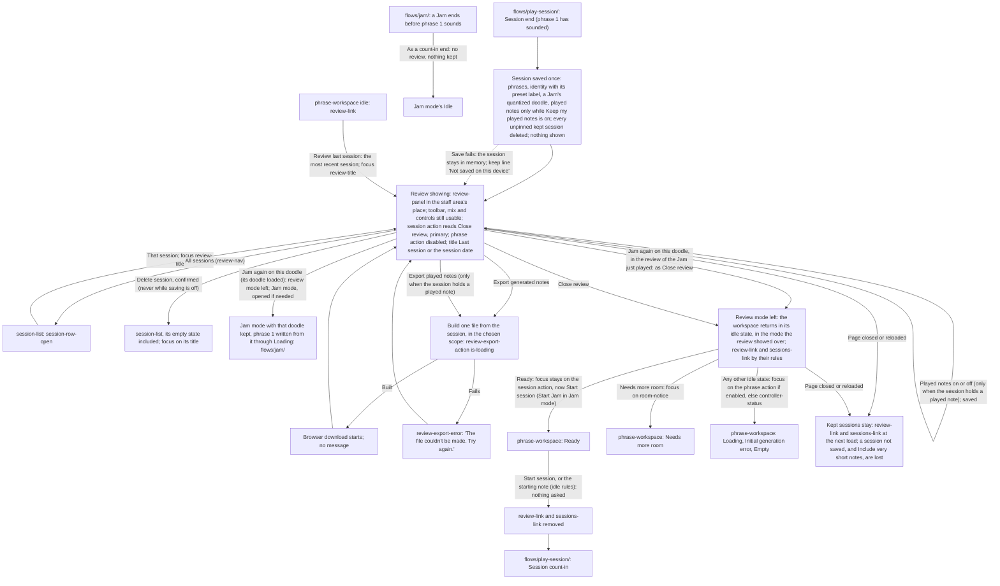

# Review and Export Handoff

> **Changes since v2**
>
> - _Changed:_ the handoff is split under headings; rules not marked below are unchanged
> - _New:_ the review opens from a row of the session list and, after a reload, from
>   `Review last session`; `All sessions` and deleting lead to the list ([Flow](#flow))
> - _Changed:_ a Review exists for every session that can be opened, not only the last one; its
>   title is "Last session" or the session's date ([Screens and Conditions](#screens-and-conditions))
> - _Changed:_ `Review last session` and the session start, which no longer discards anything
>   ([Leaving and Coming Back](#leaving-and-coming-back))
> - _New:_ the save at the session's end and the keep line ([Saving the Session](#saving-the-session))
> - _New:_ favorites, the comment, pin, unpin and delete
>   ([Favorites, Comment, Pin and Delete](#favorites-comment-pin-and-delete))
> - _New:_ the export scope and `Include very short notes`; _Changed:_ Format and Backing track
>   are saved ([Export](#export))
> - _New:_ `Keep my played notes` and `Delete played notes`; _Changed:_ the `Played notes` switch
>   is saved, and the lane leaves out very short notes ([Played Notes](#played-notes))
> - _Changed:_ what is kept and what leaves ([Privacy](#privacy))
> - _Changed:_ the phone gets every function ([At Every Breakpoint](#at-every-breakpoint))
> - _Removed:_ "Only one Review exists", the session start discarding the Review, the page's close
>   or reload discarding everything, Format and the `Played notes` switch "kept for the page
>   session", and "The Review and its data live in memory only" (v2 in the
>   [frozen copy](../../versions/v2/flows/review-and-export/handoff.md))
> - _v3.1 changed:_ the session is saved with its preset label, a snapshot, in place of its
>   musical profile ([Saving the Session](#saving-the-session))
> - _v3.2 new:_ `Jam in {answer}`, `Keep` and `Jam again on this doodle` in a Jam's review; a Jam
>   ended before phrase 1 sounds opens no review; the review over either mode ([Flow](#flow),
>   [Screens and Conditions](#screens-and-conditions))
> - _v3.2 new:_ the mode switch read-only while the review shows; the hidden workspace after a
>   Jam, Jam mode's Idle with the kept doodle; the kept doodle's bar hidden while the review
>   shows ([Showing](#showing))
> - _v3.2 new:_ `Close review` returns to the mode the review showed over
>   ([Leaving and Coming Back](#leaving-and-coming-back))
> - _v3.2 new:_ what a Jam session's save adds, and no preset label
>   ([Saving the Session](#saving-the-session))
> - _v3.2 new:_ a Jam's review, its doodle loaded with Jam's code, the suggestion's actions and
>   what they change, and `Jam again on this doodle`
>   ([The Doodle and the Suggestion](#the-doodle-and-the-suggestion))
> - _v3.2 new:_ both exports open with the doodle, still line up, and wait for Jam's code
>   ([Export](#export))
> - _v3.2 changed:_ the raw doodle notes are played notes, in the lane and the played-notes export
>   ([Played Notes](#played-notes))
> - _v3.2 new:_ the doodle's two forms ([Privacy](#privacy))
> - _v3.2 new:_ the doodle section at every breakpoint ([At Every Breakpoint](#at-every-breakpoint))
> - _v3.3 new:_ a kept phrase's inputs hold the Seventh chords level ([Saving the Session](#saving-the-session));
>   seventh chord symbols in the review and the MusicXML file, the backing's chords in the MIDI
>   file; no new control ([Export](#export))

## Flow

## Screens and Conditions

- Screens: `screens/last-session-review/` (`review-panel`, its export and its list),
  `screens/phrase-workspace/` (the header, the cue row, the staff and every idle state) and,
  **[v3 new]** `screens/session-list/` (the review mode's second level). Every idle transition
  (Loading, the fit retries, **Needs more room** and its clearing, the errors, **Empty**) is drawn
  once, in `flows/generate-phrase/handoff.md`; it runs unchanged, out of sight, while the Review
  shows. The list, the cue-row links and the moves between the list and a review are routed in
  `flows/kept-sessions/handoff.md`.
- **[v3 changed]** **Two conditions.** A Review _exists_ for every session that can be opened: the
  most recent session (from its end, once phrase 1 has sounded, kept or held in memory after a
  failed save) and every kept session (`flows/kept-sessions/handoff.md`, Terms). One Review is
  _showing_ at a time, while the player is in it: at a session end, after `Review last session`,
  and after a row of the list is opened. A session ended during its count-in opens none and
  changes nothing kept.
- **[v3.2 new]** **A Jam that ends before phrase 1 sounds** (no doodle note in time, Stop, a lost
  controller, a hidden tab, no staff, or phrase 1 never written) ends as a count-in end: no
  Review, nothing kept, no doodle kept by Jam mode (`flows/jam/`). A Jam whose phrase 1 sounded
  has a Review like any session, opening with its doodle (The Doodle and the Suggestion).
- **[v3.2 new]** **Over either mode.** A Review shows over the mode the workspace is in: at a
  session end, the mode the session was played in; from `Review last session` or the list, the
  mode the player was in. A Jam session's Review can show over session mode and any other
  session's over Jam mode; nothing in the Review differs.
- **[v3 new]** **Title.** `review-title` reads "Last session" for the most recent session and the
  session date (`flows/kept-sessions/handoff.md`, Terms) for any other.

## Showing

- **Showing.** Inside `score-panel`, `review-panel` is rendered in place of the generation-failure
  banner, `session-cue-row` and `staff-viewport`, which stay mounted with their state but out of
  sight: the banner and `session-cue-row` hidden; `staff-viewport` kept laid out at its normal
  inline size, so the idle machinery can still engrave and measure, but invisible, inert (out of
  the accessibility tree and the tab order) and taking no block space (`is-out-of-sight` in the
  token source); `score-toolbar` stays, its `score-title` not rendered (`review-title` heads the review) and
  `mix-controls` fully usable. `control-section` stays after `score-panel`, fully editable as at
  idle (tempo and every setting; a profile switch regenerates the hidden phrase as at idle). The
  header stays: `controller-status` interactive (the connection sheet opens and its transposition
  check works, since connecting is allowed between sessions), `theme-control` live,
  `tempo-readout` as at idle, the phrase action disabled in place, secondary, and the session
  action reading `Close review`, primary. `generation-status` and `notation-status` are emptied
  when the Review opens and stay silent while it shows, as during a session; the hidden staff's
  state is what the player finds on leaving.
- **[v3.2 new]** **The mode switch** (`mode-switch`) is read-only while the review mode shows (a
  Review or the list), with no note; `control-section` holds the controls of the mode underneath,
  editable as at that mode's Idle.
- **[v3.2 new]** **The kept doodle's bar.** While Jam mode keeps a doodle, `jam-bar` is hidden
  with the generation-failure banner while the review mode shows, keeping its state, and is seen
  again on leaving it (`screens/phrase-workspace/`).
- **No start while showing.** No session starts while the Review shows: `Start session` is not
  offered (its slot reads `Close review`), and no MIDI note, the starting note included, starts a
  session. `start-note-line` and `start-note-marker` are hidden with the staff. Notes played into
  the open connection sheet work there as usual. **[v3 new]** The same holds while a confirmation
  or the Your data sheet is open over the Review.
- **The next phrase.** At the session end both systems' `staff-content` are cleared (hidden, so no
  fade shows) and a new phrase is generated from the current controls with a fresh seed and no
  carry-in, through the idle attempt budget (`flows/generate-phrase/handoff.md`, **Attempt
  budget**), as `Regenerate phrase` would. It lands in **Ready** (or **Needs more room**, **Initial
  generation error**, **Empty** with the unsupported-rhythm alert, as any such Loading can) out of
  sight, and silently: nothing is announced while the Review shows, nor when it closes (the player
  sees the staff, and focus lands as **Close review** sets); a generation still running at
  `Close review` is announced when it ends, as at idle. If the staff has no room at that
  moment, nothing is generated: **Needs more room** with
  its no-room sentence, the phrase coming when the notice clears. Whatever the workspace holds when
  the player leaves the Review is what they see; it becomes the next session's phrase 1 only by the
  ordinary idle start.
- **[v3.2 new]** **The hidden workspace after a Jam.** At a Jam's end (phrase 1 having sounded)
  the hidden workspace is Jam mode's Idle with the kept doodle, not a fresh phrase from the
  controls: Jam mode keeps that Jam's doodle (a fresh Jam's, or the doodle a Jam on the kept
  doodle was played on), and phrase 1 is written from it again, with a fresh seed, through the
  idle attempts from the doodle, out of sight and silently; `jam-bar` is kept, hidden, and
  `doodle-readings` holds the doodle's readings. Session mode, set aside, is untouched. The Idle
  side is specified in `flows/jam/handoff.md`, The Kept Doodle.
- **Focus at the end.** Focus moves to the session action, which now reads `Close review` and is
  always enabled while the Review shows.

## Leaving and Coming Back

- **Close review.** Activation (click, Space, Enter) stops showing the Review, shows the staff
  area (banner, `session-cue-row`, `staff-viewport`) and `score-title` again, scrolls the page
  instantly to its top, and adds **[v3 changed]** `review-link` and `sessions-link` to
  `session-cue-row` by their rules (`flows/kept-sessions/handoff.md`, The Cue-Row Links). The
  session action takes its idle label and emphasis. Focus: stays on the session action if it is
  enabled (`Start session` in **Ready**); otherwise moves once to `room-notice` in **Needs more
  room**, whichever its cause, else to the phrase action if enabled, else to
  `controller-status`. The Review is kept, not discarded.
- **[v3.2 new]** **Close review returns to the mode the Review showed over**, in that mode's idle
  state; `mode-switch` is pressable again. In Jam mode the session action reads `Start Jam` (focus
  stays on it when enabled, so a Jam on the kept doodle starts with Space); without a connected
  controller it is disabled and focus follows the rule above.
- **[v3 changed]** **Review last session** (`review-link`, idle only, while the most recent session
  can be opened): shows its Review as above, the page scrolled instantly to its top as on
  `Close review`, then focus on `review-title`; the session action reads `Close review` again.
  After a reload the session is read from the device first (`flows/kept-sessions/handoff.md`).
- **[v3 changed]** **Start conditions** after leaving: exactly those of the idle workspace
  (`flows/play-session/handoff.md`, Start conditions, No start while the staff is not shown,
  Starting note). A session start, by either kind of start, asks nothing and discards nothing:
  `review-link` and `sessions-link` are removed before the start's jump, and what is kept changes
  only when that session is saved at its end (see Saving the Session).
- **Portrait.** Below `bp-desktop`, a portrait-shaped viewport hides the whole page, the Review
  included, behind `orientation-notice`; the Review stays showing (or kept) and returns in
  landscape. A session ended by that turn (once phrase 1 has sounded) finds the staff with no
  width behind the notice: its fresh phrase takes the no-room path above, coming when the notice
  clears, never a notation error.

## Saving the Session

**[v3 new]**

- **[v3.1 changed]** As a session's Review opens at its end, the session is saved once (master
  spec §5.1, §5.2, §B9): each phrase's timeline, chord symbols, reproduction inputs (the seven
  figure levels in place of the profile), tempo and repeat flag; the session's start, length,
  phrase count, preset label, instrument, starting and reached tempo, pinned state, comment and
  app version; its played notes only while `Keep my played notes` is on. The preset label is the
  selection at the session's start, as `control-summary` writes it ("Bebop", "Custom, based on
  Bebop", "Custom"): a snapshot that a later rename or deletion of the preset never changes.
  Never acknowledgements. The same save deletes every unpinned kept session
  (`flows/kept-sessions/handoff.md`, Keeping at a Session's End). Nothing is shown on success.
- **[v3.3 new]** Each phrase's reproduction inputs also hold the Seventh chords level, and its chord
  symbols are kept exactly as displayed, seventh chords included. Sessions kept before v3.3 open as
  before, their phrases' level read as `Off`; nothing in the review or the session list shows the
  level.
- **Keep line.** `review-keep-line` states how the session showing is kept: "Pinned: kept until
  you unpin or delete it.", "Not pinned: deleted when your next session is saved.", or, for a
  session whose save failed, "Not saved on this device: export it to keep it." It changes in place
  when the session is pinned or unpinned. Below `bp-tablet-landscape` it is rendered only in its
  "Not saved" form.
- **A session whose save failed** stays in memory as the most recent session; its Review works in
  full. While saving is on, a favorite, a pin, an unpin or a comment changed in it tries the save
  again; when that
  succeeds, the keep line takes its pinned or not-pinned wording. A failed retry changes nothing
  shown.
- **Changes made in any Review** (a favorite, pin, unpin, the comment, `Keep my played notes`) are
  saved when made. A change that cannot be saved stays in memory for the visit, and the failure
  is told by the workspace's notice row once the player is back at idle
  (`flows/saved-data/handoff.md`).
- **[v3.2 new]** **A Jam session's save** also holds that it is a Jam, the quantized doodle with
  the tempo it was played at, and, once answered, the suggestion's decline; each phrase's
  reproduction inputs hold the request's new fields, the rhythm lock's and what the app read from
  the doodle to steer the phrase (master spec §C11). It holds no preset label: Jam mode has no
  presets, so the summary and the list's row have no preset part. The raw doodle notes are played
  notes, saved with the others only while `Keep my played notes` is on. `Keep {key} {mode}` saves
  the decline into the session when pressed, as a favorite is saved; in a session held in memory,
  or while saving is off, the decline lasts for the visit.

## The Doodle and the Suggestion

**[v3.2 new]**

- **A Jam's review** opens with `review-doodle`, before phrase 1: the quantized doodle engraved
  as the app heard it, its header ("Your doodle", the tempo it was played at,
  `Jam again on this doodle`), its played-notes lane when `Played notes` is on, then the
  suggestion when there is one (`screens/last-session-review/handoff.md`). It is the same in the
  review of the Jam that just ended and of a kept Jam session, over either mode. A session kept
  before v3.2 has no doodle and opens as before.
- **Jam's code.** The doodle section, the suggestion and the doodle's part of both exports come
  with Jam's code, loaded on demand (`flows/jam/handoff.md`, Opening Jam mode), never with the
  page. Already loaded in the review of the Jam just played, and wherever Jam mode has opened or
  a Jam session's review has loaded it in the visit. Otherwise the Review opens at once with
  "Loading your doodle." in the doodle's place and `Jam again on this doodle` disabled; once
  loaded, the doodle is engraved and the suggestion judged, silently. **If it cannot load**
  (offline before the app's files were kept): "Your doodle can't be shown: part of the app
  didn't load. Check that you're online, then open this session again." in the doodle's place,
  `Jam again on this doodle` disabled with that reason, no suggestion, and both exports of that
  session unavailable with the same reason. Everything else in the Review works. The next opening
  of a Jam session's Review, or a press of `Jam`, tries the load again.
- **When the suggestion is offered.** Worked out from the quantized doodle and judged against
  Jam's key and mode (Jam's own Written key and Collection; session mode's current ones while Jam
  mode has never opened on this device), whenever the review opens (once Jam's code has loaded)
  and whenever Jam's key or mode changes while it shows. Offered while Jam's key and mode are not
  among the close answers and the player has not declined it for this doodle; the "no fit"
  sentence when under 80 % of the doodle fits the best answer; nothing otherwise. Never offered
  during a session.
- **`Jam in {answer}`** sets Jam's Written key and Collection only, from a Review over either
  mode: saved as Jam's settings (in memory only while saving is off); session mode's key, mode,
  preset and prepared phrases untouched. An answer outside the Major and Minor group moves Jam's
  Collection to the modes; the player's press is what allows it. Under a Review over Jam mode the
  hidden workspace takes the change as at Jam's Idle: without a kept doodle its empty staff takes
  the new key signature; with one, phrase 1 is written again from it in the new key and mode,
  through **Loading**, out of sight, whichever session the kept doodle came from
  (`flows/jam/handoff.md`, A Jam setting changed with a kept doodle). Under a Review over session
  mode nothing on the hidden staff changes; Jam mode opens in the new key and mode. The row then
  reads "Jams now play in {answer}." until the review closes or Jam's key or mode is changed
  again. `Jam in {answer}` does not close the review.
- **`Keep {key} {mode}`** changes no setting. The row leaves, and this doodle's suggestion is
  never offered again: not in this review, not in the kept session's review later, not at Jam
  mode's Idle for the doodle kept from it. The decline is saved with the session (see Saving the
  Session).
- **`Jam again on this doodle`** (enabled once the doodle has loaded, with or without a connected
  controller): leaves the review mode exactly as `Close review` does (the staff area back, the
  page at its top, the cue-row links by their rules), onto Jam mode with this doodle kept,
  replacing a doodle Jam mode already kept. Over session mode, Jam mode is opened first, as a
  press of `Jam` (its code is already loaded, since the doodle shows); session mode is kept as it
  was, as whenever Jam mode opens. Phrase 1 is then written from the doodle through **Loading**,
  `jam-bar` shown, its suggestion offered again when this review left it unanswered; without a
  connected controller `Start Jam` is disabled with Jam mode's reason. Focus moves to
  `jam-bar`'s sentence (`tabindex="-1"`), since both header actions are disabled while phrase 1
  is written, and never to `mode-switch`, where an arrow key would leave Jam mode; the sentence
  says where the player now is. From the review of the Jam just played, whose
  doodle Jam mode already keeps, it does exactly what `Close review` does, focus included. The Idle that follows is specified in
  `flows/jam/handoff.md`, The Kept Doodle. It does not answer the suggestion.
- **A Jam played on the kept doodle.** Its review shows the kept doodle as its doodle, with the
  tempo it was first played at. Its raw notes belong to the session it was first played in, so
  this Review's `Played notes` lane under the doodle is empty and its played-notes export holds no
  doodle note. A suggestion declined for that doodle stays declined in this session too. Its
  `Jam again on this doodle` closes the review, the doodle being kept already.

## Favorites, Comment, Pin and Delete

**[v3 new]**

- **Favorites.** `favorite-toggle` at the end of each `review-phrase-header` turns that phrase's
  favorite on or off, at once, in every Review. Turning one on in an unpinned session pins it: the
  keep line and the pin button change in place, with no message and no focus move. Turning the
  last one off leaves the session pinned. The summary's favorites count changes in place.
- **Comment.** `review-comment`: `Add a comment` (no comment) or the comment with `Edit comment`
  opens the editor, focus in the field; `Done`, the field losing focus, or the Review being left
  or replaced saves it (an emptied field removes the comment). Never in an export.
- **Pin, Unpin.** `review-session-tools`, with the rules and confirmation of
  `flows/kept-sessions/handoff.md`, Pin and Unpin.
- **Delete session.** `review-session-tools`; the confirmation and what follows are in
  `flows/kept-sessions/handoff.md`, Deleting a Session: the list replaces the Review, its empty
  state included, focus on the list's title. Deleting the session that just ended also removes it
  from memory, and `review-link` with it. Absent while saving is off,
  in an outdated tab or a visit whose saved data couldn't be read
  (`flows/kept-sessions/handoff.md`, While Saving Is Off).
- **All sessions.** `review-nav`: the list replaces the Review, focus on that session's
  `session-row-open` (`flows/kept-sessions/handoff.md`).

## Export

- **[v3 changed]** `Export generated notes`, with its format (`MusicXML` default, or `MIDI`) and, for MIDI only,
  `Backing track` (off by default), and `Export played notes` (MIDI only), rendered only when the
  session holds a played note in a phrase. Each delivers exactly one file, built from the session,
  as a browser download; the generated-notes file never holds a played note, the played-notes
  file never holds the backing. Both together are two separate files whose names share the
  session's stem (`-generated`, `-played`). Each works whatever the hidden workspace is doing,
  including while the next phrase loads and while the staff has no room. Any failure to build or
  hand over a file, a failed load of the export code included, shows `review-export-error`.
  Details in `screens/last-session-review/handoff.md`.
- **[v3.3 new]** **Seventh chords in the files.** No new control and no changed wording: the
  review draws each phrase's chord symbols as displayed, seventh chords included; the MusicXML
  file writes each seventh chord's symbol with its chord kind and the suffix as printed; with
  `Backing track` on, the MIDI backing holds the chords as the backing played them, four notes for
  a seventh chord. No file carries the level.
- **[v3 new]** **Scope.** `review-scope`, first in `review-actions`: `Whole session` (checked at
  every Review opening, never saved) or `Favorites only`, which governs both exports: only the
  favorite phrases, in session order, each keeping its session phrase number; a played note held
  past a favorite phrase's end stops there when the next phrase is not exported (master spec §6).
  `Favorites only` is disabled with no favorite; `Export played notes` is disabled under
  `Favorites only` when no favorite phrase holds a played note. File names add `-favorites` to the
  stem's last word (`-generated-favorites`, `-played-favorites`).
- **[v3 new]** **Very short notes.** `Include very short notes`, in `review-export-played` before
  `Export played notes`, off by default, held for the page visit and never saved: off, the
  played-notes file leaves out notes shorter than the very-short-note threshold (master spec §9);
  on, it holds every note as received. The generated-notes file is unaffected. While it is off
  and every played note the scope selects is very short, the file would hold no note:
  `Export played notes` is then disabled with its reason, and turning the option on enables it.
  So `Export played notes` is disabled whenever its file would hold no note under the current
  scope and option, and never reaches `review-export-error` that way
  (`screens/last-session-review/handoff.md`, Components and Content).
- **[v3 changed]** **Saved choices.** Format and `Backing track` are saved when changed and return
  after a reload (master spec §4.2).
- **[v3.2 new]** **A Jam's exports open with the doodle**, in both scopes (`Whole session` and
  `Favorites only`; the doodle is never a favorite and always exported) and in every file:
  - the generated-notes file, MusicXML or MIDI, opens with the quantized doodle as a section marked
    "Doodle", with no backing under it in the MIDI file even when `Backing track` is on;
  - the played-notes file opens with the raw doodle notes in the same section, very short notes
    following `Include very short notes`; every other note played before phrase 1 (the count-in,
    the measures while phrase 1 is written and read in, an extended wait) is still left out. In a
    Jam on the kept doodle the section is there, with no note in it;
  - **both files still line up:** the doodle section starts at time zero in each, as many
    measures long as the doodle, at the tempo it was played at; the first exported phrase follows
    at the next barline, and the waiting measures between them are not written. A raw note
    running past the section's end stops there.
    Details: `screens/last-session-review/handoff.md`, Components and Content.
- **[v3.2 new]** **A Jam's exports wait for Jam's code.** An export pressed while it loads waits
  in its `is-loading` state; when it could not load, both exports of that session are disabled
  with the doodle's failure sentence as their reason, and never reach `review-export-error` for
  that cause (`screens/last-session-review/handoff.md`, Components and Content).
- **[v3.2 changed]** In a Jam, `Export played notes` and `review-view` are rendered when the
  session holds a played note in a phrase or in its doodle. Under `Favorites only`,
  `Export played notes` is disabled only when neither a favorite phrase nor the doodle holds one.
  With `Include very short notes` off, the doodle's raw notes count with the phrases' toward the
  file holding a note, in both scopes; under `Favorites only` the very-short reason names "your
  favorites and the doodle" (`screens/last-session-review/handoff.md`).

## Played Notes

- When the session holds a played note in a phrase, a `Played notes` switch (off at first)
  shows or hides a lane under each staff system of every phrase, with a neutral bar for each note
  the player played there, unquantized; nothing is ever coloured or marked, matched or not, and
  the generated staff never changes. Details in `screens/last-session-review/handoff.md`.
- **[v3 changed]** The `Played notes` switch is saved when changed and returns after a reload. The
  lane always leaves out very short notes, with no switch of its own. A session whose every played
  note is very short keeps the switch, `review-view` and the played-notes export ("holds a played
  note" counts very short ones); its lanes show no bar.
- **[v3 new]** A kept session holds played notes only if they were kept; one with none (after a
  reload, their keeping off) has no lane, no `review-view` and no played-notes export, as a
  session without a controller.
- **[v3 new]** **Keep my played notes** (`review-view`, beside `Played notes`, whenever that
  switch shows): turning it on saves the setting and, in the Review of the session that just
  ended whose played notes are still in memory, keeps that session's played notes too. Turning
  it off saves the setting; when played notes are kept with any session, the confirmation
  "Delete the played notes already kept?" opens (`screens/last-session-review/handoff.md`):
  `Delete them` deletes every kept played note, `Keep them` keeps them; the switch is off either
  way. The same setting as in `Your data`. While saving is off it changes for the visit only:
  nothing is saved or kept, and turning it off opens no confirmation.
- **[v3 new]** **Delete played notes** (`review-view`, only when this session's played notes are
  kept): after a confirmation, this session's played notes are deleted, in memory too; the lane,
  `review-view` and the played-notes export leave the Review at once, focus on `review-title`.
  The session, its favorites and its comment stay. Never shown while saving is off.
- **[v3.2 changed]** In a Jam, the raw doodle notes are played notes like every other: shown in
  the doodle's lane, kept only while `Keep my played notes` is on, deleted by
  `Delete played notes` with the rest. Deleting them keeps the quantized doodle, which belongs to
  the music: the doodle section, the suggestion and `Jam again on this doodle` stay.

## Privacy

- **[v3 changed]** A session is kept on the device by the rules of kept sessions
  (`flows/kept-sessions/handoff.md`); its played notes only while `Keep my played notes` is on,
  and they can be deleted on their own. Nothing is ever sent. An export the player triggers is
  the only way anything leaves the device, and the comment is never in one.
- **[v3.2 new]** **The doodle's two forms** (master spec §C5.14). The quantized doodle is a
  generation input the player gave on purpose and travels with the music: kept with a kept Jam
  session without the played-notes opt-in, engraved in the doodle section, in the generated-notes
  export. The raw doodle notes are played notes: in memory unless `Keep my played notes` is on,
  shown only in the `Played notes` lane, leaving the device only in the played-notes export.
  Deleting a Jam session deletes both; deleting its played notes deletes the raw notes only.
  Neither is ever sent.

## At Every Breakpoint

- **[v3 changed]** The phone included: every element of this flow is rendered at every breakpoint.
  Below `bp-tablet-landscape` the Review drops only `review-summary` and `review-keep-line`
  (except the keep line's "Not saved" form, which stays), and
  `favorite-toggle` shows its star without its word
  (`screens/last-session-review/handoff.md`, Responsive Behavior).
- `Export played notes` and `review-view` are never rendered when the session holds no played
  note in a phrase.
- **[v3.2 new]** In a Jam's review, `review-doodle` is rendered at every breakpoint with all it
  holds; below `bp-tablet-landscape` the doodle takes the split layout like a phrase
  (`screens/last-session-review/handoff.md`, Responsive Behavior).
