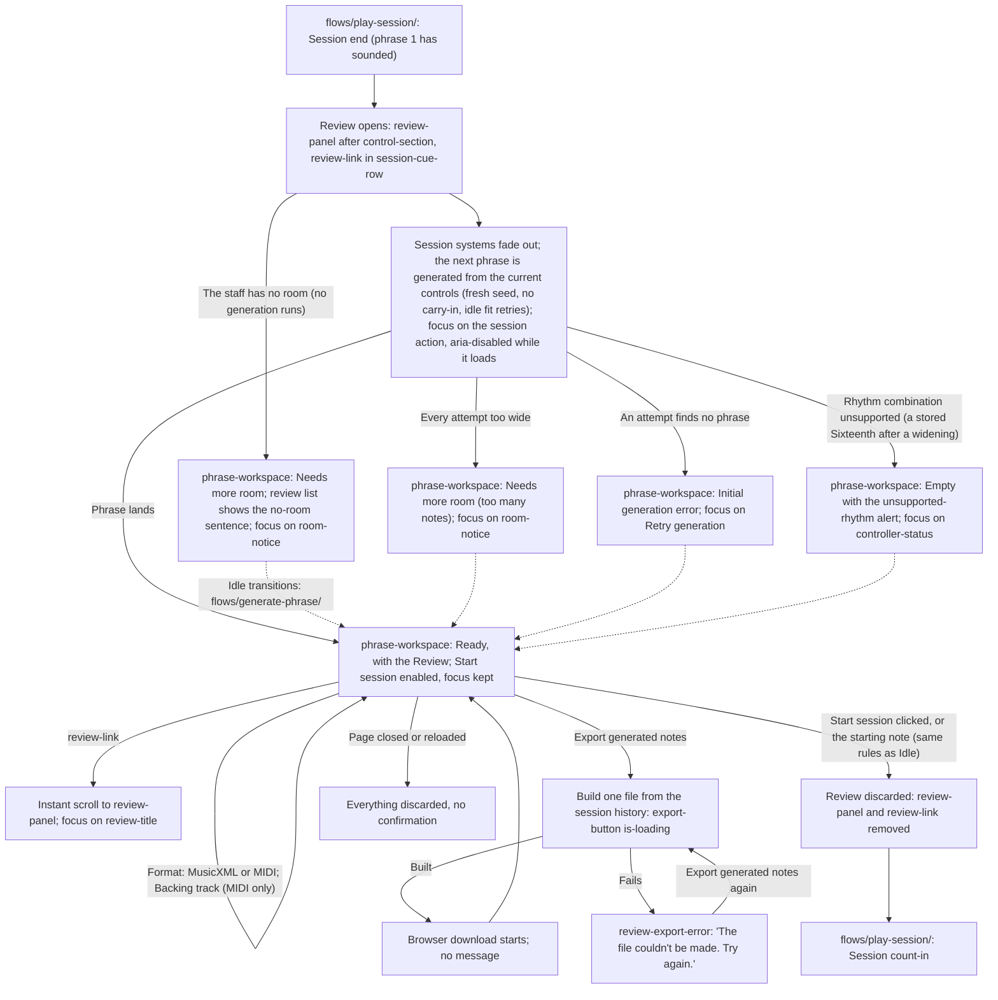

# Review and Export Handoff

> **New in v2.**

- Screens: `screens/phrase-workspace/` (the staff, the header, the cue row and every idle state
  named above) and `screens/last-session-review/` (`review-panel`, its export and its list). The
  Review is not a workspace state of its own: it is `review-panel` present alongside whichever idle
  state the workspace is in. Every idle transition (Loading, the fit retries, **Needs more room**
  and its clearing, the errors, **Empty**) is drawn once, in `flows/generate-phrase/handoff.md`,
  and applies unchanged with the Review open.
- **Opens.** Only at a session end once phrase 1 has started sounding (see
  `flows/play-session/handoff.md`, End). A session ended during its count-in opens no Review and
  does not restore an earlier one. Only one Review exists: the most recent session's.
- **The next phrase.** At the same session end, both systems' `staff-content` take
  `is-fading-out`, `staff-frame` shows `staff-loading` with no score, and a new phrase is generated
  from the current controls with a fresh seed and no carry-in, through the idle attempt budget
  (`flows/generate-phrase/handoff.md`, **Attempt budget**). It lands in **Ready** with the
  `staff-content` fade and is the next session's phrase 1. If the staff has no room at that
  moment, no generation runs: **Needs more room** with its no-room sentence, and the phrase is
  generated when the notice clears, as at idle.
- **Focus at the end.** Focus moves to the session action, reading `Start session`. While the next
  phrase loads it carries `aria-disabled="true"` instead of `disabled`, so it keeps focus and
  ignores activation (Space, Enter, click), with the disabled look; it becomes a normal enabled
  button when the phrase lands in **Ready**, focus unchanged. If the workspace lands anywhere else,
  the session action becomes `disabled` as usual and focus moves once: to `room-notice` in
  **Needs more room** (either cause, including when no generation ran); otherwise to the phrase
  action if enabled (`Retry generation` in **Initial generation error**); otherwise to
  `controller-status`.
- **Start conditions.** Exactly those of the idle workspace (`flows/play-session/handoff.md`,
  Start conditions, No start while the staff is not shown, Starting note): a session starts from
  **Ready** only, by `Start session` or, with a controller attached and the connection sheet
  closed, by the starting note. `start-note-line` and `start-note-marker` show exactly as at idle.
  The Review adds no condition and removes none.
- **Discard.** A session start, by either kind of start, removes `review-panel` and `review-link`
  at once, with no confirmation, before the start's jump. Nothing else discards the Review except
  closing or reloading the page. A session ended during that session's count-in does not restore
  it.
- **While the Review is open.** The workspace behaves exactly as at idle: controls, the phrase
  action, `controller-status` and the connection sheet, the theme and the audio mix all work.
  Nothing the player changes there alters the Review, which is drawn from the session history; the
  theme recolours it.
- **Portrait.** Below `bp-desktop`, a portrait-shaped viewport hides the whole workspace, the
  Review with it, behind `orientation-notice`. The Review is kept and shows again when the viewport
  is landscape.
- **Export.** One action in v2.0, `Export generated notes`, with its format (`MusicXML` default, or
  `MIDI`) and, for MIDI only, `Backing track` (off by default). It delivers exactly one file, built
  from the session history, as a browser download. It never holds a played note. It works in every idle state, including while the next
  phrase loads and while the staff has no room. Details in `screens/last-session-review/handoff.md`.
- **Privacy.** The Review and its data live in memory only. Nothing is written to browser storage
  and nothing is sent; the export is the only way anything leaves, and only when the player
  triggers it.
- **v2.1 (not built in v2.0).** A played-notes toggle joins `review-header` and an
  `Export played notes` action joins `review-actions` beside the generated-notes group, at every
  breakpoint, the phone included. Designed in unit 7.
