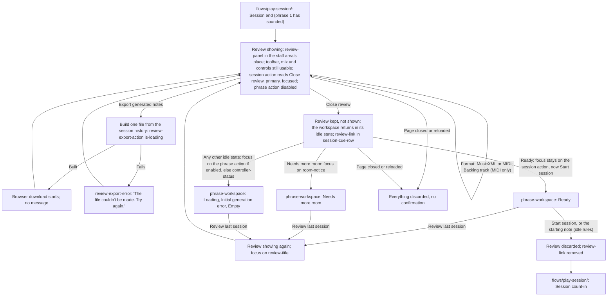

# Review and Export Handoff

> **New in v2.**

- Screens: `screens/last-session-review/` (`review-panel`, its export and its list) and
  `screens/phrase-workspace/` (the header, the cue row, the staff and every idle state). Every idle
  transition (Loading, the fit retries, **Needs more room** and its clearing, the errors, **Empty**)
  is drawn once, in `flows/generate-phrase/handoff.md`; it runs unchanged, out of sight, while the
  Review shows.
- **Two conditions.** A Review _exists_ from a session end once phrase 1 has sounded until the next
  session starts or the page closes. It is _showing_ while the player is in it: at that session
  end, and again after `Review last session`. Only one Review exists: the most recent session's. A
  session ended during its count-in opens none and does not restore an earlier one.
- **Showing.** Inside `score-panel`, `review-panel` is rendered in place of the generation-failure
  banner, `session-cue-row` and `staff-viewport`, which stay mounted with their state but hidden;
  `score-toolbar` stays, its `score-title` not rendered (`review-title` heads the review) and
  `mix-controls` fully usable. `control-section` stays after `score-panel`, fully editable as at
  idle (tempo and every setting; a profile switch regenerates the hidden phrase as at idle). The
  header stays: `controller-status` interactive (the connection sheet opens and its transposition
  check works, since connecting is allowed between sessions), `theme-control` live,
  `tempo-readout` as at idle, the phrase action disabled in place, secondary, and the session
  action reading `Close review`, primary. `generation-status` and `notation-status` stay silent
  while the Review shows, as during a session; the hidden staff's state is what the player finds on
  leaving.
- **No start while showing.** No session starts while the Review shows: `Start session` is not
  offered (its slot reads `Close review`), and no MIDI note, the starting note included, starts a
  session. `start-note-line` and `start-note-marker` are hidden with the staff. Notes played into
  the open connection sheet work there as usual.
- **The next phrase.** At the session end both systems' `staff-content` are cleared (hidden, so no
  fade shows) and a new phrase is generated from the current controls with a fresh seed and no
  carry-in, through the idle attempt budget (`flows/generate-phrase/handoff.md`, **Attempt
  budget**), as `Regenerate phrase` would. It lands in **Ready** (or **Needs more room**, **Initial
  generation error**, **Empty** with the unsupported-rhythm alert, as any such Loading can) out of
  sight. If the staff has no room at that moment, nothing is generated: **Needs more room** with
  its no-room sentence, the phrase coming when the notice clears. Whatever the workspace holds when
  the player leaves the Review is what they see; it becomes the next session's phrase 1 only by the
  ordinary idle start.
- **Focus at the end.** Focus moves to the session action, which now reads `Close review` and is
  always enabled while the Review shows.
- **Close review.** Activation (click, Space, Enter) stops showing the Review, shows the staff
  area (banner, `session-cue-row`, `staff-viewport`) and `score-title` again, scrolls the page
  instantly to its top, and adds
  `review-link` to `session-cue-row`. The session action takes its idle label and emphasis. Focus:
  stays on the session action if it is enabled (`Start session` in **Ready**); otherwise moves once
  to `room-notice` in **Needs more room**, else to the phrase action if enabled, else to
  `controller-status`. The Review is kept, not discarded.
- **Review last session** (`review-link`, idle only, while a Review exists and is not showing):
  shows the Review again as above, scrolled to its top, with focus on `review-title`; the session
  action reads `Close review` again.
- **Start conditions** after leaving: exactly those of the idle workspace
  (`flows/play-session/handoff.md`, Start conditions, No start while the staff is not shown,
  Starting note). A session start, by either kind of start, discards the kept Review:
  `review-link` is removed before the start's jump. A session ended during that session's count-in
  does not restore it.
- **Portrait.** Below `bp-desktop`, a portrait-shaped viewport hides the whole page, the Review
  included, behind `orientation-notice`; the Review stays showing (or kept) and returns in
  landscape.
- **Export.** One action in v2.0, `Export generated notes`, with its format (`MusicXML` default, or
  `MIDI`) and, for MIDI only, `Backing track` (off by default). It delivers exactly one file, built
  from the session history, as a browser download. It never holds a played note. It works whatever
  the hidden workspace is doing, including while the next phrase loads and while the staff has no
  room. Details in `screens/last-session-review/handoff.md`.
- **Privacy.** The Review and its data live in memory only. Nothing is written to browser storage
  and nothing is sent; the export is the only way anything leaves, and only when the player
  triggers it.
- **v2.1 (not built in v2.0).** A played-notes toggle joins `review-header` and an
  `Export played notes` action joins `review-actions` beside the generated-notes group, at every
  breakpoint, the phone included. Designed in unit 7.
