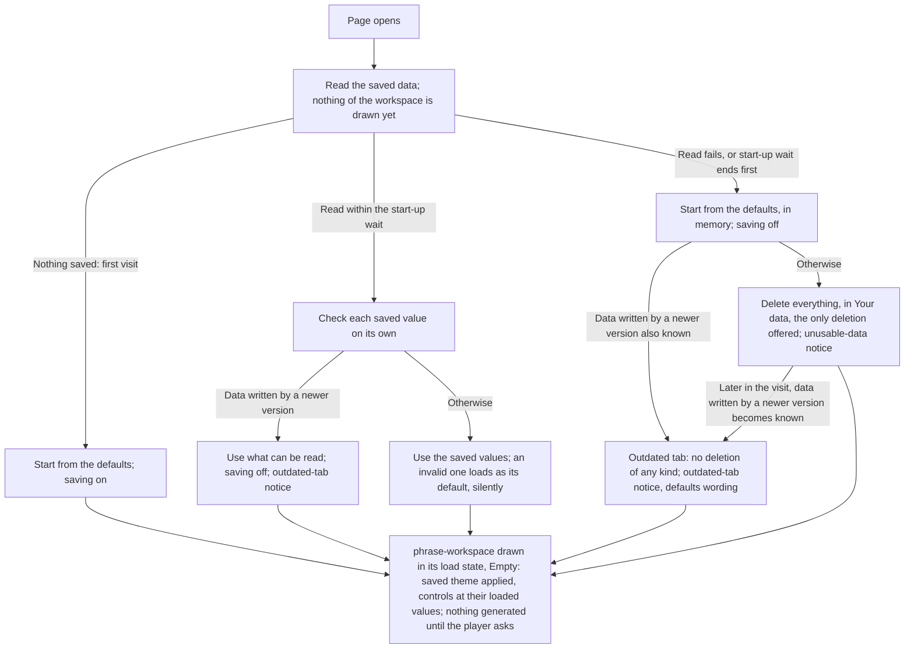

# Saved Data Handoff

> **New in v3.**

> **Changes since v3.0**
>
> - _v3.1 changed:_ the controls' row holds the seven embellishment levels and the preset
>   selection, in place of the musical profile selection; _v3.1 new:_ player presets, and when
>   each is written ([What Is Saved, and When](#what-is-saved-and-when))
> - _v3.1 changed:_ saving a player preset asks the browser for protection; _v3.1 new:_ presets
>   while saving is off ([What Is Saved, and When](#what-is-saved-and-when))
> - _v3.1 new:_ loading the presets and the selection, and settings saved by v3.0
>   ([Load](#load))
> - _v3.1 new:_ the save-problem notice's preset wording ([Notices](#notices))
> - _v3.1 new:_ Delete everything removes every player preset; the other deletions leave them;
>   one preset deleted from its row in Your data ([Your Data](#your-data))
> - _v3.2 new:_ the five new saved settings, a Jam session's doodle and the suggestion's decline;
>   the held doodle never saved; a Jam while saving is off
>   ([What Is Saved, and When](#what-is-saved-and-when))
> - _v3.2 new:_ loading the new settings, and sessions kept before v3.2 ([Load](#load))
> - _v3.2 new:_ what the deletions remove of a Jam session, and Delete everything
>   ([Your Data](#your-data))

Screens: [`phrase-workspace`](../../screens/phrase-workspace/handoff.md) (the load, the notice
row, the footer), [`your-data`](../../screens/your-data/handoff.md) (the sheet),
[`last-session-review`](../../screens/last-session-review/handoff.md) and
[`session-list`](../../screens/session-list/handoff.md) (what deletions change, the keep line),
[`my-instrument`](../../screens/my-instrument/handoff.md) and
[`controller-connection`](../../screens/controller-connection/handoff.md) (where those two items
are made). Storage is the browser's IndexedDB, one database for the app (master spec §4.3).

## What Is Saved, and When

Saving shows nothing, ever: no message, no indicator, no announcement.

| Item | Written when | Notes |
| --- | --- | --- |
| **[v3.1 changed]** The 14 generation controls, the seven embellishment levels and the preset selection (which preset, or Custom and its base) | The player changes one: a segment or stepper press, a slider when released, a preset chosen | The value the player chose, not the one a phrase was generated with (a chosen `Sixteenth` stays `Sixteenth` below `bp-tablet-landscape`; a level or the selection that Vary settings moved during a session is not saved). The restriction in force is not saved: it follows from the selection and the key and mode. |
| **[v3.1 new]** Each player preset (its name, ten controls, seven levels and key and mode restriction), one record each | `Save` in the preset sheet for a new preset; `Save changes`; a rename saved; a deletion confirmed, which removes its record (`flows/presets/`) | Known by an internal identifier, not its name, so a rename keeps it selected and as Custom's base. Never during a session. Two tabs: each save writes a whole preset, the last write wins, the other tab sees it after a reload. |
| The instrument profile selection | The player selects one, my instrument included | |
| The theme | The player changes it | |
| The audio mix (Backing and Click on or off, each volume) | The player changes it; a volume when its slider is released | |
| The three "During a session" options | The player changes one | Each comes back on only if the player turned it on. |
| The review's preferences (format, backing track in the MIDI file, `Played notes`) | The player changes one | Not the export scope or `Include very short notes`, which are never saved. |
| `Keep my played notes` | The player changes it | Off by default. |
| **[v3.2 new]** Jam, Drift, Rhythm lock, Allowed rhythm changes, What may vary | The player changes one (Jam also when `Jam again on this doodle` turns it on) | Defaults: Jam off, Drift Near, Rhythm lock off, every allowed rhythm change off, all six groups on. Jam and the lock come back on only if the player turned them on. No preset holds them. |
| A session | Once, at its end, as its review opens | Never during it; one that ends during its count-in saves nothing. Saving it deletes every unpinned older session. Its played notes go with it only while `Keep my played notes` is on. |
| Pin, unpin, a favorite, a comment | The player makes the change (a comment: on `Done`, when the field loses focus, and when the review is left or replaced) | |
| **[v3.2 new]** A Jam session's doodle, and its suggestion's decline | The doodle with its session, at its end; the decline when the player presses `Keep {key} {mode}` in its review | The quantized doodle and the tempo it was played at are saved with every Jam session, whatever `Keep my played notes` says; the raw doodle notes are played notes and follow that setting. |
| My instrument | `Save` in its sheet, or the transposition check's confirmation | |
| The remembered controller | The player chooses a device (it reaches the transposition check or `Connected`); cleared by `Disconnect` | Not changed by an unplug, a reattachment or deleting my instrument. |

**Saved at a session's end:** a theme or audio-mix change the player makes during a session is
written when the session ends, with the session's own save, or on its own when the session ends
during its count-in and nothing else is saved. **Never saved:** values the app changes by itself
during a session; anything written between Start and the session's end (the app writes nothing
in that time); the tempo a
Rising-tempo session reached; pre-generated phrases; the export scope; `Include very short notes`.

**[v3.2 new]** **Never saved either:** a held doodle, which lives in memory only and is gone after
a reload (the kept Jam session's review offers it again); the suggestion itself, which is worked
out again from the doodle whenever it is shown. A Jam that ends before phrase 1 sounds saves
nothing, as a session ended during its count-in.

**Saving is off for the whole visit** in an outdated tab (from the moment it is outdated) and in
a visit started from the defaults because the saved data couldn't be read, or not within the
start-up wait (see Load). Every save
above is then skipped: the app keeps working in memory, and the notice already showing says so.
A session ending in such a visit is not saved; its review's keep line reads as for a failed save.
Neither visit offers a deletion in the session list or a review: no `Delete`, `Delete session`
or `Delete played notes`, the session held in memory included, and turning
`Keep my played notes` off changes it for the visit only and opens no confirmation
(`flows/kept-sessions/handoff.md`, While Saving Is Off). An outdated tab also deletes nothing
and offers no deletion of any kind: Your data has no `Delete everything` (the reload comes
first). A visit started from the defaults keeps `Delete everything`, the only deletion it offers
and the way out when reloading does not help, whether the data is unreadable or only slow to
read (`screens/your-data/`, States), until data written by a newer version is known to exist.

**[v3.1 new]** **Presets while saving is off.** A preset made, changed or renamed in either visit
lasts for the page, under the visit's notice, with no wording of its own. Neither visit offers a
preset deletion: `Delete preset` is absent (`flows/presets/`), and Your data has no Presets
section. A visit started from the defaults lists the built-in presets only; an outdated tab lists
the player presets it could read.

**[v3.2 new]** **A Jam while saving is off.** Jam, its review, the suggestion's `Use` and `Keep`,
and `Jam again on this doodle` work in memory for the visit; nothing is saved, the decline
included, and the visit's deletion rules are unchanged (master spec §C10.4).

**Newer data wins over a failed read.** A tab is outdated from the moment data written by a newer
version is known to exist, whether the saved data was read or not: found at load, revealed by a
read that finished after the start-up wait, or written by a newer version while the tab is open.
A visit started from the defaults becomes an outdated tab in every respect at that moment: its
`Delete everything` goes with every other deletion, an open deletion confirmation closes
deleting nothing, and its notice takes the outdated tab's wording for a visit started from the
defaults (Notices). No deletion starts once newer data is known; one already running is not
interrupted, and its outcome is told as usual (master spec §4.4).

**[v3.1 changed]** **Asking for protection.** At the first pin, favorite, saved instrument or
saved player preset (made with `Save as new preset`, or changed with `Save changes`; not a rename
or a deletion) of each visit, while the storage is not already protected, the app asks the
browser to make it persistent. Nothing is
shown, whatever the answer; Your data's Protection section reports the state. Never asked while
saving is off.

## Load

- **The start-up wait** is a build constant, proposed at 2 seconds. Until the read finishes or
  the wait ends, the page shows only its background (in the system's light or dark theme, the
  default); the workspace is then drawn once, already in its loaded theme and values. No control
  changes value after it is drawn.
- **A read that finishes after the wait** is ignored for that visit: the visit keeps its
  defaults and saving stays off. `Reload` in the notice tries again. The one thing such a read
  still changes: if it reveals data written by a newer version, the tab becomes outdated (see
  Newer data wins over a failed read, above).
- **Newer data with a failed read at load.** A read can fail and still make a newer version
  known, for example when the database refuses to open because a newer version has upgraded it.
  The visit starts from the defaults, saving off, as for any failed read, and is an outdated tab
  from its first frame: no deletion anywhere, the outdated-tab notice in its defaults wording.
- **Each value is checked on its own:** unknown or no longer valid, it loads as that setting's
  default; every other value is kept. No notice. A saved instrument selection naming my
  instrument when my instrument cannot be loaded falls back to the default profile. My instrument
  itself is one value: if it no longer passes the profile rules, it loads as absent (no fourth
  choice, `Create my instrument` shown).
- **Kept sessions:** their row summaries (what a list row and the counts in Your data show) are
  read during the load wait, with the settings; a full session is read only when it is opened
  (`screens/session-list/`). A kept session this version cannot read is listed there with its
  note. The most recent kept session makes `Review last session` available at idle.
- **The remembered controller** is reattached at load only when the browser already allows MIDI
  access (`flows/controller-connection/`).
- **[v3.1 new]** **Player presets** are read with the settings, inside the start-up wait. A read
  of them that fails makes the visit one started from the defaults, as a whole.
- **[v3.1 new]** **The values win.** The controls and levels load as saved. When they differ from
  the selected preset's, or the saved key and mode lie outside its restriction, the selection
  loads as Custom, based on that preset; when the preset no longer exists, as Custom with no base.
  Loading never moves the key or the mode. The only thing the player sees of any of this is the
  selection the preset box shows: no notice, no announcement.
- **[v3.1 new]** **Tolerant, per preset and per field.** In a player preset, an unknown or invalid
  field takes that setting's first-load value; a figure level missing because the record predates
  that figure is Off; a missing name becomes a numbered one, as a new preset's default name is
  numbered (`flows/presets/`); in its restriction an unknown key or mode is dropped from its list,
  and an empty list or a missing restriction reads "any". A record that cannot be read at all is
  left in place and not listed; `Delete everything` still removes it.
- **[v3.1 new]** **Settings saved by v3.0** are migrated when the database opens: the musical
  profile selection becomes that built-in preset, or Custom based on it, with that built-in's
  figure levels; then the values win, so a Jazz selection saved with Tension at Build loads as
  "Custom, based on Jazz". Sessions kept by v3.0 keep their musical profile as their preset label
  (`flows/kept-sessions/handoff.md`, Terms).
- **[v3.2 new]** **The five new settings** load tolerantly too: an unknown or invalid value takes
  its default (Jam off, Drift Near, Rhythm lock off, every allowed rhythm change off, all six groups
  on), every other setting still loading; settings saved by v3.0 or v3.1 load with those defaults.
  Sessions kept before v3.2 are migrated with no doodle and open as before. No held doodle ever
  comes back at load.

## Notices

Drawn in `app-notice-row`, at the top of `layout-workspace` before `score-panel`
(`screens/phrase-workspace/`). Each is `inline-alert alert-notice app-notice`: its sentence in a
`p`, then its buttons, the action first, then `Dismiss` when it has one.

| Notice | Trigger | Copy | Actions | Lifetime |
| --- | --- | --- | --- | --- |
| Save failed | A save other than a session's own fails for any cause but full storage | "Something couldn't be saved on this device. The app keeps working, but this change may be lost when the page closes." | `Dismiss` | Until dismissed or the page closes. |
| **[v3.1 new]** Preset not saved | A player preset's save (a new preset, `Save changes`, a rename) is refused for any cause but full storage | "Your preset “{name}” couldn't be saved on this device. You can use it until this page closes." ({name}: the name it was saved under) | `Dismiss` | Until dismissed or the page closes. |
| Storage full | Any save, a session's own included, is refused because storage is full | "This device has no room left for the app's data, so something couldn't be saved. Deleting sessions you no longer need frees space." | `Your data`, `Dismiss` | Until dismissed or the page closes. |
| Outdated tab | Data written by a newer version is known to exist: found at load, revealed by a read that finished after the start-up wait, or written by a newer version while this tab is open | Saved data read: "A newer version of Infinite Flow has saved data on this device. Reload this page to use it; until then, nothing here is saved." Visit started from the defaults after a failed or too-slow read: "Your saved data couldn't be read, and a newer version of Infinite Flow has saved data on this device. This visit started from the defaults and saves nothing. Reload this page to use the newer version." | `Reload` | Until the page reloads. |
| Unusable data | The saved data couldn't be read at load, or not within the start-up wait | "Your saved data couldn't be read, so this visit started from the defaults and saves nothing. Reloading may fix it." | `Reload` | Until the page reloads. |

- **One notice at a time.** Save failed and Storage full are one save-problem notice in two
  wordings: a new failure while it shows switches it to the latest cause's wording in place, never
  adds a second. **[v3.1 changed]** Preset not saved is a third wording of the same notice, under
  the same rules. Outdated tab and Unusable data replace a save-problem notice. Unusable data, set
  at load, gives way to one notice only: the outdated tab's defaults wording, in place, when data
  written by a newer version becomes known later in the visit (with saving off, nothing else can
  arise). Outdated tab is never replaced.
- **After `Dismiss`,** the save-problem notice comes back only when a save fails again after a
  save has succeeded since; a run of refusals with no success between them shows it once.
- **[v3.1 new]** **A preset's refused save** is told at once: presets are made, changed and renamed
  only outside a session, at idle or in the review mode, so the notice never waits; full storage,
  for any preset save, takes the Storage full wording. The preset stays as made or changed for
  the visit. A preset deletion that fails raises no notice: like every deletion, it keeps its
  confirmation open with "That couldn't be deleted. Try again." and changes nothing
  (`screens/preset-sheet/`).
- **A session's own save** that fails is told by the review's keep line ("Not saved on this
  device: export it to keep it.", `screens/last-session-review/`), and raises no notice of its
  own, except when storage is full: the storage-full notice then shows too, as the review opens,
  since freeing space is something the keep line cannot offer.
- **During a session:** a notice arising during a session (an outdated tab detected then; no
  save happens during a session) is held and shown when the session ends, as the review opens or
  the workspace returns to idle. A notice already showing at Start stays, unchanged and in place,
  for the whole session; its buttons take `btn`'s disabled look, like every control, and become
  enabled again at the session's end. So an unusable-data notice showing at Start keeps its
  wording until the session ends, even when a newer version is detected during it, and takes the
  outdated tab's defaults wording then; the tab is outdated from the detection on, and the review
  that opens offers no deletion.
- **No focus, no announcement.** A notice appearing, changing wording or leaving moves no focus;
  `app-notice` is not a live region and has no `role="alert"`. It appears and leaves with no
  animation.
- **`Dismiss`** removes the notice (`app-notice-row` is then absent) and moves focus to the first
  enabled of: the session action, the phrase action, `controller-status` (the workspace's
  fallback order).
- **`Your data`** opens `screens/your-data/`; the notice stays. When the sheet closes, focus
  returns to this button.
- **`Reload`** reloads the page. In an outdated tab the reload brings the newer version.

## Your Data

```mermaid
flowchart TD
  F["layout-footer: Your data (idle or review)"] --> OV
  L["session-list header: Your data"] --> OV
  N["Storage-full notice: Your data"] --> OV
  OV["your-data: Overview"]
  OV -->|Delete every session| CS[Confirm: Delete every session?]
  OV -->|Delete all played notes| CP[Confirm: Delete all played notes?]
  OV -->|"Keep my played notes turned off, some kept"| CK[Confirm: Delete the played notes already kept?]
  OV -->|"Delete everything (not in an outdated tab)"| CE[Confirm: Delete everything?]
  %% v3.1 new: a preset's Delete, its confirmation and its ways out
  OV -->|"A preset's Delete (Presets section; v3.1 new)"| CPR["Confirm: Delete the preset “{name}”? (v3.1 new)"]
  CPR -->|"Delete preset: done (v3.1 new)"| OV
  CPR -->|"Cancel, Escape, backdrop, Close (v3.1 new)"| OV
  CPR -->|"Deletion fails (v3.1 new)"| CPR
  CS -->|"Delete every session: done"| OV
  CP -->|"Delete all played notes: done"| OV
  CK -->|"Delete them: done"| OV
  CS -->|"Cancel, Escape, backdrop, Close"| OV
  CP -->|"Cancel, Escape, backdrop, Close"| OV
  CK -->|"Keep them, Escape, backdrop, Close"| OV
  CE -->|"Cancel, Escape, backdrop, Close"| OV
  CS & CP & CK & CE & CPR -->|"The tab becomes outdated: nothing deleted, focus to Done (the preset's: v3.1 new)"| OV
  CE -->|"Delete everything: done"| RELOAD["Page reloads into its first visit"]
  CS -->|Deletion fails| CS
  CP -->|Deletion fails| CP
  CK -->|Deletion fails| CK
  CE -->|Deletion fails| CE
  OV -->|"Done, Escape, backdrop, Close"| CLOSED[Sheet closed; the page beneath brought up to date; focus to the opener]
```

- **Openers** are disabled during a session; the sheet never opens during one. While it is open,
  no MIDI note starts a session.
- **Turning `Keep my played notes` on** asks nothing. It also keeps the played notes of the most
  recent session if they are still in memory (it ended in this visit) and the session is kept.
- **Turning it off** saves the setting at once. With no played notes kept, nothing else happens;
  with some kept, the confirmation opens; `Keep them` leaves them kept, the switch staying off.
  (While saving is off the sheet shows no switch; see `screens/your-data/`, States.)
- **What each deletion removes:**
  - *Delete every session:* every kept session, pinned or not, with its favorites, comment and
    played notes; also the most recent session from memory, kept or not, so `Review last session`
    and `All sessions` go. Settings, my instrument and the remembered controller stay.
  - *Delete all played notes:* the played notes kept with every session, and those of the most
    recent session from memory when they were kept. Sessions, favorites, comments and the
    `Keep my played notes` setting stay.
  - *Delete everything:* the whole database (every setting, my instrument, the remembered
    controller, every session with everything it holds), then the page reloads. The browser's MIDI
    permission and the app's offline copy of its own files are not the app's kept data and stay.
  - **[v3.1 new]** *Delete everything* also removes every player preset, a record that could not be
    read included; the page reloads with the built-in presets only. *Delete every session* and
    *Delete all played notes* leave the presets as they are.
  - **[v3.2 new]** *Delete every session* deletes every Jam session with its doodle in both forms.
    *Delete all played notes* deletes the raw doodle notes with every other kept played note and
    keeps each Jam session's written-out doodle. *Delete everything* removes both and resets Jam,
    Drift, Rhythm lock, Allowed rhythm changes and What may vary to their defaults with every
    other setting; a held doodle goes with the reload.
- **After a deletion that doesn't reload,** the sheet returns to its overview with its counts
  updated. When the sheet closes, the page beneath reflects it: a review of a deleted session gives
  way to the session list, in its empty state if nothing is left (`screens/session-list/`); the
  session list shows what remains; the cue row's links follow (`screens/phrase-workspace/`); a
  review that loses its played notes loses the lane, the `Played notes` switch and the
  played-notes export (`screens/last-session-review/`).
- **[v3.1 new]** **After a preset's deletion,** the preset box beneath drops it from its list and,
  when it was the selection or Custom's base, reads "Custom" (Custom with no base, the same
  values); its description line and `preset-actions` follow (`flows/presets/`).
- **A deletion that fails** keeps the confirmation open, with one error line, and its confirming
  action tries again (`screens/your-data/`, States).
- The per-session deletions (one session, one session's played notes) and deleting my instrument
  are specified with their screens: `flows/kept-sessions/`, `flows/review-and-export/`,
  `flows/my-instrument/`.
- **[v3.1 new]** Deleting one player preset, by `Delete preset` in the controls or by its row's
  `Delete` in Your data's Presets section, is specified with the presets: `flows/presets/`.
