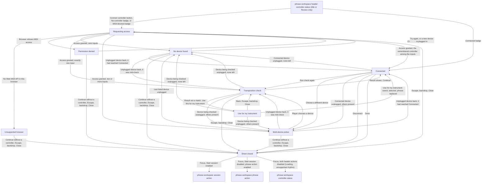
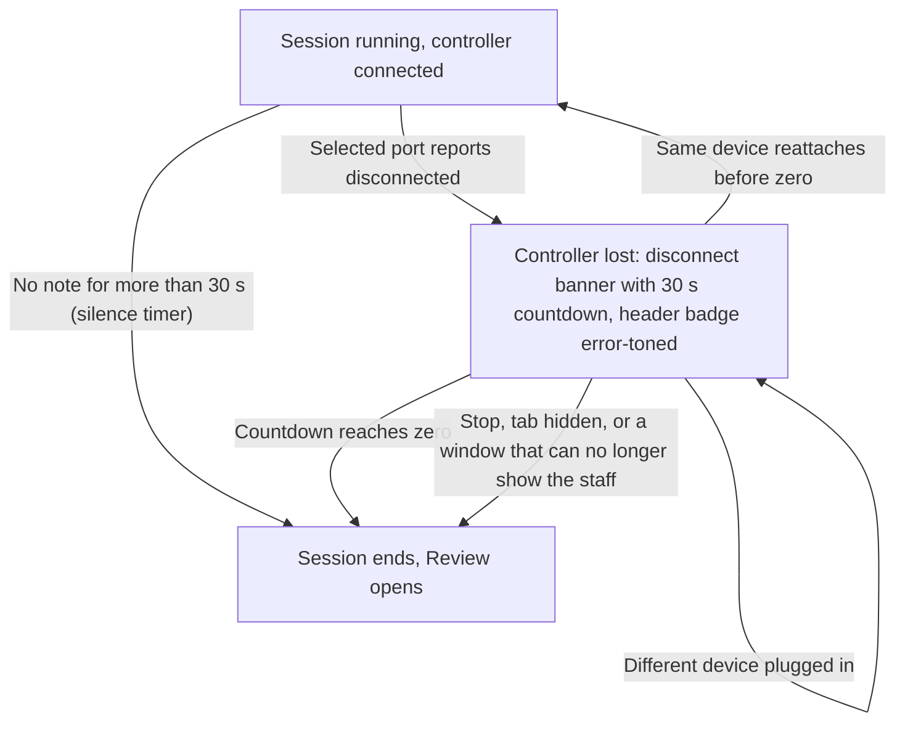
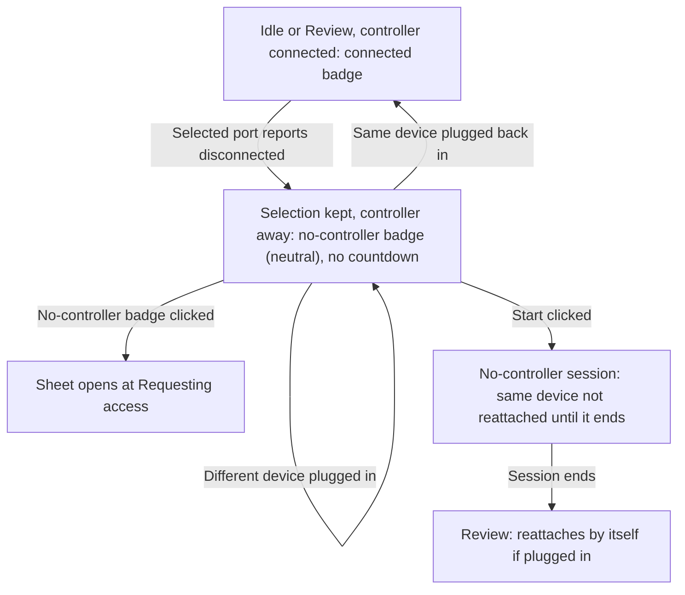
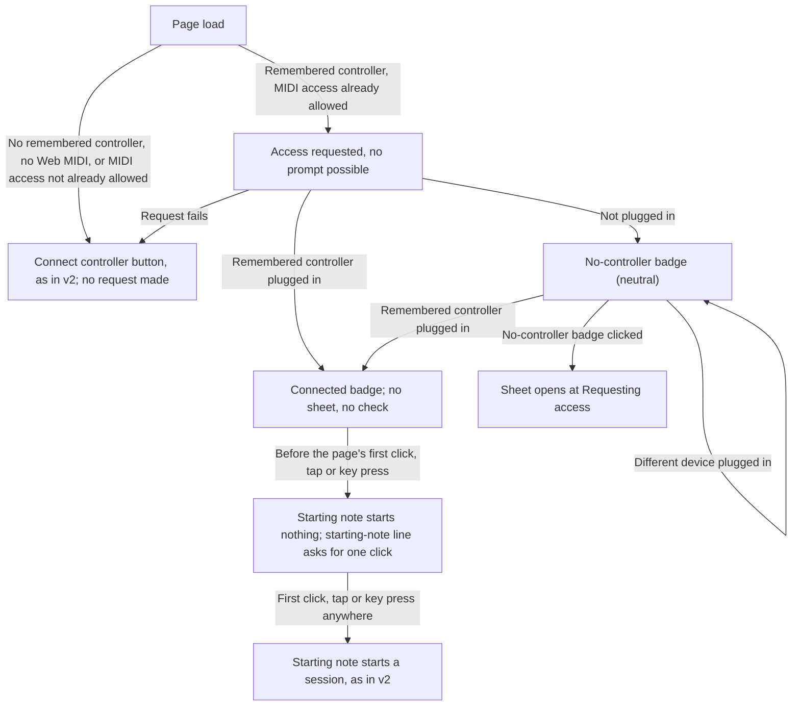

# Controller Connection Handoff

> **Changes since v2**
>
> - _New:_ `Use this for my instrument` and its confirmation, and the remembered controller chosen
>   directly from Requesting access ([Entry and exit](#entry-and-exit),
>   [Routing rules](#routing-rules))
> - _New:_ the remembered controller at load ([At load](#at-load-sheet-closed-never-enters-the-sheet),
>   [Routing rules](#routing-rules))
> - _Changed:_ the audio-unlock rule: the page's first click, tap or key press, and the starting
>   note waiting for it after a load; the header forms at load; `Disconnect` also forgets the
>   remembered controller; the check runs against my instrument when it is selected
>   ([Routing rules](#routing-rules))
> - _New:_ the check note in my instrument's clef; using the result warns when it erases my
>   instrument's sessions, and is not offered in a tab that must be reloaded while it has some
>   ([Routing rules](#routing-rules))
> - _Removed:_ "There is no other audio-unlock step." (v2 in the
>   [frozen copy](../../../v2/flows/controller-connection/handoff.md#routing-rules))

## Entry and exit

## Mid-session controller loss (never enters the sheet)

## Between-session unplug (sheet closed; never enters the sheet)

## At load (sheet closed; never enters the sheet)

**[v3 new]** The remembered controller is the last one the player chose in an earlier visit.

## Routing rules

- Screens: `screens/controller-connection/` for every state inside the sheet;
  `screens/phrase-workspace/` for the header `controller-status` entry point, the disconnect
  banner, and the mid-session loss state.
- The sheet opens only at Idle or while the Review is showing, and only from a click on the header
  `controller-status` element. It never opens by itself, and never during a session: in a session
  the header element is disabled (see `screens/phrase-workspace/handoff.md`).
- **[v3 changed]** **Sound.** The page's first click, tap or key press, wherever it lands, unlocks
  sound; a MIDI note does not. The `Connect controller` click is often that first click, and is
  also the MIDI permission request. When a controller attached without any click (reattached at
  load), the starting note starts nothing until that first click, tap or key press;
  `start-note-line` says so (wording in `screens/phrase-workspace/handoff.md`), and
  `Start session` works as always, being a click itself.
- No MIDI note received while the sheet is open, in any state, can start a session or its
  count-in — including the note the transposition check asks for, and including a note equal to the
  one phrase 1 starts on.
- **Connected** means: MIDI permission granted, one input selected (chosen in the picker, or the
  only one present), and that input's port present and open. The header shows the connected badge
  from the moment those three hold — on entering **Transposition check** — not only after the check
  result. Dismissing the sheet during the check leaves the controller connected but unchecked.
- **Lost** means: the selected input's port reports disconnected.
- Header element forms and where a click opens the sheet:

  | Header form | Shown when | Click opens at |
  | --- | --- | --- |
  | **[v3 changed]** `Connect controller` button | No controller has connected in this page session, no remembered controller is expected (see At load), and the latest request was not refused (includes after Unsupported browser, No device found, or a dismissal) | Requesting access |
  | **[v3 changed]** Connected badge | A controller is connected (including the same device reattached by itself between sessions, and the remembered controller attached at load) | Connected |
  | **[v3 changed]** No-controller badge | A controller had connected in this page session and is not attached now: disconnected by the player, lost in a session that has ended, or unplugged between sessions (selection kept); or, from a load with MIDI access already allowed, the remembered controller is not plugged in | Requesting access |
  | MIDI-blocked badge (error tone) | The browser refused MIDI permission on the latest request | Requesting access |
  | Disconnected badge (error tone) | Session only: a controller lost mid-session, while its countdown runs | Not clickable (session) |

- Every form has the same width, the `Connect controller` button included: the button and its
  label area each have one fixed inline size, and a long device name is cut with an ellipsis
  (see `screens/phrase-workspace/handoff.md`). No change of form ever moves another header
  element, the first connection included.
- A later successful request replaces the MIDI-blocked badge: the connected badge if it connects a
  device; otherwise the no-controller badge if a controller had connected earlier in this page
  session, or the `Connect controller` button only if none ever had. Once a controller has
  connected in the page session, the header never returns to the `Connect controller` button.
- **Between sessions (Idle or Review), the selected controller unplugged:** the selection is kept;
  the header shows the no-controller badge (neutral, never error-toned; no countdown). The **same
  device** plugged back in reattaches by itself: no click, no sheet, no transposition check; the
  header returns to the connected badge. A **different device** plugged in is not picked up; it
  connects only through the sheet. While the sheet is open, its own device-change rules apply
  instead (see `screens/controller-connection/handoff.md`).
- **Start clicked while the selected controller is away:** the session starts with no
  controller and stays without one; the same device plugged back in during it is not reattached.
  The header keeps the no-controller badge, disabled. When the session ends, the device
  reattaches by itself if it is plugged in.
- **Controller still away when a session ends** (countdown reached zero, Stop, a hidden tab,
  or a window that can no longer show the staff): its selection carries into the Review, handled
  as unplugged between sessions.
- **[v3 new]** **The remembered controller.** The app remembers the last controller the player
  chose: the last device that counted as connected through the sheet, picked in the picker or the
  only input present. Choosing another device replaces it from the moment that device counts as
  connected (on entering **Transposition check**). `Disconnect` forgets it, so the
  next load shows `Connect controller`. Deleting my instrument does not touch it; `Delete
  everything` forgets it.
- **[v3 new]** **At load**, the app requests MIDI access only when the browser already allows it for
  this page and a remembered controller exists, so a load never raises a browser prompt; a load
  never shows the MIDI-blocked badge, since no request was refused. The remembered controller
  plugged in is attached with no click, no sheet and no check; not plugged in, the header shows
  the no-controller badge and it attaches by itself when plugged in, as for a controller unplugged
  between sessions. A different device plugged in is not picked up.
- **[v3 new]** **Through the sheet**, when **Requesting access** finds the remembered controller
  among the inputs, it is chosen directly, however many inputs there are, and the sheet goes to
  **Connected**: no picker, no check. `Run check again` and `Choose a different device` (when more
  than one input has been seen) are there as usual.
- **[v3 new]** **The check against my instrument.** When my instrument is the selected instrument,
  the check asks for a note from its range, drawn in its clef, and compares against its
  transposition, and the result copy names it (see `screens/controller-connection/handoff.md`).
- **[v3 new]** **`Use this for my instrument`** is offered on every result that is not a match,
  unless the resulting instrument would sound outside the MIDI note range (its written range moved
  by the new transposition), in which case it is absent and the result is otherwise unchanged. It
  is also absent in a tab that must be reloaded while my instrument has kept sessions, the result
  saying a reload comes first. It
  opens the **Use for my instrument** confirmation; nothing changes until `Use for my instrument`
  is chosen. Then: my instrument's transposition becomes the semitones from the written note asked
  for to the note the controller sent; with no instrument yet, my instrument is first created from
  the selected built-in profile, named "My instrument", in treble clef, with its written range; the
  written range and the clef are kept either way. When my instrument exists and has sessions, the
  confirmation warns that they go, with how many, its action reads `Use and erase`, and
  confirming saves the transposition and erases them together (`flows/my-instrument/handoff.md`,
  Sessions erased); a failure keeps the confirmation with its error line, changing nothing. My instrument is saved and selected, the phrase is replaced as on an
  instrument switch (`flows/my-instrument/handoff.md`), and the sheet goes to **Connected** with
  the line "{name} now matches your controller.". The first save of my instrument also asks the
  browser to protect the kept data, invisibly. `Back`, Escape, the backdrop and `Close` return to
  the result with nothing changed.
- `Unsupported browser` has no retry: nothing about asking again changes which browser is running.
- `Requesting access` resolves on its own; while the browser's own permission prompt is waiting for
  an answer, it shows its waiting sub-state (see the screen handoff). If the sheet is closed while
  the browser prompt is still waiting, the attempt is abandoned: a later "allow" answer selects
  nothing and opens nothing (the next `Connect controller` click then resolves without a prompt);
  a later "block" answer switches the header to the MIDI-blocked badge, but only between
  sessions: if a session is running (count-in included), the header keeps its current form and
  the switch waits until the session ends, so the header never changes shape while the player is
  reading.
- `Check again` from **Permission denied** re-requests access. If the player has allowed MIDI in the
  browser meanwhile, or the browser is still willing to ask, the request proceeds normally;
  otherwise it lands back on **Permission denied**.
- `Choose a different device` is present on **Connected** only when more than one input has been
  seen this page session.
- Every dismiss path returns to the same place: the sheet closes, `phrase-workspace` is exactly as
  it was, and focus moves to the first enabled of, in order: the workspace's session action; the
  phrase action (when `Start session` is disabled: an empty workspace, a generation-failure banner
  showing, a notation error); `controller-status`, the element that opened the sheet (when both
  are disabled: **Loading**, or an unsupported rhythm combination), which is always interactive
  outside a session. The header element reflects
  whatever is current (unchanged if nothing was resolved, the connected badge if a device was
  selected before the dismiss).
- **[v3 new]** In the **Use for my instrument** confirmation, Escape, the backdrop and `Close` are
  the confirmation's way back, as `Back` is: they return to the check result and do not close the
  sheet. A second Escape then closes it from the result, as above.
- A running session's controller loss is handled only on `screens/phrase-workspace/`: 30 seconds
  counted from the unplug, whatever silence came before; silence timer suspended while unplugged
  and restarted from the reattachment; only the same device reattaches, automatically, with no
  check; at zero the session ends exactly like a silence timeout.
- A session started with no controller (none ever connected, or the selected one away) stays
  controller-less until it ends; only Stop ends it, apart from a hidden tab or a window that can
  no longer show the staff.
