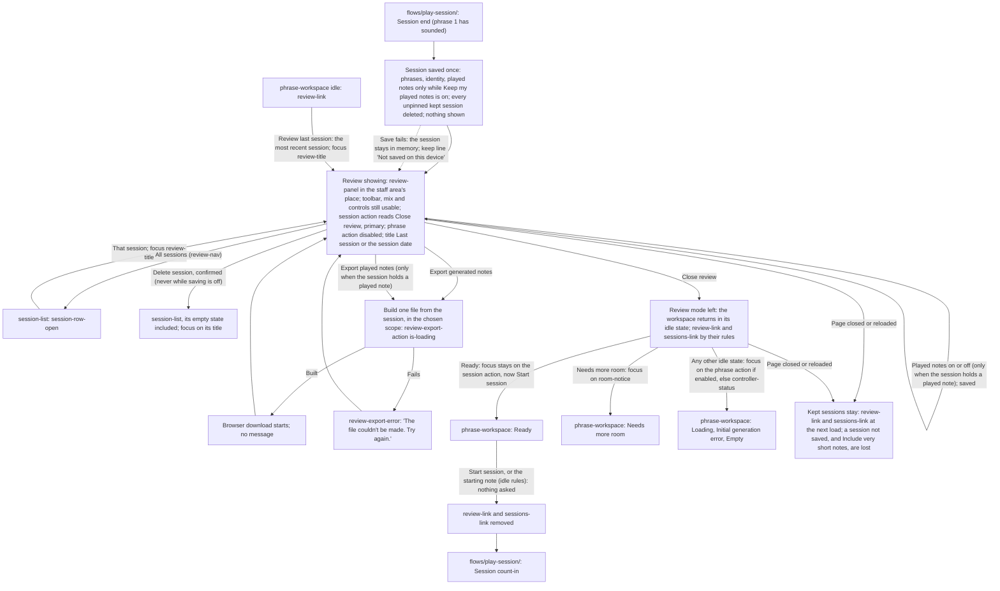

# Review and Export Handoff

> **Changes since v2**
>
> - _Changed:_ the handoff is split under headings; rules not marked below are unchanged
> - _New:_ the review opens from a row of the session list and, after a reload, from
>   `Review last session`; `All sessions` and deleting lead to the list ([Flow](#flow))
> - _Changed:_ a Review exists for every session that can be opened, not only the last one; its
>   title is "Last session" or the session's date ([Screens and Conditions](#screens-and-conditions))
> - _Changed:_ `Review last session` and the session start, which no longer discards anything
>   ([Leaving and Coming Back](#leaving-and-coming-back))
> - _New:_ the save at the session's end and the keep line ([Saving the Session](#saving-the-session))
> - _New:_ favorites, the comment, pin, unpin and delete
>   ([Favorites, Comment, Pin and Delete](#favorites-comment-pin-and-delete))
> - _New:_ the export scope and `Include very short notes`; _Changed:_ Format and Backing track
>   are saved ([Export](#export))
> - _New:_ `Keep my played notes` and `Delete played notes`; _Changed:_ the `Played notes` switch
>   is saved, and the lane leaves out very short notes ([Played Notes](#played-notes))
> - _Changed:_ what is kept and what leaves ([Privacy](#privacy))
> - _Changed:_ the phone gets every function ([At Every Breakpoint](#at-every-breakpoint))
> - _Removed:_ "Only one Review exists", the session start discarding the Review, the page's close
>   or reload discarding everything, Format and the `Played notes` switch "kept for the page
>   session", and "The Review and its data live in memory only" (v2 in the
>   [frozen copy](../../../v2/flows/review-and-export/handoff.md))

## Flow

## Screens and Conditions

- Screens: `screens/last-session-review/` (`review-panel`, its export and its list),
  `screens/phrase-workspace/` (the header, the cue row, the staff and every idle state) and,
  **[v3 new]** `screens/session-list/` (the review mode's second level). Every idle transition
  (Loading, the fit retries, **Needs more room** and its clearing, the errors, **Empty**) is drawn
  once, in `flows/generate-phrase/handoff.md`; it runs unchanged, out of sight, while the Review
  shows. The list, the cue-row links and the moves between the list and a review are routed in
  `flows/kept-sessions/handoff.md`.
- **[v3 changed]** **Two conditions.** A Review _exists_ for every session that can be opened: the
  most recent session (from its end, once phrase 1 has sounded, kept or held in memory after a
  failed save) and every kept session (`flows/kept-sessions/handoff.md`, Terms). One Review is
  _showing_ at a time, while the player is in it: at a session end, after `Review last session`,
  and after a row of the list is opened. A session ended during its count-in opens none and
  changes nothing kept.
- **[v3 new]** **Title.** `review-title` reads "Last session" for the most recent session and the
  session date (`flows/kept-sessions/handoff.md`, Terms) for any other.

## Showing

- **Showing.** Inside `score-panel`, `review-panel` is rendered in place of the generation-failure
  banner, `session-cue-row` and `staff-viewport`, which stay mounted with their state but out of
  sight: the banner and `session-cue-row` hidden; `staff-viewport` kept laid out at its normal
  inline size, so the idle machinery can still engrave and measure, but invisible, inert (out of
  the accessibility tree and the tab order) and taking no block space (`is-out-of-sight` in the
  token source); `score-toolbar` stays, its `score-title` not rendered (`review-title` heads the review) and
  `mix-controls` fully usable. `control-section` stays after `score-panel`, fully editable as at
  idle (tempo and every setting; a profile switch regenerates the hidden phrase as at idle). The
  header stays: `controller-status` interactive (the connection sheet opens and its transposition
  check works, since connecting is allowed between sessions), `theme-control` live,
  `tempo-readout` as at idle, the phrase action disabled in place, secondary, and the session
  action reading `Close review`, primary. `generation-status` and `notation-status` are emptied
  when the Review opens and stay silent while it shows, as during a session; the hidden staff's
  state is what the player finds on leaving.
- **No start while showing.** No session starts while the Review shows: `Start session` is not
  offered (its slot reads `Close review`), and no MIDI note, the starting note included, starts a
  session. `start-note-line` and `start-note-marker` are hidden with the staff. Notes played into
  the open connection sheet work there as usual. **[v3 new]** The same holds while a confirmation
  or the Your data sheet is open over the Review.
- **The next phrase.** At the session end both systems' `staff-content` are cleared (hidden, so no
  fade shows) and a new phrase is generated from the current controls with a fresh seed and no
  carry-in, through the idle attempt budget (`flows/generate-phrase/handoff.md`, **Attempt
  budget**), as `Regenerate phrase` would. It lands in **Ready** (or **Needs more room**, **Initial
  generation error**, **Empty** with the unsupported-rhythm alert, as any such Loading can) out of
  sight, and silently: nothing is announced while the Review shows, nor when it closes (the player
  sees the staff, and focus lands as **Close review** sets); a generation still running at
  `Close review` is announced when it ends, as at idle. If the staff has no room at that
  moment, nothing is generated: **Needs more room** with
  its no-room sentence, the phrase coming when the notice clears. Whatever the workspace holds when
  the player leaves the Review is what they see; it becomes the next session's phrase 1 only by the
  ordinary idle start.
- **Focus at the end.** Focus moves to the session action, which now reads `Close review` and is
  always enabled while the Review shows.

## Leaving and Coming Back

- **Close review.** Activation (click, Space, Enter) stops showing the Review, shows the staff
  area (banner, `session-cue-row`, `staff-viewport`) and `score-title` again, scrolls the page
  instantly to its top, and adds **[v3 changed]** `review-link` and `sessions-link` to
  `session-cue-row` by their rules (`flows/kept-sessions/handoff.md`, The Cue-Row Links). The
  session action takes its idle label and emphasis. Focus: stays on the session action if it is
  enabled (`Start session` in **Ready**); otherwise moves once to `room-notice` in **Needs more
  room**, whichever its cause, else to the phrase action if enabled, else to
  `controller-status`. The Review is kept, not discarded.
- **[v3 changed]** **Review last session** (`review-link`, idle only, while the most recent session
  can be opened): shows its Review as above, the page scrolled instantly to its top as on
  `Close review`, then focus on `review-title`; the session action reads `Close review` again.
  After a reload the session is read from the device first (`flows/kept-sessions/handoff.md`).
- **[v3 changed]** **Start conditions** after leaving: exactly those of the idle workspace
  (`flows/play-session/handoff.md`, Start conditions, No start while the staff is not shown,
  Starting note). A session start, by either kind of start, asks nothing and discards nothing:
  `review-link` and `sessions-link` are removed before the start's jump, and what is kept changes
  only when that session is saved at its end (see Saving the Session).
- **Portrait.** Below `bp-desktop`, a portrait-shaped viewport hides the whole page, the Review
  included, behind `orientation-notice`; the Review stays showing (or kept) and returns in
  landscape. A session ended by that turn (once phrase 1 has sounded) finds the staff with no
  width behind the notice: its fresh phrase takes the no-room path above, coming when the notice
  clears, never a notation error.

## Saving the Session

**[v3 new]**

- As a session's Review opens at its end, the session is saved once (master spec §5.1, §5.2):
  each phrase's timeline, chord symbols, reproduction inputs, tempo and repeat flag; the
  session's start, length, phrase count, musical profile, instrument, starting and reached tempo,
  pinned state, comment and app version; its played notes only while `Keep my played notes` is
  on. Never acknowledgements. The same save deletes every unpinned kept session
  (`flows/kept-sessions/handoff.md`, Keeping at a Session's End). Nothing is shown on success.
- **Keep line.** `review-keep-line` states how the session showing is kept: "Pinned: kept until
  you unpin or delete it.", "Not pinned: deleted when your next session is saved.", or, for a
  session whose save failed, "Not saved on this device: export it to keep it." It changes in place
  when the session is pinned or unpinned. Below `bp-tablet-landscape` it is rendered only in its
  "Not saved" form.
- **A session whose save failed** stays in memory as the most recent session; its Review works in
  full. While saving is on, a favorite, a pin, an unpin or a comment changed in it tries the save
  again; when that
  succeeds, the keep line takes its pinned or not-pinned wording. A failed retry changes nothing
  shown.
- **Changes made in any Review** (a favorite, pin, unpin, the comment, `Keep my played notes`) are
  saved when made. A change that cannot be saved stays in memory for the visit, and the failure
  is told by the workspace's notice row once the player is back at idle
  (`flows/saved-data/handoff.md`).

## Favorites, Comment, Pin and Delete

**[v3 new]**

- **Favorites.** `favorite-toggle` at the end of each `review-phrase-header` turns that phrase's
  favorite on or off, at once, in every Review. Turning one on in an unpinned session pins it: the
  keep line and the pin button change in place, with no message and no focus move. Turning the
  last one off leaves the session pinned. The summary's favorites count changes in place.
- **Comment.** `review-comment`: `Add a comment` (no comment) or the comment with `Edit comment`
  opens the editor, focus in the field; `Done`, the field losing focus, or the Review being left
  or replaced saves it (an emptied field removes the comment). Never in an export.
- **Pin, Unpin.** `review-session-tools`, with the rules and confirmation of
  `flows/kept-sessions/handoff.md`, Pin and Unpin.
- **Delete session.** `review-session-tools`; the confirmation and what follows are in
  `flows/kept-sessions/handoff.md`, Deleting a Session: the list replaces the Review, its empty
  state included, focus on the list's title. Deleting the session that just ended also removes it
  from memory, and `review-link` with it. Absent while saving is off,
  in an outdated tab or a visit whose saved data couldn't be read
  (`flows/kept-sessions/handoff.md`, While Saving Is Off).
- **All sessions.** `review-nav`: the list replaces the Review, focus on that session's
  `session-row-open` (`flows/kept-sessions/handoff.md`).

## Export

- **[v3 changed]** `Export generated notes`, with its format (`MusicXML` default, or `MIDI`) and, for MIDI only,
  `Backing track` (off by default), and `Export played notes` (MIDI only), rendered only when the
  session holds a played note in a phrase. Each delivers exactly one file, built from the session,
  as a browser download; the generated-notes file never holds a played note, the played-notes
  file never holds the backing. Both together are two separate files whose names share the
  session's stem (`-generated`, `-played`). Each works whatever the hidden workspace is doing,
  including while the next phrase loads and while the staff has no room. Any failure to build or
  hand over a file, a failed load of the export code included, shows `review-export-error`.
  Details in `screens/last-session-review/handoff.md`.
- **[v3 new]** **Scope.** `review-scope`, first in `review-actions`: `Whole session` (checked at
  every Review opening, never saved) or `Favorites only`, which governs both exports: only the
  favorite phrases, in session order, each keeping its session phrase number; a played note held
  past a favorite phrase's end stops there when the next phrase is not exported (master spec §6).
  `Favorites only` is disabled with no favorite; `Export played notes` is disabled under
  `Favorites only` when no favorite phrase holds a played note. File names add `-favorites` to the
  stem's last word (`-generated-favorites`, `-played-favorites`).
- **[v3 new]** **Very short notes.** `Include very short notes`, in `review-export-played` before
  `Export played notes`, off by default, held for the page visit and never saved: off, the
  played-notes file leaves out notes shorter than the very-short-note threshold (master spec §9);
  on, it holds every note as received. The generated-notes file is unaffected. While it is off
  and every played note the scope selects is very short, the file would hold no note:
  `Export played notes` is then disabled with its reason, and turning the option on enables it.
  So `Export played notes` is disabled whenever its file would hold no note under the current
  scope and option, and never reaches `review-export-error` that way
  (`screens/last-session-review/handoff.md`, Components and Content).
- **[v3 changed]** **Saved choices.** Format and `Backing track` are saved when changed and return
  after a reload (master spec §4.2).

## Played Notes

- When the session holds a played note in a phrase, a `Played notes` switch (off at first)
  shows or hides a lane under each staff system of every phrase, with a neutral bar for each note
  the player played there, unquantized; nothing is ever coloured or marked, matched or not, and
  the generated staff never changes. Details in `screens/last-session-review/handoff.md`.
- **[v3 changed]** The `Played notes` switch is saved when changed and returns after a reload. The
  lane always leaves out very short notes, with no switch of its own. A session whose every played
  note is very short keeps the switch, `review-view` and the played-notes export ("holds a played
  note" counts very short ones); its lanes show no bar.
- **[v3 new]** A kept session holds played notes only if they were kept; one with none (after a
  reload, their keeping off) has no lane, no `review-view` and no played-notes export, as a
  session without a controller.
- **[v3 new]** **Keep my played notes** (`review-view`, beside `Played notes`, whenever that
  switch shows): turning it on saves the setting and, in the Review of the session that just
  ended whose played notes are still in memory, keeps that session's played notes too. Turning
  it off saves the setting; when played notes are kept with any session, the confirmation
  "Delete the played notes already kept?" opens (`screens/last-session-review/handoff.md`):
  `Delete them` deletes every kept played note, `Keep them` keeps them; the switch is off either
  way. The same setting as in `Your data`. While saving is off it changes for the visit only:
  nothing is saved or kept, and turning it off opens no confirmation.
- **[v3 new]** **Delete played notes** (`review-view`, only when this session's played notes are
  kept): after a confirmation, this session's played notes are deleted, in memory too; the lane,
  `review-view` and the played-notes export leave the Review at once, focus on `review-title`.
  The session, its favorites and its comment stay. Never shown while saving is off.

## Privacy

- **[v3 changed]** A session is kept on the device by the rules of kept sessions
  (`flows/kept-sessions/handoff.md`); its played notes only while `Keep my played notes` is on,
  and they can be deleted on their own. Nothing is ever sent. An export the player triggers is
  the only way anything leaves the device, and the comment is never in one.

## At Every Breakpoint

- **[v3 changed]** The phone included: every element of this flow is rendered at every breakpoint.
  Below `bp-tablet-landscape` the Review drops only `review-summary` and `review-keep-line`
  (except the keep line's "Not saved" form, which stays), and
  `favorite-toggle` shows its star without its word
  (`screens/last-session-review/handoff.md`, Responsive Behavior).
- `Export played notes` and `review-view` are never rendered when the session holds no played
  note in a phrase.
