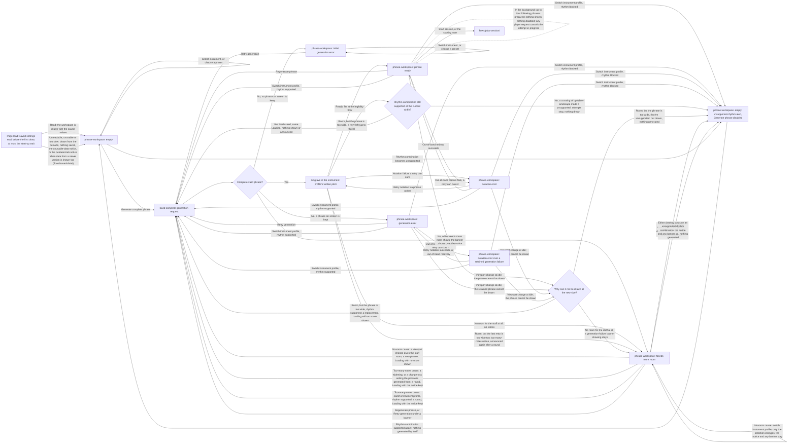

# Generate Phrase Handoff

> **Changes since v2**
>
> - _New:_ the load, which reads the saved settings before the workspace is first drawn; saved
>   settings; my instrument as an instrument-profile switch; phrases prepared in the background
>   at idle, with no interface (the diagram's load and preparation steps, and the items marked
>   below it)
> - _Removed:_ nothing
> - _v3.1 changed:_ the musical profile becomes the preset: choosing one at idle keeps the phrase,
>   and is read-only during Loading (the diagram's edges naming the preset; Choosing a preset, and
>   the items marked below the diagram)
> - _v3.1 changed:_ saved settings gain the figure levels and the preset selection; the selection's
>   return at load (Saved settings)
> - _v3.1 new:_ what presets and figure levels discard among the prepared phrases (Prepared phrases
>   and presets)

- Screen: `screens/phrase-workspace/` for every step.
- The states above are defined in that screen's handoff, under States; the fit rules under Notation Contract, **Room for the staff**. This diagram is the one place the idle transitions are drawn. `flows/play-session/` draws only what concerns starting a session (in **Generation error**, **Notation error** and **Needs more room**, `Start session` is disabled and a note does nothing), and the states a session ended during its count-in returns to; `flows/review-and-export/` draws the Loading a session end starts, which runs out of sight while the Review shows.
- **[v3 new]** **Load.** The saved settings are read before the workspace is first drawn (`flows/saved-data/`), so the theme and every control are drawn with their saved values, and nothing changes after the first draw. The first draw waits for the read at most the start-up wait. The workspace then opens in **Empty**, as before: no phrase is generated by itself at load, and `Generate phrase` builds the first request of the visit from the saved settings. A saved value that is unknown or no longer valid is drawn as its default, with no notice (master spec §4.4). If the read fails, or has not finished when the start-up wait runs out, the workspace is drawn from the defaults, nothing is saved for the rest of the visit, and the unusable-data notice shows in the notice row (copy and actions in `flows/saved-data/`).
- **[v3.1 changed]** **Saved settings.** Every control the phrase is generated from, the seven figure levels, the preset selection (a preset, or Custom with its base or none), the instrument choice, the theme, the audio mix and the "During a session" options are saved when the player changes them, with the value the player chose (`screens/phrase-workspace/handoff.md`, Components and Content, **Saved settings**). A save shows nothing, starts no generation and never changes the phrase.
  - **[v3.1 new]** At load the selection comes back and the values win: saved values that differ from the selected preset's, or a key and mode outside its restriction, show it as Custom based on it, or Custom with no base when it no longer exists. Loading never moves the written key or the collection, and builds no request (`flows/presets/handoff.md`, At load).
- **[v3.1 changed]** Before initial generation, every musical control, every figure level, the instrument profile and the preset are editable on the empty workspace. Those selections update the pending direction only; they do not create a partial result or an implicit request.
- **[v3.1 new]** **Choosing a preset** (`flows/presets/handoff.md`) at idle, in any state where the controls are editable, sets the preset-held settings and may move the written key or collection; it never regenerates the phrase on screen and never builds a request by itself, like any change of settings. During **Loading**, retries and rounds under the too-many-notes notice included, `preset-select` is read-only and a choice is refused. A choice that changes any setting is a change to a setting the phrase is generated from wherever this flow names one: under the too-many-notes notice it starts a round, and landing on a rhythm combination that cannot form a phrase shows the unsupported-rhythm alert (a phrase in **Ready** that still fits staying on screen). A choice that changes nothing starts nothing. Saving, renaming and deleting presets change no setting and start nothing here.
- Generation request uses the current control values, selected instrument profile policy, and a fresh seed on the explicit `Generate phrase`, `Regenerate phrase`, or `Retry generation` action. An instrument-profile switch made while a phrase is shown builds the same kind of fresh request automatically, keeping the written key and collection; it never validates the old phrase against the new profile's range and never retains or transposes it.
- The app also builds that kind of fresh request by itself, at idle only: a retry for a phrase too wide for the room, up to three inside the same **Loading**; a replacement for a phrase that a viewport change leaves too wide; the new phrase when the no-room notice clears; the next phrase generated when a session ends and opens the Review (`flows/review-and-export/`); and a round of attempts under the too-many-notes notice, started by a widening, a change to a setting the phrase is generated from (tempo, the audio mix, the theme and the "During a session" options are not), or `Regenerate phrase`. A widening during a round starts nothing, and narrowing never starts one. Each attempt takes the note density the viewport gives when it is generated. A session's own look-ahead is in `flows/play-session/`.
- **Attempt budget.** Every idle fit run is the first attempt plus up to three fresh-seed retries, so at most four attempts, all inside one **Loading**, whatever starts it: `Generate phrase`, `Regenerate phrase`, `Retry generation`, a profile-switch regeneration, the new phrase when the no-room notice clears, the replacement when a viewport change leaves the phrase on screen too wide, the next phrase at a session end that opens the Review, and a round under the too-many-notes notice. Every trigger goes through "Build complete generation request" in the diagram, and "a retry left (up to three)" counts from there; each round under the notice starts a new count.
- The result must contain four complete common-time measures before engraving starts.
- It is **Ready** only if it also engraves at the legibility floor in the staff layout for the current breakpoint. No room for that layout at all, whatever the phrase: **Needs more room** with its no-room sentence, and no retries. Room, but this phrase too wide: fresh-seed retries, with nothing shown or announced beyond the Loading's own; if a crossing of `bp-tablet-landscape` makes the rhythm combination unsupported meanwhile, they stop and the workspace shows **Empty** with the unsupported-rhythm alert; if every attempt is too wide, **Needs more room** with its too-many-notes sentence. An attempt that finds no phrase at all ends the run with the generation-failure banner: over the notice while **Needs more room** shows, otherwise as any failed request below.
- Theme selection changes presentation only. It neither routes to generation nor engraving, and it does not change the phrase, controls, request, seed, profile policy, or result.
- Instrument-profile selection: with a phrase shown — whether the workspace is currently on a ready phrase, a generation error over a retained phrase, a notation error, or a notation error over a retained generation failure — it always regenerates a complete replacement with a fresh seed and the retained written key, collection, and every other control, except when the current rhythm combination (note density, syncopation, silence density) is already unsupported, in which case the switch still applies but clears the phrase to Empty instead of requesting one. With no phrase shown (Empty or an initial generation error, which has no phrase to retain), the switch only changes the selection; nothing generates.
- **[v3 new]** **My instrument** is a fourth instrument choice once it exists (`flows/my-instrument/`). Every rule of an instrument-profile switch here applies, unchanged, when the player selects it, and also when it is selected for them: on saving a new instrument, on saving a change to it while it is selected, on deleting it while it is selected (its template is selected), and on the connection sheet's "Use this for my instrument" (`flows/controller-connection/`). A change saved to it while another profile is selected changes nothing here.
- Instrument-profile selection while **Needs more room** shows, which has no phrase on screen: with the too-many-notes cause, the switch starts a round like any other change to a setting the phrase is generated from, in **Loading** with the notice kept, dimmed; if the rhythm combination is unsupported, the notice and any generation-failure banner go and the workspace shows **Empty** with the unsupported-rhythm alert, as for any round trigger. With the no-room cause, the switch only changes the selection, and the notice and any banner stay: no phrase can be shown in a window with no room.
- Header actions: `Generate phrase` is primary in **Empty**, with `Start session` secondary and disabled. Once a phrase is shown, in **Ready**, `Regenerate phrase` is secondary and `Start session` primary. The phrase action takes the primary emphasis back in the generation-error states (`Retry generation`, **Needs more room** under a banner included) and the notation-error states (`Retry notation`). In **Needs more room** without a banner, `Regenerate phrase` stays enabled and secondary, and `Start session` keeps its primary emphasis, disabled. The full table is in `screens/phrase-workspace/handoff.md`, Components and Content.
- **Loading:** `Start session` is disabled for the whole Loading, retries included, and the starting note does nothing. The phrase on screen stays visible through it when there is one to keep. A Loading that replaces a phrase a viewport change left too wide, that follows the no-room notice clearing, or that follows a session end that opened the Review, shows no score until the new phrase lands; a round under the too-many-notes notice keeps the notice, dimmed, as `staff-frame staff-no-room staff-loading`.
- **Empty** with the unsupported-rhythm alert, wherever the diagram leads to it: whatever was on screen goes, a notice and a generation-failure banner included, and nothing is generated by itself afterwards. `Generate phrase` stays disabled until the rhythm combination changes; the player then generates by hand, as from **Empty**. A phrase in **Ready** that still fits stays on screen when the combination becomes unsupported, with both header actions disabled.
- A session starts only from **Ready**, by `Start session` or the starting note (`flows/play-session/`).
- Successful initial generation enters the phrase with the `staff-content` fade, on each of its units: one in the one-system layout, two in the split layout, entering together. Successful regeneration applies `staff-content is-fading-out` to each unit of the old score, then inserts the ready replacement with the `staff-content` fade. A Loading that showed no score has nothing to fade out.
- A failed request retains the last valid score; initial failure (no prior phrase) shows the empty-state error variant. A generation failure with a phrase already retained keeps that phrase visible behind its retryable error banner.
- A failed request whose Loading showed no score has no phrase to keep, so it also shows the empty-state error variant.
- A notation failure a retry can cure preserves valid phrase data but replaces the score region with its retryable error panel; if that notation failure occurs from an out-of-band redraw while a generation error banner is already active over the retained phrase, the workspace shows both together (notation error over a retained generation failure) rather than one silently overwriting the other. A lack of room for the staff, or a phrase too wide for it, never takes the notation error.
- **[v3 new]** **Pre-generation** (master spec §8). At idle in **Ready**, once the phrase on screen is one a session could start from, the app prepares, in the background on the generation worker, after the engraver's warm-up, up to four phrases that would follow phrase 1 in a session, one after another, each the exact phrase the session would generate there. It has no interface: phrase 1, `start-note-line`, `start-note-marker`, the phrase action and the session action (their labels, emphasis and availability), `generation-status` and `notation-status` never change because of it, and `Start session` never waits for it, since it does not count as a phrase being generated. It does not run while the review shows, or in any idle state other than **Ready**. Any request the player makes at idle (`Generate phrase`, `Regenerate phrase`, `Retry generation`, `Retry notation`, a profile switch, a change to a setting phrases are generated from) cancels the background attempt in progress at once and silently, so the player's request never waits behind it. Anything that replaces phrase 1 or changes a setting phrases are generated from discards every prepared phrase, and preparation starts again after the new phrase 1 is shown; a viewport change that changes the effective note density or the staff layout a session would hold re-checks the prepared phrases, discarding the first one that no longer fits and every one after it. Turning `Tension across phrases` or `Vary settings` on or off discards them too, since both change what follows phrase 1 (though neither regenerates phrase 1); tempo, `Rising tempo`, the audio mix and the theme change nothing here. A session takes whatever is prepared (`flows/play-session/`). Prepared phrases are never saved. While the phrase on screen is out of date (made under settings that differ from the current ones, master spec §16), preparation runs all the same, building the phrases `Start with this phrase` would play, phrase 2 joined to phrase 1 as after a setting changed during a session; nothing about it shows, and the out-of-date phrase prompt never waits for it (`flows/play-session/handoff.md`, A phrase made before the settings changed).
- **[v3.1 new]** **Prepared phrases and presets** (master spec B8.3). Among the changes that discard every prepared phrase: choosing a preset whose values differ from the current ones, or that moves the written key or the collection; any change of a figure level; and any change of the restriction in force (a key or mode chosen outside it or back inside it, or a save or deletion that changes it), whether `Vary settings` is on or not, since it bounds the key and mode moves a session draws. Saving, renaming or deleting a preset that changes neither a setting nor the restriction in force, and choosing a preset identical in values and restriction, discard nothing. As for every discard, nothing shows.
