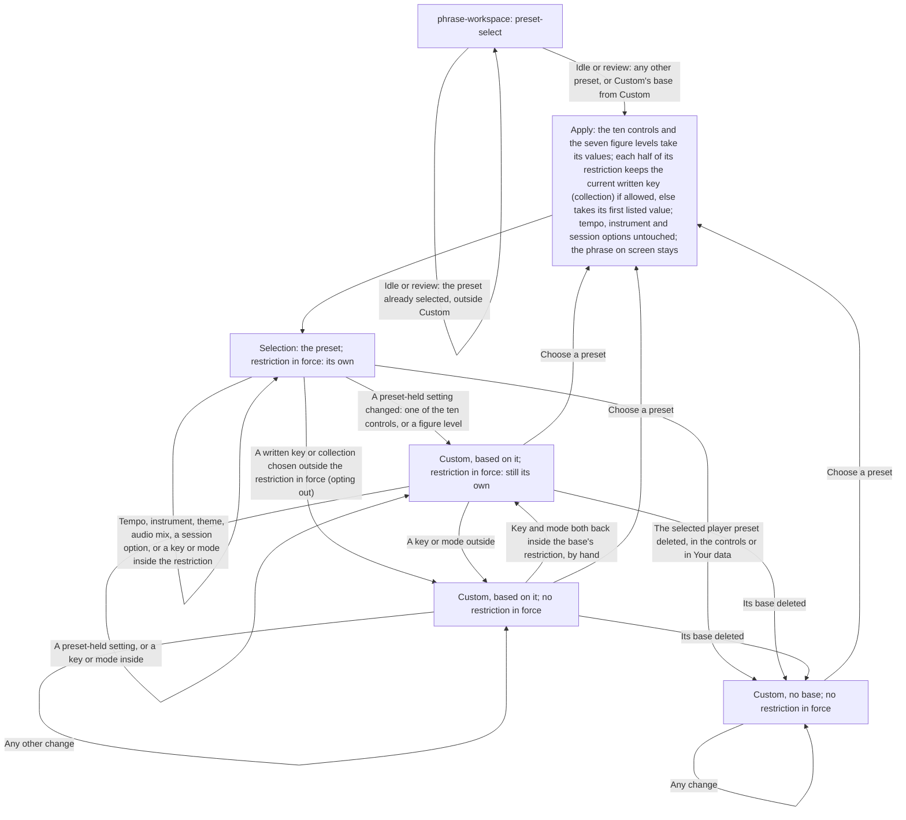
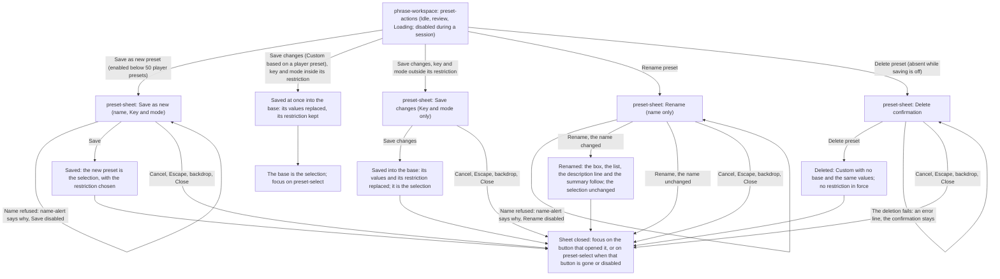
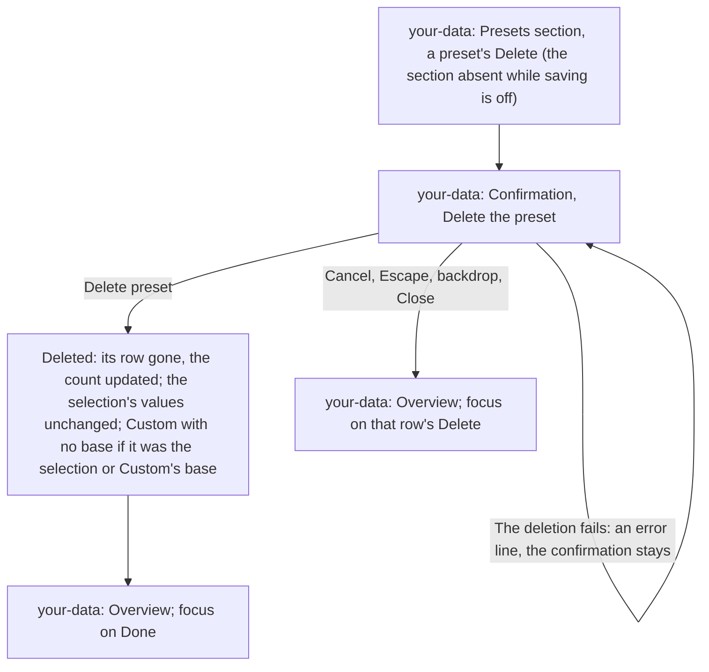

# Presets Handoff

> **New in v3.1.**

Screens: `screens/phrase-workspace/` for the preset bar (`preset-bar`: the `preset-select` box, its
description `field-note` and `preset-actions`), the key and mode marks and the Embellishments
group; `screens/preset-sheet/` for the sheet in which a preset is saved as new, saved with a new
restriction or renamed, and for the confirmation in which one is deleted; `screens/your-data/` for
the list of player presets, each with its own `Delete`, in the Presets section of Your data. The
reasoning is in [`intent.md`](intent.md).

## Choosing, Custom and the Restriction

## Saving, Renaming and Deleting

## Routing Rules

- **When.** A preset is chosen at Idle and while the review mode shows (the phrase concerned is
  then the one under the review), never during **Loading** or a session: `preset-select` is
  read-only then, like every control, and a change is refused. `preset-actions` is enabled at
  Idle, in the review mode and during **Loading**, since saving, renaming and deleting change no
  setting; it is disabled for the whole of a session, count-in included. No preset sheet opens
  during a session, and while one is open no MIDI note starts a session, the starting note
  included.
- **The list.** `preset-select` lists the built-in presets in two groups, **Practice** (Neutral,
  Gentle, Speed drill) and **Styles** (Jazz, Bebop, Pop song, Reel, Modal (Dorian)), then
  **Your presets**: the player's own, in alphabetical order ignoring case, duplicate names listed
  as they are, the group absent while there are none. The list follows every save, rename and
  deletion at once. Layout and copy: `screens/phrase-workspace/handoff.md`, Components and
  Content, **The preset bar**.
- **Choosing a preset**, from any selection:
  1. the ten preset-held controls (Harmonic motion, Tension, Note density, Rhythmic variety,
     Syncopation, Silence density, Contour, Register, Leapiness, Arpeggio chaos) and the seven
     figure levels take the preset's values, replacing any unsaved Custom changes without asking;
  2. each half of its restriction, separately: the current written key (collection) is kept if
     the half allows it, otherwise the half's first listed value is set;
  3. the tempo, the instrument and the "During a session" options never change.

  The selection is then that preset and the restriction in force is its own. Each built-in
  preset's values are in master spec B6.5; examples of the key and mode moves are in
  [`intent.md`](intent.md#choosing-a-preset). Choosing the preset already selected, outside
  Custom, changes nothing. From Custom, choosing its base applies it like any other preset.

- **The phrase stays.** Choosing a preset never regenerates the phrase on screen; the player
  regenerates when they want to hear the new settings. A choice that changes any setting, the
  written key or the collection included, counts everywhere in `flows/generate-phrase/` as a
  change to a setting the phrase is generated from (under the too-many-notes notice it starts a
  round); one that changes nothing counts as nothing. A player preset may hold a rhythm
  combination that cannot form a phrase: choosing it shows the unsupported-rhythm alert, as any
  such change does.
- **Custom begins** when, with a preset selected, the player changes a preset-held setting (a
  control of the ten, or a figure level), or chooses a written key or collection outside the
  restriction in force. The box then shows "Custom, based on {name}". Changing the tempo, the
  instrument, the theme, the audio mix or a "During a session" option never makes Custom, nor does
  choosing a key or mode inside the restriction in force. Values are never compared with the
  preset's: a setting changed back by hand stays Custom. **Only choosing a preset leaves Custom.**
- **The restriction in force** is the selected preset's restriction, or in Custom its base's,
  while the current written key and collection are both inside it; otherwise there is none (and
  Custom with no base has none). It is worked out from the selection and the two controls, never
  stored.
- **The highlight.** While a restriction is in force, each half that is a list marks its allowed
  values: the keys half on Written key, the modes half on Collection, each allowed `segment`
  taking `is-marked`, and that control gaining its restriction `field-note`
  (`screens/phrase-workspace/handoff.md`, Components and Content, **The key and mode marks**). A
  half that is "any", or no restriction in force, marks nothing and has no note. No segment is
  ever disabled for a restriction.
- **Opting out.** Choosing a written key or collection outside the restriction in force turns a
  selected preset into Custom based on it (Custom stays Custom, with the same base); the
  restriction is no longer in force, so the marks and the notes go; no other setting changes.
  Choosing a key and mode back inside the base's restriction by hand brings the marks back, and
  the selection stays Custom. Editing a preset-held setting keeps the restriction in force.
  Switching instrument keeps the written key, so it never leaves a restriction.
- **The actions row.** Its buttons, by selection (a button marked "no" is not rendered):

  | Selection                          | Save as new preset | Save changes | Rename preset | Delete preset             |
  | ---------------------------------- | ------------------ | ------------ | ------------- | ------------------------- |
  | A built-in preset                  | yes                | no           | no            | no                        |
  | A player preset                    | yes                | no           | yes           | yes, unless saving is off |
  | Custom, based on a built-in preset | yes                | no           | no            | no                        |
  | Custom, based on a player preset   | yes                | yes          | yes           | yes, unless saving is off |
  | Custom, no base                    | yes                | no           | no            | no                        |

  `Rename preset` and `Delete preset` act on the selected player preset or on Custom's base.
  While there are 50 or more player presets, `Save as new preset` is disabled, with its
  `field-note`, "You have 50 presets of your own, the most the app keeps. Delete one, here or in
  Your data, to save a new one." During a session the row keeps exactly the buttons it held at the start, all disabled,
  whatever Vary settings does to the selection.

- **Save as new** opens the sheet with a name (prefilled "My preset", or "My preset 2", "My
  preset 3" and so on, the first not taken) and the **Key and mode** choice: "As now: {the
  restriction in force, in words}" (the default), "Only {written key} {collection}" and "Any key
  and mode". Choices that would mean the same restriction are one option, keeping the default:
  with no restriction in force, or one that is "any", "As now" is "Any key and mode"; with a
  restriction in force that is exactly the current written key and collection, "As now" is "Only
  {written key} {collection}". `Save` saves the current preset-held settings under the name, with
  the restriction chosen, and makes the new preset the selection. The current key and mode are
  inside every choice, so the new preset is never selected as Custom.
- **Save changes** replaces the base's values with the current preset-held settings and makes it
  the selection. With the written key and collection inside the base's restriction, it is one
  click, with no sheet and no confirmation, and the restriction is kept. With them outside it, it
  opens the sheet without the name field, asking the restriction: "Any key and mode" (the default,
  which is "as now", since no restriction is then in force) or "Only {written key} {collection}";
  `Save changes` there replaces the restriction with the answer.
- **Rename** opens the sheet with the name only, prefilled with the current name. The preset keeps
  its place as the selection or as Custom's base: the box, the list, the description line and
  `control-summary` take the new name. `Rename` with the name unchanged only closes the sheet. A
  change of letter case alone is a rename.
- **Delete** opens the shared confirmation pattern (`flows/kept-sessions/handoff.md`, The
  Confirmation Pattern; copy in `screens/preset-sheet/handoff.md`). It deletes the selected player
  preset, or Custom's base, and leaves the selection Custom with no base and the same values:
  nothing is regenerated, and no restriction is in force any more. A deletion that fails leaves
  the confirmation open with its error line and changes nothing.
- **Deleting from Your data.** The Presets section of Your data (`screens/your-data/handoff.md`)
  lists every player preset by name, in the box's **Your presets** order, more than 50 included,
  each with its own `Delete`, absent with the section while saving is off. `Delete` opens Your
  data's confirmation, in the preset sheet's words and with its failure line; the deletion is the
  one above, the preset chosen or not. It never changes the selection's values, the written key or
  the collection: deleting another preset leaves the selection as it is; deleting the selected
  preset, or Custom's base, leaves the selection Custom with no base and the same values, with no
  restriction in force, which the box shows once the sheet closes. It is how a player at the limit
  frees a slot while keeping unsaved Custom settings, which choosing a preset to delete it would
  replace. Your data opens only between sessions, so no deletion lands during one.
- **Names** are plain text, trimmed of spaces at both ends on save, 1 to 40 characters, unique
  among all presets ignoring case, built-in names included (the preset being renamed excepted),
  and never "Custom" in any case. A refused name is said as it is typed, under the field, and the
  sheet's main action waits: "Give it a name.", "There's already a preset called “{name}”.", or
  "“Custom” is used by the app. Choose another name.". Uniqueness is checked only when saving or
  renaming: presets from another tab, or a later version's new built-in name, are listed as they
  are, duplicates included, and can be renamed.
- **The limit** is 50 player presets. More than 50 loaded (written from two tabs) are all listed,
  in the box and in Your data, and `Save as new preset` stays disabled while there are 50 or more;
  its note names both places to delete one.
- **A refused save.** A save, rename or `Save changes` the browser refuses keeps the result for the
  visit, so the preset can still be chosen and used, and raises the save-problem notice at once,
  in its preset wording, "Your preset “{name}” couldn't be saved on this device. You can use it
  until this page closes.", or in its storage-full wording when storage is full; presets are
  managed outside a session, so it never waits. The notice's mechanics (its wordings, its
  dismissal and its lifetime) are in `flows/saved-data/handoff.md`, Notices. The notice row sits
  at the top of the workspace; no focus moves to it.
- **Saving off** (an outdated tab, or a visit started from the defaults because the saved data
  couldn't be read; `flows/saved-data/handoff.md`): presets made, changed or renamed there last
  for the page, under the visit's existing notice, with no wording of their own; `Delete preset`
  is not rendered, and Your data has no Presets section. A visit started from the defaults lists
  the built-in presets only, until the player makes one; an outdated tab lists the player presets
  it read.
- **At load**, with the saved settings and before the first draw, the saved selection comes back,
  and the values win: if the saved values differ from the selected preset's, or the saved key and
  mode are outside its restriction, the selection shows as Custom based on it; if that preset no
  longer exists, Custom with no base. Loading never moves the written key or the collection. A
  record that cannot be read is left in place and not listed, with no notice. Settings saved by
  v3.0 come back as the built-in preset they named (Neutral or Jazz) or Custom based on it, by the
  same rule; nothing else shows the migration.
- **During a session.** `preset-select` is read-only and `preset-actions` disabled (above). A Vary
  settings move of a preset-held setting (a control, or a figure level by the figure step) turns
  the box to "Custom, based on {name}", or keeps it Custom, at the instant the first phrase built
  with it starts sounding, and `control-summary` with it; the description line, the key and mode
  marks and their notes keep what they showed at the start. Key and mode moves stay inside the
  restriction in force at the session's start and never make Custom; Tension across phrases never
  makes Custom. At the session's end the selection returns, with the settings, to what it was at
  the start. Details: `flows/play-session/handoff.md`, Vary settings and presets.
- **Prepared phrases** (`flows/generate-phrase/handoff.md`, Pre-generation) are discarded by:
  choosing a preset whose values differ from the current ones, or that moves the written key or
  the collection; any change of a figure level; and any change of the restriction in force
  (opting out, coming back inside, or a save or deletion that changes it), whether Vary settings
  is on or not. Saving, renaming or deleting a preset that changes neither a setting nor the
  restriction in force, and choosing a preset identical in values and restriction, discard
  nothing. None of it shows.

- **Persistent storage.** Saving a player preset, as new or by `Save changes`, also asks the
  browser to protect the kept data, once per visit unless already granted; nothing shows the
  request (`flows/saved-data/`).
- **Two tabs.** Each save writes the whole preset and the last write wins; another tab sees the
  change after a reload. Nothing is shown.
- **Focus.** Choosing from `preset-select` leaves focus on it. When a preset sheet closes, by its
  main action or the way back, focus returns to the button that opened it if it is still shown and
  enabled, else to `preset-select`: after `Save as new preset` it is the opener (unless that save
  reached the limit), after a `Save changes` or a deletion `preset-select` (the opener is gone),
  after `Rename preset` the opener. A one-click `Save changes` moves focus to `preset-select` for
  the same reason. A deletion from Your data follows that sheet's rules: `Done` after it, the
  row's `Delete` after its way back.
- **Nothing is announced.** Choosing a preset, the change to Custom, a save, a rename and a
  deletion announce nothing: the box itself carries the selection's name to assistive technology,
  and a save is silent, as every save is. The one live region is the refused name's reason, inside
  the sheet.
